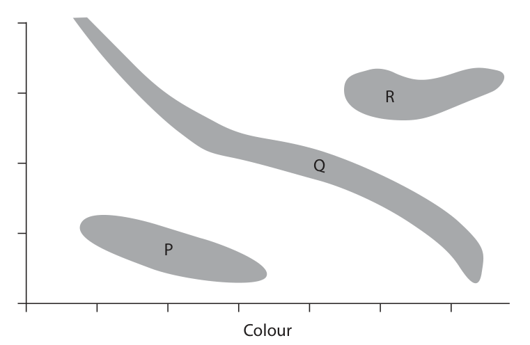
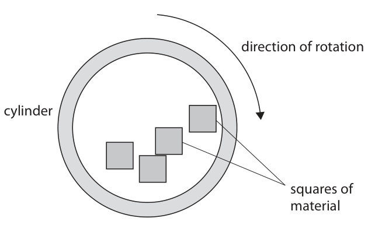
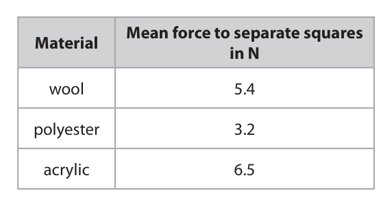
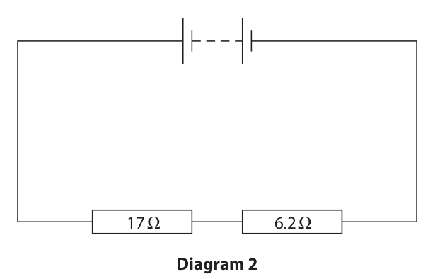
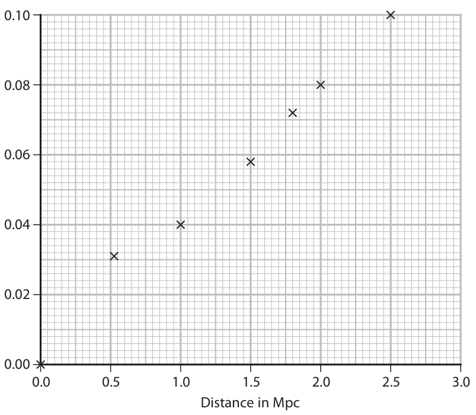

# 4PH1/2PR — 2023-01 (official extraction)

> schema `syllabai.official-paper-questions/0.2` · paper_id `pearson-edexcel:international-gcse:physics:4ph1:2023-01:4PH1/2PR` · qp sha256 `a0480a8a2b6771b6…` · extraction is the disclosed baseline (ADR-039)

## Question 1 (6 marks)

The diagram is an incomplete Hertzsprung‑Russell diagram which astronomers use to compare stars. R Q P Colour

### 1(a) [1]

The y‑axis label is missing. Which of these is the correct label for the y‑axis?

- **(A)** absolute magnitude  ✔
- **(B)** apparent magnitude
- **(C)** scalar magnitude
- **(D)** vector magnitude

**Mark scheme answer**

> A (absolute magnitude);
> B is incorrect because apparent magnitude is how bright the star appears on
> Earth, regardless of distance
> C is incorrect because the H-R diagram requires a specific scalar magnitude
> D is incorrect because the H-R diagram requires a specific magnitude

- **(1)** Answer A: absolute magnitude

### 1(b) [3]

The box contains words to identify the shaded areas P, Q and R on the Hertzsprung‑Russell diagram. white dwarfs main sequence red giants black holes supernovae dwarf planets Use words from the box to identify P, Q and R. P Q R

**Mark scheme answer**

> P: white dwarfs; reject if more than one
> given
> Q: main sequence; reject if more than one
> given
> R: red giants; reject if more than one
> given

- **(3)** P: white dwarfs; reject if more than one

### 1(c) [2]

Explain which side of the diagram contains stars with the highest surface temperature.

**Mark scheme answer**

> idea of the left-hand side; allow ‘blue’
> allow use of letter P to
> indicate left side
> ignore ‘white’
> idea that blue/white stars are hottest / hotter allow white dwarfs are
> than red/orange stars; hottest
> Answer Notes Marks

- **(2)** idea of the left-hand side; allow ‘blue’

## Question 2 (6 marks)

This is a question about electromagnetic waves.

### 2(a) [1]

State which colour in the visible spectrum has the shortest wavelength.

**Mark scheme answer**

> violet; reject purple, ultraviolet, UV

- **(1)** violet; reject purple, ultraviolet, UV

### 2(b) [2]

Explain a hazard of ultraviolet radiation to the human body.

**Mark scheme answer**

> idea that UV causes mutations/damage (in allow kills cells/tissue, sunburn,
> cells); burns skin
> (leading to) (skin) cancer/blindness;

- **(2)** idea that UV causes mutations/damage (in allow kills cells/tissue, sunburn,

### 2(c)(i) [1]

State the formula linking speed, wavelength and frequency of a wave.

**Mark scheme answer**

> speed = frequency × wavelength; allow standard symbols and
> rearrangements e.g. f = v/λ
> allow c, v for speed

- **(1)** speed = frequency × wavelength; allow standard symbols and

### 2(c)(ii) [2]

Calculate the frequency of radio waves with a wavelength of 15 m. [speed of light = 300 000 000 m/s] frequency = Hz

**Mark scheme answer**

> substitution OR rearrangement;
> evaluation; -1 for POT error
> e.g.
> 300 000 000 = f × 15 OR f = v/λ
> (f =) 20 000 000 (Hz) accept 20 MHz, 20 million (Hz),
> 20 × 106 (Hz), 2(.0) × 107 (Hz)
> Answer Notes Marks

- **(2)** substitution OR rearrangement;

## Question 3 (12 marks)

A tumble dryer is a household device that dries clothes. The clothes rotate in a heated cylinder. Clothes often stick together when they are dry because they become electrostatically charged. A student investigates how different materials charge electrostatically in a model tumble dryer. The diagram shows the model tumble dryer. direction of rotation cylinder squares of material This is the student’s method. • put four dry squares of the same material into the cylinder • rotate the cylinder at constant speed for three minutes • remove any squares that are stuck together • measure the force needed to pull the squares apart • repeat this for squares of different material

### 3(a)(i) [1]

Name a device the student could use to measure a force.

**Mark scheme answer**

> newtonmeter; allow spring balance,
> spring scale,
> dynamometer
> ignore forcemeter

- **(1)** newtonmeter; allow spring balance,

### 3(a)(ii) [2]

State the independent and dependent variables in this investigation. independent dependent

**Mark scheme answer**

> independent: material (of the squares); allow cloth
> ignore ‘squares’ on its
> own
> dependent: force;

- **(2)** independent: material (of the squares); allow cloth

### 3(a)(iii) [1]

State a control variable in this investigation.

**Mark scheme answer**

> any one from:
> • speed (of rotation);
> • direction of rotation;
> • temperature (of tumble dryer);
> • number of squares;
> • size / thickness / shape of square;
> • time (of rotation);

- **(1)** any one from:

### 3(b) [3]

Explain how the squares of material stick together. Use ideas about electrostatic charge in your answer.

**Mark scheme answer**

> any three from:
> MP1. idea of friction (between pieces of allow rubbing for friction
> material);
> MP2. electrons/charge transferred between ignore references to
> squares/material; protons
> MP3. squares become oppositely charged; allow negative and
> positive squares/eq
> MP4. square is negative if electrons gained; allow RA
> MP5. idea that opposite charges attract;

- **(3)** any three from:

### 3(c) [2]

The table shows some of the student’s results. Mean force to separate squares Material in N wool 5.4 polyester 3.2 acrylic 6.5 Explain which type of graph is the most appropriate to present the results from this investigation.

**Mark scheme answer**

> bar chart; allow bar graph
> ignore histogram
> idea that material/data is categoric; allow discrete, not
> continuous, discontinuous

- **(2)** bar chart; allow bar graph

### 3(d)(i) [1]

State the formula linking charge, current and time.

**Mark scheme answer**

> charge = current × time (taken); allow standard symbols
> and rearrangements e.g.
> Q=I×t
> ignore c, C for charge and
> current

- **(1)** charge = current × time (taken); allow standard symbols

### 3(d)(ii) [2]

When the squares of material are pulled apart there is a small spark. There is a current of 4.3 × 10–6 A in the air for a time of 2.3 × 10–3 s. Calculate the charge that is transferred. charge = C

**Mark scheme answer**

> substitution;
> evaluation; -1 for POT error
> allow use of prefixes e.g.
> 9.9 nC
> e.g.
> Q = 4.3 × 10−6 × 2.3 × 10−3
> (Q =) 9.9 × 10−9 (C) allow 9.89 × 10−9 (C)
> Answer Notes Marks

- **(2)** substitution;

## Question 4 (10 marks)

Diagram 1 shows a circuit built by a student. 83 mA 17 Ω 6.2 Ω 228 mA Diagram 1

### 4(a)(i) [1]

State the formula linking voltage, current and resistance.

**Mark scheme answer**

> voltage = current × resistance; allow standard symbols and
> rearrangements
> e.g. V = I × R
> ignore c, C for current

- **(1)** voltage = current × resistance; allow standard symbols and

### 4(a)(ii) [3]

Calculate the voltage across the 17 Ω resistor. voltage = V

**Mark scheme answer**

> conversion of mA to A;
> substitution;
> evaluation;
> 1400, 1410, 1411 (V) scores
> 2 marks
> e.g.
> 83 ÷ 1000 = 0.083
> V = 0.083 × 17
> (V =) 1.4 (V) allow 1.41, 1.411 (V)

- **(3)** conversion of mA to A;

### 4(a)(iii) [1]

State the voltage across the 6.2 Ω resistor. voltage = V

**Mark scheme answer**

> 1.4 (V) allow ecf from (ii)
> allow 1.41, 1.414 1.4136 (V)
> do not penalise not
> converting mA to A if
> already penalised in (ii)

- **(1)** 1.4 (V) allow ecf from (ii)

### 4(a)(iv) [2]

Calculate the current in the battery. current = mA

**Mark scheme answer**

> evidence of addition of the two currents;
> 311 mA; accept 0.311 A

- **(2)** evidence of addition of the two currents;

### 4(b) [3]

Diagram 2 shows a second circuit built by the student using the same battery and resistors. 17 Ω 6.2 Ω Diagram 2 Explain how the current in the battery will change now the resistors are connected in series. You do not need to do any calculations in your answer.

**Mark scheme answer**

> any three from:
> MP1. current decreases;
> MP2. (total) resistance increases;
> MP3. idea that total voltage is the same; allow idea that each resistor
> gets a lower voltage (from
> cell)
> MP4. reference to V=IR;
> Answer Notes Marks

- **(3)** any three from:

## Question 5 (9 marks)

A transformer is used to charge a mobile phone. The diagram shows a label on the transformer. input voltage: 230 V input current: 0.067 A output voltage: 5.0 V output current: 3.1 A

### 5(a) [2]

Explain how the information in the label shows that the transformer is a step‑down transformer.

**Mark scheme answer**

> output voltage is less than input voltage; allow voltage decreases
> output current is greater than input current; allow current increases

- **(2)** output voltage is less than input voltage; allow voltage decreases

### 5(b) [3]

Show that the transformer is approximately 100% efficient.

**Mark scheme answer**

> any attempt to calculate a power; allow either product of
> voltage and current
> correct calculation of either input or output
> power;
> indication that the input and output power are allow idea of calculating an
> (approximately) equal; efficiency (percentage) and
> showing it is (approximately)
> 100%
> e.g.
> input power = 230 × 0.067 output power = 5.0 × 3.1
> input power = 15(.41) output power = 15(.5)
> 15(.41) ≈ 15(.5) 15(.5)/15(.41) = 1.0… or
> 100%

- **(3)** any attempt to calculate a power; allow either product of

### 5(c)(i) [1]

State the formula linking input voltage, output voltage and turns ratio for a transformer.

**Mark scheme answer**

> Np/Ns = Vp/Vs; allow any correct
> rearrangement
> allow “i(nput) and o(utput)”
> or “1 and 2” for “p(rimary)
> and s(econdary)”
> allow correct word equation
> ignore ‘P’ for ‘N’
> condone ‘T’, ’t’ or ‘n’ for
> ‘N’
> condone ‘coils’ for ‘turns’

- **(1)** Np/Ns = Vp/Vs; allow any correct

### 5(c)(ii) [3]

The primary coil has 1500 turns. Calculate the number of turns on the secondary coil. turns on secondary coil =

**Mark scheme answer**

> substitution;
> rearrangement;
> evaluation to 2 s.f. or more;
> 32 scores 2 marks only
> e.g.
> 1500/Ns = 230/5.0
> (Ns =) 1500 / (230 / 5.0)
> (Ns =) 33 allow 32.6, 32.608…
> Answer Notes Marks

- **(3)** substitution;

## Question 6 (11 marks)

This question is about the use of water in central heating systems.

**(b)** The diagram shows a simplified central heating system viewed from above. radiator boiler house radiator pipe radiator Pipes transport hot water around a house to radiators and back to the boiler. The boiler heats water from 16 °C to 65 °C.

### 6(a) [5]

A student does an investigation to find the specific heat capacity of water. This is the list of equipment they use. • heater with a power output of 50 W • power supply • beaker • water • thermometer • stopwatch • connecting leads • balance Describe an investigation the student could use to find the specific heat capacity of water. You may draw a diagram to help your answer.

**Mark scheme answer**

> any five from:
> MP1. measure temperature increase; accept measure
> initial and final
> temperature
> MP2. measure time taken; allow a stated
> time period
> MP3. allow temperature to rise to maximum after
> heater switched off;
> MP4. calculate total energy / use of E = P×t;
> MP5. measure mass of water;
> MP6. (by) finding difference between empty beaker and
> ‘beaker + water’
> MP7. use of E = m × c × Δθ;
> MP8. plot a temperature-time graph;
> MP9. use gradient (so c = P/(m × gradient);

- **(5)** any five from:

### 6(b)(i) [3]

Calculate the energy transferred from the boiler to 75 kg of water to raise the temperature of the water from 16 °C to 65 °C. [for water, specific heat capacity = 4200 J/kg °C] energy = J

**Mark scheme answer**

> temperature difference calculated; allow 49, 65-16
> seen
> substitution; allow ecf from
> clear incorrect
> temperature
> difference
> evaluation; allow 15 MJ
> e.g.
> (∆T = 65 – 16 =) 49 (°C)
> ∆Q = 75 × 4200 × 49
> (∆Q =) 15 000 000 (J) allow correct
> answers to other
> significant figure
> values i.e.
> 15 435 000 (J)

- **(3)** temperature difference calculated; allow 49, 65-16

### 6(b)(ii) [3]

The radiators transfer energy from the water to the air in the house. The temperature of the water in the heating system decreases by 4 °C due to heat transferred to the air. This causes the air in the house to increase in temperature by 15 °C. The mass of air in the house and the mass of water in the heating system are approximately the same. Explain why there is a larger temperature change in the air.

**Mark scheme answer**

> any three from:
> MP1. idea that energy/heat lost by water is allow (∆)Q is the
> approximately equal to energy gained by air; same for both
> MP2. (some) thermal energy lost to the surroundings; allow other named
> object e.g.
> radiator, walls etc.
> MP3. air and water have a different specific heat
> capacity;
> MP4. air has a smaller heat capacity than water; also scores MP3
> MP5. valid attempt to show algebraically;
> MP6. correct algebraic attempt;
> Answer Notes Marks

- **(3)** any three from:

## Question 7 (7 marks)

A crumple zone is a safety feature in a car. It is a part of the car that is designed to collapse during a collision. A student investigates the effectiveness of crumple zones. The student rolls two model cars down a ramp. Each car comes to rest when it hits a large metal block. A data logger measures the mean force applied to the car during the collision with the block. The diagram shows the equipment used in the investigation. data logger metal ramp block 0.0 N Car 1 has a paper crumple zone at the front. Car 2 has no paper crumple zone. The table shows the student’s results. Mean force on car from block Velocity just before car hits block Car in N in m/s 1 2.5 3.0 2 4.9 3.0

### 7(a) [3]

The mass of each car is 0.074 kg. Calculate the time taken for the velocity of car 1 to decrease from 3.0 m/s to 0.0 m/s. time taken = s

**Mark scheme answer**

> substitution into F = (mv − mu) / t;
> rearrangement;
> evaluation; 0.08 scores 2 marks if
> supported by valid
> working
> allow alternative
> method using F=ma and
> a=(v-u)/t
> e.g.
> 2.5 = [0.074 × 3.0 (−0.074 × 0.0)] / time
> time = (0.074 × 3.0) / 2.5
> (time =) 0.089 (s) allow 0.09, 0.0888 (s)
> condone 0.088 (s)

- **(3)** substitution into F = (mv − mu) / t;

### 7(b) [2]

State the magnitude and direction of the force on the metal block, when car 2 collides with the block. magnitude = N direction =

**Mark scheme answer**

> magnitude = 4.9 (N);
> direction = right/opposite to car; ignore East

- **(2)** magnitude = 4.9 (N);

### 7(c) [2]

Explain why the mean force from the block on car 1 is smaller than the mean force on car 2.

**Mark scheme answer**

> any two from:
> MP1. (crumple zone) increases the time (taken to
> stop);
> MP2. same momentum change (as car 2); allow same velocity
> change (as car 2)
> MP3. smaller acceleration; allow deceleration
> MP4. reference to formula force = change in
> momentum/time;
> Answer Notes Marks

- **(2)** any two from:

## Question 8 (9 marks)

Between 1929 and 1931, physicists Hubble and Humason investigated the red‑shift of light from galaxies at different distances from the Earth. The distance unit they used is the megaparsec (Mpc).

**(b)** The graph shows some of the results of their investigation. 0.10 0.08 0.06 Change in wavelength in nm 0.04 0.02 0.00 0.0 0.5 1.0 1.5 2.0 2.5 3.0 Distance in Mpc

### 8(a) [2]

Describe what is meant by the term red‑shift.

**Mark scheme answer**

> increase in wavelength (of wave); allow decrease in
> frequency exp
> allow stretching
> wavelength
> due to source/galaxy moving away (from allow observer moving
> observer)/eq; away from
> source/galaxy

- **(2)** increase in wavelength (of wave); allow decrease in

### 8(b)(i) [1]

Draw a circle to show the anomalous data point.

**Mark scheme answer**

> point at (0.5,0.03) identified; reject if more than
> one point circled

- **(1)** point at (0.5,0.03) identified; reject if more than

### 8(b)(ii) [1]

Draw the line of best fit on the graph.

**Mark scheme answer**

> straight line drawn within 1 small square of each data allow ecf from (i)
> point;

- **(1)** straight line drawn within 1 small square of each data allow ecf from (i)

### 8(b)(iii) [3]

The reference wavelength of the light used in this investigation is 660 nm. Use information from the graph to determine the velocity of a galaxy at a distance of 0.75 Mpc. [speed of light = 300 000 km/s] velocity = km/s

**Mark scheme answer**

> change in wavelength = 0.03 (nm); allow ecf from (ii)
> correct within ½ small
> square
> substitution OR rearrangement; allow ecf from
> incorrect reading of
> ∆λ if clear from
> working
> evaluation; -1 for POT error
> e.g.
> change in wavelength = 0.03 (nm) award if seen
> anywhere in working
> 0.03/660 = v/300 000 OR v = ∆λ/λ × c
> (v =) 14 (km/s) allow 13.6… (km/s)

- **(3)** change in wavelength = 0.03 (nm); allow ecf from (ii)

### 8(b)(iv) [2]

Explain why the graph from Hubble’s investigation provides evidence for the expansion of the universe.

**Mark scheme answer**

> any two from:
> MP1. change in wavelength increases with distance allow red-shift for
> (from Earth or Milky Way); change in wavelength
> MP2. idea that (recession) velocity increases with
> distance (from Earth or Milky Way);
> MP3. galaxies are all moving away from each other;
> Pearson Education Limited. Registered company number 872828
> with its registered office at 80 Strand, London, WC2R 0RL, United Kingdom

- **(2)** any two from:

