# 4PH1/1P — 2023-06 (official extraction)

> schema `syllabai.official-paper-questions/0.2` · paper_id `pearson-edexcel:international-gcse:physics:4ph1:2023-06:4PH1/1P` · qp sha256 `8a872d304ddb3eb0…` · extraction is the disclosed baseline (ADR-039)

## Question 1 (8 marks)

This is a question about radioactivity.

**(c)** A teacher demonstrates how the activity of a radioactive sample changes with time.

### 1(a) [1]

Which of these is the unit of activity?

- **(A)** becquerel  ✔
- **(B)** kilogram
- **(C)** newton
- **(D)** pascal

**Mark scheme answer**

> A (becquerel);
> B is incorrect because it is the unit of mass
> C is incorrect because it is the unit of force
> D is incorrect because it is the unit of pressure

- **(1)** Answer A: becquerel

### 1(b) [1]

Which of these is the correct description of the term half-life?

- **(A)** time taken for the activity of a substance to halve  ✔
- **(B)** half of the time taken for the mass of a substance to decay
- **(C)** time taken for the activity to decay completely
- **(D)** time taken for the mass of a substance to decay twice

**Mark scheme answer**

> A (time taken for the activity of a substance to
> halve);
> B is incorrect because the substance will not
> completely decay
> C is incorrect because the substance will not
> completely decay
> D is incorrect because the substance cannot decay
> twice

- **(1)** Answer A: time taken for the activity of a substance to halve

### 1(c)(i) [2]

The box gives the names of different pieces of equipment. ruler stopwatch balance newton meter protractor GM tube voltmeter ammeter Complete the sentences using words from the box. The teacher measures time with a The teacher measures the count rate with a and a counter.

**Mark scheme answer**

> stopwatch;
> GM tube;

- **(2)** stopwatch;

### 1(c)(ii) [1]

The graph shows the teacher’s results. Count rate in counts / s 0 10 20 30 40 50 Time in s Draw a circle around the anomalous result.

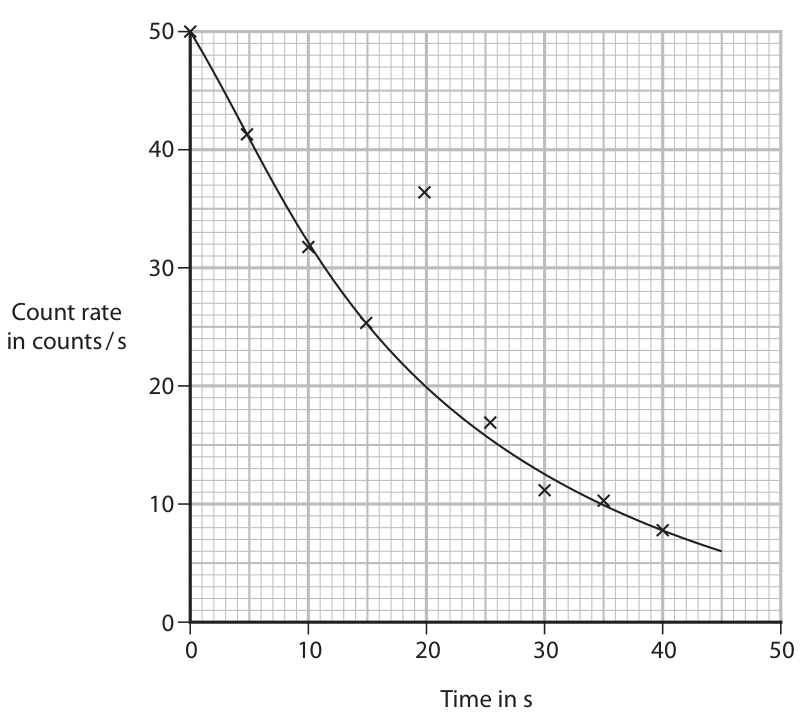

**Mark scheme answer**

> point at t = 20s identified;

- **(1)** point at t = 20s identified;

### 1(c)(iii) [2]

Use the graph to determine the half-life of the radioactive sample. half-life = s

**Mark scheme answer**

> any indication of a halving in activity; e.g. 50→25
> 40→20 etc. seen in
> working
> allow ÷2, ×½ seen in
> working
> half-life = 15 (s); allow full credit in
> range 14−16 (s)

- **(2)** any indication of a halving in activity; e.g. 50→25

### 1(c)(iv) [1]

Give a reason why the teacher should not expect the data points to lie exactly on the curve of best fit.

**Mark scheme answer**

> any indication that decay is random; allow unpredictable
> allow references to
> background
> radiation/count varying
> Answer Notes Marks

- **(1)** any indication that decay is random; allow unpredictable

## Question 2 (10 marks)

A student investigates how the current in a filament lamp changes when the voltage across the lamp is varied.

**(b)** The graph shows the student’s results. 2.5 2.0 1.5 Current in A 1.0 0.5 0.0 0 2 4 6 8 Voltage in V

### 2(a) [4]

Draw a circuit diagram the student could use in their investigation.

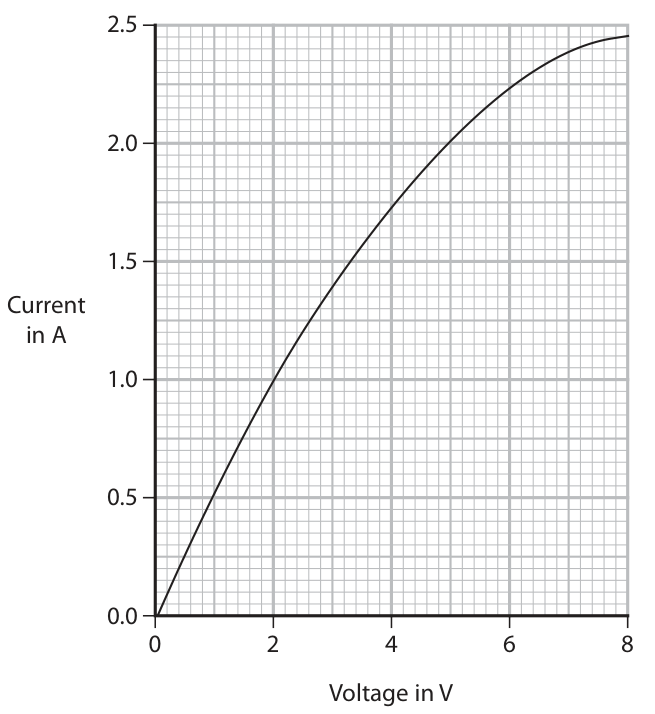

**Mark scheme answer**

> correct circuit symbols for all of; allow cell, battery or
> • suitable power source power supply for power
> • ammeter source
> • voltmeter allow or
> • filament lamp filament lamp symbol
> condone lines drawn
> through ammeter and
> voltmeter symbols
> ammeter drawn in series with lamp;
> voltmeter drawn in parallel with lamp; allow voltmeter drawn in
> parallel with power source
> if no other resistive
> components in circuit
> means of varying current or voltage i.e. variable ignore thermistor or LDR
> resistor/variable power supply;
> allow or
> for variable resistor

- **(4)** correct circuit symbols for all of; allow cell, battery or

### 2(b)(i) [2]

Describe the relationship between current and voltage shown on the graph.

**Mark scheme answer**

> current increases as voltage increases; condone proportional
> relationship for this mark
> only
> idea of non-linear relationship; reject this mark if
> proportional relationship
> described
> allow decreasing gradient,
> current increases at a
> decreasing rate
> condone slowing rate

- **(2)** current increases as voltage increases; condone proportional

### 2(b)(ii) [1]

State the formula linking resistance, voltage and current.

**Mark scheme answer**

> voltage = current × resistance; allow rearrangements
> and standard symbols
> e.g. R = V/I
> ignore ‘c’ or ‘C’ for current
> ignore formulae expressed
> in units e.g. V = A × Ω

- **(1)** voltage = current × resistance; allow rearrangements

### 2(b)(iii) [3]

Use the graph to determine the resistance of the filament lamp when the voltage across the lamp is 7.2 V. resistance = Ω

**Mark scheme answer**

> substitution; allow current = 2.40-2.45
> (A)
> rearrangement; allow R = V/I seen
> anywhere in working
> evaluation;
> e.g.
> $7.2 = 2.40 \times R$
> $R = 7.2/2.40$
> R = 3.0 (Ω) allow 2.9-3.0 (Ω)

- **(3)** substitution; allow current = 2.40-2.45

## Question 3 (8 marks)

A family has a television set.

**(b)** In normal use, the current in the television set is 0.31 A.

### 3(a) [3]

The television set has a low power mode called standby. When on standby, the power rating of the television set is 0.27 W. Calculate the energy transferred to the television set on standby in 12 hours. energy transferred = J

**Mark scheme answer**

> substitution into given formula; ignore units
> rearrangement; allow E = P × t
> correct evaluation; -1 for not converting
> units or converting units
> incorrectly
> if no other mark scored
> then evidence of 43 200
> seen in working scores 1
> mark
> e.g.
> 0.27 = energy / 43 200
> energy = 0.27 × 43 200
> (energy =) 12 000 (J) allow 11 700, 11 660,
> 11 664 (J)
> 3.24 (J), 194.4 (J) or
> answers rounded from
> these values score 2

- **(3)** substitution into given formula; ignore units

### 3(b)(i) [3]

Explain how a fuse works to protect the television set if there is a fault.

**Mark scheme answer**

> idea that current exceeds the fuse rating; allow when current is
> too high, surge of
> current etc.
> ignore current
> increasing
> fuse (wire) melts; allow fuse breaks, fuse
> blows
> ignore fuse burns
> idea that device is isolated; allow idea that circuit is
> broken

- **(3)** idea that current exceeds the fuse rating; allow when current is

### 3(b)(ii) [2]

Explain why a 13 A fuse is not an appropriate choice of fuse to use in the plug of this television set.

**Mark scheme answer**

> any two from:
> MP1. idea that fuse rating is much higher than allow fuse value is too
> normal current; high
> MP2. idea that there is still current (even if there is allow fuse will not
> a fault); melt/break/blow
> MP3. idea that (connecting lead/TV) will allow idea of causing
> overheat/cause a fire; damage to TV / circuit
> Answer Notes Marks

- **(2)** any two from:

## Question 4 (10 marks)

Ground-penetrating radar (GPR) uses radio waves to detect changes in material underground.

### 4(a)(i) [1]

State the formula linking the speed, frequency and wavelength of a wave.

**Mark scheme answer**

> speed = frequency × wavelength; allow rearrangements
> and standard symbols
> e.g. λ = v/f
> allow s for speed

- **(1)** speed = frequency × wavelength; allow rearrangements

### 4(a)(ii) [3]

GPR radio waves have a frequency of 170 MHz. The speed of radio waves is 3.0 × 10⁸ m / s. Calculate the wavelength of the waves. wavelength = m

**Mark scheme answer**

> substitution; ignore units
> rearrangement;
> evaluation; -1 for POT error from
> not converting units or
> an incorrect attempt at
> converting units
> e.g.
> 3.0 × 10⁸ = 170 (× 10⁶) × λ
> λ = v/f OR λ = 3.0 × 10⁸/170 (× 10⁶)
> (wavelength =) 1.8 (m) allow 1.76(4…) (m)

- **(3)** substitution; ignore units

### 4(b)(i) [3]

A radio wave passes through the ground and refracts at the boundary between soil and rock. The diagram shows three wavefronts of the wave before and after refraction. The wave is also reflected at the boundary between the soil and the rock. Complete the diagram to show three wavefronts after the wave has been reflected at the boundary. wavefronts soil rock

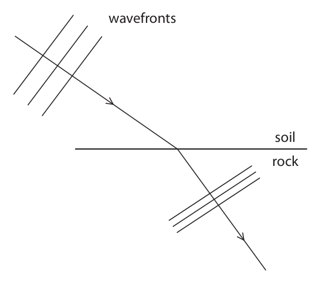

**Mark scheme answer**

> reflected ray/wavefronts drawn to right of ‘normal’ normal does not need
> and above rock; to be drawn
> reflection angle does
> not need to be correct
> ignore if wavefronts
> extended in to the rock
> wavefronts perpendicular to reflected ray; can only be scored if
> first mark awarded
> judge by eye
> wavefronts parallel to each other and spacing can only be scored if
> consistent with incident wavefronts; first mark awarded
> judge by eye
> e.g.

- **(3)** reflected ray/wavefronts drawn to right of ‘normal’ normal does not need

### 4(b)(ii) [3]

Explain why the radio waves passing through the rock have a smaller wavelength than the radio waves passing through the soil.

**Mark scheme answer**

> any three from:
> MP1. wavefronts closer together; ignore wavelength is
> smaller
> MP2. idea that rock is (optically) denser than soil; allow wave refracts
> towards normal
> allow idea that rock has
> a larger refractive index
> MP3. idea of reduction in speed;
> MP4. idea of constant frequency;
> MP5. correct reference to wave speed equation / can only be scored if
> speed = frequency × wavelength; MP3 or MP4 awarded
> Answer Notes Marks

- **(3)** any three from:

## Question 5 (7 marks)

The drawing shows a camel and a person in a desert. (Source: © Hennadii H/Shutterstock)

### 5(a) [4]

Describe a method you could use to find the pressure a person exerts on the ground when standing on two feet.

**Mark scheme answer**

> any four from:
> MP1. measurement of area of foot/feet;
> MP2. idea of drawing round foot/feet on
> squared/grid/graph paper (to measure
> area);
> MP3. measurement of weight / use of W = mg; allow if weight referred
> to in a calculation
> MP4. use of a balance / scale(s) (to measure allow newtonmeter
> weight/mass);
> MP5. use of p = F ÷ A; expressed in words or
> symbols

- **(4)** any four from:

### 5(b) [3]

The total area of contact of the camel’s feet with the ground is 1300 cm². The mass of the camel is 660 kg. Calculate the pressure this camel exerts on the ground. pressure = N / cm²

**Mark scheme answer**

> weight = 6600 (N); allow use of g = 9.8, 9.81
> (N/kg) to get
> weight = 6468, 6474.6 (N)
> substitution into p = F / A;
> correct evaluation; -1 for POT error
> allow 5 (N/cm²) if
> supported by working
> using mass instead of
> weight to get 0.51
> (N/cm²) scores 2 marks
> max.
> e.g.
> weight = 660 × 10 = 6600 (N)
> pressure = 6600 / 1300
> (pressure =) 5.1 (N/cm²) allow 5.076… (N/cm²)
> condone 5.0 (N/cm²)
> allow 4.975…, 4.980…
> (N/cm²) from use of
> different values of g

- **(3)** weight = 6600 (N); allow use of g = 9.8, 9.81

## Question 6 (13 marks)

The photograph shows an x-ray image of a person’s knee. The person has had part of their knee replaced. (Source: © edwardolive/Shutterstock)

**(a)** X-rays are part of the electromagnetic spectrum. All electromagnetic waves are transverse waves and transfer energy.

### 6(a)(i) [1]

State another property that all electromagnetic waves have in common.

**Mark scheme answer**

> (travel at) {same speed/speed of light/in allow can be reflected /
> vacuum}; refracted / diffracted
> OR
> idea that waves can travel through space / a allow don’t need a medium to
> vacuum; travel

- **(1)** (travel at) {same speed/speed of light/in allow can be reflected /

### 6(a)(ii) [1]

State a harmful effect of excessive exposure to x-rays.

**Mark scheme answer**

> (excessive exposure may cause) cancer; allow cell mutations, cell
> damage, DNA damage, DNA
> mutations, radiation sickness

- **(1)** (excessive exposure may cause) cancer; allow cell mutations, cell

### 6(a)(iii) [3]

Describe the difference between transverse waves and longitudinal waves. You may draw a diagram to help your answer.

**Mark scheme answer**

> all marks can be awarded from
> clearly labelled diagram
> mention of oscillations/vibrations;
> {oscillation/vibrations/particle movement} are allow along the line of travel
> parallel to {direction of wave (travel) /
> direction of energy transfer} of wave for
> longitudinal;
> {oscillation/vibrations/particle movement} allow right angles, 90° for
> are perpendicular to {direction of wave perpendicular
> (travel) / direction of energy transfer} of wave
> for transverse;

- **(3)** all marks can be awarded from

### 6(b) [4]

The diagram shows a part of the knee called the patella. The patella has been removed from a person’s knee. The patella is a small, irregularly shaped bone that is denser than water. Describe how to find the mass and the volume of the patella bone.

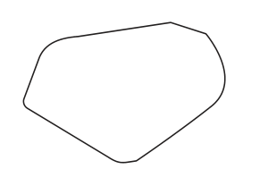

**Mark scheme answer**

> use of relevant pieces of measuring apparatus e.g.
> for mass AND volume; • balance
> • measuring cylinder
> ignore scale(s)
> idea of use of displacement method for e.g.
> volume; • using a eureka can
> • placing in a measuring
> cylinder
> further correct detail of displacement e.g.
> method; • collect displaced water from
> eureka can to measure
> volume
> • measure initial and final
> volumes in measuring
> cylinder to calculate volume
> further experimental accuracy detail; e.g.
> • not splashing
> • totally submerged
> • filling eureka can completely
> to the spout
> • collecting all drips from
> eureka can spout
> • reading measuring cylinder
> at eye level
> • balance on flat surface
> • ensure balance is zeroed
> • measure mass of dry bone

- **(4)** use of relevant pieces of measuring apparatus e.g.

### 6(c) [4]

A scientist finds the volume and mass of a patella. The mass of the patella is 17 g. The volume of the patella is 13 cm³. Calculate the density of the patella. Give your answer to 2 significant figures. density = g / cm³

**Mark scheme answer**

> correct formula selected; seen or implied by working
> substitution;
> evaluation; -1 for POT error
> answer given to 2 sf; mark independently
> e.g.
> density = mass / volume
> density = 17 / 13
> density = 1.3… (g/cm³)
> density = 1.3 (g/cm³)

- **(4)** correct formula selected; seen or implied by working

## Question 7 (9 marks)

The circuit diagram shows a motor, power supply, switch and variable resistor connected in series. + – M

### 7(a) [1]

The switch is open and the motor is not moving. State how much energy is in the kinetic energy store of the motor. kinetic energy = J

**Mark scheme answer**

> 0 / none / zero (J);

- **(1)** 0 / none / zero (J);

### 7(b) [2]

The switch is closed. The motor takes 0.42 seconds to reach its maximum speed of rotation. The mean current in the motor is 3.9 A. The voltage across the motor is 7.1 V. Show that the work done on the motor during the 0.42 seconds is about 12 J. work done = J

**Mark scheme answer**

> substitution into given formula E = V × I × t; allow use of P = E/t and
> P = VI
> correct evaluation to at least 3 s.f.;
> e.g.
> energy = 7.1 × 3.9 × 0.42
> energy = 11.6… (J)

- **(2)** substitution into given formula E = V × I × t; allow use of P = E/t and

### 7(c) [3]

Complete the Sankey diagram for the electric motor during the 0.42 seconds by giving the missing information. energy transferred to motor kinetic energy store of motor from battery J 12 J store of surroundings 2J

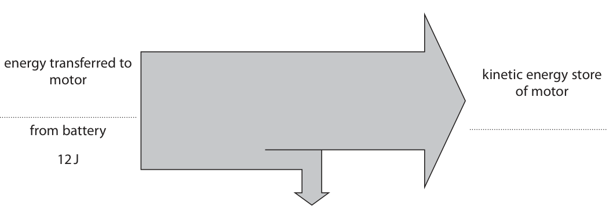

**Mark scheme answer**

> energy transferred to motor electrically from allow electric,
> battery 12 J; electrical
> kinetic energy store of motor 10 J;
> thermal store of the surroundings 2 J; condone heat

- **(3)** energy transferred to motor electrically from allow electric,

### 7(d) [3]

Use the Sankey diagram to calculate the efficiency of the process of bringing the motor to its maximum speed of rotation. efficiency = %

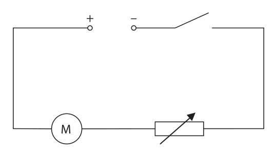

**Mark scheme answer**

> useful and total energies correctly selected; allow ecf from (c)
> substitution into efficiency formula;
> evaluation; allow lack of 100 i.e.
> 0.83 if % sign removed
> from answer line
> e.g.
> 10 (J) and 12 (J) seen in working
> efficiency = 10/12 (×100%)
> efficiency = 83 (%) allow 83.3… (%)
> Answer Notes Marks

- **(3)** useful and total energies correctly selected; allow ecf from (c)

## Question 8 (6 marks)

In some countries, snow can fall and collect on the ground. Diagram 1 shows that after the snow has fallen, the sky can be clear, leaving the snow directly exposed to the Sun. Sun snow ground Diagram 1

### 8(a) [2]

Explain why the white snow will take a long time to melt, even though directly exposed to the Sun.

**Mark scheme answer**

> any reference to absorption or reflection (of infra-
> red/heat);
> idea that snow/white objects are poor also scores first mark
> absorbers/good reflectors (of infra-red/heat);

- **(2)** any reference to absorption or reflection (of infra-

### 8(b) [2]

Diagram 2 shows a different piece of ground that has a metal drain cover. If the snow lands on metal, the snow takes a shorter time to melt. Sun snow metal drain cover ground Diagram 2 Explain why the snow melts in a shorter time on the metal drain cover.

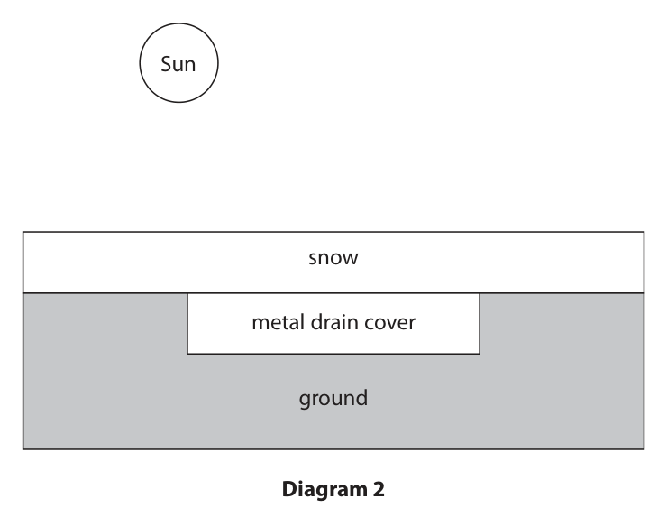

**Mark scheme answer**

> any two from:
> MP1. idea that ground / drain cover is warmer than allow RA
> snow;
> MP2. idea that drain cover / metal is a good
> conductor;
> MP3. energy transfers from drain cover to snow; condone heat for
> energy
> must be correct
> direction of energy
> transfer

- **(2)** any two from:

### 8(c) [2]

Explain how a convection current above the snow increases the time taken for the snow to melt.

**Mark scheme answer**

> any two from:
> MP1. idea that warmer air rises; allow RA
> allow warm particles
> rise
> MP2. idea that colder air is nearest the snow; ignore nearest the
> ground
> MP3. (rate of) energy/heat transfer (from air) to
> snow decreases;
> Answer Notes Marks

- **(2)** any two from:

## Question 9 (11 marks)

A manometer is a device that can be used to measure the pressure difference between gas from a gas tap and the atmosphere. When a gas tap is connected to the manometer, the liquid in the manometer moves due to the additional pressure of the gas. gas from manometer gas tap liquid 0.094 m Before connecting gas tap After connecting gas tap

**(b)** The graph shows how the velocity of the surface of the liquid changes with time from when the gas tap is opened to when the water level stops moving. Velocity in cm / s 0 0.05 0.10 0.15 0.20 0.25 Time in s

### 9(a) [2]

The pressure difference is linked to the difference in height of the two surfaces of the liquid by the formula pressure difference = density × g × height difference The height difference between the two surfaces is 0.094 m. Calculate the pressure difference between the gas from the gas tap and the atmosphere. [for liquid, density = 14 000 kg / m³ ] pressure difference = Pa

**Mark scheme answer**

> substitution into given formula; allow use of g = 9.8,
> 9.81 N/kg
> evaluation; -1 for POT error but
> only if not due to
> omitting g
> allow answers rounding
> to 13 000 (Pa)
> e.g.
> pressure difference = 14 000 × 10 × 0.094
> pressure difference = 13 000 (Pa) allow 13 200, 13 160
> (Pa)

- **(2)** substitution into given formula; allow use of g = 9.8,

### 9(b)(i) [3]

Use the graph to show that the distance travelled by the surface of the liquid is 4.7 cm.

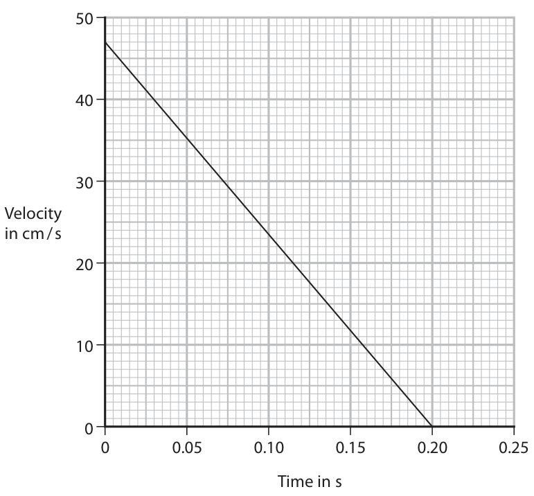

**Mark scheme answer**

> idea that distance is area under graph; expressed explicitly or
> implied from working
> allow alternative
> method that distance =
> average speed × time
> correct values read from graph; expect 47 and 0.20 to
> be seen in working
> working arriving at 4.7 (cm); DOP

- **(3)** idea that distance is area under graph; expressed explicitly or

### 9(b)(ii) [3]

Calculate the acceleration of the surface of the liquid. acceleration = cm / s²

**Mark scheme answer**

> any viable attempt at a gradient; allow use of v²=u² + 2as
> correct use of 47 and 0.20 in gradient calculation; allow other suitable
> values for gradient e.g.
> 35 (cm/s) in 0.15 (s)
> acceleration in range (−)230 to (−)240 (cm/s²);

- **(3)** any viable attempt at a gradient; allow use of v²=u² + 2as

### 9(c) [3]

Explain how the gas pressure changes if the temperature of the gas increases. You should use ideas about particles in your answer.

**Mark scheme answer**

> idea of (gas) particles speeding up; allow KE of particles
> increases
> idea of more frequent collisions between particles
> and liquid/walls/container;
> idea of harder collisions between particles and allow force (on
> liquid/walls/container; container) increases
> Answer Notes Marks

- **(3)** idea of (gas) particles speeding up; allow KE of particles

## Question 10 (10 marks)

A student investigates how the time taken for a ball to roll down a slope changes with the distance from the bottom of the slope. This is the student’s method. • place a ball on the slope 10 cm from the bottom of the slope • release the ball and start a stopwatch • stop the stopwatch when the ball arrives at the bottom of the slope • record the time taken for the ball to roll down the slope • repeat for different distances from the bottom of the slope

**(b)** The table shows the student’s results. Distance travelled in cm Time taken in s 10 0.41 20 0.58 30 0.71 40 0.82 50 0.91

### 10(a) [4]

Complete the table by placing a tick (ü) to show which variables are the independent, dependent and control variables in this investigation. Independent Dependent Control Surface of slope Angle of slope Distance travelled Time taken

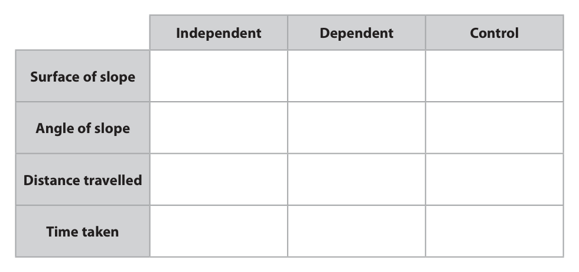

**Mark scheme answer**

> one mark for each correct row;;;; reject mark for row if more
> than one tick

- **(4)** one mark for each correct row;;;; reject mark for row if more

### 10(b)(i) [1]

Plot the student’s data on the grid.

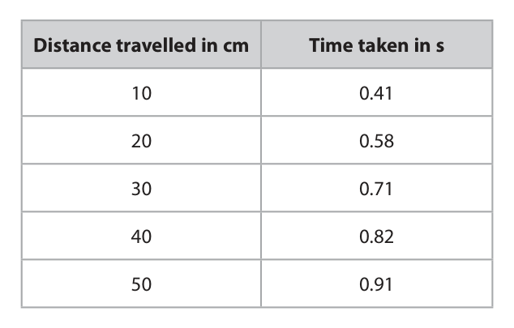

**Mark scheme answer**

> all points correct; within ½ small square

- **(1)** all points correct; within ½ small square

### 10(b)(ii) [1]

Draw a best fit curve. Distance in cm 0 0.2 0.4 0.6 0.8 1.0 Time in s

**Mark scheme answer**

> curve goes through all points; judge by eye
> ignore curve before first data
> point

- **(1)** curve goes through all points; judge by eye

### 10(b)(iii) [4]

The student concludes that the results obey this relationship distance ÷ (time²) = constant Use the student’s data to deduce whether the student’s results support this conclusion.

**Mark scheme answer**

> constant correctly calculated for one row of
> table;
> constant correctly calculated for another row of
> table;
> statement/expression comparing constants; allow even if comparison
> suggests the constants are
> not equal
> consistent conclusion about relationship based DOP
> on comparison of constants;
> Answer Notes Marks

- **(4)** constant correctly calculated for one row of

## Question 11 (8 marks)

Diagram 1 shows a light-emitting diode (LED) and a resistor in series with a cell and an ammeter. 1.5 V A 0.63 V 95 Ω Diagram 1

### 11(a) [4]

The voltage across the LED is 0.63 V. Calculate the current in the circuit. Give your answer in milliamps. current = mA

**Mark scheme answer**

> idea that voltage across resistor is difference allow 0.87 seen or
> between cell and diode voltage; 1.5−0.63 seen
> rearrangement of V = IR;
> evaluation in A;
> conversion to mA;
> condone use of
> incorrect voltage to
> give 0.0066, 0.0224,
> 0.0158 (A) = 1 mark
> e.g. 6.6, 22.4, 15.8 (mA) = 2
> voltage across resistor = 1.5 − 0.63 = 0.87 (V)
> $I = V/R = 0.87/95$
> current = 0.00915… (A)
> current = 9.2 (mA) allow current =
> 9.15…(mA)

- **(4)** idea that voltage across resistor is difference allow 0.87 seen or

### 11(b) [4]

Diagram 2 shows a second LED and an extra resistor connected in parallel with the cell. 1.5 V A Diagram 2 The resistor and the LED are the same as the components used in diagram 1. The two resistors are identical and the two LEDs are identical. Explain how the ammeter reading will change.

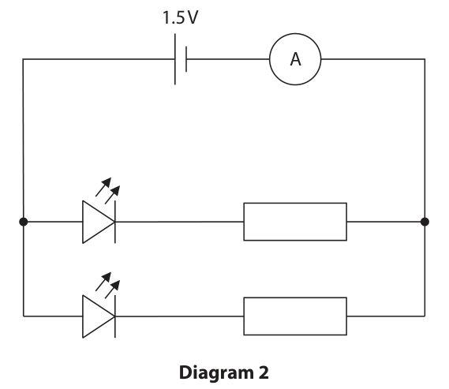

**Mark scheme answer**

> any four from:
> MP1. resistance (of circuit) decreased;
> MP2. (because) extra path in circuit;
> MP3. resistance (of circuit) halved; also scores MP1
> allow calculation of
> resistance (=81.9Ω)
> MP4. idea that voltage across parallel branches is reject if idea that cell
> the same (as previous voltage); voltage is shared
> between branches
> MP5. current (in ammeter) increased; allow current in
> ammeter is sum of
> currents in branches
> MP6. current (in ammeter) doubled; also scores MP5
> allow calculation of
> current (=18mA)
> Answer Notes Marks

- **(4)** any four from:

## Question 12 (10 marks)

A device called a metal detector can be used to find metal buried underground. transmitter coil receiver coil (Source: © mArt88/Shutterstock) The metal detector has two circuits, each containing a coil of copper wire. Diagram 1 shows the circuit for the transmitter coil. electronics transmitter coil Diagram 1

**(b)** The cell supplies direct current (d.c.). The electronics in diagram 1 change the direct current into alternating current (a.c.) in the coil.

### 12(a) [1]

Suggest why there is a magnetic field around the transmitter coil.

**Mark scheme answer**

> idea of a current (in the coil); ignore references to
> electromagnets

- **(1)** idea of a current (in the coil); ignore references to

### 12(b)(i) [2]

Describe the difference between direct current (d.c.) and alternating current (a.c.).

**Mark scheme answer**

> d.c. travels in one direction only;
> idea of a.c. continuously changing direction; allow keeps changing
> direction, changes
> direction constantly
> etc.

- **(2)** d.c. travels in one direction only;

### 12(b)(ii) [3]

Alternating current is supplied to the transmitter coil. Diagram 2 shows a gold ring in the soil below the metal detector. metal detector air soil ring Diagram 2 Explain why there is an alternating current in the gold ring.

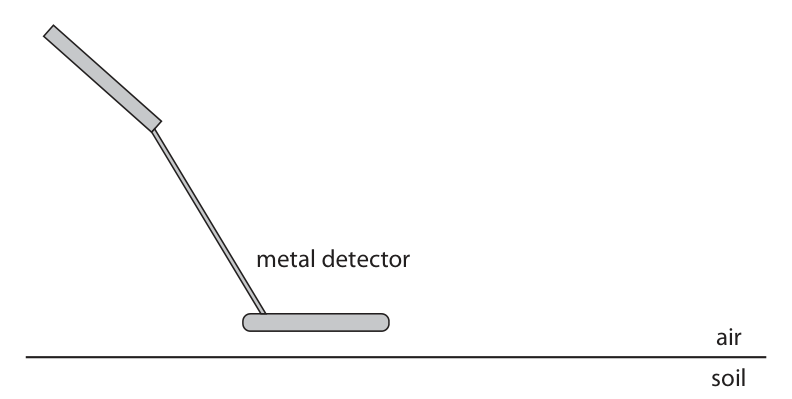

**Mark scheme answer**

> idea of changing magnetic field (from transmitter
> coil);
> idea of gold ring cutting field lines; allow field moving
> through ring
> ignore ring interacting
> with field
> idea of induced voltage for gold ring; ignore induced current

- **(3)** idea of changing magnetic field (from transmitter

### 12(c) [4]

Diagram 3 shows the circuit for the receiver coil. receiver coil loudspeaker Diagram 3 As a result of the alternating current in the gold ring, there is an alternating current in the receiving coil. Explain how an alternating current in the receiving coil causes a sound to be emitted from the loudspeaker.

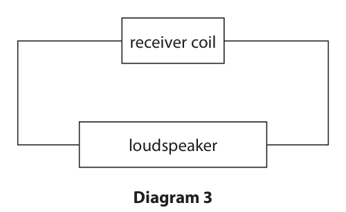

**Mark scheme answer**

> any four from:
> MP1. alternating current in loudspeaker;
> MP2. magnetic fields interact (in loudspeaker); ignore fields cutting
> MP3. causing a force (on loudspeaker cone); allow coil for cone
> MP4. a.c. causes changing force direction;
> MP5. loudspeaker (cone) vibrates; allow coil for cone
> allow description of
> vibrations e.g. “back
> and forth”
> Pearson Education Limited. Registered company number 872828
> with its registered office at 80 Strand, London, WC2R 0RL, United Kingdom

- **(4)** any four from:

