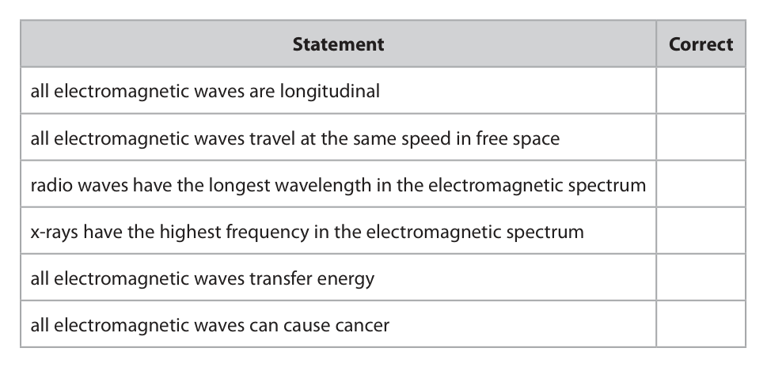
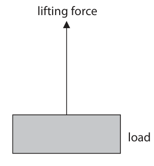
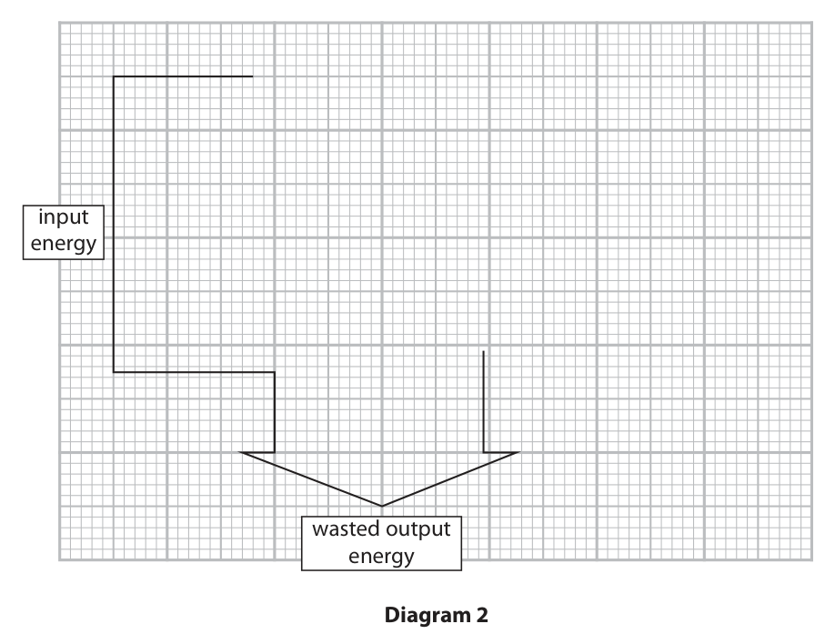
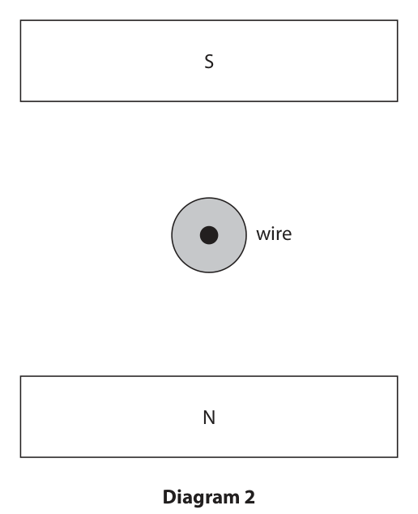
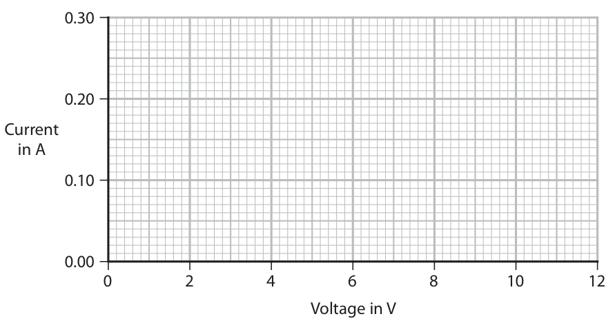
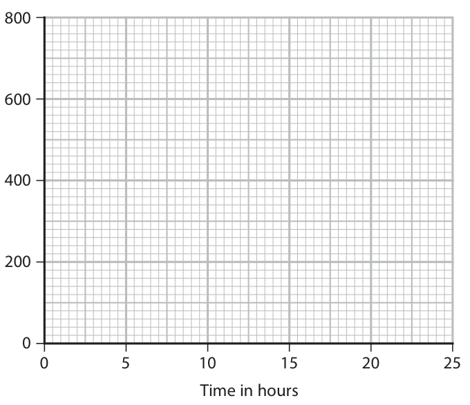
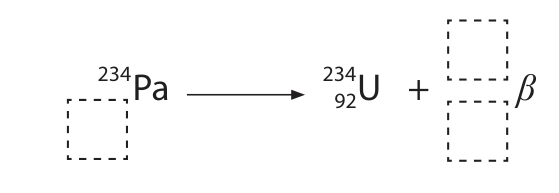
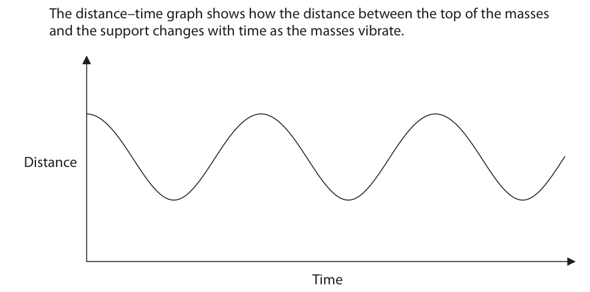
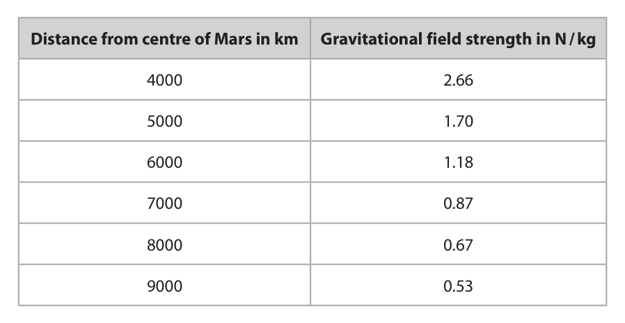

# 4PH1/1PR — 2023-06 (official extraction)

> schema `syllabai.official-paper-questions/0.2` · paper_id `pearson-edexcel:international-gcse:physics:4ph1:2023-06:4PH1/1PR` · qp sha256 `79221e982c6f0ff9…` · extraction is the disclosed baseline (ADR-039)

## Question 1 (7 marks)

This question is about the electromagnetic spectrum.

**(b)** Electromagnetic waves can be useful, but can also be harmful.

### 1(a) [3]

The table gives some statements about the electromagnetic spectrum. Place three ticks (ü) in the table to show which statements are correct. Statement Correct all electromagnetic waves are longitudinal all electromagnetic waves travel at the same speed in free space radio waves have the longest wavelength in the electromagnetic spectrum x‑rays have the highest frequency in the electromagnetic spectrum all electromagnetic waves transfer energy all electromagnetic waves can cause cancer

**Mark scheme answer**

> 3 correct ticks;;;
> 2 correct ticks;;
> 1 correct tick;
> -1 for each additional
> tick if more than three
> ticks shown
> ✓
> ✓
> ✓

- **(3)** 3 correct ticks;;;

### 1(b)(i) [2]

Give one use and one harmful effect of microwaves. use harmful effect

**Mark scheme answer**

> microwaves:
> one valid use;
> • communication /eq allow other valid uses
> e.g. radar, locating rain
> clouds etc.
> • heating food /eq
> one valid harmful effect;
> • internal heating (of body tissue) / eq reject "cancer"
> apply "list principle"

- **(2)** microwaves:

### 1(b)(ii) [2]

Give one use and one harmful effect of gamma rays. use harmful effect

**Mark scheme answer**

> gamma rays:
> one valid use;
> • sterilising {food / medical equipment} allow other valid uses
> • kill microbes or bacteria; e.g. gamma
> photography,
> identifying cancer etc.
> • treating cancer / radiotherapy;
> • medical tracing
> one valid harmful effect;
> • ionisation / mutation of cells /eq condone damages or
> kills cells or tissues
> • risk of cancer
> Answer Notes Marks

- **(2)** gamma rays:

## Question 2 (7 marks)

The photograph shows the International Space Station (ISS) in orbit around the Earth. (Source: © Dima Zel/Shutterstock)

**(c)** The ISS completes one orbit of the Earth in a time period of 93 minutes.

### 2(a) [1]

The ISS orbits the Earth in a circular orbit. Which of these also orbits the Earth?

- **(A)** a comet
- **(B)** Mars
- **(C)** the Moon  ✔
- **(D)** the Sun

**Mark scheme answer**

> C (the Moon);
> A is incorrect because comets orbit stars
> B is incorrect because Mars orbits the Sun
> D is incorrect because the Sun orbits in the Milky
> Way galaxy

- **(1)** Answer C: the Moon

### 2(b) [1]

Which of these forces causes the ISS to orbit the Earth?

- **(A)** air resistance
- **(B)** electrostatic
- **(C)** friction
- **(D)** gravitational  ✔

**Mark scheme answer**

> D (gravitational);
> A is incorrect because there is no air in space;
> B is incorrect because the ISS is not charged;
> C is incorrect because friction would act in the
> opposite direction to motion, not towards Earth

- **(1)** Answer D: gravitational

### 2(c)(i) [3]

The orbital radius of the ISS is 6.8 × 10³ km. Calculate the orbital speed of the ISS in km / s. orbital speed = km / s

**Mark scheme answer**

> substitution into given formula (v= 2πr/T);
> conversion of minutes to seconds; mark independently
> evaluation; -1 for POT errors if km/s
> changed to m/s
> unnecessarily
> e.g.
> orbital speed = 2 × π × 6.8×10³ / 93(×60)
> 93 minutes = 93 × 60 (= 5580 seconds)
> (orbital speed =) 7.7 (km/s) allow 7.656…
> 459.4, 15.31, 27565, 7.6
> scores 2 marks

- **(3)** substitution into given formula (v= 2πr/T);

### 2(c)(ii) [2]

Show that the ISS completes approximately 15 orbits of the Earth each day.

**Mark scheme answer**

> successful conversion of orbital period and a day e.g.
> into the same unit; 1 day = 24 hours = 1440
> mins = 86400 seconds,
> 1 orbit = 0.0645 days=1.55
> hours=5580 seconds,
> evaluation of ratio to 15.48… to at least 3 sf;
> allow use of number of
> orbits = distance travelled
> in 24 hours ÷
> circumference of orbit
> e.g.
> 1 day = 24 × 60 = 1440 minutes
> $1440/93 = 15.5$

- **(2)** successful conversion of orbital period and a day e.g.

## Question 3 (15 marks)

A model electric motor is used to lift a load through a vertical height. power supply electric motor joulemeter load

**(a)** The load has a mass of 400 g and gains 3.2 J of energy in its gravitational store when lifted.

**(c)** A joulemeter measures the amount of energy transferred electrically to the motor as the motor lifts the load. The joulemeter displays a reading of 11.0 J when the load has gained 3.2 J of energy in its gravitational store.

### 3(a)(i) [1]

State the formula linking gravitational potential energy, mass, gravitational field strength (g) and height.

**Mark scheme answer**

> GPE = mass × g × height; allow standard symbols
> and rearrangements e.g.
> h = GPE / m×g
> ignore ‘gravity’ for g

- **(1)** GPE = mass × g × height; allow standard symbols

### 3(a)(ii) [3]

Calculate the height the load is lifted. height = m

**Mark scheme answer**

> substitution;
> rearrangement; in either order
> evaluation; -1 for POT error due to not
> converting g to kg but not
> if due to physics error such
> as missing g
> accept use of g = 9.8(1)
> e.g. accept 1sf answer i.e. 0.8
> (m)
> $3.2 = 0.40 \times 10 \times h$
> $h = 3.2 / 0.40 \times 10$
> (h =) 0.80 (m) 0.815 or 0.816 or 0.82 if g
> used is 9.8(1) and then
> rounded

- **(3)** substitution;

### 3(a)(iii) [1]

State the amount of useful work done on the load by the motor when the load is lifted through this height. work done = J

**Mark scheme answer**

> 3.2 (J); this answer only

- **(1)** 3.2 (J); this answer only

### 3(b) [2]

The load is lifted at a constant speed. Diagram 1 shows the lifting force acting on the load as it is lifted. Draw a labelled arrow on diagram 1 to show the other force acting on the load. Ignore the effects of air resistance. lifting force load Diagram 1

**Mark scheme answer**

> downward arrow labelled “weight”/”W”/”mg”; ignore starting position of
> arrow
> ignore
> ‘gravity/g/gravitational
> field strength’
> allow ‘gravitational force’
> reject if both gravity force
> and weight force shown
> vertically downward arrow drawn equal in length to mark independently
> lifting force arrow; by eye
> reject any other labelled
> arrows for second mark

- **(2)** downward arrow labelled “weight”/”W”/”mg”; ignore starting position of

### 3(c)(i) [3]

Calculate the efficiency of the motor. efficiency =

**Mark scheme answer**

> recall of efficiency formula; may be implied from
> substitution
> substitution;
> evaluation;
> e.g.
> efficiency = useful energy output
> total energy output
> efficiency = 3.2 / 11.0 (×100%)
> efficiency = 0.29 or 29% allow 0.29, 0.2909…, 29%,
> 29.09…%
> 29 without % is PoT 2

- **(3)** recall of efficiency formula; may be implied from

### 3(c)(ii) [2]

Justify why 7.8 J of energy must be dissipated into the thermal store of the surroundings as the load is lifted.

**Mark scheme answer**

> idea that energy must be conserved; comparison in words e.g
> total = useful + wasted /eq
> demonstration that 7.8 + 3.2 = 11(.0); allow 11(.0) – 3.2 = 7.8

- **(2)** idea that energy must be conserved; comparison in words e.g

### 3(c)(iii) [3]

Diagram 2 is an incomplete Sankey diagram. Complete the Sankey diagram to show the energy transferred by the motor. input energy wasted output energy Diagram 2

**Mark scheme answer**

> only one additional arrow drawn pointing to the
> right;
> labelled “useful output (energy)” allow “gravitational
> (potential energy)”, “GPE”
> etc.
> reject reference to power
> width of arrow drawn = 8 small squares; by eye
> e.g.
> Question number Answer Notes Marks

- **(3)** only one additional arrow drawn pointing to the

## Question 4 (10 marks)

This question is about magnets.

**(d)** Diagram 2 shows a cross‑section through a wire placed between two magnetic poles. The direction of the current in the wire is out of the page. S wire N Diagram 2

### 4(a) [1]

Which of these substances is not attracted to a bar magnet?

- **(A)** cobalt
- **(B)** copper  ✔
- **(C)** iron
- **(D)** nickel

**Mark scheme answer**

> B (copper);
> A is incorrect because it is magnetic
> C is incorrect because it is magnetic
> D is incorrect because it is magnetic

- **(1)** Answer B: copper

### 4(b) [3]

Diagram 1 shows a bar magnet. NS Diagram 1 Draw magnetic field lines on diagram 1 to show the shape and direction of the magnetic field around the bar magnet.

**Mark scheme answer**

> field line connecting one pole to the other; allow small gap where
> field line joins magnet
> ignore field lines inside
> the magnet
> at least two complete field lines, but none touching / ignore field lines that
> crossing; start outside the pole
> region
> all directions shown on field lines correct (N to S); only one arrow required
> for the mark but
> contradictory directions
> negates the mark
> ignore arrow(s) inside
> the magnet

- **(3)** field line connecting one pole to the other; allow small gap where

### 4(c) [2]

Some bar magnets are made of steel. Explain why steel is a good material for making bar magnets.

**Mark scheme answer**

> steel is magnetic / eq;
> (therefore) magnet stays magnetised (for a long period allow ‘steel is a hard
> of time) /eq ; magnetic material’ for
> both marks
> reject reference to
> charge

- **(2)** steel is magnetic / eq;

### 4(d)(i) [2]

Draw an arrow on diagram 2 to show the direction of the force on the wire due to the magnetic field. Assume that the magnetic field is uniform.

**Mark scheme answer**

> arrow drawn is horizontal; ignore starting position
> of arrow
> judge by eye
> arrow drawn is to the left; ignore field lines

- **(2)** arrow drawn is horizontal; ignore starting position

### 4(d)(ii) [2]

State two changes that could be made that would decrease the magnitude of the force on the wire in diagram 2. 1 2

**Mark scheme answer**

> Any two from:
> MP1 reference to weaker field
> MP2 moving magnets further apart
> MP3 use weaker magnets
> MP4 reference to lower current
> MP5 decreasing diameter of wire increasing length of
> wire (in circuit)
> MP6 decrease voltage (of supply)
> Answer Notes Marks

- **(2)** Any two from:

## Question 5 (6 marks)

A car is travelling in a straight line along a road. The car passes a person standing at the side of the road. Before passing the person, the driver of the car presses the car’s horn. The horn makes a loud sound of constant frequency. The horn continues to make a sound until after the car has passed the person. Discuss the differences in the frequencies of the sound heard by • the driver of the car • the person at the side of the road

### 5 [6]

A car is travelling in a straight line along a road. The car passes a person standing at the side of the road. Before passing the person, the driver of the car presses the car’s horn. The horn makes a loud sound of constant frequency. The horn continues to make a sound until after the car has passed the person. Discuss the differences in the frequencies of the sound heard by • the driver of the car • the person at the side of the road

**Mark scheme answer**

> at least one from:
> in relation to driver:
> MP1. (frequency) does not change; allow pitch does not
> change
> MP2. no (relative) movement between driver and i.e. driver and car
> horn; travelling at same speed /
> distance between car
> (horn) and driver constant
> PLUS up to five from:
> in relation to person at the side of the road:
> MP3. recognition that the Doppler effect applies;
> MP4. frequency heard by person at side of the allow pitch as alternative
> road is different to that heard by driver; to frequency
> reject just ‘different’
> MP5. frequency is higher as car approaches; allow pitch of sound is
> higher
> MP6. because wavefronts become closer allow wavelength
> together; decreases
> MP7. frequency is lower as car moves away; allow pitch of sound is
> lower
> MP8. because wavefronts become further apart; allow wavelength increases
> MP9. speed of sound remains constant;
> MP10. relevant mention of v = f × λ; must link to a previous MP,
> not merely quoting the
> formula
> Answer Notes Marks

- **(6)** at least one from:

## Question 6 (14 marks)

A student investigates how the current in a 60 Ω resistor varies with the voltage across the resistor.

### 6(a) [4]

The student has access to this equipment • 12 V battery • ammeter and voltmeter • 60 Ω resistor • variable resistor • switch • connecting wires Draw a circuit diagram to show how the student could connect this equipment to carry out the investigation.

> 🖼 crop required: diagram (qp.pdf p.15)

**Mark scheme answer**

> resistor, battery, voltmeter, ammeter all present in a all four symbols drawn
> complete circuit correctly
> condone use of cell or dc
> power supply symbol for
> battery
> variable resistor connected in series with resistor; symbol drawn correctly
> ammeter in series with resistor; condone incorrect yet
> identifiable ammeter
> symbol
> voltmeter in parallel with 60 ohm resistor; condone incorrect yet
> identifiable voltmeter
> symbol
> accept higher level
> answers involving
> potential divider circuits

- **(4)** resistor, battery, voltmeter, ammeter all present in a all four symbols drawn

### 6(b) [4]

Describe a suitable method the student could use for this investigation.

**Mark scheme answer**

> any four from:
> MP1. measure voltage and current;
> MP2. idea of varying voltage (across resistor); e.g. by altering the
> resistance of the variable
> resistor
> MP3. take repeat readings and average (at each
> voltage);
> MP4. switch off circuit in between readings;
> MP5. other reasonable safety measure relating to e.g. not using full range
> equipment heating up of voltages so current
> doesn’t get too high
> ignore references to
> graph

- **(4)** any four from:

### 6(c)(i) [3]

Complete the current–voltage graph by drawing a line that shows the expected results of the investigation. 0.30 0.20 Current in A 0.10 0.00 0 2 4 6 8 10 12 Voltage in V

**Mark scheme answer**

> line passes through origin;
> line is straight throughout; by eye
> line passes/would pass through the point (12,0.20);

- **(3)** line passes through origin;

### 6(c)(ii) [3]

The student repeats their investigation with a 120 Ω resistor. Explain how a current–voltage graph for a 120 Ω resistor compares with the current–voltage graph for the 60 Ω resistor.

**Mark scheme answer**

> any three from:
> MP1. line will be same shape / straight line through allow (still) directly
> origin / both components are resistors; proportional
> MP2. line (for 120Ω resistor) will have a lower
> gradient;
> MP3. line (for 120Ω resistor) will have half the also award MP2
> gradient;
> MP4. (because) larger resistance will result in a allow relevant
> lower current in the circuit; justification by V=IR
> all three marks can be
> awarded from a correct
> new line on the graph.
> Answer Notes Marks

- **(3)** any three from:

## Question 7 (15 marks)

Protactinium is an element with several different radioactive isotopes.

**(a)** Protactinium‑234 has a half‑life of 6.7 hours. A sample of protactinium‑234 has an initial activity of 800 units.

**(b)** A student suggests an experiment to determine the type of radiation emitted by a different isotope of protactinium, protactinium‑231. This is the suggested method. Step 1 connect a suitable radiation detector to a radiation counter Step 2 place a source of protactinium‑231 at a fixed distance of 3 cm from the radiation detector Step 3 record the count of detected radiation for a time of one minute Step 4 place a sheet of paper between the source and detector Step 5 record the count of detected radiation for a time of one minute Step 6 repeat Steps 4 and 5 using a sheet of aluminium and then a sheet of lead instead of the sheet of paper The table shows the results of the investigation when it is done by a teacher. Material between source and detector Count no material 261 paper 14 aluminium 11 lead 13

### 7(a)(i) [1]

Give a suitable unit for activity.

**Mark scheme answer**

> becquerel(s); allow kilobecquerels, Bq,
> kBq, curie, Ci
> allow recognisable
> spelling
> allow mixed case letters

- **(1)** becquerel(s); allow kilobecquerels, Bq,

### 7(a)(ii) [3]

On the axes below, sketch a graph for the decay of the sample of protactinium‑234 during its first three half‑lives. 800 600 Activity 400 in 200 0 5 10 15 20 25 Time in hours

**Mark scheme answer**

> 3
> evidence that sketch starts at (0,800) accept plotted point
> evidence sketch passes through (6.7,400) accept plotted point
> smooth curve decreases with decreasing steepness

- **(3)** 3

### 7(a)(iii) [2]

When protactinium‑234 undergoes beta ( β –) decay it becomes uranium‑234. The incomplete nuclear equation shows this process. 234 234 Pa 92 U + β Complete the nuclear equation to show the beta decay of protactinium‑234. Write your answers in the dashed boxes.

**Mark scheme answer**

> both numbers for beta correct;
> atomic number of protactinium = 91;
> e.g.

- **(2)** both numbers for beta correct;

### 7(b)(i) [1]

Which of these is the dependent variable in the investigation?

- **(A)** count measured by the detector  ✔
- **(B)** distance between source and detector
- **(C)** material between source and detector
- **(D)** time the count is measured

**Mark scheme answer**

> A (count measured by the detector);
> B is incorrect because this is a control variable
> C is incorrect because this is the independent variable
> D is incorrect because this is a control variable

- **(1)** Answer A: count measured by the detector

### 7(b)(ii) [3]

The student’s method does not allow for background radiation. Describe how the student’s method should be modified to allow for background radiation.

**Mark scheme answer**

> idea of removing source (from the experiment); e.g. pointing source
> away, keeping source in
> its box, (huge) increase
> in distance, take count
> before using source
> measure count(for a minute);
> subtract background count from results;

- **(3)** idea of removing source (from the experiment); e.g. pointing source

### 7(b)(iii) [2]

Describe how the student’s method could be modified to improve the reliability of the results.

**Mark scheme answer**

> idea of repeating measurements (of count);
> to determine a mean value; allow idea of using
> repeats to identify
> anomalies
> condone average for
> mean

- **(2)** idea of repeating measurements (of count);

### 7(b)(iv) [3]

Evaluate the data from the experiment to conclude the type of radiation emitted by protactinium‑231.

**Mark scheme answer**

> count decreases (significantly) using paper;
> no (additional) effect on the count when using aluminium both must be mentioned
> AND lead / eq; for this mark
> allow idea that count
> with aluminium and lead
> is background radiation /
> in the range of 11-14
> radiation must be alpha consistent with candidate's
> discussion;
> Answer Notes Marks

- **(3)** count decreases (significantly) using paper;

## Question 8 (7 marks)

Diagram 1 shows a set of masses attached to a spring, which is suspended from a support. support spring masses Diagram 1

**(a)** After the masses are added, the length of the spring is 14.6 cm. The student measures the extension of the spring as 11.5 cm.

**(b)** The student puts the masses back on the spring. The student then pulls the masses down and releases them. The masses vibrate up and down in a vertical direction, as shown in diagram 2. support spring vibrations masses Diagram 2 The distance–time graph shows how the distance between the top of the masses and the support changes with time as the masses vibrate. Distance Time

### 8(a)(i) [1]

Calculate the original length of the spring. original length = cm

**Mark scheme answer**

> 3.1 (cm);

- **(1)** 3.1 (cm);

### 8(a)(ii) [1]

The student removes the masses and notices that the spring does not show elastic behaviour. Predict a value for the new length of the spring after the masses have been removed. new length of spring = cm

**Mark scheme answer**

> any value above candidate’s answer for (a)(i) up to
> and including 14.6cm;

- **(1)** any value above candidate’s answer for (a)(i) up to

### 8(b)(i) [3]

Explain how the gradient of the graph shows that the masses accelerate as they vibrate.

**Mark scheme answer**

> idea that speed is the gradient/slope of the graph;
> gradient is not constant; e.g. “it’s a curve”/”it’s
> not a straight line”
> (therefore) speed is not constant; allow description of
> how the speed is
> varying e.g. zero at
> turning points,
> maximum when
> steepest

- **(3)** idea that speed is the gradient/slope of the graph;

### 8(b)(ii) [2]

Add crosses (X) to the distance–time graph to show all the times when the masses are not moving.

**Mark scheme answer**

> any cross drawn at a peak/trough on the curve; reject if contradicted
> by a cross drawn in an
> incorrect place
> by eye
> crosses drawn at all three peaks and all three
> troughs;
> Answer Notes Marks

- **(2)** any cross drawn at a peak/trough on the curve; reject if contradicted

## Question 9 (11 marks)

The driver of a racing car makes a pit stop during a race to change the tyres on the racing car. The area where the tyres are changed is called the pit lane. (Source: © Hafiz Johari/Shutterstock)

**(a)** Before entering the pit lane, the speed of the car must decrease for safety reasons.

### 9(a)(i) [3]

The mass of the racing car is 830 kg. The maximum braking force is 41 000 N. Show that the maximum deceleration of the racing car is approximately 50 m / s².

**Mark scheme answer**

> recall of (unbalanced) force = mass × acceleration; allow symbols
> can be implied from
> valid substitution of
> data
> substitution and rearrangement;
> evaluation to 2 s.f. or more;
> e.g.
> $F = m\times a$
> $a = 41000 / 830$
> a = 49 (m/s²) allow 49.39…

- **(3)** recall of (unbalanced) force = mass × acceleration; allow symbols

### 9(a)(ii) [3]

The racing car is travelling at an initial speed of 72 m / s. Calculate the minimum distance needed to decrease the speed of the racing car from 72 m / s to 26 m / s. distance = m

**Mark scheme answer**

> substitution into v² = u² + 2as; allow ecf from (i)
> rearrangement;
> evaluation;
> e.g.
> 26² = 72² + 2×(-50)×s
> (distance =) 5184-676 / 100
> (distance =) 45 (m) expect answers in range
> 45-46 (m)
> reject 72-26 = 46
> (wrong physics)
> accept 46 if unqualified

- **(3)** substitution into v² = u² + 2as; allow ecf from (i)

### 9(b) [3]

The racing car slows down using its brakes. The brakes work using friction. The brakes become very hot when the racing car slows down. Using ideas about energy, explain why the brakes become hot.

**Mark scheme answer**

> kinetic energy (store) of car decreases; kinetic energy/ KE of
> car
> thermal energy (store) of brake(s) increases; transforms to
> {heat/thermal} energy
> of brakes
> energy transferred mechanically; due to work done by
> {friction / brakes}
> NB only award from
> either the answer
> column or notes
> column, not from a mix
> of the two.

- **(3)** kinetic energy (store) of car decreases; kinetic energy/ KE of

### 9(c) [2]

The tyres of the racing car also get very hot during a race. A mechanic has to handle the hot tyres during the pit stop. They wear protective gloves which have several layers of insulating materials. Explain how the layers of insulating materials in the gloves reduce the risk of the mechanic burning their hands on the hot tyres.

**Mark scheme answer**

> any two from:
> MP1. idea that insulating materials are poor
> conductors;
> MP2. layers trap air;
> MP3. air itself is a poor conductor/(good)
> insulator
> MP4. (energy transfer due to / rate of) condone idea of
> conduction reduces; stopping conduction
> MP5. idea increased thickness reduces (rate of)
> conduction
> Answer Notes Marks

- **(2)** any two from:

## Question 10 (11 marks)

A dam is a structure designed to hold water in a reservoir. dam water in a reservoir

**(a)** The water in the reservoir has a depth of 35 m.

**(b)** An underwater camera is used in the water reservoir. The camera lens experiences a force of 430 N at a pressure of 260 kPa.

### 10(a)(i) [1]

State the formula linking pressure difference, height, density and g.

**Mark scheme answer**

> pressure difference = height × density × g; allow in words or standard
> symbols
> e.g. p = h × ρ × g
> condone d for density

- **(1)** pressure difference = height × density × g; allow in words or standard

### 10(a)(ii) [3]

Atmospheric pressure at the surface of the reservoir is 100 kPa. Calculate the total pressure at the bottom of the reservoir. [for water, density = 1000 kg / m³] pressure = kPa

**Mark scheme answer**

> substitution;
> evaluation of pressure difference in kPa; allow 343 (kPa) for use of
> g=9.8 N/kg
> evaluation of total pressure by adding 100 (kPa); ECF candidate’s water
> pressure
> allow 443 (kPa) for use of
> g=9.8(1) N/kg
> allow 450 000 Pa with clear
> intent from candidate i.e.
> removal of ‘k’ from unit on
> answer line.
> -1 for POT error but not if
> due to physics error such as
> missing g, substitution of
> 100 (kPa) for g
> e.g.
> (pressure difference =) 35 × 1000 × 10
> (pressure difference =) 350 (kPa)
> (pressure = 350 + 100 =) 450 (kPa)
> 350 kPa gets 2 marks
> 350 100 kPa gets 2 marks
> unqualified 350 000 (kPa)
> gets 1 mark

- **(3)** substitution;

### 10(b)(i) [1]

State the formula linking pressure, force and area.

**Mark scheme answer**

> pressure = force ÷ area; allow in words or standard
> symbols
> e.g. p = F / A

- **(1)** pressure = force ÷ area; allow in words or standard

### 10(b)(ii) [4]

Calculate the area of the camera lens. Give a suitable unit. area = unit

**Mark scheme answer**

> substitution; condone pressure in Pa or
> kPa
> rearrangement;
> evaluation; accept standard form i.e.
> 1.7 × 10⁻³ (m²)
> corresponding unit of area;
> e.g.
> 260 000 = 430 / area
> (area =) 430 / 260 000
> (area =) 0.0017 allow 0.0016538… m² etc
> m2 allow 17, 16.5… (cm²) etc
> allow 1.65... m2 scores 3
> allow 1.65...cm2 scores 2

- **(4)** substitution; condone pressure in Pa or

### 10(c) [2]

Sea water has a density of 1030 kg / m³. Explain how the design of the dam would need to be changed to hold the same depth of sea water safely.

**Mark scheme answer**

> pressure (at bottom) is greater than before / eq;
> wider base /eq; allow stronger material/eq
> ignore taller
> Answer Notes Marks

- **(2)** pressure (at bottom) is greater than before / eq;

## Question 11 (7 marks)

The gravitational field strength of a planet decreases with increasing distance from the planet. The table shows the value of the gravitational field strength of Mars at different distances from the centre of Mars. Distance from centre of Mars in km Gravitational field strength in N / kg 4000 2.66 5000 1.70 6000 1.18 7000 0.87 8000 0.67 9000 0.53

### 11(a) [4]

A student finds this formula in a textbook, which links distance from the centre of a planet to its gravitational field strength gravitational field strength × distance² = constant Use data from the table to justify this formula.

**Mark scheme answer**

> substitution into given formula;
> evaluation of constant; allow any consistent
> PoT
> evaluation of constant for a second set of data;
> conclusion consistent with candidate’s evidence; DOP
> e.g. calculated value of constant doesn’t change
> (much) so formula is justified
> constant decreases so formula isn’t justified

- **(4)** substitution into given formula;

### 11(b) [3]

Olympus Mons is the tallest mountain on Mars. The distance between the centre of Mars and the peak of Olympus Mons is 3410 km. Calculate the gravitational field strength at the peak of Olympus Mons. gravitational field strength = N / kg

**Mark scheme answer**

> rearrangement of given formula;
> substitution of constant and distance; allow ecf from (a)
> allow mean constant
> evaluation; condone 3.7
> e.g.
> gravitational field strength = constant / distance²
> gravitational field strength = 42 700 000 / 34102 allow range of
> 42 500 000 to 42 900 000
> for constant
> gravitational field strength = 3.67 (N/kg) allow range of 3.65-3.69
> Pearson Education Limited. Registered company number 872828
> with its registered office at 80 Strand, London, WC2R 0RL, United Kingdom

- **(3)** rearrangement of given formula;

