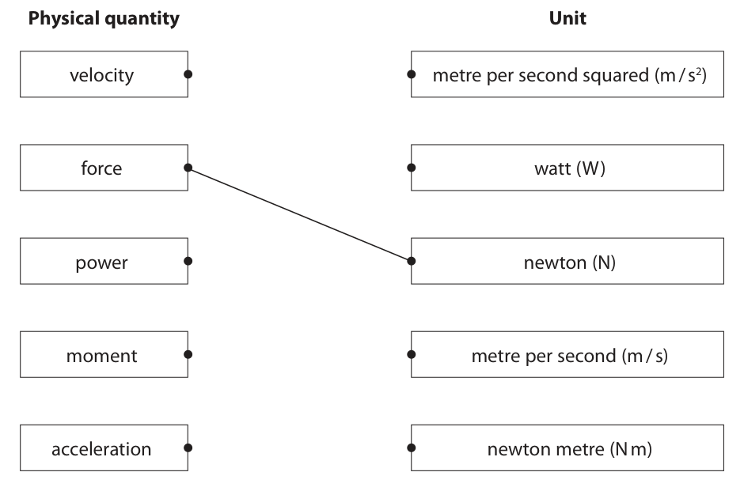
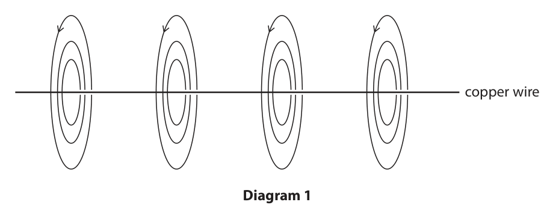
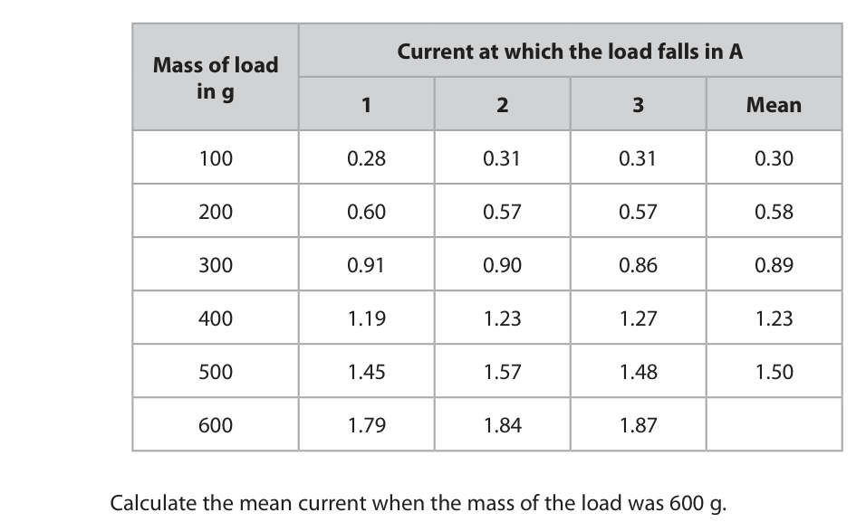
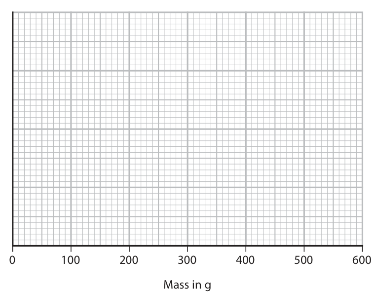
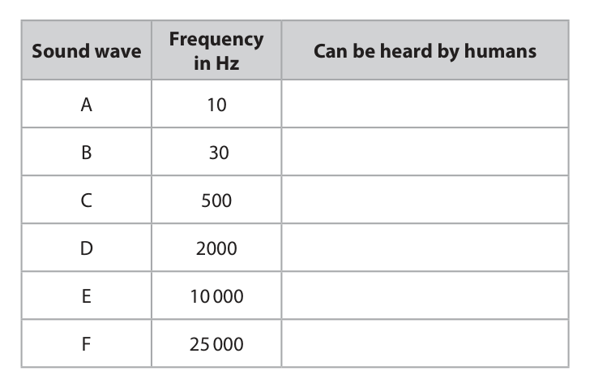
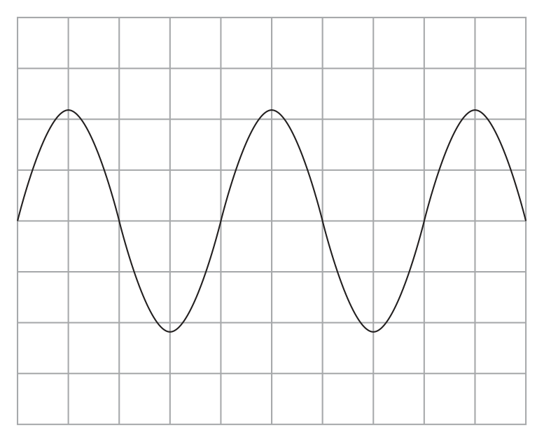
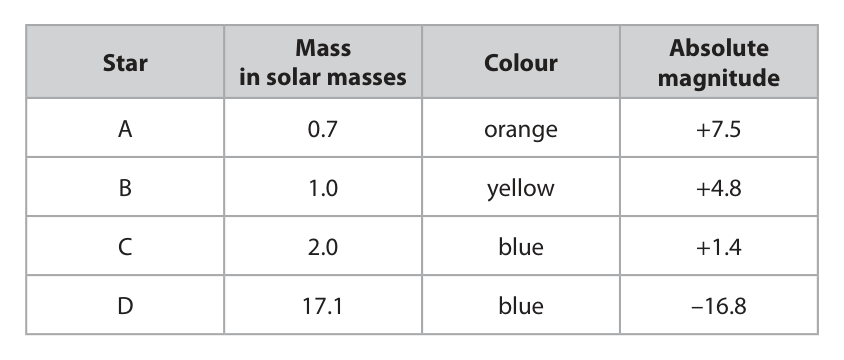

# 4PH1/2PR — 2023-06 (official extraction)

> schema `syllabai.official-paper-questions/0.2` · paper_id `pearson-edexcel:international-gcse:physics:4ph1:2023-06:4PH1/2PR` · qp sha256 `8a5adf5370c0b002…` · extraction is the disclosed baseline (ADR-039)

## Question 1 (5 marks)
**(b)** Some physical quantities are scalars and other physical quantities are vectors.

### 1(a) [3]

The boxes show some physical quantities and their units. Draw a straight line from each physical quantity to its correct unit. One has been done for you. Physical quantity Unit velocity metre per second squared (m / s2) force watt (W) power newton (N) moment metre per second (m / s) acceleration newton metre (N m)

**Mark scheme answer**

> ignore line drawn from
> force as already given
> 3 marks if all correct
> 2 marks if 2 correct
> 1 mark for any 1 correct
> ignore line if more than
> one physical quantity or
> unit are linked to each
> other

- **(3)** ignore line drawn from

### 1(b)(i) [1]

State the difference between a scalar quantity and a vector quantity.

**Mark scheme answer**

> idea that vectors have a direction but scalars do allow idea that only
> not; vectors have a direction

- **(1)** idea that vectors have a direction but scalars do allow idea that only

### 1(b)(ii) [1]

Give an example of a scalar quantity.

**Mark scheme answer**

> any correct scalar; e.g. speed, distance,
> length, mass, time,
> temperature, energy,
> power etc.
> Answer Notes Marks

- **(1)** any correct scalar; e.g. speed, distance,

## Question 2 (5 marks)

This question is about different methods of generating electricity.

### 2(a) [1]

Natural gas can be burned to generate electricity. Name the energy store that decreases when natural gas is burned.

**Mark scheme answer**

> chemical (energy store);

- **(1)** chemical (energy store);

### 2(b) [4]

Burning natural gas and the movement of water waves can both be used to generate electricity. Discuss the advantages and disadvantages of these two methods of generating electricity.

**Mark scheme answer**

> ignore references to cost
> any one advantage of natural gas from:
> MP1. idea that electricity generated can change allow idea that startup time is
> to meet demand; (very) short
> MP2. idea that it is reliable; e.g. is always available, does
> not depend on weather
> any one disadvantage of natural gas from:
> MP3. non-renewable / gas will eventually run
> out;
> MP4. burning gas produces CO2 / greenhouse allow causes air pollution,
> gases; contributes to global warming
> MP5. dependency on other countries to supply
> gas;
> any one advantage of wave power from:
> MP6. idea that it is renewable;
> MP7. produces no polluting gases;
> any one disadvantage of wave power from: ignore references to visual
> pollution
> MP8. idea that waves might not always be allow waves are weather
> present; dependent
> MP9. (may) cause harm to wildlife;
> MP10. possible storm damage to the generator;
> Answer Notes Marks

- **(4)** ignore references to cost

## Question 3 (8 marks)

A cleaning product is applied to a car using a sponge pad. The sponge pad is rubbed against the car to apply the cleaning product. (Source: © Nor Gal/Shutterstock)

**(b)** The sponge pad is held near a metal post that is connected to the ground. The sponge pad discharges with a small spark through the air to the metal post.

### 3(a) [3]

Some parts of the car are made of metal and other parts are made of plastic. The metal parts of the car are earthed. Explain why the pad becomes charged when rubbing the plastic parts, but not when rubbing the metal parts.

**Mark scheme answer**

> any three from:
> MP1. idea that plastic is an insulator OR that metal allow plastic has no free
> is a conductor; electrons
> allow plastic does not
> conduct
> MP2. idea that charge/electrons are transferred allow electrons gained /
> (by rubbing/friction); lost
> MP3. charge/electrons remain/build up on plastic must be clearly linked
> parts; to plastic
> MP4. charge/electrons flow through the metal must be clearly linked
> parts/travel to earth; to metal

- **(3)** any three from:

### 3(b)(i) [3]

The sponge pad stores 5.0 mJ of energy in its electrostatic store. The voltage between the sponge pad and the metal post is 6000 V. Calculate the charge transferred by the spark. charge transferred = C

**Mark scheme answer**

> ignore unit conversions
> until evaluation
> substitution into energy = charge × voltage;
> rearrangement;
> evaluation; −1 for POT error
> e.g.
> (0.00)5 = charge × 6000
> charge = (0.00)5 / 6000
> (charge =) 8.3 × 10−7 (C) allow 8 × 10−7,
> 8.33… × 10−7 (C)

- **(3)** ignore unit conversions

### 3(b)(ii) [2]

The small spark between the sponge pad and the metal post demonstrates that the sponge pad is charged. Describe a different experiment that could demonstrate that the sponge pad is charged. You may draw a diagram to support your answer.

**Mark scheme answer**

> idea of bringing pad near another uncharged allow water from tap,
> insulator; (small) pieces of paper,
> hair, balloon etc. as the
> insulator
> allow gold leaf
> electroscope
> attraction used to demonstrate charge on sponge; reject references to
> repulsion unless linked
> to gold leaf
> electroscope
> Answer Notes Marks

- **(2)** idea of bringing pad near another uncharged allow water from tap,

## Question 4 (9 marks)

The photograph shows a dummy during a test of the safety features of a car in a collision. (Source: © fStop Images GmbH/Alamy Stock Photo) Before the collision, the dummy in the car is travelling at a velocity of 14 m / s. The dummy has a momentum of 1100 kg m / s.

### 4(a)(i) [1]

State the formula linking momentum, mass and velocity.

**Mark scheme answer**

> momentum = mass × velocity; all standard symbols
> and rearrangements
> e.g. m = p / v
> ignore m, M for
> momentum

- **(1)** momentum = mass × velocity; all standard symbols

### 4(a)(ii) [3]

Show that the mass of the dummy is approximately 80 kg.

**Mark scheme answer**

> substitution;
> rearrangement;
> evaluation to 2 or more s.f.;
> answer of 78 (kg) gets 2
> marks only
> e.g.
> 1100 = mass × 14
> mass = 1100 / 14
> (mass =) 79 (kg) allow 78.6, 78.57…
> condone 78.5

- **(3)** substitution;

### 4(b) [3]

The dummy is brought to rest during the collision by a mean force of 15 kN. Calculate the time taken for the dummy to be brought to rest in the collision. time taken = s

**Mark scheme answer**

> substitution into F = ∆p / t; ignore not converting
> kN to N
> allow use of
> ∆p = (80 × 14 =) 1120
> rearrangement;
> evaluation; −1 for POT error
> e.g. 15 000 = 1100 / t
> t = 1100 / 15 000
> (t =) 0.073 (s) allow 0.07, 0.0733…,
> 0.075, 0.0746…

- **(3)** substitution into F = ∆p / t; ignore not converting

### 4(c) [2]

The car being tested is fitted with airbags. Using ideas about momentum, explain how an airbag reduces the force experienced by the dummy in the collision.

**Mark scheme answer**

> idea that airbag increases the (collision) time;
> reduces the rate of change of momentum; condone slows down
> change of momentum
> allow reduces
> acceleration
> allow use of equation
> AND statement that
> change in momentum is
> constant (which reduces
> the force)
> Answer Notes Marks

- **(2)** idea that airbag increases the (collision) time;

## Question 5 (7 marks)

This question is about specific heat capacity.

**(b)** The diagram shows a sample of solid stearic acid being heated in a boiling tube using a water bath. thermometer support boiling tube containing stearic acid water bath The mass of stearic acid in the boiling tube is 58 g. When the boiling tube is placed in the water bath, the temperature of the stearic acid increases from 21 °C to 37 °C. The stearic acid does not melt. As the temperature of the stearic acid increases, an additional 3500 J of energy needs to be transferred electrically to the water bath.

### 5(a) [3]

State what is meant by the term specific heat capacity.

**Mark scheme answer**

> ignore equations
> energy required; ignore heat for energy
> for a unit mass / per gram (of mass) / per kilogram
> (of mass);
> to change per unit temperature / change by 1°(C) / allow other statements
> change by 1 K; that imply changing e.g.
> increasing, raising, heat
> up, decreasing etc.

- **(3)** ignore equations

### 5(b)(i) [3]

Using this data, show that the specific heat capacity of the solid stearic acid is approximately 4 J / g °C.

**Mark scheme answer**

> substitution into ∆Q = mc∆T;
> rearrangement;
> correct evaluation to 2 or more s.f.;
> answer of 2.9, 1.6, 1.0
> gets 1 mark for showing
> rearrangement
> e.g.
> 3500 = 58 × c × [37−21]
> c = 3500 / 58 × 16
> c = 3.8 allow 3.77…

- **(3)** substitution into ∆Q = mc∆T;

### 5(b)(ii) [1]

The true value for the specific heat capacity of solid stearic acid is 2.3 J / g °C. Give a reason for the difference between the value in (i) and the true value.

**Mark scheme answer**

> any one from: ignore suggestions of
> human error
> MP1. energy also heating boiling tube; allow thermometer,
> support
> MP2. energy is being transferred/lost to/gained allow alternatives to
> from surroundings; surroundings e.g. air
> MP3. stearic acid may be impure;
> Answer Notes Marks

- **(1)** any one from: ignore suggestions of

## Question 6 (12 marks)

This question is about electromagnetism.

**(b)** A student investigates how the strength of an electromagnet varies with the current in the electromagnet. The diagram shows their apparatus. A electromagnet load This is the student’s method. • switch on the electromagnet at its maximum current • place a load of 100 g so that it is held above the floor by the electromagnet • slowly reduce the current in the electromagnet until the load falls from the electromagnet • record the current at which the load falls • record the current at which the same load falls two more times Repeat the method for loads of different masses.

### 6(a) [2]

Diagram 1 shows the magnetic field around a straight section of copper wire. copper wire Diagram 1 Explain why the copper wire has the magnetic field shown in the diagram.

**Mark scheme answer**

> idea that there must be a current in the wire; allow charge/electrons
> moving in the wire
> reject references to
> positive electrons
> this current must be to the right; allow electrons moving
> to the left

- **(2)** idea that there must be a current in the wire; allow charge/electrons

### 6(b)(i) [1]

Suggest a suitable safety precaution for the student’s investigation.

**Mark scheme answer**

> any one of: ignore electric shocks,
> safety glasses, gloves
> MP1. idea of avoiding fall objects from hitting allow idea of not
> hands/feet etc; standing underneath
> MP2. taking care of heating effect of current;
> MP3. idea of protecting floor from damage;

- **(1)** any one of: ignore electric shocks,

### 6(b)(ii) [2]

The table shows the student’s results. Current at which the load falls in A Mass of load in g 1 2 3 Mean 100 0.28 0.31 0.31 0.30 200 0.60 0.57 0.57 0.58 300 0.91 0.90 0.86 0.89 400 1.19 1.23 1.27 1.23 500 1.45 1.57 1.48 1.50 600 1.79 1.84 1.87 Calculate the mean current when the mass of the load was 600 g. Give your answer to a suitable number of significant figures. mean current = A

**Mark scheme answer**

> correct calculation of mean;
> answer given to 3 significant figures; independent mark
> e.g.
> (mean current =) 1.833…(A)
> (mean current =) 1.83 (A)

- **(2)** correct calculation of mean;

### 6(b)(iii) [3]

On the grid, plot a graph of the mean current against the mass of the load. The scale for the mass axis has been done for you.

> 🖼 crop required: grid (qp.pdf p.15)

**Mark scheme answer**

> y-axis scale with a sensible, continuous scale such that reject if scale uses
> plotted data covers 50% of the grid; multiples of 0.3, 0.7 or
> 0.9 or if discontinuous
> y-axis labelled with current/I AND amps/A;
> all data plotted correctly; allow ecf from (ii)
> reject if scale is
> discontinuous
> data should be plotted
> to within half a small
> square

- **(3)** y-axis scale with a sensible, continuous scale such that reject if scale uses

### 6(b)(iv) [1]

Draw the line of best fit. 0 100 200 300 400 500 600 Mass in g

**Mark scheme answer**

> straight line drawn with approximately equal allow ecf from incorrect
> distribution of points either side; plotting/scale
> line does not need to
> pass through origin

- **(1)** straight line drawn with approximately equal allow ecf from incorrect

### 6(b)(v) [3]

The student predicts that a load of 1.0 kg will fall when the current in the electromagnet is 3.0 A. Comment on the student’s prediction.

**Mark scheme answer**

> any three from:
> MP1. indication that 1.0 kg is 1000 g; can be inferred from
> working
> e.g. 2×500g = 1kg
> MP2. use of data from table to show that ratio e.g. 500g gives 1.50A
> supports 3.0 A current value; and 1000g is double
> 500g, 100g gives 0.30A
> and 1000g is 10 times
> 100g
> MP3. (because) current is (directly) proportional to
> mass;
> MP4. idea that 1.0 kg is (far) beyond range of
> collected data/graph;
> MP5. idea that pattern may not continue outside range
> of data collected/graph;
> Answer Notes Marks

- **(3)** any three from:

## Question 7 (9 marks)

This question is about sound waves.

**(c)** The speed of sound in air varies with temperature. A student finds a formula in a textbook that links the speed of sound waves in air to the temperature of the air, measured in kelvin. speed of sound in air = (0.606 × temperature in kelvin) + 166

### 7(a) [2]

The table gives the frequencies of some different sound waves. Place ticks (✓) in the table to show which sound waves can be heard by humans. Frequency Sound wave Can be heard by humans in Hz F 25 000

- **(A)** 10
- **(B)** 30
- **(C)** 500  ✔
- **(D)** 2000
- **(E)** 10 000

**Mark scheme answer**

> C and D ticked with A and F unticked = 1 mark;
> all of B, C, D and E ticked with A and F unticked = 2
> marks;;
> if either A or F ticked then
> award 0 marks

- **(2)** Answer C: 500

### 7(b) [2]

The diagram shows the screen of an oscilloscope when a sound wave is detected. Add to the diagram by drawing the trace of another sound wave that has a lower pitch and is quieter than the sound wave shown.

**Mark scheme answer**

> wave drawn with lower amplitude throughout; ignore vertical position of
> wave in the grid
> peak to peak should be
> less than 4 squares
> vertically throughout trace
> wave drawn with lower frequency throughout; should be less than 2½
> waves in the trace

- **(2)** wave drawn with lower amplitude throughout; ignore vertical position of

### 7(c)(i) [2]

Calculate the speed of sound when the air temperature is 46 °C. speed of sound = m / s

**Mark scheme answer**

> conversion of temperature into kelvin; allow 319 seen anywhere
> in working
> substitution and evaluation; apply ecf if 46 used as
> kelvin temperature giving
> 194, 193.9, 193.876 (m/s)
> for 1 mark
> e.g.
> temperature = 46 + 273 = 319 K
> speed = (0.606 × 319) + 166 = 360 (m/s) allow 359, 359.3… (m/s)

- **(2)** conversion of temperature into kelvin; allow 319 seen anywhere

### 7(c)(ii) [3]

Calculate the wavelength of a sound wave with a frequency of 15 000 Hz when the air temperature is 46 °C. wavelength = m

**Mark scheme answer**

> substitution into speed = frequency × wavelength; allow ecf from (i)
> rearrangement;
> evaluation;
> use of 194 (m/s) from (i)
> gives an answer of 0.013
> (m)
> answer of 0.023 gets 2
> marks only
> e.g.
> 360 = 15 000 × wavelength
> wavelength = 360 / 15 000
> (wavelength =) 0.024 (m) allow 0.02, 0.0239… (m)
> Answer Notes Marks

- **(3)** substitution into speed = frequency × wavelength; allow ecf from (i)

## Question 8 (15 marks)

This question is about stars.

**(a)** The table gives some information about four stars. Mass Absolute Star Colour in solar masses magnitude A 0.7 orange +7.5 B 1.0 yellow +4.8 C 2.0 blue +1.4 D 17.1 blue –16.8

**(c)** Astronomers have used supernovas in distant galaxies to investigate the expansion of the universe.

### 8(a)(i) [1]

Star C is much more powerful than star A. Stars A and C appear to have the same brightness when viewed from Earth. Suggest how this is possible.

**Mark scheme answer**

> idea that star A is closer (to Earth than star C); allow RA

- **(1)** idea that star A is closer (to Earth than star C); allow RA

### 8(a)(ii) [3]

Using information from the table, explain which star is in the supernova stage of its evolution.

**Mark scheme answer**

> star D;
> (because) it (is the only star that) has a mass dependent on 1st mark
> (much) larger than the mass of the Sun; being awarded
> (because) it has a much lower value of absolute dependent on 1st mark
> magnitude; being awarded
> allow lowest value of
> absolute magnitude
> 2 marks max. if answer
> suggests that
> colour/temperature is
> relevant

- **(3)** star D;

### 8(b) [3]

Explain how a main sequence star evolves into a supernova.

**Mark scheme answer**

> any three from:
> MP1. (hydrogen) fusion stops (in core); allow runs out of
> hydrogen
> MP2. core collapses; allow core contracts
> MP3. (which) restarts fusion (in core); allow idea that fusion of
> heavier elements starts
> MP4. star becomes red supergiant; allow super red giant
> MP5. fusion of heavier elements stops (in core);
> MP6. star explodes (as supernova); allow planetary nebula
> formed

- **(3)** any three from:

### 8(c)(i) [4]

Light emitted from a supernova at a wavelength of 7.774 × 10–7 m was detected at Earth with a wavelength of 7.780 × 10–7 m. Calculate the speed at which the galaxy containing this supernova was moving away from the Earth. [speed of light = 3.0 × 108 m / s] speed = m / s

**Mark scheme answer**

> evaluation of change of wavelength;
> substitution into ∆λ/λ = v/c; −1 if 7.780 × 10−7 used as
> λ
> rearrangement;
> evaluation of speed;
> 2.314 × 105 (m/s) gets 3
> marks only
> e.g.
> ∆λ = (7.780-7.774) = 6 × 10−10 (m)
> 6 × 10−10 / 7.774 × 10−7 = v / 3.0 × 108
> v = 6 × 10−10 / 7.774 × 10−7 × 3.0 × 108
> (v =) 2.315 × 105 (m/s) allow 2.3 × 105

- **(4)** evaluation of change of wavelength;

### 8(c)(ii) [4]

The astronomers investigated supernovas that showed a red-shift in the wavelengths detected in different galaxies. The astronomers discovered that the red-shifted light detected from supernovas in nearby galaxies had shorter wavelengths than the red-shifted light detected from supernovas in galaxies further away. Explain how this discovery supports the Big Bang theory.

**Mark scheme answer**

> MP1. nearby galaxies show smaller {red-shift / allow RA
> change in wavelength};
> MP2. nearby galaxies are travelling slower than allow RA
> further galaxies;
> MP3. (all light red-shifted) suggests universe is allow (all) galaxies are
> expanding; moving away from each
> other
> MP4. suggesting universe was once at a single
> point;
> Pearson Education Limited. Registered company number 872828
> with its registered office at 80 Strand, London, WC2R 0RL, United Kingdom

- **(4)** MP1. nearby galaxies show smaller {red-shift / allow RA

