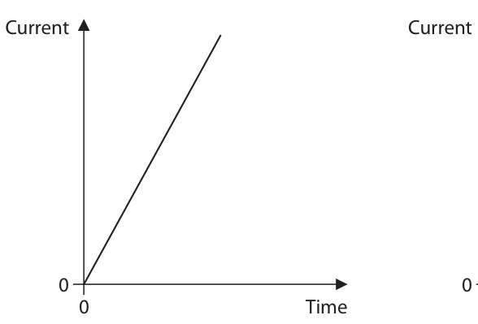
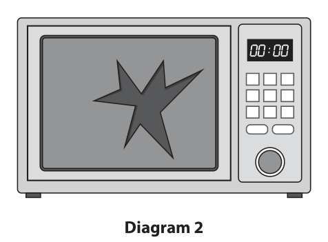
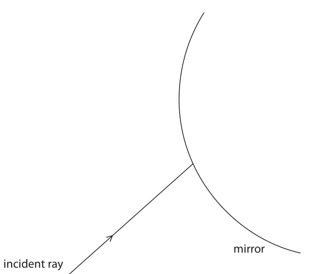
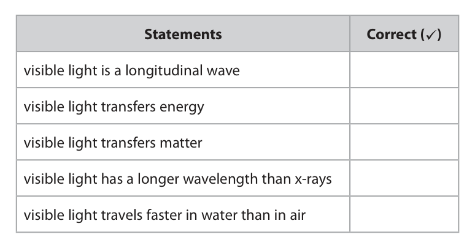
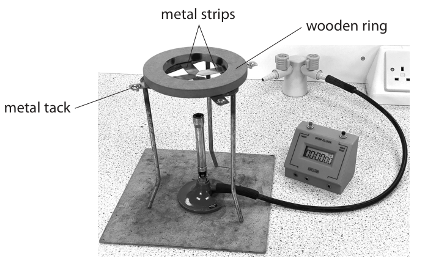
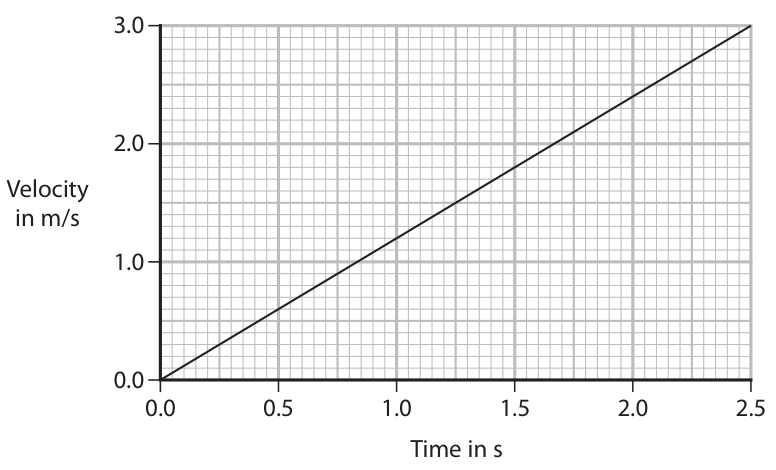
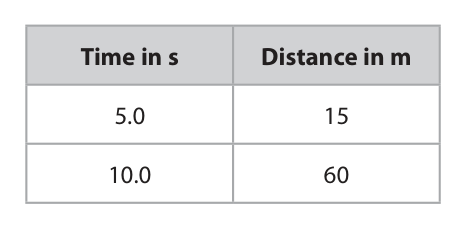
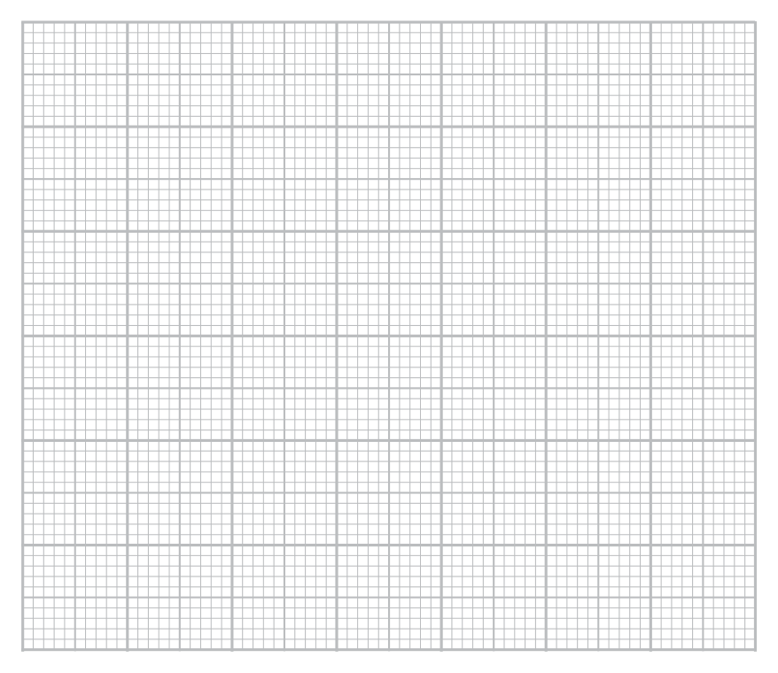
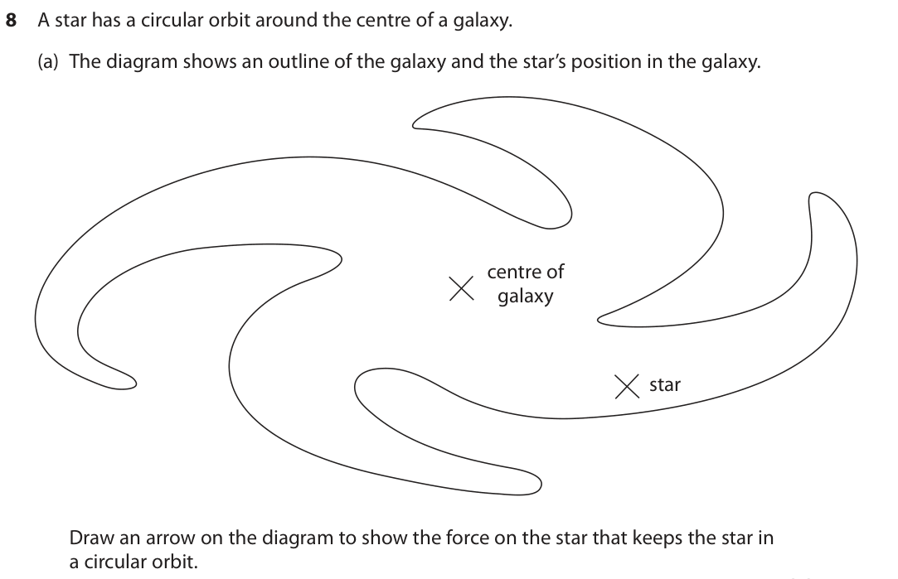
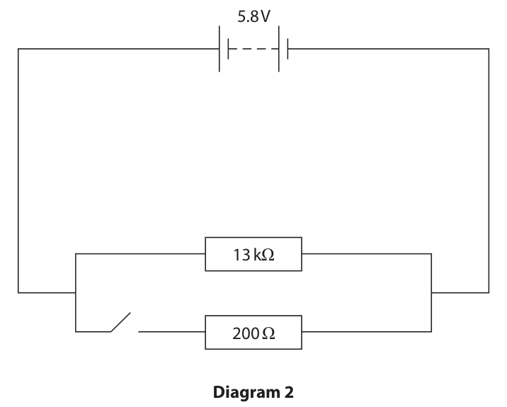

# 4PH1/1P — 2023-11 (official extraction)

> schema `syllabai.official-paper-questions/0.2` · paper_id `pearson-edexcel:international-gcse:physics:4ph1:2023-11:4PH1/1P` · qp sha256 `f872f5bebbee1260…` · extraction is the disclosed baseline (ADR-039)

## Question 1 (5 marks)

This question is about astrophysics.

### 1(a) [1]

Which of these is a large collection of billions of galaxies?

- **(A)** Milky Way
- **(B)** nebula
- **(C)** solar system
- **(D)** universe  ✔

**Mark scheme answer**

> D (universe);
> A is incorrect because the Milky way is the name of a galaxy
> B is incorrect because a nebula contains dust and gas
> C is incorrect because a solar system contains stars and planets
> (b) D (newton per kilogram);
> A is incorrect because this is the unit of mass
> B is incorrect because this is the unit of force
> C is incorrect because this is the unit of the product of force and mass
> (c) C (the Moon has less mass than the Earth);
> A is incorrect because distance from the Sun has no effect on the
> gravitational field strength of the Moon/Earth
> B is incorrect because an atmosphere does not affect gravitational field
> strength
> D is incorrect because a greater density would give a larger gravitational
> field strength
> (d) marks may be awarded
> from a suitably labelled
> diagram
> moon orbits Earth/a planet and comet orbits allow comet's orbit is
> Sun/star; 'bigger'/takes more time
> moon’s orbit is (almost) circular/slightly elliptical allow oval for elliptical
> and comet’s orbit is (very) elliptical; allow speed of moon is
> (almost) constant but
> speed of comet varies
> Answer Notes Marks
> 2 one mark for each correct row;;;; reject if more than one
> letter given in a row
> Answer Notes Marks

- **(1)** Answer D: universe

### 1(b) [1]

Which of these is a correct unit for gravitational field strength, g?

- **(A)** kilogram (kg)
- **(B)** newton (N)
- **(C)** newton kilogram (N kg)
- **(D)** newton per kilogram (N/kg)

### 1(c) [1]

Which statement explains why the gravitational field strength on the Moon is less than the gravitational field strength on Earth?

- **(A)** the Moon is further away from the Sun than the Earth
- **(B)** the Moon has less atmosphere than the Earth
- **(C)** the Moon has less mass than the Earth
- **(D)** the Moon has a greater density than the Earth

### 1(d) [2]

Describe the differences between the orbit of the Moon and the orbit of a comet. You may include a diagram to support your answer.

> 🖼 crop required: diagram (qp.pdf p.5)

## Question 2 (4 marks)

The diagram shows four graphs, P, Q, R and S. Each graph shows a different relationship between current and time. Current Current 0 0 0 Time 0 Time Graph P Graph Q Current Current 0 0 0 Time 0 Time Graph R Graph S The table gives descriptions of the relationships between current and time shown by graphs P, Q, R and S. Complete the table by giving the correct graph for each description. Description Graph current directly proportional to time current increasing at a decreasing rate current has a linear relationship to time but is not directly proportional current decreasing at a decreasing rate

### 2 [4]

The diagram shows four graphs, P, Q, R and S. Each graph shows a different relationship between current and time. Current Current 0 0 0 Time 0 Time Graph P Graph Q Current Current 0 0 0 Time 0 Time Graph R Graph S The table gives descriptions of the relationships between current and time shown by graphs P, Q, R and S. Complete the table by giving the correct graph for each description. Description Graph current directly proportional to time current increasing at a decreasing rate current has a linear relationship to time but is not directly proportional current decreasing at a decreasing rate

## Question 3 (6 marks)

This question is about microwave ovens and microwaves.

**(a)** A microwave oven cooks some food. Diagram 1 represents a microwave emitted by the microwave oven. Distance in cm 0 10 20 30 40 50 Diagram 1

### 3(a)(i) [2]

Determine the wavelength of the microwave. wavelength = cm

### 3(a)(ii) [3]

The microwave has a frequency of 2.35 GHz. Show that the speed of the microwave is about 3 × 108 m/s.

### 3(b) [1]

Diagram 2 shows a damaged microwave oven with a hole in the door. Diagram 2 This microwave oven should not be used as it is very dangerous. State a harmful effect from the microwaves if this oven is used.

## Question 4 (10 marks)

This question is about a filament lamp.

**(c)** The diagram shows a ray of light from the filament lamp incident on the reflective side of a curved mirror. mirror incident ray Complete the diagram by drawing

**(d)** The filament lamp is connected in a circuit with a switch and a battery of three cells. battery switch filament lamp

### 4(a) [1]

Which of these is the correct circuit symbol for a filament lamp? A B M C D

**Mark scheme answer**

> 1
> B( );
> A is incorrect because it is an LED
> C is incorrect because it is a motor
> D is incorrect because it is an LDR
> (b) one mark for each correctly ticked statement;;
> if 3 or more ticks, then
> −1 for each incorrectly
> ticked row

- **(1)** 1

### 4(b) [2]

The filament lamp emits visible light. The table gives some statements about visible light. Place ticks (ü) in the boxes to show which statements are correct for visible light. Statements Correct (ü) visible light is a longitudinal wave visible light transfers energy visible light transfers matter visible light has a longer wavelength than x-rays visible light travels faster in water than in air

### 4(c)(i) [1]

the normal line where the ray is incident on the mirror.

**Mark scheme answer**

> normal line drawn correctly at mirror surface; ignore tangent lines
> does not need to be
> labelled but should be
> drawn at 90° by eye
> where the ray meets
> the mirror

- **(1)** normal line drawn correctly at mirror surface; ignore tangent lines

### 4(c)(ii) [2]

the reflected ray of light.

**Mark scheme answer**

> ray drawn reflecting; reject if ray passes into
> the mirror
> angle of reflection correct; DOP
> judge by eye
> allow ecf from (c)(i)
> e.g.

- **(2)** ray drawn reflecting; reject if ray passes into

### 4(d)(i) [3]

When the switch is on, the filament lamp transfers 120 J of energy in a time of 3.0 minutes. Each cell has a voltage of 1.5 V. Calculate the current in the filament lamp. current = A

**Mark scheme answer**

> substitution into E = I × V × t; allow if 1.5 V used for
> voltage
> ignore unit for time
> allow substitution into
> P=VI and P=E/t
> rearrangement;
> evaluation;
> 26.6…, 8.8…, 0.44…
> = 2 marks
> e.g.
> 120 = current × (3×)1.5 × 3.0(×60)
> current = 120 / 4.5 × 180
> (current =) 0.15 (A) allow 0.148…(A)

- **(3)** substitution into E = I × V × t; allow if 1.5 V used for

### 4(d)(ii) [1]

A small plotting compass is placed near the wires in the circuit. When the switch is turned on, the compass needle moves to a new position. Give a reason why the compass needle moves.

**Mark scheme answer**

> idea that current in wire produces a magnetic ignore wire becomes
> field; magnetic
> Answer Notes Marks

- **(1)** idea that current in wire produces a magnetic ignore wire becomes

## Question 5 (11 marks)

A student uses this apparatus to investigate energy transfer by conduction in metals. metal strips wooden ring metal tack This is the student’s method. • attach four strips, each made of a different metal, to a wooden ring • use wax to attach a metal tack to the end of each metal strip • place the strips above a Bunsen burner • light the Bunsen burner and start a stopwatch at the same time • when enough energy has been transferred to the wax, it melts, causing the metal tack to fall • record the time taken for each tack to fall

**(c)** The bar chart shows the results of the student’s investigation. Time for tack to fall 40 in s aluminium brass copper iron Metal

### 5(a) [3]

Explain how the wooden ring makes the apparatus safer for the student to use.

**Mark scheme answer**

> idea that there is a risk of burning from apparatus; allow prevents burns
> allow metal conducts
> heat (well) / metal gets
> hot
> wood is an insulator; allow wood does not
> conduct heat / wood is
> a poor conductor
> wood will not get (as) hot;
> (b) allow ions for atoms
> idea that atoms in metal have vibrations; allow (free/delocalised)
> electrons in metal move
> around
> idea that vibrations increase in speed/amplitude allow (free/delocalised)
> (when metal is heated); electrons move faster
> (when metal is heated)
> idea that vibrations are passed (along the metal) allow (free/delocalised)
> between particles; electrons collide with
> other electrons/atoms
> (along the metal)

- **(3)** idea that there is a risk of burning from apparatus; allow prevents burns

### 5(b) [3]

Describe how energy is transferred by conduction through the metal strips.

### 5(c)(i) [1]

Justify the use of a bar chart in this investigation.

**Mark scheme answer**

> idea that metal is a discrete / categoric variable; allow not continuous,
> discontinuous variable

- **(1)** idea that metal is a discrete / categoric variable; allow not continuous,

### 5(c)(ii) [2]

State how the student could improve the reliability of their results.

**Mark scheme answer**

> repeat the measurements; allow repeat the
> experiment
> calculate a mean / identify anomalies; allow average for mean

- **(2)** repeat the measurements; allow repeat the

### 5(c)(iii) [2]

The student concludes that iron is the best metal for transferring energy by conduction. Evaluate the student’s conclusion.

**Mark scheme answer**

> copper/aluminium/brass are better conductors; ignore student is wrong
> allow {iron / it} is not
> the best conductor
> (because) time taken (for tack to fall) is shorter / allow (because) time
> quicker; taken (for tack to fall)
> is longer / slower
> Answer Notes Marks

- **(2)** copper/aluminium/brass are better conductors; ignore student is wrong

## Question 6 (10 marks)
**(a)** The graph shows how the velocity of a ball rolling down a long ramp changes with time. 3.0 2.0 Velocity in m/s 1.0 0.0 0.0 0.5 1.0 1.5 2.0 2.5 Time in s

### 6(a)(i) [3]

Using the graph, calculate the acceleration of the ball. acceleration = m/s2

### 6(a)(ii) [1]

State the feature of the graph that gives the distance travelled by the ball.

### 6(a)(iii) [3]

Calculate the distance travelled by the ball in 2.5 seconds. distance = m

### 6(b) [3]

The table shows data for the ball after it has travelled for two different times. Time in s Distance in m 5.0 15 10.0 60 A student suggests that these results obey the relationship: distance = constant time2 Use data from the table to deduce whether the results support this suggestion.

## Question 7 (12 marks)

This question is about using carbon dating to find the age of pieces of wood.

**(a)** The equation shows how carbon-14 forms in the atmosphere. n + 147N → 146C + 11X

**(b)** A scientist determines how the percentage of carbon-14 remaining in a sample of wood changes with time. The table shows the scientist’s data. Percentage (%) of carbon-14 Age of sample remaining in years 30 9900 40 7500 50 5700 60 4200 70 2900

**(c)** Carbon-14 dating is inaccurate for samples of wood produced after 1950. This is because the concentration of carbon-14 in the atmosphere greatly increased due to nuclear weapons testing.

### 7(a)(i) [1]

State the name of particle X.

### 7(a)(ii) [2]

Carbon-14 decays by beta decay. State what happens to the number of protons and the number of neutrons in a carbon-14 nucleus when it decays.

### 7(b)(i) [3]

Plot the scientist’s data on the grid.

**Mark scheme answer**

> linear scales that take up ≥ 50% of the grid for ignore orientation of axes
> both axes; allow use of false origins
> labelled axes with units; allow no units on percentage axis
> all points plotted correctly within ½ small
> square;

- **(3)** linear scales that take up ≥ 50% of the grid for ignore orientation of axes

### 7(b)(ii) [1]

Draw the curve of best fit.

**Mark scheme answer**

> smooth curve within ½ small square of each
> point;
> e.g.

- **(1)** smooth curve within ½ small square of each

### 7(b)(iii) [2]

Use the graph to determine the age of a sample of wood that has 36% of its carbon-14 remaining. age = years

**Mark scheme answer**

> indication on graph from 36% to curve; ecf curve from (ii)
> (age =) 8400 (years); allow 8200-8600 (years)
> allow within a small square of
> candidate’s curve
> answer in allowed range scores
> both marks

- **(2)** indication on graph from 36% to curve; ecf curve from (ii)

### 7(c)(i) [1]

A tree absorbs carbon-14 during its lifetime. A student suggests that trees grown after 1950 are contaminated with carbon-14. Give a reason why the student’s suggestion is correct.

**Mark scheme answer**

> idea that tree contains more carbon-
> 14/radioactive atoms than it would do normally
> / eq;

- **(1)** idea that tree contains more carbon-

### 7(c)(ii) [2]

Explain how nuclear weapons testing affects the determination of the age of a sample of wood produced after 1950.

**Mark scheme answer**

> samples will appear younger; allow idea that age of wood is less
> than it should be e.g. an
> underestimate
> with any one from:
> • idea that trees absorb more carbon-14 (from allow more carbon-14 in the wood
> the atmosphere);
> • more radioactive than ‘normal’/before 1950; allow more contaminated than
> ‘normal’/before 1950
> Answer Notes Marks

- **(2)** samples will appear younger; allow idea that age of wood is less

## Question 8 (6 marks)

A star has a circular orbit around the centre of a galaxy.

### 8(a) [1]

The diagram shows an outline of the galaxy and the star’s position in the galaxy. centre of galaxy star Draw an arrow on the diagram to show the force on the star that keeps the star in a circular orbit.

**Mark scheme answer**

> arrow pointing inwards, in direction from star to reject if contradicting
> centre of galaxy; arrows drawn

- **(1)** arrow pointing inwards, in direction from star to reject if contradicting

### 8(b)(i) [2]

The speed of light is 3.0 × 108 m/s. One light year is the distance light travels in one year. Show that one light year is approximately 1016 m. [one year = 3.2 × 107 s]

**Mark scheme answer**

> any evidence of distance = (average) speed × time;
> correct evaluation given to at least 2s.f.;
> e.g.
> (distance =) 3.0 (× 108) × 3.2 (× 107)
> (distance =) 9.6 × 1015 allow 9.5 × 1015

- **(2)** any evidence of distance = (average) speed × time;

### 8(b)(ii) [3]

The star is 29 000 light years away from the centre of the galaxy and has an orbital speed of 220 km/s. Calculate the time period of the star’s orbit around the centre of the galaxy. Give your answer in standard form. time period = s

**Mark scheme answer**

> substitution into given formula; ignore units
> rearrangement;
> evaluation and presentation in standard form;
> correct answer not in
> standard form = 2 marks
> e.g.
> 8 300 000 000 000 000 (s)
> POT error in standard
> form = 2 marks e.g.
> 8.3 × 10n (s)
> POT error not in
> standard form = 1 mark
> e.g. 830, 828, 0.83,
> 0.828 (s) etc.
> e.g.
> 220 000 = 2 × π × (29 000 × 1016)/T
> T = 2 × π × (29 000 × 1016)/220 000
> (T =) 8.3 × 1015 (s) allow 8.28… × 1015 (s)
> allow 7.9(5) × 1015 (s)
> (from use of 9.6 × 1015
> for the light year)
> Answer Notes Marks

- **(3)** substitution into given formula; ignore units

## Question 9 (11 marks)

Diagram 1 shows some of the stages of electricity generation in a nuclear power station. wires steam turbine reactor water generator pressurised water Diagram 1

**(a)** Nuclear fission takes place inside the reactor of the nuclear power station.

**(b)** High pressure steam transfers energy from the reactor to a turbine. The turbine spins as the steam passes through it. Diagram 2 shows a simplified generator connected to the turbine. wires for transmission of electricity coils of wire magnets shaft turbine Diagram 2

### 9(a)(i) [1]

Give the name of a fuel that could be used in the reactor.

### 9(a)(ii) [4]

Energy is released from the fuel in the reactor by nuclear fission. Describe the process of nuclear fission that takes place inside the reactor.

### 9(b)(i) [3]

Explain how electricity is generated by the generator.

**Mark scheme answer**

> coil(s) rotate; allow magnet(s) rotate
> coil(s) cut magnetic field of magnet(s); ignore magnetic fields
> interacting
> voltage is induced / eq; allow current induced

- **(3)** coil(s) rotate; allow magnet(s) rotate

### 9(b)(ii) [1]

At night the power station does not need to generate as much electricity. Suggest how the output of this generator could be reduced.

**Mark scheme answer**

> any one of: ignore references to
> transformers
> • reduce the strength of the magnetic field; allow weaker magnets
> allow remove some
> magnets
> • fewer coils; allow less turns on
> coil(s)
> • rotate slower / reduce speed;
> • reduce the flow/speed/pressure of steam;
> • reduce rate of fission / reactor output; allow lower/insert
> control rods

- **(1)** any one of: ignore references to

### 9(b)(iii) [2]

The generator produces alternating current. Describe the differences between alternating current (a.c.) and direct current (d.c.).

**Mark scheme answer**

> a.c. changes direction continuously / eq;
> d.c. has one direction;
> Answer Notes Marks

- **(2)** a.c. changes direction continuously / eq;

## Question 10 (10 marks)

This question is about electrical resistors.

**(a)** Diagram 1 shows a 13 kΩ resistor connected to a 5.8 V battery. 5.8 V 13 kΩ Diagram 1

**(b)** Diagram 2 shows a 200 Ω resistor connected in parallel with a 13 kΩ resistor. 5.8 V 13 kΩ 200 Ω Diagram 2

### 10(a)(i) [1]

State the formula linking voltage, current and resistance.

### 10(a)(ii) [3]

Calculate the current in the resistor. current = A

### 10(b)(i) [1]

Complete the circuit diagram by adding a suitable meter to diagram 2 to measure the current in the 13 kΩ resistor.

**Mark scheme answer**

> correct ammeter symbol in series with 13 kΩ
> resistor;

- **(1)** correct ammeter symbol in series with 13 kΩ

### 10(b)(ii) [5]

The switch in the circuit is closed. Explain what happens to the current in the 13 kΩ resistor and the current in the battery. 13 kΩ resistor battery

**Mark scheme answer**

> 13 kΩ resistor:
> • voltage remains the same;
> • so current stays the same; allow current is (still)
> 0.000446… (A)
> battery:
> • total voltage remains the same; allow current flows in
> 200 Ω resistor /
> additional path
> • (circuit) resistance is reduced; allow (total) resistance
> = 197(Ω)
> allow current through
> battery is sum of 2
> currents
> • (therefore) current through battery increases; allow (new) current =
> 0.0294…(A)
> Answer Notes Marks

- **(5)** 13 kΩ resistor:

## Question 11 (12 marks)

The diagram shows a simple barometer designed to measure atmospheric pressure. trapped gas not to scale liquid height X

**(b)** The Sun shines onto the barometer, increasing the temperature of the trapped gas. The volume of the trapped gas remains constant.

### 11(a)(i) [1]

State the formula linking pressure difference, height, density and gravitational field strength, g.

### 11(a)(ii) [4]

The total pressure at point X is 117 kPa. The pressure of the trapped gas is 12 kPa. Calculate the height of the liquid above point X. [ density of liquid = 1.36 × 104 kg/m3 ] height = m

### 11(b)(i) [3]

Explain why the pressure of the trapped gas increases as its temperature increases.

**Mark scheme answer**

> speed/KE of particles increases; ignore particles gain energy
> idea that particles collide with wall(s) more ignore if no evidence of
> frequently; walls/sides of container
> idea that particles collide with wall(s) with ignore if no evidence of
> more force/harder; walls/sides of container

- **(3)** speed/KE of particles increases; ignore particles gain energy

### 11(b)(ii) [4]

The temperature of the trapped gas increases from 23 °C to 38 °C. The pressure of the trapped gas is 12 kPa when its temperature is 23 °C. Calculate the pressure of the trapped gas when its temperature is 38 °C. pressure = kPa

**Mark scheme answer**

> conversion of both temperatures into kelvin;
> substitution into given equation; allow ecf from incorrect
> conversion
> rearrangement;
> evaluation;
> 20 kPa, 19.8 kPa scores 3 (no
> kelvin conversion)
> e.g.
> T1 = 296 K and T2 = 311 K
> 12/296 = p2 / 311
> p2 = 311 × 12/296
> p2 = 13 (kPa) allow 12.6…(kPa)
> Answer Notes Marks

- **(4)** conversion of both temperatures into kelvin;

## Question 12 (13 marks)

The photograph shows a toy called a marble run. point A pipe point B table marble A student lifts a marble from the table to the top of the marble run at point A. They release the marble from point A and it rolls through pipes to reach the bottom of the marble run at point B. The marble leaves the marble run at point B and rolls across the table. As the marble rolls, energy is transferred due to the different forces acting on the marble.

**(b)** The student wants to measure how much energy the marble loses as it moves from point A to point B.

### 12(a) [5]

Describe the energy transfers from before the student lifts the marble to when the marble reaches point B of the marble run.

**Mark scheme answer**

> any five from:
> MP1. chemical energy (store of student);
> MP2. transferred mechanically; allow idea this is due to a lift
> force exerted by student
> MP3. (to) gravitational energy (store of marble);
> MP4. transferred mechanically; must be a clear second
> reference
> allow idea this is due to
> marble’s weight
> MP5. (to) kinetic energy (store of marble);
> MP6. idea that thermal energy (store of marble) allow heat for thermal
> increases;
> MP7. idea that thermal energy (store) of marble allow heat for thermal
> run / surroundings increases;
> MP8. energy transferred to surroundings by allow transferred/lost as sound
> radiation;

- **(5)** any five from:

### 12(b)(i) [3]

The student needs to measure the speed of the marble as it leaves the marble run at point B. Describe a method the student could use to measure this speed.

**Mark scheme answer**

> let marble roll across table for a known distance; allow measure distance
> travelled across table
> measure time taken; reject if linked to measuring
> time between A and B
> use speed = distance / time;
> OR
> use of light gate;
> connected to datalogger; allow use of device with two
> integrated light gates
> positioned so that (centre of) marble cuts
> beam(s);

- **(3)** let marble roll across table for a known distance; allow measure distance

### 12(b)(ii) [5]

The difference in height between point A and point B is 0.21 m. The mass of the marble is 5.5 g. The marble leaves the marble run at point B with a speed of 0.76 m/s. Calculate the energy lost by the marble as it rolls from point A to point B. energy lost = J

**Mark scheme answer**

> substitution into GPE formula; ignore units
> allow use of g = 9.8, 9.81
> evaluation of GPE; only penalise not converting g
> to kg once
> substitution into KE formula; ignore units
> evaluation of KE; only penalise not converting g
> to kg once
> subtraction to find energy lost; allow ecf from incorrect GPE
> and/or KE
> 10, 10.0, 9.96…, 9.7… (J) etc.
> scores 4 marks
> e.g.
> GPE = 0.0055 × 10 × 0.21
> GPE = 0.01155 (J) allow 0.0113…
> KE = 0.5 × 0.0055 × 0.762
> KE = 0.0015884 (J)
> energy lost = (0.01155 ― 0.0015884 =) allow 0.00996…, 0.0097… (J)
> 0.010 (J)
> Pearson Education Limited. Registered company number 872828
> with its registered office at 80 Strand, London, WC2R 0RL, United Kingdom

- **(5)** substitution into GPE formula; ignore units

