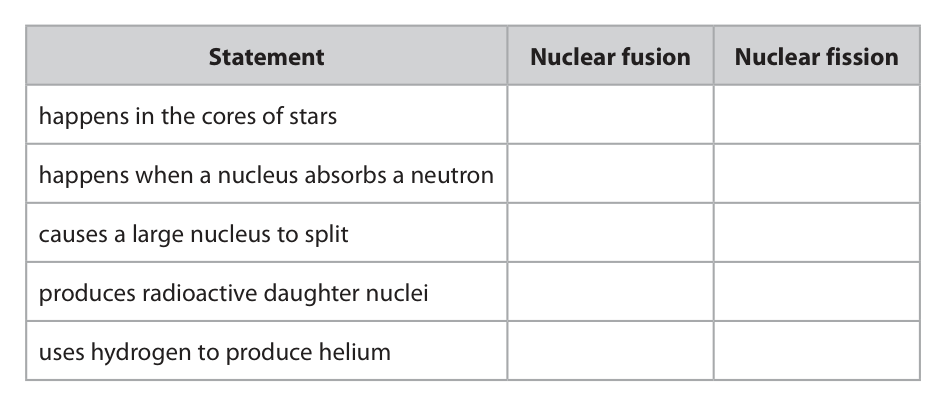
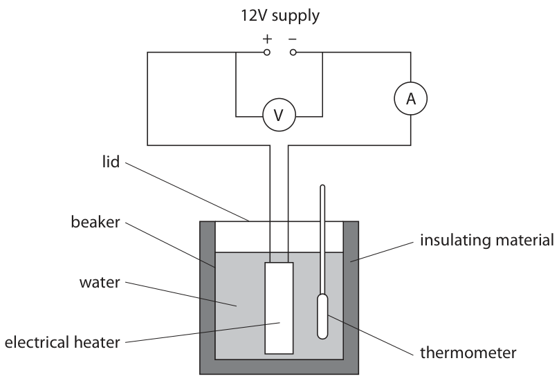
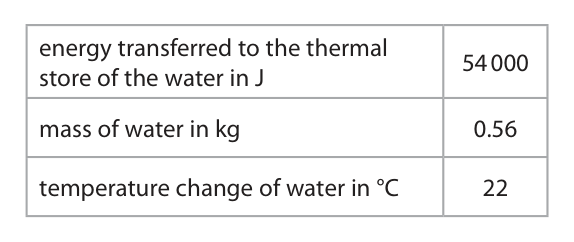
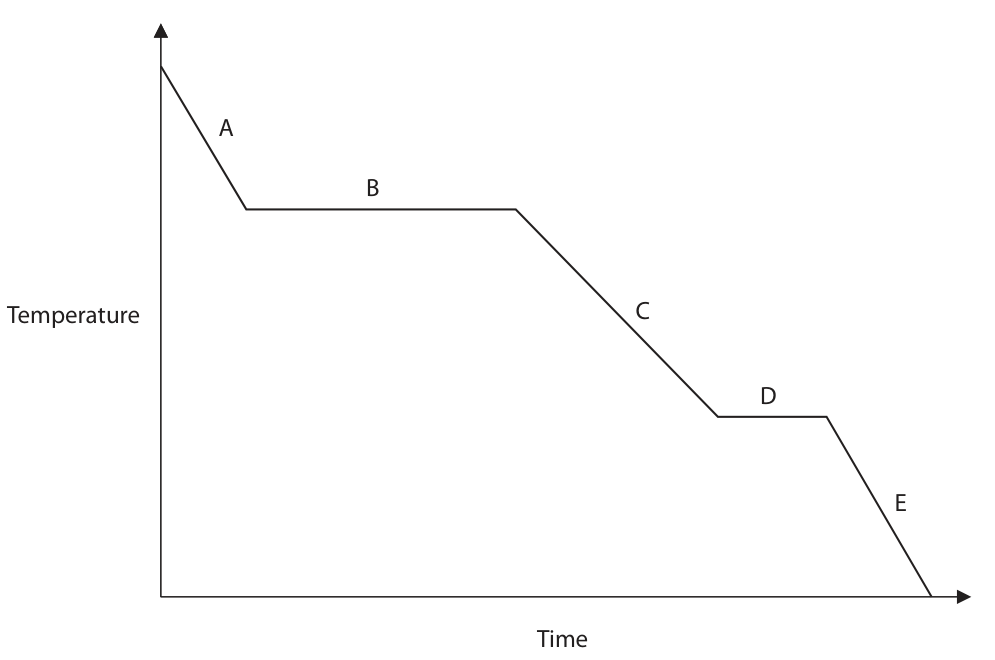
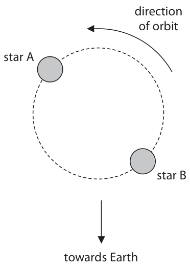

# 4PH1/2P — 2023-11 (official extraction)

> schema `syllabai.official-paper-questions/0.2` · paper_id `pearson-edexcel:international-gcse:physics:4ph1:2023-11:4PH1/2P` · qp sha256 `4a08ebd92a86e394…` · extraction is the disclosed baseline (ADR-039)

## Question 1 (7 marks)

This question is about nuclear reactions.

### 1(a) [3]

Nuclear fusion and nuclear fission release energy from the nuclear stores of atoms. The table gives some statements about nuclear fusion and some statements about nuclear fission. Place ticks (✓) in the table to show whether each statement applies to nuclear fusion or nuclear fission. Statement Nuclear fusion Nuclear fission happens in the cores of stars happens when a nucleus absorbs a neutron causes a large nucleus to split produces radioactive daughter nuclei uses hydrogen to produce helium

**Mark scheme answer**

> all five rows correct = 3 marks row cannot score if
> 3-4 rows correct = 2 marks both boxes ticked
> 1-2 rows correct = 1 mark
> allow any reasonable
> indication other than
> a tick
> (b) high temperature; ignore references to
> repulsion or
> attraction
> (so that) nuclei will have high(er) speed or high(er) condone particles,
> {kinetic energy/KE}; atoms, molecules for
> nuclei
> high pressure;
> plus one from:
> • (so that nuclei will be) closer together / eq; e.g. closely packed
> • (so that nuclei are) more likely to collide/ eq; e.g. collide more
> frequently
> Answer Notes Marks

- **(3)** all five rows correct = 3 marks row cannot score if

### 1(b) [4]

In nuclear fusion, two positively charged nuclei must overcome the effects of the repulsive electrostatic force between them. Explain the two conditions needed to overcome the effects of this repulsive force and achieve nuclear fusion. 1 2

## Question 2 (9 marks)

This question is about moments. Diagram 1 shows the raised lower leg of a person. F 0.25 m 0.28 m weight of pivot lower leg 0.55 m Diagram 1

**(b)** Diagram 2 shows the person resting their lower leg on two supports. force X force Y support A support B weight of lower leg Diagram 2

### 2(a)(i) [2]

The moment of the weight of the lower leg about the pivot is 19 N m. A vertical force, F, is applied to the person’s foot to keep the lower leg raised. The lower leg does not move. Calculate the magnitude of force F, using the formula moment = force × perpendicular distance from pivot force F = N

### 2(a)(ii) [1]

Which distance is used to calculate the moment of the weight of the lower leg about the pivot?

- **(A)** 0.25 m
- **(B)** 0.28 m
- **(C)** 0.30 m
- **(D)** 0.55 m

### 2(b)(i) [3]

The centre of gravity of the lower leg is 0.25 m away from support A and 0.35 m away from support B. Explain whether force X or force Y is larger. Ignore the weight of the upper leg.

**Mark scheme answer**

> Note: no credit for
> repeating question I.e.
> CoG is closer to support
> A
> force X has the shorter distance to the CoG; condone reference to
> force A
> accept ‘weight’ for CoG
> allow RA
> moments of two forces must be equal/eq; i.e. (total) clockwise
> moment = (total) anti-
> clockwise moment
> so force X must be larger; DOP on either

- **(3)** Note: no credit for

### 2(b)(ii) [3]

A bag of ice is placed on the lower leg, vertically above the centre of gravity. This causes force X and force Y to increase. The bag is then moved towards the person’s foot. Describe how force X and force Y change as the bag is moved towards the person’s foot.

**Mark scheme answer**

> any three from:
> force X decreases;
> force Y increases;
> change by the same amount; allow idea of change
> with distance is linear
> total force remains the same;
> Answer Notes Marks

- **(3)** any three from:

## Question 3 (11 marks)

The diagram shows some apparatus that can be used to determine the specific heat capacity of water. 12V supply + – A V lid beaker insulating material water electrical heater thermometer

### 3(a) [6]

Describe how a student could use this apparatus to determine the specific heat capacity of water. Include details of any additional equipment needed in your answer.

**Mark scheme answer**

> any five from:
> MP1. idea of mass of water = [mass of water and accept zeroing
> cup] − [mass of cup]; balance with cup
> present
> MP2. mass found on balance; condone ‘weighing
> scales’ or ‘scales’
> reject ‘scale’
> allow ‘measure
> volume of water with
> a measuring cylinder
> and multiply volume
> by density to find
> mass’ for MP1 and
> MP2
> MP3. time measured on timer/stopwatch/stopclock; accept idea of a fixed
> amount of time
> MP4. idea of finding temperature change; e.g. temp change =
> final temp − initial
> temp
> accept idea of a
> defined temperature
> change I.e. stop
> heating after a temp
> change of 20 degrees
> MP5. energy supplied = voltmeter reading × accept E = VIt
> ammeter reading × time; accept use of
> joulemeter
> MP6. whole experiment repeated and averaged; i.e. get several values
> of c
> MP7. water stirred (throughout);
> MP8. keep taking temperature after heater switched
> off for max temp;
> MP9. plot a graph of temperature against time;
> MP10. find gradient of temperature-time graph;
> and one from:
> MP11. use of equation "gradient = power of heater /
> m × c” or re-arrangement;
> MP12. rearrangement of formula sheet equation;
> i.e. c = energy supplied/(m × temp change)

- **(6)** any five from:

### 3(b)(i) [3]

The table shows the student’s results. energy transferred to the thermal 54 000 store of the water in J mass of water in kg 0.56 temperature change of water in °C 22 Use the student’s results to calculate the specific heat capacity of water. specific heat capacity of water = J / kg °C

**Mark scheme answer**

> substitution into given formula;
> rearrangement;
> evaluation; -1 POT error
> e.g.
> 54 000 = 0.56 × c × 22
> c = 54 000 / 0.56 × 22
> (c =) 4400 (J/kg °C) allow 4383…
> allow any reasonable
> rounding
> ignore rounding error
> after 3sf

- **(3)** substitution into given formula;

### 3(b)(ii) [2]

Give two reasons why the energy from the heater is not all retained in the thermal store of the water. 1 2

**Mark scheme answer**

> any two from: ignore references to
> KE or sound
> MP1. heating of beaker/heating of thermometer; allow idea of ‘heat
> goes to
> beaker/thermometer’
> MP2. heating of surroundings/heating of insulation; allow idea of ‘heat
> going to surroundings
> or insulaton’
> MP3. insulation not perfect; e.g. insulation
> conducts or radiates
> MP4. hole(s) in lid for thermometer/heater leave gaps; allow idea of heat
> ‘escaping’ through lid
> or via evaporation
> Answer Notes Marks

- **(2)** any two from: ignore references to

## Question 4 (10 marks)

The diagram shows a step-down transformer. primary coil secondary coil iron core 16 W output

### 4(a) [3]

The input power to the transformer is 16 W. The transformer is used for 2.5 hours. Calculate the energy transferred to the transformer during this time. energy transferred = J

**Mark scheme answer**

> substitution into given formula; ignore units
> rearrangement;
> evaluation;
> 2 marks max. if time
> not converted correctly
> to seconds e.g. 40 (J),
> 2400 (J)
> e.g.
> 16 = energy / 2.5 (× 3600)
> energy = 16 × 2.5 (× 3600)
> (energy =) 140 000 (J) allow 144 000 (J)
> 2.5 × 60 × 60 or 9000
> seen for 1 mark if no
> other mark awarded
> (b) any six from:
> MP1. it steps up or steps down the voltage; allow “increases”,
> “decreases” or
> “changes”
> MP2. current in (primary) coil produces magnetic
> field;
> MP3. current is changing/alternating;
> MP4. causing a (changing) magnetic field in the e.g. making the core
> core; magnetised
> MP5. the core strengthens the magnetic field; allow “concentrates”
> for “strengthens”
> MP6. idea that iron is a soft magnetic material I.e.
> can gain and lose its magnetism easily
> MP7. field lines interact with (secondary) coil; idea of core linking the
> two coils with magnetic
> field
> MP8. which induces a voltage in the secondary condone “induces a
> coil; current”
> MP9. transformer won’t work with (steady) d.c.; ignore idea of “works
> with a.c.” repetition of
> stem
> (c) less turns (on the primary coil) / eq; ignore any reference to
> secondary
> ignore references to
> increasing current,
> power or voltage of the
> primary coil
> condone ‘coils’ for
> ‘turns’
> Answer Notes Marks

- **(3)** substitution into given formula; ignore units

### 4(b) [6]

Explain how a transformer works. In your answer, include reasons for using • two coils • the iron core • an a.c. power supply

### 4(c) [1]

State how the primary coil of the transformer can be changed to increase the output voltage.

## Question 5 (7 marks)

A sample of steam (water in a gas state) is cooled using a very cold freezer.

**(b)** The temperature-time graph shows how the temperature of the steam changes during the cooling process. The steam eventually becomes ice (water in a solid state). A B Temperature C D E Time

### 5(a) [1]

The steam is cooled from an initial temperature of 150 °C. Calculate the initial temperature of the steam in kelvin (K). initial temperature = K

**Mark scheme answer**

> 423 (K); allow 423.15 (K),
> 423.16(K)

- **(1)** 423 (K); allow 423.15 (K),

### 5(b)(i) [1]

The graph shows five stages, A, B, C, D and E, of the cooling process. State which stages of the cooling process show a change of state.

**Mark scheme answer**

> B and D only; both required

- **(1)** B and D only; both required

### 5(b)(ii) [2]

Describe the differences in the arrangement of particles when the sample is in a gas state (steam) and a solid state (ice). You may draw a diagram to help your answer.

**Mark scheme answer**

> particles closer together in solid; accept RA
> ignore motion
> references
> may be shown in a
> clear, titled diagram
> particles have fixed or regular arrangement in may be shown in a
> solid but irregular in gas; clear, titled diagram

- **(2)** particles closer together in solid; accept RA

### 5(b)(iii) [3]

Explain whether or not the energy in the kinetic store of the particles changes when the sample is changing state.

**Mark scheme answer**

> kinetic energy stays constant / eq;
> and any two from:
> • temperature stays constant (during state
> change);
> • (average) speed of particles does not
> change;
> • (kelvin) temperature is (directly)
> proportional to (average) kinetic energy
> of particles;
> Answer Notes Marks

- **(3)** kinetic energy stays constant / eq;

## Question 6 (13 marks)

This question is about momentum and forces.

**(b)** The diagram shows an air track that can be used to investigate motion without friction. Air comes out through a series of small holes in the air track. The air lifts the glider slightly above the track. A small spacecraft engine floats at rest on a cushion of air. spacecraft engine glider air in air holes

### 6(a) [1]

State the principle of conservation of momentum.

**Mark scheme answer**

> idea that (total) momentum before = (total) ignore ‘momentum is
> momentum after (event); conserved’

- **(1)** idea that (total) momentum before = (total) ignore ‘momentum is

### 6(b)(i) [1]

State the momentum of the spacecraft engine when it is at rest. momentum = kg m / s

**Mark scheme answer**

> zero/0/nought/nothing;

- **(1)** zero/0/nought/nothing;

### 6(b)(ii) [3]

The spacecraft engine ejects large numbers of xenon ions to the left. A mass of 2.6 × 10−8 kg of xenon ions leaves the engine with a mean speed of 26 km / s. Calculate the momentum of all the ejected xenon ions. momentum = kg m / s

**Mark scheme answer**

> recall of momentum = mass × velocity; allow standard symbols
> e.g. p = m × v
> substitution;
> evaluation; -1 POT error
> e.g.
> p = mv
> p = 2.6 × 10−8 × 26 000
> p = 6.8 × 10−4 (kg m/s) allow 6.76 × 10−4

- **(3)** recall of momentum = mass × velocity; allow standard symbols

### 6(b)(iii) [2]

State the magnitude and direction of the spacecraft engine’s momentum after these xenon ions leave the engine. magnitude of momentum = kg m / s direction of momentum =

**Mark scheme answer**

> 6.8 × 10−4 (kg m/s); allow ecf from (ii)
> right;

- **(2)** 6.8 × 10−4 (kg m/s); allow ecf from (ii)

### 6(b)(iv) [4]

The ions exert a force of 2.6 mN on the spacecraft engine. The spacecraft engine has a mass of 1.2 kg. Calculate the acceleration of the engine. Give your answer to 2 significant figures. acceleration = m / s2

**Mark scheme answer**

> substitution into ‘F=ma’; ignore units
> rearrangement;
> evaluation; −1 for POT error
> answer given to 2s.f.; independent mark
> e.g.
> 2.6 (×10−3)= 1.2 × acceleration
> acceleration 2.6 (×10−3) / 1.2
> (acceleration =) 2.16… × 10−3 (m/s2)
> (acceleration =) 2.2 × 10−3 (m/s2)
> (c) any two from: ignore idea of simple
> yes/no
> MP1. idea of tiny amount of fuel ‘consumed’ per
> second;
> MP2. any attempt of calculation of time to run out
> of xenon seen;
> MP3. correct calculation of 7.575... × 106 s; accept 88 or 87.68..
> days, 2104 hours, 1.26..
> × 105 minutes , 12.5..
> weeks, 0.24... years
> MP4. idea that ‘burn’ is for a long time;
> MP5. idea that low acceleration for long time
> gives high speed change;
> MP6. mass of spacecraft will be larger so
> acceleration is even smaller;
> Answer Notes Marks

- **(4)** substitution into ‘F=ma’; ignore units

### 6(c) [2]

The engine is designed to accelerate a spacecraft while the spacecraft is travelling through space. The spacecraft carries a mass of 0.75 kg of xenon ions for the engine. When the engine is used, 9.9 × 10−8 kg of xenon ions leave the engine each second. A student suggests that this small spacecraft engine would not be useful because the acceleration it produces is very small. Evaluate the student’s suggestion.

## Question 7 (8 marks)

The diagram shows the screen of an oscilloscope when a sound wave is detected, and the oscilloscope settings. oscilloscope settings: y direction: 1 square = 5.0 V x direction: 1 square = 0.0020 s

### 7(a) [1]

Give the name of the piece of equipment that is connected to the oscilloscope to detect the sound wave.

**Mark scheme answer**

> microphone;

- **(1)** microphone;

### 7(b)(i) [2]

Use the trace on the oscilloscope to determine the time period of the detected sound wave. time period = s

**Mark scheme answer**

> determination of number of squares for one period; allow 5.2 − 5.5 squares
> use of timebase to determine appropriate period in ‘5 x 0.002’ or ‘0.01’
> seconds; scores 1
> ‘8 x 0.002’ or ‘0.016’
> scores 1
> accept 0.0104 − 0.0110 (s)
> for 2 marks
> e.g.
> period = 8/1.5 = 5.3 squares
> period = (5.3 × 0.002 =) 0.011(s)

- **(2)** determination of number of squares for one period; allow 5.2 − 5.5 squares

### 7(b)(ii) [1]

Calculate the frequency of the detected sound wave. frequency = Hz

**Mark scheme answer**

> use of f = 1 / T to evaluate frequency; allow ecf from (i)
> e.g.
> frequency = (1 / 0.011 =) 91 (Hz) allow 90.9-96.2 (Hz)

- **(1)** use of f = 1 / T to evaluate frequency; allow ecf from (i)

### 7(c)(i) [1]

State the formula linking energy transferred, charge and voltage.

**Mark scheme answer**

> energy (transferred) = charge × voltage; allow rearrangements and
> standard symbols e.g
> E=Q×V
> allow W for energy
> ignore C for charge

- **(1)** energy (transferred) = charge × voltage; allow rearrangements and

### 7(c)(ii) [3]

The effective voltage of the oscilloscope trace can be calculated using the formula amplitude of trace in V effective voltage = Use the effective voltage to calculate the energy transferred when 6.3 × 10−5 C of charge passes through the oscilloscope. energy transferred = J

**Mark scheme answer**

> amplitude of signal in volts determined;
> evaluation of effective voltage; ecf amplitude in volts
> evaluation of energy transferred; reject 6.3 × 10−5 / √2
> -1 POT error
> e.g.
> amplitude = 2 squares × 5 = 10 V
> effective voltage = 10 / √2 = 7.1 V
> energy transferred = (7.1 × 6.3 × 10−5 =) 4.5 × 10−4 (J) allow
> 4.4 × 10−4 − 4.5 × 10−4 (J)
> 8.9... × 10−4 scores 2
> Answer Notes Marks

- **(3)** amplitude of signal in volts determined;

## Question 8 (5 marks)

This question is about red‑shift.

### 8(a) [1]

The diagram shows two identical stars, A and B, orbiting each other. direction of orbit star A star B towards Earth Light from each star arrives at Earth. As the stars move in their orbit, the wavelength of the light observed at Earth changes due to the Doppler effect. Add an X to the diagram to show the position of star B when the light emitted from it shows maximum red-shift when detected on Earth.

**Mark scheme answer**

> X at 3 o’clock position on orbit by eye; any indicative mark
> within a star’s radius of
> the correct position
> (b) difference in wavelength: 11 (nm);
> all substitutions correct in formula; allow ecf from clear
> incorrect change in
> wavelength
> rearrangement;
> evaluation; -1 POT error
> 5.88 × 106 scores 3
> marks (wrong lab
> wavelength)
> e.g.
> ∆λ = 561 − 550 = 11 (nm)
> 11/550 = v / 3.0 × 108 ignore references to
> v = 11/550 × 3.0 × 108 direction
> (v =) 6.0 × 106 (m/s)
> Pearson Education Limited. Registered company number 872828
> with its registered office at 80 Strand, London, WC2R 0RL, United Kingdom

- **(1)** X at 3 o’clock position on orbit by eye; any indicative mark

### 8(b) [4]

Light is received on Earth from a distant galaxy. The longest wavelength of light arriving at Earth from the galaxy is 561 nm. A lamp on Earth produces the same light with a wavelength of 550 nm. Calculate the velocity of the galaxy. [speed of light = 3.0 × 108 m / s] velocity = m / s

