# 4PH1/1P — 2024-06 (official extraction)

> schema `syllabai.official-paper-questions/0.2` · paper_id `pearson-edexcel:international-gcse:physics:4ph1:2024-06:4PH1/1P` · qp sha256 `3c1e2eea09258259…` · extraction is the disclosed baseline (ADR-039)

## Question 1 (5 marks)

This question is about the motion of objects in the solar system.

### 1(a)(i) [2]

Draw a labelled diagram showing the Moon orbiting the Earth.

**Mark scheme answer**

> labelled diagram showing a moon in circular orbit allow planet for Earth
> around Earth; judge circular by eye
> ignore attempts at 3D
> drawing
> Earth approximately at the centre of the path; allow planet for Earth

- **(2)** labelled diagram showing a moon in circular orbit allow planet for Earth

### 1(a)(ii) [1]

Give the name of the force that causes the Moon to orbit the Earth.

**Mark scheme answer**

> gravitational (force); allow gravity
> ignore weight,
> centripetal, centrifugal
> reject gravitational
> potential, gravitational
> field strength

- **(1)** gravitational (force); allow gravity

### 1(a)(iii) [1]

Give the name of another object that orbits the Earth.

**Mark scheme answer**

> satellite / space station; allow other suitable
> object e.g. (rocket)
> debris etc.
> reject comet

- **(1)** satellite / space station; allow other suitable

### 1(b) [1]

A planet and a comet both orbit a star. Give a difference between the orbit of a planet and the orbit of a comet.

**Mark scheme answer**

> planet’s orbit is circular/slightly elliptical but clear comparison
> comet’s orbit is elliptical/oval; needed
> allow comet orbit is
> more elliptical
> OR ignore references to
> period/length of orbits
> planet has constant speed but comet has variable allow idea that planet
> speed; has constant orbital
> radius but comet has
> variable orbital radius
> Answer Marks

- **(1)** planet’s orbit is circular/slightly elliptical but clear comparison

## Question 2 (5 marks)

This question is about radioactivity.

### 2(a) [1]

The nucleus of an atom of carbon has 6 protons and 8 neutrons. Which row of the table shows the nucleus of an atom that is a different isotope of carbon? Number of protons Number of neutrons

- **(A)** 6                       6  ✔
- **(B)** 6                       8
- **(C)** 8                       6
- **(D)** 8                       8

**Mark scheme answer**

> A (6 protons, 6 neutrons);
> B is not the answer because it is the same isotope
> C is not the answer because it is a different element
> D is not the answer because it is a different element

- **(1)** Answer A: 6                       6

### 2(b) [1]

Which type of radiation is a high-energy electron?

- **(A)** alpha
- **(B)** beta  ✔
- **(C)** gamma
- **(D)** neutron

**Mark scheme answer**

> B (beta);
> A is not the answer because alpha is a helium nucleus
> C is not the answer because gamma is a high frequency EM wave
> D is not the answer because it is not an electron

- **(1)** Answer B: beta

### 2(c) [1]

A nucleus emits radiation. This causes the mass number to decrease by one. The atomic number stays the same. Which type of radiation does the nucleus emit? A alpha B beta C gamma D neutron

**Mark scheme answer**

> D (neutron);
> A is not the answer because this would decrease the atomic number and
> decrease the mass number
> B is not the answer because this would increase the atomic number and
> keep the mass number the same
> C is not the answer because this would keep the atomic number and mass
> number the same

- **(1)** D (neutron);

### 2(d) [1]

The nucleus of an isotope of uranium can be represented using this symbol. U 238 The nucleus forms part of a positively charged ion. How many electrons could be in this ion?

- **(A)** 90  ✔
- **(B)** 92
- **(C)** 146
- **(D)** 238

**Mark scheme answer**

> A (90);
> B is not the answer because this is a neutral atom
> C is not the answer because it is a negatively charged ion
> D is not the answer because it is a negatively charged ion

- **(1)** Answer A: 90

### 2(e) [1]

A radioactive isotope has an initial activity of 400 Bq. The half-life of the isotope is 8 hours. What is the activity of the isotope after 16 hours? A 25 Bq B 50 Bq C 100 Bq D 200 Bq

**Mark scheme answer**

> C (100 Bq);
> A is not the answer because this is 4 half-lives
> B is not the answer because this is 3 half-lives
> D is not the answer because this is 1 half-life
> Answer Notes Marks

- **(1)** C (100 Bq);

## Question 3 (10 marks)

The photograph shows infrared heating lamps being used to harden fresh paint on a car. infrared heating lamps car (Source: © Dmitry Kalinovsky / Shutterstock)

**(b)** The heating lamps produce visible light waves in addition to infrared waves.

### 3(a) [1]

Give a harmful effect of infrared waves.

**Mark scheme answer**

> {skin / eye / tissue} burns; allow damage to surface
> cells, skin damage
> reject skin cancer, cell
> mutation, sunburn

- **(1)** {skin / eye / tissue} burns; allow damage to surface

### 3(b)(i) [2]

Give two similar properties of visible light waves and infrared waves. 1 2

**Mark scheme answer**

> any two from:
> • both electromagnetic waves; allow EM waves
> allow both part of EM
> spectrum
> • both transfer energy; allow both can be
> reflected / refracted /
> diffracted
> • both transverse waves;
> • both are non-ionising;
> • both can travel through vacuum;
> • both have same speed (in a vacuum);

- **(2)** any two from:

### 3(b)(ii) [2]

Give two differences between the properties of visible light waves and infrared waves. 1 2

**Mark scheme answer**

> • infrared has longer/higher wavelength; allow RA
> • infrared has lower frequency; allow RA
> condone infrared has lower
> energy

- **(2)** • infrared has longer/higher wavelength; allow RA

### 3(c) [3]

The infrared heating lamps are placed 1.5 m from the car. Calculate the time taken for infrared waves emitted from a lamp to reach the car. [for infrared waves, speed = 3.0 × 10⁸ m/s] time taken = s

**Mark scheme answer**

> substitution into speed = distance / time;
> rearrangement;
> evaluation; -1 for POT error
> e.g.
> 3.0 × 10⁸ = 1.5 / time
> time = 1.5 / 3.0 × 10⁸
> (time =) 5.0 × 10⁻⁹ (s) allow 5 × 10⁻⁹ (s),
> 0.000 000 005 (s)

- **(3)** substitution into speed = distance / time;

### 3(d) [2]

Paint takes less time to harden when it absorbs more energy from infrared radiation. A technician observes that white paint takes more time to harden than black paint. Explain this observation.

**Mark scheme answer**

> black is a better/good absorber (of infrared allow RA e.g. white is a
> radiation); poor absorber
> allow white is a
> better/good reflector (of
> infrared radiation)
> idea that more energy/heat transferred to black car allow RA e.g. less
> (in the same time); energy/heat transferred to
> white car
> allow black car warms up
> quicker
> black car absorbs more
> energy/heat scores 2
> Answer Notes Marks

- **(2)** black is a better/good absorber (of infrared allow RA e.g. white is a

## Question 4 (9 marks)

This question is about the evolution of a star.

### 4(a) [4]

A main sequence star is created in a collapsing region of a nebula. The table gives different energy stores for the gases in the collapsing nebula, from when the nebula starts to collapse to just before the main sequence star is created. Complete the table by placing ticks (ü) to show whether each energy store increases, decreases or stays the same. Stays the Energy store Increases Decreases same chemical gravitational potential nuclear thermal

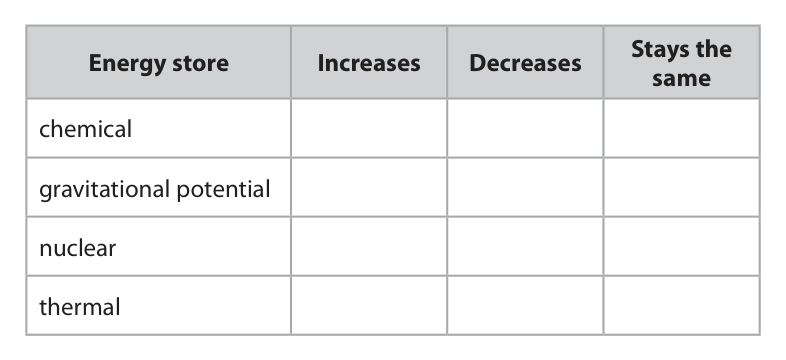

**Mark scheme answer**

> one mark for each correct row;;;; reject mark for row if
> more than one tick
> given

- **(4)** one mark for each correct row;;;; reject mark for row if

### 4(b) [1]

At the end of the main sequence stage of a star’s evolution, the star can become a red giant or a red supergiant. Give the property of a star that determines whether it becomes a red giant or a red supergiant.

**Mark scheme answer**

> mass; ignore size, weight

- **(1)** mass; ignore size, weight

### 4(c) [4]

A red giant star eventually becomes a white dwarf star. Discuss the differences between a red giant star and a white dwarf star.

**Mark scheme answer**

> any four from: allow RA for all marking
> points
> MP1. red giant has greater brightness than white allow absolute
> dwarf; magnitude, luminosity,
> power for brightness
> allow red giant emits
> more light
> MP2. (nuclear) fusion takes place in red giant allow red giant has
> (core) but not in white dwarf (core); more hydrogen
> MP3. red giant is larger than white dwarf; condone red giant has
> more mass than white
> dwarf
> MP4. red giant has lower (surface) temperature allow red giant is cooler
> than white dwarf;
> MP5. white dwarf is denser than a red giant;
> MP6. white dwarf has a planetary nebula but a red
> giant does not;
> Answer Notes Marks

- **(4)** any four from: allow RA for all marking

## Question 5 (11 marks)
**(b)** Diagram 1 shows an object suspended from a support using a metal spring. The object is initially at rest. support spring object Diagram 1

### 5(a) [3]

A metal spring obeys Hooke’s law. Sketch a graph to show that the spring obeys Hooke’s law as it is stretched. You should label both axes with appropriate physical quantities.

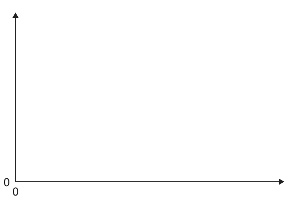

**Mark scheme answer**

> axes labelled “extension”/“elongation” and ignore units
> “load”/“force”/”weight”; allow “distance/length
> stretched” for extension
> ignore orientation of
> axes
> straight line of positive gradient drawn throughout; judge by eye
> condone curve at end of
> line if clear indication
> that Hooke’s law does
> not apply for that part of
> the line e.g. “limit of
> proportionality” marked
> at end of straight section
> ignore “elastic limit”
> line passes through origin;
> allow full marks for axes
> labelled “length” and
> “load”/”force”/”weight”
> if line intersects length
> axis above zero

- **(3)** axes labelled “extension”/“elongation” and ignore units

### 5(b)(i) [2]

The object is pulled down and then released. Diagram 2 shows the forces acting on the object at the instant it is released. 3.2 N object 2.0 N Diagram 2 Determine the magnitude and direction of the resultant force acting on the object. magnitude of resultant force = N direction of resultant force =

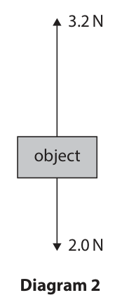

**Mark scheme answer**

> magnitude = 1.2 (N);
> direction = up(wards); allow arrow pointing up
> ignore unqualified
> “north”

- **(2)** magnitude = 1.2 (N);

### 5(b)(ii) [3]

The object has a mass of 0.20 kg. Calculate the acceleration of the object at the instant it is released. acceleration = m/s²

**Mark scheme answer**

> substitution into F = m × a; allow ecf from (i)
> rearrangement;
> evaluation; -1 for POT error
> e.g.
> $1.2 = 0.20 \times a$
> $a = 1.2 / 0.20$
> (a =) 6.0 (m/s²) allow 6 (m/s²)

- **(3)** substitution into F = m × a; allow ecf from (i)

### 5(b)(iii) [3]

Explain how the magnitude of the acceleration of the object changes, from the instant the object is released until the first time the object returns to its initial resting position. You should refer to the forces acting on the object in your answer.

**Mark scheme answer**

> acceleration decreases (to zero); ignore decelerates
> with any two from:
> • spring extension decreases; allow spring becomes
> less stretched
> • force from spring / elastic force / upwards ignore other irrelevant
> force decreases; forces e.g. upthrust, air
> resistance etc.
> • weight (of object) stays the same;
> • resultant force decreases (to zero); allow forces are
> balanced if clear that
> this only applies when
> the mass is at its initial
> resting position
> Answer Notes Marks

- **(3)** acceleration decreases (to zero); ignore decelerates

## Question 6 (8 marks)

Diagram 1 shows the magnetic field lines near the south pole of a bar magnet. S Diagram 1

**(d)** Diagram 2 shows a small piece of iron that has been placed in the magnetic field. iron S Diagram 2 The piece of iron becomes magnetised when placed in the magnetic field.

### 6(a) [1]

Draw two arrows on the field lines in diagram 1 to show the direction of the magnetic field lines.

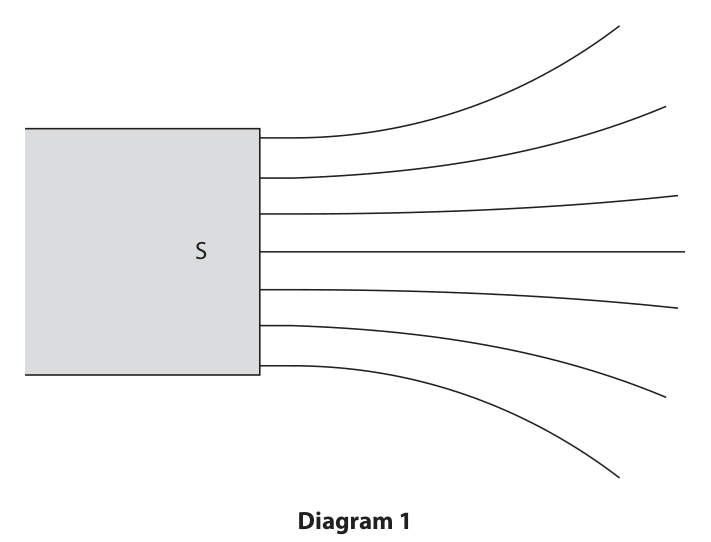

**Mark scheme answer**

> arrows drawn on at least two field lines pointing condone if arrows are
> towards the south pole; not drawn on the
> existing field lines
> reject if any arrows
> point away from the
> south pole

- **(1)** arrows drawn on at least two field lines pointing condone if arrows are

### 6(b) [1]

Which of these is attracted to the bar magnet if placed in the magnetic field?

- **(A)** copper
- **(B)** nickel  ✔
- **(C)** plastic
- **(D)** zinc

**Mark scheme answer**

> B (nickel);
> A is incorrect because copper is not a magnetic
> material
> C is incorrect because plastic is not a magnetic
> material
> D is incorrect because zinc is not a magnetic
> material

- **(1)** Answer B: nickel

### 6(c) [2]

The strength of the magnetic field changes as the distance from the south pole increases. Explain how the magnetic field lines show this.

**Mark scheme answer**

> field line spacing/density changes (with distance allow field lines aren’t
> from south pole); parallel
> further apart field lines shows weaker field scores both marks
> strength; allow RA
> ignore references to
> forces

- **(2)** field line spacing/density changes (with distance allow field lines aren’t

### 6(d)(i) [2]

Explain why the piece of iron experiences a force towards the south pole of the bar magnet. You may add to diagram 2 to help your answer.

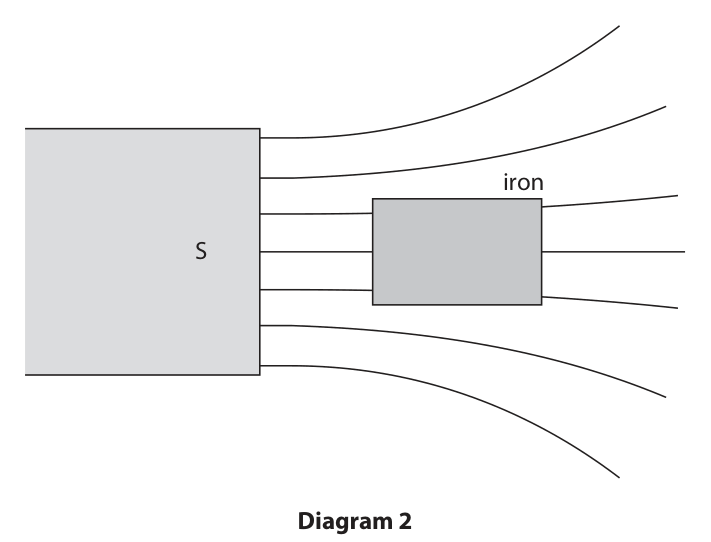

**Mark scheme answer**

> idea that a north pole is induced on the side of the allow if shown on
> iron nearest the bar magnet; diagram
> idea that opposite poles attract; allow north attracted to
> south
> ignore references to
> charge

- **(2)** idea that a north pole is induced on the side of the allow if shown on

### 6(d)(ii) [2]

A student suggests that the piece of iron is now a permanent magnet. Explain why the student is incorrect.

**Mark scheme answer**

> iron is a soft magnetic material; ignore iron is a soft
> magnet
> iron loses its magnetism (when it is removed from ignore iron is a
> the magnetic field); temporary magnet
> allow iron is (easily)
> demagnetised
> allow iron is only
> magnetic when it is in a
> field
> Answer Notes Marks

- **(2)** iron is a soft magnetic material; ignore iron is a soft

## Question 7 (12 marks)

The diagram shows a domestic lighting circuit. 230 V mains voltage lamp 1 22 mA switch 1 lamp 2 43 mA switch 2 lamp 3 17 mA switch 3

**(b)** When switch 1 is closed, the current in lamp 1 is 22 mA.

**(c)** The circuit is connected to the mains supply. Mains voltage is 230 V.

### 7(a) [2]

Explain an advantage of using this circuit for domestic lighting.

**Mark scheme answer**

> idea that lamps can be controlled allow some lights on whilst
> independently; others off / if one lamp blows
> the others still work etc.
> allow all lamps get full voltage
> / 230V
> (because) circuit is a parallel circuit; allow idea that lamps are on
> (three) separate
> paths/branches of the circuit

- **(2)** idea that lamps can be controlled allow some lights on whilst

### 7(b)(i) [1]

Give the name of the charged particle that moves in an electric current.

**Mark scheme answer**

> electron(s); allow ion(s), cation(s), anion(s)

- **(1)** electron(s); allow ion(s), cation(s), anion(s)

### 7(b)(ii) [3]

Show that lamp 1 has a power of about 5 W.

**Mark scheme answer**

> substitution into formula; ignore units
> conversion from mA to A; allow if 0.022 or ÷1000 seen
> anywhere in working
> evaluation to 2 or more s.f.;
> condone a calculation of
> current or voltage given to at
> least 3 s.f. using a power of 5 W
> for full marks
> e.g.
> power = 230 × 22(×10⁻³)
> power = 230 × 0.022
> power = 5.1 (W) allow 5.06 (W)

- **(3)** substitution into formula; ignore units

### 7(b)(iii) [3]

Calculate the energy transferred by lamp 1 when it is on for 30 seconds. energy transferred = J

**Mark scheme answer**

> substitution into P = E/t; allow ecf from (ii)
> allow use of E = V×I×t or other
> valid methods
> rearrangement;
> evaluation; -1 for POT error
> e.g.
> 5 = E / 30 allow
> E = 230 × 22(×10⁻³) × 30
> $E = 5 \times 30$
> E = 150 (J) allow 151.8, 152, 153

- **(3)** substitution into P = E/t; allow ecf from (ii)

### 7(c)(i) [1]

State what is meant by the term voltage.

**Mark scheme answer**

> energy (transferred) per unit charge allow V = E/Q only if all terms
> (passed); defined
> allow work done for energy
> transferred
> allow coulomb for unit charge

- **(1)** energy (transferred) per unit charge allow V = E/Q only if all terms

### 7(c)(ii) [2]

Switches 1 and 3 are closed, which turn on lamps 1 and 3. Switch 2 is open. Calculate the current in the mains supply. current = mA

**Mark scheme answer**

> any attempt to add any currents together;
> (current =) 39 (mA);
> 60, 65, 82 (mA) scores 1 mark
> Answer Notes Marks

- **(2)** any attempt to add any currents together;

## Question 8 (6 marks)

The diagram shows two rays of light, A and B, incident on the boundary between air and water. light source drawn to scale A B air water The refractive index of water is 1.33 Explain the paths of the two rays of light after they strike the boundary between air and water. Include calculations in your answer and draw on the diagram to support your answer.

### 8 [6]

The diagram shows two rays of light, A and B, incident on the boundary between air and water. light source drawn to scale A B air water The refractive index of water is 1.33 Explain the paths of the two rays of light after they strike the boundary between air and water. Include calculations in your answer and draw on the diagram to support your answer.

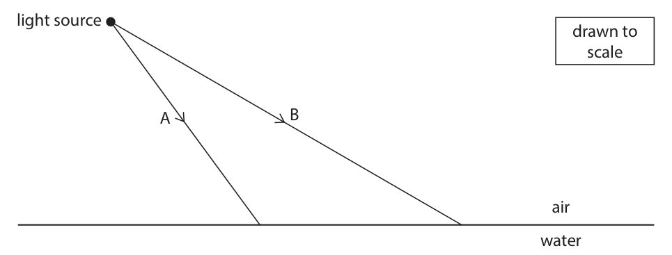

**Mark scheme answer**

> any six from:
> MP1. ray A is refracted and changes direction; may be shown on
> diagram by ray passing
> MP2. ray B is refracted and changes direction; through boundary
> ignore reflected rays
> allow 1 mark max. from
> MP1 and MP2 if either
> ray is refracted in the
> wrong direction
> MP3. correctly measured angle of incidence for allow 34°-38° for ray A,
> either ray; 58°-62° for ray B
> MP4. correctly calculated angle of refraction for may be shown on
> either ray A or ray B; diagram
> allow ecf from angles of
> incidence
> expect 24°-28° for A
> and 39°-42° for B
> MP5. water and air have different (optical) condone air having a
> densities; higher (optical) density
> than water
> MP6. light travels slower in water than air; allow RA
> MP7. TIR does not happen because water is more ignore calculated values
> (optically) dense than air; of the critical angle as
> not relevant
> Answer Notes Marks

- **(6)** any six from:

## Question 9 (6 marks)

This question is about air pressure.

### 9(a) [1]

During an aeroplane flight, a passenger drinks some water from a plastic bottle. The passenger then replaces the top to seal the bottle, as shown in diagram 1. air water Diagram 1 The air pressure outside the bottle is 80 kPa. State the air pressure inside the bottle just after the bottle has been sealed. air pressure = kPa

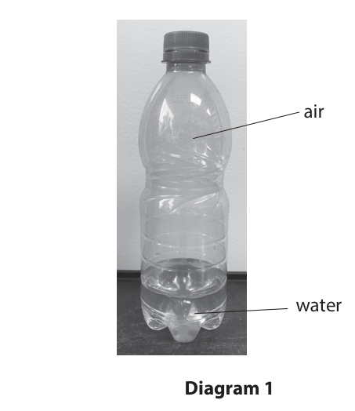

**Mark scheme answer**

> 80 (kPa);

- **(1)** 80 (kPa);

### 9(b) [2]

As the aeroplane descends, the air pressure inside the aeroplane changes. When the aeroplane lands, the passenger notices that the plastic bottle has collapsed, as shown in diagram 2. air water Diagram 2 Explain why the bottle has collapsed.

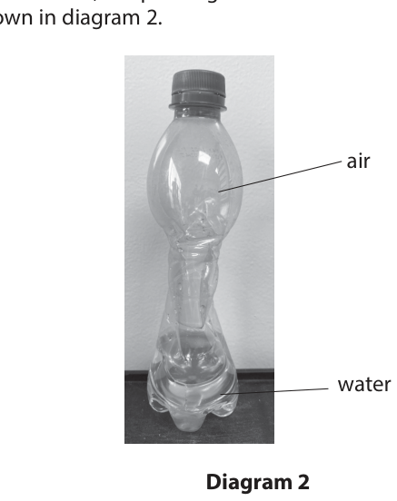

**Mark scheme answer**

> any two from:
> MP1. pressure (in aeroplane) increases; allow idea that pressure
> outside bottle is greater
> than inside bottle
> MP2. (resultant) force (inwards) on bottle;
> MP3. idea that decreasing volume (in bottle)
> increases pressure (in bottle);

- **(2)** any two from:

### 9(c) [3]

Explain how gas molecules in the air exert a pressure on the surface of the bottle.

**Mark scheme answer**

> any three from: allow particles / atoms
> for molecules
> MP1. (direction of) movement of molecules is
> random;
> MP2. molecules collide with the (bottle) surface; allow equivalent words
> for collide e.g. bounce,
> hit etc.
> ignore ‘molecules
> collide’ (with each
> other)
> MP3. exert a force (on the surface);
> MP4. pressure is force on an area; allow if given in formula
> format
> Answer Notes Marks

- **(3)** any three from: allow particles / atoms

## Question 10 (15 marks)

Diagram 1 shows the apparatus a student uses to investigate the bending of a wooden strip. Part of the wooden strip is clamped to a table. A load is fixed to the free end of the wooden strip, causing it to bend. length, L wooden strip load clamp table clamp height, h Diagram 1 The free end of the wooden strip is positioned a length, L, beyond the edge of the table, as shown in diagram 1. The weight of the load causes the end of the wooden strip to move down through a height, h. A student investigates how the length, L, affects the height, h.

**(b)** This is the student’s method for the investigation. • clamp the wooden strip so that L = 20 cm • fix the load to the end of the wooden strip, as shown in diagram 1 • measure the height, h The student repeats this method for different values of L.

**(c)** The table shows the results of the investigation. Length (L) in cm Height (h) in cm 20 2 40 8 60 18 100 53 120 71

### 10(a) [2]

The load has a mass of 250 g. Calculate the weight of the load. Use the formula weight = mass × gravitational field strength, g weight = N

**Mark scheme answer**

> substitution into formula; ignore units
> evaluation; -1 for clear POT error in units of
> mass
> e.g.
> weight = 250 (÷1000) × 10 allow use of g = 9.8, 9.81
> (weight =) 2.5 (N) allow 2.45, 2.4525

- **(2)** substitution into formula; ignore units

### 10(b)(i) [2]

Give the independent and dependent variables in the investigation. independent variable dependent variable

**Mark scheme answer**

> independent variable = length (extending allow L/l
> beyond table); condone length of wood(en strip)
> dependent variable = height; allow H/h

- **(2)** independent variable = length (extending allow L/l

### 10(b)(ii) [2]

Give two control variables in the investigation. 1 2

**Mark scheme answer**

> any two from:
> • mass/weight of load; ignore “same load” on its own
> • position of load (on wooden strip);
> • thickness of wood(en strip); allow “same wood(en strip)” in
> • material/type of wood(en strip); the absence of either of these

- **(2)** any two from:

### 10(b)(iii) [2]

Suggest how the student could accurately measure the height, h.

**Mark scheme answer**

> any two from:
> MP1. use of (metre) rule; allow tape measure
> condone metre stick
> MP2. fixed in place at end of wooden strip;
> MP3. 0 on rule placed at original height of allow alternative valid methods
> wooden strip; e.g. distance measured up from
> the ground with and without load
> MP4. method to ensure measurement is
> vertical e.g. using a plumb line, set
> square etc.;
> MP5. measure at eye level; ignore unqualified references to
> parallax error

- **(2)** any two from:

### 10(c)(i) [2]

Diagram 2 shows the wooden strip when L = 80 cm. wooden strip starting height table clamp load Diagram 2 Using diagram 2, determine the height, h, in the laboratory. [1 cm on the diagram = 10 cm in the laboratory] height, h = cm

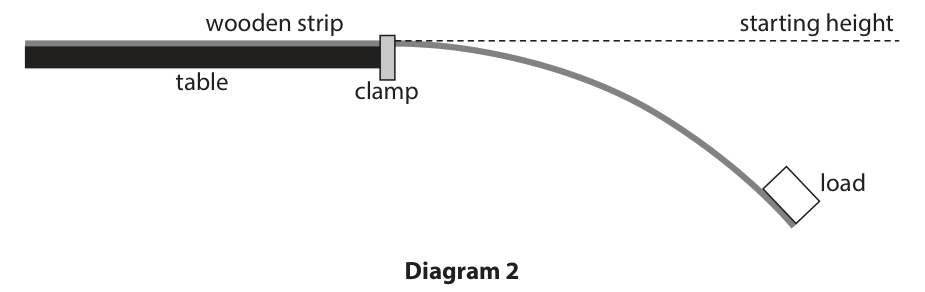

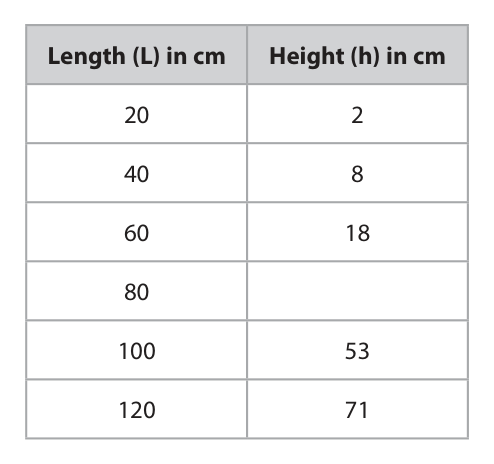

**Mark scheme answer**

> correct measurement from diagram = 3.1 (cm); allow between 3(.0) and 3.2 (cm)
> use of scale factor gives 31 (cm); allow ×10 seen in working
> answer between 30 and 32 (cm)
> scores both marks

- **(2)** correct measurement from diagram = 3.1 (cm); allow between 3(.0) and 3.2 (cm)

### 10(c)(ii) [2]

Plot a graph of the student’s results.

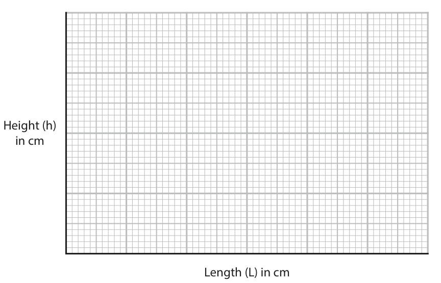

**Mark scheme answer**

> suitable linear scale chosen (>50% of grid used); allow use of false origin
> plotting correct to nearest half square; allow ecf from (i)
> reject if non-linear scale used

- **(2)** suitable linear scale chosen (>50% of grid used); allow use of false origin

### 10(c)(iii) [1]

Draw the curve of best fit. Height (h) in cm Length (L) in cm

**Mark scheme answer**

> acceptable curve of best fit drawn for data i.e. smooth curve with points
> between 20cm and 120cm; distributed equally either side
> all points should be at least 1
> small square from curve unless
> there is a plotting error in (ii) or
> a measurement error in (i), in
> which case apply ecf

- **(1)** acceptable curve of best fit drawn for data i.e. smooth curve with points

### 10(c)(iv) [2]

The student concludes that h is directly proportional to L. Evaluate the student’s conclusion.

**Mark scheme answer**

> idea that proportionality requires a straight line allow idea that relationship is not
> (through the origin); linear / gradient is not constant
> allow idea that h/L should be
> constant
> (graph does not show this so) DOP
> conclusion/student is incorrect;
> score 0 marks if any indication
> that the response is proportional
> or directly proportional
> Answer Notes Marks

- **(2)** idea that proportionality requires a straight line allow idea that relationship is not

## Question 11 (11 marks)

The photograph shows a power bank used to recharge the battery in an electronic device.

**(b)** An electronic device is connected to the power bank. Whilst recharging, the electronic device receives a constant current of 2.4 A and 3.8 × 103 C of charge is transferred.

### 11(a) [2]

The power bank stores charge. The charge stored can be measured in amp-hours (Ah). 1 Ah is the amount of charge transferred by a current of 1 A in a time of 1 hour. Calculate the charge stored in coulombs when the charge stored is 1 Ah. Use the formula charge stored = current × time taken charge stored = C

**Mark scheme answer**

> conversion of hours into seconds; allow 3600 or 60×60
> seen in working
> evaluation;
> e.g.
> 1 hour = (60 × 60 =) 3600 (s)
> (charge = 1 × 3600 =) 3600 (C)

- **(2)** conversion of hours into seconds; allow 3600 or 60×60

### 11(b)(i) [3]

Calculate the time taken to recharge the electronic device. Give your answer in minutes. time = minutes

**Mark scheme answer**

> substitution OR rearrangement;
> evaluation in seconds;
> conversion to minutes; mark independently and
> apply ecf
> e.g.
> 3.8 × 10³ = 2.4 × t OR t = Q/I
> (t =) 1600 (s) allow 1580, 1583…
> (t =) 26 (minutes) allow 26-27 (minutes)

- **(3)** substitution OR rearrangement;

### 11(b)(ii) [2]

The electronic device is connected to the power bank using a long cable. Suggest how using a long cable affects the time taken to recharge the electronic device when compared with a short cable.

**Mark scheme answer**

> idea that longer cable has more resistance; ignore longer distance
> (so) charging current will be less AND time taken both ideas needed for
> will increase; the mark

- **(2)** idea that longer cable has more resistance; ignore longer distance

### 11(c) [4]

A student owns three electronic devices. Each electronic device stores a different amount of charge. The table gives some information about the charge stored by the electronic devices and how often they need to be recharged. Charge stored Frequency of Electronic device in Ah recharging A 2.4 once every day B 4.2 once during the week C 6.8 once during the week The power bank stores a maximum charge of 26.8 Ah. The student needs to take these three electronic devices on a school trip for one week. Determine whether the maximum charge of the power bank is enough to recharge the batteries of the three electronic devices during the school trip.

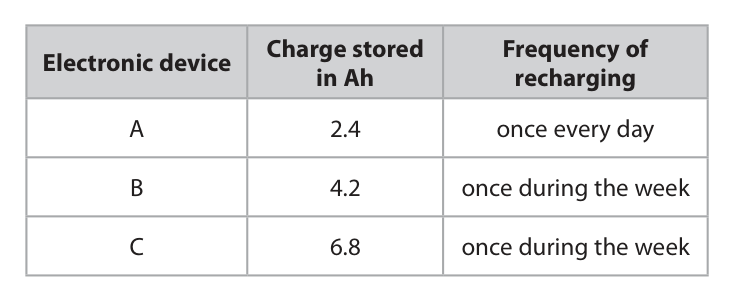

**Mark scheme answer**

> any four from:
> MP1. determination of total charge needed for 27.8 (Ah) or 100 080 C
> the week;
> MP2. quantitative comparison to power bank allow 27.8 is greater
> charge; than 26.8
> allow power bank is
> 1 Ah less than needed
> allow ecf from MP1
> MP3. idea that power bank cannot recharge all allow power bank is not
> devices (from completely flat); suitable/enough
> MP4. idea that devices will not always be allow idea that devices
> completely empty when recharged; could be partially
> charged
> MP5. idea that devices could be used less (which
> would make them last longer before
> recharging);
> MP6. idea that other charging facilities might be allow idea that power
> available; bank could be
> recharged during trip
> Answer Notes Marks

- **(4)** any four from:

## Question 12 (12 marks)

A car accelerates with a constant driving force along a horizontal road and reaches its maximum speed. This is the velocity-time graph for the car’s journey. Velocity in m/s 40 0 20 40 60 80 100 Time in s

### 12(a) [4]

By drawing a tangent to the curve, determine the acceleration of the car at a time of 20 s. acceleration = m/s²

**Mark scheme answer**

> appropriate attempt to draw tangent at 20s on the
> graph;
> acceleration = gradient; allow if seen explicitly
> or from a clear attempt
> to calculate a gradient
> acceleration in the range 1.00-1.20 (m/s²); scores 3 marks total
> acceleration in the range 1.05-1.15 (m/s²); scores 4 marks total

- **(4)** appropriate attempt to draw tangent at 20s on the

### 12(b) [5]

Determine the distance travelled by the car during the first 80 s of its journey. distance = m

**Mark scheme answer**

> distance = area under line; seen explicitly or
> implied by working
> suitable method used; allow
> • use of trapeziums
> • rectangles and
> triangles
> • counting squares
> estimation
> distance in the range = 3200-4200 (m); scores 3 marks total
> distance in the range = 3500-4000 (m); scores 4 marks total
> distance in the range = 3700-3800 (m); scores 5 marks total

- **(5)** distance = area under line; seen explicitly or

### 12(c) [3]

Explain the motion of the car after 80 s.

**Mark scheme answer**

> speed/velocity is constant; allow terminal velocity
> idea that driving force of car = air resistance; allow forces are
> balanced
> resultant force is zero; allow acceleration is
> zero
> Pearson Education Limited. Registered company number 872828
> with its registered office at 80 Strand, London, WC2R 0RL, United Kingdom

- **(3)** speed/velocity is constant; allow terminal velocity

