# 4PH1/1PR — 2024-06 (official extraction)

> schema `syllabai.official-paper-questions/0.2` · paper_id `pearson-edexcel:international-gcse:physics:4ph1:2024-06:4PH1/1PR` · qp sha256 `bbb72ad3f05db8a7…` · extraction is the disclosed baseline (ADR-039)

## Question 1 (4 marks)

The table shows an incomplete electromagnetic spectrum. radio visible gamma microwaves A B x-rays waves light rays Two parts of the electromagnetic spectrum are missing. The missing parts are labelled A and B.

### 1(a)(i) [1]

Name the part labelled A.

**Mark scheme answer**

> infrared; allow IR

- **(1)** infrared; allow IR

### 1(a)(ii) [1]

Name the part labelled B.

**Mark scheme answer**

> ultraviolet; allow UV

- **(1)** ultraviolet; allow UV

### 1(b)(i) [1]

Give a use of microwaves.

**Mark scheme answer**

> heating food / eq;
> communication;
> radar;

- **(1)** heating food / eq;

### 1(b)(ii) [1]

Give a use of gamma rays.

**Mark scheme answer**

> sterilising (equipment or food); ignore cleaning
> (equipment)
> treating cancer; ignore chemotherapy
> medical imaging;
> medical tracing techniques;
> Answer Notes Marks

- **(1)** sterilising (equipment or food); ignore cleaning

## Question 2 (6 marks)

The photograph shows an electric heater connected to the mains electricity supply. (Source: © Yevhen Prozhyrko / Shutterstock) The circuit the heater is connected to is fitted with a circuit breaker, which breaks the circuit if the current gets too high.

**(b)** The voltage of the mains electricity supply is 230 V.

### 2(a) [1]

Give an advantage of using a circuit breaker instead of using a fuse.

**Mark scheme answer**

> any of:
> ● idea that circuit breaker can easily be reset; allow ‘does not need to
> be replaced’ cf fuse
> ● idea that circuit breaker turns off circuit
> more quickly;

- **(1)** any of:

### 2(b)(i) [1]

State the formula linking power, current and voltage.

**Mark scheme answer**

> power = current × voltage; allow standard symbols
> and rearrangements
> e.g. P = I × V
> ignore C,c for current

- **(1)** power = current × voltage; allow standard symbols

### 2(b)(ii) [3]

The normal operating current of the heater is 11 A. Calculate the input power to the heater for this current. Give your answer in kW. power = kW

**Mark scheme answer**

> substitution;
> evaluation in W;
> evaluation in kW;
> e.g.
> power = 11 × 230
> (power =) 2500 (W) allow 2530 W if
> candidate’s intention is
> clear i.e. removal of ‘k’
> or 2530 with W seen.
> (power =) 2.5 (kW) allow 2.53 (kW)

- **(3)** substitution;

### 2(c) [1]

The circuit breaker has a rating of 16 A. Suggest a reason why the heater may switch off before it reaches its normal operating current.

**Mark scheme answer**

> any of: ignore reference to an
> electric fault in the
> heater
> ● idea that there are likely to be other
> appliances on same circuit;
> ● fuse in heater may be rated at less than 16A;
> ● idea that heater may have a (thermal) safety
> cut-out;
> ● idea that thermostat turns off heater;
> Answer Notes Marks

- **(1)** any of: ignore reference to an

## Question 3 (8 marks)

In 1947, the Railton Mobil Special was the first ground vehicle to achieve a speed of more than 400 miles per hour.

**(a)** During a test, the vehicle travelled at a speed of 403 miles per hour.

### 3(a)(i) [2]

Calculate a speed of 403 miles per hour in metres per second (m / s). [1 mile = 1600 m] speed = m / s

**Mark scheme answer**

> × 1600 seen in working OR ÷ 3600 seen in working; allow ÷ 602
> speed = 179 (m/s); allow any answer that
> would round to 179
> condone 180
> NB 1600 × 403 = 644800

- **(2)** × 1600 seen in working OR ÷ 3600 seen in working; allow ÷ 602

### 3(a)(ii) [3]

During the test, the vehicle travelled past two markers. The markers were placed a known distance apart. Describe how these markers could be used to determine the speed of the vehicle.

**Mark scheme answer**

> idea of measuring time taken (to travel between
> markers);
> use of appropriate instrument to measure time; allow stopwatch, timer,
> (stop)clock, light gates
> use of speed = distance / time; condone any subject of
> equation.

- **(3)** idea of measuring time taken (to travel between

### 3(b) [3]

The diagram shows the vehicle travelling at a constant speed. direction of travel driving force One of the horizontal forces acting on the vehicle has been drawn. Complete the diagram by drawing a labelled arrow for the other horizontal force acting on the vehicle.

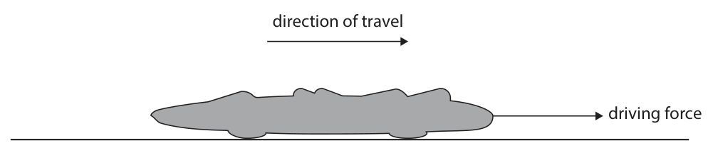

**Mark scheme answer**

> ignore vertical arrows
> length of arrow equal to given arrow; judge by eye
> arrow drawn horizontally to the left;
> arrow labelled “air resistance”; allow drag, friction
> ignore wind resistance
> Answer Notes Marks

- **(3)** ignore vertical arrows

## Question 4 (9 marks)

This question is about the Sun.

**(c)** The Sun transfers energy to the Earth by radiation.

### 4(a) [4]

The table shows the different stages in the evolution of stars of different masses. Complete the table by adding ticks (ü) to show which stages of evolution occur in the life cycle of the Sun. Stage of evolution Occurs in the life cycle of the Sun black hole main sequence nebula neutron star red giant red supergiant supernova white dwarf

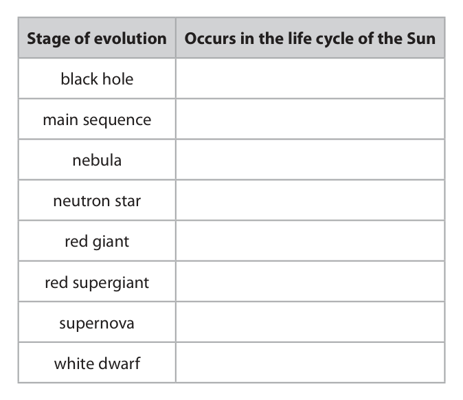

**Mark scheme answer**

> one mark for each correct tick;;;;
> if 5 or more ticks given
> then -1 for each
> additional tick

- **(4)** one mark for each correct tick;;;;

### 4(b) [2]

When viewed from Earth, the surface of the Sun is yellow in colour. The surface of another star, Betelgeuse, is red in colour. Explain the difference between the Sun and Betelgeuse, based on the different colours of their surfaces.

**Mark scheme answer**

> idea of the temperatures being different;
> Sun is hotter than Betelgeuse; also scores first mark
> allow RA

- **(2)** idea of the temperatures being different;

### 4(c)(i) [1]

Give a reason why energy is not transferred from the Sun to the Earth by conduction or convection.

**Mark scheme answer**

> idea that there are no particles in space (between allow space is a vacuum
> Sun and Earth);

- **(1)** idea that there are no particles in space (between allow space is a vacuum

### 4(c)(ii) [2]

A satellite orbiting the Earth contains sensitive equipment that can be damaged if it gets too hot. Explain which colour would be most appropriate for the outer surface of the satellite to protect the equipment.

**Mark scheme answer**

> shiny / white / silver;
> poor absorber of (IR) radiation; accept good reflector of
> radiation
> accept ‘does not
> absorb’
> ignore references to
> emission
> ignore references to
> conduction
> allow ‘heat’ or ‘energy’
> for ‘radiation’
> Answer Notes Marks

- **(2)** shiny / white / silver;

## Question 5 (10 marks)

A student needs to determine the density of some small rocks that appear to all be made of the same material. (Source: © Chake / Shutterstock)

**(b)** The table shows the student’s results for three of the rocks. Rock Mass in g Volume in cm3 A 15 6.3 B 13 6.1 C 16 7.5

### 5(a) [5]

The student decides to measure the mass and the volume of each rock. Describe a method the student could use to accurately determine the mass and the volume of each rock. You may draw a diagram to help your answer.

**Mark scheme answer**

> marks can be awarded
> from candidate’s
> diagram
> MP1. use balance to measure mass; allow (weighing) scales
> reject scale
> MP2. use of measuring cylinder to measure
> volume;
> PLUS
> Any three from:
> MP3. ensure balance reads zero before placing
> rock;
> MP4. ensure balance is on a level surface;
> MP5. ensure rock is dry when measuring its mass allow measure mass
> before volume
> MP6. recording volume before rock added to fill displacement can to
> water ‘top’ or ‘spout’/eq
> MP7. finding difference in volume of water after catch displaced volume
> rock added when rock added
> MP8. ensure rock is fully submerged;
> MP9. ensure no water is spilt / all water
> collected by measuring cylinder;
> MP10. read measuring cylinder at eye level / on ignore unqualified
> a level surface; reference to ‘avoid
> MP11. read to bottom of water meniscus; parallax’

- **(5)** marks can be awarded

### 5(b)(i) [1]

State the formula linking density, mass and volume.

**Mark scheme answer**

> density = mass / volume; allow standard symbols
> and rearrangements
> e.g. ρ = m / V
> allow d for density

- **(1)** density = mass / volume; allow standard symbols

### 5(b)(ii) [4]

After looking at the data, the student concludes that one of the rocks may be made of a different material from the others. Using the data from the table, justify the student’s conclusion.

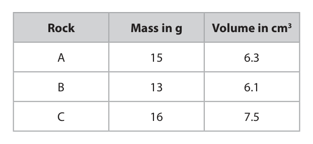

**Mark scheme answer**

> idea that different materials have different
> densities;
> correct evaluation of density for at least one A = 2.38 or 2.4 (g/cm3)
> rock; B = 2.1(3) (g/cm3)
> C = 2.1(3) (g/cm3)
> correct evaluation of density for all rocks;
> conclusion from density values that rock A is ecf incorrect densities
> made from a different material (so student is if candidate’s
> correct); conclusion is consistent
> Answer Notes Marks

- **(4)** idea that different materials have different

## Question 6 (11 marks)

The diagram shows two rays of green light entering a semicircular glass block. normal A B

### 6(a)(i) [2]

Measure the angle of incidence and the angle of refraction for ray A as it enters the glass block. angle of incidence = degrees angle of refraction = degrees

**Mark scheme answer**

> angle of incidence = 40 (o); allow 38-42
> angle of refraction = 23 (o); allow 21-25

- **(2)** angle of incidence = 40 (o); allow 38-42

### 6(a)(ii) [1]

State the formula linking refractive index, angle of incidence and angle of refraction.

**Mark scheme answer**

> n = sin(i)/sin(r); allow rearrangements
> reject n = i/r

- **(1)** n = sin(i)/sin(r); allow rearrangements

### 6(a)(iii) [3]

Calculate the refractive index of the glass. refractive index =

**Mark scheme answer**

> substitution of candidate’s values into formula; allow ecf from (i)
> evidence of sines of angles; i.e 0.642... for sin(40),
> 0.390... for sin(23)
> evaluation; reject 1.73913 or any
> value clearly angle of
> incidence divided by
> angle of refraction
> e.g.
> n = sin(40)/sin(23)
> n = 1.6(5)
> NB - using extreme
> values from (i), n
> rounds the range 1.46
> to 1.87

- **(3)** substitution of candidate’s values into formula; allow ecf from (i)

### 6(b)(i) [2]

Complete the path of ray A until it crosses ray B. Label the point where the rays cross with the letter F.

**Mark scheme answer**

> single ray emerges and extended to horizontal ray;
> ray bends away from normal by eye;

- **(2)** single ray emerges and extended to horizontal ray;

### 6(b)(ii) [3]

The refractive index of glass for red light is lower than for green light. Explain what would happen to point F if red light were used instead of green light. You may draw a diagram to help your answer.

**Mark scheme answer**

> idea that F moves away from the prism; i.e. the crossing point is
> further away or moves
> out
> idea that red ray bends less than green at either
> interface;
> idea that red ray bends less than green at both
> interfaces; allow angle of
> refraction is smaller at
> second interface
> allow angle of
> refraction is larger at
> first interface
> allow angle of
> refraction is closer to
> angle of incidence/eq
> condone ‘less
> refraction’
> Answer Notes Marks

- **(3)** idea that F moves away from the prism; i.e. the crossing point is

## Question 7 (13 marks)

A student investigates the voltage-current characteristics of an unknown component, X.

**(b)** The graph shows the results of the investigation. Current in mA 0 1 2 3 4 5 6 Voltage in V

### 7(a) [4]

The student is given this equipment to investigate component X. • battery • variable resistor • ammeter • voltmeter • connecting wires The diagram shows an incomplete circuit containing the battery and component X. Complete the diagram by drawing a circuit the student could use for their investigation. X

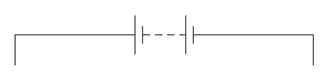

**Mark scheme answer**

> circuit symbols for variable resistor, ammeter and allow variable power
> voltmeter drawn correctly; supply
> variable resistor drawn in series with battery and allow potentiometer
> component X; circuit if clear
> ammeter drawn in series with component X;
> voltmeter drawn in parallel with component X;

- **(4)** circuit symbols for variable resistor, ammeter and allow variable power

### 7(b)(i) [1]

Draw a line of best fit on the graph.

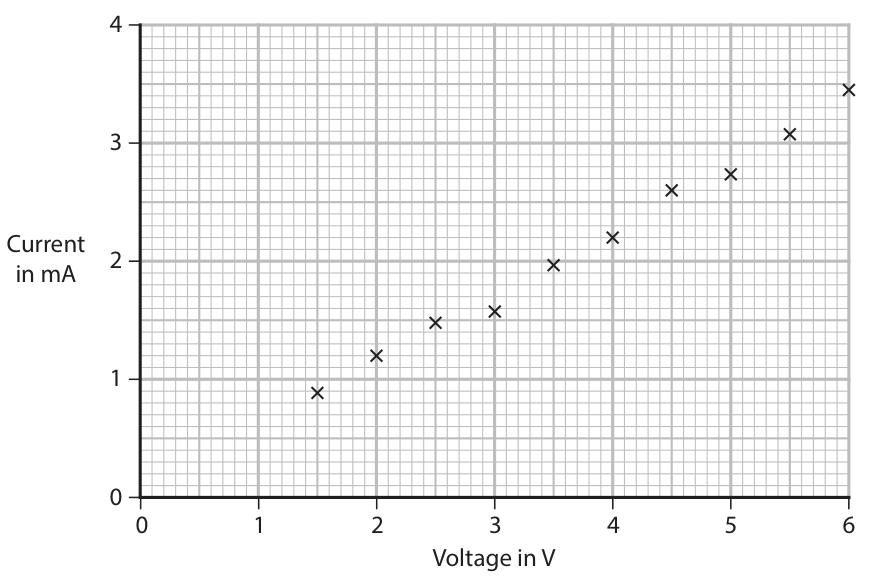

**Mark scheme answer**

> straight line of best fit drawn with points ignore extrapolation
> distributed equally either side; below V = 1.5V

- **(1)** straight line of best fit drawn with points ignore extrapolation

### 7(b)(ii) [5]

Calculate the resistance of component X when the voltage is 4.2 V. Give the unit. resistance = unit

**Mark scheme answer**

> use of voltage = current × resistance; seen in words or
> symbols or implied by
> working
> correct reading of current from graph; allow ecf from (i)
> substitution OR rearrangement; ignore non-conversion
> of mA to A at this point
> evaluation;
> matching unit; expect Ω but allow kΩ if
> matched to appropriate
> value
> -1 POT error
> e.g.
> V=I×R
> current = 2.35 (×10-3) (A) allow 2.3-2.4 (mA)
> 4.2 = 2.35 (×10-3) × R OR R = V / I
> (resistance =) 1800 allow 1750 – 1826
> ohms / Ω

- **(5)** use of voltage = current × resistance; seen in words or

### 7(b)(iii) [1]

Which of these is equivalent to 4.2 V?

- **(A)** 4.2 coulombs per second (C / s)
- **(B)** 4.2 seconds per joule (s / J)
- **(C)** 4.2 joules per second (J / s)
- **(D)** 4.2 joules per coulomb (J / C)  ✔

**Mark scheme answer**

> D (4.2 joules per coulomb);
> A is incorrect because this is the unit for current
> B is incorrect because this is the reciprocal of the
> unit for power
> C is incorrect because this is the unit for power

- **(1)** Answer D: 4.2 joules per coulomb (J / C)

### 7(b)(iv) [2]

The student concludes that component X is a filament lamp. Comment on the student’s conclusion.

**Mark scheme answer**

> graph for lamp should be a curve; allow line is straight
> (because) a lamp does not obey Ohm’s Law/ lamp allow reference to
> does not have I directly proportional to V. (direct) proportionality
> component X is a resistor; allow component X is an
> ohmic conductor
> accept component X
> could be a lamp but it’s
> not warm enough yet
> for the graph to curve
> for 2 marks
> Answer Notes Marks

- **(2)** graph for lamp should be a curve; allow line is straight

## Question 8 (13 marks)

This question is about radioactive isotopes used for medical imaging.

**(a)** Iodine-131 is represented by this symbol. 131 53 I

**(b)** When iodine-131 decays, it emits beta radiation and gamma radiation. A patient swallows a tablet containing iodine-131. The radiation emitted can be detected outside the body.

### 8(a)(i) [1]

How many neutrons are in the nucleus of an atom of iodine-131?

- **(A)** 53
- **(B)** 78  ✔
- **(C)** 131
- **(D)** 184

**Mark scheme answer**

> B (78);
> A is incorrect because this is the number of protons
> C is incorrect because this is the number of
> nucleons
> D is incorrect because this is the number of
> nucleons + protons

- **(1)** Answer B: 78

### 8(a)(ii) [2]

Iodine-131 is radioactive and decays with a half-life of 8 days. State what is meant by the term half-life.

**Mark scheme answer**

> time taken; allow “how long it
> takes”
> reject “half the time”
> and either of
> for (radio)activity to halve; allow count rate for
> activity
> for half of the (radioactive) {nuclei / atoms / ignore substance
> isotope / mass} to decay;

- **(2)** time taken; allow “how long it

### 8(a)(iii) [3]

The cross (×) on the graph shows the initial number of atoms in a sample of iodine-131. Draw three more crosses (×) on the graph to show how the number of atoms of iodine-131 in the sample changes during three half-lives. [iodine-131 half-life = 8 days] 20 000 15 000 Number of atoms 10 000 5000 0 5 10 15 20 25 Time in days

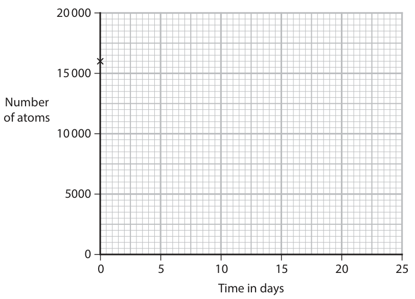

**Mark scheme answer**

> one mark for each correct cross drawn curve from (iv) can be
> used to infer correct
> data points
> (8, 8000);
> (16, 4000);
> (24, 2000);

- **(3)** one mark for each correct cross drawn curve from (iv) can be

### 8(a)(iv) [2]

Use a curve of best fit on the graph to estimate the time taken for the number of atoms in the sample to decrease to 5000. time taken = days

**Mark scheme answer**

> smooth curve of best fit drawn; can be used to infer
> points in (iii)
> correct reading of time to decrease to 5000; ecf candidate’s curve
> within 1 square
> NB - perfect curve
> would give answer
> between 13-14 days

- **(2)** smooth curve of best fit drawn; can be used to infer

### 8(b)(i) [1]

State the name of a piece of equipment that can detect the radiation emitted by iodine-131.

**Mark scheme answer**

> Geiger(-muller) tube/ GM tube / photographic film allow detector or
> / scintillator; counter for tube
> ignore radiation
> detector

- **(1)** Geiger(-muller) tube/ GM tube / photographic film allow detector or

### 8(b)(ii) [1]

Give a reason why gamma radiation is more likely to be detected outside the body than beta radiation.

**Mark scheme answer**

> idea that gamma is more penetrating than beta; RA
> allow gamma less
> ionising (power) than
> beta

- **(1)** idea that gamma is more penetrating than beta; RA

### 8(c) [3]

Technetium-99m is another radioactive isotope. Iodine-131 and technetium-99m are both used as medical tracers. Medical tracers use radiation detected outside the body to diagnose illnesses. The table gives information about some of the properties of iodine-131 and technetium-99m when they undergo radioactive decay. Type(s) of radiation Isotope Half-life emitted iodine-131 beta and gamma 8 days technetium-99m gamma 6 hours Explain why technetium-99m is likely to be safer than iodine-131 when used as a medical tracer.

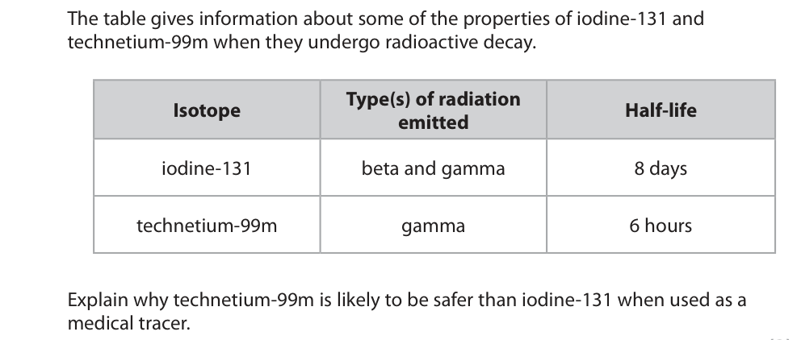

**Mark scheme answer**

> any three from: RA
> MP1. gamma is less ionising than beta;
> MP2. beta is more likely to cause cell damage allow named damage
> than gamma; e.g. cancer, cell
> mutation etc.
> MP3. technetium decays more quickly; ignore half-life of
> technetium is less
> MP4. technetium is in the body for less time/short
> time;
> Answer Notes Marks

- **(3)** any three from: RA

## Question 9 (15 marks)

A student stretches a rubber band.

**(a)** The photographs show a rubber band before and after it has been stretched. before after

**(b)** The diagram shows a force-extension graph for a rubber band. Force loading unloading Extension

**(c)** The student stretches the rubber band and then releases it. The band moves vertically upwards.

### 9(a)(i) [1]

State which energy store increases in the rubber band after it has been stretched.

**Mark scheme answer**

> elastic (potential) / EPE;

- **(1)** elastic (potential) / EPE;

### 9(a)(ii) [1]

State the main method of energy transfer when the rubber band is stretched.

**Mark scheme answer**

> mechanically/mechanical (working);

- **(1)** mechanically/mechanical (working);

### 9(a)(iii) [1]

State the source of the energy transferred to the rubber band.

**Mark scheme answer**

> the person/the hand/the fingers; allow chemical (energy
> of the student)

- **(1)** the person/the hand/the fingers; allow chemical (energy

### 9(b)(i) [1]

State how the graph shows that the rubber band does not obey Hooke’s law.

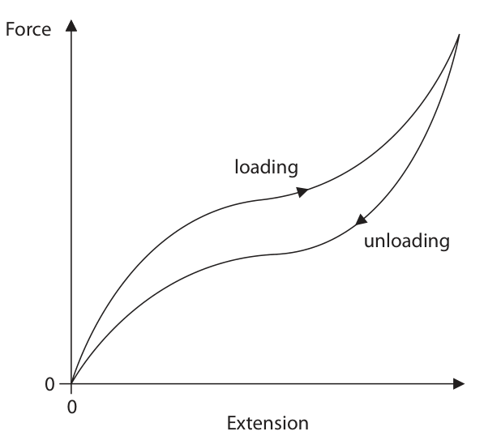

**Mark scheme answer**

> curve/variable gradient/not linear; accept ‘unloading and
> loading are different’
> ignore reference to
> proportionality

- **(1)** curve/variable gradient/not linear; accept ‘unloading and

### 9(b)(ii) [2]

Explain how the graph shows that the rubber band is elastic.

**Mark scheme answer**

> line returns to {origin/start/(0,0)/no extension}; ignore reference to
> shape
> allow returns to original
> length
> when the force is removed/ unloaded; condone ‘when
> unloading’

- **(2)** line returns to {origin/start/(0,0)/no extension}; ignore reference to

### 9(c)(i) [4]

The band travels with an initial speed of 13 m / s. When the band reaches its maximum height above the student’s hand, the band has a speed of 0 m / s. Calculate the maximum height that the band reaches. Give your answer to 2 significant figures. [ acceleration due to gravity = −10 m / s2 ] maximum height = m

**Mark scheme answer**

> substitution into given equation “v2 = u2 + 2as”; ignore sign
> accept mgh = ½ m v2
> re-arrangement;
> evaluation;
> answer to 2 sig figs; independent mark
> e.g.
> 02 = (13)2 + (2 × -10 × s)
> height = 169 / 20
> (height =) 8.45 (m)
> (height =) 8.5 (m)

- **(4)** substitution into given equation “v2 = u2 + 2as”; ignore sign

### 9(c)(ii) [5]

The band reaches its maximum height. Explain the motion of the band as it falls from its maximum height to the ground. Refer to forces in your answer. You may assume • the band does not rotate • the band does not reach terminal velocity

**Mark scheme answer**

> any five from:
> MP1. band has weight; allow ‘has gravitational
> force’
> ignore ‘has gravity’
> MP2. no drag at highest point; allow ‘air resistance’
> for ‘drag’
> MP3. resultant force is downwards;
> MP4. band accelerates; allow ‘speed increases’
> MP5. (once band is moving) there is drag
> MP6 automatically
> MP6. drag increases (while accelerating); scores MP5
> MP7. resultant force decreases;
> MP8. (so) acceleration decreases;
> Answer Notes Marks

- **(5)** any five from:

## Question 10 (9 marks)

Diagram 1 shows a generator inside a small wind turbine. The generator is connected to a lamp and the windmill blades. windmill coil rotates blades in direction of arrow N S slip rings A brushes lamp Diagram 1

**(b)** The generator in the wind turbine acts as an alternating current (a.c.) power supply. Diagram 2 shows an electric circuit containing the generator being used to charge a mobile phone battery. generator mobile phone battery Diagram 2

### 10(a) [2]

When the coil rotates in the direction of the arrow, the ammeter displays a small current. Explain how the generator produces a current.

**Mark scheme answer**

> (coil rotates) through magnetic field / cutting allow idea of coil
> field lines; experiencing a changing
> flux
> voltage is induced; ignore current is
> induced
> accept p.d. or potential
> difference for ‘voltage’

- **(2)** (coil rotates) through magnetic field / cutting allow idea of coil

### 10(b)(i) [2]

Direct current (d.c.) is needed to charge the battery. Explain why there is a diode in the circuit.

**Mark scheme answer**

> idea that d.c. is current in one direction only;
> diode allows current flow in one direction
> only/eq;

- **(2)** idea that d.c. is current in one direction only;

### 10(b)(ii) [2]

Explain how the current in the battery will change if the wind speed increases.

**Mark scheme answer**

> ignore references to
> energy
> higher speed generates higher voltage;
> allow higher tier
> answers in terms of
> increased flux linkage
> i.e cutting field lines
> faster
> accept p.d. or potential
> difference for ‘voltage’
> higher voltage causes higher current;

- **(2)** ignore references to

### 10(c) [3]

The mean voltage across the battery is 7.2 V. The battery gains 14 kJ of energy in 8400 seconds. Calculate the mean current in the battery. mean current = A

**Mark scheme answer**

> substitution into given equation ‘E = IVt’;
> rearrangement;
> evaluation; -1 POT error
> treat misconversion of
> time as a POT error
> e.g.
> 14 000 = I × 7.2 × 8400
> (current =) 14000 / (7.2 × 8400)
> (current =) 0.23 (A) allow 0.23…(A)
> allow 0.2 (A)
> Answer Notes Marks

- **(3)** substitution into given equation ‘E = IVt’;

## Question 11 (6 marks)

This question is about gas pressure.

### 11(a) [2]

Diagram 1 shows some of the molecules of a gas in a sealed container. Diagram 1 The molecules collide with all the surfaces of the container. This exerts an outward force on the container and causes pressure. Describe how the motion of the gas molecules causes an equal pressure on all the walls of the container. You may add to diagram 1 to help your answer.

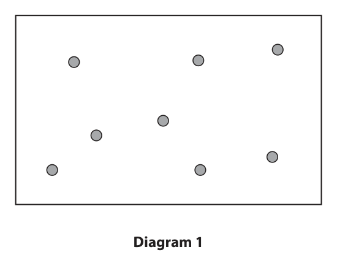

**Mark scheme answer**

> allow atoms or particles
> for ‘molecules’
> idea that (large number of) molecules moving
> randomly; can be acquired from
> diagram by showing
> arrows of different
> lengths (by eye) or
> different directions (by
> eye)
> idea of equal rate of collisions in each direction; condone idea of equal
> number in each
> direction

- **(2)** allow atoms or particles

### 11(b) [4]

The width of the container is slowly decreased so that the volume of the container is smaller than before. Diagram 2 shows the width of the container before and after this change. All other dimensions of the container remain the same. before after 8.4 cm 5.0 cm Diagram 2 The initial volume of the gas is 130 cm3. The initial pressure of the gas is 100 kPa. Calculate the pressure of the gas after the width of the container is decreased. Assume the temperature of the gas remains constant. pressure = kPa

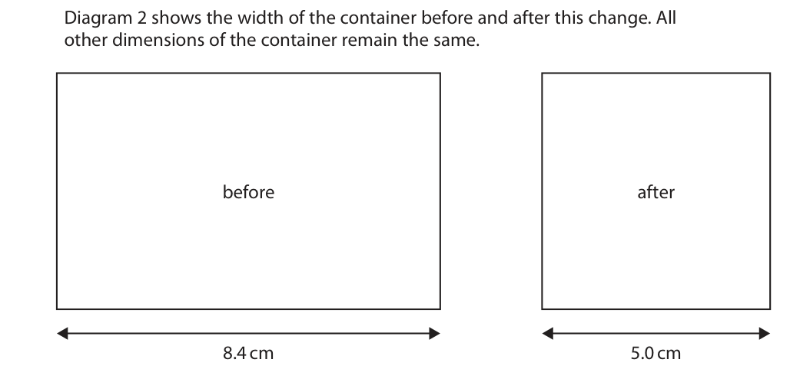

**Mark scheme answer**

> evaluation of new volume;
> substitution into p1V1 = p2V2; ecf different yet
> incorrect volume
> rearrangement;
> evaluation of new pressure; -1 POT error
> e.g.
> V2 = (130 × 5.0/8.4 =) 77 (cm3) allow 77.38…
> 100 × 130 = p2 × 77
> (p2 =) 100 × 130/77
> (p2 =) 170 (kPa) allow any value that
> rounds to 170 (kPa)
> Answer Notes Marks

- **(4)** evaluation of new volume;

## Question 12 (6 marks)

Air is trapped in a boiling tube by sealing the boiling tube with a rubber bung. The boiling tube is placed in a beaker containing hot water. bung beaker boiling tube containing air hot water

### 12(a) [4]

Energy is transferred from the thermal store of the water to the thermal store of the air in the boiling tube with an efficiency of 16%. The air in the boiling tube gains 1800 J of energy during this process. This is defined as the useful energy transfer. Calculate the amount of energy wasted during this process. energy wasted = J

**Mark scheme answer**

> substitution into given equation,
> efficiency = useful output energy (x 100%)
> total output energy;
> rearrangement;
> evaluation of total output energy; 11250 (J) seen
> -1 POT here
> evaluation of wasted energy; i.e. subtracting 1800
> (J) from candidate’s
> total output energy
> or calculating 84% of
> total output energy
> ecf wrong total output
> energy
> e.g.
> 0.16 = 1800/total output
> total output = 1800 / 0.16
> total output = 11 250 (J)
> (wasted energy = 11250 - 1800 =) 9500 (J) allow 9450 (J)

- **(4)** substitution into given equation,

### 12(b) [2]

Give two ways that the apparatus could be modified to improve the efficiency of the energy transfer.

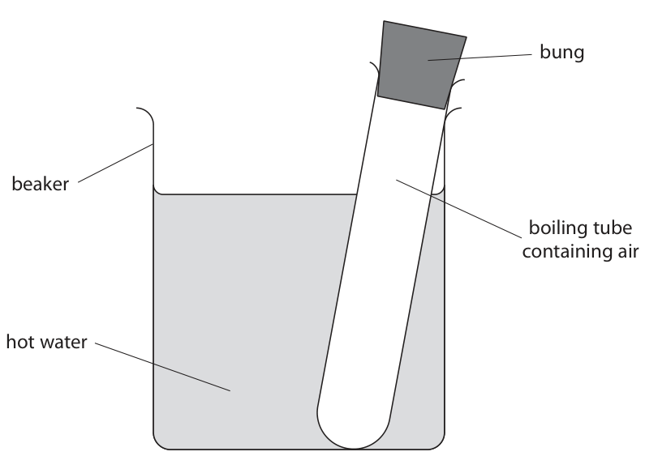

**Mark scheme answer**

> any two from:
> MP1. wrap beaker in insulation; allow use a plastic
> beaker or beaker with
> better insulating
> properties
> MP2. cover top of beaker; allow ‘use a lid’
> MP3. fully immerse boiling tube in water; allow use a smaller
> boiling tube
> MP4. shiny outer layer to the beaker;
> MP5. use a thinner (walled) boiling tube
> i.e. use a metal boiling
> MP6. use a better conducting boiling tube tube
> Pearson Education Limited. Registered company number 872828
> with its registered office at 80 Strand, London, WC2R 0RL, United Kingdom

- **(2)** any two from:

