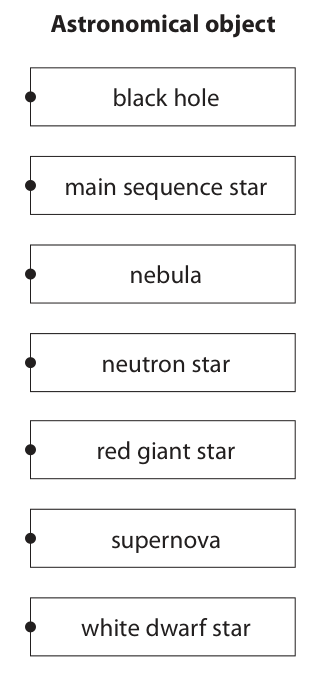
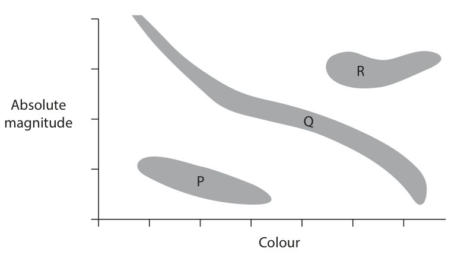
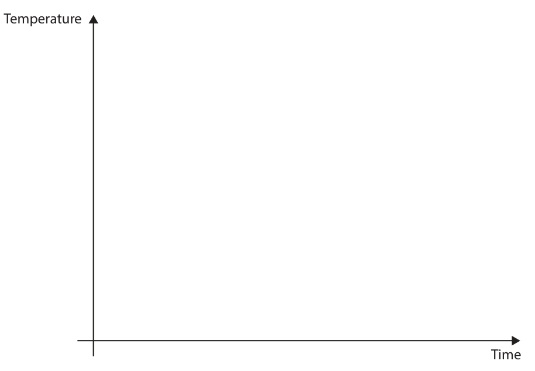
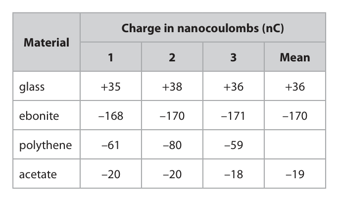
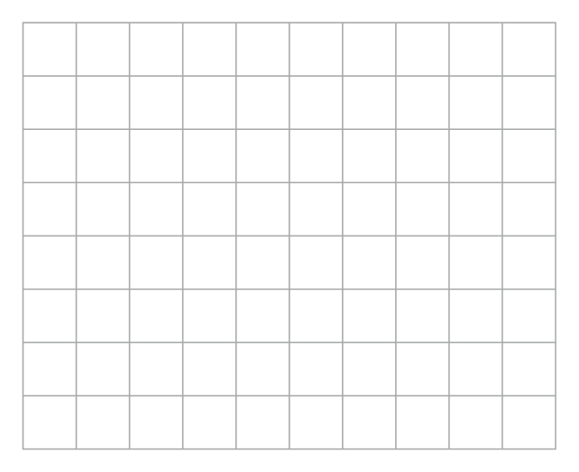
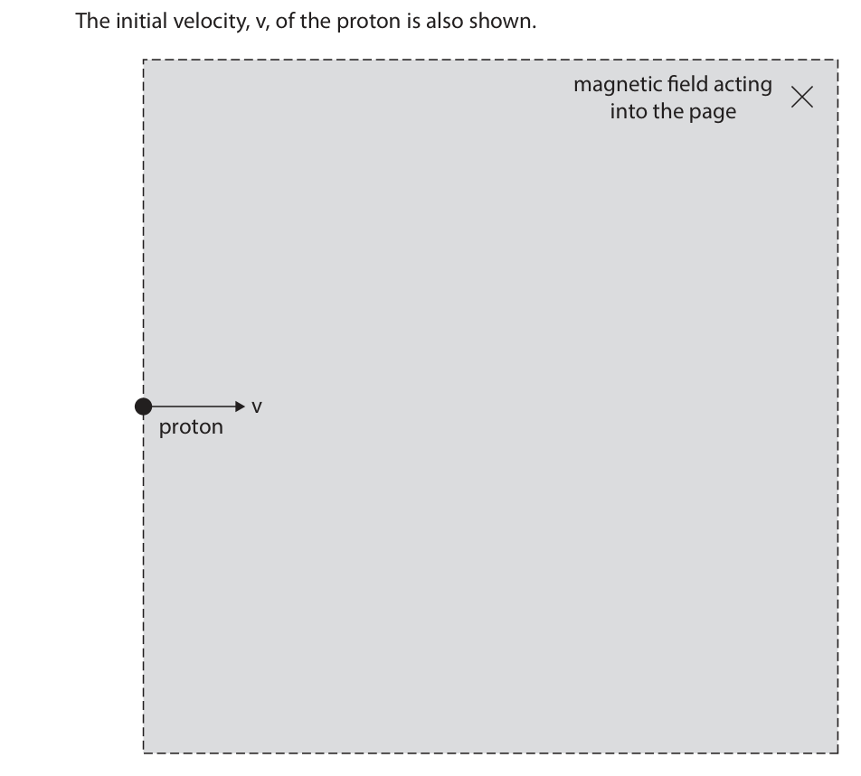
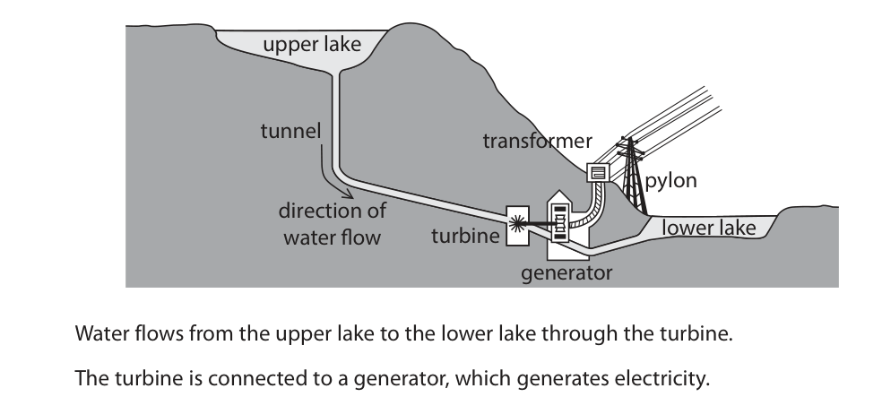
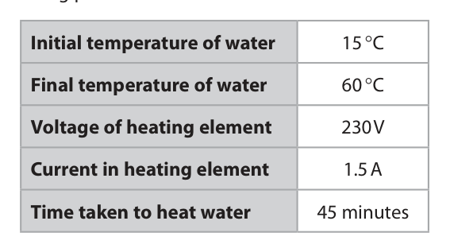

# 4PH1/2P — 2024-06 (official extraction)

> schema `syllabai.official-paper-questions/0.2` · paper_id `pearson-edexcel:international-gcse:physics:4ph1:2024-06:4PH1/2P` · qp sha256 `e5920b0b4f8478d9…` · extraction is the disclosed baseline (ADR-039)

## Question 1 (5 marks)

The Hertzsprung-Russell (HR) diagram shown can be used to classify stars. R Absolute magnitude Q P Colour

### 1(a) [3]

Three regions in the HR diagram are labelled P, Q and R. The boxes show the three regions and different astronomical objects. Draw a straight line from each region to the type of astronomical object contained in that region. Region Astronomical object black hole main sequence star P nebula Q neutron star red giant star R supernova white dwarf star

**Mark scheme answer**

> one mark for each correct line; reject mark if more
> than one line drawn
> from region

- **(3)** one mark for each correct line; reject mark if more

### 1(b) [2]

Define the term absolute magnitude.

**Mark scheme answer**

> (a measure of) brightness; allow power,
> luminosity, intensity
> ignore description of
> scale for idea of
> magnitude
> (of a star) at a {standard / fixed / same / set} allow correct distance
> distance; e.g. 10 parsecs/32(.6)
> light years
> ignore incorrect
> distance
> Answer Notes Marks

- **(2)** (a measure of) brightness; allow power,

## Question 2 (10 marks)

A wrench is used to turn a nut. nut 28 N wrench 15 cm Diagram 1 (Source: https://www.shutterstock.com/image-photo/adjustable-spanner-isolated-on-white- chrome-1794553030)

**(c)** Diagram 2 shows the wrench as it is turned through 90° 28 N 15 cm 28 N Diagram 2 (Source: https://www.shutterstock.com/image-photo/adjustable-spanner-isolated-on-white- chrome-1794553030)

### 2(a) [3]

The force applied to the wrench is 28 N. Calculate the moment applied by the wrench on the nut. Give a suitable unit. moment = unit =

**Mark scheme answer**

> substitution into moment = force × distance; accept dimensionally
> correct substitution
> evaluation; -1 for POT error
> matching unit; condone case error
> e.g.
> moment = 28 × 0.15 allow 28 × 15
> (moment =) 4.2 N m allow 420 N cm

- **(3)** substitution into moment = force × distance; accept dimensionally

### 2(b) [2]

State two changes that could be made to increase the size of the moment applied to the nut. 1 2

**Mark scheme answer**

> allow pivot for nut
> apply a larger force / eq;
> apply force further from nut / eq; allow use a longer
> wrench
> condone bigger wrench

- **(2)** allow pivot for nut

### 2(c)(i) [2]

The force is applied over a distance that is equal to a quarter of the circumference of a circle. The circle has a radius of 15 cm. Calculate the distance over which the force is applied. [circumference of circle = 2 ×π ×radius] distance = cm

**Mark scheme answer**

> circumference of circle calculated;
> divided by 4 to find distance; answer evaluated as a
> decimal only
> ecf candidate’s
> circumference
> e.g. 22/7 for π gives 94.3
> (circumference = 2πr = 2 × π × 15) = 94(.2) (cm)
> (distance = 94 / 4 =) 24 (cm) allow anything that
> would round to 24 (cm)
> condone 23.5 (cm)

- **(2)** circumference of circle calculated;

### 2(c)(ii) [3]

Calculate the work done by the force as the wrench is turned through a quarter of the circumference of the circle. work done = J

**Mark scheme answer**

> conversion of cm to m; allow ecf from (i)
> seen explicitly or
> implied by working
> substitution;
> evaluation; answer evaluated as a
> decimal only
> -1 for POT error
> e.g.
> work done = force × distance
> work done = 28 × 0.24
> (work done =) 6.7 (J) allow any answer that
> rounds to 6.6 (J)
> or 6.7 (J)
> using 0.94 for the
> distance gives an
> answer that rounds to
> 26 (J) ecf 3 marks
> Answer Notes Marks

- **(3)** conversion of cm to m; allow ecf from (i)

## Question 3 (8 marks)

A student investigates how much infrared radiation is absorbed by different surfaces.

### 3(a) [6]

The photograph shows some of the equipment available to the student. infrared heater black bottle silver bottle thermometers The student pours some water into each bottle. Describe a method the student could use to investigate how the colour of the bottle affects the amount of infrared radiation absorbed by the bottle. You may draw a diagram to help your answer.

**Mark scheme answer**

> any six from: allow marks from
> suitable diagram
> MP1. idea of equal volume of water in each bottle;
> MP2. place both bottles an equal distance from the
> heater;
> MP3. idea of same heater output for both bottles; condone have ‘heater
> setting’ the same for
> both bottles
> MP4. same starting temperature of water in both allow ‘measure initial
> bottles; temp of water’
> MP5. measure temperature of water in both allow measure time in
> bottles after a given time; for a given temperature
> change
> MP6. repeat investigation (more than once); i.e. the candidate has
> shown they understand
> that both bottles have
> been measured more
> than once
> MP7. calculate a mean; condone average
> MP8. safety guidance to avoid the hazard of e.g. take care to avoid
> burn/scald/electrocution; burns from heater,
> clean up water spillages
> etc.

- **(6)** any six from: allow marks from

### 3(b) [2]

The student plots a graph to show how the temperature of the water in each bottle varies with time. Draw two curves to show the expected variation in temperature of the black bottle and the silver bottle during the investigation. Label your curves with the colour of each bottle. Temperature Time

**Mark scheme answer**

> reject whole response if
> both lines show a
> decrease
> two lines drawn showing an increase in ignore starting
> temperature over time; temperature
> ignore flat sections
> line identified by candidate as black is always lines must be labelled
> above the line identified by candidate as silver; for this mark
> allow “silver” line
> reaching same
> temperature as “black”
> line at a later time
> Answer Notes Marks

- **(2)** reject whole response if

## Question 4 (9 marks)

This question is about electrostatics.

**(a)** A polythene rod is rubbed with a cloth, which causes both the rod and the cloth to become charged.

**(b)** A student has rods made from different materials. The student rubs each rod the same way with a cloth. The student measures the charge gained by each rod three times. The table shows the results. Charge in nanocoulombs (nC) Material 1 2 3 Mean glass +35 +38 +36 +36 ebonite –168 –170 –171 –170 polythene –61 –80 –59 acetate –20 –20 –18 –19

### 4(a)(i) [1]

Which of these is the force that causes the rod and the cloth to become charged?

- **(A)** friction  ✔
- **(B)** gravitational
- **(C)** magnetic
- **(D)** tension

**Mark scheme answer**

> A (friction);
> B is incorrect because gravity is not the
> force
> C is incorrect because magnetic is not the
> force
> D is incorrect because tension is not the
> force

- **(1)** Answer A: friction

### 4(a)(ii) [1]

The polythene rod becomes negatively charged. Which of these statements explains how the rod has become negatively charged?

- **(A)** the rod gains electrons  ✔
- **(B)** the rod loses electrons
- **(C)** the rod gains protons
- **(D)** the rod loses protons

**Mark scheme answer**

> A (the rod gains electrons);
> B is incorrect because this would produce a
> positive charge
> C is incorrect because protons are not
> transferred
> D is incorrect because protons are not
> transferred

- **(1)** Answer A: the rod gains electrons

### 4(b)(i) [1]

One of the readings for the polythene rod is anomalous. Circle the anomalous result in the results table.

**Mark scheme answer**

> reading at −80 circled

- **(1)** reading at −80 circled

### 4(b)(ii) [1]

State how the student should deal with the anomalous result.

**Mark scheme answer**

> repeat or check that test or that result / condone idea of
> “repeat the whole
> experiment”
> ignore the result /
> idea of not including (that result) in the
> mean;

- **(1)** repeat or check that test or that result / condone idea of

### 4(b)(iii) [2]

Calculate the mean charge for the polythene rod. mean charge = nC

**Mark scheme answer**

> mean calculated including anomaly giving
> an answer that rounds to -67 = 1 mark max;
> mean calculated correctly ignoring anomaly allow ecf from (i)
> i.e. -60 = 2 marks;;
> (-59+-61/2 =) -89.5
> scores 1
> (+)60 scores 1
> (+)67 scores 0

- **(2)** mean calculated including anomaly giving

### 4(b)(iv) [3]

Describe how the student could use the rods to demonstrate that there are two different types of electric charge.

**Mark scheme answer**

> reject response with
> references to
> magnets
> MP1 : suitable apparatus that would e.g. suspended
> demonstrate rod is charged second rod, hair,
> water stream, bits of
> paper, electroscope,
> coulombmeter
> MP2: indication that a charged rod will e.g. (charged) rods
> apply a force on the ‘other object’ attract, (charged)
> rods repel, water
> stream bends, hair
> attracts,
> electroscope foil
> deflects
> MP3: evidence that both attraction and
> repulsive forces will happen with opposite e.g. like charged
> and like charges rods will move away
> from each other but
> unlike charged rods
> will move together,
> condone gold leaf
> deflects one way
> with positive object
> then other way with
> negative object,
> coloumbmeter shows
> positive with one
> test and negative
> with another
> Answer Notes Marks

- **(3)** reject response with

## Question 5 (8 marks)

This question is about sound.

**(c)** A sound wave has a frequency of 500 Hz.

### 5(a) [1]

State which wave property determines the pitch of a sound.

**Mark scheme answer**

> frequency; ignore unit for
> frequency
> reject response with
> more than one
> quantity/property

- **(1)** frequency; ignore unit for

### 5(b) [2]

The bar chart shows the maximum frequency of sound heard by four animals and a human. Frequency in kHz A B C D E Explain which of the bars is most likely to show the results for a human.

**Mark scheme answer**

> C chosen; condone E chosen
> condone ‘C and E’
> condone ‘C or E’
> (because) humans can hear up to 20 kHz / accept additional
> 20 000Hz; reasonable qualification
> e.g. idea of upper
> range decreasing with
> age or hearing loss

- **(2)** C chosen; condone E chosen

### 5(c)(i) [3]

Show that the time period of the sound wave is 2.0 ms.

**Mark scheme answer**

> accept use of standard
> form throughout
> substitution into f = 1/T; working required
> rearrangement; working required
> evaluation in seconds and appropriate conversion to -1 for POT error
> ms;
> e.g. accept reverse
> 500 = 1/T argument
> i.e
> converted to 0.002;
> substituted i.e. f =
> 1/0.002;
> evaluated to get 500
> Hz;
> T = 1/500
> T = 0.002 s = 2(.0) (ms)
> ignore amplitude

- **(3)** accept use of standard

### 5(c)(ii) [2]

The diagram shows the screen of an oscilloscope. The timebase of the oscilloscope is 0.50 ms per square. Draw the trace on the oscilloscope screen when the sound wave is detected.

**Mark scheme answer**

> one or more complete wave(s) drawn with e.g. all half-cycles the
> consistent period by eye; same number of
> squares horizontally
> each cycle is 4 squares; mark independently
> Question number Answer Notes Marks

- **(2)** one or more complete wave(s) drawn with e.g. all half-cycles the

## Question 6 (7 marks)

This question is about electromagnets.

**(b)** A proton moves through a uniform magnetic field produced by a strong electromagnet. The shaded area in the diagram represents the magnetic field. The initial velocity, v, of the proton is also shown. magnetic field acting into the page v proton

### 6(a) [3]

Describe the construction of a simple electromagnet that is producing a magnetic field. You may draw a diagram to help your answer.

**Mark scheme answer**

> all ideas may be
> shown on diagram
> solenoid / coil (of wire); e.g. labelled wire
> wrapped multiple
> times around a box
> shape on diagram
> (direct/d.c.)current in the wire/coil/solenoid; condone idea of
> connection to a
> voltage source e.g.
> battery, powerpack,
> cell etc
> ignore alternating
> current / a.c.
> (soft) iron core; ignore steel
> accept ‘magnetically
> soft material’
> reject indication of a
> complete (iron) loop
> reject explicit
> reference to bar
> magnet

- **(3)** all ideas may be

### 6(b)(i) [1]

Use the left-hand rule to determine the direction of the force acting on the proton.

**Mark scheme answer**

> idea of upwards/ towards top of page; may be shown on
> diagram
> ignore ‘north’

- **(1)** idea of upwards/ towards top of page; may be shown on

### 6(b)(ii) [2]

Explain how the force on the proton changes as the proton moves through the magnetic field. You may add to the diagram to help your answer.

**Mark scheme answer**

> any TWO from:
> force (always) at right angles (to velocity); may be shown on the
> causes the proton’s direction to change; diagram
> (because) proton motion is equivalent to a current;
> (this causes) the direction of the force on the proton
> to change;
> idea of magnitude of force is constant;

- **(2)** any TWO from:

### 6(b)(iii) [1]

Suggest why the velocity of the proton changes.

**Mark scheme answer**

> (velocity changes because) the direction changes; ignore idea of speed
> or magnitude of
> velocity changes
> Answer Notes Marks

- **(1)** (velocity changes because) the direction changes; ignore idea of speed

## Question 7 (10 marks)

A hydroelectric power (HEP) station generates electricity from renewable energy resources.

**(c)** The HEP station is located near a large wind farm.

### 7(a) [1]

State what is meant by the term renewable energy resource.

**Mark scheme answer**

> idea that source will not run out / can be ignore ‘recycled’ or ‘re-
> replaced; used’
> condone ‘infinite’
> accept ‘replenished’

- **(1)** idea that source will not run out / can be ignore ‘recycled’ or ‘re-

### 7(b) [4]

The diagram shows the design of a HEP station. upper lake tunnel transformer pylon direction of water flow turbine lower lake generator Water flows from the upper lake to the lower lake through the turbine. The turbine is connected to a generator, which generates electricity. Describe the energy transfers involved in generating electricity in the HEP station.

**Mark scheme answer**

> any four from: condone ‘turns into’,
> ‘becomes’ etc for
> ‘transfers’
> MP1. water has (high) {gravitational potential energy starts as
> energy/GPE (store)} ; gravitational (potential
> energy)
> MP2. water loses GPE / gains {kinetic transfers from GPE to
> energy/KE}; KE scores MP1 and MP2
> MP3. transfers mechanically (to water or to allow at any correct
> turbine or to generator); stage i.e. for water,
> turbine or generator
> allow KE of water to KE
> of turbine
> allow KE of turbine to
> KE of generator
> MP4. energy is transferred electrically (from transfers from KE (of
> power station); water or generator) to
> electrical (energy)
> MP5. energy is wasted by heating/radiation e.g. allow transfer of heat
> IR, sound; (energy) to
> surroundings/eq
> allow transfer of sound
> (energy)

- **(4)** any four from: condone ‘turns into’,

### 7(c)(i) [1]

Give one advantage of generating electricity using the HEP station rather than the wind farm.

**Mark scheme answer**

> any one from: ignore cost factors
> ignore visual pollution
> ● idea that energy can be supplied more e.g. allow does not
> reliably by HEP; depend on the weather
> ● idea that HEP produces less
> (environmental) noise;
> ● idea that HEP can respond (quickly) to
> demand;

- **(1)** any one from: ignore cost factors

### 7(c)(ii) [1]

Give one disadvantage of generating electricity using the HEP station rather than the wind farm.

**Mark scheme answer**

> any one from: ignore cost factors
> ● large area of land needs to be flooded; ignore visual pollution
> ● location dependent / mountainous area;
> ● damage to habitats / eq;

- **(1)** any one from: ignore cost factors

### 7(c)(iii) [3]

The HEP station has an electric pump that can pump water from the lower lake back to the upper lake. The pump can be powered using electricity generated by the wind farm. Explain how the HEP station and wind farm can be used together to maximise the effectiveness of generating electricity.

**Mark scheme answer**

> any THREE from:
> MP1 idea that wind farm cannot store energy;
> MP2 idea of wind powering the pump when do not credit simple
> (energy) demand is low; reference to wind farm
> powering pump
> (repeats question)
> MP3 idea that (therefore) upper lake acts as an allow idea that upper
> energy store (for wind farm output); lake acts like a battery
> MP4 (so that) energy released from upper lake or (so that) energy can be
> to the HEP when demand is high released from the upper
> lake when it’s not
> windy
> MP5 idea that more electricity/energy is condone less energy or
> transferred usefully; less electricity wasted
> condone less energy or
> less electricity lost
> Answer Notes Marks

- **(3)** any THREE from:

## Question 8 (13 marks)

The photograph shows a water bath that a technician uses to heat some water.

**(b)** The technician heats the water to a final temperature of 60 °C.

**(c)** Some water evaporates as a gas from the water bath.

### 8(a) [1]

The water bath is filled with water at an initial temperature of 15 °C. Calculate the initial temperature of the water in kelvin. initial temperature = K

**Mark scheme answer**

> 288 (K); allow 288.15 (K)
> allow 288.16 (K)

- **(1)** 288 (K); allow 288.15 (K)

### 8(b)(i) [2]

Describe how the energy of the water molecules changes as the temperature of the water increases.

**Mark scheme answer**

> (energy of molecules) increases;
> kinetic energy increases; scores both marks
> allow KE for kinetic
> energy

- **(2)** (energy of molecules) increases;

### 8(b)(ii) [3]

The table shows some information about the heating element in the water bath and the heating process. Initial temperature of water 15 °C Final temperature of water 60 °C Voltage of heating element 230 V Current in heating element 1.5 A Time taken to heat water 45 minutes Calculate the energy transferred by the heating element in the water bath during the heating process. energy transferred = J

**Mark scheme answer**

> substitution into E = V × I × t; independent mark i.e.
> allow ×60 seen
> anywhere
> conversion of minutes to seconds; allow in either order
> evaluation;
> e.g.
> time = 45 × 60 = 2700 (s)
> energy = 230 × 1.5 × 2700
> energy = 9.3 × 105 (J) allow 931 500 (J)
> however rounded
> 15 525 (J) scores 2
> marks however rounded
> 258.75 (J) scores 2
> however rounded

- **(3)** substitution into E = V × I × t; independent mark i.e.

### 8(b)(iii) [3]

Calculate the mass of water being heated. Assume that all the energy is transferred to the thermal store of the water. [for water, specific heat capacity = 4200 J / kg °C] mass of water = kg

**Mark scheme answer**

> substitution into Q = m × c × ∆T; allow ecf from (ii)
> rearrangement; allow in either order
> evaluation;
> e.g.
> 9.3 × 105 = mass × 4200 × (60-15)
> mass = 9.3 × 105 / 4200 × 45
> (mass =) 4.9 (kg)
> answer that rounds to
> 0.082 (kg) scores 3 ecf
> from 15 525 divided by
> (4200 x 45)
> answer that rounds to
> 0.0014 (kg) scores 3 ecf
> from 258.75 divided by
> (4200 x 45)

- **(3)** substitution into Q = m × c × ∆T; allow ecf from (ii)

### 8(c)(i) [2]

Describe the arrangement of particles in a gas.

**Mark scheme answer**

> particles are arranged randomly; condone moving
> randomly
> condone irregular for
> random
> idea that particles are spread out or are widely idea of ‘large gaps’
> spaced;

- **(2)** particles are arranged randomly; condone moving

### 8(c)(ii) [2]

Describe two differences between evaporation and boiling.

**Mark scheme answer**

> boiling happens at a specific or fixed temperature needs comparison
> or 100 oC but evaporation happens at any condone idea of a lower
> temperature; temperature (compared
> to boiling point)
> boiling happens throughout a liquid but ignore reference to
> evaporation only happens at the surface /eq ; bubbles
> Pearson Education Limited. Registered company number 872828
> with its registered office at 80 Strand, London, WC2R 0RL, United Kingdom

- **(2)** boiling happens at a specific or fixed temperature needs comparison

