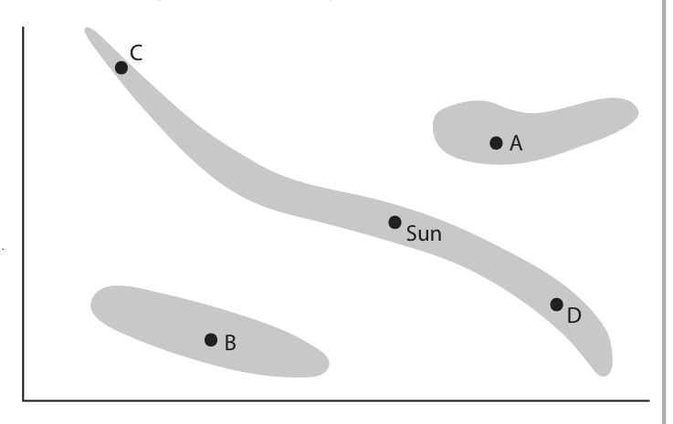
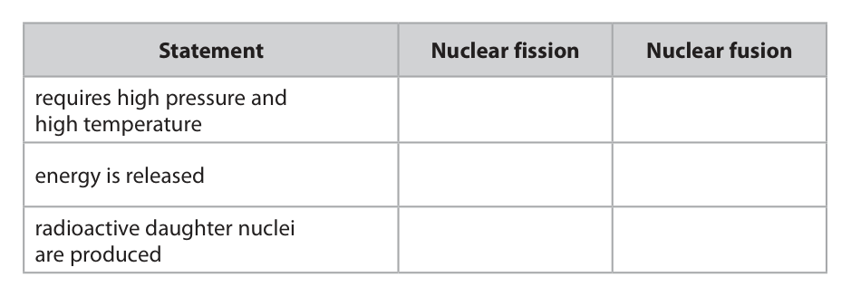
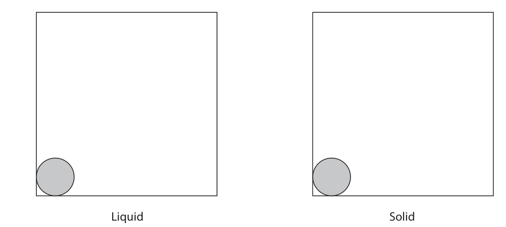
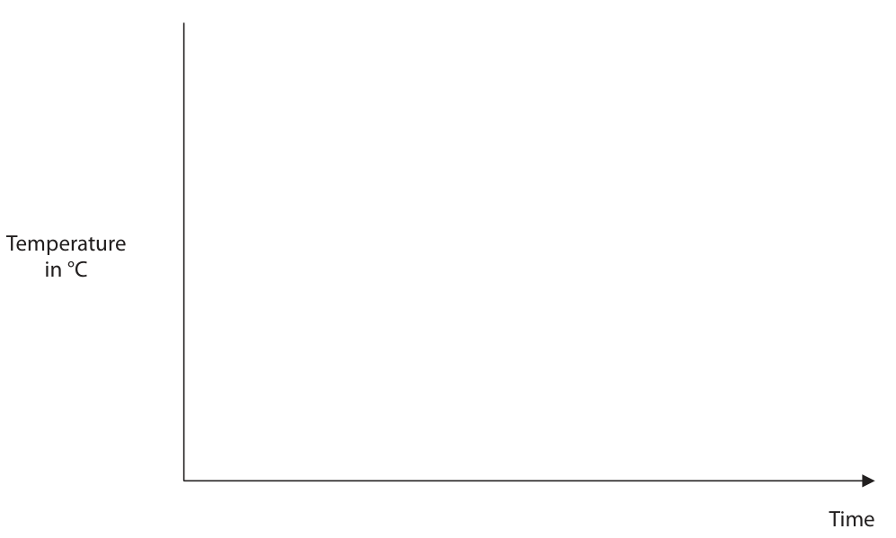
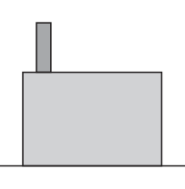
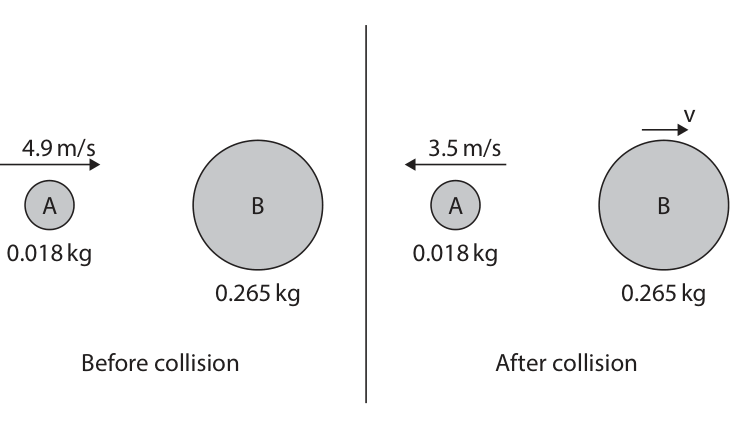
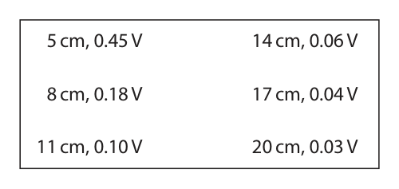
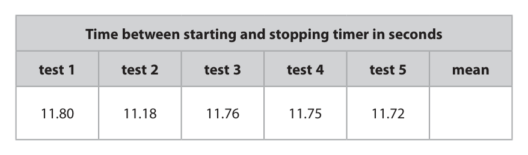
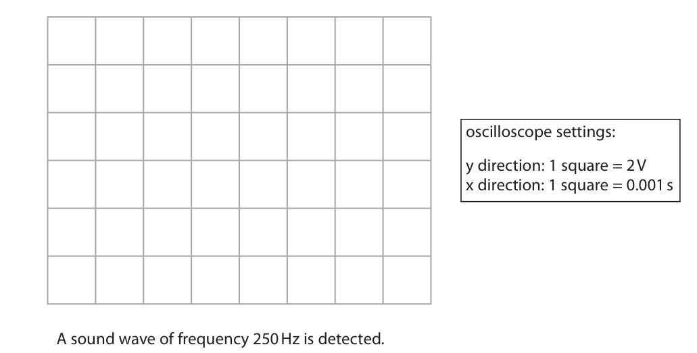
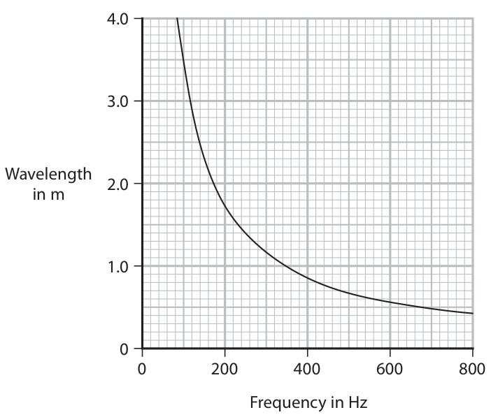

# 4PH1/2PR — 2024-06 (official extraction)

> schema `syllabai.official-paper-questions/0.2` · paper_id `pearson-edexcel:international-gcse:physics:4ph1:2024-06:4PH1/2PR` · qp sha256 `e99ecb0e2c52893a…` · extraction is the disclosed baseline (ADR-039)

## Question 1 (5 marks)

This question is about stars. The diagram shows an incomplete Hertzsprung-Russell (H-R) diagram. C A Sun D B

### 1(a) [2]

Label the axes on the diagram.

**Mark scheme answer**

> y-axis: one from ignore brightness
> • luminosity;
> • absolute magnitude; allow magnitude
> absolute
> • power;
> x-axis: one from
> • temperature;
> • colour;
> • spectral class;
> 1 mark if both labels
> correct but on the
> wrong axes

- **(2)** y-axis: one from ignore brightness

### 1(b) [1]

There are three shaded areas on the diagram. State the name of the shaded area that contains the Sun.

**Mark scheme answer**

> main sequence;

- **(1)** main sequence;

### 1(c) [1]

Which star is a white dwarf? A B C D

**Mark scheme answer**

> B;
> A is incorrect because it is a red giant
> C is incorrect because it is a hot main sequence star
> D is incorrect because it is a cool main sequence
> star

- **(1)** B;

### 1(d) [1]

At a standard distance from the Earth, which star is brighter than the Sun and has a greater surface temperature than the Sun? A B C D

**Mark scheme answer**

> C;
> A is incorrect because red giants are cooler than
> the Sun
> B is incorrect because white dwarf stars are fainter
> than the Sun
> D is incorrect because this star is both cooler and
> fainter than the Sun
> Answer Notes Marks

- **(1)** C;

## Question 2 (5 marks)

This question is about nuclear fission and nuclear fusion.

### 2(a) [3]

The table gives some statements about nuclear fission, or nuclear fusion, or both nuclear fission and nuclear fusion. Place ticks (✓) in the table to show which statements are about nuclear fission and which statements are about nuclear fusion. Statement Nuclear fission Nuclear fusion requires high pressure and high temperature energy is released radioactive daughter nuclei are produced

**Mark scheme answer**

> one mark for each correct row;;;

- **(3)** one mark for each correct row;;;

### 2(b) [2]

Nuclear fission reactors use control rods and a moderator. Describe the function of the control rods and the function of the moderator in a nuclear fission reactor. control rods moderator

**Mark scheme answer**

> control rods absorb neutron(s); ignore controls rate of
> reaction
> condone stops
> neutron(s)
> moderator reduces speed of neutron(s); allow reduces kinetic
> energy of neutron(s)
> ignore controls speed
> Answer Notes Marks

- **(2)** control rods absorb neutron(s); ignore controls rate of

## Question 3 (7 marks)

A sample of liquid gallium is allowed to cool in a laboratory. The liquid gallium freezes to become a solid.

### 3(a) [4]

Complete the diagram by drawing the arrangement of particles in a liquid and the arrangement of particles in a solid. The first particle in each box has been drawn for you. Liquid Solid

**Mark scheme answer**

> liquid arrangement: ignore if particles don’t
> fill entire box
> attempt to draw most particles in contact with each reject if gap large
> other; enough to draw another
> particle
> random arrangement;
> solid arrangement: ignore if particles don’t
> fill entire box
> attempt to draw particles in contact with each other; reject if gap large
> enough to draw another
> particle
> regular arrangement;

- **(4)** liquid arrangement: ignore if particles don’t

### 3(b) [3]

The initial temperature of the sample of liquid gallium is 80 °C. The freezing temperature of gallium is 30 °C. The final temperature of the solid gallium is 20 °C. Complete the graph to show how the temperature of the gallium changes during the time that it cools to 20 °C. Add appropriate values to the temperature axis. Temperature in °C Time

**Mark scheme answer**

> line drawn decreasing from any high temperature to any allow straight lines and
> low temperature; curves
> single constant temperature stage drawn in the middle DOP
> of the cooling (to show freezing); ignore constant
> temperature at the end
> of the process
> temperature axis labelled with suitable values e.g. line all three temperatures
> starts at 80, flat stage at 30 and line ends at 20; required
> ignore scale
> Answer Notes Marks

- **(3)** line drawn decreasing from any high temperature to any allow straight lines and

## Question 4 (6 marks)

The photograph shows transmission cables used for long-distance transmission of electricity. (Source: © Paul Maguire / Shutterstock)

### 4(a) [3]

The diagram shows a power station and a school. Add to the diagram by drawing the structures needed to efficiently transfer energy from the power station to the school using electricity. Power station School

**Mark scheme answer**

> at least one transformer drawn in the space drawing must be clearly
> between power station and school; recognisable as a
> transformer (e.g. two
> coils) or correctly
> labelled
> second similar object drawn in the space between ignore pylons and
> power station and school; transmission lines
> transformer/object nearest power station labelled allow if transformers
> “step-up” and transformer/object nearest school drawn accurately i.e.
> labelled “step-down”; more turns on
> secondary coil for step-
> up etc.

- **(3)** at least one transformer drawn in the space drawing must be clearly

### 4(b) [3]

Explain how the amount of current in the transmission cables increases the efficiency of the transmission of electricity.

**Mark scheme answer**

> (because) current causes wires/cables to heat up; link between current
> and heating must be
> clear
> idea of low/decreased/less current;
> reduces energy loss (to the surroundings); allow reduces energy
> dissipated/wasted
> ignore heat loss
> Answer Notes Marks

- **(3)** (because) current causes wires/cables to heat up; link between current

## Question 5 (12 marks)

The diagram shows the collision between two balls, A and B. The masses and velocities of both balls are shown before and after the collision. Ball B is stationary before the collision. v 4.9 m/s 3.5 m/s A B A B 0.018 kg 0.018 kg 0.265 kg 0.265 kg Before collision After collision

### 5(a) [2]

When the balls collide, ball B applies a force on ball A, which causes the velocity of ball A to change. Ball A also applies a force on ball B during the collision. Describe how the force applied on ball A compares with the force applied on ball B during the collision.

**Mark scheme answer**

> both forces are the same size/magnitude/equal; ignore same force
> forces are in opposite directions; allow one (force) is left
> and the other (force) is
> right
> “forces are equal and
> opposite” / “every
> action has an equal and
> opposite reaction”
> scores 1 mark if no
> other marks awarded

- **(2)** both forces are the same size/magnitude/equal; ignore same force

### 5(b) [2]

Calculate the momentum of ball A before the collision. momentum of ball A before collision = kg m / s

**Mark scheme answer**

> substitution into p = m × v;
> evaluation; -1 for POT error from
> incorrectly converting
> kg to g
> e.g.
> (momentum =) 0.018 × 4.9
> (momentum =) 0.088 (kg m/s) allow 0.09, 0.0882 (kg
> m/s)

- **(2)** substitution into p = m × v;

### 5(c) [4]

Show that the velocity, v, of ball B after the collision is about 0.6 m / s.

**Mark scheme answer**

> use of conservation of momentum; seen explicitly or
> implied from working
> setting up equation to be solved; allow ecf from (b)
> rearrangement;
> evaluation to 2 or more significant figures; ignore 0.6 as given in
> answer of 0.095… scores
> 3 marks
> e.g.
> momentum is conserved
> 0.088 = 0.018 × −3.5 + 0.265 × v
> v = [0.088 + 0.063]/0.265
> v = 0.57 (m/s) allow any answer
> rounding to 0.57

- **(4)** use of conservation of momentum; seen explicitly or

### 5(d) [4]

A collision is considered elastic if the total kinetic energy before the collision is equal to the total kinetic energy after the collision. Using data from the diagram, deduce whether this collision is elastic.

**Mark scheme answer**

> use of KE = ½ × m × v²; seen explicitly or
> implied from working
> evaluation of KE before collision; allow 0.2, 0.22, 0.216,
> 0.216… (J)
> evaluation of KE after collision; allow 0.15-0.16 (J) OR
> 0.110 AND 0.043 seen in
> working
> comparison with correct conclusion that collision is DOP
> not elastic/inelastic; allow ecf from KE
> calculations

- **(4)** use of KE = ½ × m × v²; seen explicitly or

## Question 6 (10 marks)

This question is about generating electricity from renewable energy resources.

**(b)** A student investigates how the amount of light affects the output voltage of a solar cell. Photograph 3 shows how the student sets up their equipment. lamp solar cell ruler voltmeter Photograph 3

### 6(a) [4]

Photograph 1 shows a solar farm in the United Kingdom and photograph 2 shows a geothermal power station in Iceland. Photograph 1 Photograph 2 (Source: © Marcin Jucha / Shutterstock) (Source: © Javarman / Shutterstock) Discuss the advantages and disadvantages of generating electricity using solar power and geothermal resources.

**Mark scheme answer**

> any one advantage for solar: ignore renewable
> • produces no noise;
> • available in all locations;
> • no greenhouse/polluting/harmful gases
> produced;
> any one disadvantage for solar: ignore statements relating
> to cost
> • dependent on amount of sun(light); allow doesn’t work at night,
> depends on the weather
> • requires large area of panels; allow takes up lots of space,
> idea that it takes away land
> for farming/agriculture etc.
> any one advantage for geothermal: ignore renewable
> • can be used all day; allow it is reliable, does not
> depend on the weather
> • requires small amount of space;
> • produces very little/no noise;
> any one disadvantage for geothermal: ignore statements relating
> to cost
> • not available in all locations;
> • releases some allow other named gases
> greenhouse/polluting/harmful gases; e.g. ammonia etc.
> • possible pollution of ground water;

- **(4)** any one advantage for solar: ignore renewable

### 6(b)(i) [3]

The student varies the distance between the solar cell and the lamp and measures the output voltage of the solar cell at each distance. The student’s results are shown below. 5 cm, 0.45 V 14 cm, 0.06 V 8 cm, 0.18 V 17 cm, 0.04 V 11 cm, 0.10 V 20 cm, 0.03 V Draw a table showing the student’s results.

**Mark scheme answer**

> two columns/rows with headings of “distance” and ignore additional column for
> “voltage”; experiment number
> units included correctly in both column headings; reject if units included with
> data in the body of the table
> all data recorded correctly to the same number of
> decimal places as originally presented;
> e.g.

- **(3)** two columns/rows with headings of “distance” and ignore additional column for

### 6(b)(ii) [1]

Give a control variable for the student’s investigation.

**Mark scheme answer**

> any one of:
> • power/luminosity (of lamp); condone same lamp
> • (amount of) background light; ignore amount of light, light
> • brightness of lamp; intensity, brightness, same
> • light intensity of lamp; solar cell etc.

- **(1)** any one of:

### 6(b)(iii) [2]

The student states that the solar cell could be used as a power source for the lamp. They suggest that this would work if • the solar cell is connected directly to the lamp • the light from the lamp is used to produce the output power from the solar cell Explain, with reference to the principle of conservation of energy, why the student’s suggestion would not work.

**Mark scheme answer**

> any two from:
> MP1. idea that lamp / solar cell is not 100%
> efficient;
> MP2. not all light produced by lamp is received by allow light spreads out in all
> solar cell; directions
> MP3. energy losses {in connecting wires / to allow energy
> surroundings / as heat}; wasted/dissipated for
> energy losses
> Answer Notes Marks

- **(2)** any two from:

## Question 7 (9 marks)

The diagram shows two students doing an experiment to measure the speed of sound in air. wall students 100 m This is their method. • both students stand 100 m away from a large flat wall • student A makes a sound by hitting two blocks of wood together • the sound waves travel to the wall and reflect back to the students as an echo • student A hits the blocks together again when the echo is heard • student A continues to hit the blocks together every time an echo is heard • student B starts a timer when the blocks are hit together and stops the timer when the blocks have been hit together 20 more times

**(b)** The students repeat their method five times. The table shows the students’ results. Time between starting and stopping timer in seconds test 1 test 2 test 3 test 4 test 5 mean 11.80 11.18 11.76 11.75 11.72

### 7(a) [1]

Give a reason why the students do not stand nearer to the wall.

**Mark scheme answer**

> idea that time (between hits) is too short / ignore thinking
> reaction/thinking time is an issue; distance, human error

- **(1)** idea that time (between hits) is too short / ignore thinking

### 7(b)(i) [1]

The students decide that one of their tests shows an anomalous result. Circle the anomalous result in the table.

**Mark scheme answer**

> 11.18 circled;

- **(1)** 11.18 circled;

### 7(b)(ii) [1]

Suggest a reason for the anomalous result.

**Mark scheme answer**

> idea that student miscounted the number of block ignore “reaction time”,
> hits; human error
> allow idea that timer
> was started late /
> stopped early
> allow idea that distance
> to wall is different

- **(1)** idea that student miscounted the number of block ignore “reaction time”,

### 7(b)(iii) [3]

Calculate the mean time between starting and stopping the timer. Give your answer to a suitable number of decimal places. mean time = s

**Mark scheme answer**

> evaluation of a mean value; allow even if anomaly
> included
> evaluation of a mean value excluding anomaly; allow ecf from (i)
> final answer correctly given to 2 decimal places; independent mark
> e.g. 11.642 scores 1 mark
> 11.64 scores 2 marks
> mean = 11.642 (s)
> mean = 11.7575 (s)
> mean = 11.76 (s) 11.75 scores 2 marks

- **(3)** evaluation of a mean value; allow even if anomaly

### 7(b)(iv) [3]

The speed of sound in air can be calculated using the formula distance travelled speed = time taken Use the students’ results to calculate a value for the speed of sound in air. speed of sound = m / s

**Mark scheme answer**

> substitution into given formula; allow ecf from (iii)
> condone lack of ×2 and
> ÷20
> evidence of doubling distance OR dividing time by
> 20;
> evaluation;
> 8.5 (m/s) scores 1 mark
> 17, 170 (m/s) scores 2
> e.g.
> speed = (2×) 100 / 11.76(÷20)
> distance = 200m OR time = 0.59s
> speed = (200 / 0.59) = 340 (m/s) allow 340.2…, 340.1…
> (m/s)
> Question number Answer Notes Marks

- **(3)** substitution into given formula; allow ecf from (iii)

## Question 8 (7 marks)

The diagram shows a machine that can be used to measure the speed of fast‑moving protons. proton detector negative plate force proton path of proton magnetic field

**(a)** At the start, the proton is attracted towards a negatively charged plate.

**(b)** The proton passes through a hole in the negatively charged plate and enters an area where there is a magnetic field. The magnetic field exerts a force on the proton, as shown in the diagram. This force causes the proton to follow a circular path without changing speed.

### 8(a)(i) [1]

Give a reason why the proton is attracted to the negatively charged plate.

**Mark scheme answer**

> idea that proton and plate have opposite charges; allow proton is positive
> ignore different charges

- **(1)** idea that proton and plate have opposite charges; allow proton is positive

### 8(a)(ii) [3]

The proton accelerates at 1.90 × 10¹¹ m / s² from rest to a speed of 1.38 × 10⁵ m / s. Show that the time taken for this acceleration is about 7 × 10⁻⁷ s.

**Mark scheme answer**

> substitution into a = (v-u)/t;
> rearrangement;
> evaluation to 2 s.f. or more;
> award full marks for
> using given time to
> calculate either
> acceleration or speed to
> 4 s.f. or more
> e.g.
> 1.90 × 10¹¹ = 1.38 × 10⁵ / t
> t = 1.38 × 10⁵ / 1.90 × 10¹¹
> t = 7.26… × 10⁻⁷ (s) allow 0.000 000 73,
> 7.3 × 10⁻⁷ (s)
> condone 0.000 000 72,
> 7.2 × 10⁻⁷ (s)

- **(3)** substitution into a = (v-u)/t;

### 8(b)(i) [1]

Give the direction of the magnetic field.

**Mark scheme answer**

> into the page / eq;
> allow

- **(1)** into the page / eq;

### 8(b)(ii) [2]

Suggest how increasing the strength of the magnetic field will affect the proton when it is moving in the magnetic field.

**Mark scheme answer**

> any two from:
> idea that force increases;
> acceleration increases; ignore (proton) speed
> increases
> proton moves in tighter circle / hits detector further to allow hits detector
> the left; closer to hole
> allow path of proton is
> shorter
> allow if seen on
> diagram
> Answer Notes Marks

- **(2)** any two from:

## Question 9 (9 marks)

An oscilloscope can be used to determine the frequency of a sound wave.

### 9(a) [1]

Give the name of the piece of apparatus that must be connected to the oscilloscope to detect the sound wave.

**Mark scheme answer**

> microphone;

- **(1)** microphone;

### 9(b) [5]

The diagram shows the screen of the oscilloscope and the oscilloscope settings. oscilloscope settings: y direction: 1 square = 2 V x direction: 1 square = 0.001 s A sound wave of frequency 250 Hz is detected. The sound wave produces a trace on the oscilloscope of amplitude 4 V. Complete the diagram by drawing the trace of this sound wave on the oscilloscope screen.

**Mark scheme answer**

> any roughly sine-shaped wave drawn on the screen; allow triangle wave
> amplitude of trace = 2 squares;
> substitution into f = 1 / T; e.g. 250 = 1/T
> or T = 1/250
> evaluation of time period = 0.004 (s);
> trace drawn on oscilloscope has period of 4 squares; automatically scores
> last three marking
> points
> e.g.

- **(5)** any roughly sine-shaped wave drawn on the screen; allow triangle wave

### 9(c) [3]

The graph shows how the wavelength of sound waves in air varies with their frequency. 4.0 3.0 Wavelength 2.0 in m 1.0 0 200 400 600 800 Frequency in Hz If wavelength and frequency are inversely proportional, then wavelength × frequency = constant Using the graph, evaluate whether the wavelength of sound waves in air is inversely proportional to their frequency.

**Mark scheme answer**

> single use of data from graph to show that constant should be
> frequency × wavelength = constant; between 320 and 360
> depending on data used
> second use of data from graph to show that
> frequency × wavelength = constant;
> clear comparison of constants to show they are
> (approximately) equal AND conclusion that the
> relationship is inversely proportional;
> Pearson Education Limited. Registered company number 872828
> with its registered office at 80 Strand, London, WC2R 0RL, United Kingdom

- **(3)** single use of data from graph to show that constant should be

