# 4PH1/1P — 2024-11 (official extraction)

> schema `syllabai.official-paper-questions/0.2` · paper_id `pearson-edexcel:international-gcse:physics:4ph1:2024-11:4PH1/1P` · qp sha256 `572e731305709b17…` · extraction is the disclosed baseline (ADR-039)

## Question 1 (9 marks)

Diagram 1 shows a planet orbiting a star, and a moon orbiting a planet. not to scale star moon planet Diagram 1

### 1(a) [2]

On Diagram 1, draw the orbit of a comet around the star.

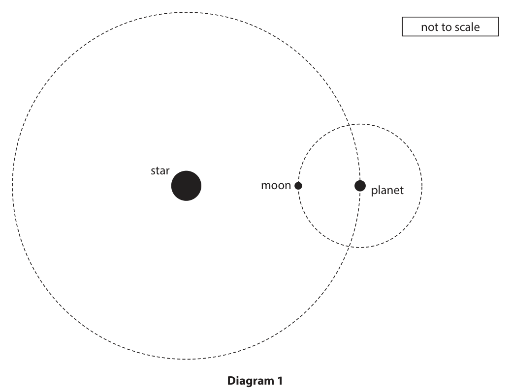

**Mark scheme answer**

> elliptical orbit drawn; allow partial elliptical
> orbits
> star (approximately) at the focus of the ellipse; reject if star at the
> centre of the ellipse

- **(2)** elliptical orbit drawn; allow partial elliptical

### 1(b)(i) [1]

On Diagram 1, draw an arrow to show the force the planet exerts on the moon.

**Mark scheme answer**

> arrow drawn pointing from moon towards planet; arrow does not need to
> start at moon but line
> of arrow must pass
> through moon and
> planet
> ignore force arrows
> associated with comet

- **(1)** arrow drawn pointing from moon towards planet; arrow does not need to

### 1(b)(ii) [1]

What type of force does the planet exert on the moon?

- **(A)** electric
- **(B)** gravitational  ✔
- **(C)** magnetic
- **(D)** nuclear

**Mark scheme answer**

> B - gravitational;
> A is incorrect as any electrical force would not be
> strong enough
> C is incorrect as any magnetic force would not be
> strong enough
> D is incorrect as nuclear forces are short range

- **(1)** Answer B: gravitational

### 1(c) [3]

The planet completes one orbit of the star in a time of 2.5 × 108 s. The radius of the planet’s orbit is 8.7 × 1010 m. Calculate the orbital speed of the planet. Give your answer to two significant figures. orbital speed = m/s

**Mark scheme answer**

> substitution into given formula; allow use of 3.14, 22/7
> for π
> correct evaluation; −1 for POT error
> answer given to 2 s.f.; any final value
> expressed to 2 s.f. gets
> this mark
> e.g.
> orbital speed = 2π × 8.7 × 1010 / 2.5 × 108
> orbital speed = 2186.54848… (m/s) allow 2185.44,
> 2187.4… (m/s)
> orbital speed = 2200 (m/s) allow 2.2 × 103 (m/s)

- **(3)** substitution into given formula; allow use of 3.14, 22/7

### 1(d) [2]

Diagram 2 shows the region around the Sun, a yellow star, where liquid water can exist on the surface of planets. This is because the surface temperature of the planet is between 0 °C and 100 °C. Earth liquid water region Sun Diagram 2 Explain what would happen to the position of the liquid water region if the Sun was replaced with a blue star of the same size.

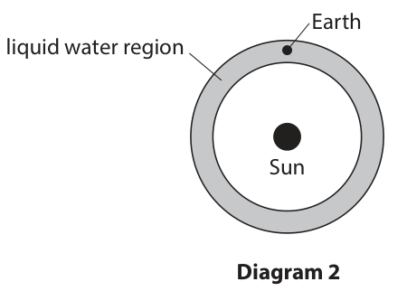

**Mark scheme answer**

> blue star is hotter (than the Sun); allow blue star is
> hottest
> region is further away (from the star); allow region for blue
> star has larger radius /
> eq
> Answer Notes Marks

- **(2)** blue star is hotter (than the Sun); allow blue star is

## Question 2 (14 marks)

An athlete jumps vertically from the ground.

**(a)** The athlete has a mass of 85 kg, and leaves the ground with an upwards velocity of 4.5 m/s.

### 2(a)(i) [1]

State the formula linking kinetic energy, mass and speed.

**Mark scheme answer**

> kinetic energy = ½ × mass × speed2; allow velocity for speed
> allow standard symbols
> e.g. KE = ½ × m × v2

- **(1)** kinetic energy = ½ × mass × speed2; allow velocity for speed

### 2(a)(ii) [2]

Calculate the athlete’s kinetic energy at a speed of 4.5 m/s. kinetic energy = J

**Mark scheme answer**

> substitution;
> evaluation;
> e.g.
> KE = ½ × 85 × 4.52
> KE = 860 (J) allow 861, 860.6, 860.62,
> 860.63, 860.625 (J)

- **(2)** substitution;

### 2(a)(iii) [1]

At the maximum height of the jump, the athlete has a speed of 0 m/s. State the increase in the amount of energy in the athlete’s gravitational potential energy store from the ground to the maximum height of the jump. increase in gravitational potential energy = J

**Mark scheme answer**

> identical answer to (ii); expect 860 (J)
> allow ecf from (ii)

- **(1)** identical answer to (ii); expect 860 (J)

### 2(a)(iv) [1]

State the formula linking gravitational potential energy, mass, gravitational field strength and height.

**Mark scheme answer**

> gravitational potential energy = mass × g × height; allow standard symbols
> e.g. GPE = m × g × h
> ignore gravity for g

- **(1)** gravitational potential energy = mass × g × height; allow standard symbols

### 2(a)(v) [3]

Calculate the maximum height of the athlete’s jump. height = m

**Mark scheme answer**

> substitution; allow use of g = 9.8, 9.81
> allow ecf from (ii) or (iii)
> rearrangement;
> evaluation;
> allow use of v2 = u2 + 2as
> for full marks
> e.g.
> 860 = 85 × 10 × h
> h = 860 ÷ 850 = 1.0(125) (m)
> (h =) 1.0 (m) allow 1 (m) if supported by
> valid working
> allow 1.00 – 1.03 (m)

- **(3)** substitution; allow use of g = 9.8, 9.81

### 2(b)(i) [3]

Sketch a velocity‑time graph for the athlete’s jump from the ground to the maximum height of the jump. No numbers are required. Assume there is no air resistance. Velocity 0 Time

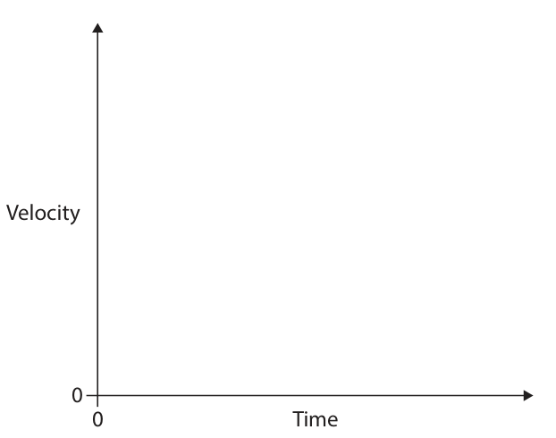

**Mark scheme answer**

> velocity shown to decrease from an initial positive allow if velocity initially
> value; increases from 0 (m/s) and
> then decreases
> reject if velocity remains
> at maximum value (flat
> line)
> straight line of negative gradient drawn; judge by eye
> finishes at 0 (m/s);
> e.g.
> OR

- **(3)** velocity shown to decrease from an initial positive allow if velocity initially

### 2(b)(ii) [1]

What feature of the velocity‑time graph gives the acceleration due to gravity?

- **(A)** area under the line
- **(B)** gradient  ✔
- **(C)** x‑axis
- **(D)** y‑axis

**Mark scheme answer**

> B - gradient;
> A is incorrect as that would give the distance
> travelled
> C and D are incorrect as the x and y axes are
> integral features of the graph, not the data

- **(1)** Answer B: gradient

### 2(b)(iii) [2]

Explain why the gravitational field strength on the Moon is different from the gravitational field strength on the Earth.

**Mark scheme answer**

> any two from:
> MP1. idea that Moon and Earth have different allow RA
> masses; allow density for mass
> condone Earth is
> heavier/Moon is lighter
> MP2. gravitational field strength is proportional
> to mass;
> MP3. gravitational field strength on the Moon is allow RA
> less; condone less gravity on
> Moon
> Answer Notes Marks

- **(2)** any two from:

## Question 3 (7 marks)
**(b)** The electrical equipment is connected to the mains power supply of 230 V.

### 3(a) [2]

Photograph 1 shows a power supply for some electrical equipment. The electrical equipment is connected to the mains supply. (Source: © 2211575607/ Shutterstock) Photograph 1 Explain why the power supply is completely covered in plastic.

**Mark scheme answer**

> plastic is an (electrical) insulator; allow idea the plastic
> doesn’t conduct
> (electricity)
> allow reference to
> double insulation
> idea that it prevents an electric shock; ignore references to
> current transferring to
> surroundings

- **(2)** plastic is an (electrical) insulator; allow idea the plastic

### 3(b)(i) [1]

State the formula linking power, current and voltage.

**Mark scheme answer**

> power = current × voltage; allow standard symbols
> and rearrangements
> e.g. I = P / V
> ignore C, c for current

- **(1)** power = current × voltage; allow standard symbols

### 3(b)(ii) [2]

The electrical equipment has a power of 350 W. Calculate the current in the equipment when it is being used. current = A

**Mark scheme answer**

> substitution OR rearrangement;
> evaluation;
> e.g.
> 350 = current × 230 OR current = power / voltage
> (current =) 1.5 (A) allow 1.52… (A)

- **(2)** substitution OR rearrangement;

### 3(c) [2]

Photograph 2 shows a circuit breaker. (Source: © 509531608 / Shutterstock) Photograph 2 Explain the advantages of using a circuit breaker rather than a fuse.

**Mark scheme answer**

> idea the circuit breaker is faster (at isolating allow circuit breaker is
> circuit); more sensitive
> idea the circuit breaker is resettable; allow circuit breaker
> can be reused / used
> multiple times
> Answer Notes Marks

- **(2)** idea the circuit breaker is faster (at isolating allow circuit breaker is

## Question 4 (11 marks)

A teacher investigates a sample of radioactive material. The graph shows their results. 1200 1000 800 Activity in 600 400 200 0 5 10 15 20 25 30 35 Time in minutes

### 4(a) [1]

On the graph, give the unit for activity.

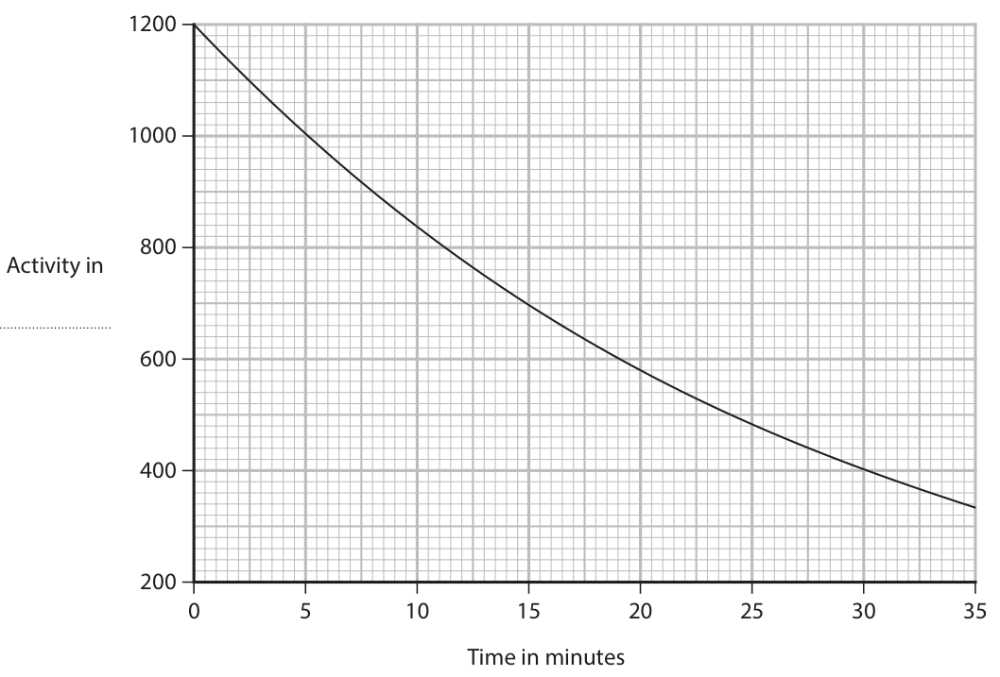

**Mark scheme answer**

> becquerel(s)/Bq; accept with any prefix (e.g.
> kBq) or recognisable spelling
> allow bq, BQ

- **(1)** becquerel(s)/Bq; accept with any prefix (e.g.

### 4(b) [2]

Describe what is meant by the term background radiation.

**Mark scheme answer**

> idea that background radiation is always present; allow radiation all around us,
> in the
> surroundings/environment,
> everywhere etc.
> appropriate named source of background radiation e.g. from:
> mentioned; • the Sun / cosmic rays
> • rocks / soil
> • radon
> • weapons testing
> • food
> • nuclear disasters
> • medical equipment
> reject CMBR

- **(2)** idea that background radiation is always present; allow radiation all around us,

### 4(c)(i) [2]

Describe what is meant by the term half‑life.

**Mark scheme answer**

> (average) time; allow how long it takes
> for halving of:
> • the (radio)activity; allow count rate for activity
> • number of nuclei; allow atoms for nuclei
> • mass of isotope; ignore mass of
> substance/sample

- **(2)** (average) time; allow how long it takes

### 4(c)(ii) [2]

Use the graph to determine the half‑life of this radioactive sample. half‑life = minutes

**Mark scheme answer**

> lines drawn on graph indicating an activity and half e.g. line drawn across from
> of that activity; 600 and down to 19
> half-life = 19 (minutes); accept any answer that rounds
> to 19 (minutes) for 2 marks

- **(2)** lines drawn on graph indicating an activity and half e.g. line drawn across from

### 4(d) [4]

The teacher suggests that this formula shows the relationship between activity and time taken. activity × time taken = constant Use data from the graph to determine if this relationship is correct.

**Mark scheme answer**

> data point taken from graph;
> constant correctly calculated using data point;
> constant correctly calculated from a second data
> point taken from graph;
> conclusion consistent with calculated constants; dependent on first three marks
> being awarded (DOP)
> conclusion must be clearly
> linked to a comparison of the
> constants
> Answer Notes Marks

- **(4)** data point taken from graph;

## Question 5 (8 marks)

Diagram 1 shows two magnetic poles. N S Diagram 1

### 5(a) [2]

Draw three field lines on Diagram 1 to show the uniform magnetic field in the shaded region between the two poles.

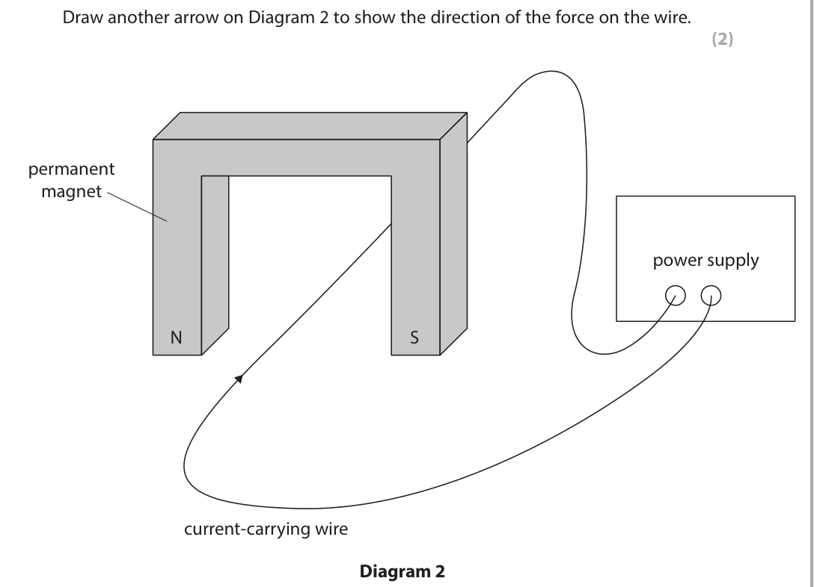

**Mark scheme answer**

> at least three horizontal, straight field lines, parallel judge by eye
> and equally spaced;
> at least one arrow on field line from N to S; reject any
> contradictory field
> line directions for
> this mark

- **(2)** at least three horizontal, straight field lines, parallel judge by eye

### 5(b) [2]

Diagram 2 shows a current‑carrying wire in the uniform magnetic field between the poles of a magnet. The arrow on the wire shows the direction of current. Draw another arrow on Diagram 2 to show the direction of the force on the wire. permanent magnet power supply N S current-carrying wire Diagram 2

**Mark scheme answer**

> vertical arrow; allow arrow drawn
> anywhere on
> diagram
> downwards; DOP

- **(2)** vertical arrow; allow arrow drawn

### 5(c) [4]

Diagram 3 shows a rectangular loop of wire carrying a current in a uniform magnetic field. permanent magnet B C N S A D coil + – Diagram 3 Explain why the loop starts to turn but stops when the loop is vertical.

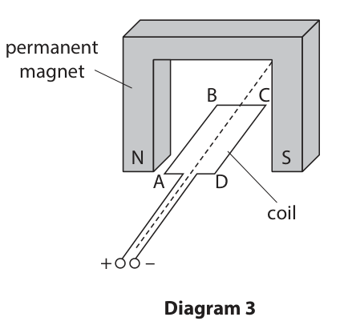

**Mark scheme answer**

> any three from:
> MP1. wire/coil/current has a magnetic field;
> MP2. field of wire/coil/current interacts with field allow idea that fields
> of magnet; overlap
> ignore cutting field
> MP3. idea of there being a force on wire AB or CD; allow if shown on
> diagram
> MP4. idea that forces are in opposite/different allow upward force
> directions; on one side and
> downward force on
> other side
> ignore references to
> movement
> MP5. (because) the currents (in the sides of the coil)
> are in opposite/different directions;
> with one from:
> MP6. forces do not change direction; allow idea that there
> is no (net) moment
> (when the coil is
> vertical)
> MP7. idea that current cannot swap direction; allow current is not
> a.c.
> MP8. lack of split-ring / commutator; allow idea that a
> split-ring /
> commutator is
> needed
> Answer Notes Marks

- **(4)** any three from:

## Question 6 (13 marks)

A student does an investigation to determine the refractive index of a rectangular block of transparent material. The student uses this equipment in their investigation. • ray box • rectangular transparent block • protractor • pencil • paper • ruler This is the formula linking refractive index, angle of incidence and angle of refraction. sin(i ) refractive index = sin(r )

**(b)** The refractive index of the material is 1.2

**(c)** The diagram shows a ray of light entering a prism made of the same material as the rectangular block used in the student’s investigation. A B

### 6(a) [5]

Describe a method to determine the refractive index of the material. You may draw a diagram to help your answer.

**Mark scheme answer**

> any three from:
> MP1. means of recording position of block; allow drawing around
> block on paper
> MP2. means of recording rays; allow drawing paths of
> rays, marking positions of
> incident/emerging rays
> MP3. mark normal where light enters/leaves the allow if shown in diagram
> block;
> MP4. measurement of angles of incidence and
> refraction;
> MP5. repeat for range of angles of incidence;
> with any two from:
> MP6. sin(i)÷ sin(r) used to calculate n; allow graph plotted of
> sin(i) against sin(r)
> MP7. for different angles of incidence and allow use of gradient to
> averaged; determine n

- **(5)** any three from:

### 6(b)(i) [1]

State the formula linking the refractive index and the critical angle of a material.

**Mark scheme answer**

> sin(c) = 1/n; allow any correct
> rearrangement
> allow word formula

- **(1)** sin(c) = 1/n; allow any correct

### 6(b)(ii) [2]

Calculate the critical angle of this material. critical angle = degrees

**Mark scheme answer**

> substitution OR rearrangement; allow sin(c) = 0.83…
> evaluation;
> e.g.
> sin(c) = 1 / 1.2 OR c = sin−1(1/n)
> (c = sin−1(1/1.2) =) 56 (degrees) allow 56.4… (degrees)
> allow answers that round
> to 56 (degrees)

- **(2)** substitution OR rearrangement; allow sin(c) = 0.83…

### 6(b)(iii) [2]

Describe what is meant by the term total internal reflection.

**Mark scheme answer**

> any two from:
> MP1. idea that all light is reflected inside a allow if seen in a diagram
> medium; allow idea that all light is
> reflected rather than
> being refracted
> MP2. for light travelling from a higher refractive allow higher (optical)
> index to a lower refractive index; density to lower (optical)
> density
> MP3. (when) angle (of incidence) is greater than
> critical angle;

- **(2)** any two from:

### 6(c)(i) [1]

Use a protractor to determine the angle of incidence at the point where the ray of light is incident on side AB of the prism. angle of incidence = degrees

**Mark scheme answer**

> 24 (degrees); allow 22-26 (degrees)

- **(1)** 24 (degrees); allow 22-26 (degrees)

### 6(c)(ii) [2]

Complete the path of the ray of light.

**Mark scheme answer**

> ray emerges into air; allow dashed lines
> arrow not required
> ray refracts correctly, bending away from the judge by eye
> normal; ignore reflected rays
> Answer Notes Marks

- **(2)** ray emerges into air; allow dashed lines

## Question 7 (13 marks)

The diagram shows a submarine at rest underwater.

**(a)** There are two vertical forces acting on the submarine.

**(c)** To rise back to the surface, air is pumped into a storage tank inside the submarine.

### 7(a)(i) [1]

One of the forces is called upthrust. Give the name of the other force.

**Mark scheme answer**

> weight / gravitational (force) / gravitational pull ignore gravity
> (of Earth);

- **(1)** weight / gravitational (force) / gravitational pull ignore gravity

### 7(a)(ii) [2]

Draw two arrows on the diagram to represent the vertical forces acting on the submarine.

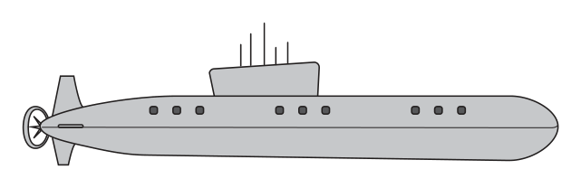

**Mark scheme answer**

> one vertical upwards arrow and one vertical allow if drawn
> downwards arrow; anywhere on diagram
> ignore any horizontal
> arrows
> ignore labels on arrows
> two arrows are equal length; DOP
> judge by eye

- **(2)** one vertical upwards arrow and one vertical allow if drawn

### 7(b)(i) [1]

State the formula linking pressure, density, gravitational field strength and height.

**Mark scheme answer**

> pressure (difference) = density × g × height; allow standard symbols
> e.g. p = ρ × g × h
> condone d for density,
> condone gfs for g
> ignore gravity

- **(1)** pressure (difference) = density × g × height; allow standard symbols

### 7(b)(ii) [2]

Calculate the pressure from the water at a point 38 m below the surface of the water. [density of sea water = 1030 kg/m3 ] pressure = kPa

**Mark scheme answer**

> substitution; allow use of g = 9.8,
> 9.81
> evaluation in kPa;
> 391 400 (kPa) scores 1
> mark
> e.g.
> pressure = 1030 × 10 × 38
> (pressure =) 390 (kPa) allow 391(.4) (kPa)
> allow 380, 383, 384,
> 383.5…, 383.9… (kPa)

- **(2)** substitution; allow use of g = 9.8,

### 7(c)(i) [3]

Explain how the air exerts pressure on the walls of the storage tank.

**Mark scheme answer**

> idea of collisions between particles and the walls of allow atoms, molecules
> the storage tank; for particles
> allow equivalent
> expressions for
> collisions e.g. bounce,
> hit etc.
> idea of particles exerting a force on the walls; condone air exerts a
> force on the walls
> idea of a force exerted over an area gives a allow p = F/A quoted
> pressure;

- **(3)** idea of collisions between particles and the walls of allow atoms, molecules

### 7(c)(ii) [4]

The air in the storage tank starts at a pressure of 410 kPa. As the submarine rises, the air in the storage tank increases in temperature from 2.5 °C to 18 °C. The volume of the storage tank remains constant. Calculate the pressure of the air in the storage tank at 18 °C. pressure = kPa

**Mark scheme answer**

> conversion of either temperature in kelvin; allow if seen anywhere
> in working
> substitution into given formula; allow ecf for °C values
> used or incorrect kelvin
> temperatures
> accept calculation of
> constant value i.e. 410
> ÷ 275.5 = 1.488…
> rearrangement;
> evaluation; −1 for POT error
> 3000, 2952 (kPa) scores
> 3 marks (not converting
> e.g. to kelvin)
> T = 275.5 (K) or T = 291 (K)
> 410 / 275.5 = p2 / 291
> p2 = 410 × 291 / 275.5
> (p2 =) 430 (kPa) allow 433.1, 433.0…
> (kPa)
> Answer Notes Marks

- **(4)** conversion of either temperature in kelvin; allow if seen anywhere

## Question 8 (8 marks)

The diagram shows two whales in the sea. Some species of whale communicate with sound signals and visual signals. Whale A Whale B (Source: © 1974996491 / Shutterstock)

### 8(a) [2]

Describe the difference between the motion of particles in a transverse wave and the motion of particles in a longitudinal wave. You may use a diagram to help your answer.

**Mark scheme answer**

> both marking points can
> be awarded from
> clearly labelled
> diagrams
> reference to vibrations / oscillations; ignore up and down,
> forwards and backwards
> (vibrations/oscillations) are parallel to direction of allow equivalent
> wave/energy transfer for longitudinal AND statements of
> (vibrations/oscillations) are perpendicular to parallel/perpendicular
> direction of wave/energy transfer for transverse;

- **(2)** both marking points can

### 8(b) [3]

Whale A makes a sound with a constant frequency. This sound is detected by whale B. When whale A swims towards whale B, the frequency of the sound detected by whale B increases. This is known as the Doppler effect. Explain how the Doppler effect causes the frequency of sound detected by whale B to increase.

**Mark scheme answer**

> wavefronts (at whale B) are compressed / allow alternative
> wavelength (at whale B) is smaller; phrases for compressed
> speed of sound is constant;
> frequency = speed of sound ÷ wavelength (therefore allow any
> frequency increases); rearrangement of the
> formula
> allow symbols for
> formula

- **(3)** wavefronts (at whale B) are compressed / allow alternative

### 8(c) [3]

Visible light from the Sun reaches whale B. The wavelength of this light is 5.4 × 10–7 m. Calculate the frequency of this light. [speed of light = 3.0 × 108 m/s] frequency = Hz

**Mark scheme answer**

> substitution into speed = frequency × wavelength;
> rearrangement;
> evaluation; −1 for POT error
> if no other marks
> scored, allow selection
> of correct formula for 1
> mark
> e.g.
> 3.0 × 108 = frequency × 5.4 × 10-7
> frequency = 3.0 × 108 / 5.4 × 10-7
> (frequency =) 5.6 × 1014 (Hz) allow 6 × 1014,
> 5.55… × 1014 (Hz)
> reject 5.5 × 1014 (Hz)
> Answer Notes Marks

- **(3)** substitution into speed = frequency × wavelength;

## Question 9 (12 marks)

A student investigates different electrical components.

**(b)** In the second investigation, the student uses a circuit with two different resistors, A and B, and a battery with a voltage of 2.9 V. Diagram 1 shows the circuit, and the current in each resistor. 2.9 V A 0.15 A 0.23 A B Diagram 1

### 9(a) [4]

The student first investigates how the voltage of a diode affects the current in the diode. They use this equipment. • diode • cell • variable resistor • wires • voltmeter • ammeter Draw a circuit diagram to represent a circuit the student could use. The diode has been drawn for you.

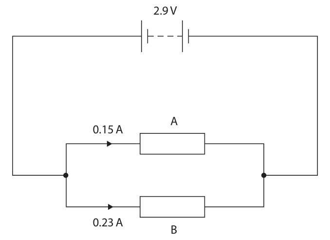

**Mark scheme answer**

> complete circuit with correct symbols for cell, condone more than one
> ammeter and voltmeter; cell / battery drawn
> ignore orientation of
> diode relative to cell
> variable resistor in series with diode; circuit symbol must be
> correct
> condone incorrect
> orientation of symbol
> ammeter in series with diode;
> voltmeter in parallel with diode; reject if voltmeter
> drawn in parallel with
> variable resistor and
> diode
> e.g.

- **(4)** complete circuit with correct symbols for cell, condone more than one

### 9(b)(i) [1]

Calculate the current in the battery. current = A

**Mark scheme answer**

> 0.38 (A);

- **(1)** 0.38 (A);

### 9(b)(ii) [1]

State the formula linking voltage, current and resistance.

**Mark scheme answer**

> voltage = current × resistance; allow standard symbols
> and rearrangements
> e.g. R = V / I
> ignore c, C for current

- **(1)** voltage = current × resistance; allow standard symbols

### 9(b)(iii) [2]

Calculate the resistance of resistor A. resistance = Ω

**Mark scheme answer**

> substitution OR rearrangement;
> evaluation;
> e.g.
> 2.9 = 0.15 × R OR R = V / I
> (resistance =) 19 (Ω) allow 19.3… (Ω)

- **(2)** substitution OR rearrangement;

### 9(b)(iv) [4]

Diagram 2 shows the same three components connected in a different circuit. 2.9 V A B Diagram 2 Resistor B has a resistance of 13 ohms. Comment on the difference between the current in the battery in Diagram 2 and the current in the battery in Diagram 1. Use calculations to support your answer.

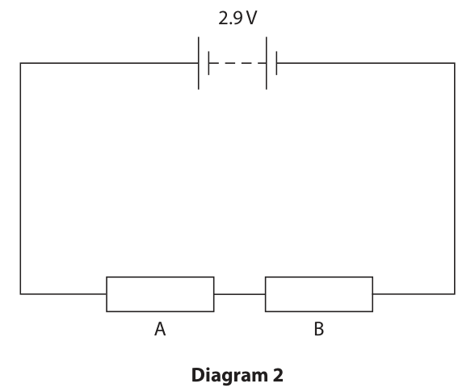

**Mark scheme answer**

> MP1. calculation of resistance in diagram 2; allow 19(.3) + 13 or
> 32(.3) (Ω) seen
> allow ecf from (iii)
> allow 12.6 Ω used for RB
> MP2. idea that resistance is larger in diagram 2; allow RA
> award this mark if MP1
> awarded
> MP3. calculation of current in diagram 2; allow ecf from MP1
> e.g. I (= 2.9 / 32(.3)) =
> 0.09 (A)
> MP4. conclusion that current is smaller in dependent on one of
> diagram 2; MP1-MP3 being awarded
> allow RA
> Answer Notes Marks

- **(4)** MP1. calculation of resistance in diagram 2; allow 19(.3) + 13 or

## Question 10 (10 marks)

A student investigates energy transfer by conduction in different metals. The student uses wax to attach one coin to each of four different metal rods, and connects the rods to a heater. When the heater is on, energy is transferred through the metal rods. This melts the wax and causes the coins to fall. The diagram shows the student’s equipment viewed from above. coin attached with wax iron heater steel aluminium copper

**(a)** This is the student’s method. Step 1 switch on the heater and start a stopwatch Step 2 record the time taken for the coin to fall from each metal rod

**(b)** The table gives the student’s results. Material Time for coin to drop in seconds iron 180 steel 230 aluminium 140 copper 90

### 10(a)(i) [1]

Give the independent variable in this investigation.

**Mark scheme answer**

> metal/material; ignore unqualified “type of rod”

- **(1)** metal/material; ignore unqualified “type of rod”

### 10(a)(ii) [1]

Give the dependent variable in this investigation.

**Mark scheme answer**

> time (taken for coin to fall off); allow how long it takes (for the
> coin to fall off)

- **(1)** time (taken for coin to fall off); allow how long it takes (for the

### 10(a)(iii) [2]

A teacher tells the student that their investigation is not valid (a fair test). Give two ways to improve the validity of the student’s investigation. 1 2

**Mark scheme answer**

> any two from:
> MP1. rods the same length; allow a mark for “rods same
> MP2. rods the same size/volume” if MP1 or MP2 have
> diameter/thickness/width/area; not been awarded
> MP3. coins of the same mass;
> MP4. same mass/amount of wax; allow same type of wax

- **(2)** any two from:

### 10(a)(iv) [2]

The student improves the validity of their investigation. Describe what the student should do to improve the reliability of their results.

**Mark scheme answer**

> repeat the experiment; reject if method modified e.g.
> testing additional metals
> calculate the mean (time for each rod); allow calculate the average
> allow identify/ignore anomalies

- **(2)** repeat the experiment; reject if method modified e.g.

### 10(b)(i) [3]

Plot a bar chart of the results on the grid.

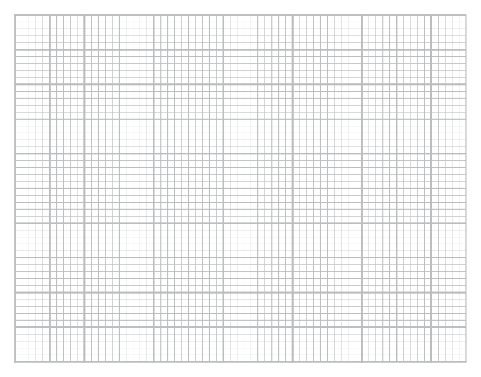

**Mark scheme answer**

> suitable linear scale for time axis; reject multiples of 30, 45, 60, 80
> for 10 small squares
> allow use of false origin
> scale should be such that length
> of tallest bar must be at least
> half the grid
> time axis labelled with quantity and unit AND condone missing “material” label
> material axis labelled; if bars are labelled iron, steel
> etc.
> all bars correct length to within ½ small square;
> e.g.

- **(3)** suitable linear scale for time axis; reject multiples of 30, 45, 60, 80

### 10(b)(ii) [1]

State why a bar chart is a better choice than a line graph for this investigation.

**Mark scheme answer**

> material/data is categoric/discrete/not allow discontinuous for not
> continuous; continuous
> Answer Notes Marks

- **(1)** material/data is categoric/discrete/not allow discontinuous for not

## Question 11 (5 marks)
### 11(a) [1]

Which of these is the main source of energy in stars?

- **(A)** alpha decay
- **(B)** beta decay
- **(C)** nuclear fission
- **(D)** nuclear fusion  ✔

**Mark scheme answer**

> D - nuclear fusion;
> A is incorrect as the abundance of nuclei with high proton
> number is too small
> B is incorrect as the energy release per decay is too small
> C is incorrect as fusion below Fe-57 is endothermic

- **(1)** Answer D: nuclear fusion

### 11(b) [4]

The table lists the stages of development of a star that has a very much larger mass than the Sun. Give the stages in the correct order, using numbers 1 to 5. Stages of development Order number a black hole is formed heavy elements are made in the core of the star the star becomes a red supergiant the star explodes in a supernova the core of the star runs out of hydrogen

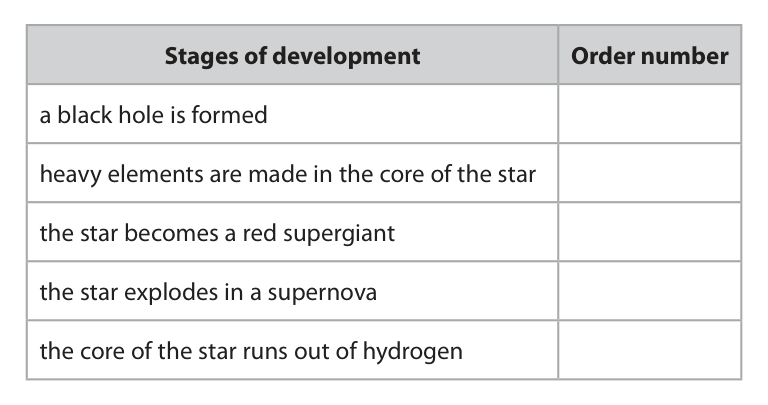

**Mark scheme answer**

> all numbers written in the correct rows = 4 marks;;;;
> any three numbers written in the correct rows = 3 marks;;;
> any two numbers written in the correct rows = 2 marks;;
> any one number written in the correct row = 1 mark;
> e.g.
> Pearson Education Limited. Registered company number 872828
> with its registered office at 80 Strand, London, WC2R 0RL, United Kingdom

- **(4)** all numbers written in the correct rows = 4 marks;;;;

