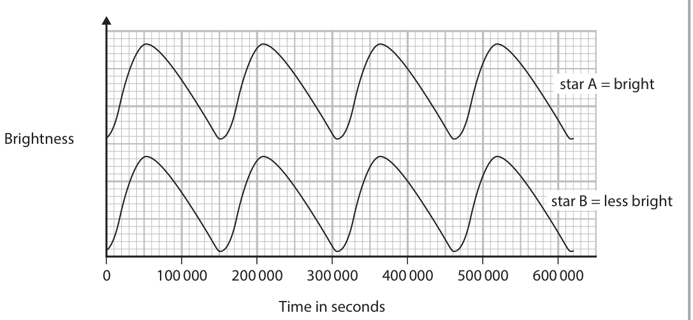
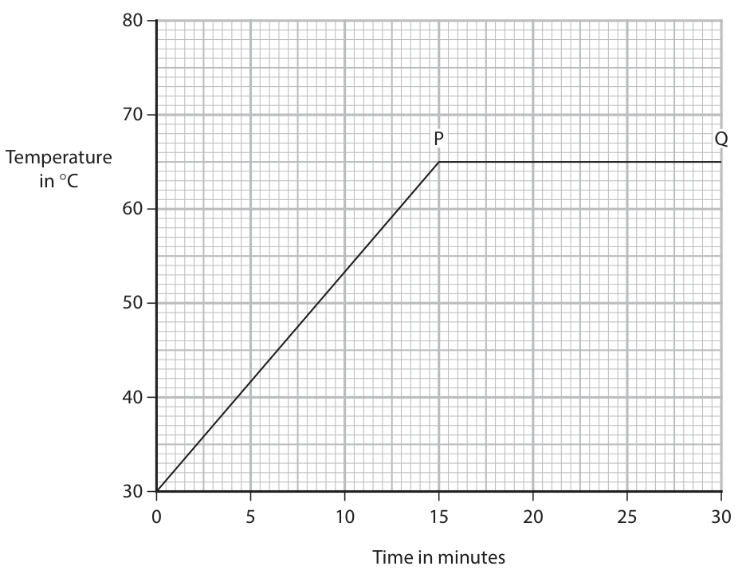

# 4PH1/2P — 2024-11 (official extraction)

> schema `syllabai.official-paper-questions/0.2` · paper_id `pearson-edexcel:international-gcse:physics:4ph1:2024-11:4PH1/2P` · qp sha256 `f3fb3b9bb313cb25…` · extraction is the disclosed baseline (ADR-039)

## Question 1 (5 marks)

This question is about nuclear decay.

### 1(a) [1]

Which of these is the same as a beta particle?

- **(A)** electromagnetic wave
- **(B)** electron  ✔
- **(C)** helium nucleus
- **(D)** neutron

**Mark scheme answer**

> B - electron;
> A cannot be correct as a beta particle is not an EM
> wave
> C cannot be correct as a helium nucleus is the same
> as an alpha particle
> D cannot be correct as a beta particle is not a
> neutron

- **(1)** Answer B: electron

### 1(b) [1]

Which of these is the same as an alpha particle?

- **(A)** electromagnetic wave
- **(B)** helium nucleus  ✔
- **(C)** neutron
- **(D)** proton

**Mark scheme answer**

> B - helium nucleus;
> A cannot be correct as an alpha particle is not an
> EM wave
> C cannot be correct as a neutron is merely a
> constituent particle of an alpha particle
> D cannot be correct as a proton is merely a
> constituent particle of an alpha particle
> top line: 4;

- **(1)** Answer B: helium nucleus

### 1(c) [3]

Complete the nuclear equation for an alpha decay. 241 Am → 237 Np + α

**Mark scheme answer**

> bottom left box: 93
> bottom right box: 2;
> Total for question 1= 5 marks
> Answer Notes Marks

- **(3)** bottom left box: 93

## Question 2 (8 marks)

The diagram shows a rod and a cloth. cloth rod When the rod is rubbed with the cloth, the cloth becomes positively charged and the rod becomes negatively charged.

**(b)** The negatively charged rod makes contact with a metal object connected to the ground. There is an ammeter in series with the object and the ground.

### 2(a) [2]

Explain how the cloth has become positively charged.

**Mark scheme answer**

> idea of negative charge transfer;
> cloth loses electrons; this statement alone
> scores 2 marks.
> allow rod takes
> electrons off the cloth
> for 2 marks

- **(2)** idea of negative charge transfer;

### 2(b)(i) [2]

Explain why the ammeter shows a current for a short time and then shows no current.

**Mark scheme answer**

> electrons flow (through metal/towards Earth)/eq ; accept ‘charge(s)’ for
> ‘electrons’
> then stop flowing / eq; accept idea that rod
> has discharged or has
> been neutralised

- **(2)** electrons flow (through metal/towards Earth)/eq ; accept ‘charge(s)’ for

### 2(b)(ii) [1]

State the formula linking charge transferred, current and time.

**Mark scheme answer**

> charge = current × time; allow standard
> symbols and
> rearrangements e.g.
> ‘Q=It’
> ignore ‘C’ for current
> or charge

- **(1)** charge = current × time; allow standard

### 2(b)(iii) [3]

The mean current displayed on the ammeter is 6.8 × 10⁻⁶ A. The current lasts for 3.7 ms. Calculate the charge transferred. charge = C

**Mark scheme answer**

> conversion of ms to s; mark independently
> substitution; allow ECF from missing
> or wrong conversion
> correct evaluation; accept answer in
> either decimal or
> standard form
> reject evaluation of
> answer expressed as a
> eg. fraction
> charge = current × time
> charge = 6.8 × 10⁻⁶ × 3.7 × 10⁻³
> charge = 2.516 × 10⁻⁸ (C)
> correct answer = 2.5 × 10⁻⁸ (C)
> allow any incorrect
> answer that rounds to
> 2.5 × 10n for 2 marks

- **(3)** conversion of ms to s; mark independently

## Question 3 (9 marks)
**(b)** The diagram shows object A and object B moving in opposite directions. The arrows show the direction of the velocities of the two objects. Object A Object B Before the collision object A has a momentum of 39 kg m/s. After the collision object A and object B stick together and stop moving.

### 3(a) [1]

State the principle of conservation of momentum.

**Mark scheme answer**

> (total) momentum before (collision) = (total)
> momentum after (collision) / eq;
> ignore equation i.e.
> m₁u₁ + m₂u₂ = m₁v₁ +
> m 2v 2

- **(1)** (total) momentum before (collision) = (total)

### 3(b)(i) [1]

State the magnitude of the momentum of object B before the collision. momentum = kg m/s

**Mark scheme answer**

> 39 (kg m/s); ignore sign

- **(1)** 39 (kg m/s); ignore sign

### 3(b)(ii) [1]

State the formula linking momentum, mass and velocity.

**Mark scheme answer**

> momentum = mass × velocity; allow standard
> symbols and
> rearrangements
> e.g. v = p ÷ m

- **(1)** momentum = mass × velocity; allow standard

### 3(b)(iii) [2]

The mass of object A is 8.1 kg. Calculate the velocity of object A before the collision. velocity = m/s

**Mark scheme answer**

> substitution or rearrangement;
> correct evaluation;
> eg.
> 39 = 8.1 × speed
> speed = 39 ÷ 8.1
> speed = 4.814… (m/s)
> correct answer: 4.8 (m/s) accept any answer that
> rounds to 4.8
> allow 5 (m/s)

- **(2)** substitution or rearrangement;

### 3(b)(iv) [2]

The time taken for the collision is 0.56 s. Calculate the average force on object A. force = N

**Mark scheme answer**

> substitution of time and change in momentum accept use of F = ma
> into given formula; AND a = (v-u) ÷ t with
> ECF from (iii)
> correct evaluation; ignore sign
> eg. force = (change in momentum) ÷ time
> taken accept any answer that
> force = 39 ÷ 0.56 rounds to 70 (N) for 2
> force = 69.6…. (N) marks
> correct answer = 70 (N)

- **(2)** substitution of time and change in momentum accept use of F = ma

### 3(b)(v) [2]

Give the direction and magnitude of the force on object B from object A. magnitude = N direction =

**Mark scheme answer**

> magnitude: candidate’s answer to (iv);
> direction: right / eq;
> Answer Notes Marks

- **(2)** magnitude: candidate’s answer to (iv);

## Question 4 (11 marks)

Diagram 1 shows a Hertzsprung–Russell (HR) diagram. –5 Absolute magnitude 5 Temperature Diagram 1

**(c)** Diagram 2 shows how the brightness of two stars, star A and star B, changes with time. These stars are called Cepheid variables. star A = bright Brightness star B = less bright 0 100 000 200 000 300 000 400 000 500 000 600 000 Time in seconds Diagram 2

### 4(a)(i) [1]

Draw a cross to show the position of the Sun on the HR diagram.

**Mark scheme answer**

> X drawn anywhere in rectangle on main sequence by eye and use extreme
> as shown below; left edge of red giant
> blob as a guide

- **(1)** X drawn anywhere in rectangle on main sequence by eye and use extreme

### 4(a)(ii) [1]

In approximately 4 billion years, the Sun will enter the next stage of its evolution. Draw a circle on the HR diagram around the area that will include the Sun in the next stage of its evolution.

**Mark scheme answer**

> red giants in top right encircled as shown below; allow any loop that
> overlaps correct area
> only

- **(1)** red giants in top right encircled as shown below; allow any loop that

### 4(b) [2]

Describe the stars that are in the top left corner of the HR diagram.

**Mark scheme answer**

> any two from: ignore reference to
> absolute magnitude
> • hot / high (surface) temperature;
> • bright/ high luminosity / high power;
> • white/blue-white/blue;
> • high mass;

- **(2)** any two from: ignore reference to

### 4(c)(i) [2]

Determine the period of the variation in brightness for these stars. period = s

**Mark scheme answer**

> any attempt at an average over more than one mark independently
> period;
> answer in range 150 000 - 160 000 (s);

- **(2)** any attempt at an average over more than one mark independently

### 4(c)(ii) [2]

Calculate the frequency of the variation in brightness for these stars. frequency = Hz

**Mark scheme answer**

> candidate’s answer to (i) substituted into given ignore POT for this MP
> formula;
> correct evaluation; -1 POT penalty
> eg. frequency = 1 ÷ 155 000 i.e. answer in range
> frequency = 6.45… × 10⁻⁶ (Hz) 6.25 – 6.67 × 10⁻⁶ (Hz)
> for correct answer to
> frequency = 6.5 × 10⁻⁶ (Hz) (i)
> accept any answer that
> rounds to 6 or 7 × 10⁻⁶
> (Hz) for 2 marks

- **(2)** candidate’s answer to (i) substituted into given ignore POT for this MP

### 4(c)(iii) [1]

State what is meant by the term absolute magnitude.

**Mark scheme answer**

> brightness of an object at a standard distance allow intensity, power,
> (from the Earth) / eq; luminosity for
> brightness AND
> allow any distance for
> idea of ‘standard
> distance’

- **(1)** brightness of an object at a standard distance allow intensity, power,

### 4(c)(iv) [2]

Star A and star B have the same absolute magnitude but star A is always brighter than star B in the night sky. Explain how this is possible.

**Mark scheme answer**

> idea that the stars are not the same distance
> away; allow RA
> {star A/ brighter star} is nearer / eq; this statement alone
> scores 2 marks
> Answer Notes Marks

- **(2)** idea that the stars are not the same distance

## Question 5 (10 marks)

Diagram 1 shows the apparatus a student uses to determine the specific heat capacity of a liquid. power supply A V lid insulating material liquid electrical heater thermometer Diagram 1

**(b)** The graph shows the student’s results. P Q Temperature in C 0 5 10 15 20 25 30 Time in minutes

### 5(a) [5]

Describe a suitable method the student could use to determine the specific heat capacity of the liquid.

**Mark scheme answer**

> 5
> MP1 Mass found on balance; accept “scales”
> reject “scale”
> MP2 Time determined using
> timer/stopwatch/stopclock;
> MP3 temperature change determined; allow ‘determined
> i.e. temperature change= final temp – initial temp time for a given
> temp change’
> MP4 rearrangement of formula sheet equation; accept “E = VIt” for
> i.e. c = energy /(m x temp change) ‘energy supplied’
> and for MP5 also
> accept SHC found
> using method
> involving calculating
> the gradient of a
> temperature-time
> graph
> PLUS
> ONE from
> MP5 Energy supplied = voltmeter reading x can be awarded if
> ammeter reading x time; seen for MP4
> allow use of
> joulemeter to
> determine energy
> MP6 Mass of liquid = mass of water + cup – mass of however expressed
> cup; i.e. zero balaance
> when empty cup on
> balance
> MP7 Entire experiment repeated and averaged; not just unqualified
> ‘repeat and average’
> MP8 Liquid stirred (throughout);
> MP9 Keep taking temperature after heater
> switched off for max temp;
> ignore reference to
> insulation or lid

- **(5)** 5

### 5(b)(i) [1]

What is happening to the liquid between points P and Q on the graph?

- **(A)** melting
- **(B)** freezing
- **(C)** boiling  ✔
- **(D)** condensing

**Mark scheme answer**

> C - boiling;
> A cannot be correct because the substance is already
> a liquid
> B cannot be correct because the substance is being
> heated
> D cannot be correct because the substance is being
> heated and is not a gas

- **(1)** Answer C: boiling

### 5(b)(ii) [1]

Use the graph to determine the change in temperature of the liquid after 15 minutes of heating. temperature difference = °C

**Mark scheme answer**

> 35 (°C);

- **(1)** 35 (°C);

### 5(b)(iii) [3]

The power of the heater is 48 W and the mass of the liquid is 0.53 kg. Calculate the specific heat capacity of the liquid. specific heat capacity = J / kg °C

**Mark scheme answer**

> ECF candidate’s time
> taken and temp
> change
> energy supplied = 48 × appropriate time taken in
> seconds;
> rearrangement with SHC as subject; accept dimensionally
> correct substitution
> into formula for this
> mark
> condone wrong
> power of ten for any
> substitution
> correct evaluation;
> eg.:
> energy supplied = 48 × 15 × 60 = 43200 J
> energy supplied = m × c × (temp change) allow 39 (J/kg oC)
> 43200 = 0.53 × c × 35 for 2 marks (missed
> c = 43200 ÷ (0.53 × 35) conversion from
> c = 43200 ÷ 18.55 minutes to seconds)
> c = 2328.84… (J/kg oC) allow answer that
> rounds to 2.6 for 1
> Correct answer = 2300 (J/kg oC) mark
> allow answer that
> rounds to 1300 for 3
> allow answer that
> rounds to 4700 for 2
> Answer Notes Marks

- **(3)** ECF candidate’s time

## Question 6 (7 marks)

The diagram shows forces used to turn a tap. 8.1 N 2.6 cm 2.6 cm pivot 8.1 N

### 6(a)(i) [1]

State the formula linking moment, force and perpendicular distance from a pivot.

**Mark scheme answer**

> moment = force × (perpendicular) distance allow standard symbols and
> rearrangements e.g. ‘F =
> moment/d’
> condone ‘M = F × d’

- **(1)** moment = force × (perpendicular) distance allow standard symbols and

### 6(a)(ii) [3]

Calculate the total moment of the two forces required to turn the tap around the pivot. Give your answer in N cm. total moment = N cm

**Mark scheme answer**

> substitution into correct formula for one force;
> attempt to combine two moments; accept however expressed
> -1 POT error
> correct evaluation;
> eg.
> moment of one force = 8.1 × 2.6 (cm) allow answers that round to
> moment of one force = 21.06 (N cm) 84 for 2 marks
> total moment = 21.06 × 2 = 42.12 (N cm)
> correct answer = 42 (N cm)

- **(3)** substitution into correct formula for one force;

### 6(b) [3]

The tap is used to put some water in a bucket. Describe the arrangement and motion of the water particles in liquid water. You may draw a diagram to help your answer.

**Mark scheme answer**

> arrangement: mark can be scored from a
> at least one from diagram
> closely packed /eq; e.g. ‘all touching’, ‘not as
> closely packed as the solid’
> random/irregular (arrangement);
> motion:
> at least one from
> random (motion);
> idea of flow of particles; e.g. “particles slide over
> each other”
> ignore ‘move freely’
> Answer Notes Marks

- **(3)** arrangement: mark can be scored from a

## Question 7 (9 marks)

The photograph shows a wind turbine used for supplying energy on a large scale. (Source: © Pla2na / Shutterstock)

### 7(a)(i) [2]

Describe a change in the turbine’s energy stores from when the turbine is at rest to when it is moving at full speed.

**Mark scheme answer**

> kinetic energy (store); accept thermal store
> reject ‘heat’
> increases;
> accept ‘KE (store) of
> air/wind to KE (store) of
> turbine for 2 marks
> accept ‘...to KE (store)
> of turbine for 1 mark

- **(2)** kinetic energy (store); accept thermal store

### 7(a)(ii) [2]

Describe a change in the turbine’s energy stores when the wind is blowing but the turbine moves at constant speed.

**Mark scheme answer**

> thermal (store); ignore ‘heat'
> increases; DOP

- **(2)** thermal (store); ignore ‘heat'

### 7(b)(i) [1]

State the formula linking efficiency to useful energy output and total energy output.

**Mark scheme answer**

> efficiency = useful energy (output) ÷ total accept omission of 100%
> energy(output) x100% accept power for energy
> condone input for output
> in denominator

- **(1)** efficiency = useful energy (output) ÷ total accept omission of 100%

### 7(b)(ii) [4]

The wind transfers 1.2 × 10⁶ J of energy to the turbine. The total mass of the turbine blades is 16 000 kg. The wind causes the turbine blades to accelerate from rest to an average speed of 7.6 m/s. Calculate the efficiency of the turbine. efficiency =

**Mark scheme answer**

> KE = ½ m v² seen; accept substitution
> evaluation of KE of blades; correct KE is 462 080 (J)
> substitution of candidate’s value for blades’ KE
> and wind KE into efficiency equation;
> evaluation of efficiency; allow correct decimal
> expression
> allow correct %
> expression with % sign
> ignore fractional final
> e.g.
> KE of blades = ½ × 16 000 × (7.6) 2
> KE of blades = 462 080 (J)
> efficiency = (KE of blades/KE of wind) x 100%
> efficiency = (462 080 ÷ 1 200 000) × 100%
> efficiency = 38.506… %
> correct answer = 39%

- **(4)** KE = ½ m v² seen; accept substitution

## Question 8 (11 marks)

A student investigates the speed of sound by making a loud sound in front of a large wall a long distance away. The diagram shows the positions of the student and the wall. wall The sound reflects off the wall and back to the student.

### 8(a) [2]

Give an appropriate method for measuring the distance between the student and the wall.

**Mark scheme answer**

> ignore any attempt at
> using speed of sound
> suitable instrument e.g. metre wheel, trundle wheel, condone ruler
> tape measure, laser (range-finder);
> repeat and take an average; allow idea of a
> straight/flat tape
> measure
> allow idea of measuring
> perpendicular to wall
> allow ensuring use of
> trundle wheel in a
> straight line

- **(2)** ignore any attempt at

### 8(b) [3]

The student uses a stopwatch to determine the time taken for the sound to travel from them to the wall and back again. The distance from the student to the wall is 65 m. The student measures a time of 0.35 seconds when the sound has travelled to the wall and back again. Calculate the speed of sound from the student’s data. speed of sound = m/s

**Mark scheme answer**

> use of average speed = distance ÷ time taken;
> substitution; scores first two MP
> evaluation;
> eg.:
> speed = distance ÷ time taken
> speed = 130 (m) ÷ 0.35 (s)
> speed = 371.428… (m/s)
> speed = 370 m/s
> accept answer that
> rounds to 190 (m/s) for
> 2 marks (use of 65 m)
> accept answer that
> rounds to 370 (m/s) for
> 3 marks

- **(3)** use of average speed = distance ÷ time taken;

### 8(c) [4]

Evaluate this method for determining an accurate value for the speed of sound.

**Mark scheme answer**

> any four from:
> MP1 idea of original method did not repeat (and need to repeat (and
> average) average)
> repeating (and
> averaging) would
> improve experiment
> MP2 mention of (human) reaction time;
> MP3 critique of accuracy of distance measurement;
> MP4 reference to sound becoming inaudible because
> of distance;
> MP5 reference to large distance reducing effect of allow RA
> timing errors;
> MP6 reference to uncontrolled variables; e.g.
> temperature, humidity, wind, noise
> ignore ‘repeat and
> average’

- **(4)** any four from:

### 8(d) [2]

Explain an improvement to the student’s method.

**Mark scheme answer**

> ignore use of
> oscilloscope to
> measure wavelength or
> period
> ignore unqualified use
> of microphone
> any two from:
> reduction of timing inaccuracy:
> MP1 idea of datalogging (with a microphone/sound
> meter);
> MP2 idea of electronic start and/or stop timing (with a
> microphone/sound meter);
> MP3 larger distance (gives larger time);
> MP4 idea of longer time may reduce effect of reaction
> time;
> MP5 produce a regular sound that coincides with echo;
> improvement of distance measurement:
> MP6 use a laser-based distance measure/use a map
> (and scale) to pinpoint start and finish;
> other:
> MP7 idea of removing noise/wind; e.g. do the
> experiment indoors, shielding a microphone, wait
> for a windless time
> MP8 drawing a distance-time graph for different
> distances and finding gradient;
> Pearson Education Limited. Registered company number 872828
> with its registered office at 80 Strand, London, WC2R 0RL, United Kingdom

- **(2)** ignore use of

