# 4PH1/1P — 2025-06 (official extraction)

> schema `syllabai.official-paper-questions/0.2` · paper_id `pearson-edexcel:international-gcse:physics:4ph1:2025-06:4PH1/1P` · qp sha256 `04d05027f1178eb5…` · extraction is the disclosed baseline (ADR-039)

## Question 1 (7 marks)

Ice hockey is a team sport played on ice. Players try to hit a disc called a puck into the other team’s goal. (Source: © Alexandr Grant / Shutterstock)

**(a)** Diagram 1 shows a puck travelling across some smooth ice. direction of travel puck smooth ice Diagram 1

**(b)** Diagram 2 shows a puck travelling across some rough ice. direction of travel puck rough ice Diagram 2 The rough ice exerts a frictional force on the puck.

### 1(a)(i) [1]

State the formula linking average speed, distance moved and time taken.

**Mark scheme answer**

> (average) speed = distance (travelled) / time allow standard symbols and
> (taken); rearrangements e.g. s = vt
> allow d, D, s, S for distance
> allow s, S, v, V for speed

- **(1)** (average) speed = distance (travelled) / time allow standard symbols and

### 1(a)(ii) [3]

The puck travels at a constant speed of 2.8 m/s. Calculate the distance moved by the puck in a time of 3.5 s. distance moved = m

**Mark scheme answer**

> substitution;
> rearrangement;
> evaluation;
> e.g.
> 2.8 = distance / 3.5
> distance = 2.8 × 3.5 OR distance = speed × time
> (distance =) 9.8 (m)

- **(3)** substitution;

### 1(b)(i) [1]

Draw a labelled arrow on diagram 2 to show the force of friction acting on the puck.

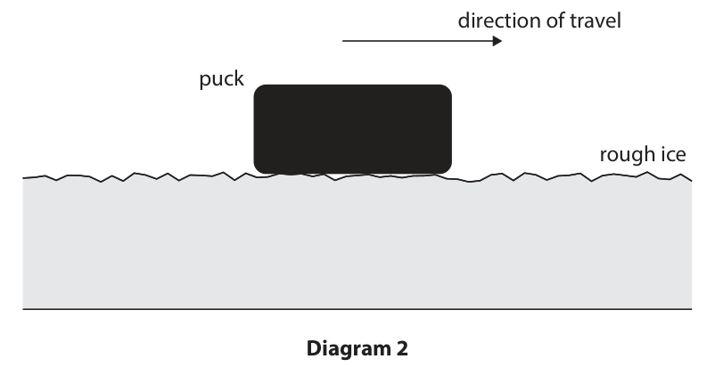

**Mark scheme answer**

> horizontal arrow drawn acting to the left; label not needed for the
> mark but reject
> contradictory arrows
> ignore starting position and
> length of arrow

- **(1)** horizontal arrow drawn acting to the left; label not needed for the

### 1(b)(ii) [2]

Explain how the force of friction changes the velocity of the puck.

**Mark scheme answer**

> speed / velocity will decrease; allow puck slows down,
> decelerates
> ignore kinetic energy / KE
> decreases
> (resultant) force is in the opposite direction to allow “it” for force
> the velocity; allow alternatives to
> velocity e.g. speed, motion,
> travel etc.
> Answer Notes Marks

- **(2)** speed / velocity will decrease; allow puck slows down,

## Question 2 (13 marks)

This question is about astrophysics.

**(a)** Diagrams A, B, C and D show different orbital paths for object Y orbiting object X. A B Y Y X X C D Y Y X X

**(b)** Table 2 gives information about four different stars in the same galaxy as the Sun. Star Colour Evolutionary stage Antares red red supergiant Capella yellow main sequence Sirius B white white dwarf Vega blue‑white main sequence Table 2

### 2(a)(i) [3]

Table 1 gives some possible names for object X and object Y. Complete the table by placing one tick (ü) in each row to show which orbital path is correct for each combination of object X and object Y. Each orbital path may be used once, more than once, or not at all. Orbital path Object X Object Y A B C D the Earth the Moon the Sun a comet the Sun the Earth Table 1

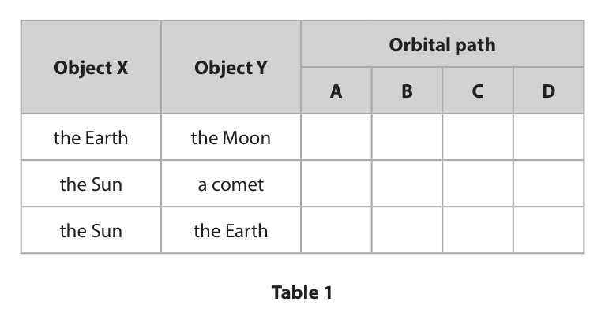

**Mark scheme answer**

> one mark for each correct row;;; reject mark for row if
> more than one tick
> shown
> allow alternative
> symbols instead of ticks
> ✓
> ✓
> ✓

- **(3)** one mark for each correct row;;; reject mark for row if

### 2(a)(ii) [1]

Give the name of the force that causes one object to orbit another object in space.

**Mark scheme answer**

> gravity; allow gravitational
> (force/pull/attraction)
> ignore weight,
> centripetal, g, G
> reject gravitational
> field strength,
> gravitational potential,
> GPE

- **(1)** gravity; allow gravitational

### 2(b)(i) [1]

Give the name of the galaxy that contains the Sun and the stars shown in table 2.

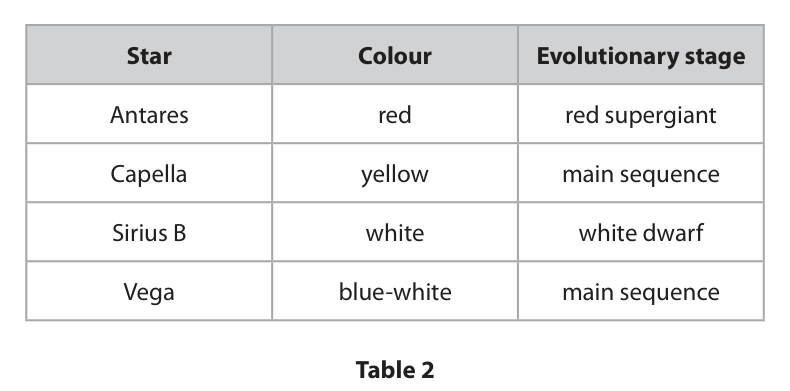

**Mark scheme answer**

> (the) Milky Way (galaxy);

- **(1)** (the) Milky Way (galaxy);

### 2(b)(ii) [3]

Explain how the stars in table 2 can be classified according to their colour.

**Mark scheme answer**

> idea that colour depends on temperature; allow idea that colour is
> how hot/cold the star is
> Antares / red is coolest; also scores MP1
> allow Vega / blue-white
> / blue is hottest
> full (surface) temperature order given; allow RA
> e.g. in order of coolest to hottest
> • Antares, Capella, Sirius B, Vega
> • red, yellow, white, blue-white

- **(3)** idea that colour depends on temperature; allow idea that colour is

### 2(b)(iii) [3]

Describe the likely future evolution of Antares.

**Mark scheme answer**

> supernova; −1 if order of stages is
> incorrect or incorrect
> stages named
> neutron star; allow pulsar for neutron
> star
> black hole; allow idea that Antares
> becomes black hole or
> neutron star

- **(3)** supernova; −1 if order of stages is

### 2(b)(iv) [2]

Describe what additional information is needed to predict the next evolutionary stage for Vega.

**Mark scheme answer**

> idea that evolution depends on mass; idea that it depends on
> relative to the Sun; the solar mass(es) of
> Vega = 2 marks
> Answer Notes Marks

- **(2)** idea that evolution depends on mass; idea that it depends on

## Question 3 (15 marks)

A student builds this electric circuit to measure the temperature of a room. 6.0 V A 290 Ω V

**(a)** At 20 °C , the voltage across the thermistor is 3.9 V.

**(b)** The student observes that the voltmeter reading increases as the temperature of the room increases.

### 3(a)(i) [2]

Explain why the reading on the voltmeter is 2.1 V.

**Mark scheme answer**

> components are connected in series; ignore voltmeter is in
> parallel (with the
> resistor)
> voltages must add up to 6(.0)V; allow voltages must add
> up to battery voltage
> allow 6(.0) − 3.9 = 2.1

- **(2)** components are connected in series; ignore voltmeter is in

### 3(a)(ii) [3]

The resistor in the circuit has a resistance of 290 Ω. Calculate the current in the resistor. Use the formula voltage = current × resistance current = A

**Mark scheme answer**

> correct substitution into V = I × R;
> rearrangement; allow ecf from incorrect
> voltage
> evaluation; allow ecf from incorrect
> voltage
> 0.0206…, 0.0134… (A)
> scores 2 marks
> e.g.
> 2.1 = current × 290
> current = 2.1 / 290
> (current =) 0.0072 (A) allow 0.007,
> 0.00724… (A)

- **(3)** correct substitution into V = I × R;

### 3(a)(iii) [1]

State the reading on the ammeter. ammeter reading = A

**Mark scheme answer**

> same answer as (ii); expect 0.0072 (A)
> allow if rounded
> differently to (ii) but
> still consistent

- **(1)** same answer as (ii); expect 0.0072 (A)

### 3(a)(iv) [3]

Calculate the resistance of the thermistor. resistance = Ω

**Mark scheme answer**

> correct substitution into V = I × R; allow ecf from current
> in (ii) or (iii)
> rearrangement; allow dimensionally
> correct rearrangement
> using incorrect voltage
> for this mark only
> e.g. R = 2.1 / 0.0072
> evaluation;
> e.g.
> 3.9 = 0.0072 × R
> R = 3.9 / 0.0072
> (R =) 540 (Ω) allow 557, 542, 541.6…,
> 539, 538.5… (Ω)

- **(3)** correct substitution into V = I × R; allow ecf from current

### 3(b)(i) [3]

Explain this observation.

**Mark scheme answer**

> thermistor/circuit resistance decreases (as
> temperature increases);
> current increases; allow idea of less
> voltage across
> thermistor
> resistance of resistor is fixed/does not change AND allow idea that
> V=IR (so voltmeter reading increases); battery/total voltage is
> fixed/6V AND this is
> shared between
> thermistor and resistor
> (so voltmeter reading
> increases)

- **(3)** thermistor/circuit resistance decreases (as

### 3(b)(ii) [3]

The student wants to use the circuit as a temperature‑measuring device. They have this additional equipment • a large beaker • water at different temperatures • a thermometer Describe what measurements the student needs to take so that the circuit could be used as a temperature‑measuring device. Assume that the thermistor in the circuit is waterproof. You may draw a diagram to help your answer.

**Mark scheme answer**

> any three from: ignore methods
> involving adding bulbs
> to circuit etc.
> MP1. place thermistor (and thermometer) into can be awarded from
> beaker of water; diagram
> MP2. idea of varying temperature of water /
> thermistor;
> MP3. measure reading on voltmeter (at different allow idea of measuring
> temperatures); current or calculating
> resistance (at different
> temperatures)
> MP4. plot graph of voltmeter reading against allow current /
> temperature; resistance for voltmeter
> reading
> MP5. idea of using graph to read off temperature allow current /
> at different voltmeter readings; resistance for voltmeter
> reading
> Answer Notes Marks

- **(3)** any three from: ignore methods

## Question 4 (8 marks)

This question is about the process of controlled nuclear fission in a nuclear reactor.

**(d)** Many of the daughter nuclei produced in nuclear fission are very radioactive. These daughter nuclei decay by emitting ionising radiation in a random process.

### 4(a) [1]

In a nuclear reactor, uranium‑235 nuclei are split to produce daughter nuclei and neutrons. State what else is released in nuclear fission that makes the process useful in a nuclear reactor.

**Mark scheme answer**

> (kinetic/thermal/heat) energy; condone nuclear energy
> condone energy as
> gamma waves
> ignore heat, radiation

- **(1)** (kinetic/thermal/heat) energy; condone nuclear energy

### 4(b) [1]

What is the function of the control rods in a nuclear reactor?

- **(A)** absorb excess neutrons  ✔
- **(B)** create additional neutrons
- **(C)** fuse neutrons together
- **(D)** split neutrons

**Mark scheme answer**

> A (absorb excess neutrons);
> B is incorrect because neutrons cannot be created
> C is incorrect because fusion does not occur in a
> fission reactor
> D is incorrect because neutrons cannot be split

- **(1)** Answer A: absorb excess neutrons

### 4(c) [1]

What is the function of the moderator in a nuclear reactor?

- **(A)** change protons into neutrons
- **(B)** change neutrons into protons
- **(C)** slow down neutrons  ✔
- **(D)** speed up neutrons

**Mark scheme answer**

> C (slow down neutrons);
> A is incorrect because this would not affect the
> rate of fission
> B is incorrect because this would not affect the
> rate of fission
> D is incorrect because faster neutrons would
> reduce the rate of fission

- **(1)** Answer C: slow down neutrons

### 4(d)(i) [1]

State what is meant by the term ionising radiation.

**Mark scheme answer**

> idea (that radiation can) remove electrons from condone idea (that
> atoms/molecules; radiation) turns
> atoms/molecules into
> (positive) ions
> ignore references to α,
> β, γ
> reject if reference
> given to gaining
> electrons

- **(1)** idea (that radiation can) remove electrons from condone idea (that

### 4(d)(ii) [1]

State what is meant by the term random process.

**Mark scheme answer**

> idea that it is not possible to know when nuclei will allow idea that decay is
> decay; unpredictable / has no
> pattern
> ignore spontaneous

- **(1)** idea that it is not possible to know when nuclei will allow idea that decay is

### 4(d)(iii) [3]

The diagram shows some parts of a nuclear reactor. shielding coolant out reactor vessel coolant in Explain the role of shielding in a nuclear reactor.

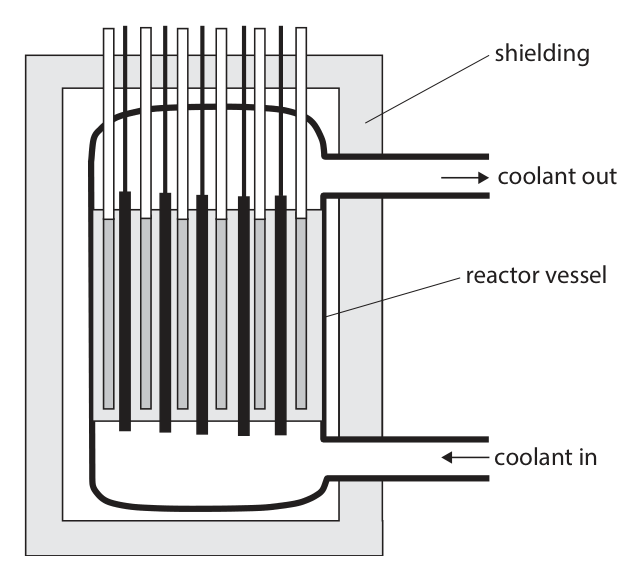

**Mark scheme answer**

> idea that radiation (emitted in the reactor) is allow named harmful
> harmful; effect e.g. cell damage,
> cancer etc.
> shielding absorbs radiation; allow shielding blocks
> radiation
> idea that amount of radiation reaching allow shielding prevents
> people/workers is less/zero; radiation escaping
> ignore protect people
> Answer Notes Marks

- **(3)** idea that radiation (emitted in the reactor) is allow named harmful

## Question 5 (6 marks)

The diagram shows a simple direct current (d.c.) electric motor. coil magnet magnet split-ring commutator direct current brushes Explain why the coil turns continuously when the motor is connected to a direct current supply. You should refer to the brushes and the split‑ring commutator in your answer.

### 5 [6]

The diagram shows a simple direct current (d.c.) electric motor. coil magnet magnet split-ring commutator direct current brushes Explain why the coil turns continuously when the motor is connected to a direct current supply. You should refer to the brushes and the split‑ring commutator in your answer.

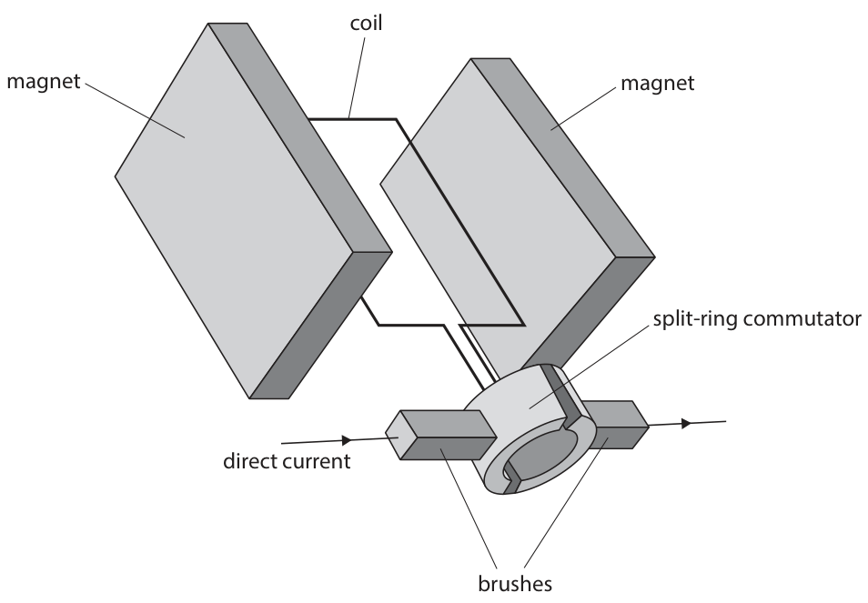

**Mark scheme answer**

> any six from:
> MP1. current/coil has magnetic field; allow coil becomes an
> electromagnet
> allow current/coil has
> electromagnetic field
> MP2. interaction between (magnetic) fields; allow (magnetic) fields
> overlap
> ignore cutting of field
> ignore current interacting
> with field
> MP3. (produces a) force on coil;
> MP4. brushes allow (sliding) contact between allow idea that brushes
> split ring/commutator/coil and wires; allow the coil to spin
> without tangling
> (connecting) wires
> allow idea that brushes
> prevent circuit being broken
> / allow a current to always
> flow
> MP5. split ring/commutator reverses the allow idea of swapping
> direction of the current (in the coil); negative and positive
> charges / terminals
> MP6. (which) reverses the direction of the force
> on (each side of) the coil;
> MP7. current/force is reversed every half turn
> (when coil is vertical);
> Answer Notes Marks

- **(6)** any six from:

## Question 6 (12 marks)

Two students do an experiment to determine their power when running up a set of steps. The diagram shows how they set up their experiment. Not all of the steps are shown in the diagram. student A 24 steps student B This is the students’ method. • student A stands with a stopwatch at the top of the steps • student A starts timing on the stopwatch and shouts “go” at the same time • student B begins to run up the steps when she hears student A shout • student A stops timing when student B reaches the top of the steps The students repeat their method two more times.

**(b)** There are 24 steps in total and each step has a height of 19 cm.

### 6(a) [1]

Give a reason why the times recorded may not be accurate.

**Mark scheme answer**

> idea that reaction time is an issue / eq; allow student (A)
> starts/stops stopwatch
> early/late
> allow student (B) starts
> running early/late
> ignore human error,
> comments relating to
> time for sound to travel

- **(1)** idea that reaction time is an issue / eq; allow student (A)

### 6(b)(i) [3]

Student B has a mass of 67 kg. Show that student B gains about 3000 J of energy in her gravitational store when she runs up the set of steps.

**Mark scheme answer**

> selection of GPE = mgh; condone omitting factor
> of 24 for this mark only
> substitution; allow use of g = 9.8,
> 9.81
> ignore POT errors from
> not converting cm to m
> evaluation to more than 2s.f.;
> e.g.
> GPE = mgh
> GPE = 67 × 10 × 24 × 0.19
> GPE = 3055.2 (J) allow 3055, 3060, 3100,
> 2994, 2997.1… (J)

- **(3)** selection of GPE = mgh; condone omitting factor

### 6(b)(ii) [2]

The table shows the times recorded for student B. Time in s 4.28 4.95 4.65 Calculate the mean time from this data. Give your answer to three significant figures. mean time = s

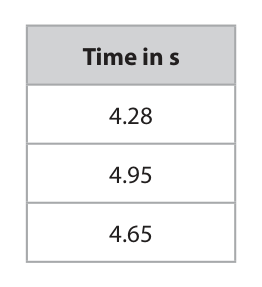

**Mark scheme answer**

> evaluation of mean;
> rounded to 3s.f.; independent mark
> e.g.
> mean time = (4.28 + 4.95 + 4.65) / 3 = 4.626…
> mean time = 4.63 (s)

- **(2)** evaluation of mean;

### 6(b)(iii) [2]

Calculate the mean power of student B transferring energy to her gravitational store as she runs up the steps. mean power = W

**Mark scheme answer**

> substitution into P = E/t; allow ecf from (i) and
> (ii)
> evaluation;
> e.g.
> power = 3055.2 / 4.63
> power = 660 (W) allow 646 – 671 (W)

- **(2)** substitution into P = E/t; allow ecf from (i) and

### 6(c) [4]

The students extend their investigation by calculating the power for students of different masses running up the steps. The graph shows their results. 1000 900 Power 800 in W 700 600 50 60 70 80 90 100 Mass in kg The students conclude that the greater the mass of the person, the greater the power of the person when running up the steps. Comment on the students’ conclusion.

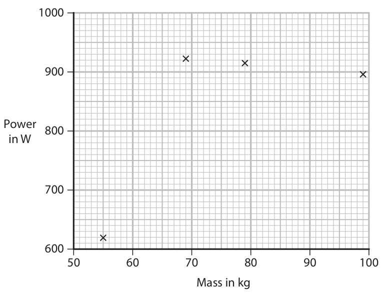

**Mark scheme answer**

> any four from: ignore students are
> correct / incorrect
> MP1. not enough data points to make a valid allow idea that more
> conclusion; students/readings are
> needed
> MP2. idea of testing a greater range of masses;
> MP3. idea of testing masses in between values;
> MP4. idea that there is a general (weak) positive allow power increases
> correlation; with mass for the first
> two data points
> MP5. idea that one of the data points could be allow any named data
> anomalous; point
> MP6. if first data point considered anomalous then allow power decreases
> there is a (weak) negative correlation; with increasing mass
> ignoring the first data
> point
> MP7. idea that final three data points suggest that allow final three data
> power could be independent of mass; points have
> approximately same
> power
> MP8. person with greatest mass does not have the allow statement that
> greatest power; 69kg person has the
> greatest power
> Answer Notes Marks

- **(4)** any four from: ignore students are

## Question 7 (7 marks)

This question is about pressure.

**(a)** Small air bubbles form in a container of water.

### 7(a)(i) [1]

The pressure of the water acts on these bubbles. The diagrams show the forces that cause this pressure. Which diagram correctly shows how the pressure of the water acts on a stationary air bubble? A B C D

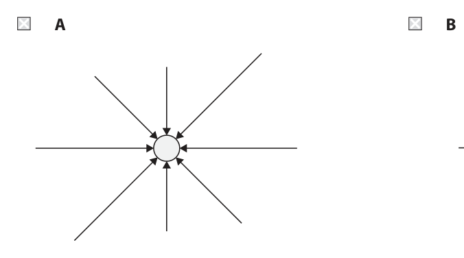

**Mark scheme answer**

> 1
> D; ( )
> A is incorrect because the pressure is not equal
> around the bubble
> B is incorrect because the pressure above the
> bubble is greater than below the bubble
> C is incorrect because the pressure to the right of
> the bubble is greater than to the left of the bubble

- **(1)** 1

### 7(a)(ii) [3]

The diagram shows the air bubbles rising to the surface of the water in a container. container water bubbles Explain why the bubbles increase in volume as they get nearer to the surface of the water. Assume that the temperature of the water is the same throughout the container.

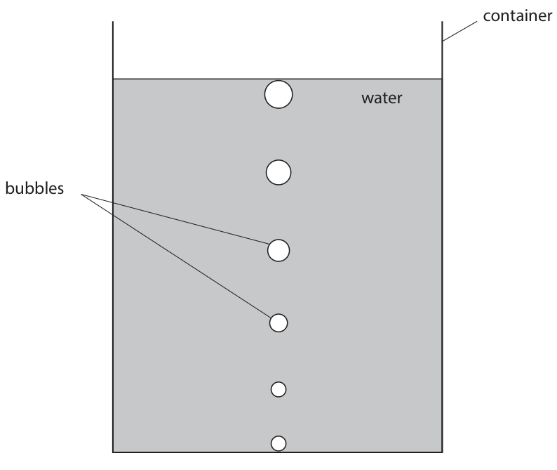

**Mark scheme answer**

> pressure decreases as bubbles get nearer to the allow RA
> surface; allow less pressure at
> smaller depth
> (because) less (weight of) water above the bubble; allow RA
> allow use of p=ρgh to
> justify why pressure
> decreases as height
> decreases
> with one from:
> volume is inversely proportional to pressure; allow pressure × volume
> = constant OR
> p1V1 = p2V2
> OR condone as pressure
> decreases volume
> increases
> forces outside bubble decrease (as pressure
> decreases), which leads to bubble expanding;

- **(3)** pressure decreases as bubbles get nearer to the allow RA

### 7(b) [3]

A teacher does a demonstration using an inflated balloon and a board with many sharp nails. balloon board with sharp nails The teacher pushes the balloon onto the board of nails. The balloon does not pop. The teacher then pops the balloon using a single nail. Explain why the balloon does not pop when pushed onto the board of nails.

**Mark scheme answer**

> idea that board of nails increases the area that
> force is being applied;
> pressure is less with board;
> (for a given force) pressure is inversely proportional allow p = F/A
> to area;
> OR
> idea that force on each nail is less when using board
> of nails;
> pressure is less with board;
> (for a given area) pressure is proportional to force; allow p = F/A
> Answer Notes Marks

- **(3)** idea that board of nails increases the area that

## Question 8 (11 marks)

A student uses a ripple tank to investigate water waves. Diagram 1 shows the ripple tank when viewed from the side. movement up and down container dipper water Diagram 1 A dipper moves up and down to produce waves on the surface of the water in the container.

**(b)** Diagram 2 shows the surface of the ripple tank, at an instant in time, when viewed from above. container water wavefront Diagram 2 The dipper produces circular waves on the surface of the water.

### 8(a) [2]

The waves on the surface of the water are transverse. State what is meant by a transverse wave. You may draw a diagram to help your answer.

**Mark scheme answer**

> oscillations / vibrations;
> perpendicular to direction of wave/travel/energy; allow 90 degrees, right
> angles for perpendicular

- **(2)** oscillations / vibrations;

### 8(b)(i) [2]

1 cm in diagram 2 is equal to 2 cm in the laboratory. Use the diagram to measure the wavelength of the water waves. wavelength = cm

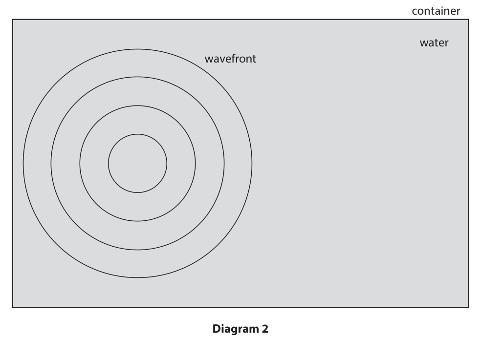

**Mark scheme answer**

> measurement of 0.9-1.1 cm;
> use of scale factor to give 1.8-2.2 (cm); allow 2 (cm)
> allow ecf if clear that
> scale factor is being used

- **(2)** measurement of 0.9-1.1 cm;

### 8(b)(ii) [3]

The dipper moves up and down with a frequency of 15 Hz. Calculate the speed of the waves. wave speed = m / s

**Mark scheme answer**

> conversion of cm to m; allow ÷100 seen anywhere
> substitution into v = f × λ; allow ecf from (i)
> evaluation;
> not converting cm to m
> scores 2 marks max.
> e.g.
> 2.0 cm = 0.020 m
> v = 15 × 0.020
> (wave speed =) 0.30 (m/s) allow 0.27 to 0.33 (m/s)
> allow 0.3 (m/s)

- **(3)** conversion of cm to m; allow ÷100 seen anywhere

### 8(c) [4]

The student then makes the dipper move horizontally to the right at constant speed. The dipper continues to move up and down with a frequency of 15 Hz. Diagram 3 shows the surface of the ripple tank, at an instant in time, when viewed from above. horizontal movement of dipper container water wavefront X Diagram 3 Explain how the frequency of the waves arriving at point X compares with the frequency at which the dipper moves up and down.

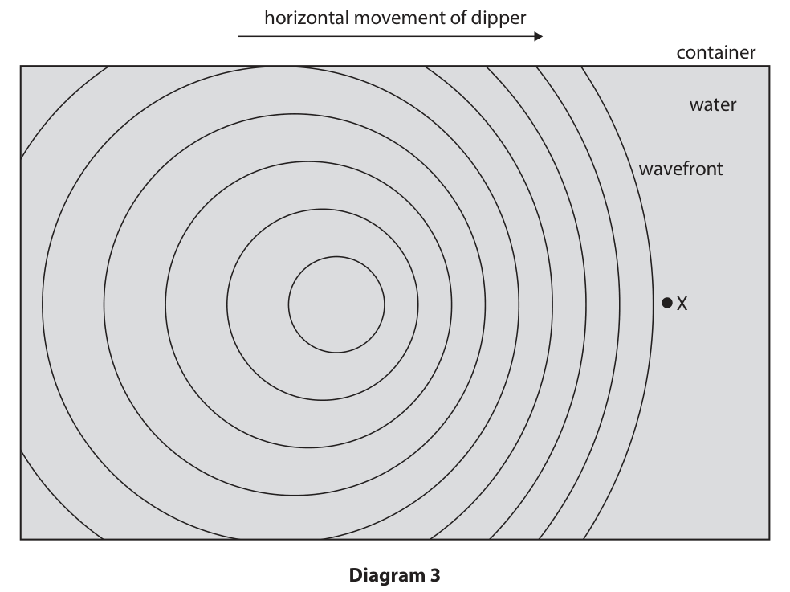

**Mark scheme answer**

> frequency is greater (at point X);
> {wavefronts / peaks / crests} closer together; allow wavefronts more
> bunched up/compressed
> ignore wave is
> compressed
> wavelength decreases;
> wave speed does not change; ignore speed of dipper
> Answer Notes Marks

- **(4)** frequency is greater (at point X);

## Question 9 (8 marks)

A protactinium generator is a device that can produce samples of an isotope called protactinium‑234m. A teacher investigates the activity of protactinium‑234m using the apparatus shown in the photograph. counter radiation detector protactinium generator

**(c)** Protactinium‑234m decays with a half‑life of 70 seconds.

### 9(a) [1]

The teacher uses a radiation detector to detect the radiation emitted from the protactinium‑234m. Give the name of a suitable radiation detector.

**Mark scheme answer**

> Geiger-Muller tube; allow GM tube, Geiger-
> Muller (detector), GM
> (detector), Geiger
> counter

- **(1)** Geiger-Muller tube; allow GM tube, Geiger-

### 9(b) [2]

Give two safety precautions to minimise the risk of harm to the teacher from the radiation emitted by the protactinium generator. 1 2

**Mark scheme answer**

> any two from:
> MP1. increase distance from source; allow stay 2m away,
> don’t stand too close
> MP2. idea of minimising time of exposure; allow keeping source in
> metal box (when not in
> use)
> MP3. not pointing source at teacher/people;
> MP4. handle source with tongs / wear gloves; allow idea of not
> touching with bare
> hands
> MP5. idea of shielding between teacher and ignore lead vest / coat
> source;

- **(2)** any two from:

### 9(c)(i) [2]

The initial count rate is 840 counts per second. Calculate the expected count rate after 140 seconds. count rate = counts per second

**Mark scheme answer**

> recognition that 140s is 2 half-lives;
> correct final evaluation;
> e.g.
> (140 / 70 =) 2 half-lives
> (840 ÷ 2 ÷ 2 =) 210 (counts per second)

- **(2)** recognition that 140s is 2 half-lives;

### 9(c)(ii) [3]

The activity of an isotope is the total amount of radiation emitted each second. The teacher estimates that only 5% of the total radiation emitted is detected by the radiation detector. Estimate the activity of the isotope when the count rate is 840 counts per second. Give the unit. activity = unit =

**Mark scheme answer**

> correct use of 5%;
> evaluation; 1680, 168 scores this
> mark as a POT error
> unit; independent mark
> e.g.
> activity = 840 / 0.05
> (activity =) 16 800
> becquerels allow Bq
> condone bq, BQ
> Answer Notes Marks

- **(3)** correct use of 5%;

## Question 10 (11 marks)

A student investigates the magnetic force on a current‑carrying metal rod. The student places a U‑shaped magnet on a sensitive balance. They connect a rigid metal rod to a low-voltage power supply, and then fix the rod in place so that it passes between the poles of the magnet. The diagram shows part of the student’s apparatus. U-shaped magnet current-carrying rigid metal rod balance When there is a current in the metal rod, the rod experiences a force due to the magnetic field of the magnet. The reading on the balance changes because the magnet experiences a force that is the same magnitude as the force on the rod, but in the opposite direction.

**(c)** The student investigates how the balance reading varies as they change the current in the metal rod. The table shows the student’s results. Current in A Balance reading in g 0.00 194.95 0.50 194.80 1.00 194.65 1.50 194.50 2.00 194.35 2.50 194.20 3.00 194.05

### 10(a) [2]

The student can increase the current in the metal rod up to a maximum of 5.0 A. Suggest why the student should only have the power supply switched on for short periods of time.

**Mark scheme answer**

> any two from: ignore comments
> relating to electric
> shock
> idea that current causes a heating effect; allow rod/wire/power
> supply might get hot,
> prevents overheating of
> the rod/wire/power
> supply
> ignore risk of fire
> reduce risk of burns;
> maintain a constant resistance for the rod;

- **(2)** any two from: ignore comments

### 10(b) [4]

Before the power supply is switched on, the reading of the balance is 194.95 g. After the power supply is switched on, the reading of the balance is 193.80 g. Calculate the force exerted on the current‑carrying rod by the magnet. force = N

**Mark scheme answer**

> evaluation of change in mass;
> conversion of g to kg;
> substitution into W = mg; allow ecf from
> incorrect/no unit
> conversion
> allow use of g = 9.8,
> 9.81
> evaluation of force; ignore any minus signs
> e.g.
> ∆m = 194.95 – 193.80 = 1.15 (g)
> ∆m = 0.00115 (kg)
> force = 0.00115 × 10
> (force =) 0.0115 (N) allow 0.01127,
> 0.0112815 (N)

- **(4)** evaluation of change in mass;

### 10(c)(i) [1]

Plot the student’s results on the grid.

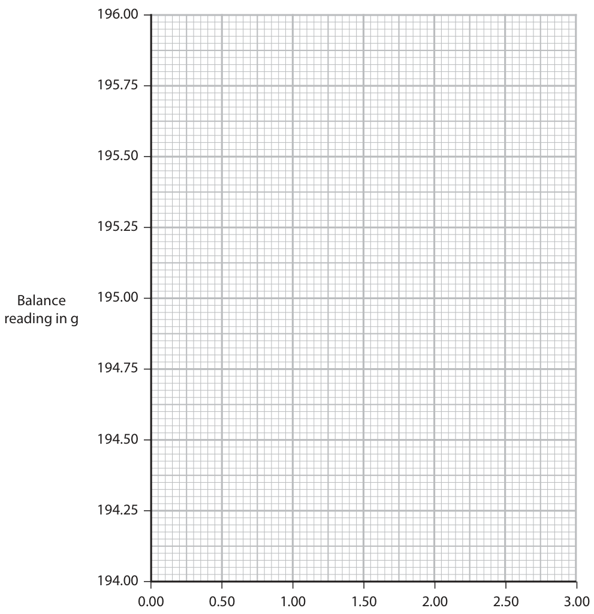

**Mark scheme answer**

> all points plotted correctly to within ½ small
> square;

- **(1)** all points plotted correctly to within ½ small

### 10(c)(ii) [1]

Draw the line of best fit. 196.00 195.75 195.50 195.25 Balance 195.00 reading in g 194.75 194.50 194.25 194.00 0.00 0.50 1.00 1.50 2.00 2.50 3.00 Current in A

**Mark scheme answer**

> continuous straight line of best fit; allow ecf from incorrect
> plotting in (i)
> reject if clearly drawn
> dot to dot

- **(1)** continuous straight line of best fit; allow ecf from incorrect

### 10(c)(iii) [3]

The student changes the connections between the metal rod and the power supply to reverse the direction of the current. Draw another line on the graph to show how the balance reading will vary with current after this change has been made.

**Mark scheme answer**

> straight line drawn of positive gradient;
> line starts at same mass reading for zero current
> as previous line;
> line ends at 195.85 g when current is 3.00 A; to within +/− 1 small
> square
> e.g.
> Answer Notes Marks

- **(3)** straight line drawn of positive gradient;

## Question 11 (12 marks)

Fluorescent tube lamps can be used in schools and office buildings for lighting. The photograph shows an engineer installing a fluorescent tube lamp. (Source: © Naparat / Shutterstock) Diagram 1 shows a simplified view of the components of a fluorescent tube lamp. fluorescent coating positive negative electrode mercury gas electrode Diagram 1

**(a)** When the lamp is on, a large voltage is applied between the positive electrode and the negative electrode.

**(b)** When the electrons accelerate between the electrodes, they collide with mercury atoms. Energy is transferred to the mercury atoms during the collisions. This causes the mercury atoms to emit ultraviolet light. Atoms in the fluorescent coating absorb this ultraviolet light, which is then re‑emitted as light from a different part of the electromagnetic spectrum. Diagram 2 shows this process. mercury atom electron inside tube ultraviolet light fluorescent coating outside tube electromagnetic waves Diagram 2

### 11(a)(i) [1]

State what is meant by the term voltage.

**Mark scheme answer**

> energy (transferred) per unit charge (passed); allow V = E/Q only if all
> terms defined
> allow work done for
> energy transferred
> allow coulomb for unit
> charge
> ignore joules per coulomb
> (equivalent to the volt)

- **(1)** energy (transferred) per unit charge (passed); allow V = E/Q only if all

### 11(a)(ii) [3]

The large voltage causes electrons to accelerate from the negative electrode towards the positive electrode. An electron gains 1.0 × 10–16 J of energy when it accelerates between the electrodes. Show that the voltage between the electrodes is about 600 V. [magnitude of electron charge = 1.6 × 10–19 C]

**Mark scheme answer**

> substitution into E = Q × V;
> rearrangement;
> evaluation to at least 2s.f.;
> e.g.
> 1.0 × 10−16 = 1.6 × 10−19 × V
> V = 1.0 × 10−16 / 1.6 × 10−19
> V = 625 (V)

- **(3)** substitution into E = Q × V;

### 11(a)(iii) [4]

The electron gains 1.0 × 10–16 J of energy in its kinetic store when it accelerates from the negative electrode to the positive electrode. Calculate the speed of an electron when it reaches the positive electrode. Assume the electron is initially at rest. [electron mass = 9.1 × 10–31 kg] speed = m / s

**Mark scheme answer**

> substitution into KE = ½ × m × v2;
> rearrangement for v2;
> rearrangement for v;
> evaluation; allow standard form or
> decimal
> 2.1978… × 1014 (m/s)
> scores 3 marks ...
> e.g.
> 1.0 × 10−16 = 0.5 × 9.1 × 10−31 × v2
> v2 = 2 × 1.0 × 10−16 / 9.1 × 10−31
> v = √[2 × 1.0 × 10−16 / 9.1 × 10−31]
> v = 1.5 × 107 (m/s) allow 1.48… × 107,
> 14 824 986.33 (m/s)

- **(4)** substitution into KE = ½ × m × v2;

### 11(b)(i) [2]

Suggest why the tube must have a fluorescent coating for the lamp to operate effectively.

**Mark scheme answer**

> idea that humans can’t see ultraviolet;
> fluorescent coating emits/produces visible light; allow idea that coating
> produces light that
> humans can see

- **(2)** idea that humans can’t see ultraviolet;

### 11(b)(ii) [2]

Explain why the fluorescent tube lamp is dangerous if the fluorescent coating becomes damaged.

**Mark scheme answer**

> any two from:
> MP1. idea that mercury/ultraviolet would escape
> from the tube;
> MP2. UV is ionising (radiation);
> MP3. named harmful effect of UV; e.g. skin cancer,
> damage/mutation to skin
> cells, skin burns, damage
> to eyes, blindness
> MP4. idea that mercury (vapour) is
> poisonous/toxic/harmful;
> Pearson Education Limited. Registered company number 872828
> with its registered office at 80 Strand, London, WC2R 0RL, United Kingdom

- **(2)** any two from:

