# 4PH1/1PR — 2025-06 (official extraction)

> schema `syllabai.official-paper-questions/0.2` · paper_id `pearson-edexcel:international-gcse:physics:4ph1:2025-06:4PH1/1PR` · qp sha256 `2709198bccff3906…` · extraction is the disclosed baseline (ADR-039)

## Question 1 (5 marks)

The diagram shows a truck travelling along a horizontal road. total resistive force 16 kN driving force 16 kN

**(b)** The driver of the truck has to stop because a tree has fallen on the road.

### 1(a) [1]

The diagram shows the horizontal forces acting on the truck. Give the resultant horizontal force acting on the truck. resultant horizontal force = kN

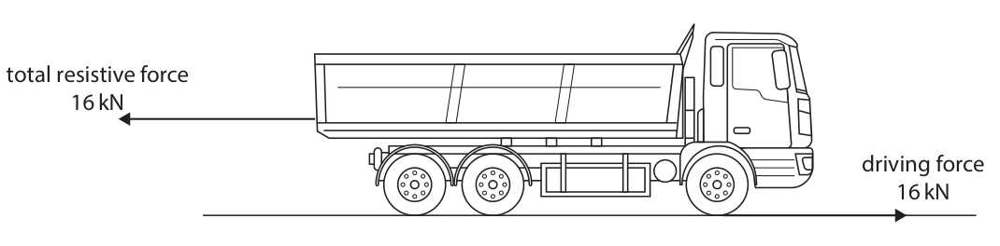

**Mark scheme answer**

> 0 (kN);

- **(1)** 0 (kN);

### 1(b)(i) [1]

The thinking distance of the driver is 7 m. The braking distance of the truck is 20 m. Calculate the stopping distance of the truck. stopping distance = m

**Mark scheme answer**

> (stopping distance = 7 + 20 =) 27 (m);

- **(1)** (stopping distance = 7 + 20 =) 27 (m);

### 1(b)(ii) [2]

Give two factors that would affect the braking distance of the truck. 1 2

**Mark scheme answer**

> any two from:
> MP1. speed of truck;
> MP2. mass or weight of truck;
> MP3. condition of brakes/eq;
> MP4. condition of tyres/eq;
> MP5. condition of road/eq; allow wet/icy roads eq.
> MP6. braking uphill / downhill;
> MP7. how hard the brake pedal is
> pressed;
> reference to factors that
> affect thinking distance,
> e.g. alcohol, tiredness
> etc. limits score 1 mark
> max

- **(2)** any two from:

### 1(b)(iii) [1]

Which of these factors would decrease the driver’s thinking distance?

- **(A)** the road is dry, rather than wet
- **(B)** the truck has old, worn tyres, rather than new tyres
- **(C)** the driver is tired
- **(D)** the truck is travelling at a lower speed  ✔

**Mark scheme answer**

> D (the truck is travelling at a lower
> speed);
> A is incorrect because this would affect
> the braking distance
> B is incorrect because this would affect
> the braking distance
> C is incorrect because this would
> increase the thinking distance
> Answer Notes Marks

- **(1)** Answer D: the truck is travelling at a lower speed

## Question 2 (7 marks)

This question is about magnetic fields.

**(b)** Diagram 2 shows a strong magnet attracting an iron block. N strong magnet S iron block Diagram 2

### 2(a) [4]

Diagram 1 shows the poles of two strong bar magnets being held close together. Diagram 1 There is a uniform magnetic field between the poles of the bar magnets. Complete diagram 1 by drawing magnetic field lines to show the uniform magnetic field. You should label the poles of the bar magnets.

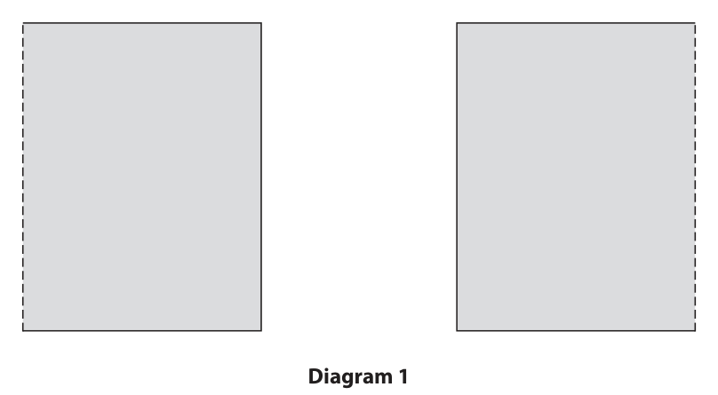

**Mark scheme answer**

> opposite poles labels; ignore orientation
> horizontal straight lines drawn joining ignore lines drawn outside
> poles; the region between the
> poles
> judge 'straight' by eye
> minimum 3 lines drawn equally spaced;
> arrows drawn on lines consistent with i.e. from N to S
> labelling of poles;

- **(4)** opposite poles labels; ignore orientation

### 2(b)(i) [1]

The iron block becomes magnetised when it is in the magnetic field of the strong magnet. Label the magnetic poles on the magnetised iron block in diagram 2.

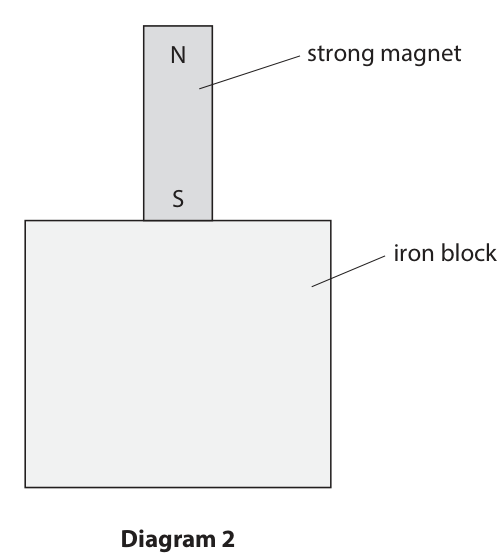

**Mark scheme answer**

> north (pole)/N drawn at the top and condone away from top
> south (pole)/S drawn at the bottom; and bottom provided 'N' is
> above 'S'
> e.g.

- **(1)** north (pole)/N drawn at the top and condone away from top

### 2(b)(ii) [2]

A student takes the strong magnet away from the iron block. The student suggests they can permanently use the iron block to attract small pieces of iron. Explain whether the student’s suggestion is correct.

**Mark scheme answer**

> (will not work because) iron will lose its allow iron cannot be
> magnetism; permanently magnetised
> (because) iron is a (magnetically) soft
> material;
> Answer Notes Marks

- **(2)** (will not work because) iron will lose its allow iron cannot be

## Question 3 (12 marks)

This question is about electrical circuits.

**(b)** Diagram 1 shows an electrical circuit containing a cell and component X. X Diagram 1 The graph shows how the resistance of component X varies with temperature. 400 300 Resistance in Ω 200 100 0 20 40 60 80 100 Temperature in C

### 3(a) [3]

The table shows the circuit symbols for some electrical components. Complete the table by placing ticks (✓) to show whether each component can visibly indicate the presence of a current in a circuit. Can visibly indicate the Electrical component presence of a current A

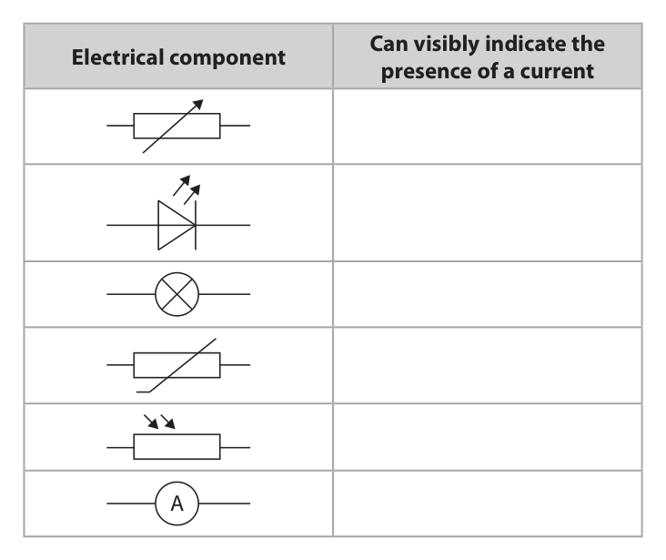

**Mark scheme answer**

> one mark for each correct tick;;; ignore names of
> components
> if more than 3 ticks
> then -1 for each
> incorrect tick

- **(3)** one mark for each correct tick;;; ignore names of

### 3(b)(i) [1]

Give the name of component X.

**Mark scheme answer**

> (NTC) thermistor;

- **(1)** (NTC) thermistor;

### 3(b)(ii) [1]

Using the graph, determine the resistance of component X when its temperature is 50 °C. resistance = Ω

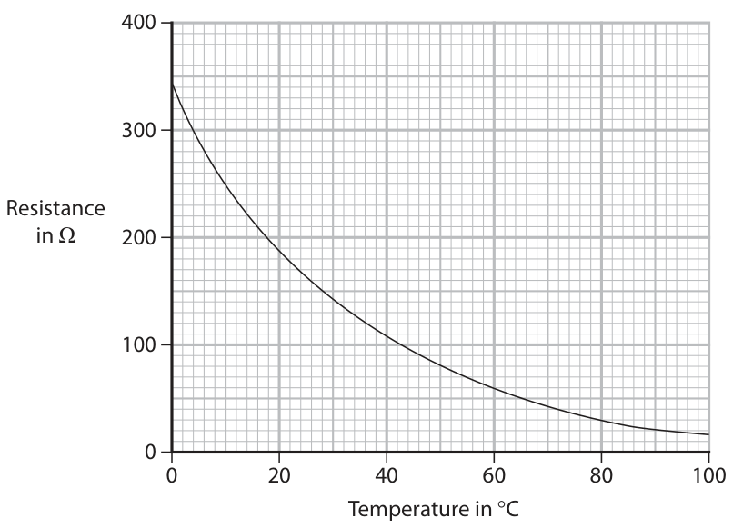

**Mark scheme answer**

> 80 (Ω); allow 75-85 (Ω)

- **(1)** 80 (Ω); allow 75-85 (Ω)

### 3(b)(iii) [3]

The cell in diagram 1 has a voltage of 9.0 V. Calculate the current in component X when its temperature is 50 °C. Use the formula voltage = current × resistance current = A

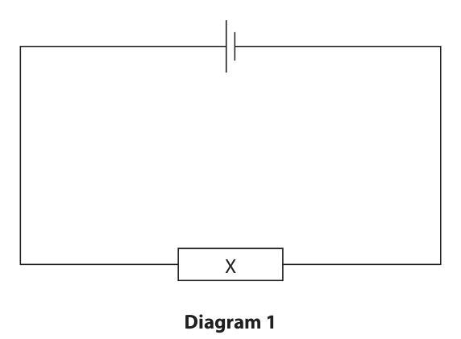

**Mark scheme answer**

> substitution; allow ecf from (ii)
> rearrangement; allow in either order
> evaluation;
> e.g.
> 9.0 = current × 80
> (current =) 9.0 / 80
> (current =) 0.11 (A) allow any value that
> would round to either
> 0.11 (A) or 0.12 (A)

- **(3)** substitution; allow ecf from (ii)

### 3(b)(iv) [4]

The circuit in diagram 1 is modified by adding a second identical component X in series with the other components. The temperatures of the first component X and second component X are reduced to 26 °C. Explain how the resistance of the circuit is affected by these changes.

**Mark scheme answer**

> any four from:
> MP1. resistance of component X is 160 (Ω); allow resistance
> doubles
> ignore resistance
> increases unless
> qualified
> e.g.
> accept reference to
> increase of
> thermistor's resistance
> because of reduction
> in temperature
> MP2. idea that two components in series accept idea that
> have more resistance; resistors in series add
> up
> MP3. idea that two components in series also scores MP2
> have double the resistance;
> MP4. resistance of circuit increases;
> MP5. resistance of circuit is 320 (Ω); also scores MP4
> accept circuit
> resistance is four
> times that previously
> Answer Notes Marks

- **(4)** any four from:

## Question 4 (13 marks)

A student does an experiment to investigate energy transfer by conduction.

**(a)** The student plans to use the piece of apparatus shown in the photograph. metal bars temperature-sensitive strips hot water The apparatus has four bars made from different metals. When the apparatus is placed in hot water, energy is transferred from the bottom of the bar to the top of the bar. The temperature-sensitive strip on each bar changes colour as the temperature of the bar changes. The time taken for the colour change to reach the top of the bar can be used to compare how effective each metal is at transferring energy by conduction.

**(b)** The table shows the results of the student’s investigation. Time taken for colour Metal change in seconds aluminium 29 brass 64 copper 22 steel 115

### 4(a)(i) [3]

Give three control variables in the student’s investigation. 1 2 3

**Mark scheme answer**

> any three from:
> MP1. (all bars same) length; condone 'size' for
> 'length'
> MP2. (all bars same) width;
> MP3. (all bars same) thickness;
> MP4. (all bars can be) placed in same accept ‘same initial
> water; temperature (for all
> bars)’
> MP5. (all bars will be same) depth in
> water;

- **(3)** any three from:

### 4(a)(ii) [5]

The student has this equipment. • beaker • hot water • stopclock • clamp and clamp stand Design a method the student could use to compare the effectiveness of the metals at transferring energy by conduction. You may draw a diagram to help your answer.

**Mark scheme answer**

> any four from:
> MP1. support apparatus in (clamp)stand; may be shown in
> diagram
> MP2. place apparatus into hot water and condone (stop)watch or
> start stopclock; timer for stopclock
> MP3. determine time (from stopclock) for condone reference to
> colour change to reach top of strip; wax falling off end
> MP4. allow apparatus to cool
> MP5. repeat and calculate mean for each accept 'average' for
> bar; 'mean'
> MP6. other relevant extra practical detail; e.g. ensure bars are
> vertical, repeats have
> same initial
> temperature, bars are
> at same depth for
> repeats

- **(5)** any four from:

### 4(b)(i) [3]

Plot a bar chart of the student’s results.

**Mark scheme answer**

> linear scale that takes up ≥ 50% of the grid ignore orientation of
> for time axis; axes
> allow use of false
> origins
> labelled axes with units; allow no units on metal
> axis
> all bars plotted correctly within ½ small ignore width of bars
> square;
> accept line for bar
> ignore plotted 'points'

- **(3)** linear scale that takes up ≥ 50% of the grid ignore orientation of

### 4(b)(ii) [2]

Deduce which metal is the most effective at transferring energy by conduction.

**Mark scheme answer**

> copper (is most effective at transferring
> energy by conduction);
> (because) time taken (for colour change) is condone shorter time
> shortest; (than the others)
> Answer Notes Marks

- **(2)** copper (is most effective at transferring

## Question 5 (10 marks)

The photograph shows a cloud chamber, used to observe alpha radiation produced by a radioactive source. The radioactive source is inside the cloud chamber, as shown in the photograph. glass viewing window radioactive source

### 5(a) [2]

Describe the structure of an alpha particle.

**Mark scheme answer**

> (particle made from) contains protons
> and neutrons;
> 2 protons and 2 neutrons; scores first MP as well
> ignore electrons
> ignore reference to helium
> nucleus

- **(2)** (particle made from) contains protons

### 5(b) [3]

The source used in the cloud chamber contains the isotope radium-226. The incomplete nuclear equation shows the decay of radium-226 into an isotope of radon. Complete the nuclear equation by writing the correct numbers in the boxes. 226 Ra → 86 Rn + α

**Mark scheme answer**

> 2 for proton number of alpha;
> 4 for nucleon number of alpha;
> nucleon numbers balance; allow ecf from incorrect
> nucleon number of alpha
> e.g.

- **(3)** 2 for proton number of alpha;

### 5(c) [2]

The tracks in the cloud chamber can be seen through the glass viewing window. Explain why the radioactive source is not a hazard to the person viewing the cloud chamber.

**Mark scheme answer**

> any two from:
> MP1. alpha source is outside body /
> skin would absorb alpha;
> MP2. alpha has poor penetrating condone ‘highly ionising’
> ability;
> MP3 idea of alpha (radiation) is allow idea that alpha can't
> absorbed by glass/cloud chamber; penetrate glass

- **(2)** any two from:

### 5(d) [3]

When radiation is emitted from the source a white line is produced in the cloud chamber. The white line is known as a track. The diagram shows the tracks produced by the radiation from the source. The diameter of the cloud chamber is also shown. 10 cm radioactive source Explain the properties of alpha radiation that can be deduced from the length of the tracks.

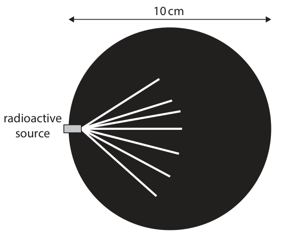

**Mark scheme answer**

> Any three from:
> MP1. idea that all tracks are
> (approximately) same length;
> MP2. (so) all alpha particles have the
> same (kinetic) energy;
> allow sensible numerical
> MP3. tracks are short / alpha radiation
> value
> is short range;
> MP4. (so) alpha particles are highly
> ionising or poorly penetrating
> ignore ideas of thickness
> and direction of track
> Answer Notes Marks

- **(3)** Any three from:

## Question 6 (10 marks)

The photograph shows a rocket being launched at Cape Canaveral in the United States of America. (Source: © Geopix / Alamy Stock Photo) The table gives some information about the motion of the rocket during the first 5.0 seconds of its launch. Initial velocity 0.0 m / s Acceleration 13 m / s² Time taken 5.0 s

### 6(a) [3]

Calculate the final velocity of the rocket after 5.0 seconds. Assume that the acceleration remains constant during this time. final velocity = m / s

**Mark scheme answer**

> substitution into a = v–u/t;
> rearrangement; allow in either order
> evaluation; ignore sign
> -1 for POT error
> e.g.
> 13 = v (-0) / 5.0
> $v = 13 \times 5.0$
> (v =) 65 (m/s)
> correct answer without
> working scores all marks

- **(3)** substitution into a = v–u/t;

### 6(b) [3]

Calculate the distance the rocket travels during the 5.0 seconds. Assume that the acceleration remains constant during this time. distance travelled = m

**Mark scheme answer**

> substitution into v² = u² + 2as; allow ecf from (a)
> allow use of ‘s = ½ v t’
> rearrangement; allow in either order
> evaluation; ignore sign
> e.g. -1 for POT error
> allow 162, 163, 162.5 (m)
> $65^{2} = (0^{2}) + 2 \times 13 \times s$
> $s = 65^{2} / 26$
> (s =) 160 (m)
> correct answer without
> working scores all marks

- **(3)** substitution into v² = u² + 2as; allow ecf from (a)

### 6(c) [4]

Sketch a velocity-time graph and a distance-time graph showing how the motion of the rocket changes during the first 5.0 seconds of its launch. You do not need to include values on the axes. Velocity 0 Time Distance 0 Time

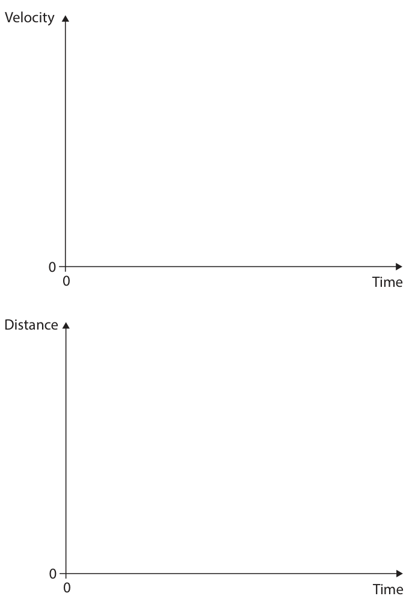

**Mark scheme answer**

> for velocity-time graph
> straight line drawn;
> line starts at origin and has positive
> gradient throughout;
> for distance-time graph
> line starts at origin and has positive
> gradient throughout;
> gradient of line increases over time;
> Answer Notes Marks

- **(4)** for velocity-time graph

## Question 7 (11 marks)

This question is about light.

**(b)** Diagram 1 shows a ray of light in a section of optical fibre. air optical fibre Diagram 1

### 7(a) [2]

Light is an example of a transverse wave. Describe a transverse wave. You may draw a diagram to help your answer.

**Mark scheme answer**

> mention of vibrations / oscillations; accept either noun or verb
> (vibrations are) at right angles to allow wave travel or wave
> direction of energy transfer; propagation or wave
> velocity for energy transfer
> diagram(s) must be
> labelled such that direction
> of vibration and direction
> of travel are clear
> ignore unlabelled diagrams

- **(2)** mention of vibrations / oscillations; accept either noun or verb

### 7(b)(i) [2]

The ray of light is incident at the boundary between the optical fibre and air. The ray of light reflects at the boundary. Complete diagram 1 by drawing the reflected ray of light.

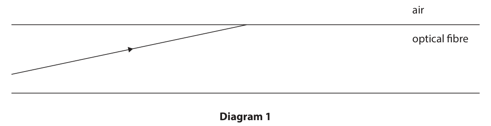

**Mark scheme answer**

> any reflecting ray drawn; condone lack of arrowhead
> reject arrowhead in wrong
> direction
> angle or reflection approximately equal judge by eye
> to angle of incidence;

- **(2)** any reflecting ray drawn; condone lack of arrowhead

### 7(b)(ii) [3]

Explain why no light leaves the optical fibre when the light reflects at the boundary between the optical fibre and air.

**Mark scheme answer**

> idea that refractive index of air is less allow (optical) density for
> than refractive index of optical fibre; refractive index
> accept idea of going from
> (optically) more dense to
> (optically) less dense
> angle of incidence is greater than
> critical angle;
> reference to total internal reflection; accept ‘TIR’ (whatever
> case) for ‘total internal
> reflection’

- **(3)** idea that refractive index of air is less allow (optical) density for

### 7(c) [4]

Diagram 2 shows a different ray of light, incident on the boundary between water and air. normal air water Diagram 2 Using diagram 2, show that the refractive index of water is approximately 1.3

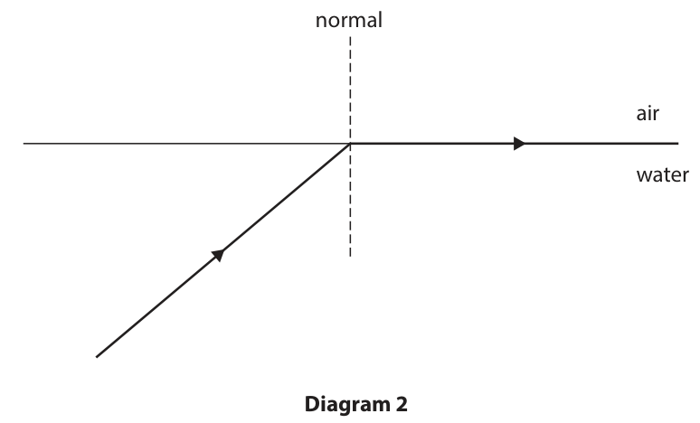

**Mark scheme answer**

> angle of incidence measured correctly; allow 48-52 seen anywhere
> in working
> allow clear RA that gives
> c = 50.28...
> substitution into sin c = 1/n; allow sin(90) for '1' or
> correct substitution into n
> = sin(i)/sin(r) (i= 50 and
> r=90)
> rearrangement; allow substitution and
> rearrangement in either
> order
> evaluation to 3 or more s.f.; accept value consistent
> with candidate’s value for
> angle of incidence
> i.e. 48 degrees gives
> 1.345...
> 52 degrees gives 1.269...
> arriving at n=0.766 scores 2
> marks max
> e.g.
> angle of incidence = 50°
> sin 50 = 1/n
> n = 1/sin 50
> n = 1.305…
> correct evaluation
> (e.g.1.305) without
> working scores 1 mark only
> Answer Notes Marks

- **(4)** angle of incidence measured correctly; allow 48-52 seen anywhere

## Question 8 (7 marks)

This is a question about the Solar System.

**(b)** Neptune is a planet in the Solar System.

### 8(a) [1]

Give the name of the galaxy the Solar System is in.

**Mark scheme answer**

> Milky Way;

- **(1)** Milky Way;

### 8(b)(i) [2]

Triton is a moon that orbits the planet, Neptune. Draw a diagram to show the orbit of Neptune and the orbit of Triton in the Solar System.

**Mark scheme answer**

> Neptune orbits the Sun;
> Triton orbits Neptune;

- **(2)** Neptune orbits the Sun;

### 8(b)(ii) [4]

Neptune orbits in the Solar System at an orbital speed of 5.4 × 10³ m / s with an orbital radius of 4.5 × 10¹² m. Pluto is another object in the Solar System. Pluto orbits with a time period of 7.8 × 10⁹ s. Show that the ratio of the orbital time period of Neptune to the orbital time period of Pluto is 2 : 3

**Mark scheme answer**

> substitution into v = 2πr/T; data for Neptune seen
> rearrangement; allow substitution and
> rearrangement in either
> order
> evaluation of T for Neptune; accept 5.2 ×10⁹ following
> correct working for first
> 3 marks
> accept 5.23(...)×10⁹
> without correct working
> for first three marks
> setting up ratio of T for Pluto and
> Neptune that leads to 2:3;
> e.g.
> 5.4×10³ = 2π × 4.5×10¹² / T
> T = 2π × 4.5×10¹² / 5.4×10³
> (T =) 5.2 ×10⁹ (s)
> ratio = 5.2×10⁹ / 7.8×10⁹ (= 2:3)
> Question Mark
> Answer Notes
> number s

- **(4)** substitution into v = 2πr/T; data for Neptune seen

## Question 9 (14 marks)
**(a)** The diagrams show a spring hanging from a nail. • diagram 1 shows the spring with no weight added • diagram 2 shows the spring stationary, after a weight has been added • diagram 3 shows the spring after the weight has been pulled down weight Diagram 1 Diagram 2 Diagram 3

**(b)** Shock absorbers containing springs are used on motorcycles. Shock absorbers are designed to compress and expand as the motorcycle moves across a rough surface. A new type of shock absorber has been developed to generate electricity from the movement of the motorcycle. This new type of shock absorber consists of magnets that slide inside a coil when the motorcycle goes over a bump. coil magnets Some of the energy that would normally be wasted can be recovered, so fuel is saved.

### 9(a)(i) [1]

Which energy store has increased for the spring in diagram 2 compared to the spring in diagram 1?

- **(A)** chemical
- **(B)** elastic  ✔
- **(C)** gravitational potential
- **(D)** kinetic

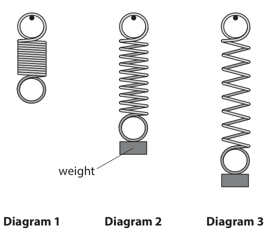

**Mark scheme answer**

> B (elastic);
> A is incorrect because there is no transfer from a
> chemical store
> C is incorrect because the gravitational potential
> store decreases
> D is incorrect because the spring is stationary in
> both cases

- **(1)** Answer B: elastic

### 9(a)(ii) [6]

The spring is released from the position shown in diagram 3. Describe the energy transfers that take place until the spring stops vibrating.

**Mark scheme answer**

> any six from:
> MP1. elastic energy (store) decreases (on way up);
> MP2. kinetic energy (store) increases (on way up);
> MP3. gravitational (store) increases (on way up);
> MP4. idea of process reversing as mass moves
> downwards;
> MP5. energy transferred mechanically;
> MP6. idea of amplitude of oscillations decreasing allow reference to
> over time; ‘slowing down’ to
> mean ‘max speed
> decreasing’
> allow reference to
> reduction in total
> energy of mass/spring
> MP7. (eventually all) energy is transferred to condone heat for
> thermal store of spring/surroundings; thermal
> MP8. (mechanically) by friction between spring and
> surroundings
> alternate energy
> transfer scheme:
> MP1 EPE converted to
> KE (on way up)
> MP2 EPE converted to
> GPE (on way up)
> MP3 KE converted to
> GPE (after midway
> point)

- **(6)** any six from:

### 9(b)(i) [1]

Which of these statements best describes the advantage of this new type of shock absorber?

- **(A)** it increases the energy transferred to a thermal store from the fuel
- **(B)** it increases the efficiency of the motorcycle  ✔
- **(C)** it decreases the speed of the motorcycle
- **(D)** it decreases the braking power of the motorcycle

**Mark scheme answer**

> B (it increases the efficiency of the motorcycle);
> A is incorrect because it decreases the energy
> transferred from fuel each second
> C is incorrect because it does not affect the speed
> D is incorrect because it does not affect the
> braking power

- **(1)** Answer B: it increases the efficiency of the motorcycle

### 9(b)(ii) [3]

Explain how this new type of shock absorber can generate electricity.

**Mark scheme answer**

> magnet(s) move through coil; allow RA
> condone ‘magnet
> slides through coil’
> (candidate has
> realised this is
> relevant)
> idea of coil cutting magnetic field lines; ignore fields
> interacting
> accept reference to
> changing magnetic flux
> inducing a voltage; accept potential
> difference, p.d. or
> EMF for voltage
> condone ‘induces a
> current’

- **(3)** magnet(s) move through coil; allow RA

### 9(b)(iii) [3]

Road X has a rough surface. Road Y has a smooth surface. (Source: © MikhailSh / Shutterstock) (Source: © BearFotos / Shutterstock) Road X Road Y A motorcycle travels at the same speed along road X and road Y. Explain why the new type of shock absorber will generate more electricity for this motorcycle on road X than on road Y.

**Mark scheme answer**

> bigger or more (frequent) bumps; allow RA
> allow idea of shorter
> time between bumps
> allow up and down for
> bump
> magnet(s) have bigger amplitude of motion / ignore unqualified
> ‘moves more’ (needs
> magnet(s) caused to move more times (per metre idea of a quantity e.g.
> size, speed)
> of road); allow coil for magnet
> (so) induced voltage / voltage generated is larger allow current for
> or for a longer time in total; voltage
> Answer Notes Marks

- **(3)** bigger or more (frequent) bumps; allow RA

## Question 10 (11 marks)

The photograph shows a ring made of gold. (Source: ©Michael Burrell / Alamy Stock Photo) A student wants to determine the volume of the ring.

**(a)** The student measures the mass of the ring several times.

### 10(a)(i) [2]

Describe how the student should use laboratory equipment to accurately measure the mass of the ring.

**Mark scheme answer**

> use of a balance; ignore scale
> allow weighing scale
> condone scales
> PLUS
> idea that balance should be zeroed /
> idea that balance should be level / allow idea that balance is
> placed on a flat/level
> surface
> idea that there should be no draughts

- **(2)** use of a balance; ignore scale

### 10(a)(ii) [1]

The table shows the student’s measurements of the mass of the ring. Mass in g 6.411 6.408 6.410 6.426 6.412 One of the student’s measurements is an anomaly. Draw a circle around the anomalous result in the table.

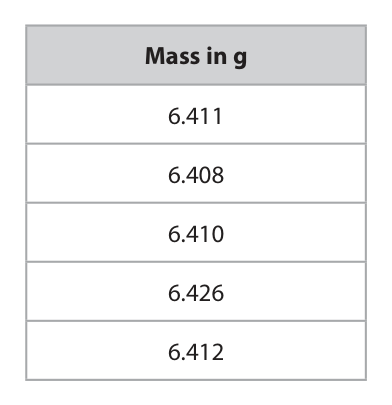

**Mark scheme answer**

> 6.426 circled;

- **(1)** 6.426 circled;

### 10(a)(iii) [3]

Calculate the mean mass of the gold ring. mean mass = g

**Mark scheme answer**

> evidence of correct method of e.g. adding all five values
> calculating mean; together and dividing by
> five = 6.4134
> evidence of ignoring anomaly in allow ecf from (ii)
> calculation;
> expect 6.41025
> answer rounded to 3 decimal places;
> e.g.
> mean mass = (6.411 + 6.408 + 6.410 +
> 6.412) / 4
> mean mass = 6.410 (g)

- **(3)** evidence of correct method of e.g. adding all five values

### 10(a)(iv) [1]

The student is given a value for the density of gold. Which of these formulae should be used to calculate the volume of the gold ring?

- **(A)** volume = density ÷ mass
- **(B)** volume = density ÷ mass³
- **(C)** volume = mass ÷ density  ✔
- **(D)** volume = mass ÷ density³

**Mark scheme answer**

> C (volume = mass ÷ density);
> A is incorrect because this is the
> incorrect rearrangement
> B is incorrect because this is the
> incorrect rearrangement
> D is incorrect because it has density
> cubed

- **(1)** Answer C: volume = mass ÷ density

### 10(b) [4]

The student does not know if the ring is made of pure gold. The student suggests that they could also measure the volume of the ring using a displacement method. Discuss which method (calculation method or displacement method) will give the most accurate volume measurement.

**Mark scheme answer**

> any four from:
> MP1. idea that density will depend on
> purity of gold;
> MP2.idea that calculating volume will
> be affected by purity;
> MP3. reference to mass measurement
> being four significant figures;
> MP4. source of error in displacement e.g.
> method described; • possible splashing
> • ring not fully submerged
> • meniscus
> • parallax
> MP5. idea that small volume of ring e.g. due to gradations being
> will be difficult to measure using not small enough
> displacement method;
> accept RA i.e. if gold is not
> MP6. calculating volume is likely to be pure then measurement
> more accurate than measuring for a could be more accurate
> valid reason e.g. if gold is pure or if
> there’s splashing in a displacement
> method
> Answer Notes Marks

- **(4)** any four from:

## Question 11 (10 marks)

A ball is moving through the air with a speed of 54.8 m / s. The ball has a mass of 159 g.

**(b)** The speed of the ball is measured using radio waves. Radio waves of frequency 2.90 × 1010 Hz travel towards the ball from a source. The radio waves then reflect off the ball. The reflected radio waves change frequency depending on the speed of the ball. This change in frequency is due to the Doppler effect. waves from source 54.8 m/s radio waves source ball reflected waves

### 11(a) [4]

Calculate the energy in the kinetic store of the ball. Give your answer to 3 significant figures. energy in kinetic store = J

**Mark scheme answer**

> conversion of units from g to kg; allow 0.159 seen anywhere in
> working
> substitution; ignore units
> evaluation; note: take care not to penalise
> POT error twice here
> evaluation given to 3 s.f.; independent mark
> e.g.
> 159 g = 0.159 kg
> (KE =) ½ × 159 (×10⁻³) × 54.82
> (KE =) 238.74… (J)
> (KE =) 239 (J)

- **(4)** conversion of units from g to kg; allow 0.159 seen anywhere in

### 11(b)(i) [3]

The change in frequency can be calculated using this formula. change of frequency speed of radio waves speed of ball = × source frequency 2 Show that the change in frequency of the radio waves is approximately 1.1 × 10⁴ Hz. [speed of radio waves = 3.00 × 10⁸ m / s]

**Mark scheme answer**

> substitution;
> rearrangement; allow in either order
> evaluation to 3 or more s.f.;
> e.g.
> 54.8 = ∆f / 2.90 × 10¹⁰ × 3.00 × 10⁸ / 2
> ∆f = 54.8 × 2.90 × 10¹⁰ × 2 / 3.00 × 10⁸
> (∆f =) 10.59…× 10³ (Hz) allow any value that rounds to
> 1.06 × 10⁴
> accept non-standard form e.g.
> 10.6 × 10³
> accept answer not in standard
> form
> 10594.6… (Hz)
> award 1 mark max for a
> successful attempt at
> calculating the speed that
> gives a shift of 1.1 × 10⁴ (Hz)
> i.e. 56.8... (m/s)

- **(3)** substitution;

### 11(b)(ii) [3]

The change in frequency of the radio waves happens because the ball acts as a new source of radio waves. The ball is moving away from the original source of radio waves. Explain the change in frequency of the radio waves when the radio waves reflect off the ball.

**Mark scheme answer**

> frequency (of radio waves) decreases;
> wavelength increases; condone 'waves stretch'
> speed of (radio) waves stays the same;
> Pearson Education Limited. Registered company number 872828
> with its registered office at 80 Strand, London, WC2R 0RL, United Kingdom

- **(3)** frequency (of radio waves) decreases;

