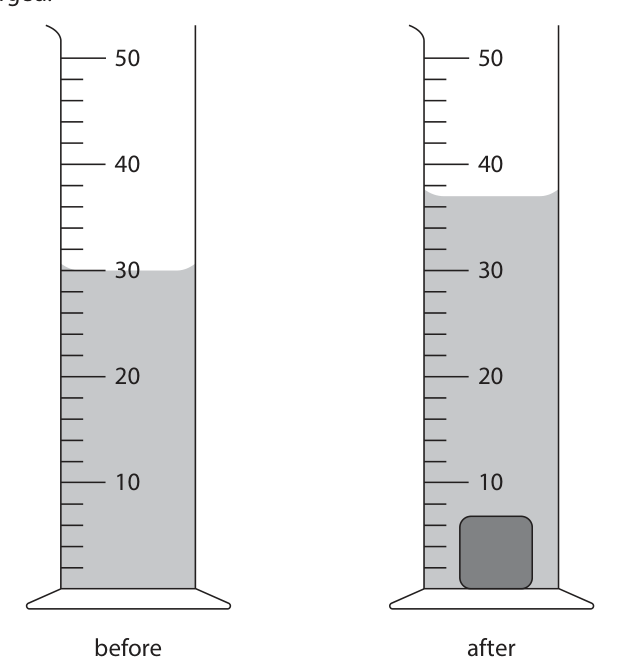
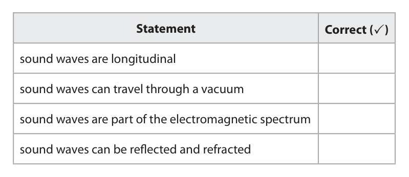
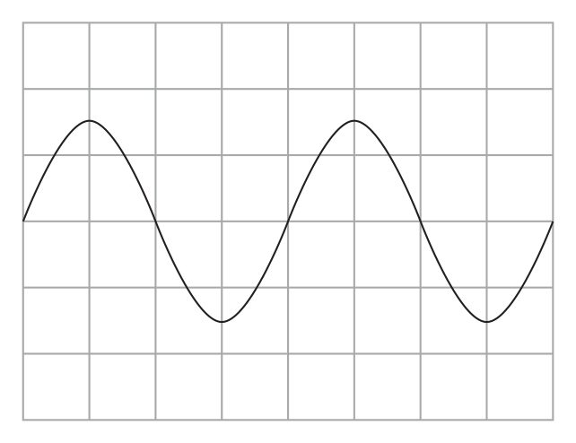
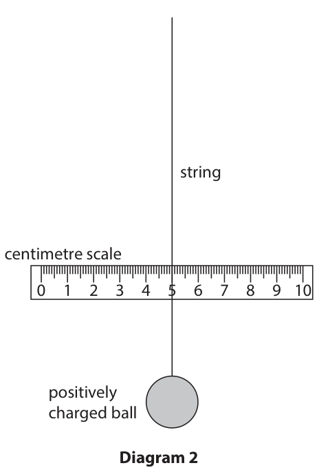
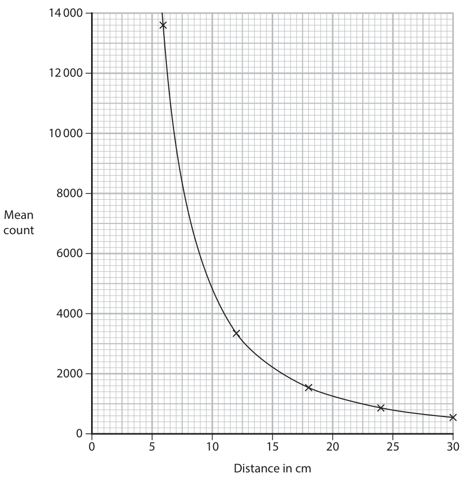
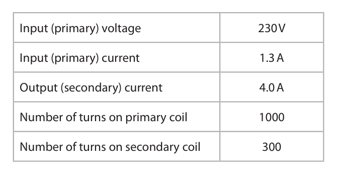

# 4PH1/2P — 2025-06 (official extraction)

> schema `syllabai.official-paper-questions/0.2` · paper_id `pearson-edexcel:international-gcse:physics:4ph1:2025-06:4PH1/2P` · qp sha256 `d90d0a7c49c9478e…` · extraction is the disclosed baseline (ADR-039)

## Question 1 (7 marks)

A student plays a game using a single dice. The student decides to determine the density of the dice by measuring its mass and volume.

**(b)** The dice is not a regular shape. The student decides to measure the volume of the dice using a displacement method. The student places the dice into a measuring cylinder containing water. The diagram shows the water in the measuring cylinder before and after the dice is fully submerged. 50 50 40 40 30 30 20 20 10 10 before after

### 1(a) [2]

Describe how the student could accurately measure the mass of the dice.

**Mark scheme answer**

> use of a balance; ignore scale
> allow weighing scale
> condone scales
> PLUS any ONE from
> • idea that balance should be zeroed;
> • idea that there should be no draughts;
> • idea that balance should be level; allow ‘tare’ for ‘zero’
> allow idea that balance
> is placed on a flat/level
> surface
> ignore idea of ‘repeat
> and average’
> ignore references to sig
> figs or decimal places

- **(2)** use of a balance; ignore scale

### 1(b)(i) [2]

The measuring cylinder gives volume in units of cm3. Using the diagram, determine the volume of the dice. volume = cm3

**Mark scheme answer**

> either reading correctly measured; allow 30 or 37 seen in
> working
> both readings correctly measured and subtracted; final answer of 7 (cm3)
> scores both marks

- **(2)** either reading correctly measured; allow 30 or 37 seen in

### 1(b)(ii) [3]

The dice has a mass of 9.2 g. Calculate the density of the dice using the formula mass density = volume Give a suitable unit. density = unit

**Mark scheme answer**

> substitution; allow ecf from (i)
> evaluation; allow any value which
> would round to 1.3 ×10n
> any dimensionally correct unit that matches
> candidate’s evaluation;
> e.g. the following would
> score full marks:
> 1300 kg/m3
> 1.3 g/cm 3
> 1300 g / litre
> 1.3 ×10-3 kg/cm3
> e.g.
> density = 9.2 ÷ 7
> (density =) 1.3 allow 1.31…
> g/cm3
> Answer Notes Marks

- **(3)** substitution; allow ecf from (i)

## Question 2 (6 marks)

This question is about sound waves.

**(c)** An oscilloscope can be used to display a sound wave.

### 2(a) [1]

Which range of frequencies of sound waves can be heard by humans?

- **(A)** 2 Hz to 20 000 Hz
- **(B)** 2 Hz to 200 000 Hz
- **(C)** 20 Hz to 20 000 Hz  ✔
- **(D)** 20 Hz to 200 000 Hz

**Mark scheme answer**

> C (20 Hz to 20 000 Hz);
> A is incorrect because the lower range is too low
> B is incorrect because both the lower and upper
> ranges are incorrect
> D is incorrect because the upper range is too high

- **(1)** Answer C: 20 Hz to 20 000 Hz

### 2(b) [2]

The table gives some statements about sound waves. Complete the table by placing a tick (✓) next to each correct statement. Statement Correct (✓) sound waves are longitudinal sound waves can travel through a vacuum sound waves are part of the electromagnetic spectrum sound waves can be reflected and refracted

**Mark scheme answer**

> 1 mark for each correctly ticked row;; if more than two ticks
> then -1 for each
> Correct (✓) incorrect tick
> Statement
> sound waves are longitudinal ✓
> sound waves can travel through
> a vacuum
> sound waves are part of the
> electromagnetic spectrum
> sound waves can be reflected
> and refracted ✓

- **(2)** 1 mark for each correctly ticked row;; if more than two ticks

### 2(c)(i) [1]

Give the name of the variable that is measured on the x‑axis of the oscilloscope screen.

**Mark scheme answer**

> time; ignore any unit given
> reject time base
> reject time period
> accept lower case ‘t’
> reject upper case ‘T’

- **(1)** time; ignore any unit given

### 2(c)(ii) [2]

The diagram shows the trace on an oscilloscope screen when a sound wave is detected. On the screen, draw the trace for a quieter sound wave with a lower frequency.

**Mark scheme answer**

> trace has lower amplitude throughout;
> trace has larger time period throughout;
> e.g.
> Answer Notes Marks

- **(2)** trace has lower amplitude throughout;

## Question 3 (9 marks)

The photograph shows a camper van with a solar panel on its roof. The solar panel is made from lots of solar cells connected together. (Source: © kostasgr / Shutterstock) The solar panel is connected to a battery. The solar panel receives energy from the Sun to charge the battery.

### 3(a) [3]

Describe how energy is transferred from the Sun’s energy store to the battery’s energy store.

**Mark scheme answer**

> any three from:
> MP1. idea of reduction of nuclear store of Sun;
> MP2. (transferred) by radiation (to the solar panel); allow by light/by IR/by
> infrared
> MP3. energy absorbed by solar panel;
> MP4. energy transferred (from panel to battery) NOT by electricity
> electrically;
> MP5. idea of increase of chemical store of battery;
> alternate description
> MP1 nuclear energy of sun
> transferred to light energy
> MP2 light energy from sun
> transferred to electrical
> energy of panel
> MP3 electrical energy of
> panel transferred to
> chemical energy of battery
> NOTE: marks can be scored
> from either the answer
> column scheme or the
> alternate description but
> not from both

- **(3)** any three from:

### 3(b) [1]

The petrol engine can also be used to charge the battery of the camper van. Give an advantage of using the solar panel instead of the petrol engine to charge the battery. Do not refer to cost in your answer.

**Mark scheme answer**

> any one from:
> • solar power is renewable; allow it won’t run out etc.
> • solar panel does not produce CO2; ignore ‘greenhouse gas(es)’
> • idea of using less petrol;
> • idea that it can be used if petrol runs out;

- **(1)** any one from:

### 3(c) [2]

The surface of the solar panel is black. Explain why black is a suitable colour for the solar panel.

**Mark scheme answer**

> black is a good absorber;
> of radiation; allow light
> allow infra-red / IR
> condone heat
> ignore reference to emission
> ignore reference to
> conduction or insulation

- **(2)** black is a good absorber;

### 3(d) [3]

The solar panel can charge the battery in the camper van with a maximum current of 15 A. Calculate the minimum time to transfer 360 000 C of charge through the battery. Use the formula charge transferred = current × time minimum time = s

**Mark scheme answer**

> substitution;
> rearrangement;
> evaluation; -1 POT error
> e.g.
> 360 000 = 15 × time
> time = 360 000 ÷ 15
> (time =) 24 000 (s)
> Answer Notes Marks

- **(3)** substitution;

## Question 4 (9 marks)

The photograph shows a mechanism that can be used to open a gate. (Source: © Photimageon / Alamy Stock Photo) The diagram shows the gate mechanism when the handle is being pulled to the right. handle force F bolt 70 cm 22 cm spring pivot The bolt is connected to the handle. When the handle is pulled to the right, the bolt also moves to the right and the gate can be opened. The spring is compressed when the bolt moves to the right. When the handle is released, the spring pushes the bolt back to its original position.

**(a)** When the handle is pulled to the right, the spring applies a force on the handle to the left. The vertical distance between the spring and the pivot point of the handle is 22 cm. The force from the spring is 5.2 N.

### 4(a)(i) [3]

Show that the force from the spring produces a moment of approximately 1 Nm.

**Mark scheme answer**

> use of moment = force × distance; may be implied by
> substitution
> substitution; ignore units
> evaluation to 2 s.f. or more; i.e. answer of 1.14(4) (N m)
> or 114(.4) N cm is
> acceptable
> e.g.
> moment = force × distance
> moment = 5.2 × (0.)22
> moment = 1.14(4) (N m) RA scores one mark max
> i.e. attempt to find force
> or distance from a moment
> of 1 N m

- **(3)** use of moment = force × distance; may be implied by

### 4(a)(ii) [1]

State what is meant by the term principle of moments.

**Mark scheme answer**

> idea that (sum of) clockwise moment(s) = (sum of)
> anti-clockwise moment(s);

- **(1)** idea that (sum of) clockwise moment(s) = (sum of)

### 4(a)(iii) [3]

Force F acts on the handle to keep the handle stationary so that the gate can be opened. Force F acts at a vertical distance of 70 cm from the pivot point of the handle. Calculate the magnitude of force F. magnitude of force F = N

**Mark scheme answer**

> substitution into principle of moments; allow ECF from (i)
> ignore units
> rearrangement;
> evaluation;
> e.g.
> F × (0.)70 = 1.14
> F = 1.14 ÷ (0.)70
> (F =) 1.63 (N) allow any answer that
> rounds to 1.4 (N) by using 1
> N m as the moment or
> rounds to 1.6 by using
> 1.14(4) N m as the moment

- **(3)** substitution into principle of moments; allow ECF from (i)

### 4(b) [2]

Give two changes to this gate mechanism that would make it easier to open the gate. 1 2

**Mark scheme answer**

> any two from: ignore changes to force
> applied
> MP1. longer handle/eq;
> MP2. weaker spring/eq; accept ‘lower spring
> constant’
> MP3. spring closer to pivot point/eq; allow bolt for spring
> MP4. lubricate pivot or lubricate spring /eq;
> ignore unqualified ‘longer
> coil’, ‘more coils’,’longer
> spring’, ‘less coils’ etc
> Answer Notes Marks

- **(2)** any two from: ignore changes to force

## Question 5 (12 marks)

A student uses this apparatus to investigate static electricity. The positively charged ball is suspended vertically on a long length of string. not to scale string positively charged ball Diagram 1

**(c)** The student places a centimetre scale behind the length of string. The string lines up with the 5.0 cm mark on the scale when the ball is in its resting position, as shown in diagram 2. string centimetre scale 0 1 2 3 4 5 6 7 8 9 10 positively charged ball Diagram 2 The student brings a negatively charged polythene rod near to the right side of the ball. The ball moves, as shown in diagram 3. string centimetre scale 0 1 2 3 4 5 6 7 8 9 10 negatively charged polythene rod positively charged ball Diagram 3

**(e)** The bar chart shows the results of the student’s investigation. 10.0 7.5 Reading on scale 5.0 in cm 2.5 Ebonite Glass Nylon Polythene Wood Rod material

### 5(a) [1]

The ball is made of a material that is a good electrical conductor. Name a material that is a good electrical conductor.

**Mark scheme answer**

> metal; allow any named
> conductor e.g.,
> aluminium, graphite,
> copper, iron

- **(1)** metal; allow any named

### 5(b) [2]

Explain, in terms of the movement of charged particles, how the ball has become positively charged.

**Mark scheme answer**

> idea of transfer of electrons or transfer of negative reject whole response
> charge; motion of protons or
> motion of positive
> charge
> electrons are lost from the ball / eq; scores both marks

- **(2)** idea of transfer of electrons or transfer of negative reject whole response

### 5(c)(i) [2]

Explain how the movement of the ball shows that the charge on the polythene rod is negative.

**Mark scheme answer**

> ball moves towards rod; allow rod and ball
> attract
> must be opposite(ly) charged;
> ‘opposite charges
> attract’ scores 2 marks

- **(2)** ball moves towards rod; allow rod and ball

### 5(c)(ii) [1]

In diagram 3, the string lines up with the 7.2 cm mark on the scale. The student moves the polythene rod slightly further away from the ball. Predict a possible reading on the scale. reading = cm

**Mark scheme answer**

> any value greater than 5.0 and less than 7.2 (cm); i.e.
> reject 5.0 (cm)
> reject 7.2 (cm)

- **(1)** any value greater than 5.0 and less than 7.2 (cm); i.e.

### 5(d) [2]

The student extends the investigation by measuring the reading on the scale for rods made from different materials. As a control variable, the student charges each rod by rubbing it with a cloth the same number of times. Give two other control variables for the student’s investigation. 1 2

**Mark scheme answer**

> any two from:
> MP1. distance between rod and ball;
> MP2. (initial) charge on ball; accept ‘rub rod with
> same force’ or ‘rub rod
> for the same amount of
> time’
> MP3. dimensions of rod; e.g. same length,
> thickness, size etc.
> condone ‘shape of rod’

- **(2)** any two from:

### 5(e)(i) [1]

Justify the use of a bar chart to present the student’s results.

**Mark scheme answer**

> idea that material is a categoric variable; allow not continuous,
> discontinuous
> condone discrete

- **(1)** idea that material is a categoric variable; allow not continuous,

### 5(e)(ii) [3]

Deduce what can be concluded about the charge on each of the rods used in the investigation. Use information from the bar chart to help your answer.

**Mark scheme answer**

> any three from:
> MP1. wood has no charge;
> MP2. ebonite and/or polythene are negatively charged;
> MP3. glass and/or nylon are positively charged;
> MP4. ebonite has the most charge;
> MP5. (of those that have charge) nylon is the least
> charged;
> nylon has the least
> MP6. glass has the biggest positive charge; positive charge
> MP7. ebonite has the biggest negative charge; polythene has the least
> negative charge
> Answer Notes Marks

- **(3)** any three from:

## Question 6 (5 marks)

This question is about gamma radiation.

**(b)** A student uses a simulation to investigate gamma radiation. This is the student’s method. • place a Geiger‑Muller (GM) tube a distance of 6 cm from a source of gamma radiation • measure the count for a time of 10 seconds • move the GM tube further away from the source and measure the count again. The student measures the count three times for each distance.

### 6(a) [1]

Which of these statements is correct for gamma radiation?

- **(A)** gamma radiation has a weaker penetrating ability than alpha radiation
- **(B)** gamma radiation is emitted by electrons in atoms
- **(C)** gamma radiation is positively charged
- **(D)** gamma radiation is less ionising than alpha radiation  ✔

**Mark scheme answer**

> D (gamma radiation is less ionising than
> alpha radiation);
> A is incorrect because gamma radiation has a high
> penetrating ability
> B is incorrect because gamma radiation is emitted
> by nuclei
> C is incorrect because gamma radiation has no
> charge

- **(1)** Answer D: gamma radiation is less ionising than alpha radiation

### 6(b)(i) [1]

Give a reason why the student takes repeat readings.

**Mark scheme answer**

> any one from:
> • to calculate a mean; allow ‘average’ for
> ‘mean’
> • anomalies can be identified or can be
> removed or can be checked;
> • to minimise the effect of random errors or
> of anomalies;

- **(1)** any one from:

### 6(b)(ii) [3]

The graph shows the student’s results. 14 000 12 000 10 000 8000 Mean count 6000 4000 2000 0 5 10 15 20 25 30 Distance in cm The student claims that the data obeys the formula count × distance2 = constant Evaluate the student’s claim.

**Mark scheme answer**

> calculation of one constant from a point on the roughly, the constant
> curve; for any count-distance
> pair is in range 460 000-
> 540 000
> calculation of a second constant from a second reject this mark if there
> point on the curve; are any miscalculated
> constants
> comparison of the constants AND conclusion that is i.e. are the constants
> valid from the candidate’s values for the ‘the same’ or not
> ‘constant’;
> NB: ignore consistent
> PoT errors
> Sample data:
> Count Distance Constant
> 13 600 6 489 600
> 3300 12 475 200
> 1600 18 518 400
> 800 24 460 800
> 600 30 540 000
> Answer Notes Marks

- **(3)** calculation of one constant from a point on the roughly, the constant

## Question 7 (14 marks)

This question is about transformers.

**(a)** The diagram shows a step‑down transformer. primary coil secondary coil 230 V output The table gives some data for the step‑down transformer. Input (primary) voltage 230 V Input (primary) current 1.3 A Output (secondary) current 4.0 A Number of turns on primary coil 1000 Number of turns on secondary coil 300

### 7(a)(i) [1]

State the formula linking input (primary) voltage, output (secondary) voltage and the turns ratio for a transformer.

**Mark scheme answer**

> input (primary) voltage / output (secondary) allow recognisable symbols
> voltage = primary turns / secondary turns; and rearrangements
> e.g. V2 = (N2/N1) × V1
> condone coils for turns
> condone T for turns
> allow 1 and 2 for input and
> output

- **(1)** input (primary) voltage / output (secondary) allow recognisable symbols

### 7(a)(ii) [3]

Use data from the table to calculate the output (secondary) voltage of the transformer. output (secondary) voltage = V

**Mark scheme answer**

> substitution;
> rearrangement; accept in either order
> substitution into an
> incorrectly arranged formula
> scores zero
> evaluation;
> e.g.
> 230 ÷ V2 = 1000 ÷ 300
> V2 = 300 × 230 ÷ 1000
> (V2 =) 69 (V)

- **(3)** substitution;

### 7(a)(iii) [5]

This transformer is not 100% efficient. The efficiency of a transformer can be calculated using the formula useful output power efficiency = × 100% total input power Calculate the efficiency of the transformer. efficiency = %

**Mark scheme answer**

> use of power = current × voltage; e.g. a correct substitution
> evaluation of input power;
> evaluation of output power; allow ECF from (ii)
> substitution into given formula; allow ECF from incorrect
> power values if clear from
> working
> evaluation of efficiency;
> e.g.
> power = current × voltage
> input power = (1.3 × 230 =) 299 (W)
> output power = (4.0 × 69 =) 276 (W)
> efficiency = 276 ÷ 299 (×100%)
> (efficiency =) 92 (%) allow 92.3… (%)

- **(5)** use of power = current × voltage; e.g. a correct substitution

### 7(b) [5]

Explain how transformers are used in the efficient, large‑scale transmission of electrical energy. You may draw a diagram to help your answer.

**Mark scheme answer**

> any five from: allow ideas seen/expressed in
> a diagram
> MP1. step-up transformer used before
> transmission;
> MP2. voltage is increased before transmission;
> MP3. current is reduced before transmission;
> MP4. less heating in transmission wires / cables;
> MP5. less energy wasted;
> MP6. step-down transformer used after
> transmission;
> MP7. voltage is decreased after transmission for allow larger current required
> safety; for some household devices
> Answer Notes Marks

- **(5)** any five from: allow ideas seen/expressed in

## Question 8 (8 marks)

This question is about cosmology.

### 8(a) [2]

Give two pieces of evidence that support the Big Bang theory. 1 2

**Mark scheme answer**

> cosmic microwave background radiation; allow CMBR
> condone one missing
> word or one missing
> letter from the
> acronym
> red-shift of galaxies; accept cosmological
> red-shift
> accept quasars for
> galaxies

- **(2)** cosmic microwave background radiation; allow CMBR

### 8(b) [4]

The galaxy NGC 300 is moving away from the Earth at a speed of 1.44 × 105 m/s. Hydrogen atoms in NGC 300 emit light with a reference wavelength of 4.3405 × 10−7 m. Calculate the wavelength of this light when it is detected at Earth. Give your answer to five significant figures. [speed of light in a vacuum, c = 3.00 × 108 m/s] wavelength = m

**Mark scheme answer**

> substitution into
> 𝜆𝜆−𝜆𝜆0 𝑣𝑣
> = 𝑐𝑐 ;
> 𝜆𝜆0
> rearrangement; take evaluation of the
> change in wavelength
> as evidence of MP1 and
> MP2 regardless of PoT
> NB correct change in
> wavelength is
> 2.0834... x 10-10 (m)
> evaluation of λ; accept any value that
> would round to
> 4.3426 × 10−7 (m)
> evaluation of λ to 5s.f.; mark independently
> e.g.
> 𝜆𝜆 − 4.3405 × 10−7 1.44 × 105
> =
> 4.3405 × 10−7 3.00 × 108
> 𝜆𝜆 = (0.0048 × 4.3405 × 10−7 ) + 4.3405 × 10−7
> λ = 4.34258344 × 10−7 (m)
> λ = 4.3426 × 10−7 (m)

- **(4)** substitution into

### 8(c) [2]

Another galaxy, Centaurus A, is much further away from the Earth than NGC 300. Explain how the wavelength of light detected from hydrogen atoms in Centaurus A is different from the wavelength of light detected from hydrogen atoms in NGC 300.

**Mark scheme answer**

> allow idea of “further
> galaxies” for
> “Centaurus A”
> Centaurus A will have a greater red-shift; allow RA
> (so) wavelength from Centaurus A will be longer /eq; allow RA
> Total for Question 8 = 8 mark
> Pearson Education Limited. Registered company number 872828
> with its registered office at 80 Strand, London, WC2R 0RL, United Kingdom

- **(2)** allow idea of “further

