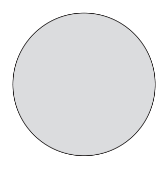
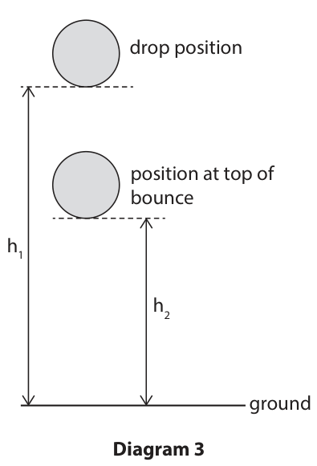
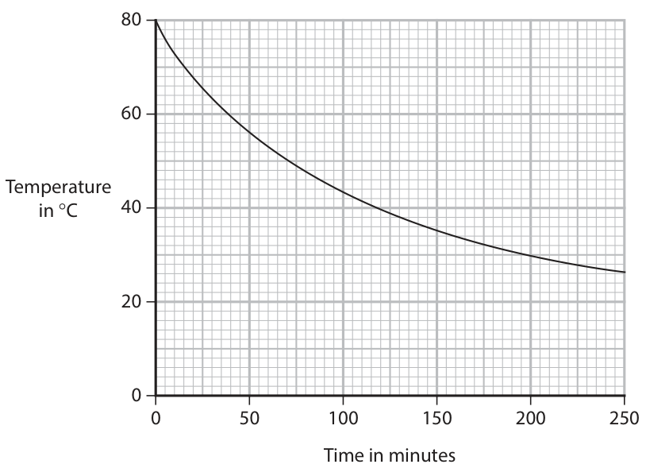
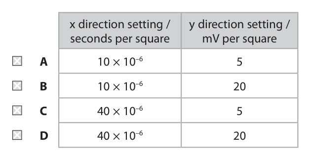

# 4PH1/2PR — 2025-06 (official extraction)

> schema `syllabai.official-paper-questions/0.2` · paper_id `pearson-edexcel:international-gcse:physics:4ph1:2025-06:4PH1/2PR` · qp sha256 `58bb413788dc3b4d…` · extraction is the disclosed baseline (ADR-039)

## Question 1 (6 marks)

A flour mill is a factory where flour is produced. The photograph shows some flour moving through metal channels in the flour mill. flour metal channels (Source: © Retan/Shutterstock)

**(a)** The flour particles can become charged as they move through the metal channels.

### 1(a)(i) [2]

Explain how the flour particles can become charged.

**Mark scheme answer**

> idea of rubbing / friction; condone rubbing between
> particles
> (causing) transfer of electrons; reject transfer of
> protons/positive charge

- **(2)** idea of rubbing / friction; condone rubbing between

### 1(a)(ii) [2]

The charged flour particles move away from each other as they fall from the end of each channel. Complete the passage by writing a suitable word or words in each blank space. Flour particles move away from each other because they have charges. This causes the flour particles to exert forces on each other.

**Mark scheme answer**

> like / identical / (the) same / similar; allow equivalent phrases
> e.g. both have negative
> (charges)
> ignore unqualified
> negative, positive
> repulsive / repelling / repulsion; allow equivalent phrases
> ignore opposite

- **(2)** like / identical / (the) same / similar; allow equivalent phrases

### 1(b) [2]

The dust created by producing flour in a flour mill is dangerous because the dust is flammable. This creates a risk of an explosion. Explain why connecting the metal channels to earth reduces the risk of an explosion in a flour mill.

**Mark scheme answer**

> idea that earthing prevents the metal channels / allow idea that
> particles from becoming charged; {charge/electrons/current}
> can pass {through the
> earth wire / to earth /
> ground}
> allow idea that
> channel/particles remain
> neutral/become
> discharged
> prevents a spark from occurring; allow idea that risk of
> spark is reduced
> ignore references to
> explosions
> Answer Notes Marks

- **(2)** idea that earthing prevents the metal channels / allow idea that

## Question 2 (7 marks)

Uranium‑239 is an isotope of the element uranium.

**(b)** Uranium‑239 can be represented using the symbol 239 92 U Protons are one type of particle found in the nucleus of an atom.

**(c)** Uranium‑239 is radioactive and decays by beta emission. Uranium‑239 has a half‑life of 23 minutes.

### 2(a) [2]

State what is meant by the term isotopes.

**Mark scheme answer**

> ignore references to
> electrons
> (nuclei with) same number of protons; allow same atomic
> ignore same element
> different number of neutrons; allow different (atomic)
> mass, nucleon/mass

- **(2)** ignore references to

### 2(b)(i) [1]

How many protons are in the nucleus of an atom of uranium‑239?

- **(A)** 92  ✔
- **(B)** 147
- **(C)** 239
- **(D)** 331

**Mark scheme answer**

> A (92);
> B is incorrect because this is the number of
> neutrons
> C is incorrect because this is the number of
> nucleons
> D is incorrect because this is the nucleon number
> and proton number added together

- **(1)** Answer A: 92

### 2(b)(ii) [1]

Give the name of the other particle found in the nucleus of an atom of uranium‑239.

**Mark scheme answer**

> neutron; ignore n
> condone spelling
> mistakes

- **(1)** neutron; ignore n

### 2(c)(i) [2]

A sample of uranium‑239 has an initial mass of 60 g. Calculate the mass of uranium‑239 remaining after 46 minutes. mass = g

**Mark scheme answer**

> recognition that 46 minutes is 2 half-lives; allow attempt to halve
> twice in calculation
> correct final evaluation;
> e.g.
> 46 ÷ 23 = 2 OR 60 × ½ × ½ allow 2 half-lives seen
> explicitly in working
> (mass =) 15 (g)

- **(2)** recognition that 46 minutes is 2 half-lives; allow attempt to halve

### 2(c)(ii) [1]

When uranium‑239 undergoes beta decay, an isotope of the element neptunium, Np, is produced. Which of these is the correct symbol for the neptunium nucleus produced in the beta decay of uranium‑239? 239 A 92Np 240 B 92Np 239 C 93Np 240 D 93Np

**Mark scheme answer**

> C( );
> A is incorrect because neither the number of
> neutrons or protons has changed
> B is incorrect because a neutron has been added
> with no change to the number of protons
> D is incorrect because a proton has been added
> with no change to the number of neutrons
> Answer Notes Marks

- **(1)** C( );

## Question 3 (9 marks)

The photograph shows the tidal power station across the estuary of the river Rance in France. (Source: © Francois BOIZOT/Shutterstock) The diagram shows a simplified view of the tidal power station. tidal barrier river sea water trapped at high tide water at low tide turbine shaft At high tide, water is trapped behind the tidal barrier. At low tide, the trapped water is released through the turbine shaft. This causes a turbine to spin, which generates electricity.

**(c)** At low tide, water flows through the turbine shaft. As the height of the trapped water in the river decreases, water falls through a height of 8.0 m to reach the turbine shaft.

### 3(a) [2]

Give two advantages of generating electricity using tidal power. 1 2

**Mark scheme answer**

> any two from: ignore references to cost
> MP1. idea that it is renewable; allow idea that resource
> will not run out
> MP2. does not produce carbon dioxide / allow does not contribute
> greenhouse gases; to global warming
> ignore toxic/polluting
> gases
> MP3. does not produce sulfur dioxide / oxides of ignore toxic/polluting
> nitrogen / acid rain; gases
> MP4. idea that it is reliable / tides are allow doesn’t depend on
> dependable; sunlight, wind etc.
> condone can be used at
> any time
> MP5. does not produce radioactive waste;

- **(2)** any two from: ignore references to cost

### 3(b) [2]

Give two disadvantages of generating electricity using tidal power. 1 2

**Mark scheme answer**

> any two from: ignore references to cost
> MP1. potential impact on wildlife; allow idea that it blocks
> migration routes, wading
> bird habitats etc.
> MP2. idea that it cannot (always) provide allow idea that (electrical)
> electricity when needed (e.g. at high tide); output varies
> MP3. changes shipping routes;
> MP4. idea that tides may vary (over time);
> MP5. idea that not suitable in all locations; allow idea that it doesn’t
> work if not near the sea

- **(2)** any two from: ignore references to cost

### 3(c)(i) [2]

Calculate the energy transferred from the gravitational store of the water when 1.0 kg of water flows through the turbine shaft. Use the formula change in gravitational potential energy = mass × g × height energy transferred = J

**Mark scheme answer**

> substitution; allow use of g = 9.8, 9.81
> (N/kg)
> condone substitution of
> mass in grams for this mark
> only
> evaluation;
> e.g.
> energy transferred = 1 × 10 × (8.0)
> (energy transferred =) 80 (J) allow 78, 78.4, 78.5, 78.48
> (J)

- **(2)** substitution; allow use of g = 9.8, 9.81

### 3(c)(ii) [3]

The tidal power station has a maximum power output of 240 000 kW when water falls through a height of 8.0 m. Calculate the mass of water flowing through the turbine shaft in 1 second when the power station is operating at maximum power. Assume the power station is 100% efficient. mass of water = kg

**Mark scheme answer**

> conversion of kW to W;
> setting up calculation; allow ecf from (i) and from
> incorrect power conversion
> evaluation;
> answers between 3000 and
> 3100 (kg) scores 2 marks
> e.g.
> 240 000 kW = 240 000 000 W
> 240 000 (000) = mass × 10 × 8(.0) (÷ 1) allow use of ratio e.g. mass
> = 240 000 (000) / 80
> (mass of water =) 3 000 000 (kg) allow 3(.0) × 10⁶ (kg)
> allow answers between
> 3 000 000 and 3 100 000 (kg)

- **(3)** conversion of kW to W;

## Question 4 (7 marks)

This question is about transformers.

**(b)** A step‑up transformer has an input voltage of 230 V and an input current of 4.5 A. The output current of the transformer is 0.21 A.

### 4(a) [3]

Describe the structure of a step‑up transformer. You may draw a diagram to help your answer.

**Mark scheme answer**

> all marking points can be
> awarded from labelled
> diagram
> two coils (of wire); allow two coils drawn in
> diagram even if not
> labelled as “coils”
> secondary coil has more turns than primary coil; allow RA
> condone more coils on
> secondary
> relative numbers of turns
> can be inferred from
> diagram
> iron core (linking the coils); allow “magnetically soft”
> for iron
> allow both coils wound
> round a single iron core

- **(3)** all marking points can be

### 4(b)(i) [1]

State the formula linking input power and output power for a transformer that is 100% efficient.

**Mark scheme answer**

> input power = output power; allow if expressed in
> terms of voltages and
> currents e.g. VpIp = VsIs
> allow p/s, 1/2, in/out,
> i/o for subscripts

- **(1)** input power = output power; allow if expressed in

### 4(b)(ii) [3]

Calculate the output voltage of the transformer. output voltage = V

**Mark scheme answer**

> substitution;
> rearrangement;
> evaluation;
> e.g.
> $230 \times 4.5 = V \times 0.21$
> $V = 230 \times 4.5 / 0.21$
> (V =) 4900 (V) allow 5000, 4930, 4929,
> 4928.6, 4928.57… (V)
> condone 4928, 4928.5 (V)

- **(3)** substitution;

## Question 5 (15 marks)

A tennis ball is dropped from a height above the ground.

**(b)** Diagram 2 shows the tennis ball at the instant it hits the ground. tennis ball ground Diagram 2 Just before hitting the ground, the tennis ball is moving downwards at a velocity of 2.5 m/s. Just after hitting the ground, the tennis ball is moving upwards at a speed of 1.9 m/s.

### 5(a) [2]

Diagram 1 shows the tennis ball at the instant it is released. Diagram 1 On diagram 1, draw a labelled arrow to show the force acting on the tennis ball at the instant it is released.

**Mark scheme answer**

> ignore any additional
> arrows
> arrow drawn vertically downwards such that its line judge by eye
> of action passes through the centre of the ball; ignore starting position of
> arrow
> arrow labelled “weight”; allow force due to
> gravity, gravitational
> force
> ignore gravity

- **(2)** ignore any additional

### 5(b)(i) [4]

The mass of the tennis ball is 0.057 kg. Calculate the change in momentum of the tennis ball when it hits the ground. Give the unit. change in momentum = unit =

**Mark scheme answer**

> initial momentum calculated; ignore any minus signs
> final momentum calculated; allow if calculated in
> evaluation of change in momentum; kg m/s or g m/s
> consistent unit;
> change in momentum of
> 0.034(2) scores first two
> e.g.
> (initial momentum = 0.057 × 2.5 =) 0.14 allow 0.142, 0.143,
> 0.1425
> (final momentum = 0.057 × 1.9 =) 0.11 allow 0.108, 0.1083
> (change in momentum = 0.14 + 0.11 =) 0.25 allow 0.251, 0.2508
> kg m/s allow N s
> allow g m/s only if
> consistent with values

- **(4)** initial momentum calculated; ignore any minus signs

### 5(b)(ii) [3]

The ball is in contact with the ground for a time of 6.0 ms. Calculate the force exerted on the ball by the ground. Give the direction of this force. force = N direction =

**Mark scheme answer**

> substitution into given formula; allow ecf from (i)
> ignore units
> evaluation;
> direction of force = upwards; allow upwards arrow
> ignore north
> e.g.
> (force =) 0.25 / 0.0060
> (force =) 42 (N) allow 41-42 (N)
> direction = upwards

- **(3)** substitution into given formula; allow ecf from (i)

### 5(c) [6]

The coefficient of restitution can be used to determine how high a ball will bounce. The higher the value of the coefficient of restitution, the higher the ball will bounce. Diagram 3 shows a ball being dropped from a height (h1) above the ground. The ball hits the ground and bounces. At the top of its bounce, the ball reaches a height (h2) above the ground. drop position position at top of bounce h1 h2 ground Diagram 3 The coefficient of restitution can be determined using the formula h2 coefficient of restitution = h1 A student decides to do an investigation to compare the coefficient of restitution for different types of ball. Design a method for the student’s investigation. Your answer should include details of • the variables in the investigation • how to obtain accurate measurements • how to obtain reliable results You may add to diagram 3 or draw an additional diagram to help your answer.

**Mark scheme answer**

> any two marks max. from: related to variables
> MP1. independent variable is type of ball; allow material of ball
> MP2. dependent variable is height of bounce; allow coefficient of
> restitution
> MP3. any named control variable; e.g. drop height, surface
> used, temperature of
> ball, released from rest
> any two marks max. from: related to accuracy
> MP4. ensure distances are measured vertically; allow ruler/tape measure
> perpendicular to ground
> can be awarded from
> well-drawn diagram
> MP5. use of set square;
> MP6. measure at eye level; ignore unqualified “avoid
> parallax”
> MP7. use of (slow motion) camera to measure ignore use of light gates
> height;
> any two marks max. from: related to reliability
> MP8. repeats taken for each ball; allow repeat
> investigation
> MP9. identify anomalies;
> MP10. calculate mean values; allow average for mean
> Answer Notes Marks

- **(6)** any two marks max. from: related to variables

## Question 6 (10 marks)

This question is about cosmic microwave background radiation (CMBR) and the Big Bang.

**(a)** CMBR has a mean frequency of 1.6 × 1011 Hz.

### 6(a)(i) [1]

State the formula linking wave speed, frequency and wavelength.

**Mark scheme answer**

> (wave) speed = frequency × wavelength; allow standard symbols
> and rearrangements i.e.
> $\lambda = v/f$
> allow v, c and s for
> speed

- **(1)** (wave) speed = frequency × wavelength; allow standard symbols

### 6(a)(ii) [3]

Show that the mean wavelength of CMBR is about 2 mm. [speed of light = 3.0 × 10⁸ m/s]

**Mark scheme answer**

> substitution;
> rearrangement;
> evaluation in mm to at least 2s.f.;
> e.g.
> 3.0 × 10⁸ = 1.6 × 10¹¹ × λ
> λ = 3.0 × 10⁸ / 1.6 × 10¹¹
> λ = (0.0019 (m) =) 1.9 (mm) allow 1.88, 1.875 (mm)
> condone 1.87 (mm)

- **(3)** substitution;

### 6(b) [2]

CMBR was first released after the Big Bang. When CMBR was first released it had a wavelength of about 9 × 10⁻⁵ mm, but now it has a wavelength of about 2 mm. Using this information, explain how CMBR supports the Big Bang theory.

**Mark scheme answer**

> idea that wavelength has increased (over time); allow wavelength has
> stretched
> ignore wavelength has
> expanded
> ignore red-shift
> because Universe is expanding;

- **(2)** idea that wavelength has increased (over time); allow wavelength has

### 6(c) [4]

Explain how the cosmological red‑shift of galaxies also supports the Big Bang theory.

**Mark scheme answer**

> (most galaxies show a) red-shift because they are condone use of stars,
> moving away (from Earth / each other); planets, objects for
> galaxies for this
> marking point only
> further galaxies show a greater red-shift;
> further galaxies are travelling (away from Earth) allow faster galaxies
> faster; have greater red-shift
> idea that all matter must have originated from a
> single point;
> Answer Notes Marks

- **(4)** (most galaxies show a) red-shift because they are condone use of stars,

## Question 7 (10 marks)

The photograph shows a cup that is designed to keep a drink hot. shiny silver-coloured surface plastic lid

**(c)** A student investigates how the temperature of a drink in the cup varies with time. This is the student’s method. • pour some hot water into the cup and place the lid on the cup • wait for the water to cool to 80 °C and then start a stopwatch • measure the temperature of the water in the cup every 10 minutes The graph shows the student’s results. Temperature in C 40 0 50 100 150 200 250 Time in minutes

### 7(a) [2]

The inside surface of the cup is shiny and silver‑coloured. Explain how the shiny silver‑coloured surface helps to keep a drink hot.

**Mark scheme answer**

> mention of infrared (radiation); allow IR for infrared
> idea that surface is a poor absorber (of infrared); allow idea that surface is
> a (good) reflector
> condone surface reflects
> heat

- **(2)** mention of infrared (radiation); allow IR for infrared

### 7(b) [2]

Explain why a drink in the cup will stay hot for longer when the lid is placed on the cup.

**Mark scheme answer**

> lid traps air; allow steam/gas for air
> ignore traps heat/energy
> which reduces/stops convection (currents); allow reduces evaporation

- **(2)** lid traps air; allow steam/gas for air

### 7(c)(i) [1]

On the graph, draw a tangent to the curve when the temperature is 40 °C.

**Mark scheme answer**

> suitable tangent drawn at point on curve if extrapolated, line
> corresponding to a temperature of 40 °C; should intersect
> temperature axis between
> e.g. 56 and 64 °C

- **(1)** suitable tangent drawn at point on curve if extrapolated, line

### 7(c)(ii) [3]

Calculate the gradient of the tangent to find the rate of temperature change of the water when the temperature is 40 °C. Give your answer in °C / minute. rate of temperature change = °C / minute

**Mark scheme answer**

> attempt at gradient calculation; allow ecf from (i)
> allow any clear change in
> temperature divided by a
> change in time
> gradient evaluated correctly; allow range of 0.14 – 0.21
> minus sign included in answer; mark independently
> e.g.
> gradient = (18 – 60) / (250 – 0)
> gradient = (−)0.17 (°C/minute)
> gradient = − 0.17 (°C/minute)

- **(3)** attempt at gradient calculation; allow ecf from (i)

### 7(c)(iii) [2]

The student is working in a laboratory with a room temperature of 20 °C. Draw a line on the graph to show how the temperature of the water in the cup would change if there was no lid on the cup.

**Mark scheme answer**

> curve drawn consistently below existing curve; curve may start at 80°C,
> but does not have to for
> this mark
> curve starts at same initial temperature and does DOP
> not decrease below 20°C;
> Answer Notes Marks

- **(2)** curve drawn consistently below existing curve; curve may start at 80°C,

## Question 8 (6 marks)

A high‑frequency sound wave is detected by a microphone and displayed on an oscilloscope. The diagram shows the oscilloscope screen when the sound wave is detected. It also shows the oscilloscope settings. oscilloscope settings: x direction: 1 square = 20 × 10⁻⁶ s y direction: 1 square = 10 mV

### 8(a) [1]

Give the maximum frequency of sound that can be heard by humans.

**Mark scheme answer**

> 20 000 (Hz); allow if full range given
> i.e. 20 - 20 000 (Hz)
> allow 20 kHz but
> matching unit needed

- **(1)** 20 000 (Hz); allow if full range given

### 8(b) [4]

Determine if the sound wave displayed on the oscilloscope could be heard by humans.

**Mark scheme answer**

> evaluation of time period;
> use of f = 1/T; allow ecf from incorrect
> T for this mark only
> evaluation of frequency;
> consistent conclusion comparing calculated frequency this mark can only be
> to answer in (a); awarded if a frequency
> calculation has been
> attempted
> allow ecf from (a)
> e.g.
> T = 4 × 20 × 10⁻⁶ = 8 × 10⁻⁵ (s)
> f = 1 / 8 × 10⁻⁵
> f = 12 500 (Hz)
> this is within human hearing range so can be heard

- **(4)** evaluation of time period;

### 8(c) [1]

A student changes the settings of the oscilloscope to alter the displayed wave in these two ways. • increase the amplitude of the wave • only display one time period of the wave on the screen The table shows some possible settings for the oscilloscope. Which row of the table gives the student’s new oscilloscope settings? x direction setting / y direction setting / seconds per square mV per square A 10 × 10⁻⁶ 5 B 10 × 10⁻⁶ 20 C 40 × 10⁻⁶ 5 D 40 × 10⁻⁶ 20

**Mark scheme answer**

> A (10 × 10⁻⁶ seconds per square, 5 mV per square);
> B is incorrect because this will cause the amplitude to decrease
> C is incorrect because this will cause there to be four waves on the screen
> D is incorrect because this will cause there to be four waves on the screen and the
> amplitude to decrease
> Pearson Education Limited. Registered company number 872828
> with its registered office at 80 Strand, London, WC2R 0RL, United Kingdom

- **(1)** A (10 × 10⁻⁶ seconds per square, 5 mV per square);

