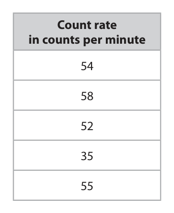
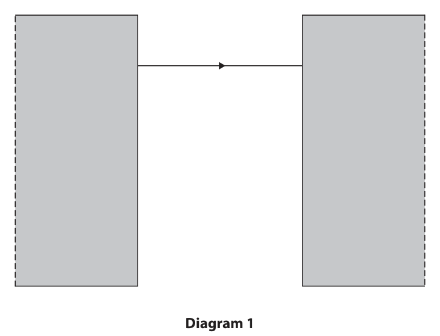
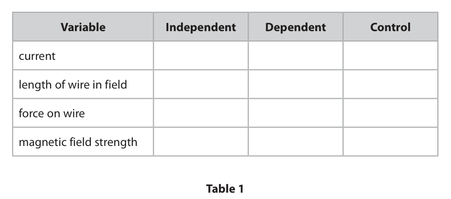
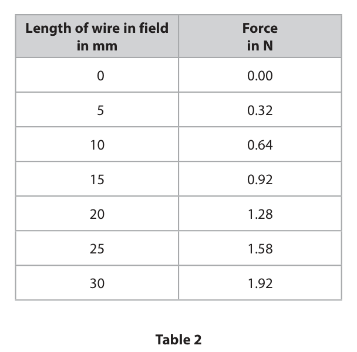
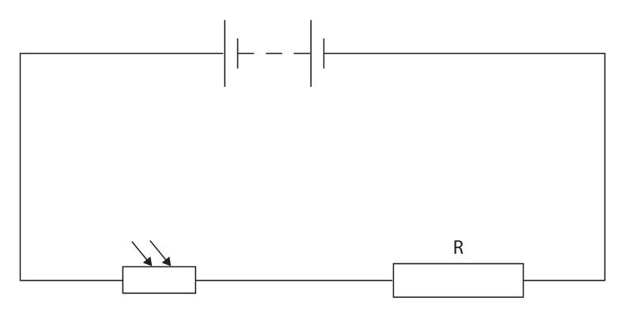
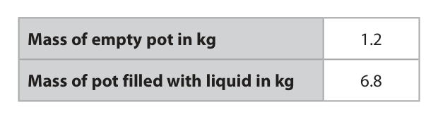
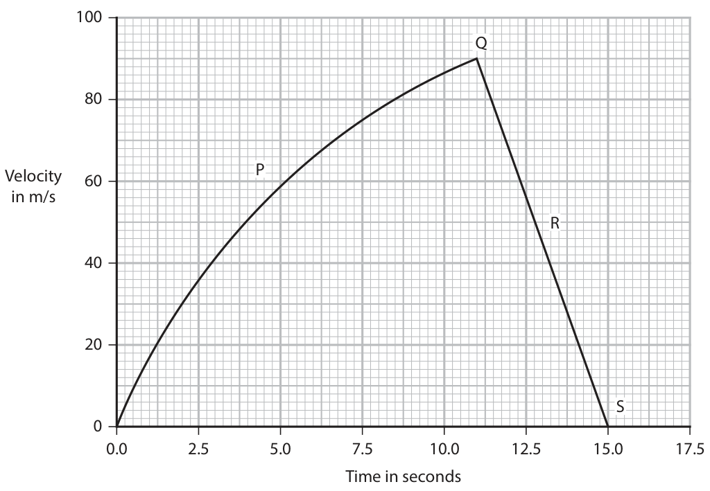
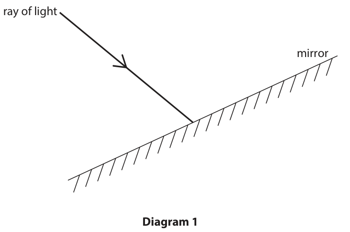
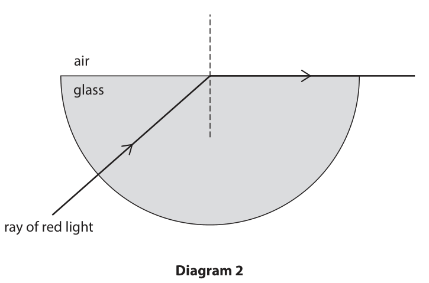
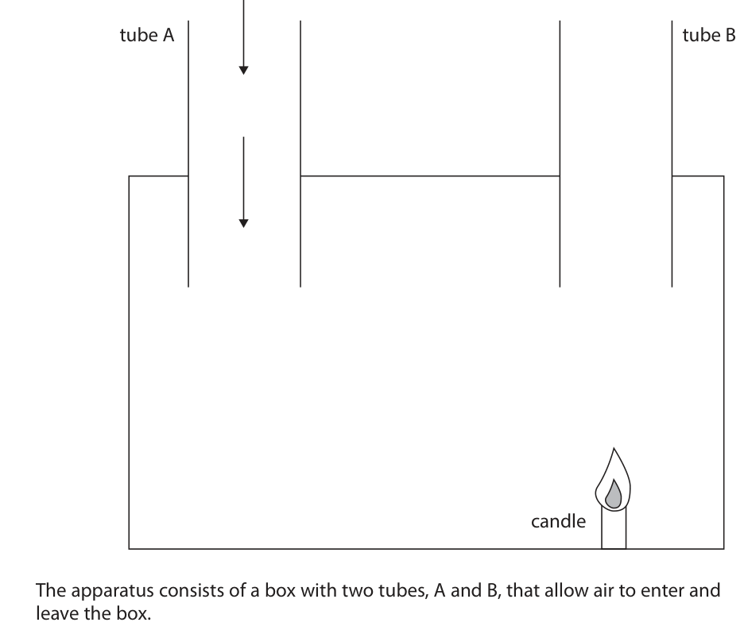

# 4PH1/1P — 2025-11 (official extraction)

> schema `syllabai.official-paper-questions/0.2` · paper_id `pearson-edexcel:international-gcse:physics:4ph1:2025-11:4PH1/1P` · qp sha256 `3fd20dc307f4ce5d…` · extraction is the disclosed baseline (ADR-039)

## Question 1 (7 marks)

This question is about stars.

**(a)** The table gives information about four different stars. Mass in multiples of Star Colour Evolutionary stage the mass of the Sun Betelgeuse red 16.5 red supergiant Sirius A blue‑white 2.4 main sequence Sirius B white 1.0 white dwarf The Sun yellow 1.0 main sequence

### 1(a)(i) [1]

Which of these stars has the lowest surface temperature?

- **(A)** Betelgeuse  ✔
- **(B)** Sirius A
- **(C)** Sirius B
- **(D)** The Sun

**Mark scheme answer**

> A (Betelgeuse);
> B is incorrect because Sirius A is the hottest
> C is incorrect because Sirius B is hotter than
> Betelgeuse
> D is incorrect because the Sun is hotter than
> Betelgeuse

- **(1)** Answer A: Betelgeuse

### 1(a)(ii) [1]

Which of these stars will become a supernova in the future?

- **(A)** Betelgeuse  ✔
- **(B)** Sirius A
- **(C)** Sirius B
- **(D)** The Sun

**Mark scheme answer**

> A (Betelgeuse);
> B is incorrect because its mass is about the same as
> the Sun
> C is incorrect because Sirius B is the same mass as
> the Sun and is already a white dwarf
> D is incorrect because the Sun will not become a
> supernova

- **(1)** Answer A: Betelgeuse

### 1(a)(iii) [2]

Sirius B and the Sun have approximately the same mass but are different colours and in different evolutionary stages. Describe two other differences between Sirius B and the Sun. 1 2

**Mark scheme answer**

> any two from: allow RA throughout
> ignore comments about
> colour, mass and
> evolutionary stage
> MP1. Sirius B is smaller than the Sun;
> MP2. Sirius B is more dense than the Sun; allow Sirius B has a higher
> value of g
> MP3. Sirius B contains less hydrogen than the Sun;
> MP4. fusion doesn’t take place in Sirius B but does
> take place in the Sun;
> MP5. Sirius B is hotter than the Sun;
> MP6. Sirius B emits less light than the Sun; allow Sirius B has smaller
> brightness / absolute
> magnitude / luminosity

- **(2)** any two from: allow RA throughout

### 1(b) [3]

Sirius B orbits with Sirius A as part of a binary star system. The mean orbital radius of Sirius B is 29.7 × 10⁹ km. The time for Sirius B to complete one orbit is 50 years. Calculate the mean orbital speed of Sirius B. Give your answer in km / s. mean orbital speed = km / s

**Mark scheme answer**

> conversion of time into seconds;
> substitution; allow ecf from incorrect or
> no conversion
> evaluation;
> answer of 3.7… × 10⁹ scores
> 2 marks
> e.g.
> 50 years = 50 × 365 × 24 × 60 × 60 OR 1.5768 × 10⁹ (s)
> orbital speed = 2π × 29.7 (× 10⁹) / 1.5768 (× 10⁹)
> (orbital speed =) 118 (km/s) allow 120, 118.2…, 118.3…
> (km/s)

- **(3)** conversion of time into seconds;

## Question 2 (5 marks)

A car travels at a constant speed of 14 m / s along a road.

**(b)** The driver of the car sees an obstacle in the road ahead and applies the brakes.

### 2(a) [2]

Calculate the distance travelled by the car in a time of 30 seconds. Use the formula distance travelled = average speed × time taken distance travelled = m

**Mark scheme answer**

> substitution;
> evaluation;
> e.g.
> (distance =) 14 × 30
> (distance =) 420 (m)

- **(2)** substitution;

### 2(b)(i) [1]

Which of these is a description of the thinking distance of the car? A distance travelled between applying the brakes and the car coming to a stop B distance travelled between seeing the obstacle and applying the brakes C distance travelled between seeing the obstacle and the car coming to a stop D distance travelled as the car slows down

**Mark scheme answer**

> B (distance travelled between seeing the obstacle
> and applying the brakes);
> A is incorrect because this is the braking distance
> C is incorrect because this is the stopping distance
> D is incorrect because this is part of the braking
> distance

- **(1)** B (distance travelled between seeing the obstacle

### 2(b)(ii) [1]

Which of these factors would increase the braking distance of the car?

- **(A)** car travelling at a lower initial speed
- **(B)** driver being tired
- **(C)** worn tyres on the car  ✔
- **(D)** a dry road instead of a wet road

**Mark scheme answer**

> C (worn tyres on the car);
> A is incorrect because this would decrease the
> braking distance
> B is incorrect because this increases the thinking
> distance
> D is incorrect because this would decrease the
> braking distance

- **(1)** Answer C: worn tyres on the car

### 2(b)(iii) [1]

State the only factor that affects both the thinking distance and the braking distance of the car.

**Mark scheme answer**

> speed (of the car); allow velocity
> Answer Notes Marks

- **(1)** speed (of the car); allow velocity

## Question 3 (6 marks)

This is a simplified diagram of the electrical wiring in a house. 230 V a.c. circuit breaker circuit 6A 32 A breaker lights sockets

### 3(a) [2]

A current larger than 32 A flows in the sockets. Describe how having the circuit breaker in series with the sockets protects the house.

**Mark scheme answer**

> any two from: ignore comments relating to
> electric shock etc.
> if the current is too high; allow current surge
> idea of isolating device; allow stops the current, breaks the
> circuit, cuts the power
> idea of no danger of overheating; allow idea that it prevents fires

- **(2)** any two from: ignore comments relating to

### 3(b) [2]

A student suggests that fuses could be used instead of the circuit breakers. Give two disadvantages of using fuses instead of circuit breakers. 1 2

**Mark scheme answer**

> idea that fuse can’t be reset; allow fuse has to be replaced
> ignore fuse melts/blows
> idea that fuse is slower (to break the circuit); allow idea that fuse is less sensitive

- **(2)** idea that fuse can’t be reset; allow fuse has to be replaced

### 3(c) [2]

Explain why the wiring in the house includes an earth wire.

**Mark scheme answer**

> any two from:
> in the event of a fault; allow description of a fault e.g. live
> wire touching metal case (of an
> appliance), drilling through a cable
> ignore comments relating to too
> much current etc.
> current flows in earth wire; allow charge/electrons for current
> allow current goes to earth/ground
> allow idea that it provides low
> resistance path to earth
> trips the circuit breaker; allow idea that it prevents an
> electric shock
> Answer Notes Marks

- **(2)** any two from:

## Question 4 (6 marks)

The diagram shows a force pulling a block up a ramp. distance pulled along ramp = 3.7 m force = 120 N height lifted = 0.82 m

### 4(a) [2]

Show that the work done by the force is about 440 J. Use the formula work done = force × distance moved

**Mark scheme answer**

> substitution;
> evaluation to 3 s.f.;
> e.g.
> (work done =) 120 × 3.7
> (work done =) 444 (J)

- **(2)** substitution;

### 4(b) [2]

The block gains 12 J of energy in its gravitational store when it is lifted through a height of 0.82 m. Calculate the mass of the block. mass = kg

**Mark scheme answer**

> substitution OR rearrangement; allow use of g = 9.8, 9.81
> condone symbol for g being
> used in the substitution rather
> than the value
> evaluation; allow 1.49…(kg)
> e.g.
> 12 = mass × 10 × 0.82 OR mass = GPE / [g x h]
> (mass =) 1.5 (kg) allow 1.46…(kg)

- **(2)** substitution OR rearrangement; allow use of g = 9.8, 9.81

### 4(c) [2]

A student states that most of the input energy is destroyed when the block is pulled up the ramp. Comment on the student’s statement.

**Mark scheme answer**

> MP1. energy can’t be destroyed; allow statement that energy is
> conserved
> with any one of: allow wasted / lost /
> dissipated for transferred
> MP2. energy transferred to thermal/heat store; ignore transferred to GPE, KE
> MP3. energy transferred to surroundings; allow heat is transferred to
> surroundings
> MP4. energy transferred due to friction;
> Answer Notes Marks

- **(2)** MP1. energy can’t be destroyed; allow statement that energy is

## Question 5 (10 marks)

This question is about radioactivity.

**(c)** A teacher demonstrates radioactivity using a radioactive rock. The rock contains uranium‑238 and other radioactive isotopes. The teacher takes precautions to reduce the risk of contamination and irradiation by the radioactive rock.

### 5(a) [3]

Uranium‑238 decays by emitting an alpha particle to become an isotope of thorium. Complete the equation for the alpha decay of uranium‑238. 238 U → 90 Th + α

**Mark scheme answer**

> correct mass number and atomic number for α; expect 42α
> mass number for thorium = 234; allow ecf from α if
> equation balances
> atomic number for uranium = 92; allow ecf from α if
> equation balances

- **(3)** correct mass number and atomic number for α; expect 42α

### 5(b) [2]

The isotope of thorium produced in the decay of uranium‑238 is also radioactive. Thorium decays by emitting a beta particle. Describe how the structure of a thorium nucleus changes when a beta particle is emitted.

**Mark scheme answer**

> allow neutron becomes
> a proton (and an
> electron) for 2 marks
> number of neutrons decreases by 1; allow (atomic) mass
> number stays the same
> number of protons increases by 1; allow atomic number
> increases by 1

- **(2)** allow neutron becomes

### 5(c)(i) [1]

Suggest a safety precaution that would reduce the risk of contamination by the radioactive rock.

**Mark scheme answer**

> any one from:
> wearing gloves (whilst handling rock); allow other methods of
> not directly touching
> rock e.g. use of tongs
> taking care not to drop rock;
> storing rock in container (when not being used);

- **(1)** any one from:

### 5(c)(ii) [1]

Suggest a safety precaution that would reduce the risk of irradiation by the radioactive rock.

**Mark scheme answer**

> any one from: ignore use of protective
> clothing e.g. mask,
> goggles, lead apron etc.
> minimising exposure time;
> maximising distance from rock; allow use of tongs
> use of a screen between rock and teacher/students;
> storing rock in (lead) box (when not being used);

- **(1)** any one from: ignore use of protective

### 5(c)(iii) [3]

The teacher measures the amount of radiation emitted by the radioactive rock in a time of 1 minute using a Geiger‑Müller (GM) tube and counter. The teacher repeats this measurement to obtain a total of five measurements of the count rate. The table shows the teacher’s results. Count rate in counts per minute Calculate the mean count rate. Give your answer to 2 significant figures. . mean count rate = counts per minute

**Mark scheme answer**

> ignoring anomaly;
> mean correctly calculated; allow ecf if anomaly
> included or if 58 is also
> considered anomalous
> evaluation to 2 s.f.; independent mark
> e.g. 54.8, 54.7, 54.75, 51
> score 2 marks
> 50.8 scores 1 mark
> mean count rate = [54 + 58 + 52 + 55] ÷ 4
> mean count rate = 54.75
> mean count rate = 55
> Answer Notes Marks

- **(3)** ignoring anomaly;

## Question 6 (16 marks)

This question is about magnetism.

**(a)** Diagram 1 shows the ends of two strong bar magnets and the space between the bar magnets. Diagram 1 There is a uniform magnetic field in the space between the bar magnets.

**(b)** A student investigates how the length, L, of a current‑carrying wire in a magnetic field affects the size of the force on the wire. The student uses a power supply and keeps the current in the wire constant. They use the same magnet throughout the experiment. Diagram 2 shows part of the student’s equipment. connecting wire connecting wire N L S Diagram 2

### 6(a)(i) [3]

One of the magnetic field lines has already been drawn. Complete diagram 1 by drawing three more magnetic field lines and labelling the poles of the bar magnets.

**Mark scheme answer**

> magnet poles labelled correctly; N on left and S on right
> at least three more straight lines drawn such that ignore lines drawn
> they are equally spaced and parallel with existing outside the rectangular
> line; space between the
> magnets for this mark
> arrows on all field lines between the poles pointing reject if any field lines
> to the right; drawn between poles
> have contradictory
> arrows

- **(3)** magnet poles labelled correctly; N on left and S on right

### 6(a)(ii) [3]

Describe a method a student could use to show the shape and direction of the magnetic field between the bar magnets. You may draw a diagram to help your answer.

**Mark scheme answer**

> EITHER: all marking points can
> be awarded from
> labelled diagram
> MP1. use of (plotting) compass;
> MP2. movement of compass/use of multiple
> compasses;
> MP3. idea of joining of dots;
> OR
> MP1. use of (sprinkled) iron filings/eq.;
> MP2. idea of tapping to distribute filings;
> MP3. use of (plotting) compass to show direction;

- **(3)** EITHER: all marking points can

### 6(a)(iii) [1]

Name a magnetically soft material.

**Mark scheme answer**

> iron; condone nickel, cobalt

- **(1)** iron; condone nickel, cobalt

### 6(b)(i) [3]

Table 1 lists the variables in the student’s investigation. Add one tick (ü) to each row to show whether each variable is an independent, dependent or control variable. Variable Independent Dependent Control current length of wire in field force on wire magnetic field strength Table 1

**Mark scheme answer**

> 4 rows correct = 3 marks; reject row if more than
> one tick
> 2-3 rows correct = 2 marks; allow other symbols
> instead of ticks
> any 1 row correct = 1 mark;
> e.g.

- **(3)** 4 rows correct = 3 marks; reject row if more than

### 6(b)(ii) [3]

Table 2 shows the student’s results. Length of wire in field Force in mm in N 0 0.00 5 0.32 10 0.64 15 0.92 20 1.28 25 1.58 30 1.92 Table 2 Plot a graph of the results on the grid.

> 🖼 crop required: graph (qp.pdf p.18)

**Mark scheme answer**

> suitably labelled axes with quantity and unit; ignore orientation of
> axes
> suitable scale; reject multiples of 0.3
> plotted points must
> occupy at least 50% of
> the grid on both scales
> data plotted correctly to nearest ½ square;
> e.g.

- **(3)** suitably labelled axes with quantity and unit; ignore orientation of

### 6(b)(iii) [1]

Draw a line of best fit.

**Mark scheme answer**

> adequate straight line of best fit; reject dot-to-dot lines

- **(1)** adequate straight line of best fit; reject dot-to-dot lines

### 6(b)(iv) [2]

The student repeats the experiment but with a smaller current in the wire. Draw another line on the grid to show the expected results when using a smaller current.

**Mark scheme answer**

> straight line drawn; ECF if line same shape
> as drawn in (iii)
> line starts at same point (0,0.00) and has smaller allow larger gradient if
> gradient if length plotted on x-axis; force plotted on x-axis
> Answer Notes Marks

- **(2)** straight line drawn; ECF if line same shape

## Question 7 (12 marks)

The diagram shows an electric circuit used to determine the brightness of the light in a room. R

### 7(a) [2]

Add a voltmeter to the diagram to measure the voltage of resistor R.

**Mark scheme answer**

> correct symbol; must be a V inside a circle e.g.
> symbol in parallel with resistor R; allow an incorrect symbol for
> the voltmeter for this mark, but
> must be identifiable/labelled as
> a voltmeter

- **(2)** correct symbol; must be a V inside a circle e.g.

### 7(b)(i) [1]

State the formula linking voltage, current and resistance.

**Mark scheme answer**

> voltage = current × resistance; allow standard symbols and
> rearrangements e.g.
> $I = V\div R$
> condone lower case symbols
> ignore c, C for current

- **(1)** voltage = current × resistance; allow standard symbols and

### 7(b)(ii) [3]

The voltage across resistor R is 1.9 V. The resistance of resistor R is 800 Ω. Calculate the current in the circuit. Give your answer in milliamps, mA. current = mA

**Mark scheme answer**

> substitution;
> rearrangement;
> evaluation in milliamps; mark independently
> answer of 0.002375,
> 0.00238, 0.00237, 0.0024 scores
> 2 marks
> e.g.
> 1.9 = current × 800 OR I = V ÷ R
> current = 1.9 ÷ 800
> current = 2.4 (mA) allow 2.375, 2.38 (mA)
> condone 2.37 (mA)

- **(3)** substitution;

### 7(c) [4]

Explain why the voltage across the light dependent resistor (LDR) decreases if the brightness of the light in the room increases.

**Mark scheme answer**

> MP1. resistance (of LDR / circuit) decreases (with
> increased brightness);
> MP2. current increases;
> MP3. voltage of fixed resistor increases; allow R, resistor R for fixed
> resistor
> MP4. battery/total voltage remains constant (so allow circuit voltage for total
> voltage across LDR decreases); voltage
> OR
> MP1. resistance of LDR decreases (with increased
> brightness);
> MP2. LDR resistance is a smaller proportion/fraction
> of total resistance;
> MP3. voltage from battery is split/shared between
> LDR and resistor;
> MP4. (so) voltage (across LDR) is proportional to ignore quotation of V=I×R
> resistance (so voltage across LDR decreases);

- **(4)** MP1. resistance (of LDR / circuit) decreases (with

### 7(d) [2]

Another resistor is connected in parallel with resistor R. The new resistor has a higher resistance than resistor R. Explain what happens to the current in the LDR in the circuit diagram. Assume that the brightness of the light in the room remains constant.

**Mark scheme answer**

> any two from:
> MP1. current increases;
> MP2. increase in number of paths/branches;
> MP3. resistance (of parallel combination) is lower;
> Answer Notes Marks

- **(2)** any two from:

## Question 8 (9 marks)

The diagram shows a pot made of clay. (Source: © Victoria Sergeeva / Shutterstock)

### 8(a) [4]

Describe a method that could be used to accurately determine the volume of clay used in the pot.

**Mark scheme answer**

> reference to using a displacement method; ignore filling pot with
> water
> measuring cylinder used (to measure volume of allow graduated
> water); cylinder for measuring
> cylinder
> ignore beaker
> repeating and average; allow repeating to
> identify anomalous
> results
> further experimental detail relating to accuracy;
> e.g.
> • lack of splashing
> • reading measuring cylinder at eye level
> • placing measuring cylinder on flat surface
> • ensure pot is fully submerged
> • ensure eureka can/bowl is (completely) full
> prior to submerging pot
> • no trapped air in pot

- **(4)** reference to using a displacement method; ignore filling pot with

### 8(b) [1]

Give the name of a piece of apparatus that could be used to measure the mass of the clay pot.

**Mark scheme answer**

> (top pan) balance; allow mass balance,
> electronic balance,
> digital balance,
> weighing scale
> ignore
> (electronic/digital)
> scale(s)

- **(1)** (top pan) balance; allow mass balance,

### 8(c) [4]

The clay pot can be used to hold liquids. A student needs to determine the volume of liquid that can be contained in the pot. The student measures the mass of the empty pot and then measures the mass of the pot again when it is filled with a liquid. The table shows the student’s measurements. Mass of empty pot in kg 1.2 Mass of pot filled with liquid in kg 6.8 The density of the liquid used is 920 kg / m³. Calculate the volume of liquid that can be contained in the pot. Use the formula mass density = volume volume = m³

**Mark scheme answer**

> evaluation of mass of liquid;
> substitution into formula; allow ecf from incorrect
> mass
> rearrangement;
> evaluation; −1 for POT error
> e.g.
> mass of liquid = 6.8 − 1.2 = 5.6 (kg)
> 920 = 5.6 ÷ volume
> volume = 5.6 ÷ 920
> (volume =) 0.0061 (m³) allow 0.006,
> 0.00608… (m³)

- **(4)** evaluation of mass of liquid;

## Question 9 (7 marks)

The photograph shows a car being driven along a straight race track. (Source: © Shayne T Wright/Shutterstock) The car starts from rest and accelerates along the straight race track. After crossing the finish line, the driver applies the brakes to bring the car to rest. The graph shows how the velocity of the car changes with time after the car starts to accelerate. 100 Q Velocity P in m/s R S 0.0 2.5 5.0 7.5 10.0 12.5 15.0 17.5 Time in seconds

### 9(a) [1]

What feature of the graph gives the magnitude of the acceleration of the car?

- **(A)** area between line and time axis
- **(B)** axes labels
- **(C)** curved section of the line
- **(D)** gradient of the line  ✔

**Mark scheme answer**

> D (gradient of the line);
> A is incorrect because this gives the distance
> travelled
> B is incorrect because axes are a feature of all
> graphs not connected with acceleration
> C is incorrect because not all graphs have curves

- **(1)** Answer D: gradient of the line

### 9(b) [1]

At which point on the graph does the driver of the car first apply the brakes?

- **(A)** P
- **(B)** Q  ✔
- **(C)** R
- **(D)** S

**Mark scheme answer**

> B (Q);
> A (P) is incorrect as the car is still increasing in
> velocity
> C (R) is incorrect as the car has been decelerating
> for some time
> D (S) is incorrect as the car has stopped moving

- **(1)** Answer B: Q

### 9(c) [2]

Explain why the graph is a curve for the first 11.0 seconds.

**Mark scheme answer**

> any two from:
> MP1. air resistance increases (with increasing allow drag/friction for
> speed); air resistance
> MP2. resultant force decreases;
> MP3. acceleration decreases; allow velocity increases
> at decreasing rate
> ignore accelerates at
> decreasing rate
> MP4. gradient decreases; condone slope
> decreases

- **(2)** any two from:

### 9(d) [3]

Calculate the distance travelled by the car from 11.0 seconds to 15.0 seconds. distance = m

**Mark scheme answer**

> idea that distance = area (under line); allow statement that
> distance = average
> speed × time
> attempt at calculating area of correct triangle; condone misreading
> speed for this mark e.g.
> using speed = 85, 88
> correct evaluation; must be 180 (m)
> no ECF from use of
> speed = 85, 88
> allow alternative valid
> methods e.g.
> using v² = u² + 2as with
> e.g. calculated acceleration
> distance = area
> distance = 0.5 × 90 × 4.0
> (distance =) 180 (m)

- **(3)** idea that distance = area (under line); allow statement that

## Question 10 (11 marks)

This question is about light.

**(c)** Diagram 2 shows a ray of red light entering a semi‑circular glass block from the air. When the ray of red light is incident on the glass–air boundary, the light refracts with an angle of refraction of 90° air glass ray of red light Diagram 2

### 10(a) [2]

Light is an example of a wave. State what is meant by the term wave.

**Mark scheme answer**

> any two from:
> idea that waves transfer energy; allow waves transfer
> information
> by vibrations / oscillations;
> idea that waves don’t transfer mass/matter;

- **(2)** any two from:

### 10(b) [2]

Diagram 1 shows a ray of light incident on a mirror. ray of light mirror Diagram 1 Draw another ray of light on diagram 1 to show the path of the ray after it is incident on the mirror.

**Mark scheme answer**

> ray of light drawn reflecting from mirror at the ray does not need an
> point of the incident ray; arrow
> condone ray reflecting
> to left of incident ray
> reject refracting ray
> angle of reflection correct; reflected ray should
> pass through the word
> “mirror” in sentence
> above if extrapolated

- **(2)** ray of light drawn reflecting from mirror at the ray does not need an

### 10(c)(i) [1]

Using diagram 2, determine the critical angle for red light at the glass–air boundary. critical angle = degrees

**Mark scheme answer**

> critical angle = 49(°); allow 48-50(°)

- **(1)** critical angle = 49(°); allow 48-50(°)

### 10(c)(ii) [3]

Calculate the refractive index of the glass. refractive index =

**Mark scheme answer**

> substitution; allow ecf from (i)
> rearrangement;
> evaluation;
> e.g.
> sin 49 = 1/n
> n = 1/sin 49
> (n =) 1.3 allow answers in the
> range 1.30 to 1.35

- **(3)** substitution; allow ecf from (i)

### 10(c)(iii) [3]

The refractive index of blue light in glass is higher than the refractive index of red light in glass. A ray of blue light has an angle of incidence equal to the critical angle of the red light. Explain what would happen to the ray of blue light at the glass–air boundary.

**Mark scheme answer**

> higher refractive index means lower critical angle; allow blue light has
> lower critical angle
> angle of incidence will be greater than critical
> angle;
> blue light will undergo total internal reflection; allow TIR for total
> internal reflection
> allow if seen on
> diagram
> Answer Notes Marks

- **(3)** higher refractive index means lower critical angle; allow blue light has

## Question 11 (5 marks)

The diagram shows apparatus that can be used to demonstrate convection currents. smoke tube A tube B candle The apparatus consists of a box with two tubes, A and B, that allow air to enter and leave the box. During the demonstration, a candle is placed inside the box directly underneath tube B. A source of smoke is placed above tube A. Using ideas about convection, explain why the smoke moves down into the box through tube A. You may add to the diagram to help your answer.

### 11 [5]

The diagram shows apparatus that can be used to demonstrate convection currents. smoke tube A tube B candle The apparatus consists of a box with two tubes, A and B, that allow air to enter and leave the box. During the demonstration, a candle is placed inside the box directly underneath tube B. A source of smoke is placed above tube A. Using ideas about convection, explain why the smoke moves down into the box through tube A. You may add to the diagram to help your answer.

**Mark scheme answer**

> any five from: allow any marking point
> if seen on labelled
> diagram
> MP1. idea that air is heated (by candle under tube allow air particles move
> B); faster / gain KE
> ignore smoke is heated
> MP2. (heated) air expands; allow air particles move
> further apart
> ignore particles expand
> MP3. density of (heated) air decreases; ignore particle density
> decreases
> MP4. hot air rises through tube B;
> MP5. idea that cool air is drawn in (through tube A ignore smoke moving
> to replace air that has left box); through tube A
> MP6. idea that the process repeats;
> Answer Notes Marks

- **(5)** any five from: allow any marking point

## Question 12 (16 marks)

This question is about gas pressure.

**(a)** Diagram 1 shows some gas particles contained in a box. Diagram 1

**(b)** Diagram 2 shows a device used to measure differences in gas pressure. This device is called a manometer. The difference between the pressure of the atmosphere and the pressure of the gas supply causes a difference in the height of the liquid levels on each side of the manometer. from atmosphere from gas supply height difference liquid Diagram 2

### 12(a)(i) [2]

The gas particles move in random motion. State what is meant by the term random motion.

**Mark scheme answer**

> idea that (particles) move in allow particles move in
> different/unpredictable directions; all/any directions
> ignore random directions
> idea that (particles) move at allow particles have
> different/unpredictable speeds; different velocities,
> kinetic energies
> ignore random speeds

- **(2)** idea that (particles) move in allow particles move in

### 12(a)(ii) [2]

The gas exerts a pressure due to the gas particles colliding with the walls of the box. Explain how these collisions produce a pressure.

**Mark scheme answer**

> idea that a force is produced (on the walls); ignore pushing on walls
> pressure is force on an area; allow p = F/A

- **(2)** idea that a force is produced (on the walls); ignore pushing on walls

### 12(a)(iii) [3]

The volume of the box is increased but the temperature of the gas remains constant. Explain how increasing the volume of the box affects the pressure of the gas in the box. Assume the amount of gas remains constant.

**Mark scheme answer**

> MP1. pressure decreases;
> with any two from:
> MP2. (average) speed of particles does not change; allow kinetic energy for
> speed
> MP3. particles travel greater distance / time
> between collisions increases;
> MP4. particles collide less frequently (with walls allow statement of Boyle’s
> of container); law e.g. p₁V₁ = p₂V₂
> MP5. decrease in (average) force (of particles on allow pressure is inversely
> walls) / increase in area (for collisions); proportional to volume

- **(3)** MP1. pressure decreases;

### 12(b)(i) [3]

The liquid in the manometer is oil, which has a density of 820 kg/m³. The pressure difference between the atmosphere and the gas supply is 1850 Pa. Calculate the height difference between the liquid levels in the manometer. Use the formula pressure difference = height × density × gravitational field strength height difference = m

**Mark scheme answer**

> substitution; allow use of g = 9.8, 9.81
> condone symbol for g being
> used in the substitution
> rather than the value
> rearrangement;
> evaluation; allow 0.229…, 0.230…
> 0.22 (m) scores 2 mark only
> e.g.
> 1850 = height × 820 × 10
> height = 1850 / 8200
> (height =) 0.23 (m) allow evaluations that
> round to 0.23 (m)
> condone 0.225 (m)

- **(3)** substitution; allow use of g = 9.8, 9.81

### 12(b)(ii) [2]

Different liquids can be used in the manometer. Liquid mercury has a density of 14 000 kg / m³. Suggest why liquid mercury would be more appropriate to use in the manometer when measuring very large pressure differences.

**Mark scheme answer**

> any two from:
> mercury is denser (than oil);
> height difference for mercury will be small(er);
> idea that a (very) large pressure difference could allow (very) large pressure
> cause a very/too large height difference (if mercury difference could cause
> not used as the liquid); manometer to overflow

- **(2)** any two from:

### 12(c) [4]

The pressure of a sample of gas is 232 kPa at a temperature of 16 °C. Calculate the temperature when the pressure of the sample of gas increases to 249 kPa. Give your answer in degrees Celsius (°C) Assume that the volume and the mass of the gas sample remain constant. temperature = ° C

**Mark scheme answer**

> conversion of initial temperature into kelvin;
> substitution; allow ECF from incorrectly
> or non converted
> temperature
> rearrangement;
> correct evaluation in °C; ignore 37.1 (°C)
> award 2 marks for not
> converting temperature
> units when supported by
> working
> = 17(.17…) (°C)
> e.g.
> 16 °C = 289 K
> 232 / 289 = 249 / T₂
> T₂ = 249 × 289 / 232
> (T₂ = 310 K =) 37 (°C) allow 37.2, 37.1767… (°C)

- **(4)** conversion of initial temperature into kelvin;

