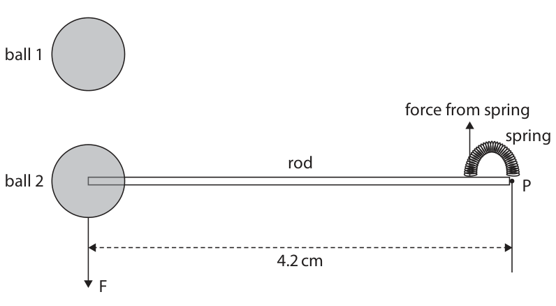
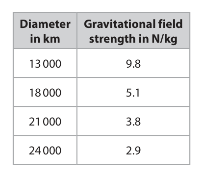
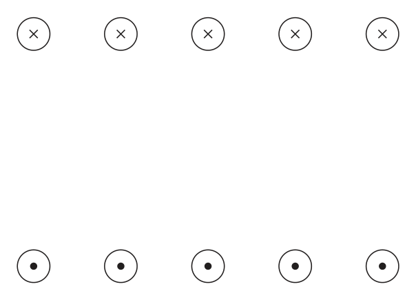
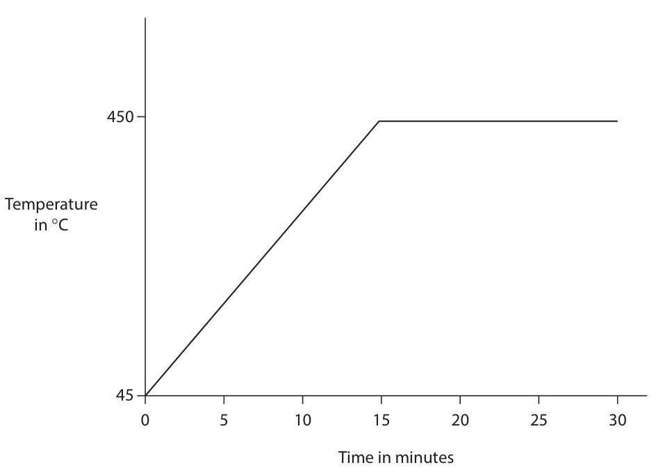

# 4PH1/2P — 2025-11 (official extraction)

> schema `syllabai.official-paper-questions/0.2` · paper_id `pearson-edexcel:international-gcse:physics:4ph1:2025-11:4PH1/2P` · qp sha256 `719e9bbe239fbc93…` · extraction is the disclosed baseline (ADR-039)

## Question 1 (6 marks)

The diagram shows the apparatus used to investigate electric charge. The equipment is viewed from above. • ball 1 and ball 2 have a positive charge • ball 1 is fixed in place • ball 2 is attached to a rod that can rotate about point P • ball 2 does not move ball 1 force from spring spring rod ball 2 P 4.2 cm F

**(b)** Ball 1 exerts a force, F, of 0.57 N on ball 2.

### 1(a) [1]

State, in terms of charged particles, how the balls have become positively charged.

**Mark scheme answer**

> idea of loss of electrons; allow “negative charge” for
> electrons

- **(1)** idea of loss of electrons; allow “negative charge” for

### 1(b)(i) [1]

State the value of the force exerted on ball 1 from ball 2. force = N

**Mark scheme answer**

> 0.57 (N); ignore sign

- **(1)** 0.57 (N); ignore sign

### 1(b)(ii) [2]

Calculate the moment on the rod from force F about point P. moment = N cm

**Mark scheme answer**

> substitution;
> evaluation;
> correct answer = 2.4 N cm correct answer scores 2 marks
> e.g. moment = force × distance allow 2.39, 2.394 (N cm)
> moment = 0.57 × 4.2 condone 2, 2.3 (Ncm)
> moment = 2.394 (N cm) allow for 2 marks 0.024 Nm,
> 0.0239 Nm, 0.2394 Nm if
> candidate has made unit clear
> or 1 mark if unit is
> incorrect/not clear

- **(2)** substitution;

### 1(b)(iii) [1]

State the magnitude of the moment about point P due to the force from the spring. magnitude of moment = N cm

**Mark scheme answer**

> candidate’s answer from (ii); allow rounded or unrounded
> ignore sign

- **(1)** candidate’s answer from (ii); allow rounded or unrounded

### 1(b)(iv) [1]

Draw an arrow on the diagram to show the direction of the force that the rod exerts on the spring.

**Mark scheme answer**

> arrow going downwards; by eye
> ignore length of arrow
> ignore label
> Total for question 1: 6 marks
> Question Number Answer Notes Marks

- **(1)** arrow going downwards; by eye

## Question 2 (6 marks)

This question is about gravitational field strength.

### 2(a)(i) [1]

The table shows gravitational field strengths at the surfaces of four different planets. The planets have the same mass but different diameters. Diameter Gravitational field in km strength in N/kg 13 000 9.8 18 000 5.1 21 000 3.8 24 000 2.9 Give a reason why a scatter graph is the correct way to display this data, rather than a bar chart.

> 🖼 crop required: graph (qp.pdf p.6)

**Mark scheme answer**

> idea that gravitational field strength and diameter are allow ‘the
> both continuous variables; data’,’this
> data’ etc for
> both variables
> allow RA i.e.
> ‘not discrete’
> or ‘not
> discontinuous’
> or ‘not
> categoric’

- **(1)** idea that gravitational field strength and diameter are allow ‘the

### 2(a)(ii) [4]

A student claims that the relationship between the gravitational field strength and the diameter of a planet is given by this formula. gravitational field strength × (diameter)² = constant Using data from the table, evaluate the student’s claim.

**Mark scheme answer**

> data from a single row selected;
> constant calculated; allow values
> next to table
> constant for a second row calculated; ignore POT
> ignore SF
> valid conclusion consistent with comparison of (at least)
> two constant values;
> unrounded
> values for the
> constant are:
> 1656200000
> 1652400000
> 1675800000
> 1670400000
> C (mass)

- **(4)** data from a single row selected;

### 2(b) [1]

The diameter of a planet affects the gravitational field strength at the surface of the planet. Which of these is also a factor that affects gravitational field strength?

- **(A)** absolute magnitude
- **(B)** colour
- **(C)** mass  ✔
- **(D)** specific heat capacity

**Mark scheme answer**

> A does not affect gravitational field strength
> B does not affect gravitational field strength
> D does not affect gravitational field strength
> Total for question 2: 6 marks
> Question Number Answer Notes Marks

- **(1)** Answer C: mass

## Question 3 (11 marks)

The diagram shows some of the parts of a hydroelectric power station. electricity transformer spillway generator powerhouse dam turbine water discharge water flow (Source: © Radzas2008/Shutterstock)

**(a)** Water enters the turbine with a momentum of 120 000 kg m/s.

### 3(a)(i) [1]

State the formula linking momentum, mass and velocity.

**Mark scheme answer**

> momentum = mass × velocity; p=m×v

- **(1)** momentum = mass × velocity; p=m×v

### 3(a)(ii) [2]

A mass of 14 000 kg of water enters the turbine. Calculate the velocity of the water as it enters the turbine. velocity = m/s

**Mark scheme answer**

> substitution;
> correct evaluation; accept any answer
> that rounds to 8.6
> e.g. (m/s)
> $120 000 = 14 000 \times v$
> $v = 120 000 \div 14 000 = 8.57$
> momentum = 8.6 (m/s) to 2 s.f.

- **(2)** substitution;

### 3(a)(iii) [3]

The 14 000 kg of water leaves the turbine. This water has a momentum of 63 000 kg m/s after it leaves the turbine. The turbine exerts a force of 6100 N on the water. Calculate the time taken for the water to pass through the turbine. time = s

**Mark scheme answer**

> initial momentum – final momentum;
> substitution into given formula;
> correct evaluation;
> correct answer: 9.3 (s) accept any answer
> e.g. that rounds to 9.3 (s)
> change in momentum = 120 000 – 63 000 (kg m/s)
> change in momentum = 57 000 (kg m/s) accept any answer
> that rounds to 20 (s)
> for 1 mark
> accept any answer
> that rounds to 10 (s)
> for 1 mark
> time = change in momentum ÷ force
> time = 57 000 ÷ 6100
> time = 9.3 (s)

- **(3)** initial momentum – final momentum;

### 3(b) [3]

As the water passes through the turbine, energy is lost from the water’s kinetic energy store. Explain what happens to the energy lost from the water’s kinetic energy store.

**Mark scheme answer**

> ignore references to
> electrical energy,
> sound energy
> transferred mechanically; reject mechanical
> energy
> the KE store of the turbine increases; allow ‘...to the KE
> store of the turbine’
> reject mechanical
> energy
> some energy is transferred to the thermal store
> of the surroundings/turbine;
> alternate:
> MP1 ‘KE of water
> transfers to KE of
> turbine’
> MP2 idea that not all
> of the KE of water
> goes to KE of turbine
> i.e. most of the KE of
> the water goes to
> the KE of the
> turbine’
> MP3 reference to
> some (of the KE of
> water) is lost as heat
> or thermal energy to
> the surroundings
> NB marks can only be
> scored either from
> the original or
> alternate, not from
> both

- **(3)** ignore references to

### 3(c) [2]

Hydroelectric power is an example of a renewable resource for the generation of electricity. Give two examples of non-renewable resources for the generation of electricity. 1 2

**Mark scheme answer**

> Any two from: ignore power,
> station, power
> coal; station, energy
> gas;
> oil;
> petrol;
> diesel;
> kerosene;
> uranium;
> plutonium;
> nuclear;
> fossil fuels;
> Total for question 3: 11 marks
> Question Number Answer Notes Marks

- **(2)** Any two from: ignore power,

## Question 4 (9 marks)

This question is about sound waves.

**(b)** The diagram shows an oscilloscope screen. Oscilloscope settings: x direction: 1 square = 0.5 ms y direction: 1 square = 0.5 V

### 4(a) [5]

Describe an investigation to measure the frequency of a sound wave with an oscilloscope. You may draw a diagram to help your answer.

**Mark scheme answer**

> allow MPs from
> (labelled) diagram
> MP1 measure the period; allow ‘time for one
> wave / cycle’ or ‘time
> between two
> consecutive
> peaks/troughs’ for
> period
> MP2 (determine frequency by using) f = 1/T; allow reasonable
> alternatives for
> PLUS measure e.g.
> determine, calculate
> any THREE from:
> MP3 use of a mic(rophone);
> MP4 reference to a steady trace/eq;
> MP5(by) counting the squares (for at least one allow idea of
> adjustment to a set
> wave); number of waves
> MP6 (and) multiplying number of squares by the
> time base/eq;
> MP7 for two or more waves and averaging;
> e.g. find time for
> multiple waves and
> dividing by number of
> waves
> unqualified ‘repeat and
> average’ does not score
> MP

- **(5)** allow MPs from

### 4(b)(i) [3]

Estimate the period, in ms, of the wave. period = ms

**Mark scheme answer**

> attempt at measuring average period;
> one period = 5.6 squares; allow 5.4-5.8
> period = 5.6 squares × 0.5 = 2.8 ms; allow ECF on number of
> squares

- **(3)** attempt at measuring average period;

### 4(b)(ii) [1]

Calculate the frequency of the wave. frequency = Hz

**Mark scheme answer**

> candidate uses answer to (i), in seconds, in given accept correct rounded
> formula and evaluated correctly; or unrounded figure
> e.g. 357, 357.1 etc
> e.g.
> period = 0.0028 seconds
> frequency = 1/T = 1/0.0028
> frequency = 360 (Hz) to 2sf
> Total for question 4: 9 marks
> Question Number Answer Notes Marks

- **(1)** candidate uses answer to (i), in seconds, in given accept correct rounded

## Question 5 (9 marks)
**(a)** The diagram shows a cross‑section of a solenoid. Key current into paper current out of paper

**(b)** A transformer consists of two solenoids and an iron core. This is the label on the transformer. Number of turns on primary coil: 180 Number of turns on secondary coil: 345 Output voltage: 230 V Output power = 320 W

### 5(a)(i) [2]

Draw one field line on the diagram to show the direction of the magnetic field.

**Mark scheme answer**

> (at least) one field line (which does not cross) and is e.g. see diagram
> consistent with the correct field line pattern; for non-
> exhaustive
> examples of
> acceptable field
> lines
> apply list
> principle
> reject field lines
> arrow head on at least one field line that is consistent that start/finish
> with current direction in solenoid; on a wire

- **(2)** (at least) one field line (which does not cross) and is e.g. see diagram

### 5(a)(ii) [1]

Use the field line to determine which end of the solenoid is the north pole and label this on the diagram.

**Mark scheme answer**

> clear indication from the candidate which end is north however ressed
> consistent with their field line and no further than two (but including
> wires ‘in’. "N" or "North")
> accept ECF from
> (i)

- **(1)** clear indication from the candidate which end is north however ressed

### 5(b)(i) [1]

State the formula linking input (primary) voltage, output (secondary) voltage and the turns ratio.

**Mark scheme answer**

> Np / Ns = Vp/Vs any correct
> rearrangment.
> Allow word
> equation
> Allow “T”,
> “turns” for N.
> Allow clear yet
> different
> annotation from
> primary and
> secondary i.e. p
> and s, 1 and 2, A
> and B etc.

- **(1)** Np / Ns = Vp/Vs any correct

### 5(b)(ii) [3]

Calculate the input voltage of this transformer. input voltage = V

**Mark scheme answer**

> substitution;
> rearrangement; NB substitution
> correct evaluation; into an
> incorrectly
> arranged
> formula scores
> zero.
> e.g.
> 180/345 = Vp/230
> Vp = 230 × 180 / 345
> Vp = 120 V

- **(3)** substitution;

### 5(b)(iii) [1]

Give the name of this type of transformer.

**Mark scheme answer**

> step up (transformer);

- **(1)** step up (transformer);

### 5(b)(iv) [1]

When the transformer is in use, there is a current in the primary coil and in the secondary coil. State the type of current in the coils of the transformer.

**Mark scheme answer**

> alternating (current)/a.c.;
> Total for question 5: 9 marks
> Question Number Answer Notes Marks

- **(1)** alternating (current)/a.c.;

## Question 6 (7 marks)

Galaxies A, B and C are different distances from the Earth. Galaxy A is moving away from the Earth with a velocity of 1.7 × 10⁴ km/s.

### 6(a) [3]

The reference wavelength for light arriving at the Earth from galaxy A is 506 nm. Calculate the observed wavelength for the light arriving from galaxy A. [speed of light = 3.0 × 10⁵ km/s] wavelength = nm

**Mark scheme answer**

> substitution into given equation; allow ∆λ for change in
> wavelength
> rearrangement to find wavelength; POT error –1 here on
> either ∆λ or λ
> evidence of ∆λ of 29 nm
> scores first 2 marks
> correct evaluation;
> e.g.
> (λ - 506)/506 = 1.7 × 10⁴/ 3.0 × 10⁵
> λ = 506 × (1.7 × 10⁴/ 3.0 × 10⁵) + 506
> λ = 534.7 (nm)
> accept any value that
> rounds to 530 (nm)
> accept any value that
> rounds to 29nm (change
> in wavelength) as final
> answer for 2 marks
> accept any value that
> rounds to 480 nm
> (subtraction of change
> in wavelength) for 2
> wrong change in
> wavelength added to
> 506 nm gives 1 mark

- **(3)** substitution into given equation; allow ∆λ for change in

### 6(b) [2]

Galaxy B is twice as far away from the Earth as galaxy A is from the Earth. Galaxy C is four times as far away from the Earth as galaxy A is from the Earth. Explain how the velocities of galaxies B and C are different.

**Mark scheme answer**

> Any TWO from:
> the universe is expanding / eq; i.e. galaxies are moving
> away from each other;
> idea that (recession) velocity increases with i.e. ‘galaxies’ velocities
> distance/eq; (away from Earth)’ for
> ‘recession velocity’
> explicit statement that galaxy C is moving faster e.g. C is twice as fast as
> than galaxy B (from Earth); B
> double the distance (from Earth) will give double allow higher order
> the speed; thinking e.g. distance
> and velocity
> proportional
> idea that galaxy C is moving four times faster
> than galaxy A and galaxy B is moving two times
> faster than galaxy A;

- **(2)** Any TWO from:

### 6(c) [2]

The universe started with an event called the Big Bang. Explain how evidence from cosmic microwave background radiation shows how the temperature of the universe has changed since the Big Bang.

**Mark scheme answer**

> Any TWO from: accept RA
> MP1 idea that wavelength of CMB has increased
> over time (as the universe has expanded);
> MP2 Universe was (significantly) hotter in the
> past/eq;
> MP3 temperature is inversely proportional to
> wavelength (of CMB)
> Total for question 6: 7 marks
> Question Number Answer Notes Marks

- **(2)** Any TWO from: accept RA

## Question 7 (9 marks)

A student investigates how the temperature of a metal block varies with time as it is heated. The student measures the temperature of the block at 5-minute intervals for a total of 30 minutes. The graph shows the student’s results. 450 Temperature in C 0 5 10 15 20 25 30 Time in minutes

### 7(a)(i) [1]

Give the name of a piece of equipment that the student could use to measure the time during the investigation.

**Mark scheme answer**

> (stop)watch / (stop)clock / timer/chronometer; ignore ‘light gate’
> apply list principle

- **(1)** (stop)watch / (stop)clock / timer/chronometer; ignore ‘light gate’

### 7(a)(ii) [1]

Which of these is the dependent variable in this investigation?

- **(A)** mass of block
- **(B)** temperature of block  ✔
- **(C)** time taken to heat block
- **(D)** volume of block

**Mark scheme answer**

> B (temperature of block);
> A and D cannot be correct as they are control
> variables here
> C cannot be correct as it is the independent
> variable here

- **(1)** Answer B: temperature of block

### 7(b) [3]

The energy supplied to the block is 440 000 J. Calculate the mass of the metal block when the temperature of the block increases from 45 °C to its melting point of 450 °C. [for the metal, specific heat capacity = 910 J / kg °C] mass = kg

**Mark scheme answer**

> temperature change of 405 degrees; allow (450 – 45) seen
> substitution into given formula or correct re- mark independently
> arrangement with mass as subject;
> correct evaluation;
> e.g.
> temperature change = 450 – 45 = 405 degrees
> energy supplied = mass × 910 × 405
> mass = 440 000 / (910 × 405)
> mass = 1.2 (kg) (to 2sf) 1.1938.... (kg)
> allow any answer
> that rounds to 1.2
> (kg) for 3 marks
> any POT error in
> otherwise correct
> answer scores 2
> substitution of 450,
> 45 or 495 for the
> temperature change
> into the correct
> equation with
> correct SHC and
> energy change scores
> 1 mark only

- **(3)** temperature change of 405 degrees; allow (450 – 45) seen

### 7(c) [2]

The metal block melts and then the liquid metal boils to become a gas. Describe the motion of the particles when the metal is a gas.

**Mark scheme answer**

> idea of high speed; ignore ’freely’
> idea of randomness;

- **(2)** idea of high speed; ignore ’freely’

### 7(d) [2]

Suggest two changes to the graph if the student had used a different metal in their investigation. 1 2

**Mark scheme answer**

> accept annotation of
> graph for either mark
> MP1 temperature rises at a different rate/eq;
> MP2 melting point would be different/eq; allow idea that 'flat
> part would be at a
> different temp'
> allow higher order
> idea that ‘flat part
> would be a different
> length’
> Total for question 7: 9 marks
> Question Number Answer Notes Marks

- **(2)** accept annotation of

## Question 8 (13 marks)

The photograph shows a nuclear power station. (Source: © Julius Fekete/Shutterstock) A chain reaction releases energy inside the power station.

### 8(a) [3]

Explain how the fission of U-235 can set up a chain reaction.

**Mark scheme answer**

> Any THREE from
> MP1 neutron absorbed by (uranium) nucleus
> MP2 (uranium) nucleus becomes unstable
> MP3 nucleus splits producing two condone
> (smaller/daughter) nuclei and (some) neutrons ‘undergoes fission’
> for ‘splits’
> condone named
> isotopes e.g.
> MP4 neutrons absorbed by other (uranium) nuclei krypton and barium

- **(3)** Any THREE from

### 8(b) [2]

Explain how nuclear fusion is different from radioactive decay.

**Mark scheme answer**

> fusion: joining of nuclei/eq; condone ‘fusing’
> radioactive decay: idea of (spontaneous) release accept any named
> of particle(s) from the nucleus; particle e.g.
> alpha/helium
> nucleus,
> beta/electron,
> gamma, neutron
> ignore reference to
> ‘splitting’
> accept higher order
> idea of a decrease
> in
> instability/increase
> in stability

- **(2)** fusion: joining of nuclei/eq; condone ‘fusing’

### 8(c) [2]

An isotope of hydrogen is used as a fuel for nuclear fusion. The nuclear equation shows how this isotope of hydrogen can be manufactured. Complete the equation by giving the missing information. n + Li → 2α 1 6 4 H + 3 1

**Mark scheme answer**

> 0; (for the neutron)
> 3; (for the hydrogen)

- **(2)** 0; (for the neutron)

### 8(d) [2]

Explain why nuclear fusion can only happen at high temperatures and pressures.

**Mark scheme answer**

> Any TWO from:
> nuclei are both positive so (electrostatically)
> repel;
> ORA for MP2 and
> high temperature means high KE or high speed; MP3
> (high temperature and/or high pressure means) allow idea of
> nuclei can get close enough to fuse; high(er) probability
> of fusion
> allow particles for
> nuclei for this MP
> only

- **(2)** Any TWO from:

### 8(e)(i) [1]

Which of these is the time taken for the number of undecayed nuclei in a radioactive isotope to halve?

- **(A)** activity
- **(B)** becquerels
- **(C)** half-life  ✔
- **(D)** proton number

**Mark scheme answer**

> C (half-life)
> A is not the half-life
> B is not the half-life
> D is not the half-life

- **(1)** Answer C: half-life

### 8(e)(ii) [3]

This isotope of hydrogen is radioactive and has a half‑life of 12 years. A sample of the isotope has an activity of 72 kBq. Calculate the activity of the isotope in the sample after 60 years. activity = kBq

**Mark scheme answer**

> original activity halved at least once;
> however ressed
> 60 years corresponds to 5 half lives; e.g. 60 ÷ 12 = 5
> correct evaluation;
> e.g. 72->36->18->9->4.5->2.25 (kBq) accept 2.2 or 2.3
> (kBq)
> 36 (kBq) scores 1
> mark only
> accept any correct
> activity from
> another incorrect
> number of halvings
> for 2 marks
> e.g. 18, 9, 4.5,
> 1.125 etc
> Total for question 8: 13 marks

- **(3)** original activity halved at least once;

