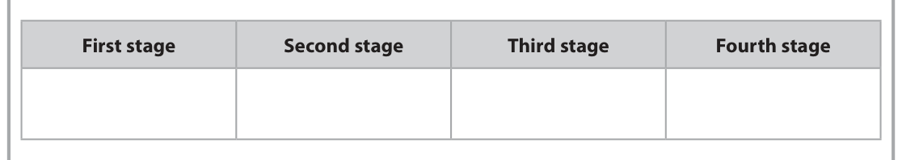
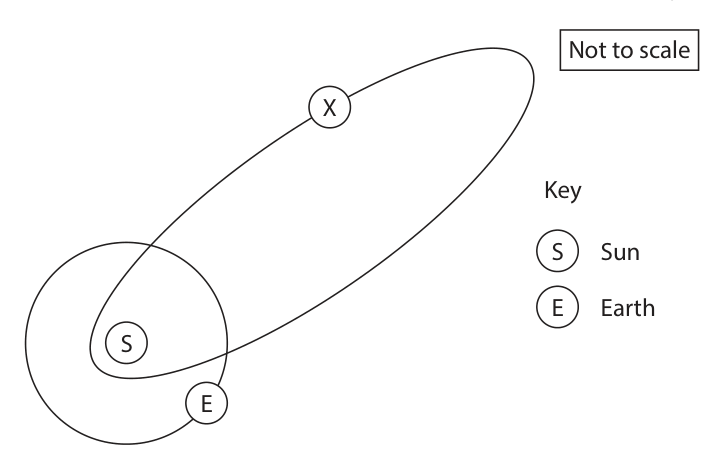
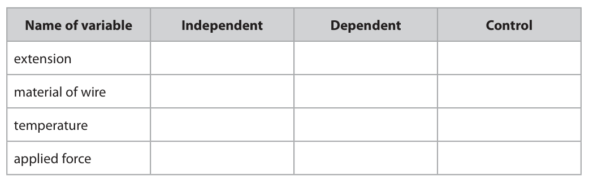
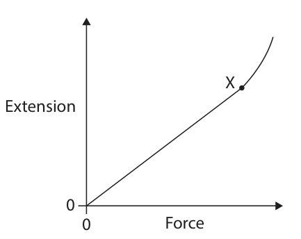
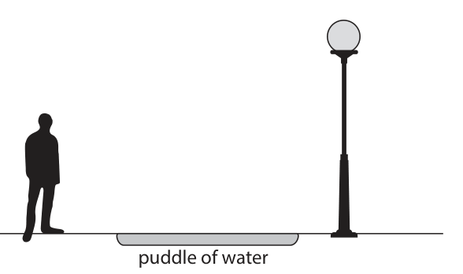
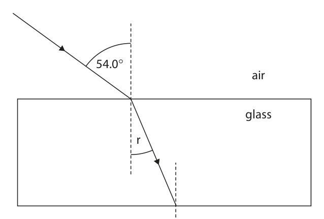
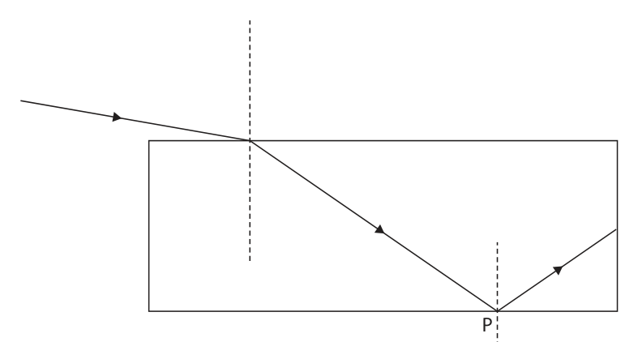
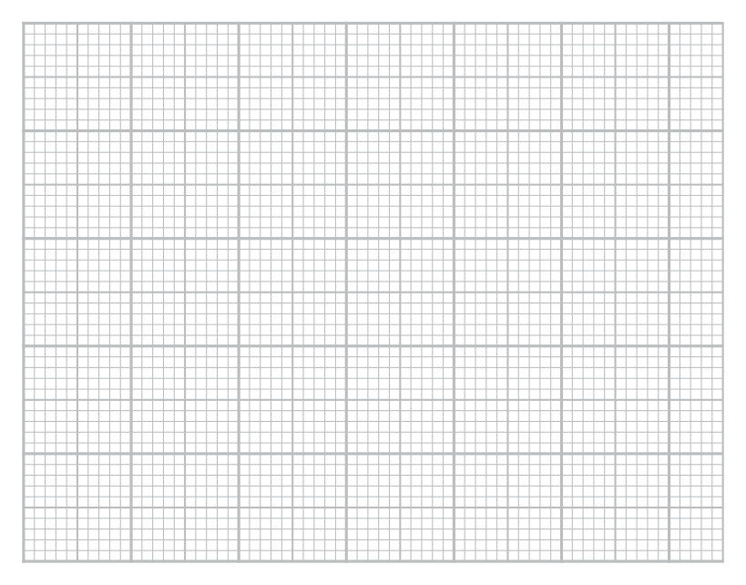
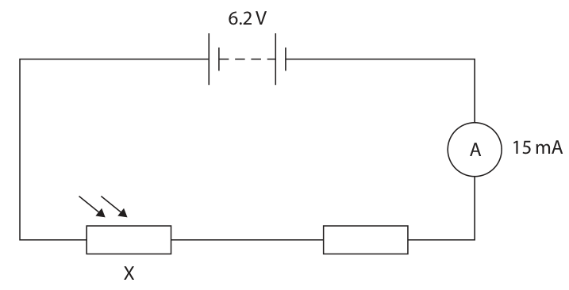
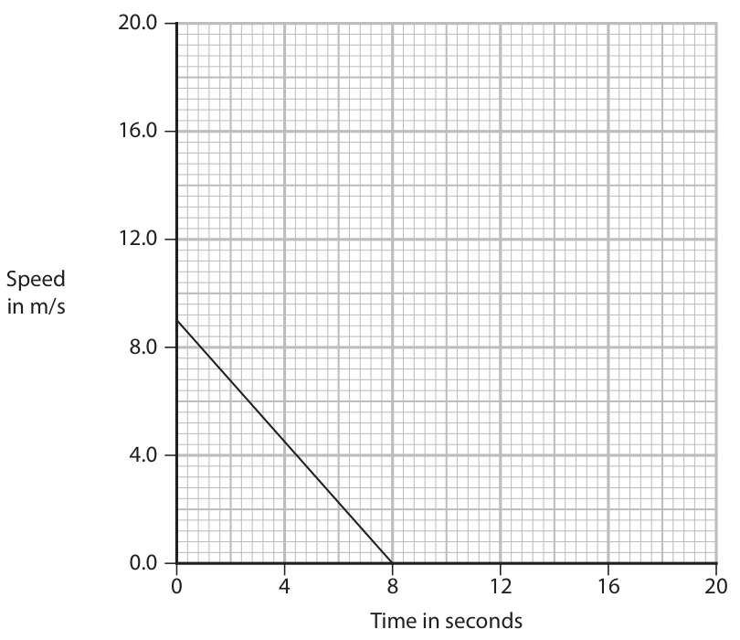

# 4PH1/1P — 2026-06 (official extraction)

> schema `syllabai.official-paper-questions/0.2` · paper_id `pearson-edexcel:international-gcse:physics:4ph1:2026-06:4PH1/1P` · qp sha256 `fece9f0d68d50d96…` · extraction is the disclosed baseline (ADR-039)

## Question 1 (8 marks)

Epsilon Eridani is a star with a similar mass to the Sun.

### 1(a) [4]

The box lists the stages in the life cycle of stars. white dwarf main sequence red giant supernova nebula red supergiant The table gives stages in the life cycle of Epsilon Eridani. Complete the table by giving the correct word or phrase from the box for each stage. First stage Second stage Third stage Fourth stage

**Mark scheme answer**

> first stage = nebula;
> main sequence before red giant/white dwarf; can be given as any
> stages as long as main
> sequence is before red
> giant/white dwarf
> red giant before white dwarf; can be given as any
> stages as long as red
> giant is before white
> dwarf
> fourth stage = white dwarf;
> e.g.
> nebula main sequence red giant white dwarf

- **(4)** first stage = nebula;

### 1(b)(i) [2]

Nuclear fusion is the process that provides energy for stars. Describe the process of nuclear fusion.

**Mark scheme answer**

> reference to combining nuclei however expressed; allow hydrogen (ions) /
> protons for nuclei
> allow two nuclei fuse
> together (to form larger
> nucleus)
> reference to loss in mass; ignore releases energy

- **(2)** reference to combining nuclei however expressed; allow hydrogen (ions) /

### 1(b)(ii) [2]

Explain why nuclear fusion in stars does not happen at low temperatures and pressures.

**Mark scheme answer**

> any two from: allow protons,
> particles, atoms, ions
> for nuclei
> MP1. nuclei are (all) positive AND repel each other; allow nuclei have same
> charge so repel
> MP2. low temperature means low speed/KE; allow RA
> MP3. low pressure means that nuclei aren’t close allow RA
> enough together (to fuse); allow idea that low
> pressure decreases
> number of collisions
> Answer Notes Marks

- **(2)** any two from: allow protons,

## Question 2 (12 marks)

Venera 13 was a probe that fell through the atmosphere of the planet Venus and landed on its surface in 1982. (Source: © DETLEV VAN RAVENSWAAY / SCIENCE PHOTO LIBRARY)

**(a)** The atmospheric pressure on the surface of Venus is 9 300 000 pascal.

**(b)** The mean temperature on Venus is 453 °C. At this temperature, the atmospheric pressure on the surface of Venus is 9.3 million pascal.

### 2(a)(i) [2]

The density of the atmosphere on the surface of Venus is 65 kg/m3. Estimate the depth of the atmosphere on Venus. Use the formula pressure difference = depth × density × gravitational field strength [for Venus, gravitational field strength = 8.9 N/kg] depth = m

**Mark scheme answer**

> substitution OR rearrangement into given formula;
> correct evaluation;
> condone 14 307.69… (m) for
> 1 mark for using g=10 N/kg
> e.g.
> 9 300 000 = h × 65 × 8.9
> OR
> h=P/ρ×g
> (h = 9 300 000 / 65 × 8.9 =) 16 000 (m) allow 16 100, 16 076… (m)

- **(2)** substitution OR rearrangement into given formula;

### 2(a)(ii) [1]

State an assumption you have made to complete the calculation.

**Mark scheme answer**

> any one from: ignore pressure is constant
> • density is constant;
> • g is constant; condone gravity is constant
> • temperature is constant;

- **(1)** any one from: ignore pressure is constant

### 2(b)(i) [4]

The temperature on the surface of Venus can change. Calculate the atmospheric pressure on the surface of Venus when the temperature is 482 °C. pressure = million Pa

**Mark scheme answer**

> conversion of either temperature into kelvin; mark independently
> i.e. 726 or 755 seen
> substitution into given formula; allow ECF from incorrect or
> no unit conversion
> rearrangement of given formula;
> evaluation;
> 9.9, 9.90, 9.89… (million Pa)
> scores 3 marks
> e.g.
> 453 oC is 726 K and 482 oC is 755 K
> 9.3 ÷ 726 = P2 ÷ 755
> P2 = 755 × 9.3 ÷ 726
> P2 = 9.7 (million Pa) allow 9.67… (million Pa)

- **(4)** conversion of either temperature into kelvin; mark independently

### 2(b)(ii) [2]

State the assumptions you have made to complete this calculation.

**Mark scheme answer**

> any two from:
> number of particles is constant (in a given volume); allow constant mass (of gas)
> reference to constant volume;
> density is constant;

- **(2)** any two from:

### 2(c) [3]

On the surface of Venus, a gas molecule has a mean kinetic energy of 6.1 × 10–21 J. Calculate the mean speed of the gas molecule. [mass of molecule = 7.3 × 10–26 kg] speed = m/s

**Mark scheme answer**

> statement of correct formula; correct formula can be
> assumed by evidence of
> correct substitution
> rearrangement to give v2 or v as the subject;
> evaluation;
> answer of 167 123 scores 2
> marks (not taking square
> root)
> e.g.
> KE = ½ × m × v2
> v2 = (2 × 6.1 × 10-21) ÷ 7.3 × 10-26
> v (= √167 123) = 410 (m/s) allow 409, 408.8… (m/s)
> Answer Notes Marks

- **(3)** statement of correct formula; correct formula can be

## Question 3 (6 marks)

The diagram shows the orbit of the Earth around the Sun, and the orbit of object X. Not to scale X Key S Sun E Earth S E

**(a)** Object X has a highly elliptical orbit.

### 3(a)(i) [1]

Which of these is object X?

- **(A)** comet  ✔
- **(B)** galaxy
- **(C)** star
- **(D)** universe

**Mark scheme answer**

> A (comet);
> B is incorrect because galaxies do not orbit the Sun
> C is incorrect because the Sun has no binary
> partner star
> D is incorrect because the universe does not orbit
> the Sun

- **(1)** Answer A: comet

### 3(a)(ii) [1]

On the diagram, draw an arrow from object X to show the direction of the force responsible for keeping object X in orbit.

**Mark scheme answer**

> straight arrow drawn pointing towards S such that judge straight by eye
> its line of action passes through both X and S; arrow does not need to
> start at X or finish at
> the Sun

- **(1)** straight arrow drawn pointing towards S such that judge straight by eye

### 3(b) [3]

The Moon orbits the Earth in 28 days. The radius of the Moon’s orbit is 390 000 km. Calculate the orbital speed of the Moon. Give your answer in km/s. orbital speed = km/s

**Mark scheme answer**

> conversion of time into seconds; mark independently
> i.e. 28 × 24 × 60 × 60 or
> 2 419 200 seen
> substitution into given formula; allow ECF from
> incorrect / no unit
> conversion
> evaluation;
> 87 515… (km/s) scores 2
> e.g.
> time = 28 × 24 × 60 × 60 = 2 419 200 (s)
> orbital speed = 2 × π × 390 000 ÷ 2 419 200
> (orbital speed =) 1.0 (km/s) allow 1, 1.01… (km/s)

- **(3)** conversion of time into seconds; mark independently

### 3(c) [1]

Suggest why the gravitational field strength on the Moon is different from the gravitational field strength on the Earth.

**Mark scheme answer**

> different mass/density/diameter/radius; condone size for radius
> condone ‘moon is
> smaller’ / RA
> ignore if incorrect
> comparison given e.g.
> ‘Earth has less mass
> than the Moon’
> Answer Notes Marks

- **(1)** different mass/density/diameter/radius; condone size for radius

## Question 4 (13 marks)

A student investigates how the extension of a metal wire varies with applied force provided by a load. The diagram shows some of the apparatus the student uses. marker wire pulley ruler bench load

**(c)** The graph shows the student’s results. X Extension 0 Force

### 4(a) [5]

Describe a method that a student could use for their investigation. Refer to safety in your answer.

**Mark scheme answer**

> ignore
> • repeats
> • calculation of mean
> • control variables
> • Hooke’s law
> MP1. measure the extension / length (of the wire); allow ‘calculate how
> much it has increased
> (in length) for every
> added load’
> ‘how much the marker
> moves for each load
> added’
> MP2. detail for how extension is determined; e.g. calculate
> difference between
> original length and new
> length
> MP3. increase applied force / load / mass added;
> MP4. description of how to protect eyes/feet/skin; ignore ‘be careful’,
> ‘protective clothing’,
> protection aimed to
> prevent damage to floor
> or load
> PLUS
> any one from:
> MP5. description of method to reduce parallax error; allow view ruler
> perpendicularly / bird’s
> eye view etc.
> ignore eye level
> MP6. idea of placing masses on gently instead of
> dropping;
> MP7. measurement of mass with a balance OR ignore ‘weigh each
> measurement of force with newton-meter; load’
> MP8. description of a (potentially) more accurate way
> of measuring extension i.e. (vernier) calipers;

- **(5)** ignore

### 4(b) [3]

Add one tick (ü) to each row of the table to show the independent, dependent and control variables in this investigation. Name of variable Independent Dependent Control extension material of wire temperature applied force

**Mark scheme answer**

> ‘independent’ column has a tick in last row only; reject if ticks given in
> any other rows
> ‘dependent’ column has a tick in first row only; reject if ticks given in
> any other rows
> ‘control’ column has ticks in the middle two rows reject if ticks given in
> only; any other rows
> e.g.
> ✓
> ✓
> ✓
> ✓

- **(3)** ‘independent’ column has a tick in last row only; reject if ticks given in

### 4(c)(i) [3]

Describe the relationship shown by the graph.

**Mark scheme answer**

> allow ‘elastic limit’,
> ‘limit of
> proportionality’ for X
> as force increases extension increases; allow linear
> (relationship) before X
> (directly) proportional / obeys Hooke’s law before X; also scores MP1
> (non-linear with) increasing gradient after X / eq; allow ‘gets steeper’ for
> increasing gradient

- **(3)** allow ‘elastic limit’,

### 4(c)(ii) [2]

Point X on the graph is called the elastic limit. Explain what will happen to the wire if the applied force is removed before the extension of the wire reaches point X.

**Mark scheme answer**

> idea that elastic limit not reached; allow idea that wire
> still behaves elastically
> (so) wire will return to its original length; ignore size/shape/form
> for length
> Question number Answer Notes Marks

- **(2)** idea that elastic limit not reached; allow idea that wire

## Question 5 (13 marks)

A street has many street lamps.

**(c)** A different ray of light from a street lamp passes through the glass in a window as shown in diagram 2. 54.0 air glass r Diagram 2

### 5(a) [1]

Suggest why the street lamps are connected in parallel.

**Mark scheme answer**

> idea that street lamps work independently of allow lamps still work if
> each other however expressed; one lamp breaks etc.
> allow idea that all
> lamps get the same
> (high) voltage

- **(1)** idea that street lamps work independently of allow lamps still work if

### 5(b) [3]

Diagram 1 shows one street lamp, a person and a puddle of water. The puddle of water reflects light from the street lamp into the person’s eyes. puddle of water Diagram 1 On diagram 1, draw a ray of light from the street lamp that is reflected by the puddle to the person’s eyes.

**Mark scheme answer**

> straight ray lines drawn between any point on allow dashed line
> the street lamp to any point on the person’s judge straight by eye
> head via the puddle;
> any indication that the direction of the ray is
> from the lamp to the eye e.g. arrow;
> angle of incidence = angle of reflection; judge by eye
> allow if angles marked
> as equal on diagram

- **(3)** straight ray lines drawn between any point on allow dashed line

### 5(c)(i) [1]

Using diagram 2, determine the angle of refraction, r. r = degrees

**Mark scheme answer**

> any angle in the range 22-24 (degrees);

- **(1)** any angle in the range 22-24 (degrees);

### 5(c)(ii) [4]

At the point where the ray of light enters the glass in the window, the angle of incidence is 54.0°. Calculate the refractive index of the glass in the window. Give your answer to three significant figures. refractive index =

**Mark scheme answer**

> statement of correct formula; accept correct
> substitution into given
> formula
> substitution; allow ECF from (i)
> evaluation;
> final answer rounded to 3s.f.; mark independently
> e.g.
> n = sin(i) ÷ sin(r)
> n = sin(54.0) ÷ sin(23.0)
> n = 2.0705… allow 1.9890 - 2.1596
> n = 2.07 allow 1.99 – 2.16

- **(4)** statement of correct formula; accept correct

### 5(c)(iii) [2]

On diagram 2, draw a straight line to show the path of the ray of light after it leaves the glass.

**Mark scheme answer**

> light leaves block; ignore reflected ray
> light bends correctly away from the normal (by ray does not need to be
> eye); parallel to original ray

- **(2)** light leaves block; ignore reflected ray

### 5(d) [2]

Another ray of light enters the glass in the window as shown in diagram 3. P Diagram 3 Explain what happens to this ray of light at point P.

**Mark scheme answer**

> any two from:
> light has undergone total internal
> reflection/TIR;
> angle of incidence is greater than critical angle;
> glass is more (optically) dense than air / glass
> has a refractive index greater than {air / 1} /
> speed of light in glass lower than in air;
> Answer Notes Marks

- **(2)** any two from:

## Question 6 (7 marks)

The photographs show two different types of oven. (Source: © goffkein.pro/Shutterstock) (Source: © Pixel-Shot/Shutterstock) Microwave oven Hot electric oven

### 6(a) [1]

Which part of the electromagnetic spectrum is used to heat food in the hot electric oven?

- **(A)** gamma
- **(B)** infrared  ✔
- **(C)** ultraviolet
- **(D)** radio

**Mark scheme answer**

> B (infrared);
> A is incorrect because gamma rays would penetrate
> all the way through the food
> C is incorrect because UV does not cook food
> D is incorrect because radio waves do not cook food

- **(1)** Answer B: infrared

### 6(b)(i) [1]

Give a property that all electromagnetic waves have in common.

**Mark scheme answer**

> any one from:
> • same speed (in a vacuum) / travel at the speed
> of light;
> • can travel through a vacuum;
> • (all) transverse waves;
> • (all) undergo reflection/refraction/transfer
> energy;

- **(1)** any one from:

### 6(b)(ii) [3]

The microwave oven uses microwave radiation with a wavelength of 12 cm. Calculate the frequency of this microwave radiation. [speed of microwaves = 3.0 × 108 m/s] frequency = Hz

**Mark scheme answer**

> conversion of wavelength to 0.12 m;
> substitution OR rearrangement; allow ECF from
> incorrect / no unit
> conversion
> evaluation;
> 2.5 × 107 (Hz)
> scores 2 marks
> e.g.
> 12 cm = 0.12 m
> 3.0 × 108 = frequency × 0.12 OR f = v ÷ λ
> frequency (= 3.0 × 108 ÷ 0.12) = 2.5 × 109 (Hz)

- **(3)** conversion of wavelength to 0.12 m;

### 6(c) [2]

The electromagnetic radiation in the hot electric oven heats the surface of the food. Explain how the inside of the food increases in temperature. Refer to a method of heat transfer in your answer.

**Mark scheme answer**

> reference to conduction; allow description of
> conduction e.g.
> particles passing on
> vibrations
> idea that inside (of food) gains energy; allow energy is
> transferred through
> food
> Answer Notes Marks

- **(2)** reference to conduction; allow description of

## Question 7 (12 marks)

The photograph shows a Thorium Molten Salt Reactor. This type of nuclear reactor uses an isotope of thorium as its primary fuel source. (Source: © Gabriele Rohde/Shutterstock)

**(c)** Iodine‑129 is a waste product of nuclear fission. The half‑life of iodine‑129 is 15.7 million years.

### 7(a) [3]

This nuclear equation shows how the isotope thorium‑232 is transformed into thorium‑233. X Y n + 232 Th → 233 Th This nuclear equation shows how thorium‑233 decays into uranium‑233. 233 Th → 2Z0 β + 233 U Determine the values of X, Y and Z. X = Y = Z =

**Mark scheme answer**

> X = 1;
> Y = 0;
> Z = −1;

- **(3)** X = 1;

### 7(b) [3]

A uranium‑233 nucleus can absorb a neutron and become part of a chain reaction. Describe how a chain reaction occurs.

**Mark scheme answer**

> uranium splits / uranium undergoes fission; allow nucleus for
> uranium
> condone uranium breaks
> up
> ignore atoms
> neutron(s) released;
> (these) neutron(s) go on to cause further fissions /
> eq;

- **(3)** uranium splits / uranium undergoes fission; allow nucleus for

### 7(c)(i) [2]

Describe what is meant by the term half‑life.

**Mark scheme answer**

> (average) time; condone “how long it
> takes”
> reject “half the time”
> for {(radio)activity / count rate / number of nuclei allow half the
> / number of atoms / mass of isotope} to halve; nuclei/atoms to decay
> ignore unqualified
> reference to mass halving
> ignore substance halving

- **(2)** (average) time; condone “how long it

### 7(c)(ii) [4]

A sample of iodine‑129 has an activity of 72 MBq. Calculate the time it will take for the activity of this sample to decay to 6.25% of its original activity. time = million years

**Mark scheme answer**

> calculation of 6.25% of 72 = 4.5 (MBq);
> evidence of a total of 4 half-lives; also scores MP1
> candidate’s number of half-lives multiplied by allow ECF from incorrect
> half-life; number of half-lives used
> for this mark only
> correct final answer; no ECF for this mark
> e.g.
> 6.25% of 72 is 4.5 (MBq)
> 72 → 36 → 18 → 9 → 4.5 (gives 4 half-lives)
> time = 4 × 15.7
> (time =) 63 (million years) allow 62.8 (million years)
> Answer Notes Marks

- **(4)** calculation of 6.25% of 72 = 4.5 (MBq);

## Question 8 (8 marks)

The diagram shows a loudspeaker connected to an alternating current (a.c.) power supply. tube N paper cone S power N supply coil on tube

### 8(a)(i) [1]

State how direct current (d.c.) differs from alternating current (a.c.).

**Mark scheme answer**

> idea that d.c. is in one direction AND a.c. changes allow both/different
> direction (continuously) however expressed; directions for a.c.
> condone d.c. goes one way
> and a.c. goes both ways

- **(1)** idea that d.c. is in one direction AND a.c. changes allow both/different

### 8(a)(ii) [3]

Explain how the loudspeaker produces sound using the a.c. power supply.

**Mark scheme answer**

> any three from:
> idea that current/coil/wire has a magnetic field; allow current/coil/wire
> becomes an electromagnet
> idea that interaction between magnetic fields allow overlaps for
> produces a force (on the coil); interaction
> ignore cutting for
> interaction
> allow interaction between
> current and magnetic field
> produces a force
> direction of the force changes (due to a.c.);
> (so the) cone/air vibrates; allow coil/tube vibrates

- **(3)** any three from:

### 8(b) [4]

The loudspeaker is disconnected from the power supply. The wires from the loudspeaker are then connected to a very sensitive ammeter. When a sound is directed towards the paper cone, the loudspeaker behaves as a microphone. Explain why there is a reading on the ammeter when a sound is directed towards the paper cone.

**Mark scheme answer**

> cone {vibrates / oscillates}; allow coil/tube for cone
> coil/wire cuts (magnetic) field (lines); ignore interacts with field
> inducing a voltage; allow alternatives to
> inducing e.g. causing,
> producing etc.
> (which in turn) induces an (alternating) current; allow alternatives to
> inducing e.g. causing,
> producing etc.
> ignore causes a reading on
> ammeter
> Answer Notes Marks

- **(4)** cone {vibrates / oscillates}; allow coil/tube for cone

## Question 9 (12 marks)

A student releases a ball on a ramp as shown in the diagram. ball ramp light gate The ball has an initial speed of 0 m/s. The student uses a light gate to determine the final speed of the ball.

**(a)** Table 1 shows the student’s results. Diameter of ball in m 0.048 Time for ball to pass through light gate in s 0.028 Table 1

**(b)** The student uses this method to investigate how the distance rolled along the ramp affects the final speed of the ball. • position the ball on the ramp and release the ball • measure the distance the ball rolls along the ramp • use the light gate to determine the final speed of the ball • determine the (final speed of ball)2 The student repeats the method using different distances along the ramp. Table 2 shows the student’s results. Distance rolled along ramp (Final speed of ball)2 in m in (m/s)2 0.00 0.00 0.10 0.44 0.20 0.86 0.30 1.31 0.40 1.75 0.50 2.19 Table 2

### 9(a)(i) [2]

Using the data from table 1, show that the final speed of the ball is about 2 m/s.

**Mark scheme answer**

> substitution into given formula; condone reverse calculation for full
> marks e.g. using v = 2 (m/s) to
> calculate distance or time to more
> than 2s.f.
> correct evaluation to more than 1s.f.;
> e.g.
> final speed = 0.048 ÷ 0.028
> final speed = 1.714… (m/s)

- **(2)** substitution into given formula; condone reverse calculation for full

### 9(a)(ii) [3]

The ball rolls along the ramp for a distance of 0.63 m. Calculate the acceleration of the ball. acceleration = m/s2

**Mark scheme answer**

> substitution into given formula; ECF for use of v from (i)
> rearrangement;
> evaluation; ignore any minus sign included in
> use of 2 (m/s) for v
> gives a = 3.2 (m/s2) for full marks
> e.g.
> 1.7142 = 02 + 2 × a × 0.63
> a = 2.94 ÷ 1.26
> (a =) 2.3 (m/s2) allow 2.33… (m/s2)

- **(3)** substitution into given formula; ECF for use of v from (i)

### 9(b)(i) [3]

Plot the data on the grid.

**Mark scheme answer**

> suitable linear scales constructed such that data accept distance on x-axis or y-axis
> takes up over half of the grid in both directions;
> axes labelled and unit included in distance axis; ignore unit on speed-squared axis
> all points plotted correctly to within ½ small must include point at origin
> square;
> e.g.

- **(3)** suitable linear scales constructed such that data accept distance on x-axis or y-axis

### 9(b)(ii) [1]

Draw a line of best fit.

**Mark scheme answer**

> best fit straight line added; ECF plotting
> points should be evenly
> distributed about the line

- **(1)** best fit straight line added; ECF plotting

### 9(b)(iii) [1]

Determine the gradient of the line of best fit. gradient =

**Mark scheme answer**

> gradient of best fit line from (ii) evaluated as a allow ECF from line drawn in (ii)
> decimal; allow 4.3 – 4.5 for graph with
> distance on x-axis
> allow 0.22 – 0.23 for graph with
> final speed2 on x-axis

- **(1)** gradient of best fit line from (ii) evaluated as a allow ECF from line drawn in (ii)

### 9(b)(iv) [2]

The student uses the gradient of this graph to find the acceleration due to gravity and obtains a value of 7.6 m/s2. The accepted value of the acceleration due to gravity is 9.8 m/s2. Explain one change the student could make to improve the accuracy of their investigation.

**Mark scheme answer**

> EITHER: ignore reference to repeating
> and/or averaging
> method of reducing friction/air resistance; allow use a smoother ramp/ball
> statement that friction/air resistance should be
> reduced;
> OR
> method of releasing ball from rest; allow idea that ball is not pushed
> statement that ball should be released from rest;
> OR
> method to ensure ball rolls in a straight line; allow idea of using guide rails along
> sides of ramp
> statement that ball should roll in a straight line;
> Answer Notes Marks

- **(2)** EITHER: ignore reference to repeating

## Question 10 (12 marks)

A diagram shows an electric circuit. 6.2 V A 15 mA X

### 10(a)(i) [1]

Component X changes the current in the circuit if there is a change in the brightness of light. Give the name of component X.

**Mark scheme answer**

> light dependent resistor; allow LDR
> ignore light dependent resistance

- **(1)** light dependent resistor; allow LDR

### 10(a)(ii) [2]

On the diagram, draw a voltmeter to measure the voltage of the fixed resistor.

**Mark scheme answer**

> correct symbol for voltmeter;
> drawn in parallel with fixed resistor;

- **(2)** correct symbol for voltmeter;

### 10(b)(i) [4]

The resistance of component X is 220 ohms. The battery has a voltage of 6.2 V. The ammeter reading is 15 mA. Calculate the resistance of the fixed resistor. resistance = ohms

**Mark scheme answer**

> conversion of current from mA to A;
> calculation of circuit resistance (413 ohms); allow ECF for this mark from
> incorrect / no conversion of mA to A
> idea that resistors in series add up; allow ECF for this mark from
> incorrect / no conversion of mA to A
> correct evaluation of resistance (by
> subtracting resistance of X);
> answer of 413.3… (Ω) scores 2 marks
> answer of 4.13… (Ω) to any other
> POT scores 1 mark
> e.g.
> 15 mA = 0.015 A
> circuit resistance (= 6.2 ÷ 0.015) = 413 (Ω)
> 413 = R + 220
> R (413 – 220) = 190 (Ω) allow 193, 193.3…(Ω)
> OR
> conversion of current from mA to A;
> calculation of voltage across X(by use of allow ECF for this mark from
> V=IR); incorrect / no conversion of mA to A
> subtraction of voltage across X from supply allow ECF for this mark from
> (to give voltage across resistor); incorrect / no conversion of mA to A
> correct evaluation of resistance (by division
> of voltage across resistor by current);
> e.g.
> 15 mA = 0.015 A
> voltage across LDR (= 0.015 × 220) = 3.3 (V)
> voltage across R (= 6.2 − 3.3) = 2.9 (V)
> resistance of R (= 2.9 ÷ 0.015) = 190 (Ω) allow 193, 193.3…(Ω)

- **(4)** conversion of current from mA to A;

### 10(b)(ii) [5]

Explain how an extra resistor could be used to double the current measured by the ammeter. You should draw a circuit diagram to support your answer.

**Mark scheme answer**

> a resistor/path in parallel (will increase allow if seen in circuit diagram or
> current); described
> ignore if drawn in parallel with
> ammeter
> extra resistor placed in parallel with both X allow if seen in circuit diagram or
> and fixed resistor; described
> extra resistor/path has the same resistance as
> the original circuit resistance;
> resistance of circuit is given by 6.2 ÷ 15 (mA);
> value of extra resistance is 413 (Ω); also scores MP3 and MP4
> allow ECF from incorrect total
> resistance if seen in (i)
> allow for full marks a
> 14 Ω resistor drawn/described in
> parallel with component X only
> Answer Notes Marks

- **(5)** a resistor/path in parallel (will increase allow if seen in circuit diagram or

## Question 11 (7 marks)

A vehicle travels at constant speed along a flat road.

**(a)** The kinetic energy store (KE) of the vehicle is 52 000 J. The driver applies the brakes.

### 11(a)(i) [1]

Which of these is the work done by friction to slow the vehicle down to 0 m/s?

- **(A)** 520 J
- **(B)** 5200 J
- **(C)** 52 000 J  ✔
- **(D)** 520 000 J

**Mark scheme answer**

> C (52 000 J);
> A is incorrect as it is not equal to the KE of the
> vehicle
> B is incorrect as it is not equal to the KE of the
> vehicle
> D is incorrect as it is not equal to the KE of the
> vehicle

- **(1)** Answer C: 52 000 J

### 11(a)(ii) [2]

After the brakes are applied, the braking distance is 36 m. Calculate the braking force applied to the vehicle. braking force = N

**Mark scheme answer**

> substitution OR rearrangement; allow ECF from (i)
> evaluation;
> e.g.
> 52 000 = force × 36 OR
> force = work done ÷ distance
> (force = 52 000 ÷ 36 =) 1400 (N) allow 1440, 1444,
> 1444.4… (N)

- **(2)** substitution OR rearrangement; allow ECF from (i)

### 11(b) [4]

The graph shows how the speed of the vehicle changes with time when the braking distance is 36 m. 20.0 16.0 12.0 Speed in m/s 8.0 4.0 0.0 0 4 8 12 16 20 Time in seconds On another journey, the vehicle is travelling at twice the initial speed and decelerates with the same braking force. Using information from the graph, explain how the new braking distance compares to the original braking distance.

**Mark scheme answer**

> MP1. braking distance will increase; condone incorrect
> quoted value as long as
> it is greater than 36 m
> MP2. braking distance will increase by a also scores MP1
> factor of 4 / will be 144 m;
> methods using KE and
> work done can still
> score MP1 and MP2
> with any two from:
> MP3. braking distance is area of graph;
> MP4. double speed means triangle is twice as allow if seen on graph
> high;
> MP5. gradient of line or deceleration is the same; allow if seen on graph
> MP6. time (taken to stop) will be twice as long / allow if seen on graph
> 16 seconds;

- **(4)** MP1. braking distance will increase; condone incorrect

