# 4PH1/1PR — 2026-06 (official extraction)

> schema `syllabai.official-paper-questions/0.2` · paper_id `pearson-edexcel:international-gcse:physics:4ph1:2026-06:4PH1/1PR` · qp sha256 `84e4226ba5f80cc7…` · extraction is the disclosed baseline (ADR-039)

## Question 1 (6 marks)

The diagram shows the orbits of some of the objects in the solar system. D A Not to scale B C

### 1(a) [4]

Give the names of objects A, B, C and D. A B C D

**Mark scheme answer**

> A = Sun; allow star
> allow named star
> B = planet; allow named planet e.g.
> Earth
> C = moon; allow satellite, named
> artificial or natural
> satellite e.g. ISS
> D = comet; allow named comet

- **(4)** A = Sun; allow star

### 1(b) [2]

The Sun is a main sequence star. Describe the future evolution of the Sun after it leaves the main sequence.

**Mark scheme answer**

> Sun will become a red giant; reject ‘red supergiant’
> reject ‘super red giant’
> AND THEN
> Sun will become a white dwarf; reject any other stages
> e.g. supernova, neutron
> star, black hole
> allow black dwarf
> /planetary nebula for
> white dwarf
> white dwarf without red
> giant stage scores one
> mark
> Question number Answer Notes Marks

- **(2)** Sun will become a red giant; reject ‘red supergiant’

## Question 2 (6 marks)

This question is about magnetism.

**(a)** A student draws a diagram of the magnetic field between two bar magnets with north poles facing each other. The student has made two mistakes in the diagram. S N N S

### 2(a)(i) [2]

Identify the mistakes in the student’s diagram. You may draw on the diagram to help your answer.

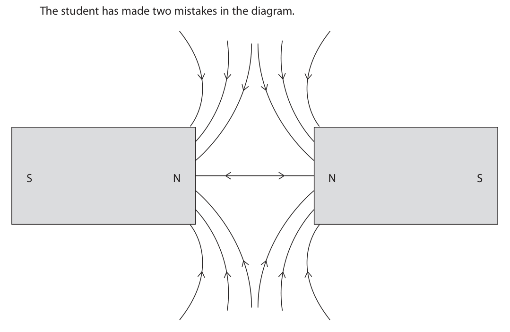

**Mark scheme answer**

> central line should not be drawn / does not exist; allow if seen on
> diagram
> arrows are pointing in the wrong direction / eq; allow if seen on
> diagram
> allow arrows should
> point away from north
> poles
> ignore any statement
> about start and finish
> points of field lines

- **(2)** central line should not be drawn / does not exist; allow if seen on

### 2(a)(ii) [1]

Give the name of a piece of equipment that can be used to show the direction of a magnetic field.

**Mark scheme answer**

> (plotting) compass(es); allow use of (bar)
> suspended magnet with
> known poles

- **(1)** (plotting) compass(es); allow use of (bar)

### 2(b) [1]

Which of these will not experience a magnetic force when at rest in a magnetic field?

- **(A)** plastic rod  ✔
- **(B)** bar magnet
- **(C)** copper wire with a current at right angles to the field
- **(D)** iron bar

**Mark scheme answer**

> A (plastic rod);
> B is incorrect because a bar magnet has its own
> magnetic field
> C is incorrect because a current-carrying conductor
> has its own magnetic field
> D is incorrect because iron is a magnetic material

- **(1)** Answer A: plastic rod

### 2(c) [2]

A teacher demonstrates magnetism by placing a strong magnet above some small nails made from steel. The steel nails are attracted to the magnet and stick to it. The teacher removes the steel nails from the magnet and puts the magnet away. A student observes that the steel nails are attracted to each other and stick together, even though the magnet is no longer present. Explain this observation.

**Mark scheme answer**

> steel is a hard magnetic material / magnetically ignore hard magnet
> hard;
> idea that steel retains its magnetism (for however allow steel is
> long) / eq; permanently
> magnetised
> Answer Notes Marks

- **(2)** steel is a hard magnetic material / magnetically ignore hard magnet

## Question 3 (10 marks)

Photograph 1 shows a water bath with its plastic lid. Water is placed in the water bath. The water bath heats the water and then keeps the water at a constant temperature. Photograph 1

### 3(a) [2]

The water bath is connected to mains electricity. Mains electricity provides alternating current (a.c.). Describe what is meant by the term alternating current (a.c.).

**Mark scheme answer**

> idea that current changes direction; allow current in both
> directions
> allow reference to
> electron direction (of
> travel)
> ignore vibrate
> continuously / repeatedly / frequently / constantly
> / eq;

- **(2)** idea that current changes direction; allow current in both

### 3(b) [3]

720 000 J of energy is transferred to the heating element in the water bath in a time of 30 minutes. Calculate the power of the heating element. power = W

**Mark scheme answer**

> conversion from minutes to seconds; allow 1800 seen
> allow 30 × 60 seen
> substitution into P = E / t; allow ecf from
> incorrect/no conversion
> evaluation; allow ecf from
> incorrect/no conversion
> e.g. 24 000 (W), 1 440 000 (W)
> scores 2 marks
> time = 1800 s
> P = 720 000 / 1800 400 (W) to any other
> power of 10 scores 2 marks
> 24 000 (W), 1440 000 (W)
> to any other power of 10
> scores 1 mark
> (P =) 400 (W) allow correct unit that
> matches candidate’s
> answer e.g. 24 kW is
> equivalent to 24 000 W

- **(3)** conversion from minutes to seconds; allow 1800 seen

### 3(c) [5]

A technician switches on the water bath before a science lesson so that the water has enough time to reach a temperature of 60 °C. The technician also covers the water bath with the plastic lid, as shown in photograph 2. Photograph 2 Explain why the lid reduces the time taken for the water in the water bath to reach a temperature of 60 °C.

**Mark scheme answer**

> any five from: accept heat for thermal
> energy throughout
> MP1. (thermal) energy is lost to the surroundings;
> MP2. (lid) reduces the amount of (thermal) energy
> lost (to surroundings) /eq;
> MP3. (lid) traps air (between water and lid); ignore traps heat
> MP4. (lid) reduces convection losses (to the allow ‘(lid) reduces
> surroundings)/eq; evaporation’
> MP5. idea that lid acts as insulation;
> MP6. plastic is a poor (thermal) conductor; allow plastic is a (good
> thermal) insulator
> allow air is a poor
> conductor
> allow air is a (good)
> insulator
> MP7. energy transfers by conduction are reduced;
> MP8. idea that black lid is a good radiator;
> Answer Notes Marks

- **(5)** any five from: accept heat for thermal

## Question 4 (9 marks)

This question is about microwaves.

**(a)** Diagram 1 represents a microwave. Displacement Distance Diagram 1

**(b)** A teacher demonstrates microwaves using a microwave transmitter and a microwave receiver. Diagram 2 shows the demonstration viewed from above. microwave microwave transmitter receiver direction of microwaves Diagram 2 The table gives some information about the microwaves produced by the transmitter. Speed of microwaves 3.0 × 108 m/s Frequency of microwaves 1.0 × 1010 Hz

### 4(a)(i) [1]

Add a labelled arrow to diagram 1 to show the amplitude of the microwave.

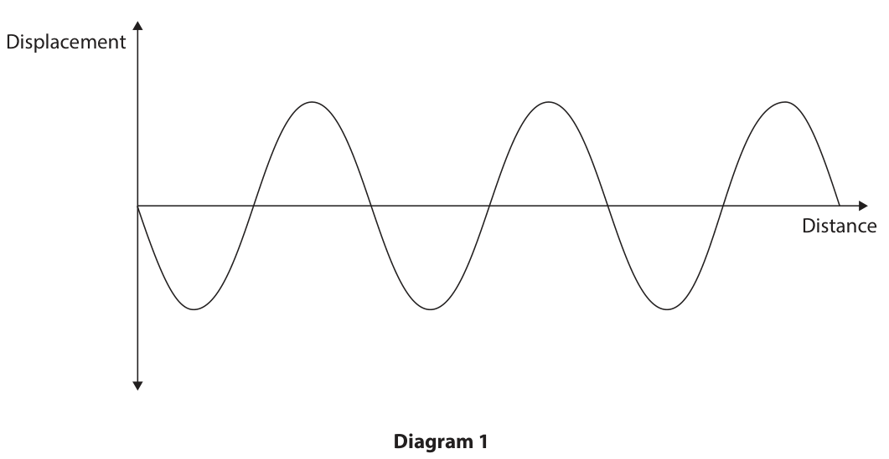

**Mark scheme answer**

> labelled arrow drawn between distance axis up to a
> crest or down to a trough;

- **(1)** labelled arrow drawn between distance axis up to a

### 4(a)(ii) [1]

Add a labelled arrow to diagram 1 to show the wavelength of the microwave.

**Mark scheme answer**

> labelled arrow drawn between two adjacent crests allow equivalent arrow
> or two adjacent troughs; drawn between any two
> adjacent positions at
> the same point in the
> wave cycle

- **(1)** labelled arrow drawn between two adjacent crests allow equivalent arrow

### 4(b)(i) [1]

The transmitter emits microwaves that travel towards the receiver. State the number of complete waves received by the receiver in one second. number =

**Mark scheme answer**

> 1(.0) × 1010; allow 10 000 000 000
> allow 1010 by itself
> ignore Hz or hertz

- **(1)** 1(.0) × 1010; allow 10 000 000 000

### 4(b)(ii) [4]

The teacher positions the receiver so that the distance between the receiver and the transmitter is equal to 15 wavelengths. Calculate the distance between the receiver and the transmitter. distance = m

**Mark scheme answer**

> substitution into v = f × λ; allow re-arrangement
> and substitution in
> either order
> substitution into an
> incorrect or incorrectly
> re-arranged equation
> scores no further marks
> rearrangement;
> evaluation of wavelength;
> evaluation of distance;
> e.g.
> 3(.0) × 108 = 1(.0) × 1010 × λ
> λ = 3(.0) × 108 / 1(.0) × 1010
> λ = 0.03(0) (m)
> (distance = 15 × 0.03 =) 0.45 (m) 0.45 (m) to any other
> power of 10 scores 3
> allow 0.4 (m) or 0.5 (m)
> for 4 marks
> 0.4 or 0.5 to any other
> power of 10 scores 3

- **(4)** substitution into v = f × λ; allow re-arrangement

### 4(b)(iii) [2]

The teacher changes the position of the receiver and adds a metal sheet to the demonstration, as shown in diagram 3. microwave transmitter metal direction of microwaves sheet microwave receiver Diagram 3 Microwaves are detected by the receiver. Suggest why the microwaves are detected. You should add to diagram 3 to help your answer.

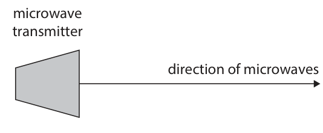

**Mark scheme answer**

> waves are reflected (by metal sheet);
> reference to or drawing on diagram showing initial judge by eye
> waves reflecting at sheet correctly towards allow reference to or
> receiver; drawing on diagram to
> indicate ‘straight down
> (the page)’. law of
> reflection or i=r.
> reject contradiction
> between diagram and
> text e.g. diagram shows
> reflection, text
> discusses refraction
> Answer Notes Marks

- **(2)** waves are reflected (by metal sheet);

## Question 5 (14 marks)

This question is about electric current.

**(c)** A student investigates how the current in a series circuit varies as the number of resistors in the circuit changes. This is the student’s method. Step 1	build a series circuit using a 6 V battery, a 12 Ω resistor, an ammeter, a switch and connecting wires Step 2 close the switch and measure the current using the ammeter Step 3 add another 12 Ω resistor into the series circuit and repeat step 2 The student repeats this method for a total of six 12 Ω resistors connected in series.

### 5(a) [1]

Which of these particles flow in an electric current in solid metallic conductors?

- **(A)** negatively charged electrons  ✔
- **(B)** negatively charged protons
- **(C)** positively charged electrons
- **(D)** positively charged protons

**Mark scheme answer**

> A (negatively charged electrons);
> B is incorrect because protons are positively charged
> C is incorrect because electrons are negatively
> charged
> D is incorrect because protons cannot flow in solid
> metallic conductors

- **(1)** Answer A: negatively charged electrons

### 5(b) [1]

What is the definition of electric current?

- **(A)** energy transferred per unit charge passed
- **(B)** energy transferred per unit resistance
- **(C)** rate of energy transfer
- **(D)** rate of flow of charge  ✔

**Mark scheme answer**

> D (rate of flow of charge);
> A is incorrect because this is the definition of
> voltage
> B is incorrect because this is the ratio of energy and
> resistance
> C is incorrect because this is the definition of power

- **(1)** Answer D: rate of flow of charge

### 5(c)(i) [3]

Identify the independent variable, the dependent variable and a control variable in the student’s investigation. independent variable dependent variable control variable

**Mark scheme answer**

> independent variable = number of resistors; ignore resistance
> dependent variable = current;
> control variable = voltage of battery / resistance of ignore switch, same
> each resistor/ temperature (of circuit or of components etc.
> resistors);

- **(3)** independent variable = number of resistors; ignore resistance

### 5(c)(ii) [1]

Give a reason why the student includes the switch in the circuit.

**Mark scheme answer**

> idea that it prevents overheating (of the circuit or or allow idea that resistance
> the wires or the battery); might change if circuit is
> left on
> ignore idea of switching
> on and off

- **(1)** idea that it prevents overheating (of the circuit or or allow idea that resistance

### 5(c)(iii) [3]

Draw a suitable circuit diagram showing how the components in the method should be connected to measure the current in a series circuit containing two 12 Ω resistors. The 6 V battery has been drawn for you. 6V

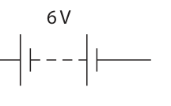

**Mark scheme answer**

> all four components in a complete circuit with circuit must include two
> battery; resistors, switch and
> ammeter
> condone incorrect
> symbols sufficiently
> labelled
> ignore extra components
> correct circuit symbol used for two resistors in series
> with each other;
> correct circuit symbol used for ammeter in series;

- **(3)** all four components in a complete circuit with circuit must include two

### 5(c)(iv) [2]

The table shows the student’s results. Number of resistors Current in A 1 0.50 2 0.25 3 0.17 4 0.13 5 0.10 6 0.08 Describe the relationship between the number of resistors and the current in the circuit.

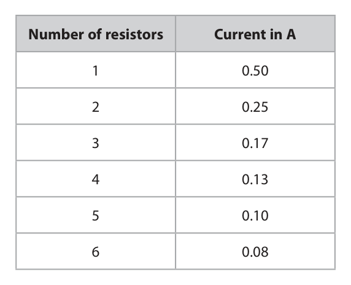

**Mark scheme answer**

> idea that as number of resistors increases, the ignore negative
> current decreases; correlation
> idea that the decrease in current gets smaller as the
> number of resistors increases
> allow “inversely
> proportional” for 2 marks

- **(2)** idea that as number of resistors increases, the ignore negative

### 5(c)(v) [3]

Discuss whether a bar chart or a line graph is most appropriate for displaying the results of this investigation.

**Mark scheme answer**

> any three from: allow discrete, not
> continuous and categoric
> as equivalent ideas
> ignore “quantitative” and
> “qualitative” discussion
> MP1. bar chart is (more) suitable for discrete
> variables;
> MP2. line graph is (more) suitable for continuous
> data;
> MP3. idea that number of resistors is not
> continuous;
> MP4. idea that number of resistors is equivalent to
> resistance which is continuous/eq;
> Answer Notes Marks

- **(3)** any three from: allow discrete, not

## Question 6 (7 marks)

This question is about nuclear fusion.

### 6(a) [1]

In which of these does nuclear fusion take place naturally?

- **(A)** in nuclear power stations
- **(B)** in plants
- **(C)** in stars  ✔
- **(D)** in the human body

**Mark scheme answer**

> C (in stars);
> A is incorrect because this is not a natural process
> B is incorrect because fusion does not take place in
> plants
> D is incorrect because fusion does not take place in
> the human body

- **(1)** Answer C: in stars

### 6(b) [3]

Describe the process of nuclear fusion.

**Mark scheme answer**

> reference to combining nuclei however expressed; allow hydrogen or protons
> for nuclei
> reject atoms, molecules
> for nuclei
> allow recognisable mis-
> spellings for nuclei e.g.
> nucleuses
> (resulting in) a loss of mass/eq;
> releasing energy; condone ‘heat’ for
> ‘energy’

- **(3)** reference to combining nuclei however expressed; allow hydrogen or protons

### 6(c) [3]

Explain the conditions required for nuclear fusion.

**Mark scheme answer**

> any three from: allow particles for nuclei
> condone atoms for nuclei
> MP1. high temperature;
> MP2. nuclei need to move at high speeds or with
> high KE / eq;
> MP3. high pressure;
> MP4. nuclei need to be close together / eq; allow high density
> MP5. reference to electrostatic repulsion (of
> protons)
> Answer Notes Marks

- **(3)** any three from: allow particles for nuclei

## Question 7 (11 marks)

A student does an experiment to determine the density of air.

**(a)** The student completely fills a large bucket with water and places the bucket in a large tray. The student then inflates a balloon with air and seals the balloon. The inflated balloon is then pushed into the bucket so that it is completely submerged in the water. Water is displaced from the bucket and is collected in the tray, as shown by the diagram. balloon bucket water before submerging tray after submerging

### 7(a)(i) [2]

The volume of water collected in the tray is equal to the volume of the inflated balloon. Describe how the student could accurately measure the volume of water collected in the tray.

**Mark scheme answer**

> NB only allow marks from
> one of the three alternate
> routes
> idea of pouring water into a measuring cylinder;
> idea of reading measuring cylinder at eye level / no allow idea of making sure
> parallax error / measure to the bottom of the all of the water gets to the
> meniscus; measuring cylinder e.g.
> idea of not spilling or no
> water left in tray
> OR
> measure difference of mass between water+tray condone weight for mass
> and tray alone (with a balance); for this marking point
> divide mass by density to give volume; reject weight for mass for
> this marking point
> OR
> measuring dimensions of body of water;
> calculating (geometrically) the volume from those
> dimensions;

- **(2)** NB only allow marks from

### 7(a)(ii) [1]

Give a reason why the measured volume of water in the tray may be different from the volume of the inflated balloon.

**Mark scheme answer**

> any one from: ignore idea of balloon
> having thickness
> ignore idea that balloon is
> not completely submerged
> • bucket may not have been completely full
> /eq;
> • some water may have splashed out /eq;
> • more water displaced due to object pushing
> the balloon underwater /eq;
> • idea of parallax error;
> • idea of not reading to the bottom of the
> meniscus;
> • idea of water remaining on outside of
> bucket (when removed)
> • idea that some water may remain in the
> tray
> allow idea of balloon
> decreasing in volume
> under water compared
> with being in air

- **(1)** any one from: ignore idea of balloon

### 7(b) [2]

The student removes the inflated balloon from the bucket and dries the balloon. The student places the inflated balloon on a sensitive balance and measures the mass of the inflated balloon. The student then bursts the balloon. Describe how the student should use the burst balloon to determine the mass of air that was inside the inflated balloon.

**Mark scheme answer**

> measure mass of burst balloon;
> subtract mass of burst balloon from mass of inflated accept ‘find the
> balloon; difference’ or ‘find the
> decrease’ for ‘subtract’
> allow ‘weight’ for ‘mass’
> for this mark only

- **(2)** measure mass of burst balloon;

### 7(c) [4]

The table shows the student’s results. Volume of water displaced by 4350 cm3 inflated balloon Mass of air inside balloon 5.42 g Calculate the density of air using the student’s results. Give your answer to 3 significant figures and give a suitable unit. density = unit

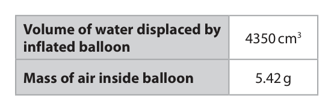

**Mark scheme answer**

> substitution into ρ = m/V;
> evaluation; POT – 1
> treat incorrect conversions
> as POT errors
> evaluation given to 3 s.f.; award mark for any value
> expressed to 3 s.f.
> unit; expect either g/cm3 or
> kg/m3
> allow 1.25 kg/m3 for full
> allow 1.25 × 10-6 kg/cm3
> for full marks
> e.g.
> density = 5.42 / 4350
> (density =) 0.0012459…
> (density =) 0.00125
> g/cm3

- **(4)** substitution into ρ = m/V;

### 7(d) [2]

Give two ways of testing the reliability of the density value obtained from the student’s results. 1 2

**Mark scheme answer**

> any two from:
> MP1. repeating the (whole) experiment again; unsupported “take
> repeats” is insufficient
> accept idea of using
> different (volume) balloon
> MP2. determine density using a different method;
> MP3. compare result with another student who did
> the experiment;
> MP4. compare result to literature/online value;
> Answer Notes Marks

- **(2)** any two from:

## Question 8 (12 marks)

This question is about gases.

### 8(a) [3]

The graph shows how the average kinetic energy of a single gas molecule varies with the temperature of the gas, measured in °C. Average kinetic energy –300 –200 –100 0 100 200 300 Temperature in C Use the graph to explain why there is an absolute zero of temperature.

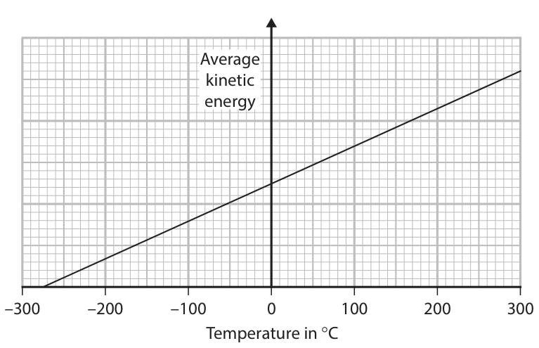

**Mark scheme answer**

> (at absolute zero) the particles in the gas stop
> moving;
> (at absolute zero) the (average) kinetic energy is
> zero;
> absolute zero is −273 °C; allow (line on graph
> intersects the
> temperature axis)
> between −270 °C and
> −280 °C

- **(3)** (at absolute zero) the particles in the gas stop

### 8(b) [4]

Diagram 1 shows a sample of gas in a syringe. gas molecules Diagram 1 The volume of the gas is increased so that it is double its original volume, as shown in diagram 2. gas molecules Diagram 2 Explain how the pressure of the gas changes when the volume of the gas is doubled. Assume the temperature of the gas remains constant.

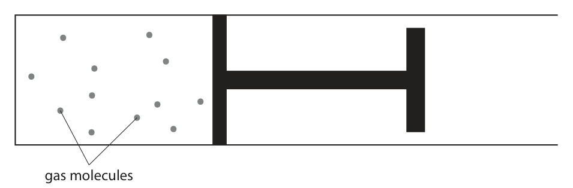

**Mark scheme answer**

> any FOUR from:
> correct reference to p1V1=p2V2;
> pressure decreases;
> pressure is halved; also scores MP2
> allow equivalent
> algebraic expression
> idea that particles hit the walls (of the container) allow particles now
> less often / eq; colliding with a greater
> (surface) area
> (so) the (overall) force on the container ignore unsupported
> decreases; references to P = F/A

- **(4)** any FOUR from:

### 8(c) [5]

Another sample of gas has a temperature of 100 °C and a pressure of 140 kPa. The gas is cooled and its temperature decreases by 65 °C. The volume of the gas does not change. Calculate the new pressure of the gas. new pressure = kPa

**Mark scheme answer**

> evaluation of new temperature in °C; allow 35 seen anywhere
> in working
> evaluation of both temperatures in K;
> substitution into p1/T1 = p2/T2;
> rearrangement; rearrangement and
> substitution in either
> order
> evaluation; 473.2..., 24.39..., 91
> score 3 marks
> 49, 13.1..., 431.2...,
> 126.86.. score 4 marks
> e.g.
> new temperature = 35 °C
> T1 = 373 K, T2 = 308 K
> 140 / 373 = p2 / 308
> p2 = 140 × 308 / 373
> (p2 =) 120 (K) allow 116, 115.6…(kPa)
> for 5 marks
> Answer Notes Marks

- **(5)** evaluation of new temperature in °C; allow 35 seen anywhere

## Question 9 (8 marks)

This question is about refraction.

**(a)** Diagram 1 shows the refraction of a ray of blue light as it passes from air through a triangular glass prism. ray of blue light air glass prism Diagram 1

**(b)** A student obtains data for the refractive index of glass using different wavelengths of light. The student plots this graph using the data. 1.55 1.54 1.53 Refractive index 1.52 1.51 1.50 3 × 10–7 4 × 10–7 5 × 10–7 6 × 10–7 7 × 10–7 8 × 10–7 Wavelength in m

### 9(a)(i) [1]

Use a protractor to determine the angle of incidence at the point where the ray of blue light enters the prism. angle of incidence = degrees

**Mark scheme answer**

> 50 (degrees); allow 48-52 (degrees)

- **(1)** 50 (degrees); allow 48-52 (degrees)

### 9(a)(ii) [2]

Show that the refractive index of the glass the prism is made from is about 1.5

**Mark scheme answer**

> substitution into n = sin(i)/sin(r); allow ecf from (i)
> evaluation to 3 or more s.f.; condone reverse
> calculation for full
> marks e.g.
> using n = 1.5 to
> calculate i or r to 3 or
> more sf
> e.g.
> refractive index = sin 50 / sin 30 NB if i is 52, n = 1.57
> to 3 sf
> if i is 48, n = 1.49 to
> 3sf
> (refractive index =) 1.53…

- **(2)** substitution into n = sin(i)/sin(r); allow ecf from (i)

### 9(a)(iii) [2]

The refractive index of red light in glass is lower than the refractive index of blue light in glass. Complete diagram 2 by continuing the path of the ray of red light as it passes through the glass prism and into the air. The ray of red light has the same angle of incidence as the original ray of blue light. The dashed line shows the path of the blue light. ray of red light air glass prism Diagram 2

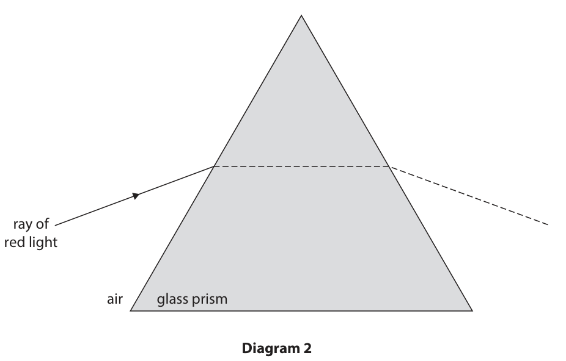

**Mark scheme answer**

> ray drawn refracting with a larger angle of ray should be drawn
> refraction but not greater than the angle of above dashed line and
> incidence; below a continuation
> of the incident ray
> ray drawn passing back into air such that it reject ray that bends
> diverges from dashed line; the wrong side of the
> normal
> e.g.

- **(2)** ray drawn refracting with a larger angle of ray should be drawn

### 9(b)(i) [1]

Give a reason why the student does not start the scales on the graph at zero.

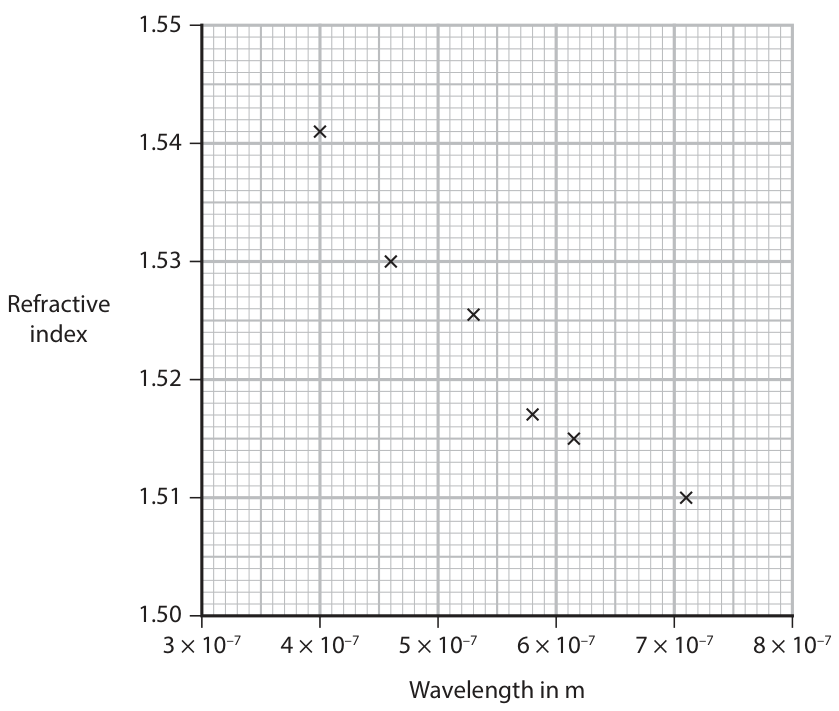

**Mark scheme answer**

> idea that plotted points would occupy a very small accept idea that
> area of the grid; labelling axes too far
> outside the range(s)
> would make the graph
> too small

- **(1)** idea that plotted points would occupy a very small accept idea that

### 9(b)(ii) [1]

The student thinks one of the data points is anomalous. Draw a circle around the anomalous data point.

**Mark scheme answer**

> data point at 5.3 × 10−7 m circled; allow any other clear
> indication

- **(1)** data point at 5.3 × 10−7 m circled; allow any other clear

### 9(b)(iii) [1]

Draw the curve of best fit on the graph.

**Mark scheme answer**

> smooth curve of best fit drawn passing through all
> data points except anomaly; allow curve passing
> through any part of
> each cross
> reject points linked by
> straight lines
> reject best fit straight
> line
> Answer Notes Marks

- **(1)** smooth curve of best fit drawn passing through all

## Question 10 (13 marks)

This question is about beta particles.

**(c)** The diagram shows a beta particle slowing down as it travels through a thin sheet of aluminium. 3.2 × 107 m/s 2.5 × 107 m/s beta particle thin sheet of aluminium

### 10(a) [1]

What is a beta particle?

- **(A)** high energy electron  ✔
- **(B)** high energy neutron
- **(C)** high frequency electromagnetic wave
- **(D)** helium nucleus

**Mark scheme answer**

> A (high energy electron);
> B is incorrect because this is neutron radiation
> C is incorrect because this is gamma radiation
> D is incorrect because this is alpha radiation

- **(1)** Answer A: high energy electron

### 10(b) [3]

A beta particle can be produced during radioactive decay. When a neutron decays into a proton, a beta particle is produced. Complete the nuclear equation for this process. n → p + β

**Mark scheme answer**

> mass and atomic numbers correct for neutron;
> mass and atomic numbers correct for proton;
> mass and atomic numbers correct for beta
> particle;
> e.g.

- **(3)** mass and atomic numbers correct for neutron;

### 10(c)(i) [2]

The table gives some statements about the sheet of aluminium after the beta particle has travelled through it. Place ticks (ü) in the table to show whether each statement is correct or incorrect. Statement Correct Incorrect the sheet of aluminium is now radioactive the sheet of aluminium has been contaminated by the beta particle the sheet of aluminium has been irradiated by the beta particle

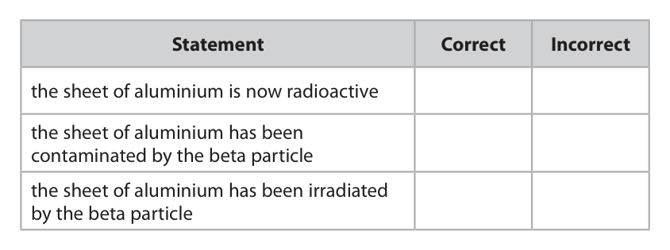

**Mark scheme answer**

> all three rows correct = 2 marks;; reject row if more than
> one tick
> any one row correct = 1 mark;
> e.g.

- **(2)** all three rows correct = 2 marks;; reject row if more than

### 10(c)(ii) [4]

Just before travelling through the sheet of aluminium, the beta particle has a speed of 3.2 × 107 m/s. Just after travelling through the sheet of aluminium, the beta particle has a speed of 2.5 × 107 m/s. The sheet of aluminium has a thickness of 0.60 mm. Show that the magnitude of the acceleration of the beta particle as it travels through the sheet of aluminium is about 3 × 1017 m/s2.

**Mark scheme answer**

> conversion of mm to m;
> substitution into v2 = u2 + 2as; ignore POT on speeds until
> the evaluation
> allow alternate
> substitutions of v and u
> rearrangement with acceleration as subject;
> evaluation to 2 or more s.f.; ignore minus sign
> condone reverse
> calculation for full marks
> e.g. using v,u and a to find
> s to 3 or more sf, using u,
> a and s to find v to 3 or
> more sf or using v, a and s
> to find u to 3 or more sf
> e.g.
> s = 0.60 × 10−3 (m)
> (2.5 × 107)2 = (3.2 × 107)2 + (2 × a × 0.60 × 10−3)
> a = [(2.5 × 107)2 − (3.2 × 107)2] / (2 × 0.60 × 10−3)
> (acceleration =) (−)3.3 × 1017 (m/s2) allow (−)3.325 × 1017 (m/s2)

- **(4)** conversion of mm to m;

### 10(c)(iii) [3]

The beta particle has a mass of 9.1 × 10–31 kg. Calculate the decrease in the kinetic energy of the beta particle as it travels through the sheet of aluminium. decrease in kinetic energy = J

**Mark scheme answer**

> allow alternative method
> of using F = ma and W = Fd
> to calculate the work done
> on the aluminium sheet
> evaluation of initial KE of beta particle;
> evaluation of final KE of beta particle;
> (subtraction of KE values to give) evaluation; ignore minus sign
> allow ecf from KE values
> for this mark if values for
> KE seen and then
> calculating difference in
> KE
> e.g.
> KEinitial = (½ × 9.1 × 10−31 × (3.2 × 107)2 =) 4.7 × 10−16 allow 4.6 × 10−16,
> (J) 4.6592 × 10−16 (J)
> KEfinal = (½ × 9.1 × 10−31 × (2.5 × 107)2 =) 2.8 × 10−16 allow 2.84375 × 10−16 (J)
> (J)
> (decrease in KE =) 1.8 × 10−16 (J) allow answers that round
> to 1.8 × 10−16 (J) and
> 1.9 × 10−16 (J)
> ignore minus sign on final
> Use of (difference in
> velocity)2 scores 1 mark
> max
> Answer Notes Marks

- **(3)** allow alternative method

## Question 11 (14 marks)

Sky diving is a sport that involves jumping out of an aeroplane high above the ground.

**(a)** Diagram 1 shows a sky diver just after they jump out of an aeroplane. Diagram 1

**(b)** Diagram 2 shows the sky diver after they have opened a parachute to decrease their speed so that they land safely on the ground. Diagram 2 The velocity‑time graph shows how the speed of the sky diver changes from the instant the parachute opens. Velocity in m/s 0.0 1.0 2.0 3.0 4.0 5.0 Time in s

### 11(a)(i) [2]

The weight of the sky diver is 850 N. Calculate the mass of the sky diver. Use the formula weight = mass × gravitational field strength mass = kg

**Mark scheme answer**

> substitution OR rearrangement; allow use of g = 9.8,
> 9.81 N/kg
> evaluation;
> e.g.
> 850 = mass × 10 OR m = W / g
> (mass = 850/10 =) 85 (kg) allow 87, 86.7…, 86.6
> (kg)

- **(2)** substitution OR rearrangement; allow use of g = 9.8,

### 11(a)(ii) [3]

After falling for a short period of time, an upward force of 250 N acts on the sky diver due to air resistance. Calculate the acceleration of the sky diver when the upward force is 250 N. acceleration = m/s2

**Mark scheme answer**

> evaluation of resultant force; allow 600 (N) seen
> anywhere in working
> allow ecf from (i)
> substitution into OR rearrangement of F = m × a; allow use of 250 (N) for
> F
> evaluation of acceleration; allow ecf for resultant
> force
> e.g.
> resultant force = 850 − 250 = 600 (N)
> 600 = 85 × acceleration OR a = F / m
> (acceleration = 600/85 =) 7.1 (m/s2) allow 6.9-7.1 (m/s2) for
> 3 marks
> allow 2.9,2.87.., 2.94..,
> etc (m/s2) for 2 marks
> allow correct answer
> without any working for
> 3 marks

- **(3)** evaluation of resultant force; allow 600 (N) seen

### 11(b)(i) [4]

Explain how the acceleration of the sky diver changes after the parachute opens. You should refer to the graph in your answer.

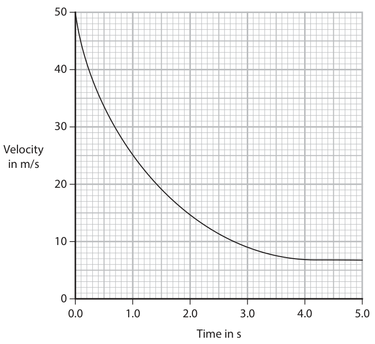

**Mark scheme answer**

> any four from: accept acceleration for
> deceleration throughout
> MP1. idea that acceleration is linked to gradient;
> MP2. idea that (initially) parachute provides accept air resistance
> (large) upwards force; (AR) or drag is bigger
> than the weight /eq
> accept AR or drag for
> upwards force
> accept there is a
> resultant upward force
> /eq
> MP3. deceleration decreases (over time period of
> the graph);
> MP4. air resistance decreases as speed decreases;
> MP5. forces of air resistance and weight accept resultant is zero
> (eventually) become equal; accept AR and weight
> are equal
> accept balanced forces
> / eq
> MP6. deceleration or gradient (eventually) ignore terminal velocity
> becomes zero;

- **(4)** any four from: accept acceleration for

### 11(b)(ii) [5]

Use the graph to estimate the distance the sky diver falls in the first 4.0 s after the parachute opens. distance = m

**Mark scheme answer**

> distance = area under line; seen explicitly or
> implied by working
> suitable method used; allow
> • use of trapeziums
> • rectangles and
> triangles
> • counting squares
> estimation
> distance in the range = 60-100 (m); scores 3 marks total
> distance in the range = 65-80 (m); scores 4 marks total
> distance in the range = 70-75 (m); scores 5 marks total
> answers in answer
> column to any other
> power of 10 scores 1
> mark fewer
> ignore attempts at
> suvat/equations of
> motion for uniform
> acceleration

- **(5)** distance = area under line; seen explicitly or

