# 4PH1/2P — 2026-06 (official extraction)

> schema `syllabai.official-paper-questions/0.2` · paper_id `pearson-edexcel:international-gcse:physics:4ph1:2026-06:4PH1/2P` · qp sha256 `60c15a9983355e19…` · extraction is the disclosed baseline (ADR-039)

## Question 1 (8 marks)

A student investigates the specific heat capacity of a material. The diagram shows some of the apparatus they use in their investigation. power supply A V lid container material heater thermometer This is the student’s method. Step 1 measure the mass of the material Step 2 measure the initial temperature of the material Step 3 switch on the heater Step 4 measure the current and voltage of the heater Step 5 allow the material to increase in temperature for two minutes Step 6 switch off the heater

**(b)** The graph shows the student’s results. Temperature in C 0 20 40 60 80 100 120 Time in seconds

### 1(a) [2]

Give two other pieces of apparatus the student needs for the investigation. 1 2

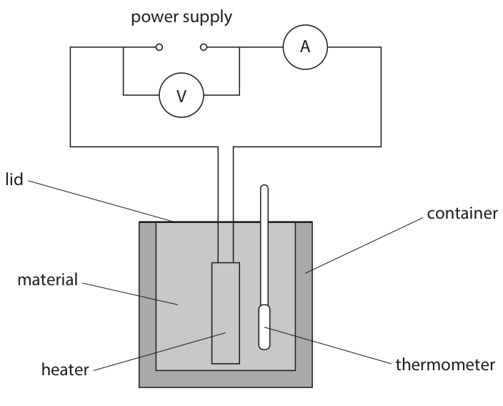

**Mark scheme answer**

> balance; accept (weighing)
> scales, weighing
> scale
> reject unqualified
> ‘scale’
> timer/stopwatch/stopclock; ignore irrelevant
> apparatus

- **(2)** balance; accept (weighing)

### 1(b)(i) [1]

What is the temperature change 80 seconds after the start of the investigation?

- **(A)** 28 °C  ✔
- **(B)** 30 °C
- **(C)** 42 °C
- **(D)** 72 °C

**Mark scheme answer**

> A (28 oC)
> B cannot be the correct answer because it is the
> lowest temperature on the graph and would
> need the temperature at 80 seconds to be 60
> (oC)
> C cannot be the correct answer because it is the
> difference between the highest and lowest
> temperatures on the graph and would need the
> temperature at 80 seconds to be 72 (oC)
> D cannot be the correct answer because it is the
> highest temperature on the graph and would
> need the temperature at 80 seconds to be 102
> (oC)

- **(1)** Answer A: 28 °C

### 1(b)(ii) [2]

The power supply provides a current of 3.9 A and a voltage of 12 V to the heater. Calculate the energy transferred to the material in the first 80 seconds. energy transferred = J

**Mark scheme answer**

> MP1 substitution into given formula;
> MP2 correct evaluation; correct answer
> with no working
> i.e. scores full marks
> energy transferred = 12 × 3.9 × 80;
> energy transferred = 3700 (J)
> unrounded answer
> is 3744 (J)

- **(2)** MP1 substitution into given formula;

### 1(b)(iii) [3]

The material has a mass of 0.29 kg. Calculate the specific heat capacity of the material. specific heat capacity = J/kg °C

**Mark scheme answer**

> MP1 substitution of the material’s mass, the rearrangement and
> candidate’s answer to (i) for the temperature substitution can be
> change and the candidate’s answer to (ii) for the in either order
> energy into given equation;
> MP2 rearrangement;
> MP3 correct evaluation using candidate’s answer
> for (i) as the temperature change and correct unrounded
> candidate’s answer for (ii) as the energy; answer using 3744
> (J) is 461 ( J/kg oC)
> i.e. correct unrounded
> energy transferred = mass × SHC × temp change answer using 3700
> 3744 = 0.29 × c × 28 (J) is 455 ( J/kg oC)
> c = 3744 ÷ (0.29 × 28)
> c = 460 (J/kg oC) correct answer
> with no working
> scores full marks
> NB – answers that
> may score full
> marks due to
> incorrect answers
> to (i) with ECF are:
> 430, 425, 310, 300,
> 180
> Total for question 1: 8 marks
> Answer Notes Marks

- **(3)** MP1 substitution of the material’s mass, the rearrangement and

## Question 2 (9 marks)

This question is about moments.

**(a)** Diagram 1 shows some forces acting on a vertical beam. The beam is in equilibrium. 3200 N pivot point 4.8 m 0.61 m F Diagram 1

### 2(a)(i) [3]

Calculate the moment of the 3200 N force. Give the unit. moment = unit

**Mark scheme answer**

> MP1 substitution in to given equation; accept standard form
> throughout (a)
> MP2 correct evaluation of moment;
> MP3 unit: Nm ; accept Ncm if
> appropriate to
> candidate’s value
> i.e. 1 536 000 Ncm
> correct answer with no
> working scores full
> e.g.
> moment = force × distance
> moment = 3200 × 4.8 unrounded answer is
> moment = 15 000 (Nm) 15 360 (Nm)

- **(3)** MP1 substitution in to given equation; accept standard form

### 2(a)(ii) [2]

State the magnitude and the direction of the moment provided by force F. magnitude = direction =

**Mark scheme answer**

> MP1 candidate’s answer to (a)(i); ignore unit
> allow 15 000 regardless
> of (i)
> MP2 clockwise; accept CW
> accept clockwise arrow
> reject anti-clockwise
> reject ACW
> reject counter-
> clockwise
> reject anti-clockwise
> arrow
> reject CCW
> ignore any other
> direction

- **(2)** MP1 candidate’s answer to (a)(i); ignore unit

### 2(b) [4]

The beam now rests on two supports. Diagram 2 shows the forces acting on the beam. upward force A upward force B A B weight of beam Diagram 2 The upward force on the beam from each support point is half of the weight of the beam. Explain how the upward forces at point A and point B change • when a person stands on the beam at point A • as the person walks along the beam from point A to point B Refer to ideas about moments in your answer.

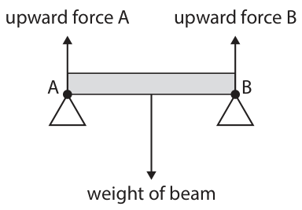

**Mark scheme answer**

> ignore movement of
> beam
> MP1 idea that moment (about a named point)
> clockwise = moment (about named point)
> anticlockwise;
> MP2 idea that from point A, total moment accept idea that from
> clockwise increases as person walks; point B, total moment
> anti-clockwise
> decreases as person
> walks
> MP3 so moment and hence force at B must also accept idea that force A
> increase (to stay in equilibrium); decreases so force B
> must increase
> MP4 idea that when person gets on, force A accept idea that force A
> increases and force B does not; increases more than
> force B when person
> gets on
> Total for question 2: 9 marks
> Answer Notes Marks

- **(4)** ignore movement of

## Question 3 (9 marks)

This question is about magnets.

**(b)** Diagram 1 shows a metal bar placed near an electromagnet. When the electromagnet is switched on, the metal bar becomes a magnet and experiences an attractive force. S electromagnet N metal bar Diagram 1

### 3(a) [3]

Describe the construction of an electromagnet. You may draw a diagram to help your answer.

**Mark scheme answer**

> all marks can be scored
> from a suitably
> annotated diagram
> MP1 reference to a coil; accept solenoid
> MP2 reference to (iron) core; ignore ‘bar magnet’ for
> core
> MP3 reference to a (d.c) current; allow reference to d.c.
> power supply or battery
> reject reference to an
> a.c. current for this
> mark only

- **(3)** all marks can be scored

### 3(b)(i) [2]

Deduce which end of the metal bar is a north pole.

**Mark scheme answer**

> reject ‘charges’ for
> ‘poles’
> MP1 (bar and electromagnet attract) so nearest allow “opposite poles
> pole to electromagnet is a S pole /eq ; attract”
> allow “unlike” for
> “opposite”
> ‘S’ on diagram is
> insufficient evidence
> for MP1
> MP2 right hand end of bar is (therefore) a N pole; ‘N’ on diagram is
> sufficient evidence for
> MP2

- **(2)** reject ‘charges’ for

### 3(b)(ii) [4]

Draw four magnetic field lines on diagram 1 to show • the field around the electromagnet • the field between the electromagnet and the metal bar

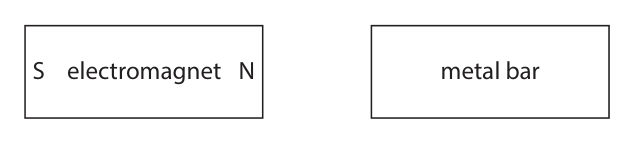

**Mark scheme answer**

> MP1 at least four field lines drawn with no field condone starting from
> lines crossing; same point on bar or
> magnet
> MP2 at least one field line loops from one pole to ignore lines that do not
> the other on the electromagnet; touch pole(s) of electro
> magnet
> MP3 at least one field line going between N pole of ignore lines that do not
> electromagnet and S pole of bar; touch pole(s) of electro
> magnet
> MP4 at least one field line with a correct arrow and ignore lines without
> no contradictory arrow heads; arrows
> NB – no requirement for
> symmetry
> Total for question 3: 9 marks
> Answer Notes Marks

- **(4)** MP1 at least four field lines drawn with no field condone starting from

## Question 4 (10 marks)

The diagram shows a nuclear fission reactor. shielding control rod coolant out moderator reactor vessel fuel rod coolant in

### 4(a) [4]

The fission reactor is used in a power station to generate electricity on a large scale. Describe how energy transfers cause changes in the energy stores in a nuclear fission power station.

**Mark scheme answer**

> any FOUR from allow ‘water’ for
> ‘coolant’ throughout
> EITHER reject ‘mechanical’ as
> an energy store
> throughout
> MP1 nuclear store of fuel to thermal store of
> moderator / eq;
> MP2 the transfer for this is (by) radiation / eq;
> MP3 thermal store of moderator to thermal store of allow nuclear store of
> coolant / eq; fuel to thermal store
> of coolant
> MP4 the transfer for this is (by) heating /eq;
> MP5 thermal store of coolant to kinetic store of
> turbine / eq;
> MP6 the transfer for this is mechanical(ly);
> MP7 kinetic store of turbine to electrostatic store of
> generator;
> MP8 the transfer for this is mechanical(ly) or
> electrical(ly);
> OR
> MP1 nuclear energy of fuel (transfers) to thermal allow nuclear energy
> energy of moderator; of fuel transfers to
> thermal energy of
> coolant
> MP2 thermal energy of moderator (transfers) to
> thermal energy of coolant;
> MP3 thermal energy of coolant (transfers) to kinetic
> energy of turbine;
> MP4 kinetic energy of turbine (transfers) to kinetic
> energy of generator;
> MP5 kinetic energy of generator (transfers) to
> electrical energy of generator;

- **(4)** any FOUR from allow ‘water’ for

### 4(b) [2]

In a nuclear power station, the reactor is shielded in concrete. Explain why a worker in a power station might still need to take safety precautions.

**Mark scheme answer**

> ignore references to
> alpha radiation or beta
> radiation
> ignore references to
> leaks or cracks /eq
> any TWO from
> MP1 gamma are more penetrating (than alpha or condone ‘highly’ for
> beta); ‘more’ penetrating
> MP2 idea that some gamma or some radiation can
> still penetrate out of the concrete / eq;
> MP3 idea that exposure time needs to be monitored
> or be limited;
> MP4 idea that increased exposure or increased dose accept (cell) mutations
> will cause or increase the likelihood of cancer; or damage to (cell)
> DNA or damage to
> tissue

- **(2)** ignore references to

### 4(c)(i) [1]

State the formula linking efficiency, useful output energy and total output energy.

**Mark scheme answer**

> efficiency = useful energy output / total energy output x 100%
> accept missing 100%
> accept total energy input for denominator
> ignore reference to power for energy

- **(1)** efficiency = useful energy output / total energy output x 100%

### 4(c)(ii) [3]

In the power station, the fission of 1.0 kg of uranium-235 fuel gives a power output of 2.4 ×1010 W for 3600 seconds. 3.2 × 1013 J of the energy is transferred usefully to the National Grid. Calculate the efficiency of the power station. Give your answer as a percentage. efficiency = %

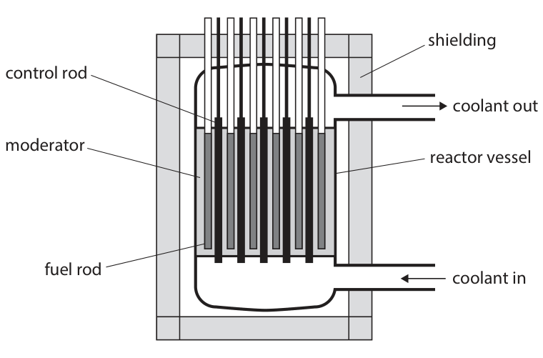

**Mark scheme answer**

> MP1 substitution into or rearrangement of given allow value of energy
> formula (P = W/t); seen as sufficient
> evidence of
> substitution e.g. total
> energy output is 8.64 ×
> 1013 (J)
> MP2 substitution into efficiency formula;
> MP3 correct evaluation;
> unrounded correct
> answer is 37.037...%
> i.e.
> answers of 37 to any
> total energy output = power × time other power of ten
> total energy output = 2.4 ×1010 × 3600 scores 2 marks
> efficiency = (3.2 × 1013)
> ÷ (2.4 ×1010 × 3600)
> efficiency = 37(%)
> Total for question 4: 10 marks
> Answer Notes Marks

- **(3)** MP1 substitution into or rearrangement of given allow value of energy

## Question 5 (7 marks)

A student investigates the forces acting on two balloons, X and Y, when they are charged by friction. Diagram 1 shows these balloons at the start of the investigation when they are uncharged. The balloons are attached by strings to a beam. Not to scale X Y Diagram 1

### 5(a) [3]

Diagram 2 shows the two balloons after the student has rubbed them together and then separated them. Not to scale X Y Diagram 2 Balloon X and balloon Y attract each other. Describe how balloon X and balloon Y have become charged.

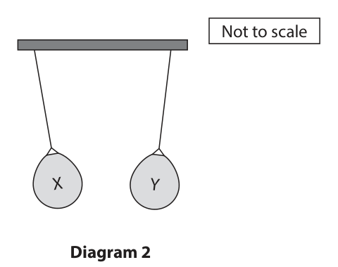

**Mark scheme answer**

> MP1 idea of transfer of (negative) charge; reject reference to
> transfer of positive
> charge e.g. protons,
> positive electrons
> MP2 one balloon has lost negative charge and the MP2 also scores MP1
> other has gained negative charge / eq;
> MP3 clear indication that electron(s) are the
> negative charge involved;
> ‘one balloon has lost
> electrons and the
> other has gained
> electrons’ scores all
> three marks
> ‘one balloon has
> transferred electrons
> to the other (balloon)’
> scores all three marks

- **(3)** MP1 idea of transfer of (negative) charge; reject reference to

### 5(b) [4]

The student changes the distance between the two balloons and measures the force of attraction between them. The graph shows the student’s results. Force in mN 0.0 1.0 2.0 3.0 4.0 5.0 6.0 Distance in cm The student suggests that the distance between the two balloons and the force of attraction between the two balloons obey this relationship (distance)2 × force = constant Use data from the graph to determine if the results from the investigation support this relationship.

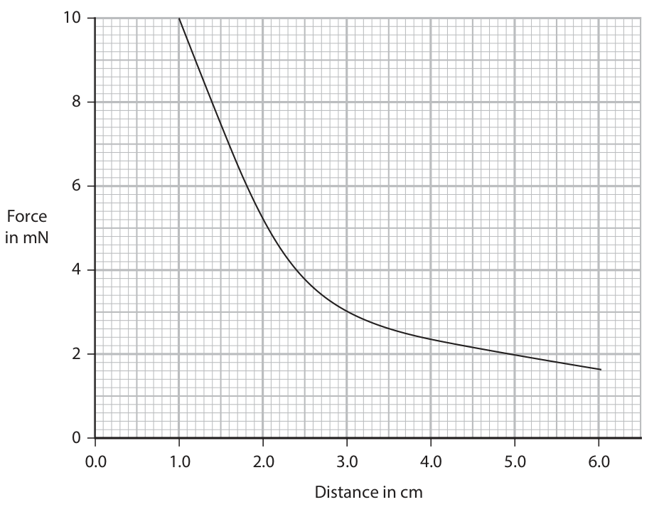

**Mark scheme answer**

> ignore POT
> MP1 x- and y-data from a point on curve selected;
> MP2 constant for that data point evaluated and
> seen;
> MP3 constant for a second data point evaluated and allow use of constant
> seen; to calculate force for
> a second distance or
> distance for a second
> force
> MP4 valid conclusion consistent with candidate’s
> constant(s) or data;
> Total for question 5: 7 marks
> Answer Notes Marks

- **(4)** ignore POT

## Question 6 (11 marks)

A student uses a sound generator to investigate the highest frequency of sound that different animals can hear.

**(c)** The table shows the student’s results for some animals. Highest frequency heard Animal in kHz cat 64 dog 45 cow 35 horse 32

### 6(a) [1]

What is the accepted range of human hearing?

- **(A)** 2 Hz to 20 000 Hz
- **(B)** 20 Hz to 20 000 Hz  ✔
- **(C)** 20 Hz to 200 000 Hz
- **(D)** 200 Hz to 2000 Hz

**Mark scheme answer**

> B (20 Hz to 20 000 Hz);
> A is not the correct answer because the lower
> limit is too low
> C is not the correct answer because the upper
> limit is too high
> D is not the correct answer because the lower
> limit is too high and the upper limit is too low

- **(1)** Answer B: 20 Hz to 20 000 Hz

### 6(b)(i) [2]

Describe how the student could use an oscilloscope and a microphone to measure the time period of a sound wave.

**Mark scheme answer**

> any TWO from:
> MP1 adjust settings until a steady trace / eq; allow ‘take a photo’,
> ’screenshot’ or ‘freezing
> screen’
> MP2 idea adjust settings until (at least) one cycle
> visible;
> MP3 count squares for period / eq; condone ‘wavelength’ for
> ‘period’
> allow description e.g.
> measure between two
> peaks
> allow idea counting
> squares for multiple
> cycles and finding mean
> or finding average
> MP4 idea of multiplying number of squares (for common alternatives to
> one period) by time base / eq; ‘time base’ are ‘time per
> square’, ‘time per
> division’. ‘time scale’

- **(2)** any TWO from:

### 6(b)(ii) [3]

The diagram shows the oscilloscope trace. Oscilloscope settings: y-direction: 1 square = 50 mV x-direction: 1 square = 1.0 × 10–5 s Determine the frequency of the sound wave. frequency = Hz

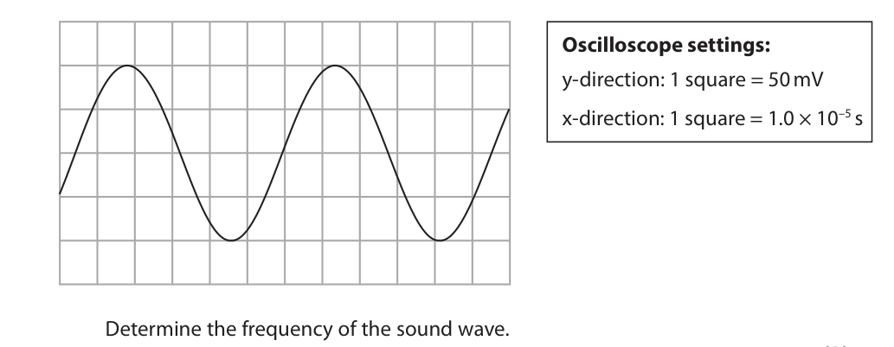

**Mark scheme answer**

> MP1 period represented by between 5.25 and 5.85 ignore use of timebase or
> squares; use of y-scale for MP1
> and MP2
> MP2 correct conversion of candidate’s number of
> squares to a time;
> MP3 frequency evaluated correctly from
> candidate’s value for period using given formula; allow values rounded
> to 2 or more sf
> i.e.
> period = 5.6 squares accept standard form
> period = 5.6 × 10-5 seconds throughout
> frequency = 1 ÷ (5.6 × 10-5 )
> frequency = 18 000 (Hz) to 2 sf
> Note periods that round
> to between 5.25 and 5.85
> squares gives frequencies
> from 19048 to 17094 Hz
> respectively

- **(3)** MP1 period represented by between 5.25 and 5.85 ignore use of timebase or

### 6(c)(i) [3]

Plot a bar chart of the student’s results on the grid.

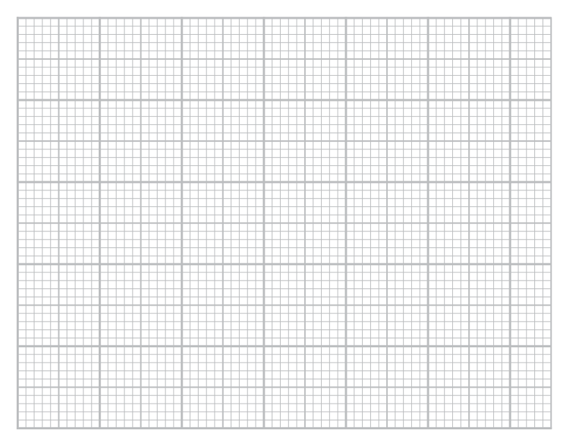

**Mark scheme answer**

> accept swapped axes
> throughout
> ignore widths of bars
> ignore separation of bars
> reject 15 or 16 per 10
> little squares
> reject non-linear scale
> for MP1 and MP3
> allow false origin i.e.
> frequency-axis starting
> with non-zero value
> MP1 suitable frequency scale that covers half of accept any frequency
> the grid with consistent increments; axis label that correctly
> indicates frequency and
> unit i.e. f/kHz, f(Hz) and
> labels 20000,40000 etc, f
> in kilohertz
> ignore any category
> labels other than
> cat,dog,cow,horse e.g.
> ‘animal’,’species’ or left
> MP2 labelled axes including units on frequency blank
> axis;
> i.e. within half a small
> square
> MP3 all bars plotted correctly;

- **(3)** accept swapped axes

### 6(c)(ii) [2]

Discuss why a bar chart is a more appropriate choice than a scatter graph for the student’s results.

**Mark scheme answer**

> MP1 idea that data is categoric; allow ‘not continuous’,
> ‘discontinuous’,‘discrete’
> MP2 idea that no intention of finding a pattern or e.g. references to no
> trend / eq; lines of best fit needed
> or required
> Total for question 6: 11 marks
> Answer Notes Marks

- **(2)** MP1 idea that data is categoric; allow ‘not continuous’,

## Question 7 (7 marks)

This question is about the spectrum produced by light from stars.

### 7(a) [3]

Explain how the redshift of light from galaxies provides evidence for the Big Bang theory of the universe.

**Mark scheme answer**

> any THREE from: ignore references to
> CMBR
> MP1 redshift increases with distance (from Earth);
> allow speed (of galaxy)
> MP2 galaxies are getting further away from each increases with distance
> other / eq ;
> ignore ‘galaxies are
> MP3 implies universal expansion / eq; getting further away
> from Earth’
> ignore ‘galaxies are
> expanding’
> MP4 expansion implies universe was at the same
> point in the past / eq;

- **(3)** any THREE from: ignore references to

### 7(b) [4]

The diagram shows the spectrum of light from a star and from a hydrogen lamp on Earth. hydrogen lamp on Earth wavelength 410 434 486 656 star wavelength 406 430 481 649 All wavelengths are in nanometres. A student suggests that the star appears red because it is moving away from the Earth at 1% of the speed of light. Use data from the diagram to evaluate the student’s suggestion. [speed of light = 3.0 × 108 m/s]

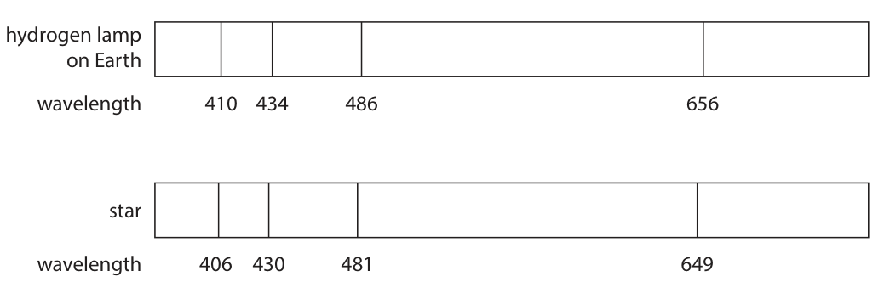

**Mark scheme answer**

> any FOUR from:
> MP1 change in wavelength for any line shown;
> MP2 correct calculation of speed of star using given accept standard form
> formula; throughout
> reject use of
> wavelength of light
> from star instead of
> reference wavelength in
> denominator of formula
> for MP2
> MP3 comparison of calculated star speed with
> 3 000 000 m/s or comparison with 1% of speed of allow ECF on calculated
> light seen; speed
> MP4 reference to the wavelength getting shorter;
> reference to blue shift;
> MP5 (which is) inconsistent with recession or moving
> away / eq;
> allow expression that
> moving away would
> MP6 idea that this direction of wavelength shift cause an increase in
> can’t be responsible for the star’s colour; wavelength
> ignore unqualified
> statements of
> agreement or
> disagreement
> speed
> Δλ
> line (millions
> (nm)
> of m/s)
> 1 4 2.93
> 2 4 2.76
> 3 5 3.09
> 4 7 3.20
> Total for question 7: 7 marks
> Answer Notes Marks

- **(4)** any FOUR from:

## Question 8 (9 marks)

This question is about the Doppler effect.

**(a)** Diagram 1 shows wavefronts of sound waves from a car as experienced by an observer. car observer Diagram 1

### 8(a)(i) [1]

Which direction is the car travelling?

- **(A)** away from the observer
- **(B)** into the page
- **(C)** out of the page
- **(D)** towards the observer  ✔

**Mark scheme answer**

> D (towards the observer);
> A cannot be correct as the pattern would be
> rotated 180 degrees clockwise;
> B cannot be correct as the pattern would be
> rotated out of the page;
> C cannot be correct as the pattern would be
> rotated out of the page;

- **(1)** Answer D: towards the observer

### 8(a)(ii) [2]

Explain why the frequency of the sound heard by the observer is higher than the frequency of the sound heard by the car driver.

**Mark scheme answer**

> ignore references to
> area behind the car
> ignore references to
> wavelengths getting
> larger behind the car
> any TWO from:
> MP1 wave(front)s are closer together /eq ; e.g. wave(front)s
> compressed, ‘more
> bunched up’, ‘shorter
> wavelength’
> MP2 linking of shorter wavelength to equation v=f
> × λ;
> MP3 idea that speed of sound is constant; allow wave speed is
> constant

- **(2)** ignore references to

### 8(b) [2]

Diagram 2 shows a spacecraft directly below the International Space Station (ISS). direction of travel ISS spacecraft Diagram 2 When radio signals pass between the ISS and the spacecraft, there is no Doppler effect. Explain why there is no Doppler effect in radio signals between the ISS and the spacecraft even though both are in orbit around the Earth and travelling very quickly. QUESTION 8 CONTINUES ON THE NEXT PAGE

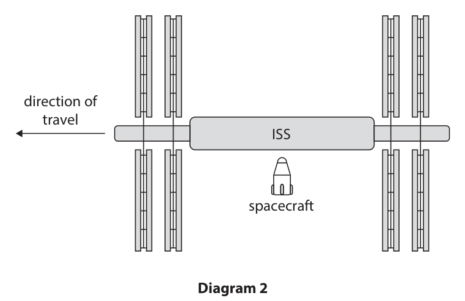

**Mark scheme answer**

> any TWO from:
> MP1 ISS and spacecraft are not moving relative to condone ‘distance
> each other / eq; between ISS and
> spacecraft is constant’
> MP2 so must be travelling at the same speed;
> MP3 (so) waves from one source come from a condone reference to
> source that’s not moving compared to the any type of wave
> observer;

- **(2)** any TWO from:

### 8(c) [4]

Diagram 3 shows the spacecraft now moving upwards towards the ISS. ISS 0.18 m/s Diagram 3 The spacecraft moves towards the ISS with an upward velocity of 0.18 m/s. The mass of the spacecraft is 12 000 kg and the mass of the ISS is 420 000 kg. When the spacecraft touches the ISS, they move upwards together. Calculate the upward velocity of the combined object. upward velocity = m/s

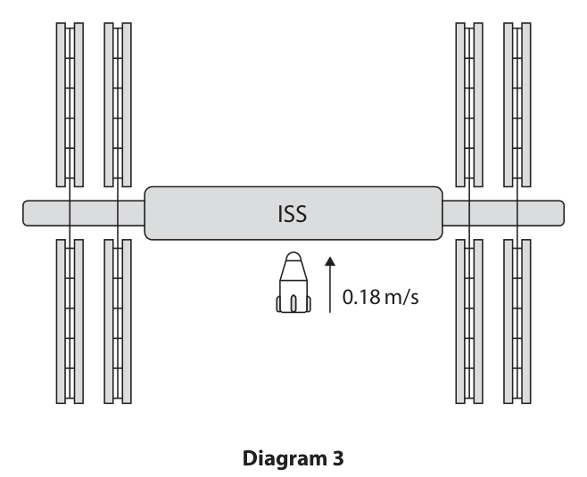

**Mark scheme answer**

> MP1 correct momentum of spacecraft before 12000 × 0.18 or 2160
> collision; (kg m/s) seen
> MP2 idea of conservation of momentum /eq ; allow momentum of
> spacecraft and ISS after
> collision is the same as
> momentum of
> spacecraft before
> collision however ressed
> 12 000 + 420 000 or
> MP3 correct total mass of spacecraft and ISS; 432 000 (kg) seen;
> MP4 evaluation of initial momentum ÷ total mass penalise POT –1 only
> of combined object; once, on candidate’s
> answer for velocity
> 0.0051... scores 3 marks
> 0.005 rounded from
> 0.0051... scores 3 marks
> 0.005 without any
> working scores 4 marks
> i.e. accept standard form
> momentum of spacecraft = 12000 ×0.18 throughout
> therefore momentum of combined object =
> 2160 kg m/s
> total mass of combined object = 420 000 + 12 000
> therefore upwards velocity of combined object =
> 2160 ÷ 432 000 = 0.005 m/s
> Total for question 8: 9 marks

- **(4)** MP1 correct momentum of spacecraft before 12000 × 0.18 or 2160

