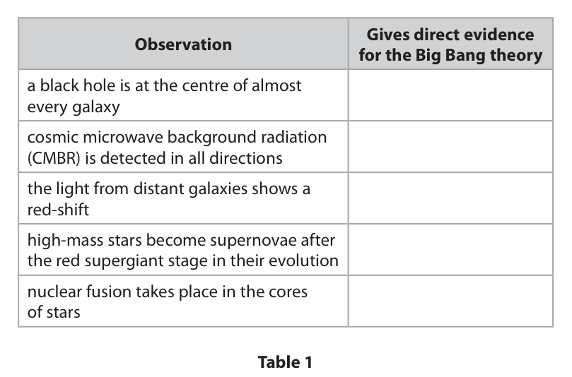
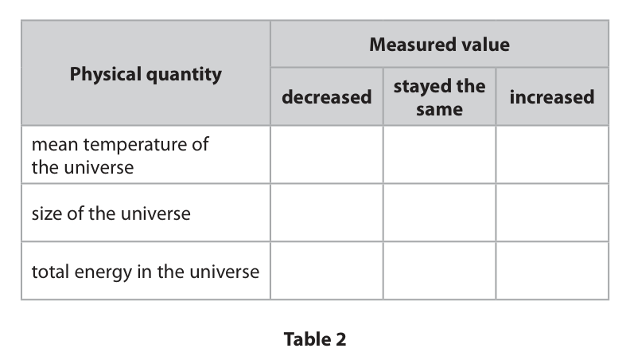
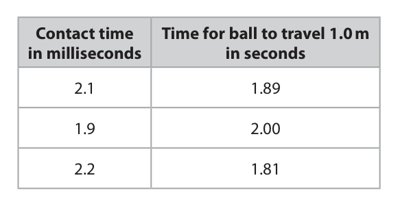
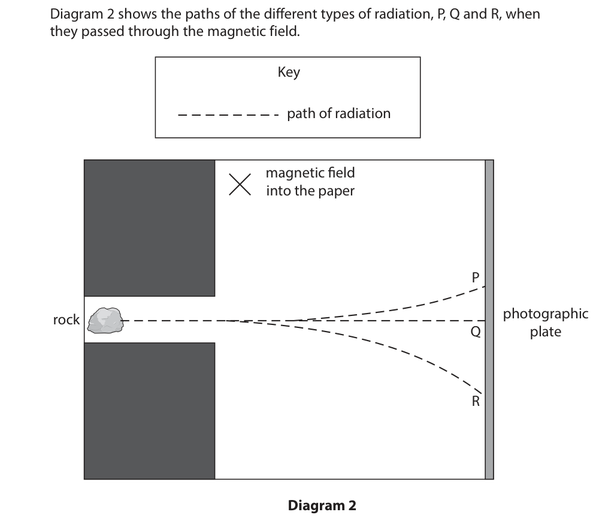

# 4PH1/2PR — 2026-06 (official extraction)

> schema `syllabai.official-paper-questions/0.2` · paper_id `pearson-edexcel:international-gcse:physics:4ph1:2026-06:4PH1/2PR` · qp sha256 `79016f4fb43632ec…` · extraction is the disclosed baseline (ADR-039)

## Question 1 (5 marks)

The Big Bang theory describes how the universe began.

### 1(a) [2]

Table 1 gives some observations about the universe. Complete table 1 by placing ticks (✓ ) to show which observations give direct evidence for the Big Bang theory. Gives direct evidence Observation for the Big Bang theory a black hole is at the centre of almost every galaxy cosmic microwave background radiation (CMBR) is detected in all directions the light from distant galaxies shows a red-shift high-mass stars become supernovae after the red supergiant stage in their evolution nuclear fusion takes place in the cores of stars Table 1

**Mark scheme answer**

> one mark for each correct tick;; if more than two ticks
> apply −1 mark for each
> incorrect tick
> e.g.
> ✓
> ✓
> (b) one mark for each correct row;;; reject row if more than
> one tick
> e.g.
> ✓
> ✓
> ✓
> Answer Notes Marks

- **(2)** one mark for each correct tick;; if more than two ticks

### 1(b) [3]

Table 2 gives some physical quantities. Complete table 2 by placing a tick (✓ ) in each row to show whether the measured value of each quantity has decreased, stayed the same or increased since the Big Bang. Measured value Physical quantity stayed the decreased increased same mean temperature of the universe size of the universe total energy in the universe Table 2

## Question 2 (9 marks)

The diagram shows the simplified construction of an electrostatic air filter. Air containing dust particles passes into the electrostatic air filter. The electrostatic air filter removes the dust particles so that the air leaving the air filter is clean. positively-charged metal grid negatively-charged dust particles collecting plates air with clean air dust particles

**(a)** The dust particles in the air pass through a positively-charged metal grid. The dust particles become positively-charged when they pass through the metal grid.

**(b)** The electrostatic air filter uses mains voltage (230 V) to charge the metal grid and collecting plates.

### 2(a)(i) [2]

Explain how the dust particles become positively-charged.

### 2(a)(ii) [2]

The dust particles then pass near negatively-charged collecting plates. Explain why the dust particles collect on the negatively-charged collecting plates.

### 2(b)(i) [2]

Explain why the electrostatic air filter is contained inside a plastic outer case.

**Mark scheme answer**

> plastic is an insulator; allow plastic does not
> conduct
> allow idea that this is
> double insulation
> ignore references to
> heat
> idea that it prevents electrocution / electric shock; ignore references to
> sparks, explosions

- **(2)** plastic is an insulator; allow plastic does not

### 2(b)(ii) [3]

A designer suggests that a metal case could be used for the electrostatic air filter if an earth wire were included in the design. Explain how an earth wire would protect the user of the electrostatic air filter if a fault occurred.

**Mark scheme answer**

> any three from:
> MP1. idea that earth wire is connected to (metal)
> case;
> MP2. (in event of fault) {current / charge / allow earth wire
> electrons} passes {through earth wire / to provides low resistance
> earth / to ground}; path to earth/ground
> MP3. idea that there is an excess of current (larger allow surge of current,
> than fuse rating); current is too high
> MP4. fuse melts / breaks; allow blows fuse
> allow circuit breaker for
> fuse
> MP5. idea that appliance is electrically isolated; allow circuit is
> broken/cut
> allow idea that it
> prevents an electric
> shock
> Answer Notes Marks

- **(3)** any three from:

## Question 3 (10 marks)

The energy density of a fuel is the amount of energy that can be released from the fuel per kg of mass. This energy can be used to generate electricity. The bar chart shows the energy density of some fuels. Energy density in MJ / kg Coal Diesel Petrol Natural gas Wood Fuel

**(c)** Uranium can be used to generate electricity through nuclear fission.

### 3(a) [1]

Wood has the lowest energy density of the fuels shown in the bar chart. Give an advantage of burning wood to generate electricity instead of the other fuels shown in the bar chart.

**Mark scheme answer**

> ignore references to
> pollution, named
> pollutants, global warming
> etc.
> idea that wood is a renewable energy resource / eq; allow wood is renewable
> OR
> idea that the others are non-renewable / eq;
> (b) both values correctly read from bar chart;
> attempt at ratio calculation; allow ecf for these marks
> evaluation of ratio; if only one value read
> incorrectly
> 0.44… (: 1) scores 2 marks
> e.g.
> natural gas = 54 (MJ/kg), coal = 24 (MJ/kg)
> ratio = 54 / 24 OR 9 / 4 allow 54 : 24
> ratio = 2.25 (: 1) allow 2.3 (:1)
> condone 2.2 (:1)
> condone 2 (:1) if supported
> by correct working

- **(1)** ignore references to

### 3(b) [3]

Determine the ratio of the energy density of natural gas to the energy density of coal. Give your answer in the form n : 1 ratio = : 1

### 3(c)(i) [2]

Uranium has an energy density of 3 900 000 MJ / kg. Other than the difference in the process used to generate electricity, explain why uranium is not included in the bar chart.

**Mark scheme answer**

> idea that energy density (of uranium) is much higher
> than the other fuels;
> bar would not fit on the scale/graph/chart; allow idea that the other
> bars would appear to be
> zero / the same (as each
> other) / incomparable if
> the scale were changed

- **(2)** idea that energy density (of uranium) is much higher

### 3(c)(ii) [2]

In nuclear fission, a uranium nucleus absorbs a neutron and then splits. The process of nuclear fission releases energy from the uranium nucleus. Give two other products of the nuclear fission of uranium. 1 2

**Mark scheme answer**

> (radioactive) {daughter / small(er) / light(er)} nuclei; allow daughter nucleus
> allow suitably named
> daughter nucleus e.g.
> barium, krypton etc.
> neutron(s); ignore number of neutrons
> if given

- **(2)** (radioactive) {daughter / small(er) / light(er)} nuclei; allow daughter nucleus

### 3(c)(iii) [2]

Give two disadvantages of using the nuclear fission of uranium to generate electricity. 1 2

**Mark scheme answer**

> any two from: ignore disadvantages
> associated with cost
> idea that uranium is non-renewable; allow finite etc.
> idea that waste is radioactive; allow waste is
> harmful/toxic
> idea that radiation emitted (in power station); allow irradiation of
> workers
> idea of high security risks;
> idea that there is a (small) risk of meltdown; ignore nuclear explosion
> Answer Notes Marks

- **(2)** any two from: ignore disadvantages

## Question 4 (14 marks)

The photograph shows some equipment used to investigate the force applied to a stationary ball when it is hit with a pool cue. track electronic timer ball pool cue The end of the pool cue is attached to an electronic pressure switch. The pressure switch is connected to an electronic timer, which measures the time the pool cue is in contact with the ball when the ball is hit. Not to scale pool cue ball 1.0 m pressure switch connected to electronic timer

### 4(a) [1]

The pool cue hits the ball and the contact time is measured by the electronic timer. After the ball is hit, the ball travels along a horizontal track. A student uses a stopclock to measure the time taken for the ball to travel 1.0 m along the track. The process is repeated to obtain three sets of results. The table shows the student’s results. Contact time Time for ball to travel 1.0 m in milliseconds in seconds 2.1 1.89 1.9 2.00 2.2 1.81 Suggest a reason for the variation in the results.

**Mark scheme answer**

> any one from:
> idea that the ball is not hit with the same force allow strength, power etc. for
> each time / eq; force
> idea that ball travels at different speeds (for each
> test);
> reference to reaction time (of student);

- **(1)** any one from:

### 4(b)(i) [3]

The student uses their measurements of the time taken for the ball to travel 1.0 m to determine the mean speed of the ball after it is hit with the pool cue. Show that the mean speed of the ball is about 0.5 m / s.

**Mark scheme answer**

> calculation of mean travel time;
> substitution into speed = distance / time; allow use of any travel time
> value for this mark only
> evaluation of mean speed to at least 2s.f.;
> allow alternative method of
> calculating speeds then
> calculating mean
> e.g.
> mean time (= (1.89 + 2.00 + 1.81) ÷ 3) = 1.9(0) (s)
> (mean) speed = 1.0 / 1.9(0)
> (mean speed =) 0.53 (m/s) allow 0.527, 0.526… (m/s)
> condone 0.52 (m/s)

- **(3)** calculation of mean travel time;

### 4(b)(ii) [3]

The mass of the ball is 0.11 kg. Calculate the mean momentum of the ball after it is hit with the pool cue. Give the unit. mean momentum = unit

**Mark scheme answer**

> substitution into momentum = mass × velocity; allow use of either 0.5 (m/s) or
> ecf value from (i) for velocity
> ignore units
> evaluation; allow 0.055 or 55
> matching unit; allow g m/s if mass converted to
> grams
> e.g.
> momentum = 0.11 × 0.53
> (mean momentum =) 0.058 allow answers rounding to 0.058
> kg m/s allow N s

- **(3)** substitution into momentum = mass × velocity; allow use of either 0.5 (m/s) or

### 4(b)(iii) [1]

Using the student’s results in the table, calculate the mean contact time. mean contact time = ms

**Mark scheme answer**

> (mean contact time =) 2.1 (ms) allow 2.07, 2.06… (ms)
> condone 2.06 (ms)
> ignore 2 (ms)

- **(1)** (mean contact time =) 2.1 (ms) allow 2.07, 2.06… (ms)

### 4(b)(iv) [3]

Calculate the mean force exerted on the ball by the pool cue. mean force = N

**Mark scheme answer**

> conversion of ms to s for contact time; allow ecf from (iii)
> substitution into allow ecf from (ii)
> force = change in momentum / time; allow ecf from not converting or
> incorrectly converting ms to s
> evaluation;
> e.g.
> t = 0.0021 (s)
> force = 0.058 / 0.0021
> (mean force =) 28 (N) allow answers that round within
> the range
> 26 to 28 (N)
> (c) any three from:
> MP1. idea that light gate removes reaction time
> errors;
> MP2. idea that light gates could be placed at the allow light gates placed 1.0 m
> start and end of the 1.0 m track; apart
> MP3. idea that centre of ball must pass through
> (single) light gate (for accurate
> measurement);
> MP4. idea that speed of ball may change as it
> travels along track;
> MP5. light gate measures speed at a specific point
> (so removes errors with changing speed);
> MP6. may not have a light gate large enough for
> ball to pass through;
> Answer Notes Marks

- **(3)** conversion of ms to s for contact time; allow ecf from (iii)

### 4(c) [3]

The student suggests that using a light gate would give a more accurate measurement of the speed of the ball after it is hit with the pool cue. Comment on the student’s suggestion.

## Question 5 (9 marks)

Gallium is a metal with a very low melting point. The photograph shows a piece of gallium as it melts when held in a human hand. (Source: © Pearson Asset Library)

### 5(a) [4]

The melting point of gallium is 29.8 °C. The mean temperature of the centre of a human hand is 31.4 °C. Explain the changes that occur as the solid piece of gallium melts to form a liquid. You should refer to particles in your answer.

**Mark scheme answer**

> any four from:
> MP1. (thermal) energy is transferred from hand to ignore heat is
> gallium; transferred
> MP2. particles gain energy in their kinetic store allow particles vibrate
> (before melting) OR kinetic energy of faster
> particles stays the same (during melting); condone particles move
> faster
> MP3. (electrostatic / attractive) forces/bonds allow particles break
> between particles are overcome / weakened; bonds
> MP4. particles move (more) freely (as a liquid); allow particles move
> around / slide past each
> other
> MP5. arrangement of particles changes from allow particles are no
> regular to irregular (structure); longer in a fixed
> arrangement
> ignore references to
> particle spacing
> (b) determination of temperature change; allow 1.6 seen
> anywhere in working
> substitution into ∆Q = m × c × ∆T; allow ecf from incorrect
> temperature change or
> use of 31.4 or 29.8 as
> the temperature change
> rearrangement;
> evaluation; −1 for POT error e.g.
> changing from g to kg
> unnecessarily
> evaluation given to 3s.f.; independent mark
> e.g. 0.595…,0.627…(g)
> scores 3 marks
> ∆T = 31.4 – 29.8 = 1.6 (°C)
> 7.63 = m × 0.408 × 1.6
> m = 7.63 / (0.408 × 1.6)
> (mass =) 11.68… (g) allow 12 (g)
> ignore 11.6 (g) for this
> mark
> (mass =) 11.7 (g)
> Answer Notes Marks

- **(4)** any four from:

### 5(b) [5]

The temperature of the liquid gallium increases from 29.8 °C to 31.4 °C when the liquid gallium gains 7.63 J of energy. Calculate the mass of the liquid gallium. Give your answer to 3 significant figures. [specific heat capacity of liquid gallium = 0.408 J / g °C] mass = g

## Question 6 (8 marks)

The scientist Henri Becquerel discovered radioactivity in 1896.

**(a)** Becquerel designed an experiment to show that rocks containing uranium could absorb energy from the Sun and then re-emit this energy as x-rays. Diagram 1 shows a simplified setup of his apparatus. rock containing uranium photographic film wrapped in paper Diagram 1 Becquerel predicted that if he exposed the rock to direct sunlight, the rock would emit x-rays. The x-rays would then produce an image on the photographic film.

### 6(a)(i) [2]

Suggest why the photographic film was wrapped in paper.

### 6(a)(ii) [2]

When Becquerel did the experiment there was no direct sunlight due to cloud cover. The photographic film still produced an image. This image was not predicted by Becquerel’s original theory. Describe what scientists should do when the results of an experiment do not support their original theory.

### 6(b) [4]

Becquerel concluded that the rock emitted radiation without absorbing any energy from direct sunlight. Becquerel passed the radiation from the rock through a magnetic field. He found that the rock emitted three different types of radiation. Diagram 2 shows the paths of the different types of radiation, P, Q and R, when they passed through the magnetic field. Key path of radiation magnetic field into the paper P rock photographic Q plate R Diagram 2 The radiation changes direction if it is charged, due to a force exerted by the magnetic field. Using information from diagram 2, explain what can be deduced about the properties of the three types of radiation, P, Q and R.

## Question 7 (6 marks)

A uniform metal bar rests horizontally on two tables, as shown in the diagram. Each table has a triangular support so that the bar rests on two pivots, A and B. A B 10 cm 30 cm table A table B

**(b)** The metal bar is supported by an upwards force at pivot A and an upwards force at pivot B.

### 7(a) [2]

The metal bar has a length of 100 cm. The metal bar has a weight of 30 N. Calculate the moment of the weight of the metal bar about pivot A. Assume that the weight of the metal bar acts at the middle of the metal bar. moment = N m

**Mark scheme answer**

> substitution into moment = force × distance; ignore units
> evaluation;
> 1200 (N m) scores 1
> mark
> e.g.
> moment = 30 × (0.)40
> (moment =) 12 (N m)

- **(2)** substitution into moment = force × distance; ignore units

### 7(b)(i) [3]

When both moments are about pivot A, the moment of the upwards force at pivot B is equal to the moment of the weight of the bar. Calculate the magnitude of the force at pivot B. force at pivot B = N

**Mark scheme answer**

> attempted use of principle of moments equation with allow ecf from (a)
> any distance; ignore units
> correct substitution and rearrangement; ignore units
> evaluation of force B; do not penalise
> incorrect units if
> already penalised in (a)
> e.g.
> 12 = FB × (0.)60
> FB = 12 / (0.)60
> (FB =) 20 (N)

- **(3)** attempted use of principle of moments equation with allow ecf from (a)

### 7(b)(ii) [1]

Calculate the magnitude of the force at pivot A. force at pivot A = N

**Mark scheme answer**

> evaluation of force A; allow ecf from (b)(i)
> e.g.
> (FA = 30 – 20 =) 10 (N)
> Answer Notes Marks

- **(1)** evaluation of force A; allow ecf from (b)(i)

## Question 8 (9 marks)

Diagram 1 shows a simplified cross-sectional view of a microphone receiving a sound wave. magnet coil of wire N S sound wave connection to oscilloscope N diaphragm Diagram 1

**(a)** The diaphragm of the microphone is connected to a coil of wire. The coil of wire is free to move around the south pole of a magnet. When the sound wave is incident on the microphone, the diaphragm vibrates.

### 8(a)(i) [3]

Explain how a sound wave causes the microphone to send an electrical signal to the oscilloscope.

### 8(a)(ii) [2]

Suggest why very loud sounds may damage the microphone.

### 8(b) [4]

The microphone is connected to an oscilloscope. Describe how the oscilloscope should be used to determine the frequency of a sound wave. You should refer to how the oscilloscope settings should be adjusted in your answer.

