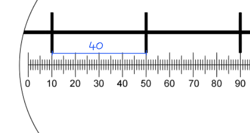
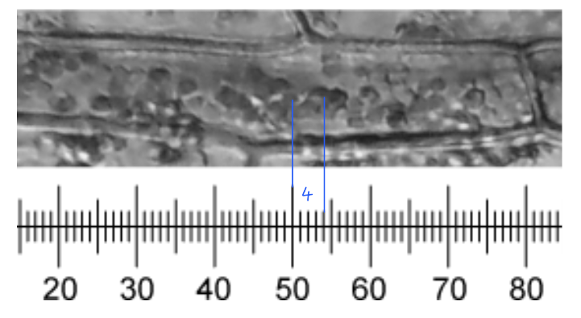
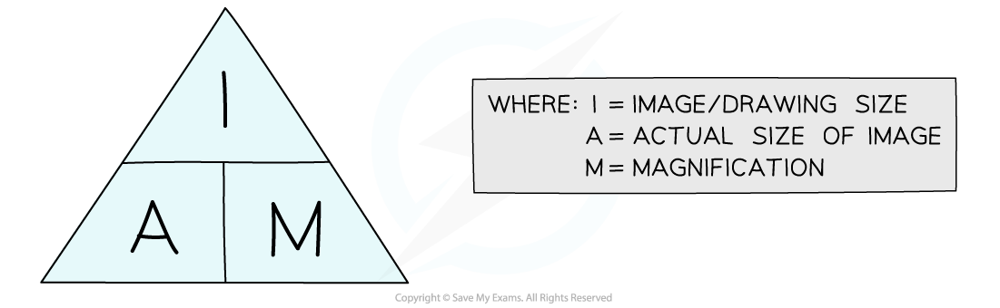
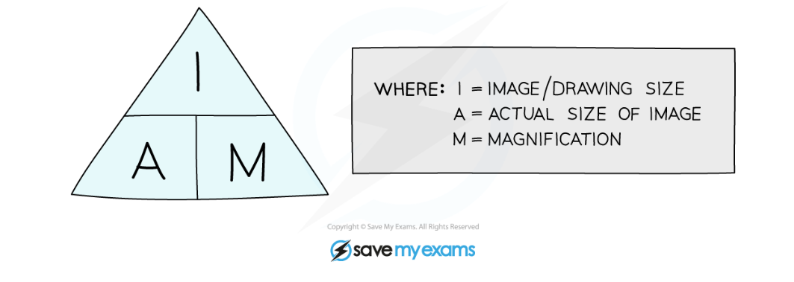
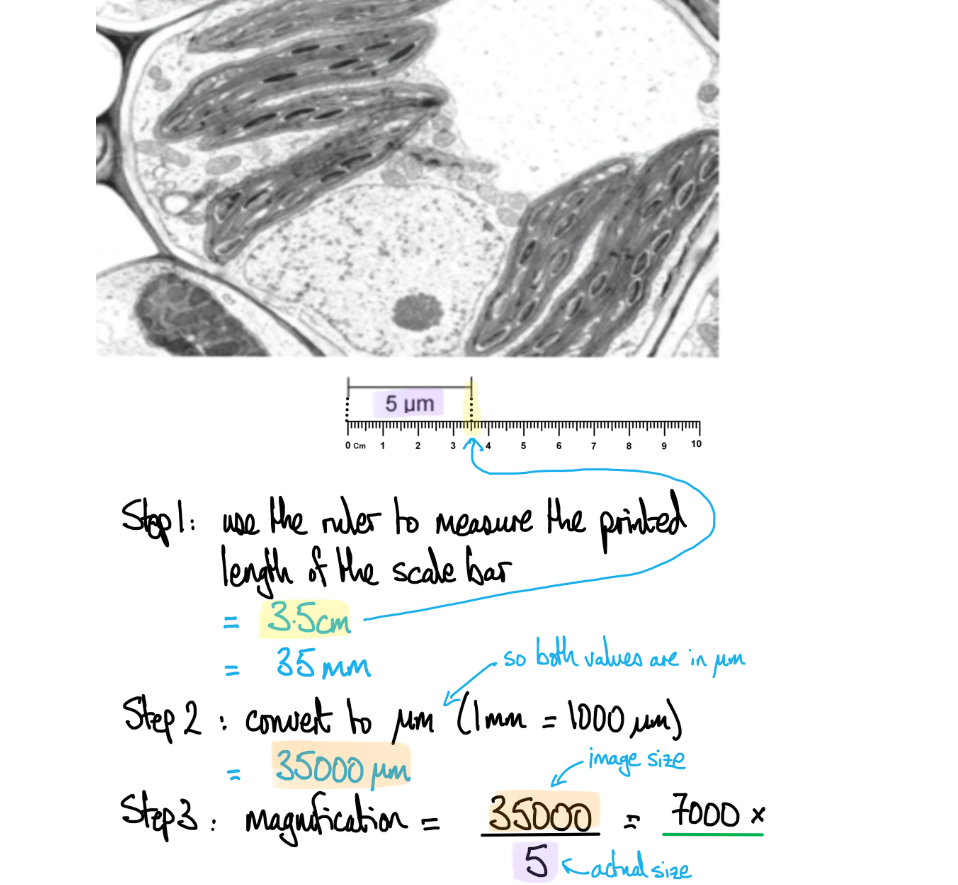

# Mark Schemes — The Microscope in Cell Studies
**1. Cell Structure** · Cambridge (CIE) A-LEVEL biology (9700)

## Multiple Choice Questions (29 questions)

### Q1
**Final answer:** **The correct answer is ****D**** because:**

**Final answer:** **There are 40 eyepiece graticule divisions in 0.1 mm, so the length of an eyepiece division is:**

**Final answer:** **0.1 ÷ 40 = 0.0025 mm**

**Final answer:** **Convert mm to µm:**

**Final answer:** **0.0025 x 1000 = 2.5 µm**

**Final answer:** **The scale shows that the circle has a diameter of 100 eyepiece divisions, so the diameter of the field of view is:**

**Final answer:** **100 x 2.5 = 250 µm**

**Final answer:** **The formula for the area of a circle is πr****2****, so we need to work out the radius of the field of view:**

**Final answer:** **250 ÷ 2 = 125 µm**

**Final answer:** **Use the equation to calculate the area of the field of view:**

**Final answer:** **π x 125****2**** = 49 087 = ****4.9 x 10****4**

### Q2
**Final answer:** **The correct answer is ****C**** because:**

**Final answer:** **Calculate the total length of the stage micrometer:**

**Final answer:** **50 x 0.04 mm = 2 mm**

**Final answer:** **2 mm = 15 eyepiece divisions, so we can calculate the length of 1 eyepiece division:**

**Final answer:** **2 ÷ 15 = 0.13 mm**

**Final answer:** **Calculate the length of the whole eyepiece scale:**

**Final answer:** **100 x 0.13 = ****13 mm**

### Q3
**Final answer:** **The correct answer is ****C**** because:**

**Final answer:** **Convert 1 cm into µm:**

**Final answer:** **1 cm = 10 mm = 10 000 µm**

**Final answer:** **Convert the diameter of a white blood cell from standard form into non-standard form:**

**Final answer:** **1.5 x 10****1**** µm = 15 µm**

**Final answer:** **Calculate the number of ****white blood cells ****that can fit into 10 000 µm:**

**Final answer:** **10 000 ÷15 = 666.67 = 667 = ****6.7 x 10****2**

**Final answer:** **Convert the diameter of a ****Streptococcus**** cell from standard form into non-standard form:**

**Final answer:** **7.5 x 10****2**** nm = 750 nm**

**Final answer:** **Convert from nm into µm:**

**Final answer:** **750 nm = 0.75 µm**

**Final answer:** **Calculate the number of ****Streptococcus**** cells**** that can fit into 10 000 µm:**

**Final answer:** **10 000 ÷ 0.75 = 13333.3 = ****1.3 x 10****4**

### Q4
**Final answer:** **The correct answer is ****C**** because:**

- **Each 0.1 mm on the stage micrometer has 40 small divisions on the eyepiece graticule:**

**Final answer:** **0.1 ÷ 40 = 0.0025 mm**

- **A chloroplast is 4 small eyepiece divisions long, so we multiply the length of one eyepiece division by 4 to give the length of a chloroplast:**

**Final answer:** **0.0025 x 4 = 0.01 mm**

- **The answers are all in µm, so we convert mm into µm**

**Final answer:** **0.01 x 1000 = 10 µm**

### Q5
**Final answer:** **The correct answer is ****B**** because:**

**Final answer:** **Magnification will stay the same; we know this because the question states that the conditions are unchanged except for the light source, meaning that the same eyepiece and objective lens are used.**

**Final answer:** **The resolution will decrease; resolution decreases as the wavelength of the light increases as there is greater diffraction and therefore less ability to resolve fine details at larger wavelengths.**

> *While a reduction in resolution will affect the maximum magnification at which a microscope can produce a clear image, this microscope is being used at a magnification of x400; this is not near the upper limits of a light microscope's magnification, so we would not expect a drop in resolution to influence magnification in this instance.*

### Q6
**Final answer:** **The correct answer is ****C**** because:**

**Final answer:** **There are 40 eyepiece graticule divisions in 0.1 mm, so we can calculate the length of each eyepiece division:**

**Final answer:** **0.1 ÷ 40 = 0.0025 mm**

**Final answer:** **Convert mm into µm:**

**Final answer:** **0.0025 x 1000 = 2.5 µm**

**Final answer:** **Calculate the number of eyepiece divisions that will fit into 12.5 µm:**

**Final answer:** **12.5 ÷ 2.5 = ****5**

### Q7
**Final answer:** **The correct answer is ****D**** because:**

**Final answer:** **There are 40 eyepiece graticule divisions in 0.1 mm, so the length of an eyepiece division can be calculated as follows:**

**Final answer:** **0.1 ÷ 40 = 0.0025 mm**

**Final answer:** **Convert mm into µm:**

**Final answer:** **0.0025 x 1000 = 2.5 µm**

**Final answer:** **Calculate the length of the chloroplast:**

**Final answer:** **4 x 2.5 = 10 µm = 1.0 x 10****1**

### Q8
**Final answer:** **The correct answer is ****B**** because:**

**Final answer:** **We begin by**** using the scale bar to calculate the magnification**** of the image:**

**Final answer:** **M = I ÷ A**

**Final answer:** **Convert both sets of units to μm:**

**Final answer:** **2 cm = 20 mm = 20 000 μm**

**Final answer:** **AND**

**Final answer:** **500 nm = 0.5 μm**

**Final answer:** **Put numbers into the equation:**

**Final answer:** **M = 20 000 ÷ 0.5**

**Final answer:** **M = 40 000**

**Final answer:** **Rearrange the equation to**** calculate the actual length of the bacterial cell****:**

**Final answer:** **A = I ÷ M**

**Final answer:** **Measure image size using the ruler and convert to μm:**

**Final answer:** **9.7 cm = 97 mm = 97 000 μm**

**Final answer:** **Put numbers into the equation:**

**Final answer:** **A = 97 000 ÷ 40 000**

**Final answer:** **=**** 2.4 μm**

### Q9
**Final answer:** **The correct answer is ****C**** because:**

**Final answer:** **The question is asking us to write a version of the magnification equation shown below, ****using the letters provided to represent the different parts of the equation****.**

**Final answer:** **To calculate magnification the equation needs to be rearranged as follows:**

**Final answer:** **Magnification = image size ÷ actual size**

**Final answer:** **We can use the letter ****r**** to represent ****image size****, and because this is given in mm we multiply this by 1000 (****s****) to convert it into μm.**

**Final answer:** **We then use the ****actual size**** provided in the question stem, which is 6 μm, represented here by ****u****.**

### Q10
**Final answer:** **The correct answer is ****D**** because:**

**Final answer:** **1 is correct; once the eyepiece graticule is calibrated at the correct magnification the eyepiece graticule is used to measure the diameter of the cell.**

**Final answer:** **4 is correct as the number of eyepiece graticule units is multiplied by the calibration factor to give the diameter of the specimen.**

> *2** **is incorrect the object is to be viewed with a x40 lens, so this is the lens that should be used during calibration.*

> *3 is incorrect as mm to µm are converted by multiplying by 1 000, or 10**3*

### Q11
**Final answer:** **The correct answer is ****D**** because:**

**Final answer:** **Alveoli and white blood cells are microscopic structures that would need to be measured in µm**

**Final answer:** **The width of cell walls is many times smaller than the diameter of a cell, so would be measured in nm.**

### Q12
**Final answer:** **The correct answer is ****A**** because:**

**Final answer:** **When nm are converted to µm:**

**Final answer:** **7000 nm = 7 µm**

**Final answer:** **When the sizes of the two cells are compared using matching units:**

**Final answer:** ** 35 ÷ 7 = 5**

**Final answer:** **The erythrocytes are therefore 5 times smaller than the pancreatic cells.**

### Q13
**Final answer:** **The correct answer is ****B**** because:**

**Final answer:** **The equation triangle can be used to rearrange the equation as follows:**

**Final answer:** **Magnification = image size ÷ actual size**

**Final answer:** **We can use the scale bar to give us image size and actual size; image size is the measured length of the scale bar (2 cm) while actual size is the length represented by the scale bar (1 μm).**

**Final answer:** **Convert units so that units for image size and actual size are the same:**

**Final answer:** **2 cm = 20 mm = 20 000 μm**

**Final answer:** **Put numbers into the equation:**

**Final answer:** **Magnification = 20 000 ÷ 1**

**Final answer:** **= 20 000x**

**Final answer:** **Convert into standard form to match the format of answer options (decimal point moves 4 places to the left):**

**Final answer:** **20 000 = 2 x 10****4**

> *Note that you would need to measure the image length of the scale bar yourself in an exam, so don't forget to bring a ruler!*

### Q14
**Final answer:** **The correct answer is ****D ****because:**

**Final answer:** **We rearrange the equation triangle to give the formula for image size:**

**Final answer:** **Image size = actual size x magnification**

**Final answer:** **Image size = 1 x 50 000**

**Final answer:** **= 50 000 μm**

**Final answer:** **The answers are given in mm, so we need to convert μm into mm:**

**Final answer:** **50 000 ÷ 1000 = 50 mm**

**Final answer:** **The answers are given in standard form, so we convert this into standard form (the decimal place is moved 1 place to the left):**

**Final answer:** **50 = 5 x 10****1**

### Q15
**Final answer:** **The correct answer is ****D**** because:**

**Final answer:** **The question states that it is a wet mount, so the specimen to be observed will already be suspended in liquid, and additional water is unlikely to be needed.**

> *A** can be involved with the preparation of a wet mount slide as methylene blue is added to stain the specimen to provide contrast.*

> *B **can be involved with the preparation of a wet mount slide as a coverslip will be used in most slide preparation techniques.*

> *C **would be involved with the preparation of a wet mount slide** **as the lowest power lens would be used to focus the object regardless of the type of sample preparation used.*

### Q16
**Final answer:** **The correct answer is ****C**** because:**

**Final answer:** **An electron microscope does not have a resolution as small as 0.05 nm; the maximum resolution of an electron microscope is 0.5 nm**

> *All the other statements are correct; note that 0.2 μm and 200 nm are the same.*

### Q17
**Final answer:** **The correct answer is ****B**** because:**

**Final answer:** **The equation triangle should be rearranged to give actual size as follows:**

**Final answer:** **Actual size = image size ÷ magnification**

**Final answer:** **We have been given the image size in the question stem, so we need to convert this from cm into μm to ensure that the units for image size and actual size are the same:**

**Final answer:** **1 cm = 10 mm = 10 000 μm**

**Final answer:** **Enter numbers into the equation:**

**Final answer:** **Actual size = 10 000 ÷ 200**

**Final answer:** **= 50 μm**

> *Note that in an exam you would be expected to use a ruler to measure the image size yourself.*

### Q18
**Final answer:** **The correct answer is ****A**** because...**

**Final answer:** **The equation triangle can be arranged to calculate magnification as follows:**

**Final answer:** **Magnification = image size ÷ actual size**

**Final answer:** **The information given on the scale bar can be used to complete this calculation; the size represented by the scale bar in μm is the actual size, while the length of the scale bar as measured using a rule is the image size:**

**Final answer:** **Make sure to ****remember the unit conversions****; it is usually a good idea to convert cm to mm, which then makes conversion to µm easier.**

> *Note that in an exam situation you would be expected to measure the actual length of the scale bar yourself using a ruler, so don't forget to take one into the exam with you!*

### Q19
**Final answer:** **The correct answer is ****B**** because:**

**Final answer:** **Label lines in a scientific drawing should not have an arrowhead.**

> *All the other statements about scientific drawings are correct. *

### Q20
**Final answer:** **The correct answer is ****C**** because:**

**Final answer:** **Both the magnification and resolution that can be achieved by an electron microscope are higher than those achieved by a light microscope.**

### Q21
**Final answer:** **The correct answer is ****D**** because:**

- **200 nm is the maximum resolution of a light microscope**
- **0.5 nm is the maximum resolution of a electron microscope**

### Q22
**Final answer:** **The correct answer is ****A**** because:**

**Final answer:** **Both the magnification and the resolution of a light microscope are limited by the wavelength of light.**

- **Light microscopes are limited to a maximum magnification of around x1000; magnifying a specimen by any more than this will result in a blurry image because the wavelength of light cannot resolve separate objects within the image**
- **The maximum resolution of a light microscope is determined by the wavelength of light**

> *Statement 3 is incorrect as the magnification is calculated by **multiplying** the magnification of the objective lens by that of the eyepiece lens.*

### Q23
**Final answer:** **The correct answer is ****B**** because:**

**Final answer:** **The size of the eyepiece graticule units varies depending on the magnification being used and minor differences between microscopes; the stage micrometer allows ****calibration of the eyepiece units****, which can then be used to measure the length of a specimen.**

> *A **is incorrect as the stage micrometer is on a separate slide which is not viewed at the same time as the specimen itself.*

> *C **is incorrect as the magnification is calculated by multiplying the magnification of the eyepiece lens by that of the objective lens.*

> *D **is incorrect as a stage micrometer is a pre-prepared slide that contains a ruled scale of known measurements; it is not used for the preparation of specimens.*

### Q24
**Final answer:** **The correct answer is ****C**** because:**

**Final answer:** **There are 1000 nm in a μm, so to convert from one to the other you need to ****multiply by 1000**

**Final answer:** **0.4 x 1 000 = 400**

### Q25
**Final answer:** **The correct answer is ****D**** because:**

**Final answer:** **The maximum magnification that can be achieved with the resolving power of a light microscope can be somewhere around x2000, but useful magnifications are closer to a maximum of x1000**

> *The other options in the table all would be low enough magnification for a light microscope to have a clear resolution.*

### Q26
**Final answer:** **The correct answer is ****D**** because:**

**Final answer:** **Methylene blue stain is used to stain the nuclei of animal cells. Iodine solution is used to stain plant tissue, such as onion epidermis.**

> *A **describes a method of placing the coverslip over a specimen that reduces the chance of air bubbles forming.*

> *B **names iodine stain, which can be used to stain plant cell walls and nuclei yellow.*

> *C **describes removing a single layer of cells from the onion sample; this allows cells to be viewed clearly.*

### Q27
**Final answer:** **The correct answer is ****C****.**

> *A **is incorrect; while resolution affects the size of an object that can be seen, the size of an object is not the definition of resolution.*

> *B **is incorrect as this is not a definition of resolution. The maximum resolution of a light microscope is **half the wavelength of visible light **(not **twice** the wavelength) but even corrected this statement still does not define the term.*

> *D **is incorrect as this describes the total magnification of the light microscope.*

### Q28
**Final answer:** **The correct answer is ****B**** because:**

**Final answer:** **No shading should be used in biological drawings, which should be line drawings only.**

> *A**, **C** and **D** are all examples of conventions used in biological drawing.*

### Q29
**Final answer:** **The correct answer is ****C**** because:**

**Final answer:** **Ribosomes are 20-30 nm in diameter; they would therefore not be resolved at a resolution of 200 nm.**

> *The structures in options** A**, **B** and **D** would all be resolved at a resolution of 200 nm.*
