# Mark Schemes — The Microscope in Cell Studies
**1. Cell Structure** · Cambridge (CIE) A-LEVEL biology (9700)

## Multiple Choice Questions (29 questions)

### Q1
**Final answer:** **The correct answer is ****D**** because:**

**Final answer:** **There are 40 eyepiece graticule divisions in 0.1 mm, so the length of an eyepiece division is:**

**Final answer:** **0.1 ÷ 40 = 0.0025 mm**

**Final answer:** **Convert mm to µm:**

**Final answer:** **0.0025 x 1000 = 2.5 µm**

**Final answer:** **The scale shows that the circle has a diameter of 100 eyepiece divisions, so the diameter of the field of view is:**

**Final answer:** **100 x 2.5 = 250 µm**

**Final answer:** **The formula for the area of a circle is πr****2****, so we need to work out the radius of the field of view:**

**Final answer:** **250 ÷ 2 = 125 µm**

**Final answer:** **Use the equation to calculate the area of the field of view:**

**Final answer:** **π x 125****2**** = 49 087 = ****4.9 x 10****4**

### Q2
**Final answer:** **The correct answer is ****C**** because:**

**Final answer:** **Calculate the total length of the stage micrometer:**

**Final answer:** **50 x 0.04 mm = 2 mm**

**Final answer:** **2 mm = 15 eyepiece divisions, so we can calculate the length of 1 eyepiece division:**

**Final answer:** **2 ÷ 15 = 0.13 mm**

**Final answer:** **Calculate the length of the whole eyepiece scale:**

**Final answer:** **100 x 0.13 = ****13 mm**

### Q3
**Final answer:** **The correct answer is ****C**** because:**

**Final answer:** **Convert 1 cm into µm:**

**Final answer:** **1 cm = 10 mm = 10 000 µm**

**Final answer:** **Convert the diameter of a white blood cell from standard form into non-standard form:**

**Final answer:** **1.5 x 10****1**** µm = 15 µm**

**Final answer:** **Calculate the number of ****white blood cells ****that can fit into 10 000 µm:**

**Final answer:** **10 000 ÷15 = 666.67 = 667 = ****6.7 x 10****2**

**Final answer:** **Convert the diameter of a ****Streptococcus**** cell from standard form into non-standard form:**

**Final answer:** **7.5 x 10****2**** nm = 750 nm**

**Final answer:** **Convert from nm into µm:**

**Final answer:** **750 nm = 0.75 µm**

**Final answer:** **Calculate the number of ****Streptococcus**** cells**** that can fit into 10 000 µm:**

**Final answer:** **10 000 ÷ 0.75 = 13333.3 = ****1.3 x 10****4**

### Q4
**Final answer:** **The correct answer is ****C**** because:**

- **Each 0.1 mm on the stage micrometer has 40 small divisions on the eyepiece graticule:**

**Final answer:** **0.1 ÷ 40 = 0.0025 mm**

- **A chloroplast is 4 small eyepiece divisions long, so we multiply the length of one eyepiece division by 4 to give the length of a chloroplast:**

**Final answer:** **0.0025 x 4 = 0.01 mm**

- **The answers are all in µm, so we convert mm into µm**

**Final answer:** **0.01 x 1000 = 10 µm**

### Q5
**Final answer:** **The correct answer is ****B**** because:**

**Final answer:** **Magnification will stay the same; we know this because the question states that the conditions are unchanged except for the light source, meaning that the same eyepiece and objective lens are used.**

**Final answer:** **The resolution will decrease; resolution decreases as the wavelength of the light increases as there is greater diffraction and therefore less ability to resolve fine details at larger wavelengths.**

> *While a reduction in resolution will affect the maximum magnification at which a microscope can produce a clear image, this microscope is being used at a magnification of x400; this is not near the upper limits of a light microscope's magnification, so we would not expect a drop in resolution to influence magnification in this instance.*

### Q6
**Final answer:** **The correct answer is ****C**** because:**

**Final answer:** **There are 40 eyepiece graticule divisions in 0.1 mm, so we can calculate the length of each eyepiece division:**

**Final answer:** **0.1 ÷ 40 = 0.0025 mm**

**Final answer:** **Convert mm into µm:**

**Final answer:** **0.0025 x 1000 = 2.5 µm**

**Final answer:** **Calculate the number of eyepiece divisions that will fit into 12.5 µm:**

**Final answer:** **12.5 ÷ 2.5 = ****5**

### Q7
**Final answer:** **The correct answer is ****D**** because:**

**Final answer:** **There are 40 eyepiece graticule divisions in 0.1 mm, so the length of an eyepiece division can be calculated as follows:**

**Final answer:** **0.1 ÷ 40 = 0.0025 mm**

**Final answer:** **Convert mm into µm:**

**Final answer:** **0.0025 x 1000 = 2.5 µm**

**Final answer:** **Calculate the length of the chloroplast:**

**Final answer:** **4 x 2.5 = 10 µm = 1.0 x 10****1**

### Q8
**Final answer:** **The correct answer is ****B**** because:**

**Final answer:** **We begin by**** using the scale bar to calculate the magnification**** of the image:**

**Final answer:** **M = I ÷ A**

**Final answer:** **Convert both sets of units to μm:**

**Final answer:** **2 cm = 20 mm = 20 000 μm**

**Final answer:** **AND**

**Final answer:** **500 nm = 0.5 μm**

**Final answer:** **Put numbers into the equation:**

**Final answer:** **M = 20 000 ÷ 0.5**

**Final answer:** **M = 40 000**

**Final answer:** **Rearrange the equation to**** calculate the actual length of the bacterial cell****:**

**Final answer:** **A = I ÷ M**

**Final answer:** **Measure image size using the ruler and convert to μm:**

**Final answer:** **9.7 cm = 97 mm = 97 000 μm**

**Final answer:** **Put numbers into the equation:**

**Final answer:** **A = 97 000 ÷ 40 000**

**Final answer:** **=**** 2.4 μm**

### Q9
**Final answer:** **The correct answer is ****C**** because:**

**Final answer:** **The question is asking us to write a version of the magnification equation shown below, ****using the letters provided to represent the different parts of the equation****.**

**Final answer:** **To calculate magnification the equation needs to be rearranged as follows:**

**Final answer:** **Magnification = image size ÷ actual size**

**Final answer:** **We can use the letter ****r**** to represent ****image size****, and because this is given in mm we multiply this by 1000 (****s****) to convert it into μm.**

**Final answer:** **We then use the ****actual size**** provided in the question stem, which is 6 μm, represented here by ****u****.**

### Q10
**Final answer:** **The correct answer is ****D**** because:**

**Final answer:** **1 is correct; once the eyepiece graticule is calibrated at the correct magnification the eyepiece graticule is used to measure the diameter of the cell.**

**Final answer:** **4 is correct as the number of eyepiece graticule units is multiplied by the calibration factor to give the diameter of the specimen.**

> *2** **is incorrect the object is to be viewed with a x40 lens, so this is the lens that should be used during calibration.*

> *3 is incorrect as mm to µm are converted by multiplying by 1 000, or 10**3*

### Q11
**Final answer:** **The correct answer is ****D**** because:**

**Final answer:** **Alveoli and white blood cells are microscopic structures that would need to be measured in µm**

**Final answer:** **The width of cell walls is many times smaller than the diameter of a cell, so would be measured in nm.**

### Q12
**Final answer:** **The correct answer is ****A**** because:**

**Final answer:** **When nm are converted to µm:**

**Final answer:** **7000 nm = 7 µm**

**Final answer:** **When the sizes of the two cells are compared using matching units:**

**Final answer:** ** 35 ÷ 7 = 5**

**Final answer:** **The erythrocytes are therefore 5 times smaller than the pancreatic cells.**

### Q13
**Final answer:** **The correct answer is ****B**** because:**

**Final answer:** **The equation triangle can be used to rearrange the equation as follows:**

**Final answer:** **Magnification = image size ÷ actual size**

**Final answer:** **We can use the scale bar to give us image size and actual size; image size is the measured length of the scale bar (2 cm) while actual size is the length represented by the scale bar (1 μm).**

**Final answer:** **Convert units so that units for image size and actual size are the same:**

**Final answer:** **2 cm = 20 mm = 20 000 μm**

**Final answer:** **Put numbers into the equation:**

**Final answer:** **Magnification = 20 000 ÷ 1**

**Final answer:** **= 20 000x**

**Final answer:** **Convert into standard form to match the format of answer options (decimal point moves 4 places to the left):**

**Final answer:** **20 000 = 2 x 10****4**

> *Note that you would need to measure the image length of the scale bar yourself in an exam, so don't forget to bring a ruler!*

### Q14
**Final answer:** **The correct answer is ****D ****because:**

**Final answer:** **We rearrange the equation triangle to give the formula for image size:**

**Final answer:** **Image size = actual size x magnification**

**Final answer:** **Image size = 1 x 50 000**

**Final answer:** **= 50 000 μm**

**Final answer:** **The answers are given in mm, so we need to convert μm into mm:**

**Final answer:** **50 000 ÷ 1000 = 50 mm**

**Final answer:** **The answers are given in standard form, so we convert this into standard form (the decimal place is moved 1 place to the left):**

**Final answer:** **50 = 5 x 10****1**

### Q15
**Final answer:** **The correct answer is ****D**** because:**

**Final answer:** **The question states that it is a wet mount, so the specimen to be observed will already be suspended in liquid, and additional water is unlikely to be needed.**

> *A** can be involved with the preparation of a wet mount slide as methylene blue is added to stain the specimen to provide contrast.*

> *B **can be involved with the preparation of a wet mount slide as a coverslip will be used in most slide preparation techniques.*

> *C **would be involved with the preparation of a wet mount slide** **as the lowest power lens would be used to focus the object regardless of the type of sample preparation used.*

### Q16
**Final answer:** **The correct answer is ****C**** because:**

**Final answer:** **An electron microscope does not have a resolution as small as 0.05 nm; the maximum resolution of an electron microscope is 0.5 nm**

> *All the other statements are correct; note that 0.2 μm and 200 nm are the same.*

### Q17
**Final answer:** **The correct answer is ****B**** because:**

**Final answer:** **The equation triangle should be rearranged to give actual size as follows:**

**Final answer:** **Actual size = image size ÷ magnification**

**Final answer:** **We have been given the image size in the question stem, so we need to convert this from cm into μm to ensure that the units for image size and actual size are the same:**

**Final answer:** **1 cm = 10 mm = 10 000 μm**

**Final answer:** **Enter numbers into the equation:**

**Final answer:** **Actual size = 10 000 ÷ 200**

**Final answer:** **= 50 μm**

> *Note that in an exam you would be expected to use a ruler to measure the image size yourself.*

### Q18
**Final answer:** **The correct answer is ****A**** because...**

**Final answer:** **The equation triangle can be arranged to calculate magnification as follows:**

**Final answer:** **Magnification = image size ÷ actual size**

**Final answer:** **The information given on the scale bar can be used to complete this calculation; the size represented by the scale bar in μm is the actual size, while the length of the scale bar as measured using a rule is the image size:**

**Final answer:** **Make sure to ****remember the unit conversions****; it is usually a good idea to convert cm to mm, which then makes conversion to µm easier.**

> *Note that in an exam situation you would be expected to measure the actual length of the scale bar yourself using a ruler, so don't forget to take one into the exam with you!*

### Q19
**Final answer:** **The correct answer is ****B**** because:**

**Final answer:** **Label lines in a scientific drawing should not have an arrowhead.**

> *All the other statements about scientific drawings are correct. *

### Q20
**Final answer:** **The correct answer is ****C**** because:**

**Final answer:** **Both the magnification and resolution that can be achieved by an electron microscope are higher than those achieved by a light microscope.**

### Q21
**Final answer:** **The correct answer is ****D**** because:**

- **200 nm is the maximum resolution of a light microscope**
- **0.5 nm is the maximum resolution of a electron microscope**

### Q22
**Final answer:** **The correct answer is ****A**** because:**

**Final answer:** **Both the magnification and the resolution of a light microscope are limited by the wavelength of light.**

- **Light microscopes are limited to a maximum magnification of around x1000; magnifying a specimen by any more than this will result in a blurry image because the wavelength of light cannot resolve separate objects within the image**
- **The maximum resolution of a light microscope is determined by the wavelength of light**

> *Statement 3 is incorrect as the magnification is calculated by **multiplying** the magnification of the objective lens by that of the eyepiece lens.*

### Q23
**Final answer:** **The correct answer is ****B**** because:**

**Final answer:** **The size of the eyepiece graticule units varies depending on the magnification being used and minor differences between microscopes; the stage micrometer allows ****calibration of the eyepiece units****, which can then be used to measure the length of a specimen.**

> *A **is incorrect as the stage micrometer is on a separate slide which is not viewed at the same time as the specimen itself.*

> *C **is incorrect as the magnification is calculated by multiplying the magnification of the eyepiece lens by that of the objective lens.*

> *D **is incorrect as a stage micrometer is a pre-prepared slide that contains a ruled scale of known measurements; it is not used for the preparation of specimens.*

### Q24
**Final answer:** **The correct answer is ****C**** because:**

**Final answer:** **There are 1000 nm in a μm, so to convert from one to the other you need to ****multiply by 1000**

**Final answer:** **0.4 x 1 000 = 400**

### Q25
**Final answer:** **The correct answer is ****D**** because:**

**Final answer:** **The maximum magnification that can be achieved with the resolving power of a light microscope can be somewhere around x2000, but useful magnifications are closer to a maximum of x1000**

> *The other options in the table all would be low enough magnification for a light microscope to have a clear resolution.*

### Q26
**Final answer:** **The correct answer is ****D**** because:**

**Final answer:** **Methylene blue stain is used to stain the nuclei of animal cells. Iodine solution is used to stain plant tissue, such as onion epidermis.**

> *A **describes a method of placing the coverslip over a specimen that reduces the chance of air bubbles forming.*

> *B **names iodine stain, which can be used to stain plant cell walls and nuclei yellow.*

> *C **describes removing a single layer of cells from the onion sample; this allows cells to be viewed clearly.*

### Q27
**Final answer:** **The correct answer is ****C****.**

> *A **is incorrect; while resolution affects the size of an object that can be seen, the size of an object is not the definition of resolution.*

> *B **is incorrect as this is not a definition of resolution. The maximum resolution of a light microscope is **half the wavelength of visible light **(not **twice** the wavelength) but even corrected this statement still does not define the term.*

> *D **is incorrect as this describes the total magnification of the light microscope.*

### Q28
**Final answer:** **The correct answer is ****B**** because:**

**Final answer:** **No shading should be used in biological drawings, which should be line drawings only.**

> *A**, **C** and **D** are all examples of conventions used in biological drawing.*

### Q29
**Final answer:** **The correct answer is ****C**** because:**

**Final answer:** **Ribosomes are 20-30 nm in diameter; they would therefore not be resolved at a resolution of 200 nm.**

> *The structures in options** A**, **B** and **D** would all be resolved at a resolution of 200 nm.*

## Structured Questions (15 questions)

### Q1
The advantages and disadvantages of electron microscopes are...

*Advantages:*

**Final answer:** **Any ****two ****of the following:**

- Higher magnification; **[1 mark]**
- Higher resolution/resolving power / points close together can be distinguished between each other; **[1 mark]**
- A greater depth of field / detailed 3D images can be produced (entirely in focus); **[1 mark]**

*Limitations:*

**Final answer:** **Any ****two ****of the following:**

- Specimens must be in a vacuum / dehydrated / only dead material can be viewed; **[1 mark]**
- Special training is required for specimen preparation; **[1 mark]**
- Electron microscopes are very large / can't be moved around; **[1 mark]**
- Images must be in greyscale/black and white / do not contain (true) colour; **[1 mark]**

**[Total: 4 marks]**
The structures labelled X are...

- Microvilli;** [1 mark]**

*Accept cell surface membrane / plasma membrane.*

**[Total: 1 mark]**

> *Microvilli are folded regions of the cell surface membrane that increase the surface area of a cell. A feature like this would be found on an epithelial cell that lines the small intestine, and the increased surface area here aids absorption of nutrients.*
The magnification of the drawing is...

- 17 000 ÷ 0.2; **[1 mark]**
- 85 000;** [1 mark]**

*Award full marks for the correct answer of 85 000 in the absence of other calculations.*

**[Total: 2 marks]**

> *Always convert cm to millimetres straight away; this avoids the risk of forgetting to do any conversions at the end of the calculation. Consider the scale bar to be 17 mm in length, rather than 1.7 cm. This makes subsequent maths easier when converting to micrometres.*

> *Typically in an exam scenario you would be expected to measure the scale bar yourself with a ruler.*

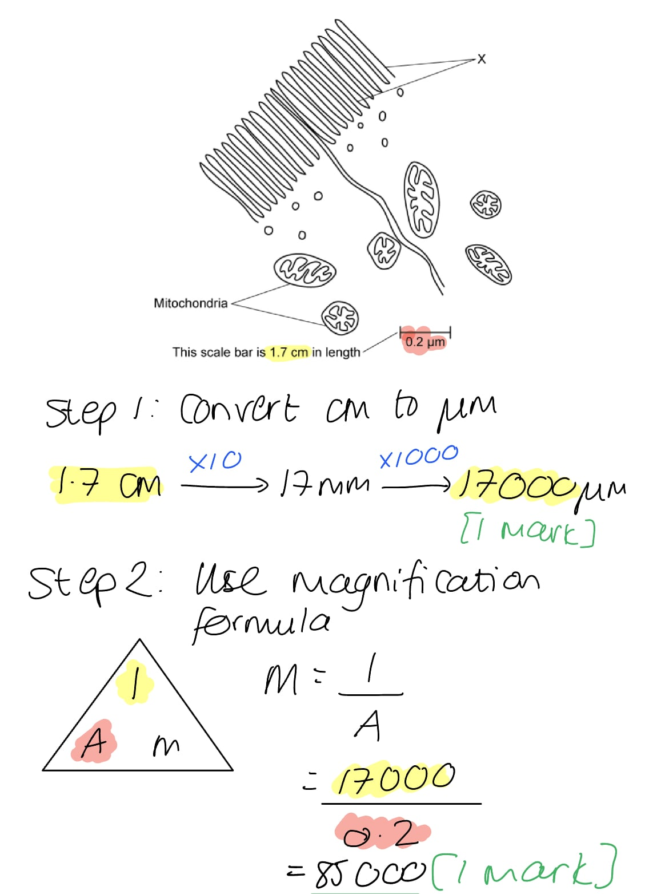
The mitochondria could appear different in shape because:

**Final answer:** **Any ****two**** of the following:**

- They were cut at different angles / one was cut across its width and the other across its length during preparation of the specimen; **[1 mark]**
- The larger mitochondrion is more mature / older **OR** the smaller mitochondrion has recently divided;** [1 mark]**
- Mitochondria show variation in their shape/size / not all mitochondria are the same shape;** [1 mark]**

**[Total: 2 marks]**

> *You are not expected to **know** about the specifics of mitochondrion shape, though you are likely to be familiar with diagrams that show them to have a slightly elongated shape, rather than being spherical. Here you need to apply reasoning skills to suggest why mitochondria might appear to be different, or why there might be shape differences between individual organelles.*

### Q2
A stage micrometer is needed in addition to the eyepiece graticule because...

- The size of the units of the eyepiece graticule change depending on the magnification being used; **[1 mark]**
- The stage micrometer can be used to <u>calibrate</u> the graticule / the graticule needs to be <u>calibrated</u>; **[1 mark]**

**[Total: 2 marks]**

> *The graticule is the little ruler that you can see inside the eyepiece when you look down a microscope; it always stays the same size no matter what magnification you are using. This means that the length measured by the graticule **changes at different magnifications** and it therefore needs to be **calibrated** using a stage micrometer before it can be used to measure the size of a specimen.*

> *A stage micrometer is a slide with a small ruler that has divisions **of known length** which can be put on the microscope stage and viewed at the same time as the eyepiece graticule.*
The steps required to calibrate the eyepiece graticule of a light microscope using a stage micrometer are...

- Line up the scale of the graticule with the scale on the stage micrometer;** [1 mark]**
- Count the number of subdivisions of the stage micrometer that fit into each division of the eyepiece graticule;** [1 mark]**
- Multiply that number by the distance between each subdivision of the stage micrometer to give the distance between each division of the eyepiece graticule; **[1 mark]**

**[Total: 3 marks]**

> *For example, the smallest subdivision etched onto the surface of most stage micrometers is 0.01 mm (10 µm). If 5 subdivisions of the stage micrometer fit into each division of the eyepiece graticule, then each division of the graticule is 5 x 10 = 50 μm.*
The steps would need to be repeated when the student changes to a more powerful objective lens because...

- (A change/increase in magnification) decreases the width/diameter of the field of view; **[1 mark]**
- The stage micrometer / specimen appears closer/larger but the eyepiece graticule scale stays the same size **OR** the specimen is zoomed in and takes up more of the field of view;** [1 mark]**

**[Total: 2 marks]**
The position of the opposite edge of the cheek cell should be indicated by...

- An arrow labelled ‘**B**’ <u>5 small subdivisions</u> to the right **OR** left of **A;** **[1 mark]**

**[Total: 1 mark]**

> *The entire length of the stage micrometer is 1.00 mm, or 1000 µm, and there are 100 subdivisions on the stage micrometer, so a single subdivision on the stage micrometer represents 10 µm (1000 ÷ 100 = 10).*

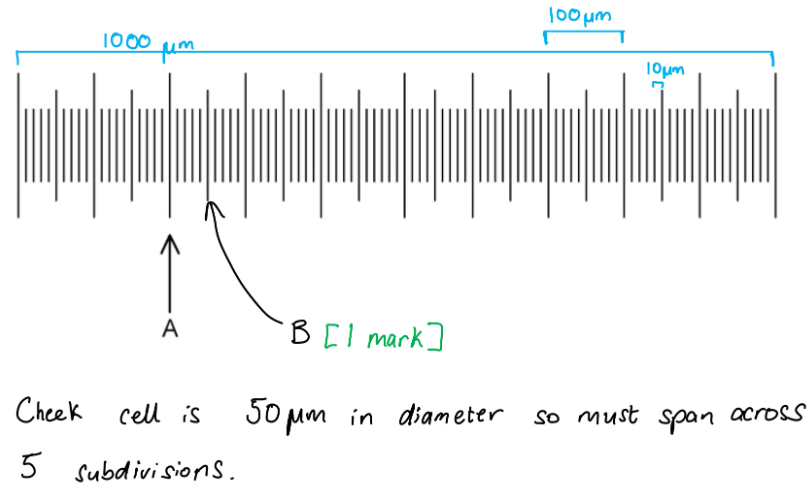

### Q3
The width of the cell in comparison to the thickness of the membrane can be calculated as follows:

- 5 cm = 50 000 000 / 5 × 107 nm; **[1 mark]**
- (Actual cell width =) 5 × 107 nm ÷ 1 250 = 40 000 nm; **[1 mark]**
- 40 000 nm ÷ 8 nm = 5 000 / 5 ×103 / (times / ×); **[1 mark]**

**[Total: 3 marks]**

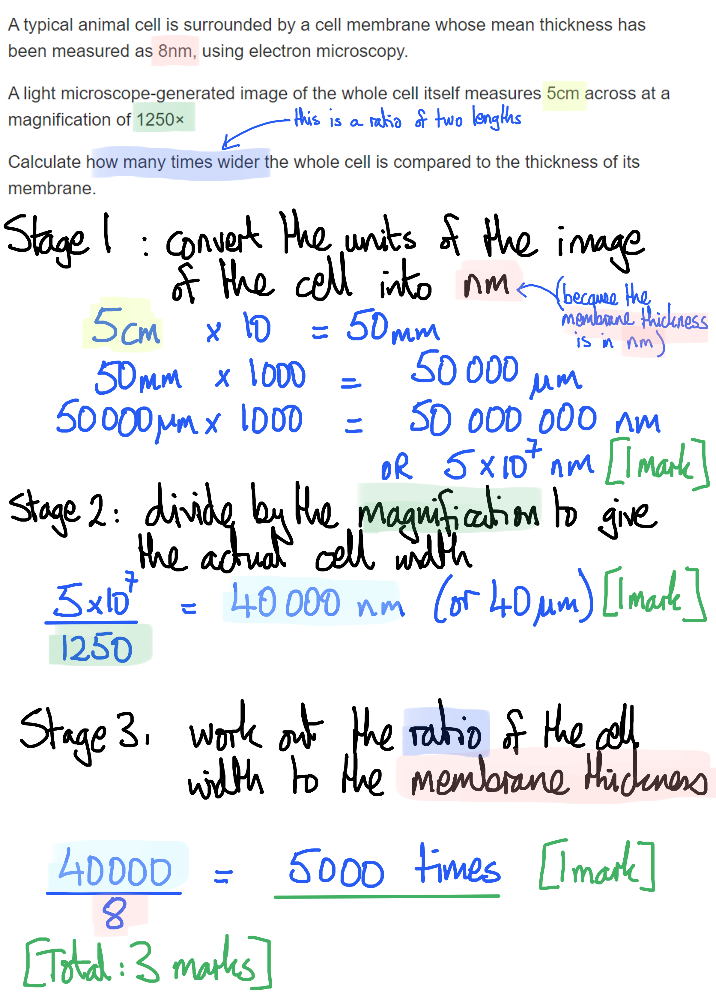

> *Remember to convert cm to mm early on in your calculations to remove the chance of being a factor of 10 out in your final answer. Any further unit conversions (mm to µm and µm to nm) all involve a factor of 1000. *
Reasons for the differences in appearance of the three images include:

- x400 is larger **AS **it is taken at a higher magnification (than x100); **[1 mark]**
- x400 is more blurred (than x100) **AS** the resolution is lower; **[1 mark]**
- The electron microscope can detect two separate objects **AS** it has a higher resolving power / is capable of higher resolution; **[1 mark]**

**[Total: 3 marks]**

> *This question gets to the heart of the distinction between magnification and resolution. Only a high resolution can distinguish between separate objects that are close together; at lower resolutions, the two objects appear merged into one, as shown in the light microscopy images in Fig. 1.*
Cell components that could be shown in Fig. 1 include:

**Final answer:** **Any**** two ****of the following:**

- Ribosomes; **[1 mark]**
- Granules, e.g. starch; **[1 mark]**
- Lysosomes; **[1 mark]**
- Vesicles; **[1 mark]**

**[Total: 2 marks]**

> *Large structures such as nuclei, mitochondria, and chloroplasts are likely to be clearly distinguishable using a x400 magnification under a light microscope, while structures such as membranes, Golgi, and ER will not have the small, spherical structure shown.*

### Q4
The actual length of one eyepiece graticule unit is:

- 0.1 x 1000 **OR** 100 ÷ 40; **[1 mark]**
- 2.5 µm; **[1 mark]**

*Full marks can be awarded for the correct answer in the absence of other calculations.*

**[Total: 2 marks]**

> *Remember that there are 1000 µm in a mm, so you need to multiply 0.1 mm by 1000 to convert this measurement into µm.*

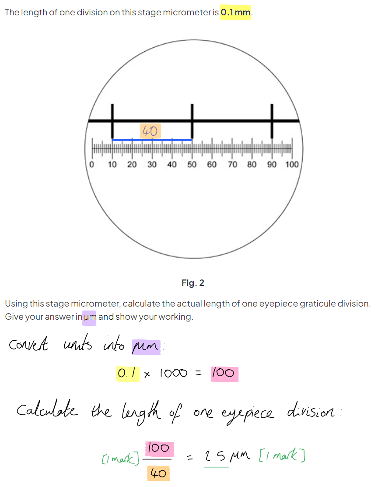

> *Note that although the question does tell us which scale is which in this instance, it is worth bearing in mind that the eyepiece graticule should always fit inside the eyepiece lens of the microscope and so be entirely visible in the field of view. The stage micrometer is placed on the stage, so you may see the divisions at a larger magnification; this, of course, will vary depending on the size and scale of your stage micrometer. *
The actual length in µm of the plant tissue from C to D is:

- 67.5 (μm);** [1 mark]**

*Accept error carried forward from part (b).*

**[Total: 1 mark]**

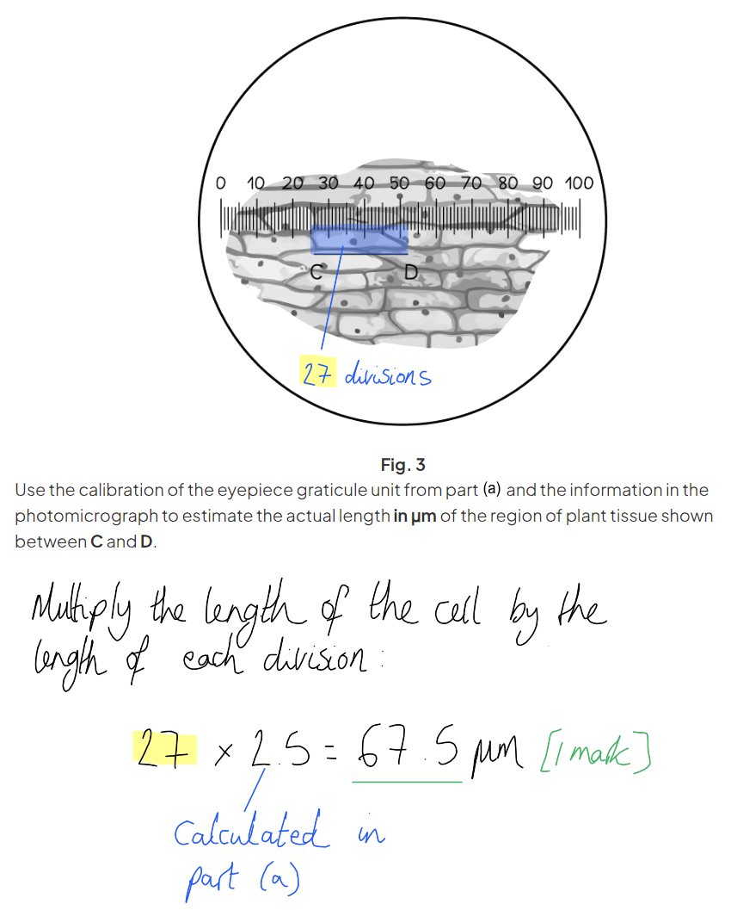

> *Remember that when answering exam questions like this it can often be wise to ask yourself whether your answer is a reasonable size for the structure in question; this can help to highlight any issues with converting units, e.g. if you have come up with an answer of 6.8 or 675 μm here, then that is an unlikely length for a plant cell, so suggests that you have done a unit conversion incorrectly!*
The drawing should have the following features:

- Cell C-D measures 67.5-68 mm in length **AND** the magnification of the image is given as x1000; **[1 mark]**
- The drawing resembles the shape and proportions of cell C-D **AND** at least three neighbouring cells; **[1 mark]**
- Clear pencil lines **AND** no shading **AND** image takes up more than half of the available space; **[1 mark]**
- Cell wall **AND** nucleus **AND** cytoplasm are labelled **AND **label lines drawn with a rule **AND** label lines do not have arrowheads **AND** label lines do not cross; **[1 mark]**

> *The actual size at which the image should be drawn can be calculated using the equation:*

> *image size = actual size x magnification*

> *= 67.5 x 1000*

> *= 67 500 μm*

> *The drawing will be easier to measure in mm, so convert μm into mm:*

> *67 500 ÷ 1000 = 67.5 mm*

**[Total: 4 marks]**

### Q5
The temporary mount should be prepared as follows...

- Place a <u>thin</u> section of (plant) tissue / a piece of plant tissue that is <u>one cell thick</u> onto a slide;** [1 mark]**
- Stain the specimen with iodine (in potassium iodide);** [1 mark]**
- Lower a coverslip over the specimen using a mounted needle;** [1 mark]**

**[Total: 3 marks]**

> *Note that you don’t need to go into detail here about how to set up the microscope and view the mount, because the question is only asking you about **preparing **the temporary mount.  *
The micrographs can be compared as follows...

*Similarities*

- Both micrographs show red blood cells; **[1 mark]**
- Both show the biconcave disc shape of the cells; **[1 mark]**

*Differences*

**Final answer:** **A ****maximum of three ****of the following:**

- Image A shows <u>more</u> cells / has a wid<u>er</u> field of view **OR **image B has few<u>er</u> cells / has a narrow<u>er</u> field of view; **[1 mark]**
- Image A has <u>less</u> detail/definition / is at a low<u>er</u> resolution **OR **image B has <u>more</u> detail/definition / has high<u>er</u> resolution; **[1 mark]**
- Image A is taken at low<u>er</u> magnification /** **image B has high<u>er</u> magnification; **[1 mark]**
- Image A was taken using a light microscope **WHILE** image B was taken using a (scanning) electron microscope; **[1 mark]**

**[Total: 4 marks]**

> *The command word **compare** means that you need to discuss the **similarities and differences** between the two images.*

> *Remember that each statement must relate to **both images**; you can do this by using comparative language such as **more**, low**er**, wid**er**, and **both**.*

> *Note that observation questions like this often don't require very much in the way of biological knowledge, but rely on your skills of observation and description, as well as your understanding of how to deal with the command words in the question.*
(i) The role of the cell type visible in Fig. 1 is...

- Transporting oxygen to (respiring) cells; **[1 mark]**

(ii) The adaptations of these cells are...

**Final answer:** **Any ****three**** of the following:**

- Contain haemoglobin **SO** can bind reversibly to oxygen; **[1 mark]**
- No nucleus **SO **there is more space for <u>haemoglobin</u>; **[1 mark]**
- Biconcave shape **SO** increases surface area for diffusion (of oxygen); **[1 mark]**
- Flexible membrane **SO** can pass/squeeze through capillaries; **[1 mark]**

**[Total: 4 marks]**

> *You are asked to '**explain**' your answers here so you must state **how** the adaptation aids the red blood cell in its role in order to gain each mark.*
The type of error is...

- <u>Systematic</u> error; **[1 mark]**

The effect on the data would be...

**Final answer:** **Any ****two ****of the following:**

- Accurate measurements cannot be made / any measurements made will be incorrect; **[1 mark]**
- (As) the eyepiece graticule would not be <u>calibrated</u>; **[1 mark]**
- All the data would have the same error / would be incorrect in the same way **OR **the trend of the data would not be affected; **[1 mark]**

**[Total: 2 marks]**

> *There are two types of errors you need to know about; **systematic** errors and **random** errors. Systematic errors **may not affect the trend** in results, whereas a random error might. This is because systematic errors are **consistently in the same direction** (e.g. they are always 50 g, 1 % or 99 mm too large or too small). Random errors produce different values in random directions, so may lead to an incorrect trend being identified. *

### Q6
Structures such as ribosomes and cell membranes cannot be seen using a light microscope because...

- Light microscopes do not have high enough <u>resolution</u> / <u>resolving power</u> **AND** these organelles are too small; **[1 mark]**
- It is not possible to distinguish between two separate points that are close together (closer together than the resolution of the microscope) / two points close together appear to be one point; **[1 mark]**

**[Total: 2 marks]**

> *Answers relating to **magnification** will **not** gain marks for this question. Remember that magnification is how many times bigger a microscope can make an object than it is in reality, but having a huge magnification is no use if the **resolution** is **poor**, because resolution determines the amount of **detail** that is visible. Objects that are closer together than the resolution of a microscope will be viewed as one object, and so **cannot be viewed clearly**.*
Ribosomes and cell membranes could be viewed clearly under an electron microscope because...

- (Electron microscopes have a higher resolution because) electrons have a smaller wavelength than light **OR** the wavelength of electrons is smaller than the width of a ribosome/cell membrane; **[1 mark]**

**[Total: 1 mark]**

> *The resolving power, or resolution, of a light microscope is limited by the wavelength of visible light, which is 400 nm. Anything that is less than half the size of this wavelength (< 200 nm) **cannot be resolved **and will appear as **one object**; we say that a light microscope has a resolution of 200 nm. Electrons have a much smaller wavelength (around 1 nm) and so **can resolve much smaller objects** e.g. a cell membrane has a width of around 10 nm, so while it cannot be clearly viewed with a light microscope (resolution 200 nm) it is clearly visible using an electron microscope (resolution 0.5 nm).*
General advantages of using an electron microscope include…

- <u>High-resolution</u> images are generated **OR** allows organelles (that can't be observed with light microscope) such as ribosomes/cell membranes to be seen as separate entities; **[1 mark]**
- Allows observation of the insides of cells **OR** allows internal details/structures cells to be seen **OR** allows cross-section of cells to be taken/observed;** [1 mark]**

General disadvantages of using an electron microscope include…

**Final answer:** **Any ****two**** of the following:**

- Can only be used to observe very <u>thin sections</u> of specimens; **[1 mark]**
- Cells/specimen must be dead **OR **living cells cannot be observed **OR **must be viewed in a vacuum; **[1 mark]**
- Can only generate images in greyscale/black and white/not in colour; **[1 mark]**
- The process of specimen preparation is complex / requires special training; **[1 mark]**
- Electron microscopes only fit in large science labs / are very large; **[1 mark]**

**[Total: 4 marks]**
(i) The type of microscope used to produce the image in Fig. 4 is a...

- (Scanning) electron (microscope); **[1 mark]**

(ii) The evidence is...

- (The image in Fig 4 is) 3-D/three-dimensional; **[1 mark]**

**[Total: 2 marks]**

> *Note that while you are not expected to know the details of different types of microscope, such as the 3D nature of images produced by a scanning electron microscope, you would still be expected to be aware that a 3D image like this one cannot be generated by most light microscopes.*

### Q7
A limitation of using a light microscope is...

**Final answer:** **Any ****two ****of the following:**

- Resolution is low/limited / has a maximum of 200 nm / is lower than an electron microscope; **[1 mark]**
- Points/objects that are very close together will be observed as one point/object; **[1 mark]**
- The wavelength of visible light ranges from about 400 to 700 nanometers / is too large; **[1 mark]**

**[Total: 2 marks]**

> *This is an **explain** question so you must explain **why** the low resolution is a limitation of light microscopes.*

> *You are not expected to know the wavelengths of light nor the specific resolution of light (or electron) microscopes. However, they do help to understand why the resolution of a light microscope is limited.*
(i) A biological drawing should include...

**Final answer:** **Any ****five ****of the following:**

- Cells have the same shape as those in Fig. 1; **[1 mark]**
- A small section of the micrograph has been drawn, e.g. three cells; **[1 mark]**
- Smooth pencil lines with no sketching; **[1 mark]**
- No shading; **[1 mark]**
- Nucleus **AND** cell wall labelled; **[1 mark]**
- Label lines are all on the same side **AND** do not cross each other **AND **drawn with a ruler; **[1 mark]**

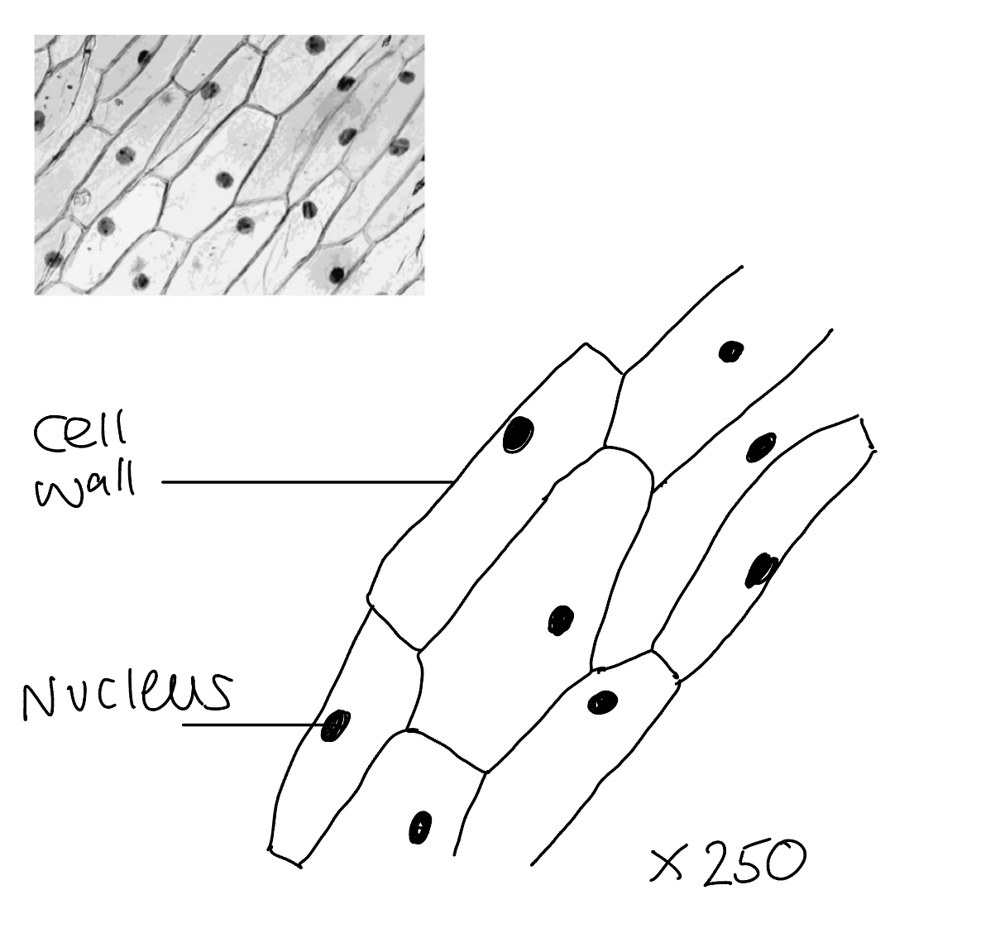

> *You need to make sure you understand the "rules" of creating biological drawings. You will lose marks if you try to add details that you cannot see in the image provided, such as certain organelles, or if you add shading or colour. Remember it is not an art exam!*

(ii) Organelles that are not visible in Fig. 1 are...

**Final answer:** **Any ****three ****of the following:**

- Chloroplasts; **[1 mark]**
- Endoplasmic reticulum (smooth/rough); **[1 mark]**
- Golgi apparatus/body; **[1 mark]**
- Mitochondria/mitochondrion; **[1 mark]**
- Ribosomes; **[1 mark]**

**[Total: 8 mark]**
The actual width of one cell is...

- (Conversion of units) 24 mm = 24 000 µm; **[1 mark]**
- (24 ÷ 250 =) 96 (µm); **[1 mark] **

**[Total: 2 marks]**

> *Do note that you are very unlikely to be given the measured length of a structure or cell from a diagram, this has only been provided to support with online learning and taking measurements off a screen. So make sure you remember your ruler as you would be expected to measure images yourself to use in calculations. *

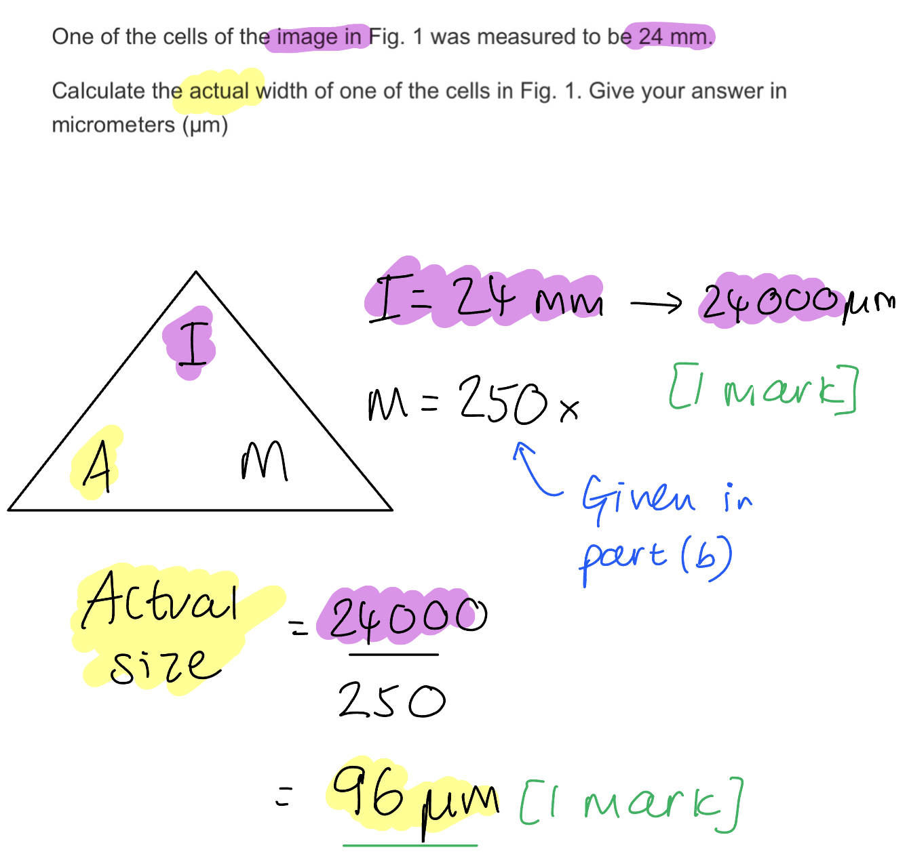
To make a temporary mount...

- (Using a) thin slice/section (of onion epidermal tissue); **[1 mark]**
- Put onto a slide in water/solution/stain/named stain; **[1 mark]**
- Lower cover slip over specimen; **[1 mark]**

**[Total: 3 marks]**

### Q8
Conventions that must be followed for biological drawings include…

**Final answer:** **Any ****four**** of the following:**

- The drawing must have a descriptive title;** [1 mark]**
- The magnification used must be included; **[1 mark]**
- A scale line must be included; **[1 mark]**
- Drawn with a sharp pencil; **[1 mark]**
- No shading; **[1 mark]**
- Clear/continuous/single lines used **OR** lines not sketched **OR **lines not overlapping; **[1 mark]**
- Structures should be clearly distinguishable;** [1 mark]**
- Proportions of the drawing should match the specimen; **[1 mark]**
- All relevant structures labelled;** [1 mark]**
- Label lines should be straight and not have arrows; **[1 mark]**
- Label lines should not cross;** [1 mark]**
- Labels should all be on one side of the drawing;** [1 mark]**

**[Total: 4 marks]**
The distance represented by one subdivision of the eyepiece graticule scale is...

- 2.5 x 10 **OR** 100 ÷ 4 **OR** (10 ÷ 4) x 10; **[1 mark]**
- 25 <u>μm</u>; **[1 mark]**

*Answers between 22-27 μm are accepted. Award full marks for correct answer without working.*

**[Total: 2 marks]**

> *One subdivision of the graticule covers roughly 2.5 subdivisions on the stage micrometer, so 2.5 x 10 μm = 25 μm. A **maximum** of **1 mark** is available for showing working along the lines of: 2.5 x 10. A correct answer **on its own** gains **2 marks**. The magnification of the microscope is irrelevant here, so don’t be tempted to include this in your calculations.*
An electron microscope gives a more detailed image of plant cell infrastructure than a light microscope because...

- It has a greater resolution **OR** it allows objects closer together to be seen as separate entities; **[1 mark]**
- (Because) electrons/electron beams have a short<u>er</u> wavelength <u>than light</u>;** [1 mark]**

**[Total: 2 marks]**

### Q9
To prepare the sample...

**Final answer:** **Any ****three**** of the following:**

- Place cells on a slide in a layer no more than <u>one cell thick</u>** OR** place a <u>single layer of cells</u> on a slide; **[1 mark]**
- Add a drop of water/stain; **[1 mark]**
- (Carefully lower) coverslip onto the sample; **[1 mark]**
- Avoid trapping air bubbles (under coverslip); **[1 mark]**
- Remove excess water/stain (using paper towel); **[1 mark]**

**[Total: 3 marks]**
To view the sample...

**Final answer:** **Any ****four**** of the following:**

- Place slide on microscope stage; **[1 mark]**
- (First) focus using the lowest power (objective) lens; **[1 mark]**
- Focus (on cells) using the (larger) coarse-focusing knob (until the cells come into focus); **[1 mark]**
- Use the fine-focusing knob to sharpen the image/ focus on particular parts; **[1 mark]**
- Increase magnification by moving to a higher power (objective) lens;** [1 mark]**
- At the higher objective powers only use the fine-focusing knob; **[1 mark]**

**[Total: 4 marks]**
Structures in a eukaryotic cell that cannot be identified using a light microscope include...

**Final answer:** **Any ****two**** of the following:**

- Ribosome; **[1 mark]**
- Endoplasmic reticulum; **[1 mark]**
- Lysosome; **[1 mark]**
- Cell-surface membrane; **[1 mark]**

**[Total: 2 marks]**

> *These structures are too small or narrow to be seen by a standard light microscope - an electron microscope would be required.*

### Q10
The magnification of the drawing in Fig. 1 is...

- 45000 ÷ 10;** [1 mark]**
- 4500 **OR** ×4500; **[1 mark]**

*Award full marks for correct answer without working.*

**[Total: 2 marks]**

> *A **maximum** of **1 mark** is available for showing working along the lines of (45 x 1000) ÷ 10. A correct answer **on its own** gains **2 marks**.*

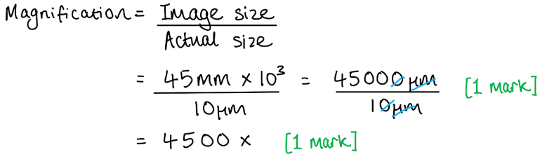
The actual width of the cell in Fig. 1 from **A** to **B** is...

- 95mm ÷ 4500; **[1 mark]**
- 21 (µm); **[1 mark]**

*Award full marks for correct answer without working.*

**[Total: 2 marks]**

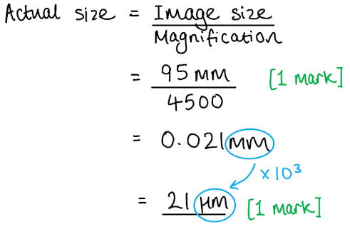
The actual length of the mitochondrion in Fig. 2 is...

- 6.4 ÷ 20000; **[1 mark]**
- 3.2 (µm); **[1 mark]**

*Award full marks for correct answer without working.*

**[Total: 2 marks]**

> *For magnification calculations like the one above, it may be easier to first convert any values given in **centimetres** into **millimetres**, as this can make the subsequent calculations slightly easier and more simple to handle.*

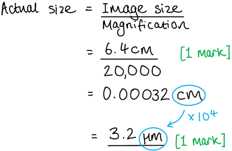
The circumference of the student’s model will be...

- 1.5µm x 50,000; **[1 mark]**
- 7.5 (cm); **[1 mark]**

*Award full marks for correct answer without working.*

**[Total: 2 marks]**

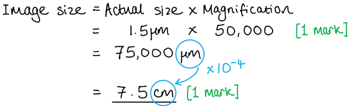

### Q11
The missing words are...

- A = electrons; **[1 mark]**
- B = lower; **[1 mark]**
- C = higher; **[1 mark]**
- D = higher; **[1 mark]**
- E = ribosomes / ER / Golgi / cell membranes / vesicles; **[1 mark]**

***Accept ****other correctly named examples for E*

**[Total: 5 marks]**
A stage micrometer is needed as well as an eyepiece graticule because:

- The size of the units of the eyepiece graticule change depending on the magnification being used; **[1 mark]**
- The micrometer can be used to <u>calibrate</u> the graticule; **[1 mark]**

**[Total: 2 marks]**

> *You may be asked to perform calculations regarding these two pieces of equipment so make sure you are comfortable with how to use them to make measurements. *
A stain is needed for some structures and specimens because:

- The cytoplasm / named cell structures / organelles may be transparent / difficult to distinguish from their surroundings; **[1 mark]**
- Stains will make structures/organelles visible / provide contrast in the image; **[1 mark]**

**[Total: 2 marks]**
The specimen needs to be thin because:

- To allow light to pass through **OR** to prevent layers of cells from obscuring each other; **[1 mark]**

**[Total: 1 mark]**

### Q12
The magnification is:

- 28 mm = 28000 µm; **[1 mark]**
- 28000 ÷ 30 = 933.33.; **[1 mark]**
- x933; **[1 mark]**

**[Total: 3 marks]**

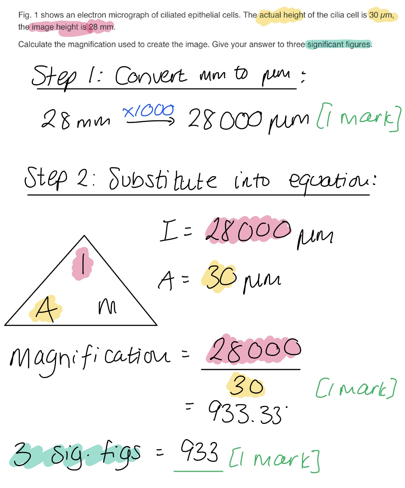
Cilia are best seen under an electron microscope because:

- They are too small (for the resolution of a light microscope); **[1 mark]**

**[Total: 1 mark]**
It is hard to distinguish individual cilia when viewed under a light microscope because:

- The <u>resolution</u> is too low; **[1 mark]**
- Cilia that are close together are seen a single object / cannot be distinguished as two separate objects; **[1 mark]**

**[Total: 2 marks]**

> *Note that there are 2 marks available here, so you need to expand on your initial answer to gain full marks.*
One limitation of an electron microscope is:

**Final answer:** **Any ****one**** of the following:**

- The specimen needs to be dead / in a vacuum; **[1 mark]**
- Users need specialist training / preparation of specimens is complicated; **[1 mark]**
- Electron microscopes are very large / will only fit into a large laboratory; **[1 mark]**

**[Total: 1 mark]**

### Q13
The coverslip should be added as follows:

- Lowered slowly / placed with one edge onto the slide and gently lowered over the specimen; **[1 mark]**

It should be added in this way because:

- To avoid smearing/spreading the specimen / to reduce the formation of air bubbles; **[1 mark]**

**[Total: 2 marks]**

> *Remember that 'explain' questions need additional detail about **why** something occurs in a particular way.*
The procedure would differ for animal tissue as follows:

- Iodine would not be used / a different stain, e.g. methylene blue would be used; **[1 mark]**

**[Total: 1 mark]**

> *Iodine stains starch, a molecule that is not present in animal cells, so a different stain would need to be used.*
The magnification is:

- 8 cm = 80 000 µm **OR **80 000 ÷ 200; **[1 mark]**
- x400; **[1 mark]**

**[Total: 2 marks]**

> *Always be sure to convert your measurements into micrometers; here this would be achieved by first converting cm into mm and then multiplying by 1000. It is usually a good idea to do this at the start of the calculations so that you don't risk forgetting at the end!*

> *Note that in an exam you would be expected to measure the length of an image with a ruler.*

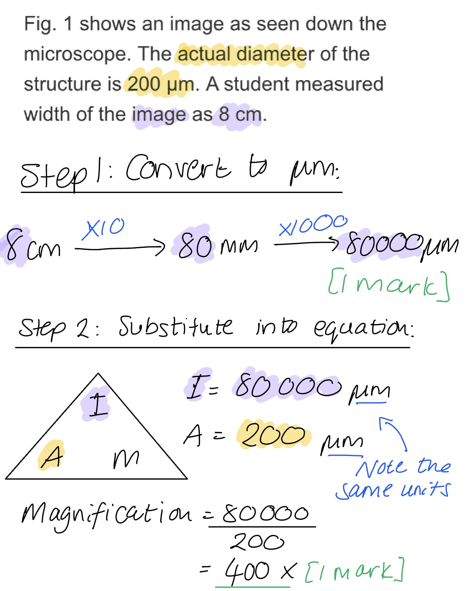
The evidence from Fig. 2 that shows that this is an image from an electron microscope is:

- Ribosomes are visible **OR** the image shows a mitochondrion / the inside of a mitochondrion; **[1 mark]**
- This is too small to be seen with a light microscope / light microscopes do not have a high enough resolution to view this structure; **[1 mark]**

***Accept**** mitochondria for mitochondrion*

**[Total: 2 marks]**

### Q14
The biological drawing should include:

**Final answer:** **Any ****five ****of the following:**

- A title; **[1 mark]**
- Magnification of x400; **[1 mark]**
- Drawn in pencil; **[1 mark]**
- Drawing takes up more than half the space; **[1 mark]**
- Position and shape of cells similar to that of Fig. 1 / proportions similar to Fig. 1; **[1 mark]**
- Solid single line / no sketch lines; **[1 mark]**
- No shading / colouring in; **[1 mark]**

**[Total: 5 marks]**

> *Biological drawings have specific conventions that must be followed, so take time to perfect this important skill in biology.*

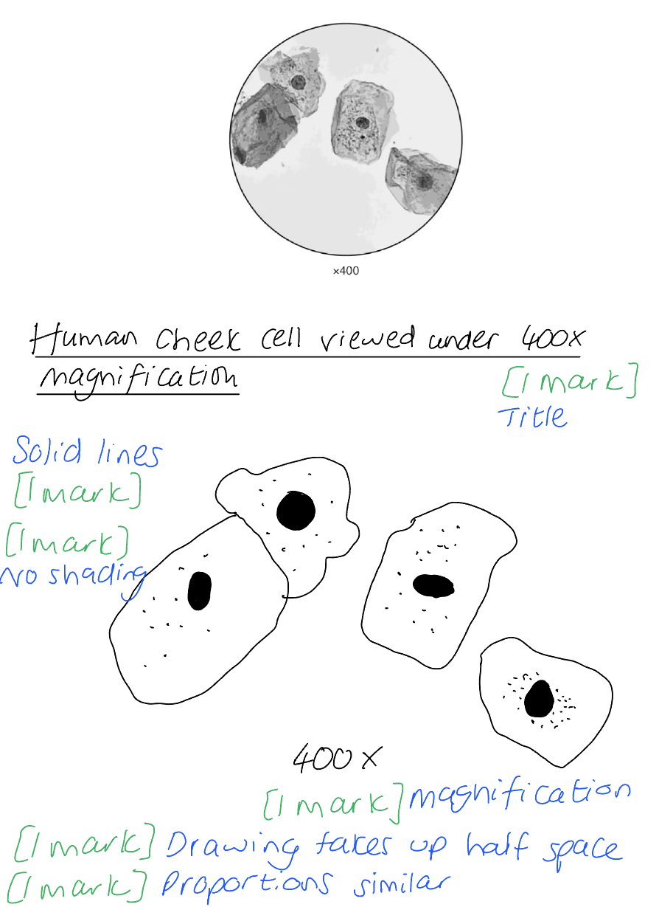
The labels added should include:

- Label lines do not cross **AND **are drawn with a ruler **AND **no arrowheads **AND **all to one side of the drawing; **[1 mark]**
- Nucleus/nuclei; **[1 mark]**
- Cell membrane; **[1 mark]**
- Cytoplasm; **[1 mark]**
- Bacteria **OR **mitochondria/mitochondrion labelled; **[1 mark]**

**[Total: 5 marks]**

> *It is important you do not label or try to identify structures you cannot clearly see in the image, therefore you should not label structures such as ribosomes or ER or Golgi apparatus. *

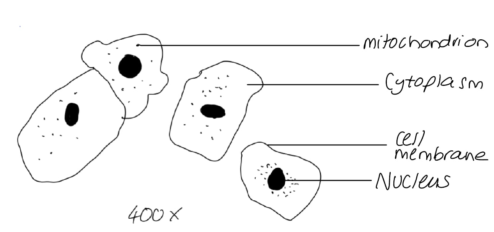
The cells appear blue because:

- A stain / methylene blue has been added; **[1 mark]**

**[Total: 1 mark]**
The function of one of the organelles labelled in part (b) is:

**Final answer:** **Any ****one**** of the following:**

- Nucleus = contains DNA/genetic material; **[1 mark]**
- Cell membrane = controls the exchange of materials between the internal cell environment and the external environment; **[1 mark]**
- Cytoplasm = medium for chemical reactions; **[1 mark]**
- Mitochondria = site of aerobic respiration; **[1 mark]**

*Do not credit nucleus - 'brain of the cell'*

**[Total: 1 mark]**

> *This is synoptic knowledge from topic 1.2, but this is also a recap of knowledge from IGCSE. *

### Q15
Magnification can be defined as follows:

- The number of times bigger the image of a specimen is in comparison to the actual (real-life) size of the specimen; **[1 mark]**

**[Total: 1 mark]**

> **[exam-tip]**
> Vague phrases such as 'zoomed in' or 'how much a microscope enlarges' will not earn credit because they do not say what is being compared.
Resolution can be defined as follows:

- The ability to distinguish between two separate points (on an image) / the distance at which two points (in an image) can be seen/distinguished as separate; **[1 mark]**

**[Total: 1 mark]**
The student should do the following to calculate the actual length of the cell:

- Use the ruler to** **measure the length in mm; **[1 mark]**
- Convert to µm by multiplying by 1000; **[1 mark]**
- Divide by the magnification/10 000; **[1 mark]**

**[Total: 3 marks]**
The conventions of biological drawings are:

**Final answer:** **Any ****three ****of the following:**

- No sketching **OR** solid lines only; **[1 mark]**
- No shading; **[1 mark]**
- Plain paper; **[1 mark]**
- More than half the page / available space; **[1 mark]**
- The drawing must have a title; **[1 mark]**
- Magnification should be recorded; **[1 mark]**
- (Only) well-defined structures should be drawn / the drawing should only show structures that are clearly visible; **[1 mark]**
- Proper proportions; **[1 mark]**
- Label lines should not cross **OR **label lines should not have arrowheads **OR l**abel lines should be kept to one side of the drawing **OR **label lines should be drawn with a ruler; **[1 mark]**

**[Total: 3 marks]**
