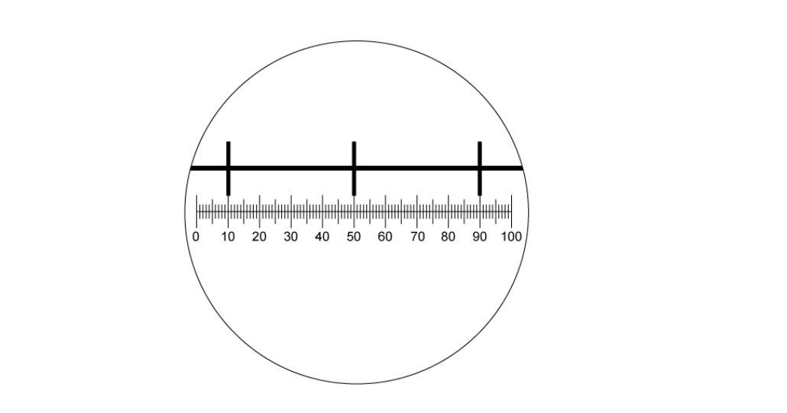
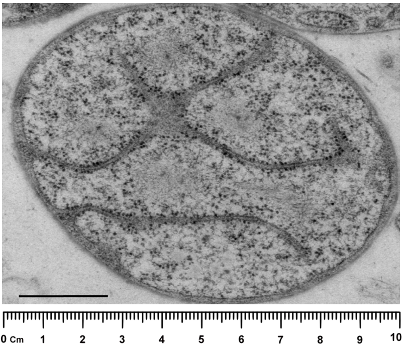
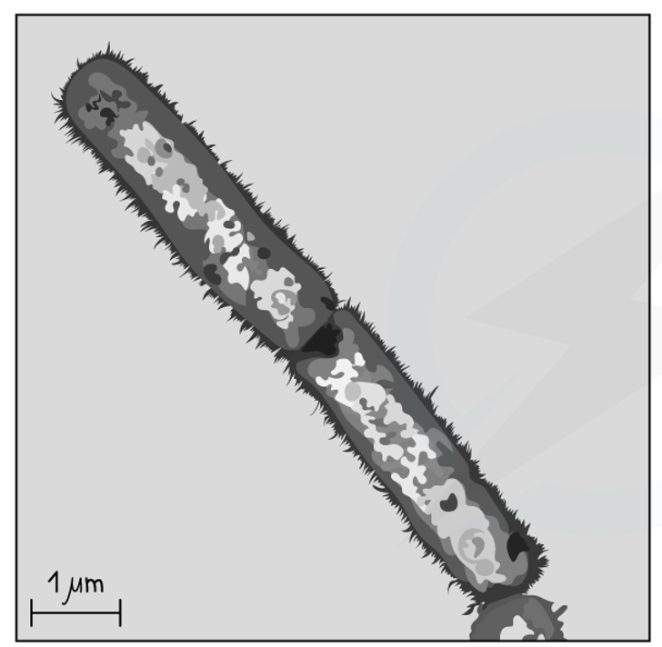
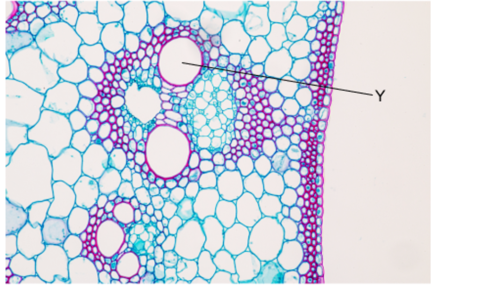

# Exam Questions — The Microscope in Cell Studies
**1. Cell Structure** · Cambridge (CIE) A-LEVEL biology (9700)
> Source: [https://www.savemyexams.com/a-level/biology/cie/25/topic-questions/](https://www.savemyexams.com/a-level/biology/cie/25/topic-questions/) · 29 questions across 1 sets

## Multiple Choice Questions (29 questions)

### Q1 — hard — 1 marks

**Q1** [1 mark]

The diagram below shows a view through a microscope eyepiece with a graticule scale (bottom) and a stage micrometer (top).

What is the area of the field of view at this magnification?

Note that π = 3.14

### Q2 — hard — 1 marks

**Q2** [1 mark]

A student was using an eyepiece graticule with 100 small divisions and a stage micrometer with 50 divisions, each 0.04 mm apart.

Using a x40 objective lens, the whole length of the stage micrometer lined up with 15 divisions of the eyepiece graticule.

What is the length of the 100 division scale of the eyepiece graticule at this magnification?

### Q3 — hard — 1 marks

**Q3** [1 mark]

Cells can vary considerably in diameter, e.g.

- Eukaryotic cells, such as a white blood cell          1.5 x 101 µm
- Prokaryotic cells, such as *Streptococcus              *7.5 x 102 nm

Use these measurements to find the maximum number of each cell that could be arranged, end-to-end, along a 1 cm line.

|   | Number of white blood cells | Number of *Streptococcus* cells |
|---|---|---|
| **A** | 6.7 x 100 | 1.3  x 102 |
| **B** | 6.7 x 101 | 1.3  x 103 |
| **C** | 6.7 x 102 | 1.3  x 104 |
| **D** | 6.7 x 103 | 1.3  x 105 |

### Q4 — hard — 1 marks

**Q4** [1 mark]

The diagram shows a stage micrometer (top) being used to calibrate an eyepiece graticule (bottom). The divisions on this micrometer measure 0.1 mm.

A slide of a plant cell was placed on the stage in place of the stage micrometer.

What is the width of a single chloroplast shown on the slide below?

### Q5 — hard — 1 marks

**Q5** [1 mark]

A light microscope is used at a magnification of x400 and with a green light source that has a wavelength of 510 nm.

The same specimen is viewed again under the same conditions, but with the light source switched to red light with a wavelength of 650 nm.

What effect would this have on the magnification and resolution of the microscope?

|   | **magnification** | **resolution** |
|---|---|---|
| **A** | stays the same | increased |
| **B** | stays the same | decreased |
| **C** | increased | decreased |
| **D** | decreased | increased |

### Q6 — hard — 1 marks

**Q6** [1 mark]

The diagram below shows the view through an eyepiece when a stage micrometer is used. This stage micrometer (shown here at the top of the image) has divisions that are 0.1 mm apart.

The same eyepiece is used to examine a blood smear.

How many of the graticule divisions will cover the diameter of a white cell of 12.5 µm?

### Q7 — hard — 1 marks

**Q7** [1 mark]

The diagram below shows a view through a microscope eyepiece with a graticule scale and a stage micrometer, using a magnification of x400.

Using the magnification of x400, a chloroplast was measured to be 4 eyepiece graticule divisions in length.

How long is the chloroplast?

### Q8 — hard — 1 marks

**Q8** [1 mark]

The image below shows an electron micrograph of a bacterial cell. The scale bar measures 2 cm and represents a length of 500 nm.

*CC BY 2.5, via **[Wikimedia Commons](https://commons.wikimedia.org/wiki/File:Santarella_plosbio_2010_gemmata_obscuriglobus_fig3_topright.png)*

What is the actual length of the bacterial cell?

### Q9 — hard — 1 marks

**Q9** [1 mark]

The actual length of a cellular structure is 6 µm.

A student was asked to write an equation that could be used to calculate the magnification of an electron micrograph of this cell structure. The student used the letters *q* to *u* in their equation.

*q* = the length of the cell structure in the image in cm

*r* = the length of the cell structure in the image in mm

*s* = 1000

*t* = 1/6

*u* = 6

Which of the following would be the correct equation to calculate the magnification?

### Q10 — medium — 1 marks

**Q10** [1 mark]

To view the actual width of a transverse section of a xylem vessel with a x40 lens, which steps are needed?

| 1 | measure the width of the xylem vessel using an eyepiece graticule |
|---|---|
| 2 | calibrate the eyepiece graticule using a stage micrometer on x10 objective lens |
| 3 | convert from mm to µm by multiplying by 10-3 |
| 4 | multiply the number of eyepiece graticule units by the calibration of the eyepiece graticule. |

### Q11 — medium — 1 marks

**Q11** [1 mark]

The table shows some approximate units for measuring the diameters of alveoli, white blood cells and the width of cell walls.

Which of the rows show the correct units for these structures?

|   | **Diameter of alveoli** | **Diameter of white blood cells** | **Width of cell walls** |
|---|---|---|---|
| **A** | mm | µm | µm |
| **B** | mm | µm | nm |
| **C** | µm | nm | µm |
| **D** | µm | µm | nm |

### Q12 — medium — 1 marks

**Q12** [1 mark]

Erythrocytes (red blood cells) have a diameter of 7 000 nm. Pancreatic cells have a diameter of 35 µm.

Which of these statements about the relative sizes of these cells is correct?

### Q13 — medium — 1 marks

**Q13** [1 mark]

The electron micrograph of a bacterial cell has a 2 cm scale bar.

What is the magnification of the image?

### Q14 — medium — 1 marks

**Q14** [1 mark]

A prokaryotic cell with a diameter of 1 µm is magnified 50 000 times by an electron microscope.

What is the diameter of the cell in the resulting electron micrograph?

### Q15 — medium — 1 marks

**Q15** [1 mark]

The following statements describe slide preparation.

Which statement would not be relevant in the preparation of a wet mount for observation with a light microscope?

### Q16 — medium — 1 marks

**Q16** [1 mark]

Which of the following descriptions of light and electron microscopes is **not** correct?

### Q17 — medium — 1 marks

**Q17** [1 mark]

The electron micrograph below shows a root vascular system.

The magnification of the image is x200 and Y has a diameter of 1 cm when measured using a ruler.

What is the diameter of the cell labelled Y?

### Q18 — medium — 1 marks

**Q18** [1 mark]

The electron micrograph below shows the organelles in a leaf cell, as well as a scale bar and on-screen ruler.

What is the magnification of the image?

### Q19 — medium — 1 marks

**Q19** [1 mark]

The following statements describe producing a scientific drawing.

Which is **not** a correct statement about drawing scientifically?

### Q20 — easy — 1 marks

**Q20** [1 mark]

Which row correctly describes the magnification and resolution of an electron microscope in relation to a light microscope?

|   | **magnification** | **resolution** |
|---|---|---|
| **A** | lower | higher |
| **B** | higher | lower |
| **C** | higher | higher |
| **D** | lower | lower |

### Q21 — easy — 1 marks

**Q21** [1 mark]

Which of the options gives the resolution, in nanometres, of an electron microscope and a light microscope?

|   | **electron microscope** | **light microscope** |
|---|---|---|
| **A** | 5.0 | 20 |
| **B** | 5.0 | 200 |
| **C** | 0.5 | 20 |
| **D** | 0.5 | 200 |

### Q22 — easy — 1 marks

**Q22** [1 mark]

Which of the statements about light microscopes are correct?

| 1 | The magnification of a light microscope is limited by the wavelength of light |
|---|---|
| 2 | The resolution of a light microscope is limited by the wavelength of light |
| 3 | To calculate the magnification of a light microscope the eyepiece lens and objective lens magnifications are added together |

### Q23 — easy — 1 marks

**Q23** [1 mark]

Specimens can be measured using eyepiece graticules and stage micrometers.

Which of the following correctly describes the role of a stage micrometer?

### Q24 — easy — 1 marks

**Q24** [1 mark]

A lysosome has a diameter of 0.4 µm.

Which of the following gives the lysosome diameter in nm?

### Q25 — easy — 1 marks

**Q25** [1 mark]

At approximately which magnification would the resolution of a light microscope become too low to produce a clear image?

### Q26 — easy — 1 marks

**Q26** [1 mark]

Which of the following is **not** a step involved in the preparation of an onion cell specimen for viewing under a light microscope?

### Q27 — easy — 1 marks

**Q27** [1 mark]

Which of the following correctly defines the term** resolution** in light microscopy?

### Q28 — easy — 1 marks

**Q28** [1 mark]

Which of the following is **not** a convention that should be used when producing biological drawings of cells?

### Q29 — easy — 1 marks

**Q29** [1 mark]

A microscope has a resolution of 200 nm.

Which of the following organelles would not be resolved by this microscope?
