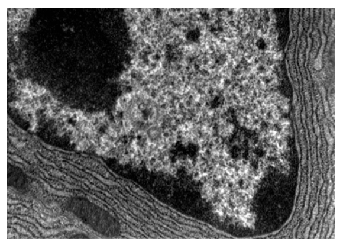
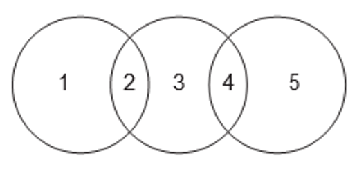
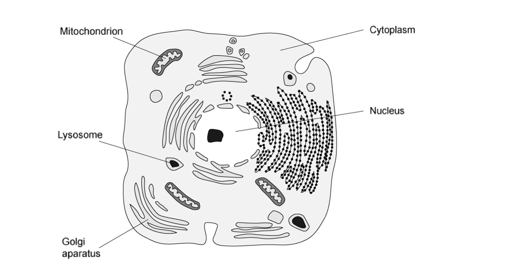
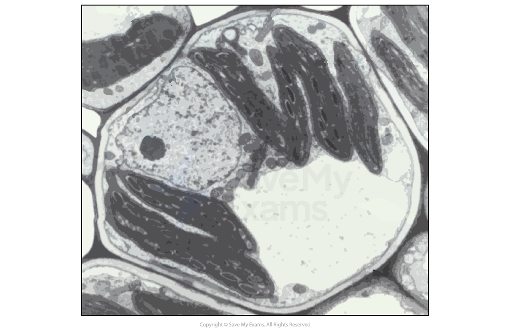
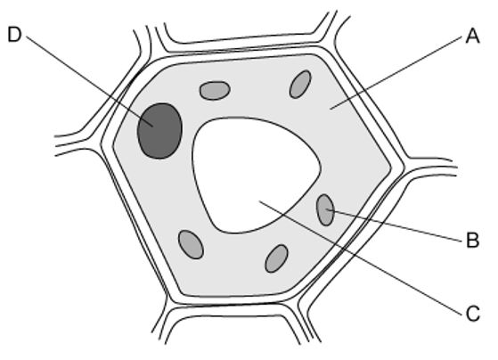
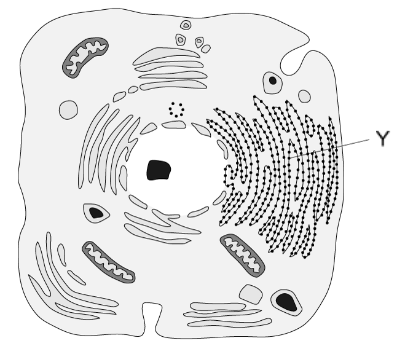
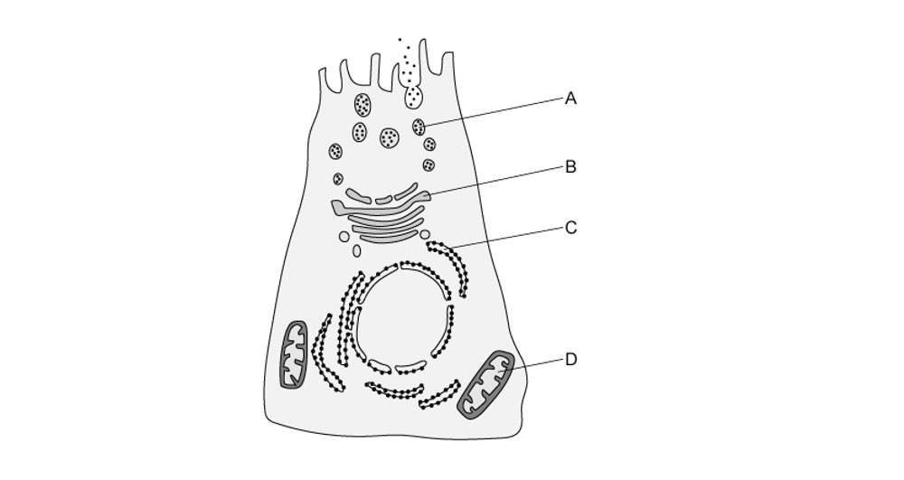
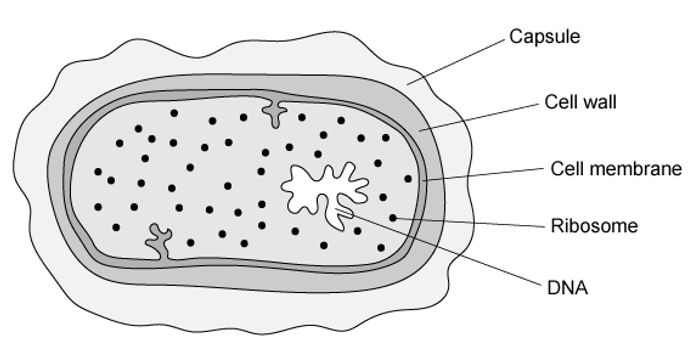

# Exam Questions — Cells as the Basic Units of Living Organisms
**1. Cell Structure** · Cambridge (CIE) A-LEVEL biology (9700)
> Source: [https://www.savemyexams.com/a-level/biology/cie/25/topic-questions/](https://www.savemyexams.com/a-level/biology/cie/25/topic-questions/) · 30 questions across 1 sets

## Multiple Choice Questions (30 questions)

### Q1 — hard — 1 marks

**Q1** [1 mark]

Which row correctly describes the structure and function of a particular cellular feature?

|   | **structure** | **function** |
|---|---|---|
| **A** | a series of flattened, membrane-bound sacs | organises microtubules to produce the spindle |
| **B** | non membrane-bound cylindrical structures | packages hydrolytic enzymes used in cell |
| **C** | membrane-bound spherical structure | synthesizes polypeptides |
| **D** | membrane surrounding an enclosed inner cavity | synthesises lipids |

### Q2 — hard — 1 marks

**Q2** [1 mark]

Some mammalian tissue was homogenised and centrifuged.

- Homogenisation involves blending the contents of a mixture until they are evenly distributed
- Centrifugation involves spinning a mixture at very high speeds to separate components by mass

The biochemical activity of four tissue samples, **A**-**D**, was investigated.

Which graph shows a tissue with a high synthesis of messenger RNA?

### Q3 — hard — 1 marks

**Q3** [1 mark]

A cell which is actively growing is supplied with radioactively labelled amino acids.

Which cell component will show an increase in radioactivity first?

### Q4 — hard — 1 marks

**Q4** [1 mark]

The table below shows some of the structures found in four different types of cell.

|   | **1** | **2** | **3** | **4** |
|---|---|---|---|---|
| chloroplast centrioles cell wall Golgi apparatus large vacuole | ✓  X  ✓  ✓  ✓ | X  X  ✓  ✓  ✓ | X  ✓  X  ✓  X | X  X  ✓  X  X |

Key: ✓ = present, X = absent

Which option (1, 2, 3 or 4) best matches the cell types below?

|   | 1 | 2 | 3 | 4 |
|---|---|---|---|---|
| **A** | ciliated epithelial cell | prokaryotic cell | root cortex cell | spongy mesophyll cell |
| **B** | spongy mesophyll cell | root cortex cell | ciliated epithelial cell | prokaryotic cell |
| **C** | root cortex cell | spongy mesophyll cell | prokaryotic cell | ciliated epithelial cell |
| **D** | prokaryotic cell | ciliated epithelial cell | spongy mesophyll cell | root cortex cell |

### Q5 — hard — 1 marks

**Q5** [1 mark]

The image below is an electron micrograph of an animal cell.

*Public domain, via **[Flickr](https://www.flickr.com/photos/internetarchivebookimages/19756543133)*

Which one of the options A to D, would be the site of protein modification and packaging?

### Q6 — hard — 1 marks

**Q6** [1 mark]

A giant bacterium, *Epulopiscium fishelsoni* was discovered in 1985.

Which cell structure(s) would enable biologists to classify *E. fishelsoni* as a prokaryote?

### Q7 — hard — 1 marks

**Q7** [1 mark]

The basic structure of a virus is made up of a protein coat and genetic material.

What is the name given to the protein coat?

### Q8 — hard — 1 marks

**Q8** [1 mark]

Which of the following identifies the type of molecule, or molecules, present in the genetic material of a virus.

### Q9 — hard — 1 marks

**Q9** [1 mark]

The image below is an electron micrograph of part of an animal cell.

*CNX OpenStax, CC BY 4.0, via **[Wikimedia Commons](https://commons.wikimedia.org/wiki/File:OSC_Microbio_03_04_ER.jpg)*

Which of the following is likely to be produced in especially large quantities in this cell?

| 1 | Glucose |
|---|---|
| 2 | RNA |
| 3 | ATP |

### Q10 — hard — 1 marks

**Q10** [1 mark]

The diagram shows similarities between chloroplasts, mitochondria and typical prokaryotes.

Which row shows the correct relationship between these structures?

|   | 1 | 2 | 3 | 4 | 5 |
|---|---|---|---|---|---|
| **A** | mitochondria | 70S ribosomes | chloroplasts | 80S ribosomes | prokaryotes |
| **B** | mitochondria | 70S ribosomes | chloroplasts | 80S ribosomes | prokaryotes |
| **C** | chloroplasts | 70S ribosomes | prokaryotes | 80S ribosomes | mitochondria |
| **D** | chloroplasts | 70S ribosomes | prokaryotes | 70S ribosomes | mitochondria |

### Q11 — medium — 1 marks

**Q11** [1 mark]

The sentence below describes a process and a cellular structure.

Cells which have a high rate of ….1…. will have many ….2….. .

Which row identifies a process and a structure that would fit correctly into the sentence?

|   | 1 | 2 |
|---|---|---|
| **A** | facilitated diffusion | mitochondria |
| **B** | DNA replication | lysosomes |
| **C** | exocytosis | vesicles |
| **D** | phospholipid production | ribosomes |

### Q12 — medium — 1 marks

**Q12** [1 mark]

The image below is a drawing of an electron micrograph.

Which structures are surrounded by a double membrane?

|   | lysosome | mitochondria | nucleus | Golgi apparatus | cytoplasm |
|---|---|---|---|---|---|
| **A** | ✓ | ✓ | ✓ | ✓ | ✓ |
| **B** | X | ✓ | ✓ | ✓ | ✓ |
| **C** | X | ✓ | ✓ | X | X |
| **D** | ✓ | X | X | X | ✓ |

Key: ✓ = surrounded by a double membrane, X = not surrounded by a double membrane

### Q13 — medium — 1 marks

**Q13** [1 mark]

Membrane bound sacs containing the products of metabolism are produced by the endoplasmic reticulum.

Where are these products used?

### Q14 — medium — 1 marks

**Q14** [1 mark]

Which of the following structures are found in photosynthetic prokaryotes?

| 1 | Cellulose wall |
|---|---|
| 2 | Circular chromosome |
| 3 | Ribosomes |
| 4 | Chloroplasts |
| 5 | Cell surface membrane |

### Q15 — medium — 1 marks

**Q15** [1 mark]

Mucus is produced in the trachea by goblet cells. The following statements describe steps in the process of mucus production.

| 1 | Fusion of the vesicle with the plasma membrane. |
|---|---|
| 2 | Secretion of a glycoprotein. |
| 3 | Separation of a vesicle from the Golgi apparatus. |
| 4 | Addition of carbohydrate to protein. |

What is the correct order of these steps?

### Q16 — medium — 1 marks

**Q16** [1 mark]

The diagram shows a cell that secretes glycoproteins; proteins with attached molecules of carbohydrate. The cell is supplied with radioactively labelled sugar, which is first detected in the cytoplasm.

In which organelle would the radioactively-labelled glucose be detected after that?

### Q17 — medium — 1 marks

**Q17** [1 mark]

The photomicrograph shows a plant cell. A student was asked to identify **three** observable features from the micrograph.

Which of the following would be correct labels for this image?

### Q18 — medium — 1 marks

**Q18** [1 mark]

The diagram shows a typical plant cell.

Which of the cell components **A, B, C **or **D** would be present in prokaryotes?

### Q19 — medium — 1 marks

**Q19** [1 mark]

Which features would indicate that a student is observing a eukaryotic cell?

|   | cytoplasm includes endoplasmic reticulum | protein molecules are associated with the DNA | ribosomes distributed through the cytoplasm |
|---|---|---|---|
| **A** | X | ✓ | X |
| **B** | X | X | X |
| **C** | ✓ | ✓ | ✓ |
| **D** | ✓ | X | ✓ |

Key: ✓ = found in eukaryotes, X = not found in eukaryotes

### Q20 — medium — 1 marks

**Q20** [1 mark]

The list below contains structures that are found in eukaryotic cells.

| 1 | Nucleus |
|---|---|
| 2 | Endoplasmic reticulum |
| 3 | Lysosome |
| 4 | Chloroplast |
| 5 | Mitochondria |

Which of these structures has a double membrane?

### Q21 — easy — 1 marks

**Q21** [1 mark]

Which structure is found in all eukaryotic cells, but is not found in prokaryotic cells?

### Q22 — easy — 1 marks

**Q22** [1 mark]

Which row shows the structures found in a typical flowering plant cell?

|   | centrioles | cilia | mitochondria | vacuole |
|---|---|---|---|---|
| **A** | X | ✓ | ✓ | X |
| **B** | X | X | ✓ | ✓ |
| **C** | ✓ | ✓ | ✓ | ✓ |
| **D** | X | X | X | ✓ |

Key: ✓ = present, X = absent

### Q23 — easy — 1 marks

**Q23** [1 mark]

What is the role of the nucleolus?

### Q24 — easy — 1 marks

**Q24** [1 mark]

The diagram shows a drawing of an animal cell.

What is the function of the membrane system labelled Y?

### Q25 — easy — 1 marks

**Q25** [1 mark]

Which of the following structures are found in all prokaryotic cells?

### Q26 — easy — 1 marks

**Q26** [1 mark]

The diagram shows a cell that secretes enzymes.

Where are the enzymes made within the cell?

### Q27 — easy — 1 marks

**Q27** [1 mark]

What is the role of the smooth endoplasmic reticulum?

### Q28 — easy — 1 marks

**Q28** [1 mark]

Which feature(s) would identify an organism as a prokaryote?

| 1 | cell wall |
|---|---|
| 2 | circular DNA |
| 3 | cell membrane |
| 4 | ribosomes |

### Q29 — easy — 1 marks

**Q29** [1 mark]

The diagram shows a bacterium.

Which three structures are found in both an animal cell and this bacterial cell?

### Q30 — easy — 1 marks

**Q30** [1 mark]

Which of the following structures are found in typical eukaryotic cells?

| 1 | circular DNA |
|---|---|
| 2 | linear DNA |
| 3 | 80S ribosomes |
| 4 | 70S ribosomes |
