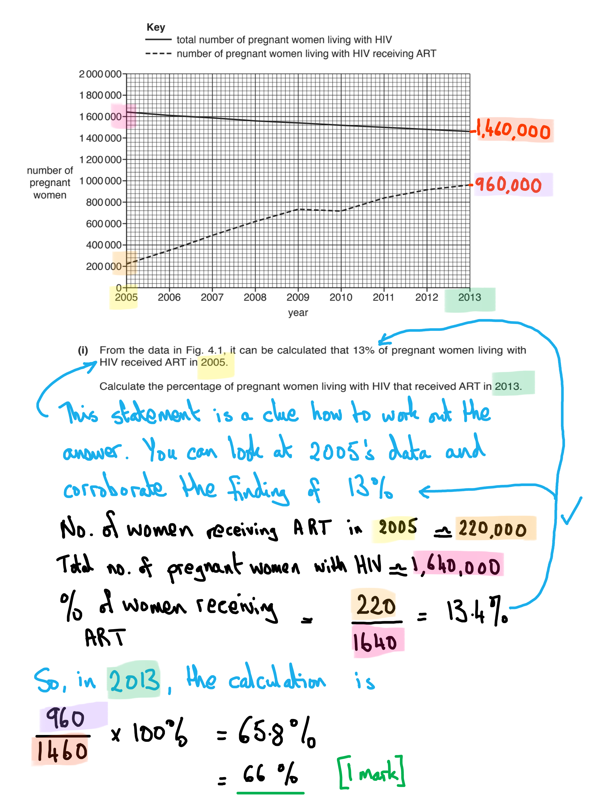

# Mark Schemes — Infectious Diseases
**10. Infectious Diseases** · Cambridge (CIE) A-LEVEL biology (9700)

## Multiple Choice Questions (30 questions)

### Q1
**The correct answer is ****D**** because the only statement that applies to both malaria and HIV is statement 3; the causative agents of both malaria and HIV (four species of ****Plasmodium**** ****and HIV respectively) can cross the placenta and be transmitted from mother to child.**

- *Statement 1 only applies to malaria (the insect vector being the female **Anopheles **mosquito. *
- *Statement 2 only applies to malaria in this case; the definition of endemic is a disease that is always found in a population. Although HIV as a disease is becoming endemic (with HIV-2, a second common type of the virus, being endemic in Western Africa) HIV epidemics occur outside of sub-tropical regions, with HIV epidemics emerging in the 1980’s. An epidemic is a widespread outbreak of a disease in large numbers of individuals over a particular period of time, in a given area. *

### Q2
**Final answer:** **The correct answer is ****D ****because:**

**Final answer:** **As T-helper cells are infected by HIV particles, they become unable to stimulate B-cells, this means that B cells will not divide to form plasma cells and therefore antibodies cannot be produced. Eventually, a patient may die from opportunistic infections which cannot be eradicated as the immune system is non-functional.**

> *A is incorrect because a decrease in T-helper cells does not result in an increase in HIV RNA. The T helper cell numbers decrease due to them being destroyed by HIV as it replicates.*

> *B is not correct because there are many treatments available to treat HIV patients in the early stages meaning that the disease will not progress to AIDs. The data shown in this graph is not representative of all HIV patients.*

> *C is incorrect as T-killer cells do not activate B cells, it is the T-helper cells that activate the B cells, and it is the B cells that produce the antibodies. Therefore, it is a decrease in T-helper cells which results in a decrease in antibodies*

### Q3
**Final answer:** **The correct answer is ****D**** because:**

- **Measles is caused by a virus**
- **Many attempts have been made to eradicate malaria, either by controlling the vector or vaccination programs, none have been successful so far**
- **HIV/AIDS is transmitted through direct contact with body fluids**
- **Cholera is caused by a bacterium**

### Q4
**Final answer:** **The correct answer is ****B**** because:**

- **In developing countries, the most effective method for controlling malaria is the prevention of mosquito biting**
- **The female ****Anopheles**** mosquito bites mainly at dusk and overnight, so the use of nets to prevent them biting whilst a person is sleeping helps prevent the spread of malaria**
- **Nets are a long-term and cost-effective method of preventing malaria in rural developing areas**

> *A is incorrect as while this can provide a control method, spraying with **B. thuringiensis **is costly and needs to be applied regularly, not the most effective method in developing countries.*

> *C is incorrect as vaccination programs are still in development, costly (and malaria is a disease predominantly affecting developing countries) and it is difficult to administer vaccines in developing rural communities.*

> *D is incorrect as it is not possible to put oil on every puddle and standing water source so will not remove all breeding sites for mosquitos.*

### Q5
**Final answer:** **The correct answer is ****A**** because:**

- **Plasmodium vivax**** is one of the parasites that causes malaria (the ****Plasmodium**** pathogens that cause malaria are often referred to as parasites)**
- **The malaria parasite infects erythrocytes (red blood cells) and multiplies inside them, eventually leading to the cell bursting (cell lysis) – this releases more parasites into the bloodstream**
- **The infection will reduce the number of red blood cells leading to a reduction in the ability of the body to transport oxygen to cells, this is ****anaemia**
- **The patient will have fevers due to the body reacting to the infection by raising the temperature**

> *B **is incorrect as this pathogen causes smallpox, smallpox does not cause anaemia.*

> *C **is incorrect as this pathogen causes tuberculosis. This infects and damages the lungs.*

> *D **is incorrect as this pathogen causes measles, the main symptom of which is a rash and fever*

### Q6
**Final answer:** **The correct answer is ****A**** because:**

- **Cholera is an infectious disease caused by the bacteria ****Vibrio**** ****cholerae ****which infects the small intestine of humans**
- **Infection with ****Vibrio**** ****cholerae**** leads to increased water loss and diarrhoea, which results in the pathogen being lost from the body in watery faeces **
- **Cholera is transmitted by ****contaminated water****. When the water is contaminated by sewage the infection can easily be spread from one person to the next**

### Q7
**Final answer:** **The correct answer is**** C****,**

**Final answer:** **White blood cells are not infected with the Malaria parasite.**

> *However, as malaria impacts the liver and the red blood cells...*

> *Option **A** is true because Malaria causes damage to the liver and the liver is responsible for the control of blood glucose through the production of glucagon and insulin. If this is disrupted then blood glucose levels may also be impacted resulting in dizziness if blood glucose levels are low.*

> *Option **B **occurs as damage to red blood cells reduces the quantity of red blood cells in the blood and therefore reduces the amount of oxygen that is delivered to respiring tissues such as the muscles*

> *Option **D** occurs as red blood cells are reduced in number leading to anaemia.*

### Q8
**Final answer:** **The correct answer is ****B**** because any infectious disease developing resistance is a concern as then the current treatments do not work and new ones will need to be developed – this takes time and costs a lot of money.**

> *All the other options, whilst representing challenges in controlling the transmission of TB, are not the main concern *

### Q9
**Final answer:** **The correct answer is ****B**** because:**

- **Plasmodium vivax**** is one of the parasites that causes malaria**
- **The malaria parasite infects the erythrocytes (red blood cells)**
- **The infection will reduce the number of red blood cells and this causes anaemia**
- **The patient will have fevers due to the body reacting to the infection by raising the temperature**

> *A **is incorrect as this pathogen causes smallpox, smallpox does not cause anaemia*

> *C **is incorrect as this pathogen causes tuberculosis. This infects and damages the lungs.*

> *D **is incorrect as this pathogen causes measles, the main symptom of which is a rash and fever.*

### Q10
**Final answer:** **The correct answer is ****D**** because:**

- **The HIV targets T-helper cells.**
- **It infects and destroys these cells until the number are so low that the body is unable to defend itself against infection.**
- **Once the immune system is depleted ****opportunistic infections**** ****can occur, leading to the patient suffering from AIDS**

> *The other cells are all cells of the immune system but are not cells targeted by HIV. *

### Q11
**Final answer:** **The correct answer is ****D**** because:**

- **The best way to control a pandemic is to reduce the spread of the disease**
- **The reduction of flights would prevent the spread of the disease from country to country, although it is worth considering that with such low numbers, a reduction in flight numbers might be too drastic as a course of action.**
- **Placing the infected individuals in quarantine would be an effective way of preventing the spread with minimal impact on anyone else**

> *Statement 2, **killing all birds, is not a suitable method of controlling the spread of disease between humans and is also an unrealistic method to contain disease**. **Therefore option **A** is incorrect.*

> *Statement 3, **taking a course of antibiotics, is incorrect as antibiotics are only used for bacterial diseases so would be of no use in this scenario. Therefore options **B** and **C** are incorrect.*

### Q12
**Final answer:** **The correct answer is ****D**** because:**

- **Tracking and tracing people that have been in contact with an infected person is the most effective way of controlling measles as this can cause an epidemic**
- **People at risk could be given a vaccination to help prevent the infection from spreading**

> *A **is incorrect as this is a genetically inherited disease so not infectious.*

> *B **is incorrect as the control of the insect vector, in this case, the mosquito, can help control the spread of the infection.*

> *C **is incorrect as cholera is transmitted by contaminated water so removing the sewage and providing clean water would be the most effective control measure.*

### Q13
**Final answer:** **The correct answer is ****D**** because:**

- **The malaria parasite infects the erythrocytes (red blood cells)**
- **The infection will reduce the number of red blood cells and anaemia**
- **The patient will have fevers due to the body reacting to the infection by raising the temperature**

> *A **is incorrect as cholera causes diarrhoea and vomiting*

> *B **is incorrect as HIV/AIDS affects the immune system and a patient may show flu-like symptoms when first infected are often asymptomatic until the immune system is severely depleted*

> *C **is incorrect as tuberculosis is an infection of the lungs and would not cause anaemia*

### Q14
**Final answer:** **The correct answer is ****A**** because:**

- **TB is caused by two species of ****Mycobacterium****, either ****M. bovis ****or ****M. tuberculosis**
- **M. bovis**** is transmitted from infected cattle in milk or meat. ****M. tuberculosis ****is transmitted through droplet infection when coughing or sneezing**
- **TB can be controlled by vaccination, the BCG vaccination is derived from the ****M. bovis**** strain and protects 70 – 80%. This is no longer used in the UK and USA as a routine vaccination but when a person is at risk of infection**

> *B **is incorrect as malaria is not caused by a bacteria*

> *C **is incorrect as cholera is not caused by a virus*

> *D **is incorrect as HIV/AIDS cannot be treated with antibiotics as it is a virus*

### Q15
**Final answer:** **The correct answer is ****B**** because:**

- **The village has a clean water supply and sewage treatment, these methods would prevent the transmission of cholera**
- **The insect control would prevent the transmission of malaria as this need the mosquito vector to transmit the infection**
- **One form of TB caused by ****M. bovis**** can be transmitted from infected cattle through meat and milk. The use of a pasteurisation program would prevent this infection**
- **The only infection not controlled by these measures would be HIV/AIDS**

### Q16
**Final answer:** **The correct answer is ****C**** because:**

- **Lung cancer is non-infectious and can result in the formation of tumours due to uncontrolled cell division in the lung tissue**
- **HIV/AIDS is an infectious disease caused by a virus. The main treatment is to use anti-retroviral medications**
- **Cholera is an infectious disease caused by the bacteria ****Vibrio**** ****cholerae**** and so can be treated with antibiotics**
- **TB is an infectious disease that affects the lungs and can be treated with antibiotics as it is caused by a bacterium**
- **Sickle cell anaemia is a non-infectious disease of the blood which leads to blood vessel blockages and fatigue **

### Q17
**Final answer:** **The correct answer is ****C**** because:**

- **Non-infectious diseases are not caused by a pathogen.**
- **A pathogen is a disease-causing organism. They can be spread from one person to another via different methods of transmission**

> *A **is incorrect as non-infectious diseases can affect all ages*

> *B **is incorrect as diseases caused by malnutrition can be non-infectious but not all non-infectious diseases are caused by malnutrition *

> *D **is incorrect as Diseases that are transmitted are by definition infectious*

### Q18
**Final answer:** **The correct answer is ****C**** because:**

- **Malaria is caused by one of 4 species of the protoctist ****Plasmodium****. It is transmitted by the insect vector the female ****Anopheles**** mosquito**
- **TB is caused by two species of ****Mycobacterium****, either ****M. bovis ****or ****M. tuberculosis****. ****M. bovis**** is transmitted from infected cattle in milk or meat. ****M. tuberculosis ****is transmitted through droplet infection when coughing or sneezing**
- **HIV is caused by a virus, Human Immunodeficiency Virus, and is transmitted by direct contact with body fluids such as blood or with sexual contact**

### Q19
**Final answer:** **The correct answer is ****D**** because:**

- **A person infected with HIV can live for many years after infection. Recent developments in antiretroviral medication has made this even longer as they slow the progression of the disease**
- **Many patients are asymptomatic (not showing signs of infection) for many years until the virus has reduced the levels of the immune system to a point that AIDS (Acquired Immunodeficiency Syndrome) has started**
- **It is not possible to completely cure or remove the HIV infection from a patient**

### Q20
**Final answer:** **The correct answer is ****D**** because:**

- **All three will increase the spread of malaria**
- **An increase in drug resistance in the malaria parasite will increase the number of patients that are infected and not treatable**
- **Migration due to wars will increase the number of areas that have people with the infection**
- **Increased global temperatures will increase the number of regions with the optimum temperatures for breeding of the ****Anopheles**** mosquito**

### Q21
**Final answer:** **The correct answer is ****A**** because:**

- **Malaria is spread by the female ****Anopheles**** mosquito (but remember it is caused by one of four species of ****Plasmodium**** protoctists**
- **The**** Anopheles**** mosquito breeds in subtropical and tropical regions of Africa**
- **When migration happens due to war the parasite can be transferred from areas that have the infection to new regions**
- **If the mosquito is breeding in the new region then the mosquito vector will transfer the disease from one human to the next**

**Final answer:** **Options B, C and D are not social factors**

### Q22
**Final answer:** **The correct answer is ****D**** because:**

- **The HIV virus responsible for HIV/AIDS is transmitted through bodily fluids, such as blood**
- **During pregnancy, the virus could be transmitted through the placenta from the mother to the fetus**
- **During birth the mother's blood could come in contact with the baby directly and infect the baby**

> *A **is incorrect as cholera is transmitted through contaminated water*

> *B **is incorrect as obesity is not an infectious disease and therefore cannot be transmitted from mother to baby during pregnancy or birth.*

> *C **is incorrect as tuberculosis is transmitted through droplet infection when coughing or sneezing*

> *Malaria (not an answer option) can also be transmitted during pregnancy or birth. *

### Q23
**Final answer:** **The correct answer is ****A**** because:**

- **HIV is transmitted by bodily fluids**
- **The methods in the list that include the mixing of body fluids are blood transfusion, sharing of intravenous needles and the transmission across the placenta**

  - **Although the virus can pass through the placenta from mother to fetus in an infected individual, most babies who get HIV from their mothers become infected during childbirth when blood is more likely to mix  **

### Q24
**Final answer:** **The correct answer is ****B**** because:**

- **Malaria is transmitted by the female ****Anopheles**** mosquito. It is caused by one of four species of the protoctist ****Plasmodium**
- **Cholera is transmitted by contaminated water. It is caused by the bacteria ****Vibrio cholerae**
- **HIV/AIDS is transmitted via bodily fluids. It is caused by the human immunodeficiency virus (HIV) **

### Q25
**Final answer:** **The correct answer is ****D**** because:**

- **As the female ****Anopheles**** mosquito is the one that transmits the malaria parasite it will only be in areas where it can survive and breed**
- **The ****Anopheles**** mosquito only breeds in sub-tropical and tropical areas, and malaria is therefore endemic in over 100 countries across Latin America, Africa and South-East Asia**

> *A **is incorrect as TB can survive in these environmental conditions*

> *B **is incorrect as antibiotics are not effective on the malaria parasite, but this would not explain why the different regions have varying rates of infection*

> *C **is incorrect as migrant workers can carry the disease but without the vector, this will not be transmitted*

### Q26
**Final answer:** **The correct answer is ****C**** because:**

- **TB and cholera are both caused by bacteria and are infectious**
- **TB is caused by either of the two bacteria: ****Mycobacterium bovis**** or ****Mycobacterium tuberculosis****. These live inside human cells, particularly in the lungs where conditions are ideal for survival (warm and moist)**
- **Cholera is caused by the bacteria ****Vibrio cholerae****. This infects the small intestine**
- **Both diseases are infectious and can be transmitted from one human to another**

> *A, B **& **D **are incorrect as TB is not transmitted by contaminated water.*

### Q27
**Final answer:** **The correct answer is ****D**** because:**

- **Cholera is caused by the bacteria ****Vibrio cholerae****. This infects the small intestine**
- **Cholera is transmitted by contaminated water**

### Q28
**Final answer:** **The correct answer is ****A**** because:**

- **HIV/AIDS is caused by the human immunodeficiency virus (HIV). Viruses do not have a cell membrane, ribosomes and therefore they cannot carry out metabolic processes such as respiration**
- **This means that the only feature all three organisms have in common is that they contain genes (genetic information)**

  - **In a virus, the genetic information can be either DNA or RNA**

### Q29
**Final answer:** **The correct answer is ****D**** because:**

- **Malaria is spread by the female ****Anopheles**** mosquito.**
- **It is caused by one of four species of the protoctist ****Plasmodium**
- **A vector is another organism that will transmit an infectious disease from one person to another**

**Final answer:** **Cholera is transmitted in contaminated water and tuberculosis is transmitted through airborne droplets. HIV is transmitted through various mechanisms, including sexual intercourse or sharing needles**

### Q30
**Final answer:** **The correct answer is ****C**** because:**

- **Cholera is caused by the bacteria ****Vibrio cholerae****. This infects the small intestine. An infected individual will spread the bacterium through their waste**
- **Cholera is transmitted by ****contaminated water****. When the water is contaminated by sewage the infection can easily be spread from one person to the next**
- **Refugee camps are unlikely to have adequate facilities for dealing with and processing human waste, which makes contamination of water and therefore the spread of cholera more likely**

> *A **is incorrect as whilst this can be an issue in refugee camps this is not a cause for the spread of cholera.*

> *B **is incorrect as antibiotics are not the best treatment choice for cholera, hydration with oral rehydration therapy is a better option.*

> *D **is incorrect as cholera is not transmitted by droplet infection.*

## Structured Questions (15 questions)

### Q1
Vaccines are important in disease prevention and control because they...

**Final answer:** **Any ****two**** of the following:**

- Provides <u>artificial</u> (active) immunity; **[1 mark]**
- Provide <u>herd immunity</u>; **[1 mark]**
- Reduce the number of people that can spread/transmit disease / reduce the pool of infection; **[1 mark]**
- Reduce the ability of the pathogen to mutate (due to a reduction in the number of infections);** [1 mark]**

**[Total: 2 marks]**

> *Note that this question does not ask you for details on how vaccinations work, but instead requires information about the role of vaccines in disease control; be sure that your answers focus on this idea.*
The process by which vaccination can lead to protection against pulmonary TB is as follows...

**Final answer:** **Any ****four**** of the following:**

- Vaccination contains antigens from the surface of *Mycobacterium tuberculosis*/TB bacterium **OR **contain dead / weakened pathogens from *Mycobacterium tuberculosis*/TB bacterium: **[1 mark]**
- Antigens bind to surface protein / surface receptor on a (specific/single) B cell **OR **antigen binds to (specific/single) T cell;** [1 mark]**
- (Activated) B cell divides by mitosis / produces clone / plasma cells **OR **T cells release chemicals/cytokines to activate B cells; **[1 mark]**
- B cells / plasma cells release antibodies; **[1 mark]**
- (Some) B cells become <u>memory cells</u>; **[1 mark]**
- Memory cells produce plasma cells / antibodies faster (after next exposure to pathogen/antigen); **[1 mark]**

**[Total: 4 marks]**

> *The mark scheme shows the complete explanation of how vaccinations lead to immunity - you should write out these bullet points and learn them as they can be applied to all different diseases.*
Ibalizumab works as a treatment for HIV in the following way...

**Final answer:** **Any ****two**** of the following:**

- Ibalizumab structure is <u>complementary</u> to that of the human CD4 receptor **SO** it binds to it; **[1 mark]**
- This prevents the HIV glycoprotein from binding to CD4 **SO** it cannot enter the host cell **OR** this prevents the shape change in the virus glycoproteins **SO** it cannot enter the cell; **[1 mark]**
- If HIV cannot enter host cells then it cannot reproduce, so the infection cannot continue **OR** the host immune system can destroy infected cells at a faster rate than new cells become infected; **[1 mark]**

**[Total: 2 marks]**

> *This is an application-based question that requires you to draw on your knowledge from elsewhere in the course, including competitive inhibitors and specificity of molecules. Try not to be put off by the unfamiliar context, but apply what you know to reach the correct conclusion.*
The following can be concluded from Fig. 2 about the efficacy of Ibalizumab...

- Ibalizumab is effective in reducing HIV infection **AS** CD4/helper T cell count increases after treatment; **[1 mark]**
- Ibalizumab is effective at improving the immune response of HIV patients **AS** their CD4/helper T cells are able to activate antibody production / killer T cell activity; **[1 mark]**

**[Total: 2 marks]**

> *Remember that HIV primarily infects and destroys helper T cells (here referred to as CD4 cells), so we would expect to see an increase in helper T cells after effective treatment. An improvement in helper T cell count would have a positive effect on a patient’s immune activity due to the important role played by helper T cells in activating B cells and increasing killer T cell activity. A CD4 count is often used to check the health of the immune system in people infected with HIV.*

### Q2
(i) The bacterium that causes TB is:

- *Mycobacterium tuberculosis / bovis*; **[1 mark]**

(ii) The presence of phagocytes in lung tissue leads to people feeling tired all the time as...

**Final answer:** **Any ****three**** of the following:**

- Phagocytes break down/weaken alveolar walls; **[1 mark]**
- Leading to reduced elastin which means alveoli cannot stretch and recoil; **[1 mark]**
- Alveoli burst / one large air sac formed; **[1 mark]**
- Meaning the surface area for gas exchange is reduced; **[1 mark]**
- So less oxygen is absorbed by blood / reduced oxygen supply (to tissues) / not enough oxygen for (aerobic) respiration; **[1 mark]**

**[Total: 4 marks]**

> *You should be careful with your spelling of **Mycobacterium** in (a)(i) as it can lose you marks if not recognisable.*

> *Elastin isn't like a muscle so it doesn't contract and relax, it stretches and recoils.*
Biological factors and social factors that make TB a difficult disease to control include...

**Final answer:** **Any ****five**** of the following:**

- *Transmission*

  - Mechanism of aerosol/droplet infection **OR** overcrowded living conditions **OR** migration from areas with high rates of TB; **[1 mark]**
- *HIV / immunodeficiency*

  - Infection with HIV may activate (dormant) TB (pathogen) immunodeficiency / individuals with HIV may be more susceptible; **[1 mark]**
- *Diagnosis is difficult*

  - TB (pathogen) remains dormant / symptomless carriers have limited access to health care for diagnosis; **[1 mark]**
- *Treatment*

  - Treatment is long term **OR** treatment may not start early enough **OR** people may not finish the course of treatment; **[1 mark]**
- *Acquired resistance*

  - Bacterium / TB (pathogen) develops resistance to antibiotics / multi-drug resistance; **[1 mark]**
- *Vaccination*

  - Vaccines may not always be effective in achieving herd immunity **OR** concerns about vaccination **OR** limited access to vaccinations **OR** poor (immune) response in people who are malnourished **OR** poor thermostability of vaccine; **[1 mark]**
- *Education*

  - Limited education / low awareness about prevention; **[1 mark]**

**[Total: 5 marks]**

> *You would not have got any marks for writing about cost in your answer. For a question like this be sure to provide an answer with good breadth as well as depth, often students will go into too much detail about two or three factors instead of mentioning five.*

### Q3
The key structural features of viruses are...

**Final answer:** **Any ****three**** of the following:**

- They have a protein coat / capsid (**NOT** protein layer); **[1 mark]**
- They contain nucleic acid / DNA or RNA; **[1 mark]**
- Viruses are acellular / not made of cells; **[1 mark]**
- Presence of capsomeres; **[1 mark]**
- Virus's size is anywhere between 15 nm to 1000 nm; **[1 mark]**
- (Some viruses) are enveloped / have phospholipid bilayer; **[1 mark]**

**[Total: 3 marks]**

> *Firstly, this question is not asking for the structural features of any one particular virus such as HIV, so avoid the temptation to be too specific about one virus, and keep the descriptions general. A common error in this question would be to describe aspects of a prokaryotic cell rather than recognising that a virus is not cellular. *
(i) The percentage of pregnant women living with HIV that received ART in 2013 is...

- Read accurately from the y-axis 960 000 divided by 1 460 000 = 65.8% / 66%; **[1 mark]**

*Allow ranges 940 000 - 980 000 divided by 1 440 000 - 1 480 000 to give final answer in range 63.5% to 68.0%.*

(ii) The trends shown in Fig. 1 are...

**Final answer:** **Any ****three**** of the following:**

- There is a (slight) decrease in the (total) number of women living with HIV and an (overall) increase in the number of women living with HIV receiving ART; **[1 mark]**
- There is a slight decrease/plateau between 2009 to 2010 in the number of women living with HIV receiving ART/therapy; **[1 mark]**
- The proportion/percentage cover(age) of women receiving ART increases (during this time period) **OR** calculated values (approx. 13% to 66%) **OR **the number of women receiving ART increases more steeply than the decrease in the number of women living with HIV; **[1 mark]**
- You can use data quoted from the graph to support mp1 or 2; **[1 mark]**

*Allow 'women' to mean 'pregnant women' in this question.*

> *Make sure to comment on the increasing proportion of pregnant women receiving ART over the time period. You are always encouraged to quote data from the axes in a 'describe the graph' question, but when doing so, make sure you quote the data faithfully; even leaving off a crucial zero from a number may invalidate your answer. *

(iii) The global importance of providing ART to all pregnant and breastfeeding women living with HIV is...

**Final answer:** **Any ****three**** of the following:**

- There can be mother-to-child transmission of HIV **OR** (because) HIV can be passed from mother to baby **OR** ART decreases HIV transmission during pregnancy/birth/breastfeeding **OR** ART reduces number/proportion of babies born with HIV (so fewer die) **OR** ART may be passed across placenta/breast milk to the baby and so provide some (short-term) protection against any HIV transmitted from the mother; **[1 mark]**
- ART reduces the number of HIV positive women becoming ill (with HIV/AIDS) / women with HIV/AIDS dying from the disease **OR** dying of opportunistic infections e.g. tuberculosis; **[1 mark]**
- ART reduces the spread of HIV e.g. a child may grow up without HIV and will not pass on **OR** a mother is less likely to pass HIV/AIDS on to her partner; **[1 mark]**
- Social/economic effect, such as; **[1 mark]**

  - Healthy women can contribute to the workforce **OR** can be the main carer if her partner has died (the idea that children do not become orphaned)
  - There will be overall financial savings e.g. if infants are not born with HIV then lifelong ART won't be required
  - ART may be less costly than treating HIV/AIDS
  - ART makes breastfeeding safer when no other options exist to feed babies
  - HIV negative children will become the next workforce generation
  - All women throughout world receive the same treatment

**[Total: 7 marks]**

> *Whilst mother-to-child transmission is an important factor in disease transmission, it is important to think beyond that for this question, for example by discussing the social and economic effects of more widespread HIV transmission. *
(i) In step 1, the mouse is being injected with...

**Final answer:** **Any ****one**** of the following:**

- Antigen; **[1 mark]**
- p24; **[1 mark]**
- Capsid protein; **[1 mark]**
- Capsomere(s); **[1 mark]**
- Protein coat; **[1 mark]**

*Do not allow 'HIV'*

> *Many candidates would answer this with 'HIV' and not be awarded the mark. This is because HIV is the name of the pathogen, whereas the question wants you to name the antigen, because the antigen by itself can stimulate the immune response. *

(ii) Several weeks, rather than several days, separates step 1 and step 2 because...

**Final answer:** **Any ****one**** of the following:**

- Time is required for the <u>immune response</u> **OR **clonal expansion **OR **production of B-lymphocytes/B-cells/splenocytes **OR **production of plasma cells to occur; **[1 mark]**

(iii) One feature of the myeloma mouse cells, used in step 3, that is essential for this production process is...

**Final answer:** **Any**** one**** from the following:**

- They are immortal / long-lived; **[1 mark]**
- They are able to replicate / capable of cell division; **[1 mark]**
- That they undergo uncontrolled cell division and can grow / survive in a cell culture; **[1 mark]**
- That they cannot grow on HAT / hypoxanthine-aminopterin-thymidine / step 4, (culture) medium **OR** they do not have gene coding for ability to grow on HAT; **[1 mark]**

> *The main features are the long-lived nature of myeloma cells and their ability to divide rapidly. They do not produce large quantities of antibody, as that is the role of the B-cells. *

(iv) The fused cells formed in step 4 are...

- <u>Hybridoma</u>; **[1 mark]**

(v) Step 6 is necessary because...

**Final answer:** **Any**** one**** from the following:**

- To (check cells for) production (by hybridoma cells) of anti-HIVp24 antibody / antibody against p24 / the monoclonal antibody; **[1 mark]**
- We only want to culture cells that produce the desired antibody / we do not want cells that produce different antibodies / we need to remove cells that don’t produce the antibody; **[1 mark]**
- It's a waste of money/resources to culture other cells / if no antibody produced; **[1 mark]**

**[Total: 5 marks]**

### Q4
Fatigue is a symptom of malaria because...

- (Haemoglobin is digested/broken down so) there is less haemoglobin present in the blood (during a malaria infection) **SO** less oxygen is transported (by red blood cells) to the cells; **[1 mark]**
- (Which results in) less aerobic respiration occurring **AND** therefore less energy/ATP being released; **[1 mark]**

**[Total: 2 marks]**

> *Be mindful of the wording of your answer when mentioning energy. Remember that energy is always **released**, NEVER produced.*
Chloroquine acts as a treatment for malaria as follows...

- (Toxic) FP cannot be isolated/sequestrated/converted into (non-toxic) haemozoin; **[1 mark]**
- The concentration of FP inside the parasite will increase to lethal/deadly levels / the parasite will be poisoned by FP; **[1 mark]**

**[Total: 2 marks]**

> *Part (a) provides you with the information necessary to answer this question. FP is toxic to the malaria parasite, so if it is unable to sequestrate it into haemozoin, then it will eventually kill the parasite inside the red blood cell.*
Challenges that scientists face in the development of an effective malaria vaccine include...

**Final answer:** **Any ****two**** of the following:**

- The parasite has different stages of development in the human host and mosquito vector **SO** it may be necessary to target both humans and mosquitoes; **[1 mark]**
- A vaccine may need to target multiple/many antigens **OR** challenges in selecting the (optimum) antigens to use in the vaccine; **[1 mark]**
- Mutation may occur in the genes that code for antigens; **[1 mark]**

*Ignore mention of parasite having a complex life cycle at marking point 1.*

**[Total: 2 marks]**

> *You would not receive a mark for mentioning that the parasite has a complex life cycle, since this information was given at part (a). The command word "suggest" requires you to apply your knowledge (or the information provided) to an unfamiliar scenario like this one.*
The effect of an increase in global temperatures on the occurrence of malaria would include...

- Malaria may spread beyond its current range/sub-Saharan Africa **OR** there may be an increase in the (global) occurrence of malaria; **[1 mark]**

This is because...

- The range of the *Anopheles* mosquito/vector would increase/expand **BECAUSE** regions that are currently colder may become warm enough / may become tropical/subtropical in climate; **[1 mark]**

**[Total: 2 marks]**

> *The **Anopheles** mosquito is a crucial part of the **Plasmodium** parasite's life cycle. Therefore the occurrence of malaria will be closely tied in with the range of these mosquitoes. As global temperatures increase there may be more habitats around the world that become favourable for the survival of the **Anopheles** mosquito, which will lead to the occurrence of malaria in parts where it wasn't present before.*

### Q5
Structures **B** and **E** are as follows...

- **B **= capsid **OR **capsomere; **[1 mark]**
- **C** = RNA; **[1 mark]**

**[Total: 2 marks]**

> *The structure of a virus particle is covered in the cell structures component of the course but is relevant whilst studying HIV also.*
The function of Structure **C** is.....

- (RNA) carries genetic information (to be incorporated into human chromosomes/genetic material); **[1 mark]**

**[Total: 1 mark]**

> *HIV is a **retrovirus**. Unlike some other viruses, retroviruses store their genetic information using **RNA** instead of DNA.*
The destruction of T-helper cells could eventually cause death because...

**Final answer:** **Any ****two**** of the following:**

- (Eventually, there are) not enough/no T cells to activate B cells / lead to antibody production / activate the immune system **OR** the death/destruction of T cells weakens the immune system;** [1 mark]**
- (This weakened immune system leads to) infected person unable to fight / more prone to (opportunistic) infections/cancer/diseases;** [1 mark]**
- The infected person is more vulnerable to *named example of infection/cancer/disease* e.g. TB / pneumonia;** [1 mark]**

**[Total: 2 marks]**

> *A correct named example of an infection/cancer/disease is required for the third marking point. Examples include tuberculosis, pneumonia or Kaposi's sarcoma.*

### Q6
The transmission of malaria from an infected person to an uninfected person occurs via the following process...

**Final answer:** **Any ****three**** of the following:**

- <u>Female</u> <u>*Anopheles*</u> (mosquito); **[1 mark]**
- Sucks <u>blood</u>/feeds on <u>blood</u>/takes <u>blood</u> (meal) from infected person and then uninfected person; **[1 mark]**
- *Plasmodium* / malaria parasite transmitted/passed on in mosquito saliva; **[1 mark]**
- *Plasmodium* / malaria parasite can also be transmitted/passed on via blood transfusion / sharing needles / across placenta (from mother to baby) / at birth; **[1 mark]**

**[Total: 3 marks]**
Features that show the malarial parasite is eukaryotic include...

**Final answer:** **Any ****two**** of the following:**

- Membranous organelles;** [1 mark]**
- E.g. nucleus **OR **nuclear membrane **OR **nuclear envelope;** [1 mark]**
- E.g. mitochondrion/mitochondria; **[1 mark]**

**[Total: 2 marks]**
Negative effects (of the presence of malarial parasites in red blood cells) on the body include...

**Final answer:** **Any ****four**** of the following:**

- Fewer red blood cells **OR ** red blood cell count/number reduced; **[1 mark]**
- (Because) *Plasmodium*/parasites destroy red blood cells **OR** red blood cells burst/rupture; **[1 mark]**
- Less (room for) haemoglobin (in red blood cells); **[1 mark]**
- Less oxygen transported **OR** red blood cell ability to transport oxygen is reduced; **[1 mark]**
- Waste products/toxins released by parasites; **[1 mark]**
- (Leading to symptoms) e.g. *one of the following:* tiredness / fatigue / muscular pain / anaemia / headaches / nausea / high temperature / fever / shivering / sweating / unable to control body temperature; **[1 mark]**

**[Total: 4 marks]**

### Q7
Tuberculosis (TB) is known as an infectious disease because...

**Final answer:** **Any ****four**** of the following:**

- It is caused/transmitted by a <u>pathogen</u>; **[1 mark]**
- It is <u>transmissible</u>/<u>communicable</u> **OR** it can be <u>passed</u> from person/animal to person; **[1 mark]**
- (The pathogen is) a bacterium/*Mycobacterium*/*M. tuberculosis*/*M. bovis*; **[1 mark]**
- (Transmitted by) (airborne/aerosol) <u>droplets</u> **OR** bacteria carried in air in (liquid) droplets; **[1 mark]**
- (Passed on by) exhaling/coughing/sneezing of (infected) person and droplets inhaled by (uninfected) person **OR** drinking (unpasteurised) milk/eating meat from infected cows/cattle **OR** eating/drinking contaminated meat/milk; **[1 mark]**

**[Total: 4 marks]**

> *Be careful - do not use the term '**contagious**' when defining or describing an infectious disease, as this will not be accepted. Instead, use the terms '**transmissible**' and '**communicable**' or simply that the disease can be **passed (on)** between people or between animals and people.*
The advantages of also providing data on the number of cases per 100 000 population include...

**Final answer:** **Any ****three**** of the following:**

- (Number of cases per 100 000) gives the <u>proportion</u> of the population affected/infected; **[1 mark]**
- *(The idea that)* it is easier to visualise/understand the severity of the problem; **[1 mark]**
- The data is more useful/qualified e.g. for making comparisons between different countries; **[1 mark]**
- (Because) countries with larger population usually have more cases **OR**  higher number of cases may just reflect larger population of country; **[1 mark]**
- (*Example from table 1*) e.g. India has many more cases than South Africa but this may only be because India has a (much) larger total population **OR** India has more total cases than South Africa but a lower number of cases per 100 000 population / lower relative proportion of cases; **[1 mark]**

**[Total: 3 marks]**
TB has a greater chance of being fatal in people who already have HIV/AIDS compared to people who do not because...

**Final answer:** **Any ****three**** of the following:**

- (HIV/AIDS causes) weakened immune system **OR **reduced immunity (to diseases e.g. TB); **[1 mark]**
- (Due to) reduced number of T-helper cell/lymphocytes **OR **because T-lymphocytes are destroyed by HIV; **[1 mark]**
- (leading to) reduced action/activity of phagocytes **OR** reduced activation of B cells/lymphocytes; **[1 mark]**
- (Meaning that) TB/pathogens/bacteria can multiply faster / can cause disease before they are destroyed; **[1 mark]**
- (*The idea that*) important organs/systems may already be damaged/weakened/disabled as a consequence of HIV/AIDS so are more likely to stop functioning (properly/fully); **[1 mark]**
- Inactive/dormant/latent TB more likely to become active; **[1 mark]**

**[Total: 3 marks]**

### Q8
Cholera is transmitted in the following ways...

**Final answer:** **Any ****three ****from the following:**

- Caused by* Vibrio cholerae* bacteria; **[1 mark]**
- Common in places with poor sanitation; **[1 mark]**
- Infection occurs through ingestion of contaminated food/water **OR **washing in contaminated water; **[1 mark]**
- Infected people egest bacteria in faeces (adding to contamination); **[1 mark]**

**[Total: 3 marks]**
Methods of prevention and control of cholera could include:

**Final answer:** **Any**** three**** from the following: **

- Improving sanitation e.g. through upgraded infrastructure for treatment of sewage / increasing access to clean/chlorinated water / ensure use of clean / safe water **OR **treat water through chlorination / boiling / sterilisation / filtration;**[1 mark]**
- Education to promote good hygiene e.g. handwashing with soap, good toilet habits etc;**[1 mark]**
- Introducing a vaccination program (in areas where cholera is common);**[1 mark]**
- Providing access to oral rehydration therapy; **[1 mark]**
- Treatment with antibiotics; **[1 mark]**

**[Total: 3 marks]**

> *It is worth considering that cholera is more common in less economically developed countries where access to clean drinking water may be limited and infrastructure for treatment of sewage may be lacking. Due to the economy of such countries, vaccination programmes and access to medical treatments may also be limited.*
Infection with cholera leads to diarrhoea in the following way:

- A higher solute concentration in the lumen means<u> lower water potential </u>(in the lumen) / a water potential gradient is created between the lumen and surrounding cells; **[1 mark]**
- Water moves into the lumen by <u>osmosis</u>; **[1 mark]**

**[Total: 2 marks]**

> *Usually, water is reabsorbed into the body from the small intestine and then excess fluids are processed by the kidneys and excreted from the body through urination. However, if the osmotic balance is disturbed, such as in patients with cholera, water quickly moves into the intestine instead of being reabsorbed. This leads to excess water in the lumen and presents as diarrhoea in the patient. Dehydration is then also a symptom in a cholera infection. *
Diarrhoea may become life-threatening if left untreated because:

**Final answer:** **Any ****two**** of the following:**

- It results in the loss of large quantities of water/ions / it can lead to dehydration / it can disrupt the balance of water and ions; **[1 mark]**
- The blood will become more concentrated / blood water potential will decrease; **[1 mark]**
- Cells may lose water <u>by osmosis</u> (into the blood);
- (This may) cause tissues and organs to stop working properly / shut down; **[1 mark]**

**[Total: 2 marks]**

> *Cholera is a very treatable disease with a relatively low mortality rate, but in severe cases, the loss of water and ions from the body may become dangerous to a person's health. This is especially true for the elderly and young children, who are very vulnerable to the effects of dehydration.*

> *Note that this is a** 'suggest' **question, meaning that you are not expected to know details about the dangers of persistent diarrhoea, but you are expected to know what happens during diarrhoea and to apply your knowledge of cells and water potential to this situation.*

### Q9
(i) The enzyme which produces double-stranded DNA from RNA is...

- Reverse transcriptase; **[1 mark]**

(ii) The process by which proteins are produced can be described as follows...

- <u>Transcription </u>AND <u>translation</u>; **[1 mark]**

**[Total: 2 marks]**

> *This question is a synoptic question and covers content from topic 6.2.*
HIV only infects specific cells of the host because...

- Only those cells / T helper cells have the correct (CD4) receptors;** [1 mark]**
- These receptors are <u>complementary </u>to the antigens on the HIV particle;** [1 mark]**

**[Total: 2 marks]**

> *Note that it is important that the shapes of the receptors and the antigens are 'complementary' and not 'the same' as one another.*
The data in **Fig.2** shows...

**Final answer:** **Any ****three ****of the following:**

- The number of people living with HIV has increased over time; **[1 mark]**
- The number of deaths increased between 1981 and 1995 **AND **then declined between 1995 and 2009; **[1 mark]**
- There was a <u>sudden/rapid</u> decline in deaths from 1995; **[1 mark]**
- The number of people living with HIV has always been higher than the number of deaths; **[1 mark]**

***Accept**** any correct comparative data manipulation *

**[Total: 3 marks]**

> *Correct comparative data manipulation means you should carry out a calculation using the data in the graph for example to show how many times more people there are living with HIV compared to dying whilst being infected with HIV. You cannot simply be awarded a mark for quoting data from the graph.*

> *Note that there is no mention of dying **from** HIV because most patients who die with HIV have died as a result of opportunistic infections which take hold after HIV causes the onset of AIDS.*
The sudden decline in deaths from HIV could be due to...

**Final answer:** **Any ****three**** of the following:**

- Availability of new medicine/treatment **OR** effectiveness of antiretroviral therapy (ART); **[1 mark]**
- (Therefore) HIV is unable to replicate; **[1 mark]**
- (So there is) less damage to the immune system **OR **fewer T-helper cells are destroyed; **[1 mark]**
- The development of AIDS is prevented / fewer individuals develop AIDS; **[1 mark]**
- Improved education increasing awareness of treatments; **[1 mark]**

**[Total: 3 marks]**

> *It is important to remember that HIV leads to the onset of AIDS and it is AIDS which usually leads to the death of infected individuals. You should also consider that whilst the death rate decreased rapidly after 1995, the number of people living with HIV continued to rise, so you should avoid talking about reduced transmission as a reason behind reduced deaths.*

### Q10
The structures labelled A, B and C are...

- **A** = trachea; **[1 mark]**
- **B** = bronchiole; **[1 mark]**
- **C** = alveoli/alveolus/air sac; **[1 mark]**

***Accept**** windpipe for part A but ****ignore ****any reference to cartilage rings*

**[Total: 3 marks]**
The symptoms that may result from lung damage in infected patients could include...

**Final answer:** **Any ****one ****of the following:**

- Coughing / coughing up mucus; **[1 mark]**
- Breathlessness / difficulty breathing; **[1 mark]**
- Fatigue / lacking energy; **[1 mark]**

***Ignore**** any reference to other symptoms not associated with lung function*

**[Total: 1 mark]**
The pathogen that causes malaria is...

- *Plasmodium falciparum/vivax/ovale/malariae*; **[1 mark]**

**[Total: 1 mark]**

> *Plasmodium** is the genus and there are several species within the genus that can cause the disease malaria. You need to state both the genus and species name to gain the mark here. *

> *Remember that mosquitoes are the vector, not the pathogen. *
Vaccination programmes have not been able to eradicate malaria because...

**Final answer:** **Any ****three ****of the following:**

*Pathogen*

- There are several different causative species (with different antigens); **[1 mark]**
- It is possible for mutation to change the antigens; **[1 mark]**
- The pathogen has different stages of its life cycle (within a human) with different antigens; **[1 mark]**
- Antigenic concealment / pathogen spends part of the life cycle within host cells; **[1 mark]**

*Vaccine*

- More than one type of vaccine needed; **[1 mark]**
- Antigens used (in current vaccines) have not given a strong immune response; **[1 mark]**

*Vaccination programme*

- There are only trial programmes / the programmes are not global; **[1 mark]**
- Herd immunity has not been achieved / not enough people (successfully) vaccinated; **[1 mark]**
- Lack of willingness to be vaccinated / lack of trained people to give vaccines **OR** poor nutrition leads to poor immune response; **[1 mark]**

**[Total: 3 marks]**

> *Just stating that the pathogen changes frequently cannot get you a mark; you need to link this to antigens and mutations, or to stages in the parasite life cycle.*
Some factors, other than lack of vaccines, that could be restricting the distribution of malaria to area P** **are...

**Final answer:** **Any ****four ****of the following:**

- (Area P has) a suitable climate for *Anopheles*, e.g. tropical/subtropical/hot and humid; **[1 mark]**
- *Anopheles* species which carry *Plasmodium *are present (in area P); **[1 mark]**
- *Anopheles* breeding sites are present (in area P); **[1 mark]**
- (Area P has) difficulty in controlling *Anopheles* breeding sites, e.g. stagnant water not drained; **[1 mark]**
- (Area P has) lack of spraying with insecticide/repellents; **[1 mark]**
- Insecticide-resistant forms of *Anopheles* exist (in area P); **[1 mark]**
- Lack of use of mosquito nets (in area P); **[1 mark]**
- Mosquito nets not impregnated with insecticide (in area P); **[1 mark]**
- (Area P has) a lack of artemisinin drugs / drugs to treat disease ; **[1 mark]**
- Drug-resistant forms of *Plasmodium* exist (in area P); **[1 mark]**
- Area P** **has conditions suitable for survival of *Plasmodium *(approximately 20 °C); **[1 mark]**
- Can be difficult to diagnose disease **OR** there is a lack of diagnostic tests / trained personnel (in area P); **[1 mark]**
- Some countries in area Q may have *Anopheles* **BUT** populations are controlled; **[1 mark]**
- (Area P may have) poor education so people don’t know how to protect themselves from malaria; **[1 mark]**

***Allow ****mosquitoes/vectors for Anopheles and pathogen/parasite for *Plasmodium

*Assume that statements refer to area P ****in comparison to area Q**** unless stated otherwise.*

**[Total: 4 marks]**

> *Your answers must describe relevant features of area P that increase the presence of malaria here in comparison to area Q; simply listing methods of mosquito control will not gain marks here.*

### Q11
Two diseases caused by bacterial pathogens might include:

- Tuberculosis (TB); **[1 mark]**
- Cholera; **[1 mark]**

***Accept ****any other correctly identified diseases*

**[Total: 2 marks]**
Two methods to prevent transmission of HIV might include...

- Using barrier contraception/condom (during sexual intercourse); **[1 mark]**
- Avoiding the use of shared needles; **[1 mark]**
- Not breastfeeding infants **OR** using specific drugs to treat mothers and babies to reduce the risk of transmission; **[1 mark]**
- Heat-treating blood donations (to kill any HIV); **[1 mark]**

***Accept ****any suggestions that will successfully prevent the direct exchange of body fluids*

**[Total: 2 marks]**
Antibiotics would not be given as a treatment for HIV because:

- Antibiotics can only be used to treat bacterial infections **and **HIV is viral; **[1 mark]**
- Antibiotics target cell processes **and **viral particles do not have cell processes / are not cells; **[1 mark]**

**[Total: 2 marks]**

### Q12
A symptom of cholera might include:

**Final answer:** **Any ****one**** of the following:**

- Diarrhoea; **[1 mark]**
- Dehydration;** [1 mark]**

**[Total: 1 mark]**
Boiling water will help to prevent transmission of cholera because...

- Bacteria will be killed at high temperatures; **[1 mark]**

**[Total: 1 mark]**
It would not be worthwhile vaccinating against cholera in the UK because...

**Final answer:** **Any ****one**** of the following:**

- Cholera is not a risk in the UK **OR **there have not been any cases of cholera for many years;**[1 mark]**
- A vaccination program would be costly / not be economically worthwhile; **[1 mark]**

**[Total: 1 mark]**

> *Cholera has been recorded in the UK in more recent years, however, these cases have been brought into the country from other high-risk areas. Any cases that do enter the UK from outside can be treated in hospitals and are not likely to be life-threatening.*
Chlorinated water has contributed to the eradication of cholera in the UK because...

- (Chlorine) kills bacteria; **[1 mark]**
- (Therefore) it cannot be transmitted via drinking water; **[1 mark]**

**[Total: 2 marks]**

### Q13
Transmissible means...

- Can pass from one individual to another / from person to person; **[1 mark]**

**[Total: 1 mark]**
Examples of infectious disease include...

**Final answer:** **Any ****two**** of the following:**

- Cholera; **[1 mark]**
- Malaria; **[1 mark]**
- HIV/AIDS; **[1 mark]**

*Accept any other example of an infectious disease e.g. influenza, COVID*

**[Total: 2 marks]**

> *There are many other examples of infectious diseases that could be accepted here as an answer.*
The name of the pathogen that causes TB in humans is...

- *Mycobacterium tuberculosis* **OR** *Mycobacterium bovis*; **[1 mark]**

**[Total: 1 mark]**

> *You must be specific in your answer here, saying that TB is caused by a bacterium is too vague to gain you any marks.*
The method of transmission of TB can be described as follows...

**Final answer:** **Any ****three**** of the following:**

- When infected people (with active TB) cough/sneeze; **[1 mark]**
- The pathogen/bacteria enter the air in tiny droplets (of liquid); **[1 mark]**
- TB is transmitted to an uninfected person when they inhale these droplets; **[1 mark]**
- *M. bovis* may spread (from cattle) to humans through contaminated meat / unpasteurised milk; **[1 mark]**

**[Total: 3 marks]**

### Q14
(i) The term *vector* can be defined as follows...

- An organism that does not cause the disease itself / is not affected by the pathogen; **[1 mark]**
- But spreads the pathogen (from one host to another); **[1 mark]**

(ii) The organism that acts as a vector for the spread of malaria is...

- (Female) *Anopheles* mosquito; **[1 mark]**

**[Total: 3 marks]**

> *You must be specific with the name of the vector, saying 'mosquito' is not enough to gain marks. The **Anopheles** mosquito spreads the pathogen causing malaria, but it does not cause the disease (different species of **Plasmodium** does). It is very important to make this distinction.*
Two other methods of transmission for malaria include..

**Final answer:** **Any ****two**** of the following:**

- During a blood transfusion; **[1 mark]**
- Re-using unsterile needles; **[1 mark]**
- (Passing from mother to child) across the placenta; **[1 mark]**

**[Total: 2 marks]**
Two ways to avoid being bitten by the Anopheles mosquito include...

**Final answer:** **Any ****two**** of the following:**

- Sleep under bed nets (soaked in insecticide); **[1 mark]**
- Avoid exposing skin at dusk / wear long sleeves/trousers; **[1 mark]**
- Use insect repellent / burn citronella candles; **[1 mark]**

*Accept any other sensible suggestion on avoiding mosquito bites*

**[Total: 2 marks]**
Reasons why malaria has not been eradicated globally include...

**Final answer:** **Any ****one**** of the following:**

- *Plasmodium* became resistant to the drugs (used to control it); **[1 mark]**
- *Anopheles* mosquitoes became resistant to DDT and other insecticides (used against them); **[1 mark]**
- There has been no successful vaccination program; **[1 mark]**

**[Total: 1 mark]**

### Q15
Cholera caused by...

- The cholera bacterium/*Vibrio cholerae*; **[1 mark]**

**[Total: 1 mark]**
There is a high risk of cholera outbreaks occurring after natural disasters because...

**Final answer:** **Any ****two**** of the following:**

- Public services/provision of clean water/safe removal and treatment of sewage, are disrupted (leading to contamination of water); **[1 mark]**
- (This results in) increased risk of people drinking contaminated <u>water/water</u> that is contaminated by cholera bacteria;** [1 mark]**
- Limited access to proper sanitation/clean water/uncontaminated food; **[1 mark]**

**[Total: 2 marks]**
Table 1 should be completed as follow:

| **Infectious disease** | **Name of causative organism(s)** | **Type of causative organism** | **Main mode of transmission** |
|---|---|---|---|
| HIV/AIDS | Human immunodeficiency virus (HIV) | Virus | (Direct) exchange of bodily fluids **OR **sexual contact; **[1 mark]** |
| Tuberculosis | *Mycobacterium tuberculosis* | Bacterium | Airborne droplets **OR** bacteria carried in air in (liquid) droplets; **[1 mark]** |
| Malaria; **[1 mark]** | *Plasmodium* | Protoctist; **[1 mark]** | Feeding/sucking blood by *Anopheles* mosquito |

**[Total: 4 marks]**

> *Remember that mosquitos are the vector and not the pathogen.*
