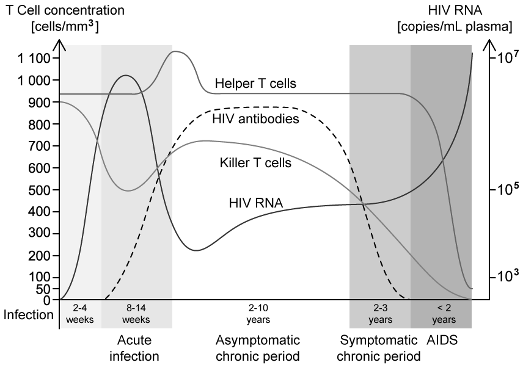
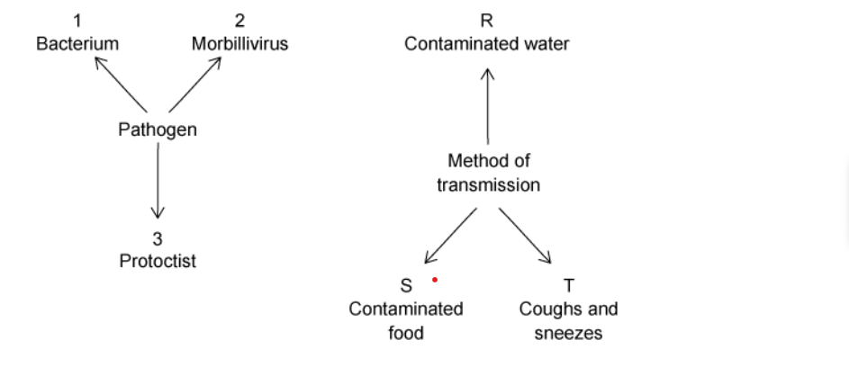
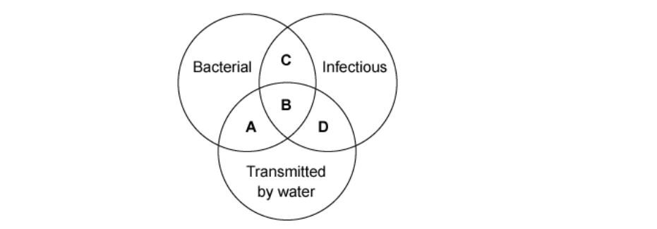

# Exam Questions — Infectious Diseases
**10. Infectious Diseases** · Cambridge (CIE) A-LEVEL biology (9700)
> Source: [https://www.savemyexams.com/a-level/biology/cie/25/topic-questions/](https://www.savemyexams.com/a-level/biology/cie/25/topic-questions/) · 30 questions across 1 sets

## Multiple Choice Questions (30 questions)

### Q1 — hard — 1 marks

**Q1** [1 mark]

Some statements about infectious diseases are given below:

| **1** | It can be transmitted by an insect vector. |
|---|---|
| **2** | It is endemic in sub-tropical regions. |
| **3** | It can be passed from mother to child. |

Which of the statements above apply to both malaria and HIV?

|   | **1** | **2** | **3** |
|---|---|---|---|
| **A** | X | ✓ | X |
| **B** | X | ✓ | ✓ |
| **C** | ✓ | X | X |
| **D** | X | X | ✓ |

### Q2 — hard — 1 marks

**Q2** [1 mark]

The graph below shows the effect of HIV on the T cells in the blood of an individual.

Using the information in the graph and your own knowledge. Which of the following statements is true?

### Q3 — hard — 1 marks

**Q3** [1 mark]

The table shows information about malaria, measles, HIV/AIDS and cholera.

Which is the correct row for each disease?

|   | **Measles** | **Malaria** | **HIV/AIDS** | **Cholera** |
|---|---|---|---|---|
| **A** | No effective vaccine available | Mainly kills children under 5 | Causes a reduction in the number of T-lymphocytes | Can be caught by swimming in contaminated water |
| **B** | Symptoms usually include a rash | Causative agent is a eukaryote | Caused by a retrovirus | Airborne infection |
| **C** | Can cause blindness | Carried by male *Anopheles* mosquitos | May be carried by a vector | Eating raw shellfish can be a source of infection |
| **D** | Caused by a virus | Eradication programme unsuccessful | Can be transmitted in breast milk and across the placenta | Caused by a bacterium |

### Q4 — hard — 1 marks

**Q4** [1 mark]

Which of the following are the most effective control measures for malaria in developing countries?

### Q5 — hard — 1 marks

**Q5** [1 mark]

After visiting a foreign country, a traveller starts to have fevers at regular intervals. They have blood tests during these fevers, these show a decrease in erythrocytes (anaemia).

Which of the following pathogens may have possibly infected the traveller?

### Q6 — hard — 1 marks

**Q6** [1 mark]

The diagram shows some human diseases and the methods of their transmission.

What is the correct pathogen and method of transmission for cholera?

### Q7 — hard — 1 marks

**Q7** [1 mark]

Malaria is caused by a parasite that enters the liver cells of the infected individual where it can lay dormant over long periods of time.

Which of the following statements is **not** likely to be true in patients suffering from malaria?

### Q8 — hard — 1 marks

**Q8** [1 mark]

Tuberculosis (TB) has an annual incidence of 8.6 million people with a mortality rate of 1.3 million worldwide.

What is the main issue that faces the World Health Organisation (WHO) when trying to control the transmission of TB?

### Q9 — hard — 1 marks

**Q9** [1 mark]

One of the pathogens listed below is transmitted by an insect vector.

Which disease has an insect vector?

### Q10 — hard — 1 marks

**Q10** [1 mark]

The human immunodeficiency virus (HIV) reproduces inside cells in the body.

Which of the following explains why HIV patients may develop flu-like symptoms?

### Q11 — medium — 1 marks

**Q11** [1 mark]

Avian bird flu is caused by the H5N1 virus. Between 2021 and 2023 there have been 11 confirmed cases of H5N1 in humans. Whilst these numbers are low, there are concerns about the possibility of H5N1 causing a global pandemic.

Which of these measures is a suitable method to help prevent the spread of disease between humans?

| 1 | reducing the number of flights |
|---|---|
| 2 | killing all birds |
| 3 | taking a course of antibiotics |
| 4 | putting infected individuals in quarantine |

Which ones are correct?

### Q12 — medium — 1 marks

**Q12** [1 mark]

One of the most effective methods for preventing and controlling some diseases is tracking and tracing people who have been in contact with infected people.

Which of these diseases would this be the most effective method for?

### Q13 — medium — 1 marks

**Q13** [1 mark]

After visiting a foreign country, a traveller starts to have fevers at regular intervals. They have blood tests during the fevers, these show a decrease in erythrocytes (anaemia).

Which disease does this person have?

### Q14 — medium — 1 marks

**Q14** [1 mark]

Which row shows the causative agent, the transmission method and method of control of each disease?

|   | **Disease** | **Causative agent** | **Transmission method** | **Method of control** |
|---|---|---|---|---|
| **A** | TB | bacterium | air-borne | vaccination |
| **B** | malaria | bacterium | insect vector | antimalarial drugs |
| **C** | cholera | virus | waterborne | oral rehydration therapy (ORT) |
| **D** | HIV/AIDS | virus | intimate contact | antibiotics |

### Q15 — medium — 1 marks

**Q15** [1 mark]

Improvements in the supply of clean water, sewage treatment, insect control and a milk pasteurisation programme have all been undertaken in a village.

Which of these diseases that are present in the village will not be controlled by these actions?

### Q16 — medium — 1 marks

**Q16** [1 mark]

The table below shows some statements about diseases.

| **Statements** | **1** | **2** | **3** | **4** |
|---|---|---|---|---|
| formation of tumours | ✓ |   |   | ✓ |
| caused by virus |   | ✓ |   |   |
| can be treated with antibiotics |   |   | ✓ | ✓ |
| infectious disease |   | ✓ | ✓ | ✓ |

key: ✓ = true

Match the 4 names diseases below to the statements above.

Which row gives the correct name for each disease?

|   | **1** | **2** | **3** | **4** |
|---|---|---|---|---|
| **A**  **B**  **C**  **D** | bronchitis  sickle cell anaemia  lung cancer  lung cancer | measles  measles  HIV/AIDS  HIV/AIDS | TB  cholera  cholera  measles | smallpox  lung cancer  TB  lung cancer |

### Q17 — medium — 1 marks

**Q17** [1 mark]

Which of the following is the best definition for non-infectious disease?

### Q18 — medium — 1 marks

**Q18** [1 mark]

These are all methods of infectious disease transmission

| **1** | vector |
|---|---|
| **2** | contact |
| **3** | food |
| **4** | droplet |

Which row correctly matches the organism with the mode of transmission of each of the diseases?

|   | **Malaria** | **TB** | **HIV** |
|---|---|---|---|
| **A** | bacterium, 3 | protoctist, 1 | bacterium, 1 and 3 |
| **B** | protoctist, 3 | virus, 1 | bacterium, 3 |
| **C** | protoctist, 1 | bacterium, 3 and 4 | virus, 2 |
| **D** | bacterium, 1 | virus, 3 and 2 | virus, 2 and 4 |

### Q19 — medium — 1 marks

**Q19** [1 mark]

The following statements are about people infected with HIV/AIDS.

| **1** | They will have symptoms |
|---|---|
| **2** | They can be treated and completely cured |
| **3** | They may live for many years after infection |

Which ones are correct?

### Q20 — medium — 1 marks

**Q20** [1 mark]

Which of the statements below provides an explanation for an increase in the spread of malaria?

| 1 | increasing resistance to antibiotics and other drugs |
|---|---|
| 2 | continued migration of people due to war and civil unrest |
| 3 | increasing carbon dioxide levels causing global warming |

### Q21 — easy — 1 marks

**Q21** [1 mark]

Over 40% of the world’s population live in areas where they are at risk of malaria infection. The number of cases of malaria in Africa in particular has increased in recent years.

Which of these social factors is increasing the spread of malaria?

### Q22 — easy — 1 marks

**Q22** [1 mark]

Which disease is most likely to be transmitted during pregnancy or birth?

### Q23 — easy — 1 marks

**Q23** [1 mark]

The following lists some possible methods of transmission of HIV:

| **1** | blood transfusion |
|---|---|
| **2** | drinking water |
| **3** | vector |
| **4** | intravenous needles |
| **5** | across the placenta |
| **6** | undercooked meat |

Which statements are correct?

### Q24 — easy — 1 marks

**Q24** [1 mark]

How are the following diseases transmitted?

|   | **Malaria** | **Cholera** | **HIV/AIDS** |
|---|---|---|---|
| **A** | body fluid | air | water |
| **B** | insect | water | body fluid |
| **C** | air | body fluid | insect |
| **D** | water | body fluid | air |

### Q25 — easy — 1 marks

**Q25** [1 mark]

Which of the following statements describe why people in Europe can suffer from both malaria and tuberculosis, but only tuberculosis is transmitted there?

### Q26 — easy — 1 marks

**Q26** [1 mark]

The diagram shows different features of disease.

Which area refers to common properties of both tuberculosis and cholera?

### Q27 — easy — 1 marks

**Q27** [1 mark]

Which row shows the causative agent and the transmission method of cholera?

|   | causative agent | transmission method |
|---|---|---|
| **A** | virus | air-borne |
| **B** | virus | water-borne |
| **C** | bacterium | air-borne |
| **D** | bacterium | water-borne |

### Q28 — easy — 1 marks

**Q28** [1 mark]

Which row in the table shows the features of the organisms that cause HIV/AIDS, malaria and TB have in common?

|   | they have a cell surface membrane | they have ribosomes | they have genes | they respire |
|---|---|---|---|---|
| **A** | X | X | ✓ | X |
| **B** | X | X | ✓ | ✓ |
| **C** | ✓ | X | X | ✓ |
| **D** | ✓ | ✓ | ✓ | ✓ |

### Q29 — easy — 1 marks

**Q29** [1 mark]

Which of the diseases, in the list below, is transmitted by an insect vector?

### Q30 — easy — 1 marks

**Q30** [1 mark]

Why are refugee camps likely to see outbreaks of cholera infections?
