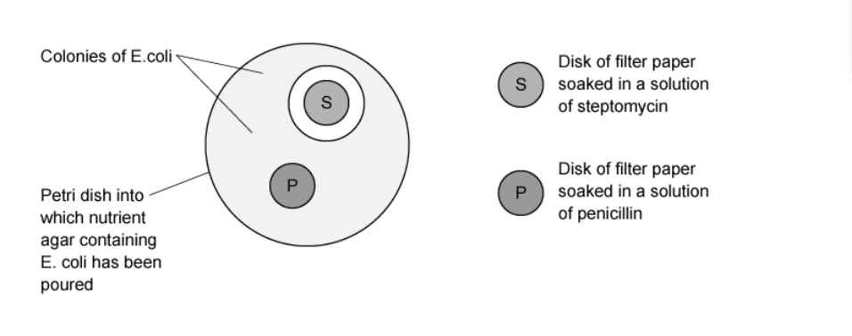
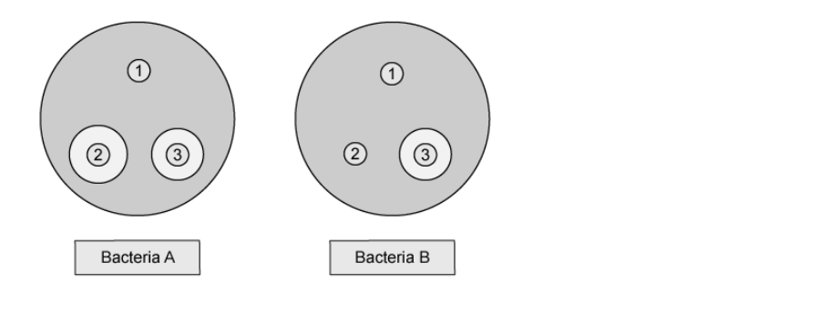
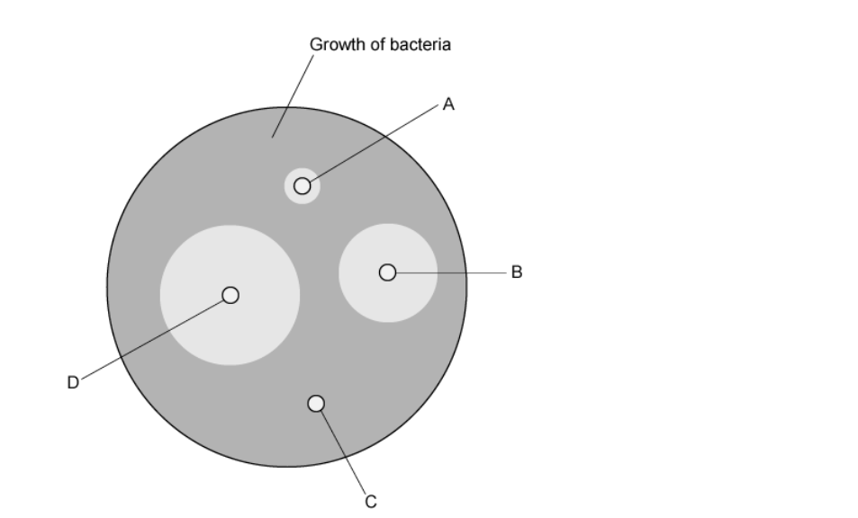

# Exam Questions — Antibiotics
**10. Infectious Diseases** · Cambridge (CIE) A-LEVEL biology (9700)
> Source: [https://www.savemyexams.com/a-level/biology/cie/25/topic-questions/](https://www.savemyexams.com/a-level/biology/cie/25/topic-questions/) · 22 questions across 1 sets

## Multiple Choice Questions (22 questions)

### Q1 — hard — 1 marks

**Q1** [1 mark]

The diagram shows the effect of growing *Escherichia coli* in the presence of streptomycin and penicillin.

What can be concluded about the results?

|   | completely resistant | not completely resistant |
|---|---|---|
| **A** | S and P | - |
| **B** | P | S |
| **C** | S | P |
| **D** | - | S and P |

### Q2 — hard — 1 marks

**Q2** [1 mark]

The data below show the number of deaths due to *Staphylococcus aureus* from 1997 to 2005.

Methicillin is an antibiotic that is used to treat *S. aureus* infections. MRSA is methicillin-resistant *S. aureus.*

| Year | total number of death certificates with *S. aureus* | total number of death certificates with MRSA |
|---|---|---|
| 1997  1999  2001  2003  2005 | 369  452  456  420  428 | 355  431  681  890  1512 |

Which statement is not supported by this data?

### Q3 — hard — 1 marks

**Q3** [1 mark]

Two species of bacteria A and B were grown on an agar plate. Each plate had three filter paper discs with the following:

| 1 | no antibiotic (control) |
|---|---|
| 2 | penicillin V, a natural penicillin |
| 3 | carboxypenicillin, a synthetic penicillin |

The diagram below shows the results:

Which statement is a correct conclusion for this experiment?

### Q4 — hard — 1 marks

**Q4** [1 mark]

Which is a reason why fungi such as *Penicillium* have evolved to produce antibiotics?

### Q5 — hard — 1 marks

**Q5** [1 mark]

Some animals have evolved to produce small peptides called cathelicidins. These peptides have a bactericidal effect. They are able to attach to lipids in the bacterial membrane, thereby weakening them.

Synthetic versions of the cathelicidins have been produced. These can be used to treat infections that have become resistant to antibiotics like tetracycline.

Read the following statements:

| 1 | The only way a bacterium could develop resistance to it is by altering all the lipids in its membranes. |
|---|---|
| 2 | Cathelicidins could be used instead of tetracycline, allowing tetracycline resistance to be reduced. |
| 3 | Cathelicidins are synthetic so bacteria can never become resistant to them. |
| 4 | Cathelicidins could be used to kill multidrug-resistant strains of bacteria, for which there are no currently effective antibiotics. |

Which pair of statements explain how these peptides can help in the fight against antibiotic resistance?

### Q6 — hard — 1 marks

**Q6** [1 mark]

Lefamulin™ is a newly-developed antibiotic that binds to the 50S bacterial ribosomal subunit.

It was approved by the US Food and Drug Administration (FDA) in August 2019 for the treatment of pneumonia.

Which is the mode of action of Lefamulin™?

### Q7 — hard — 1 marks

**Q7** [1 mark]

The diagram below shows how the effect of growing bacteria in the presence of an antibiotic can be investigated.

Five different types of bacteria were grown on their own petri dish, one example is shown below:

The table below shows the results from testing the antibiotic on the growth of these five types of bacteria. Zones of inhibition less than 13 mm show the presence of resistant bacteria.

| type of bacteria | diameter of zone / mm |   |   |   |   |
|---|---|---|---|---|---|
| Week 1 | Week 2 | Week 3 | Week 4 | Week 5 |   |
| 1  2  3  4  5 | 24.10  18.60  17.90  19.40  22.00 | 21.90  15.40  12.80  15.30  21.00 | 19.00  12.20  12.40  13.20  20.50 | 17.60  9.00  11.10  8.10  20.40 | 14.30  0.00  10.90  0.00  20.40 |

Which statement is supported by the data?

### Q8 — medium — 1 marks

**Q8** [1 mark]

The graph below shows the number of deaths from MRSA per 100 000 people in a population of over-65’s from 2005 to 2012.

Which of the following is the correct value of the average annual rate of decrease in the number of deaths from MRSA infections in the over-65s per 100 000 people from 2005 to 2012?

### Q9 — medium — 1 marks

**Q9** [1 mark]

An antibiotic sensitivity test was performed on bacteria isolated from a patient’s throat.

The diagram shows the results of the four antibiotics tested.

Which one should be used to treat the disease?

### Q10 — medium — 1 marks

**Q10** [1 mark]

Some bacteria have developed a resistance to penicillin.

Which of the following would explain how bacteria can prevent the action of penicillin?

### Q11 — medium — 1 marks

**Q11** [1 mark]

Bacteria and viruses are the main pathogens in humans. Antibiotics can be used to treat bacterial infections but not viral infections.

Which of the following statements explains why?

### Q12 — medium — 1 marks

**Q12** [1 mark]

Which of the following practices have contributed to the fall in antibiotic effectiveness in the late 20th and early 21st centuries?

1. Large-scale use of preventative antibiotics in farm livestock
2. Failing to complete the full course of antibiotics prescribed by a doctor
3. Treatment of known bacterial infections with antibiotics
4. Treatment of viral infections with antibiotics

### Q13 — medium — 1 marks

**Q13** [1 mark]

Which of these diseases can be cured with antibiotics?

### Q14 — medium — 1 marks

**Q14** [1 mark]

The data in the graph shows the effect of an antibiotic on the population of bacteria in the blood.

What can be concluded from the data in the graph?

### Q15 — medium — 1 marks

**Q15** [1 mark]

Antibiotics can interfere with aspects of growth or metabolism in bacterial cells.

Which of the following is not a mode of action of antibiotics?

### Q16 — easy — 1 marks

**Q16** [1 mark]

Which of the following statements about antibiotic resistance is incorrect?

### Q17 — easy — 1 marks

**Q17** [1 mark]

Some antibiotics are used in animal feed to help prevent disease.

Which statement explains why they should not be used to treat bacterial infections in humans?

### Q18 — easy — 1 marks

**Q18** [1 mark]

Which of these diseases can be treated with antibiotics?

### Q19 — easy — 1 marks

**Q19** [1 mark]

Which of these diseases are likely to be effectively treated with antibiotics?

|   | cholera | TB | malaria |
|---|---|---|---|
| **A**  **B**  **C**  **D** | ✓  ✓  ✓  ✓ | X  ✓  ✓  X | ✓  ✓  X  X |

### Q20 — easy — 1 marks

**Q20** [1 mark]

When a patient is prescribed a course of antibiotics they must take them at evenly spaced intervals.

Why is this necessary?

### Q21 — easy — 1 marks

**Q21** [1 mark]

Streptomycin, a type of antibiotic, is now less effective in treating TB worldwide.

Which of the following could be a reason for this?

### Q22 — easy — 1 marks

**Q22** [1 mark]

Antibiotics work by interfering with several different processes in the target bacteria.

Which of the following is not a process which is impacted by antibiotic action?
