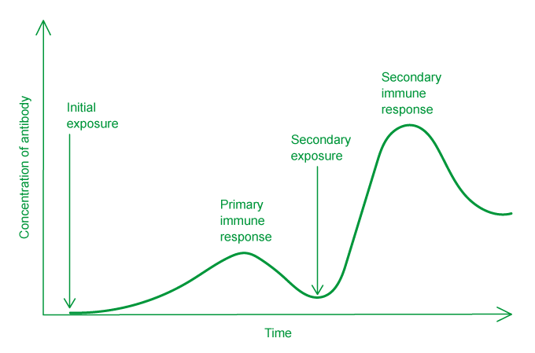
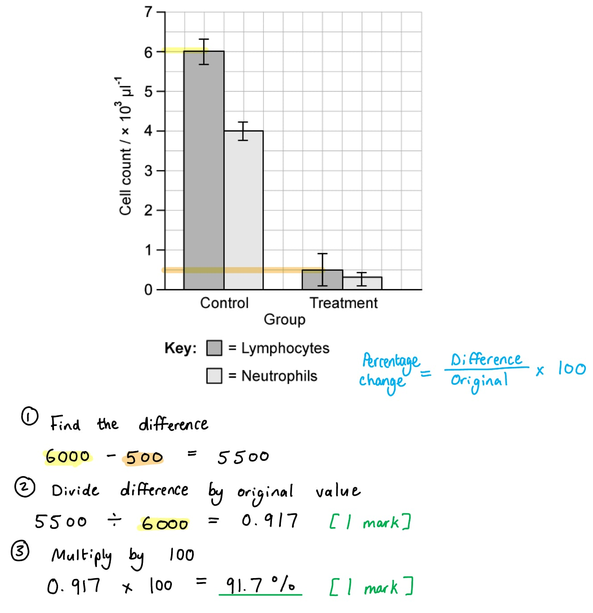

# Mark Schemes — The Immune System
**11. Immunity** · Cambridge (CIE) A-LEVEL biology (9700)

## Multiple Choice Questions (30 questions)

### Q1
**Final answer:** **The correct answer is ****C**** because:**

- **The adaptive or ****acquired immune response**** provides the immune system with the ability to ****recognize**** and act upon specific antigens quickly, giving long term immunity**
- **Both B-lymphocytes and T-lymphocytes can form memory cells however without T-lymphocytes there is no adaptive response as the T-helper cells release cytokines to activate B-lymphocytes **

> *A **is incorrect as **plasma cells** are **antibody-producing** cells derived from B-lymphocytes, which are formed when activated T-helper cells release cytokines.*

> *B **is incorrect as **antibodies** are **proteins,** not cells.*

> *D **is incorrect as B-lymphocytes are activated by T-helper cells.*

### Q2
**Final answer:** **The correct answer is ****D**** because:**

- **A person with blood group ****A ****and ****AB**** do not have the ****antibodies**** in the plasma to type ****A**
- **If they did have ****antibodies**** to group A then they would reject blood from this group**

> *A **is incorrect as **AB **is not the only blood group that would not have the A antibodies*

> *B **&** C **are incorrect as blood group O has antibodies to both A and B so would react with the group A antigens*

### Q3
**Final answer:** **The correct answer is ****D**** because:**

- **Viruses**** infect and divide inside cells**
- **The only cell in the immune system that can recognise and destroy virally infected cells are ****cytotoxic**** ****T-lymphocytes (T-killer cells)**

> *A is incorrect as phagocytic macrophages would not engulf and digest body cells.*

> *B is incorrect as activated B lymphocytes either develop into plasma cells or memory cells.*

> *C is incorrect as plasma cells produce antibodies.*

### Q4
**Final answer:** **The correct answer is ****B**** because:**

- **The ****primary response**** will take longer and results in the formation of a lower concentration of antibodies**
- **The ****secondary response**** ****will happen much more quickly, producing a higher number of antibodies (as can be seen in the graph below)** 

> *A **is incorrect as the secondary response doesn’t just happen in the spleen! (although the spleen does act as a store of lymphocytes)*

> *C **is incorrect as both primary and secondary responses would result in antibody secretion*

> *D **is incorrect as a secondary response would increase the number of memory cells produced against a particular antigen.*

### Q5
**Final answer:** **The correct answer is ****A**** because ****monocytes**** are formed in the bone marrow from myeloid stem cells. They circulate in the blood and only develop into ****macrophages**** once they have left the blood and settled in organs.**

> *B **is incorrect as a **neutrophil** is a type of phagocytic cell which forms about 60% of white blood cells in the body. Neutrophils are not derived from monocytes.*

> *C **& **D **are incorrect as both of these cells are lymphocytes, lymphocytes are not a type of **phagocyte.*

### Q6
**Final answer:** **The correct answer is ****A**** because:**

- **The ****helper T**** cell will have ****receptors**** on its cell surface to bind with complementary ****antigens ****on foreign cells**
- **The ****helper T**** cell will then release ****cytokines**** to stimulate ****B-lymphocytes ****to divide and form both ****plasma cells**** and ****memory cells**

> *B is incorrect as killer T cells are cytotoxic, not helper, T cells.*

> *C is incorrect as helper T cells can divide to form memory cells; it is the memory cells that remain in circulation to enhance a secondary immune response.*

> *D is incorrect as Helper T cells do not produce antibodies; plasma cells derived from B cells produce antibodies.*

### Q7
**Final answer:** **The correct answer is ****D**** because:**

- **The vacuole formed around the bacteria once engulfed by a ****phagocyte**** is called a ****phagosome**
- **A ****lysosome**** fuses with the membrane of the ****phagosome**** and releases ****lysozymes**** to digest the pathogen**

> *A **is incorrect as a vesicle containing lysozymes is a **lysosome.*

> *B **is incorrect as a WBC that produces antibodies describes a **plasma cell.*

> *C **is incorrect as a WBC the ingests bacteria describes a **phagocyte**.*

### Q8
**Final answer:** **The correct answer is ****C**** because:**

- **T-lymphocytes**** are produced in the ****bone marrow**
- **A transfusion of bone marrow will mean that a child with SCID would be able to produce T-lymphocytes**

> *A **&** B **are incorrect as transfusion or continual use of antibodies would provide a treatment, but not a cure. The antibodies would be short-lived in the body and would need to be continually taken. *

> *D **is incorrect as It is not possible to **vaccinate** individuals to give immunity against all infectious diseases. *

### Q9
**Final answer:** **The correct answer is ****C**** because:**

- **T-lymphocytes are central to the ****graft rejection**
- **The T cells circulate, some as ****helper T cells****, some as ****killer T cells**
- **The T-lymphocytes all have receptors on the cell surface to recognise ****foreign antigens**

> *A is incorrect as B-lymphocytes are not the main cells involved in the rejection of a graft; they must be activated by helper T cells.*

> *B & D are incorrect as T-lymphocytes do not produce antibodies*

### Q10
**Final answer:** **The correct answer is ****A**** because:**

- **Cell 1 is a ****lymphocyte**** as it has a large nucleus that fills most of the cell and is smaller in size compared to the other cells**
- **Cell 2 is a ****monocyte****; they are the largest of all white blood cells and have large oval or kidney-shaped nuclei – when they leave the blood monocytes develop into phagocytes**
- **Cell 3 is a ****neutrophil****; neutrophils are a type of phagocyte with lobed nuclei (2 to 8 lobes)**

### Q11
**Final answer:** **The correct answer is ****A**** because:**

- **The first step is that a helper T cell encounters an antigen-presenting cell (APC) to which it has a complementary receptor**
- **The activated T cell then divides by mitosis, some of the cells produced then release ****cytokines****; these activate the ****B-lymphocytes**
- **The B-lymphocytes that are specific to the antigen divide by ****mitosis**
- **Some of the B-lymphocytes will form ****plasma cells**
- **The plasma cells formed will make ****specific antibodies**

### Q12
**Final answer:** **The correct answer is ****B**** because:**

- **Antigens are often ****cell-surface proteins**
- **Proteins ****are macromolecules made from the elements carbon, hydrogen, nitrogen (as well as oxygen), and cysteine and methionine also contain sulfur in their R-groups.**

> *A is incorrect as the common 20 amino acids found in living organisms that are used to synthesise proteins do not contain phosphorus. Phosphorus is found in nucleotides.*

> *C is incorrect as carbon is the central element to all biomolecules.*

> *D is incorrect as all amino acids contain nitrogen in the amine group, so nitrogen must be included. *

### Q13
**Final answer:** **The correct answer is ****D. ****This statement is ****incorrect**** because: **

- **The production of ****antibodies**** by the body describes ****active**** (and not passive) ****immunity**
- **Active immunity**** is immunity gained when an antigen enters the body, an immune response occurs and antibodies are produced by plasma cells. This activation also results in the production of memory cells which enable a more rapid immune response if a secondary infection with the same pathogen occurs again in the future.**

> *A **is incorrect as a **specific immune response** does involve the activation of B-lymphocytes and T-lymphocytes*

> *B **is incorrect as **natural active immunity** is produced when the immune response is activated.*

> *C **is incorrect as lysosomes fuse with vacuoles and **secrete hydrolytic** **enzymes** to digest invading microorganisms.*

### Q14
**Final answer:** **The correct answer is ****D**** because:**

- **Lysosomes are membrane-bound organelles containing ****hydrolytic enzymes**
- **If the bacteria prevent the lysosome from working then the ****macrophages**** will not be able to engulf and digest the bacteria**

> *A **is incorrect as vesicles do not contain **hydrolytic enzymes.*

> *B **is incorrect as ribosomes are the site of **protein synthesis.*

> *C **is incorrect as** **the Golgi body** modifies and packages **proteins in the cell; it is not specifically involved in an immune response. *

### Q15
**Final answer:** **The correct answer is ****A**** because memory cells form from some of the cells produced when activated ****B****- and ****T****-****lymphocytes**** divide by mitosis; these memory cells enhance the immune response if a ****secondary infection ****with a pathogen with the same antigen invades the body again.**

> *B **is incorrect as antibody receptors bind with complementary antigens.*

> *C **is incorrect as only **B-lymphocytes** form plasma cells when they are stimulated by cytokines from a** helper T cell.**   *

> *D **is incorrect as only **helper** T cells release **cytokines** which **stimulate B cells** to divide into plasma cells and secrete antibodies.*

### Q16
**Final answer:** **The correct answer is ****C**** – this statement is not correct as ****phagocytes**** do no participate in the specific immune response, they will engulf and digest all types of pathogen and foreign material when activated.**

> *A **is incorrect as phagocytes need ATP for endocytosis.*

> *B **is incorrect as phagocytes will digest foreign material using hydrolytic enzymes; enzymes that breakdown complex biomolecules.*

> *D **is incorrect as phagocytes are white blood cells with lobed nuclei.*

### Q17
**Final answer:** **The correct answer is ****B**** because:**

- **Endocytosis is the process of ****engulfing ****a pathogen that is either attached to the surface of the cell or marked by an antibody**
- **A vacuole is formed around the bacteria**
- **Digestive enzymes are released from**** lysosomes**** into the vacuole**
- **The products of digestion are excreted from the cell by ****exocytosis**

> *The whole process described above is ‘phagocytosis’.*

### Q18
**Final answer:** **The correct answer is ****B**** because:**

- **B-lymphocytes form ****plasma cells**** and secrete ****antibodies**** into the blood**
- **T-lymphocytes do not form plasma cells; they are activated when they come across a specific antigen to which they have a complementary receptor, in so doing they ****divide ****forming**** ****active**** ****cells**** ****that**** secrete cytokines ****and**** memory cells **** **
- **There are two main types of T-lymphocytes, ****helper T cells**** and ****killer T cells****; ****helper T cells ****produce cytokines to stimulate the B cells, ****killer T cells**** are cytotoxic and destroy cells that are displaying foreign antigens.**

> *A **is incorrect as **macrophages** are not stimulated by B cells*

> *C **is incorrect as T-lymphocytes are formed in the bone marrow and mature in the thymus.*

> *D **is incorrect as B-lymphocytes divide to produce memory cells.*

### Q19
**Final answer:** **The correct answer is ****C**** because:**

- **B-lymphocytes**** can act as ****antigen-presenting**** cells and present the antigens to the helper T cells**
- **They do not act in the ****cell-mediated response;**** this a role of ****T-lymphocytes**
- **They do not produce ****antibodies**** immediately after formation; relatively short-lived plasma cells formed when an activated B lymphocytes**
- **T-lymphocytes**** are processed in the ****thymus****, not B lymphocytes**

### Q20
**Final answer:** **The correct answer is ****D**** because:**

- **T lymphocytes can produce ****memory cells**** to give long term immunity**
- **They can also destroy infected cells (****cytotoxic****)**
- **There are two main types of T-lymphocytes, ****helper T cells**** and ****killer T cells****; ****helper T cells ****produce cytokines to stimulate the B cells, ****killer T cells**** are cytotoxic**

> *A **& **B **are incorrect as T cells have a wider function that just destroying infected cells or producing memory cells.*

> *C **is incorrect as T cells do not produce antibodies.*

### Q21
**Final answer:** **The correct answer is ****B**** because:**

- **Goblet cells**** produce mucus, these would be activated by inhaling tiny particles to trap and remove these from the ****pulmonary system**
- **B-lymphocytes**** would be activated to make complementary ****antibodies**** to any non-self macromolecules inhaled**

> *A **&** C **are incorrect as both options state that the **B-lymphocytes** would be less active – they would be more active.*

> *D **is incorrect as this option states that the mucus-producing **goblet cells** would not be active.*

### Q22
**Final answer:** **The correct answer is ****D**** because T killer cells ‘punch’ holes in the membrane of the infected body cell by insertion of perforins into the membrane.**

> *A **is incorrect as phagocytosis is carried out by neutrophils and macrophages.*

> *B **is incorrect as antibodies are secreted by plasma cells which are derived from B-lymphocytes.*

> *C **is incorrect as anti-toxins are produced by B-lymphocytes (they are a special type of antibody).*

### Q23
**Final answer:** **The correct answer is ****A**** because ****antigens ****can be toxins or other substances that the body recognizes as non-self, these trigger an immune response to remove non-self material from the body.**

> *B **is incorrect as **antigens** are not only found on bacteria. Usually the term ‘antigen’ refers to any cell recognition marker found embedded in the cell surface membrane (usually glycolipids or glycoproteins) which are recognized as ‘foreign’.*

> *C **is incorrect as this statement describes the structure of **antibodies.*

> *D is incorrect as antigen presentation **takes place in macrophages or body cells.*

### Q24
**Final answer:** **The correct answer is ****B**** because ****macrophages**** are found in tissues and secrete ****cytokines**** that activate other cells in the immune system.**

> *A **is incorrect as **macrophages** do not produce antigens, these are the molecules that induce an immune response.*

> *C** is incorrect as **macrophages** do leave the blood and settle in organs removing foreign matter, but do not produce cytotoxins.*

> *D **is incorrect as **macrophages** do not accumulate at the site of inflammation, this is the role of **neutrophils**, neutrophils release **cytokines** to activate other cells in the immune system.*

### Q25
**Final answer:** **The correct answer is ****C**** because:**

- **The ****cell-mediated response**** uses T-lymphocytes, these are produced in the ****bone marrow**** and mature in the ****thymus**
- **When they are mature they travel around the body in the blood, until they come into contact with an ****antigen**** they can respond to**
- **This activates the ****T-lymphocyte**** and it will divide to produce a clone of cells**

> *A **is incorrect as **B-lymphocytes** produce antibodies.*

> *B **is incorrect as **phagocytes** engulf and digest foreign molecules.*

> *D **is incorrect as pathogens activate the immune system. The term pathogen encompasses all **disease causing** viruses, bacteria and other microorganisms.*

### Q26
**Final answer:** **The correct answer is ****D**** because:**

- **The precursor cell to**** macrophages**** (monocytes) are made from myeloid stem cells in the bone marrow which are released into the blood stream**
- **Monocytes specialise into ****macrophages**** in the body tissues. The role of macrophages is dependent on their location; they work to remove old/dead cells and foreign matter**

> *A **is incorrect as the lymph nodes filter the lymph fluid.*

> *B **is incorrect as monocytes are found in the blood plasma.*

> *C **is incorrect as monocytes will develop into macrophages in the tissue fluid of the organs of the body*

### Q27
**Final answer:** **The correct answer is ****A**** because:**

- **The ****cell surface proteins**** are most often specific to the pathogen.**
- **As the proteins are specific they are often the ****antigens**** that the immune cells of the body can recognize on the invading pathogen as non-self**

> *B **is incorrect as **phospholipids **are the building blocks of the cell membrane.*

> *C **is incorrect as carbohydrates are present on the cell surface but attached to proteins as **glycoproteins.*

> *D **is incorrect** **as** nucleic acids** make up DNA and this would not be found on the surface of the cell to help identify it as non-self.*

### Q28
**Final answer:** **The correct answer is ****C**** because ****memory cells ****are produced from both ****T-lymphocytes ****and ****B-lymphocytes**

> *A, B **& **D  **are incorrect as **phagocytes** engulf and digest foreign bodies.*

### Q29
**Final answer:** **The correct answer is ****B**** because ****B-lymphocytes ****produce antibodies once a foreign antigen is detected and they have been activated.**

> *A **& **C **are incorrect as **antigens** are foreign substances/cell recognition markers that induce an immune response in the body.*

> *D **is incorrect as **T-lymphocytes** do not produce antibodies.*

### Q30
**Final answer:** **The correct answer is ****C**** because:**

- **Only one type of ****B-lymphocyte**** has an antigen receptor that is specific to the shape of the antigen that has entered the body**
- **This cell, when activated, ****divides ****rapidly by mitosis. The cloned cells produced go on to develop into ****plasma cells**** and ****memory cells**
- **Plasma cells**** produce ****antibodies**

> *A is incorrect as this statement describes phagocytosis.*

> *B is incorrect as **cytokines are produced by **T-lymphocytes** that stimulate B-lymphocytes to develop into **plasma cells** and secrete antibodies.*

> *D **is incorrect as this statement describes **killer T-lymphocytes.*

## Structured Questions (9 questions)

### Q1
(i) The cell in Fig. 1 is a...

- Neutrophil; **[1 mark]**

(ii) The cell is adapted to its function by...

**Final answer:** **Any ****two**** of the following:**

- The multi-lobed nucleus enables flexibility to squeeze out of blood vessels/capillaries / to surround/engulf pathogens; **[1 mark]**
- Lysosomes contain digestive enzymes to break down/destroy pathogens; **[1 mark]**
- Glycogen granules store glucose which allows the cell to carry out respiration / release energy for phagocytosis / enzyme production; **[1 mark]**

***Reject**** references to producing energy*

**[Total: 3 marks]**
A drop in cell count for the cell type shown in Fig. 1 can be dangerous for chemotherapy patients because...

**Final answer:** **Any ****three**** of the following:**

- (Neutrophils) are released in response to infection; **[1 mark]**
- (Neutrophils) engulf pathogens / carry out phagocytosis; **[1 mark]**
- (Neutrophils) use (digestive) enzymes / lysozyme to destroy pathogens; **[1 mark]**
- Patients will be vulnerable to infection (when neutrophil count is low); **[1 mark]**

**[Total: 3 marks]**
The purpose of a placebo in this type of drug trial is...

**Final answer:** **Any ****two**** of the following:**

- To act as a control; **[1 mark]**
- To allow comparison with the results of the drug being tested; **[1 mark]**
- To show that any results are due to the effects of the drug and not any other factor; **[1 mark]**

**[Total: 2 marks]**

> *Placebos in medical trials serve the same purpose as an experimental control in any other kind of study. There are many factors that could influence the outcome of a study into patient health; sometimes simply being involved in a study can lead to a patient feeling better (due to the influence of the brain and nervous system on various aspects of health), so it is essential to provide an experimental condition that allows comparison between patients receiving the medical treatment and patients not receiving the treatment. Usually the patients will not know whether they are receiving the placebo or the treatment to avoid influencing the outcome. *
Evaluating the student's conclusion that the CSF drug effectively reduces the risk of chemotherapy to patients could include...

Points in support of the conclusion

**Final answer:** **A maximum of ****two**** of the following:**

- The cell count increases 1 day after administration of CSF **WHILE** it continues to decrease in the placebo treatment; **[1 mark]**
- From day 8 onwards the cell count of patients given CSF is higher than the cell count with the placebo treatment; **[1 mark]**
- An increased cell count will reduce the risk of patients getting an infection; **[1 mark]**

Points against the conclusion

**Final answer:** **A maximum of ****two**** of the following:**

- The study only included 225 patients / the study had a small sample size; **[1 mark]**
- Fig. 2 only shows the results of one study **AND** more results would be needed for a definite conclusion; **[1 mark]**
- Chemotherapy may bring other risks beyond that of a low cell count / increased risk of infection; **[1 mark]**
- No statistical analysis has been included (in Fig. 2) so there may be no significant difference between the CSF and placebo treatments / the standard deviations of the two treatments may overlap; **[1 mark]**

**[Total: 3 marks]**

> *When answering 'evaluate' questions it is always a good idea to include both positive and negative points.*

> *It can be helpful to consider points that are specific to the data provided, e.g. the effectiveness of the treatment and the sample size, as well as more general points, e.g. the need for repeat data and statistical analsysis.*

### Q2
Structures **X** and **Y** can be identified as follows...

- **X** = lipid envelope; **[1 mark]**
- **Y** = genetic material/genetic code/DNA/RNA; **[1 mark]**

*Accept 'capsid' for lipid envelope*

**[Total: 2 marks]**

> *You should know about the structure of viruses from topic 1. *

> *Note that while you will be expected to identify the first layer that surrounds the genetic material in a virus as the capsid, HIV has another layer outside this known as the 'lipid envelope', which is actually the layer indicated by **X**. Because the capsid is not clearly visible in the micrograph shown, and not all viruses have a lipid envelope, it is possible that you might assume that the lipid envelope is the capsid here, so a mark is available for this term.*
Symptoms that might be experience by patients in group **B**, and why, include...

**Final answer:** **Any ****two pairs**** of points from the following:**

- Greater susceptibility to infection / higher incidence of infection **BECAUSE **the (CD4+) T cell count is (significantly) lower / has decreased (significantly) **OR** neutrophil count is (significantly) lower / has decreased (significantly); **[1 mark]**
- (CD4+) T cells release chemicals that activate B cells **SO** leading to antibody production **OR** neutrophils carry out phagocytosis of/engulf and digest infected cells / pathogens; **[1 mark]**

***Accept ****named example of frequent infection, e.g. more colds/flu/respiratory infections for MP1*

**AND/OR**

- Increased fatigue / decreased energy levels **BECAUSE** blood haemoglobin levels are lower / have decreased; **[1 mark]**
- Haemoglobin carries oxygen to the cells **SO** enabling (the release of energy by) aerobic respiration; **[1 mark]**

**AND/OR**

- Slower wound healing / more blood loss after injury **BECAUSE** platelet count is lower; **[1 mark]**
- Platelets are involved with blood clotting; **[1 mark]**

**[Total: 4 marks]**

> *The term 'significant' has been given in brackets here, though it is worth bearing in mind that if you are revising for final A-Level exams, this is a term that you **would** need to include in this answer. A 'significant' decrease in CD4 cells/neutrophils means that statistical analysis of the data has been carried out, and the decrease observed is very unlikely to be due to chance. The significance of the difference can be seen in Table 1 by the lack of overlap in the standard deviations between the data for groups A and B.*

> *Note that while only the T cell and neutrophil counts are **significantly** lower in group B compared to group A, the question asks for any symptoms that **might** be experienced, so the symptoms don't need to appear in all of the patients in order to be credited in your answer.*
(i) The immune system is unable to eradicate HIV from the body prior to treatment with anti-PD-1 checkpoint inhibitors even when CD4+ T cell counts are high because...

- HIV antigens cannot be detected by the immune system/phagocytes/lymphocytes when they are inside CD4/T cells; **[1 mark]**
- Infected CD4/T cells are inactive / have their activity downregulated due to PD-1 proteins; **[1 mark]**

(ii) Treatment with anti-PD-1 checkpoint inhibitors may result in HIV eradication because...

**Final answer:** **Any ****two**** of the following:**

- Anti-PD-1 checkpoint inhibitors (bind to and) inactivate PD-1 proteins; **[1 mark]**
- HIV replication occurs / HIV becomes active **SO** can be detected/destroyed by the immune system/phagocytes/lymphocytes; **[1 mark]**
- CD4/T cells become active **SO** release cytokines / activate B cells; **[1 mark]**

**[Total: 4 marks]**

> *You are not expected to **know** anything about HIV or the drug described here, but you should be able to interpret the events in Fig. 2 and apply your existing knowledge of the immune system to the scenario shown.*
A cell might be resistant to infection by HIV as follows...

**Final answer:** **Any ****two**** of the following:**

- The antigens of HIV may be unable to bind to the cell / the cell may have surface proteins/molecules that are not complementary to HIV antigens **OR** HIV may be unable to enter the host cell; **[1 mark]**
- Infection with HIV may trigger immediate cell death; **[1 mark]**
- HIV may be unable to insert its DNA into the cell's DNA; **[1 mark]**
- The cell may not transcribe/translate/synthesise HIV proteins; **[1 mark]**

**[Total: 2 marks]**

> *Again, you are not expected to **know** the answer to this question, but you should be able to use your knowledge of viruses to suggest how a cell may be resistant to the effects of a virus.*

### Q3
(i) The mode of action of a macrophage against a bacterial cell is...

**Final answer:** **Any ****three ****of the following:**

- Detection of/binding to the bacterium/pathogen / antibodies form a complex with antigens **OR** (macrophage) has receptors for (foreign) antigen; **[1 mark]**
- Engulfs pathogen/bacterium / phagocytosis occurs; **[1 mark]**
- Forms vacuole/phagosome; **[1 mark]**
- Lysosome fusion (with phagosome); **[1 mark]**
- Hydrolytic/digestive enzymes/hydrolases released (into phagosome); **[1 mark]**
- Antigen presentation occurs; **[1 mark]**
- Response is non-specific; **[1 mark]**

(ii) One way in which* M. tuberculosis* may survive within a macrophage is...

**Final answer:** **Any ****one ****of the following:**

- *M. tuberculosis *produces inhibitors for / deactivates (lysosomal) enzymes; **[1 mark]**
- *M. tuberculosis *escapes from the phagosome; **[1 mark]**
- *M. tuberculosis* is resistant to digestive enzymes; **[1 mark]**
- *M. tuberculosis *prevents macrophage function; **[1 mark]**

**[Total: 4 marks]**
The defence mechanisms in the gas exchange system to prevent bacteria entering cells are...

**Final answer:** **Any ****three ****of the following:**

- Production of mucus by mucous glands / goblet cells; **[1 mark]**
- Sticky mucus **OR** mucus traps pathogens/bacteria/microorganisms; **[1 mark]**
- Mucus acts as a barrier (to prevent entry); **[1 mark]**
- Mucus increases distance to reach cells; **[1 mark]**
- Cilia on ciliated epithelial cells/epithelium; **[1 mark]**
- Cilia waft/move mucus; **[1 mark]**
- Mucus is moved away from alveoli/lung tissue / towards back of mouth; **[1 mark]**

**[Total: 3 marks]**

> *Remember to pay attention to the command words in the question stem. This question is asking you to describe** and** explain so you need to make sure you're covering both. *
The bacteria may spread from the lungs to other organs and tissues by...

**Final answer:** **Any ****one ****of the following:**

- (Bacteria can spread in the) blood / plasma / circulatory system; **[1 mark]**
- (Bacteria can spread in the) lymph / lymph system; **[1 mark]**
- (Bacteria can spread) within neutrophils / macrophages / phagocytes / white blood cells / leucocytes; **[1 mark]**

**[Total: 1 mark]**
The mode of transmission of *M. bovis* to humans is...

**Final answer:** **Any ****one ****of the following:**

- Eating contaminated meat/beef / meat/beef from infected cattle; **[1 mark]**
- Drinking raw/unpasteurised milk from infected cows** **/** **drinking contaminated milk; **[1 mark]**

**[Total: 1 mark]**
Binding to RNA polymerase allows rifampicin to kill mycobacterial cells by...

- mRNA is not synthesised so polypeptides/proteins/enzymes not synthesised / no transcription and translation **OR** rifampicin prevents elongation of RNA transcript/mRNA/polynucleotide chain / addition of (RNA) nucleotides so polypeptides/protein/enzymes not synthesised / prevents movement of RNA polymerase along DNA strand; **[1 mark]**
- Proteins/enzymes required for growth/replication/(essential) metabolism (so cell dies without these proteins); **[1 mark]**

**[Total: 2 marks]**

> *Although the majority of this question is about disease and pathogens, this question wants you to use your knowledge from outside of this topic and apply it to a new context. *
The differences between the trend in the total number of reported cases for TB and the trend in the total number of reported cases of MDR-TB is...

**Final answer:** **Any ****two ****of the following:**

- The rate of increase in cases of MDR-TB is great<u>er</u> than the rate of increase of TB **OR **use of data to demonstrate difference in rates of increase, e.g. MDR-TB has (an overall) percentage increase of 25 467.6 % (between 2005 and 2014) WHILE TB has a percentage increase of 32.5 %; **[1 mark]**
- Number of TB cases decreases between 2011 and 2013 / over two years **BUT** decreases for MDR-TB between 2013 and 2014 / after 2013 / only over one year; **[1 mark]**
- Reported cases of TB shows a plateau between 2009 and 2012 **BUT** no plateau for MDR-TB / MDR-TB plateaus later; **[1 mark]**

**[Total: 2 marks]**

> *It is important that when you are asked to describe **differences** that you compare the two factors to each other in the same sentence. Don't just discuss on factor and then the other separately. *
Some social and economic factors that need to be considered in the prevention and control of MDR-TB are...

**Final answer:** **Any ****three ****of the following:**

- Successful treatment/DOTS strategy of normal TB will help reduce risk of MDR-TB; **[1 mark]**
- Accommodation, e.g. poor ventilation / close proximity increases spread OR high cost of improving accommodation to prevent spread; **[1 mark]**
- Education about ways to prevent spread / minimise risk of antibiotic resistance occurring; **[1 mark]**
- Some (social) groups have a higher risk of spreading HIV infection / HIV/AIDS and TB / MDR-TB; **[1 mark]**
- Minimising use of antibiotics in agriculture / animals used for food **OR** educating farmers **OR** creating laws to prevent overuse; **[1 mark]**
- Cost of vaccination/vaccination programme, e.g. individual or health authorities / normal TB or MDR-TB 7; **[1 mark]**
- Cost of longer drug treatment (of MDR-TB) means less money available to health authorities; **[1 mark]**
- Cost of research into new drugs/new antibiotics/different treatment regimes; **[1 mark]**
- Cost of increase in demand for healthcare / training of personnel; **[1 mark]**
- Cost of educating public/health care personnel/veterinary personnel/cost of educating farmers to minimise use of antibiotics; **[1 mark]**
- A reason for individuals not finishing course of treatment, e.g. reduction in symptoms; **[1 mark]**

**[Total: 3 marks]**

### Q4
Contrasting points between lymphocytes and phagocytes include...

**Final answer:** **Any ****four**** of the following:**

- Lymphocytes are specific **WHILE** phagocytes are non-specific / lymphocytes recognise specific antigens **WHILE** phagocytes do not; **[1 mark]**
- Lymphocytes are small<u>er</u> than phagocytes; **[1 mark]**
- Phagocytes engulf and digest pathogens **WHILE** lymphocytes initiate the process of antibody production / produce antibodies; **[1 mark]**
- Lymphocytes can develop into memory cells / provide immunological memory / provide a faster/stronger secondary immune response **WHILE** phagocytes cannot; **[1 mark]**
- Phagocytes are all produced and stored in the bone marrow (before circulating in the blood) **WHILE** some lymphocytes/T-lymphocytes/T cells migrate to the thymus to mature; **[1 mark]**
- Different types of phagocyte include neutrophils and macrophages **WHILE **different types of lymphocyte include T cells/lymphocytes and B cells/lymphocytes; **[1 mark]**

**[Total: 4 marks]**
The decrease in the number of lymphocytes between the control group and the treatment group is...

- 5 500$\div$6000; **[1 mark]**
- 91.7 (%); **[1 mark]**

*Full marks can be awarded for the correct answer of 91.7 % in the absence of other calculations*

**[Total: 2 marks]**** **

Conclusions that can be drawn from Fig. 1 include...

**Final answer:** **Any ****three**** of the following:**

- Cyclophosphamide decreases the cell counts for both lymphocytes **and** neutrophils (in mice); **[1 mark]**
- The decrease in cell count for both cell types is (statistically) significant; **[1 mark]**
- Mice have (significantly) more lymphocytes than neutrophils (in their blood); **[1 mark]**
- A <u>60 mg kg</u><u>-1</u><u> dose</u> of cyclophsopamide is an effective immunosuppressant / effectively suppresses the immune system <u>in mice</u>; **[1 mark]**

**[Total: 3 marks]**

> *When drawing conclusions you need to be careful not to go beyond what the data say; here the standard deviation tells us that the drug has significantly reduced the white blood cell count for both cell types, but we can only apply this conclusion to mice and even then only at the dose given in the study.*
A possible medical application of drugs that suppress the immune system is...

**Final answer:** **Any ****one**** of the following:**

- Preventing rejection of an organ transplant/graft; **[1 mark]**
- Treating autoimmune diseases / an overactive immune system / preventing the immune system from attacking the cells of the body; **[1 mark]**

*Accept a named example of an autoimmune disease for marking point 2.*

**AND**

This would be an effective treatment because...

- (Such treatment would) prevent the immune system from attacking <u>self antigens</u>; **[1 mark]**

**[Total: 2 marks]**

### Q5
(i) Stage Y in Fig. 1 is...

- Clonal expansion; **[1 mark]**

(ii)

- Cells differentiate/specialise; **[1 mark]**
- (Cells develop) into plasma cells **AND** memory cells; **[1 mark]**

**[Total: 3 marks]**

> *No marks are available here for stating that cells divide by mitosis, as this has already been stated in Fig. 1.*
B-lymphocytes are activated by...

- The release of chemicals/cytokines by helper T cells; **[1 mark]**
- Binding/attaching to/combining with a complementary antigen (on pathogens or infected cells); **[1 mark]**

**[Total: 2 marks]**
The structure of the activated B-lymphocyte enables it to carry out its function by...

**Final answer:** **Any ****two**** of the following:**

- There are more mitochondria **SO** more energy is released / ATP is produced for protein synthesis; **[1 mark]**
- There are more ribosomes / is more <u>rough</u> endoplasmic reticulum **SO** more protein synthesis can be carried out; **[1 mark]**
- There are more golgi bodies/apparatus **SO** more proteins can be packaged/exported; **[1 mark]**

***Reject**** references to energy being produced*

**AND**

- B cells need to increase protein synthesis because their role is to produce antibodies (which are made of protein); **[1 mark]**

**[Total: 3 marks]**

> *Be sure to clearly relate structure to function for most of the marks in this question.*
(i) The malaria parasite spending part of its life cycle inside red blood cells reduces immune system function because...

- The parasite's antigens are not accessible to lymphocytes / the immune system cannot recognise/access the non-self antigens; **[1 mark]**

(ii) The TB bacterium inhibiting lysosome formation reduces immune function because...

- Phagocytes/macrophages/neutrophils are unable to digest pathogens / the bacteria can remain active inside phagocytes/macrophages/neutrophils; **[1 mark]**

(iii) *S. aureus* releasing proteins that bind to antibodies reduces immune function because...

- The antibodies are unable to bind to/combine with pathogens/antigens; **[1 mark]**

(iv) A mutation in the gene that codes for T-lymphocte receptors reduces immune function because...

- Specific/complementary receptors cannot bind to pathogens/antigens **OR **T-lymphocytes cannot be activated / undergo clonal expansion / differentiate into helper T cells/killer T cells/memory T cells / cannot release cytokines (to activate B-lymphocytes); **[1 mark]**

**[Total: 4 marks]**

### Q6
A feature shown in Fig. 1 that helps T lymphocytes to carry out their role is...

- They have many different receptors on their cell surface membranes; **[1 mark]**
- Different receptors are specific/complementary to different antigens; **[1 mark]**
- This allows them to bind/attach to different pathogens/toxins; **[1 mark]**

**[Total: 3 marks]**
(i) The change in the number of T-lymphocytes during the early days of the infection occurs because...

**Final answer:** **Any ****two**** of the following:**

- T-lymphocytes with receptors specific/complementary to the pathogen's/non-self antigens are selected/found (during clonal selection); **[1 mark]**
- T-lymphocytes are activated when they come into contact with/bind to/attach to the pathogen/antigen; **[1 mark]**
- (Activated T-lymphocytes) divide by mitosis / clone themselves / undergo clonal expansion (to make more copies); **[1 mark]**

(ii) The change in the number of pathogens that follows occurs due to...

**Final answer:** **Any ****two**** of the following:**

- T-lymphocytes differentiate into killer T cells **AND** helper T cells; **[1 mark]**
- Killer T cells destroy/kill infected body cells (also killing the pathogen); **[1 mark]**
- Helper T cells release chemicals/cytokines which lead to activation of B-lymphocytes / development of plasma cells / antibody production **OR** that lead to increased activity of phagocytes/macrophages; **[1 mark]**

**[Total: 4 marks]**
The secondary immune response would be different in that......

- There is a larger/stronger **and** faster secondary immune response **OR** a larger **and** faster decrease in the number of pathogens the second time; **[1 mark]**

This is because...

- T/B lymphocytes differentiate into (T or B) memory cells (during the primary response); **[1 mark]**
- Memory cells remain in the blood/body **AND** activate/become active quickly if the same pathogen is encountered again; **[1 mark]**

**[Total: 3 marks]**

### Q7
Structure X in Fig. 1 is a...

- Antibody / antibody receptor / glycoprotein receptor; **[1 mark]**

**[Total: 1 mark]**

> *Both B and T lymphocytes have **specific receptors **on their cell surface membranes. The difference is that the receptors found on the surface of B lymphocytes are actually **antibodies**. These antibodies function as receptors by binding to their complementary antigens and activating the B lymphocyte.*
The term antigen can be defined as follows...

- A molecule/glycoprotein/glycolipid located on the surface of a cell / cell surface membrane; **[1 mark]**
- That identifies the cell as self/non-self; **[1 mark]**

**[Total: 2 marks]**
The following occurs immediately after structure X in Fig. 1 comes into contact with a foreign antigen...

**Final answer:** **Any ****two**** of the following:**

- Structure X/the antibody (receptor) combines with/attaches to/binds to the antigen; **[1 mark]**
- The B lymphocyte is stimulated/activated; **[1 mark]**
- The B lymphocyte divides by mitosis / is cloned; **[1 mark]**
- Clonal expansion occurs; **[1 mark]**

**[Total: 2 marks]**

> *Note that the question refers to the events that occur **immediately after** contact with the pathogen, so details of differentiation and antibody production will not be credited here.*
A difference between plasma cells and memory cells is...

**Final answer:** **Any ****one**** of the following:**

- Plasma cells produce antibodies **WHILE** memory cells do not; **[1 mark]**
- Plasma cells are short-lived / do not live very long **WHILE **memory cells are long-lived / remain in the blood for long periods; **[1 mark]**

**[Total: 1 mark]**

> *Remember that when dealing with **differences** between things, your statements must be **directly comparative**. E.g. you would not be credited for saying that 'plasma cells produce antibodies while memory cells remain in the blood', as this is not a directly comparative statement. Such a description might answer a different question, e.g. 'state the roles of plasma cells and memory cells', but does not answer the question given here.*

### Q8
The type of cell that is responsible for antibody production is...

- Plasma (cell); **[1 mark]**

**[Total: 1 mark]**

> *B lymphocytes differentiate into plasma cells before antibody production begins.*
The curves for the primary and secondary immune responses shown in Fig. 1 contrast as follows...

**Final answer:** **Any ****two**** of the following:**

- Antibody production is fast<u>er</u> / antibodies are produced <u>more quickly</u> during the secondary immune response **OR** antibody production is slow<u>er</u> / antibodies are produced <u>more slowly</u> during the primary immune response; **[1 mark]**
- <u>More</u> antibodies are produced / the peak of antibody production is high<u>er</u> during the secondary immune response **OR** few<u>er</u> antibodies are produced / the peak of antibody production is low<u>er</u> during the primary immune response; **[1 mark]**
- There is a brief period during which no antibodies are produced in the primary immune response **WHILE** antibody production begins immediately in the secondary immune response; **[1 mark]**

**[Total: 2 marks]**

> *Note that this question is asking you about **the curves on the graph**, so you must refer to **the data in Fig. 1 **to gain marks here. Answers that compare the details of the processes occurring during the primary and secondary responses will not be credited.*

> *As with any question asking for differences, or contrasts, between two things, you must be sure to use clearly comparative language such as **more**, few**er**, high**er**, and WHILE.*
The difference in the primary and secondary immune responses shown in Fig. 1 can be explained as follows...

**Final answer:** **Any ****two**** of the following:**

- At the end of the primary immune response memory cells are produced; **[1 mark]**
- Memory cells remain in the blood (in between first and second contact with the pathogen); **[1 mark]**
- The memory cells recognise the pathogen if it is encountered a second time; **[1 mark]**
- Clonal selection / clonal expansion occurs more quickly (in the secondary response); **[1 mark]**

**[Total: 2 marks]**
It is possible to become ill with some diseases many times because...

**Final answer:** **Any ****one**** of the following:**

- Antigens can vary / pathogens may have more than one form of their antigen; **[1 mark]**
- Memory cells only recognise one form of an antigen / antigens that stay the same/do not vary; **[1 mark]**
- The genes that code for the antigen may mutate; **[1 mark]**
- If memory cells do not recognise a pathogen then the primary response will need to be carried out again (during which time disease symptoms are experienced); **[1 mark]**

**[Total: 1 mark]**

> *Some pathogens have **antigens that are variable**; for the immune system this is the same as encountering a completely new pathogen and the primary response will need to be carried out all over again. During the primary response, symptoms are experienced (due to the slow speed of the response) so someone will become ill with the disease.*

### Q9
The process shown in Fig. 1 is...

- Phagocytosis; **[1 mark]**

**[Total: 1 mark]**
(i) Organelle X is a...

- Lysosome; **[1 mark]**

(ii) The role of a lysosome is to...

- Contain/store digestive enzymes/proteases; **[1 mark]**
- Break down/digest the pathogen; **[1 mark]**

**[Total: 3 marks]**
The white blood cell shown in Fig. 1 carries out this process when it encounters pathogens but not when it encounters healthy body cells because...

**Final answer:** **Any ****two**** of the following:**

- It recognises foreign/non-self antigens on the (surface of the) pathogen; **[1 mark]**
- Non-self antigens stimulate/initiate an immune response; **[1 mark]**
- Healthy body cells have self antigens; **[1 mark]**

**[Total: 2 marks]**
Two examples of the type of white blood cell shown in Fig. 1 are...

- Macrophage; **[1 mark]**
- Neutrophil; **[1 mark]**

**[Total: 2 marks]**

> *Macrophages and neutrophils are both types of** phagocyte**, white blood cells which carry out phagocytosis.*
