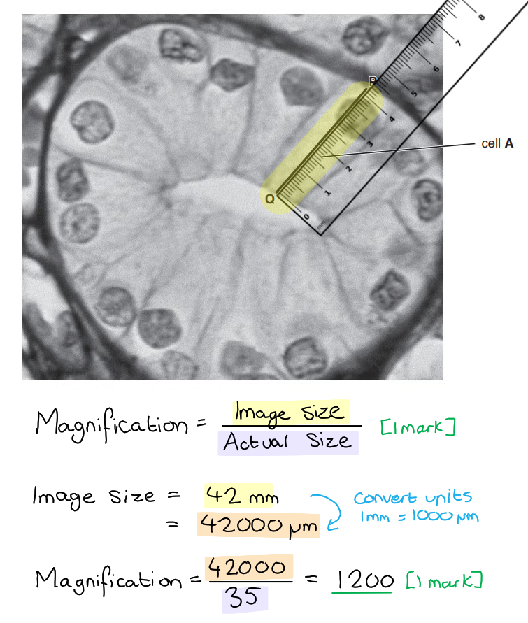
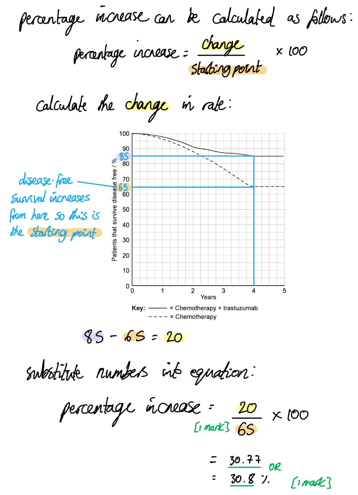
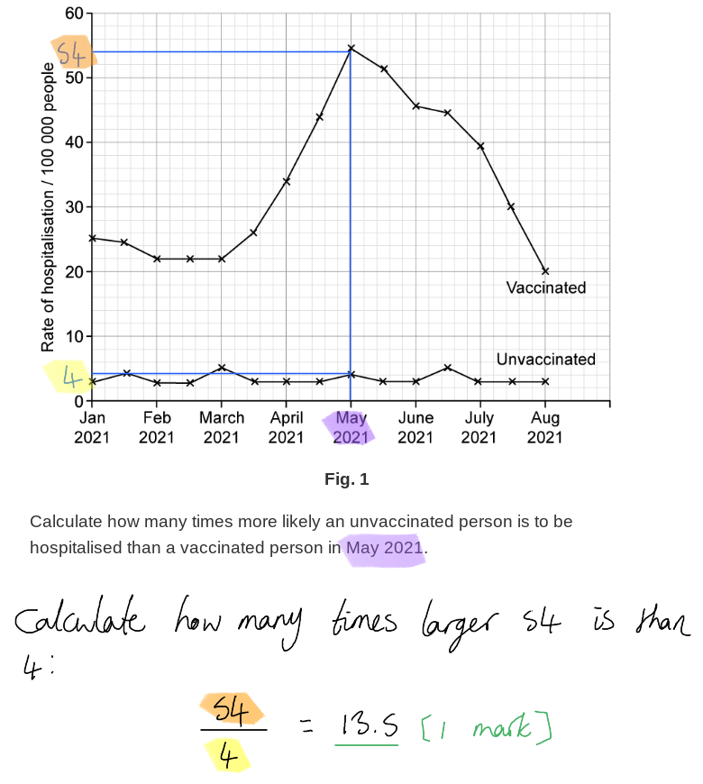

# Mark Schemes — Antibodies & Vaccination
**11. Immunity** · Cambridge (CIE) A-LEVEL biology (9700)

## Multiple Choice Questions (30 questions)

### Q1
**Final answer:** **The correct answer is ****C**** because:**

- **Live attenuated**** vaccines contain live strains of the pathogen that has been ****weakened**
- **An ****inactive vaccine**** is a pathogen that has been ****killed with heat or chemicals**
- **Subunit vaccines**** contain ****fragments ****of the pathogen containing the antigen which allow the immune response to be activated but without the patient receiving the full pathogen**

### Q2
**Final answer:** **The correct answer is ****D**** because:**

- **Monoclonal antibodies**** (Mabs) can be used to treat ****rheumatoid arthritis,**** an ****auto-immune**** disease**
- **Infliximab**** is used to bind to a protein produced by T-cells that cause damage to the cartilage in joints, blocking its action**

> *A **is incorrect as **monoclonal antibodies** are clones and only specific to one antigen; therefore they could not protect against a wide variety of pathogens*

> *B **is incorrect as taking serum from a patient would would give many different types of antibody, not one specific type. *

> *C **is incorrect as Mabs have very narrow specificity to just one antigen.*

### Q3
**Final answer:** **The correct answer is ****B**** because:**

- **TB invades the lungs initially; some people develop an infection quite quickly with infection spreading to the lymph nodes, bones and gut, whilst in others the bacteria remains inactive (dormant) for many years**
- **Malaria is caused by four species of ****Plasmodium**** protoctists which have a complex lifecycle involving stages in both female ****Anopheles ****mosquitoes and humans **
- **Sickle cell anaemia is a ****genetic condition**
- **The bacterium that causes cholera infects the cells of the gut; if the bacterium reaches the gut it secretes choleragen. This is a toxin that disrupts the function of the epithelial cells resulting in loss of salts and water which can make an immune response difficult **

### Q4
**Final answer:** **The correct answer is ****A**** because ****monoclonal antibodies**** cannot bind to chromosomes to identify any abnormalities.**

> *B **is incorrect as **monoclonal antibodies** can be used for **tissue typing** as there are many copies of the same specific antibody to bind to the antigens present.*

> *C **is incorrect as **monoclonal antibodies** are used in pregnancy tests to bind to the **hCG hormone present** in pregnant urine which is produced by the placenta when pregnancy occurs.*

> *D **is incorrect as **monoclonal antibodies** can be used to target B and T cells that would be involved in the **rejection of an organ.*

### Q5
**Final answer:** **The correct answer is ****B**** because:**

- **Pathway 1 refers tp the ****passive responses**** – there is no activation of the immune system**
- **Pathway 2 refers to the ****active responses**** – the immune system is activated to produce antibodies to the antigens present**
- **No. 3 describes ****artificial passive immunity**** when a patient is given antibodies by injection**
- **No. 4 describes ****natural passive immunity**** when a fetus receives antibodies from its mother**
- **No. 5 describes the activation of the immune system through vaccination, an ****artificial activation ****of the immune system**
- **No. 6 describes the ****natural activation**** from infection of the immune system**

### Q6
**Final answer:** **The correct answer is ****D**** because:**

- **Antibodies**** are too big to go through the cell membrane, so they can’t get to the ****viruses**** inside the cells**
- **Antibodies**** that would cause ****agglutination**** would have multiple binding sites to allow the ****clumping of the bacteria**

### Q7
**Final answer:** **The correct answer is ****B**** because:**

- **Records in developing countries are still incomplete of all the vaccinations that have been given**
- **Issue around giving the vaccination such as transport and instability due to civil war prevents individuals from certain areas from receiving vaccination**

### Q8
**Final answer:** **The correct answer is ****A**** because:**

- **Cancer cells are cells growing out of control that will divide continuously**
- **Plasma cells will not keep dividing (their role is to produce antibodies), this is why they need to be combined with the cancer cells into a ****hybridoma**** to make ****monoclonal antibodies**
- **The cancer cells and the plasma cells, when combined into a hybridoma, will retain the ****ability to divide continuously**

### Q9
**Final answer:** **The correct answer is ****C**** because:**

- **Only statement 3 explains why TB vaccination is via injection;  in that the TB ****antigen**** would be destroyed by stomach acid**
- **An injection into the bloodstream is needed so that the immune system can be activated to give ****long-term immunity**

> *A & B are incorrect as these options both contain statement 1. This statement would be an incorrect reason as there are B-lymphocytes and T-lymphocytes in the tissues of the stomach*

> *D is incorrect as macrophages do carry out antigen presentation, but this is not relevant to why TB vaccines must be given by injection.*

### Q10
**Final answer:** **The correct answer is ****B**** because:**

- **Monoclonal antibodies**** are made by first injecting a mouse with the ****antigen**
- **They are then recognised by the mouse immune system which result in the formation of plasma cells **
- **The plasma cells are then fused with a cancer cell to form a ****hybridoma**** that will divide continuously**
- **The hybridoma cells are cultured and the one that is producing the correct ****antibody isolated and cloned**

### Q11
**Final answer:** **The correct answer is ****A**** because:**

- **The heavy chain labelled ****Q**** is ****constant**** and the same in all ****antibodies ****that are formed from four polypeptide chains (the amino acid structure is conserved)**
- **R**** is the ****variable region****; this is the region that is specific to each ****antigen**
- **The binding site is formed by the variable regions**

### Q12
**Final answer:** **The correct answer is ****D****, this statement is incorrect because:**

- **The activation of the immune system to produce ****antibodies**** by plasma cells is ****active immunity**
- **The activation of the immune system would produce memory cells, so the protection would be long-lived**

> *A, B **& **C **are incorrect as all of these answers describe correctly how the body defends itself against infectious disease.*

### Q13
**Final answer:** **The correct answer is ****A**** because:**

- **The ****colostrum**** is the milk expressed in the first few days after the birth of a baby. This milk contains a high number of ****antibodies**** to provide ****passive natural immunity**** to the baby**
- **Active immunity**** is immunity that involves activation of T and B cells resulting in the formation of plasma cells (which make antibodies) and memory cells**
- **Artificial immunity ****results from an injection of antibodies or delivery of a vaccine**

### Q14
**Final answer:** **The correct answer is ****D**** because:**

- **The changing ****antigens**** on the surface of the pathogen means that new antibodies need to be produced to target each type of antigen.**
- **Antibodies**** are specific for the antigen they are made for, so if changes to the ****antigen**** structure occur then any antibodies produced from activated memory cells from a previous infection/vaccination would more than likely not be effective.**
- **This is the biggest problem when developing vaccines for infections caused by viruses responsible for colds and flu – these viruses have high mutation rates which can lead to changing antigens. **

> *A, B **& **C **are incorrect as these statements would not prevent a vaccine from being produced.*

### Q15
**Final answer:** **The correct answer is ****B**** because:**

- **The antibody has four polypeptide chains with two binding sites**
- **The ‘hinge’ region exists between the heavy chains and two light chains – it is a highly flexible part of the molecule that attaches the two light chains to the heavy chains**
- **If the enzyme breaks the fragment into three only ****two**** of them will contain the two binding sites**

### Q16
**Final answer:** **The correct answer is ****A**** because it’s the ****variation**** in the amino acid sequence that changes the structure of the ****variable region**** which gives specificity against a huge (millions+) number of potential ****antigens.**

> *B **is incorrect as the antigen-binding site of antibodies does not bind to phagocytes.*

> *C **is incorrect as the hinge region does provide flexibility to allow the antibody to bind around an antigen, but this is not a correct statement about the property of the binding site.*

> *D **is incorrect as antigen-binding sites are formed from variable regions in both the light and heavy chains.*

### Q17
**Final answer:** **The correct answer is ****C**** because:**

- **Antibodies do have both a ****tertiary and quaternary**** structure; as more than ****one polypeptide chain**** is needed to make an antibody**
- **The antibody structure is held together by ****disulfide bonds**** between the heavy and the light chain at the hinge region and between the two heavy chains – see diagram below **

- **The secondary and tertiary structure of the peptide molecule will depend on the ****hydrogen and peptide bonds**

> *A, B **& **D **are incorrect as the four polypeptide chains give two antigen-binding sites.*

### Q18
**Final answer:** **The correct answer is ****C**** because:**

- **Memory cells**** would be formed from some of the activated B-lymphocytes following vaccination (the other activated B-lymphocytes form plasma cells which secrete antibodies)**
- **The ****memory cells**** provide ****long-term immunity****; these cells remain circulating in the body for a long time and will divide rapidly (forming some plasma cells and some memory cells) if/when the antigen is encountered again**
- **The formation of these memory cells will occur within the first 20 days (when antibody concentration has risen and then fallen)**

> *A **is incorrect as the second exposure occurred before day 25.*

> *B **is incorrect as T-helper cells would have been activated earlier in the immune response. T-helper cells activate the B-cells to produce plasma cells that make the antibodies – this would happen before the antibody concentration started to rise.*

> *D **is incorrect as **active immunity** requires the formation of a population of memory cells (both T and B cells) – this would occur as the antibody concentration starts to rise (as memory cells are formed alongside plasma cells).*

### Q19
**Final answer:** **The correct answer is ****D**** because:**

- **The antiserum will contain ****antibodies ****that can bind to the toxin; the transfer and use of antibodies provides ****passive**** immunity as the immune system has not been activated**
- **The antiserum has not been produced by the patient but made in the horse and injected - this would make it artificial**

> *A is incorrect as the process involves an injection, this would be an artificial process.*

> *B & C are incorrect as this would be a passive process and does not involve the activation of the immune system.*

### Q20
**Final answer:** **The correct answer is ****D**** because:**

- **The cells fused with the ****myeloma**** to produce the ****hybridoma**** are the B-lymphocytes**
- **The B-lymphocytes will develop into a population of plasma cells that produce ****antibodies**
- **When fused with the myeloma cells the ****hybridoma**** will produce many copies of the same antibody – these are ****monoclonal antibodies**

> *A is incorrect as T-helper cells do not divide to form a population of plasma cells that can produce antibodies.*

> *B is incorrect as this combination of cells would not produce antibodies – although memory cells can divide to produce more memory cells and plasma cells it is the B plasma cells that must be fused.*

> *C is incorrect as T cells do not produce antibodies, they are matured in the thymus and either circulate as helper cells or killer cells.*

### Q21
**Final answer:** **The correct answer is ****C**** because:**

- **Vaccinations**** provide ****artificial immunity**
- **The immune system is activated to produce ****antibodies**** and memory cells; so this is ****active immunity**

> *A is incorrect as this is not a passive process the immune system is activated and would only be temporary protection*

> *B & D **are incorrect as this is not a natural process as individuals are given an injection. This would not be **natural immunity*

### Q22
**Final answer:** **The correct answer is ****C**** because:**

- **Histamine**** is produced in the ****inflammation response**
- **Histamine ****is produced when ****mast cells**** come into contact with antigen**

> *A** is incorrect as the binding of an antibody to an antigen will act as a marker for phagocytes and increase phagocytosis.*

> *B** is incorrect as some antibodies bind to toxins, making them harmless (these antibodies are known as antitoxins).*

> *D** is incorrect as antibodies will increase the agglutination (clumping) of bacteria to prevent them from infecting cells and enhancing phagocyte activity.*

### Q23
**Final answer:** **The correct answer is ****D**** because:**

- **The ingestion of ****antibodies**** from the mother’s milk does not produce an ****immune response ****(T and B cells are not activated)**
- **B-lymphocytes in the baby’s immune system would not be activated to differentiate into plasma cells to produce ****antibodies**
- **Memory cells**** are not formed if B-lymphocytes are not activated, it is these memory cells that provide long term immunity**

> *A **is incorrect as immunity cannot be inherited. Inheritance involves the transfer of genetic material from parents to offspring.*

> *B **is incorrect as f the antibodies only acted in the mother this would not help the baby to have immunity, even short term.*

> *C **is incorrect as f the antibodies were low in number then this would not give any immunity, even short term.*

### Q24
**Final answer:** **The correct answer is ****B**** because:**

- **The provision of ****antibodies**** in the mothers’ milk is a ****natural process**
- **The mothers milk has ready-made ****antibodies****, so the babies immune system is not activated, meaning this is a ****passive**** process**

> *A **& **C **are incorrect as this is a natural process, immunity was not obtained artificially.*

> *D **is incorrect as this is not an active process and only provides **temporary immunity.*

### Q25
**Final answer:** **The correct answer is ****C**** because in developing countries ****vaccinations**** without the need for ****boosters**** are essential as there may not be funds available to provide booster injections in the future.**

> *A **is incorrect as a vaccine produced by GM would not be the most relevant in the **fight against measles** in developing countries.*

> *B **is incorrect as a vaccine that only contains the live virus could give recipients the disease.*

> *D **is incorrect as whilst it is useful to vaccinate against as many diseases as possible, it is not essential to do this in the fight against measles.*

### Q26
**Final answer:** **The correct answer is ****A**** because:**

- **The influenza virus ****mutates**** regularly**
- **Some of these mutations cause ****changes to the antigens**** on the surface of the viral protein coat**
- **The many different variations and frequent mutations means that it is impossible to make a ****vaccine**** against them all**
- **The World Health Organisation (****WHO****) tracks and recommends the viral strains that should be in the influenza vaccine each year**

> *B **&** C **are incorrect as this would not prevent a vaccine from being produced.*

> *D **is incorrect as the influenza virus does not have part of its lifecycle in other mammals*

### Q27
**Final answer:** **The correct answer is ****C**** because:**

- **Colostrum ****is the first form of milk produced by the**** mammary glands**** of mammals. This is produced immediately following the delivery of a newborn.**
- **Colostrum**** contains antibodies that provide ****natural passive immunity.**

> *A, B **& **D **are incorrect as these statements are all examples of **active immunity.*

### Q28
**Final answer:** **The correct answer is ****C**** because:**

- **Vaccination with a dead pathogen would be described as ****artificial immunity ****as it is given via an ****injection ****(the pathogen is not acquired naturally)**
- **The injection of ****dead or attenuated**** (weakened) bacteria produces ****active immunity**** as it triggers an ****immune response ****(T and B cells are activated and plasma and memory cells formed)**

> *A **& **D **are incorrect as both of these options describe the response as **passive.*

> *B** is incorrect as vaccination is not **active natural** process, as when vaccinated the pathogen is not acquired naturally.*

### Q29
**Final answer:** **The correct answer is ****B**** because:**

- **The ****secondary response**** to the infection produces large quantities of antibodies**
- **The body will have produced ****memory cells**** after the injection with the vaccine**
- **This would have ****activated the immune system**** and resulted in the formation of memory cells that can activate the production of antibodies during a secondary infection**

> *A **& **D **are incorrect as both of these options describe an increase in the cells that target the antigens and result in the formation of memory cells. They contribute to the secondary response, but it is the increased number of antibodies that is important.*

> *C **is incorrect as **antigens** are on the surface of the invading pathogen; they would not be released in the body. *

### Q30
**Final answer:** **The correct answer is ****A**** because:**

- **Immediate protection would be provided by giving ****antibodies**** to those vulnerable, this would provide ****artificial immunity**
- **This would be a ****passive**** response as the ****immune system ****(T and B cells) would not be involved in the production of the antibodies**
- **This would also not provide long term immunity which requires the production of ****memory cells**

> *B & D are incorrect as this is not a natural process and they would be given an injection of antibodies. Natural passive immunity is given from mothers to babies through breast milk.*

> *C is incorrect as immediate protection would not be provided by an active response as an active response requires activation of T and B cells to produce antibodies.*

## Structured Questions (11 questions)

### Q1
More than one vaccination is offered for each disease because...

- <u>More</u> memory cells (will be produced); **[1 mark]**
- (So there will be) higher concentration of antibodies in blood /** **more antibodies produced; **[1 mark]**
- (So there will be) rapid/faster production of antibodies (on further infection); **[1 mark]**

**[Total: 3 marks]**

> *You need to be specific in your response here, general answers about the production of a secondary response are not detailed enough. Likewise, phrases such as a ‘stronger immune response’ or ‘faster immune response’, also lack details required in terms of memory cells and antibodies. The key is to detail that there will be **more** antibodies produced **more quickly.*
(i) An explanation for the the overall trend of the data shown is..

**Final answer:** **Any ****four ****from the following:**

- Vaccination contains <u>antigens</u> against meningococcal bacteria; **[1 mark]**
- B lymphocytes form <u>memory cells</u>; **[1 mark]**
- A secondary immune response is triggered if the meningococcal bacteria/antigen is encountered / enters the bloodstream; **[1 mark]**
- Memory cells recognise the antigen **and **differentiate into plasma cells / antibodies are produced; **[1 mark]**
- Very quick response; **[1 mark]**

(ii) A reason for the data shown in 2017/2018. is..

**Final answer:** **Any ****one**** from the following:**

- Parents may choose not to have baby vaccinated; **[1 mark]**
- (Meningococcal) bacteria has <u>mutated</u>** and **vaccine is no longer effective / description to explain that memory cells no longer produce antibodies complementary to the antigen; **[1 mark]**

**[Total: 5 marks]**

> *Part (ii) take care when writing short answers to include sufficient detail and accuracy; be sure not to simply state that the disease had mutated, rather than specifically making reference to the information given in part (a) where meningococcal is a bacterial disease.*
Vaccinating as many babies as possible protects the UK population against pathogens because...

- Herd immunity is achieved; **[1 mark]**
- Which reduces the spread of the disease; **[1 mark]**

**[Total: 2 marks]**

> *For the full 2 marks you are required to fully explain that herd immunity will reduce the spread of the disease. *
A foetus is protected against the pathogens that infect its mother during pregnancy because...

**Final answer:** **Any ****five ****from the following:**

- Babies are protected against diseases due to the transfer of (IgG) antibodies across the placenta (between the mother’s blood and foetal blood);**[1 mark]**
- (IgG) Antibodies (from mother) are complementary/bind specifically; **[1 mark]**
- To pathogens/antigens crossing the placenta (from the infected mother); **[1 mark]**
- Giving immediate/rapid protection (in foetus); **[1 mark]**
- Which stops symptoms forming (in foetus); **[1 mark]**
- Giving <u>passive</u> immunity (in foetus); **[1 mark]**

**[Total: 5 marks]**

*Although this is an extended response question you are not required to write in continuous prose and bullet points for your answer are perfectly acceptable*.

### Q2
The magnification of the image shown in Fig.1 is...

- (Correctly stated formula) magnification = image length ÷ actual length; **[1 mark]**
- (Correctly calculated magnification) x 1200; **[1 mark]**

***Accept ****x1171 (for an actual measurement of 41 mm) ****OR**** x1229 (for an actual measurement of 43 mm).*

**[Total: 2 marks]**

> *Don't forget that you need to convert between millimetres and micrometres to make sure both numbers have the same unit before subbing into magnification the formulae. Note that there are 1 000 micrometres in a millimetre.*

> *Note that in the actual exam you would be expected to measure the distance between P-Q yourself using your own ruler. The image of the ruler has been added here to make it easier for people with different screen sizes to view online. *

(i) The events that occur during interphase to prepare a cell for division are...

**Final answer:** **Any ****two ****of the following:**

- <u>DNA</u> replication / S phase; **[1 mark]**
- (Early interphase) chromosome becomes two chromatids; **[1 mark]**
- DNA is checked for errors / errors in DNA are repaired; **[1 mark]**
- Synthesis of (growth) protein / enzymes (for growth); **[1 mark]**
- Cell growth occurs; **[1 mark]**
- Organelle synthesis is carried out; **[1 mark]**
- Centrioles replicate; **[1 mark]**
- Nucleotide synthesis takes place; **[1 mark]**

(ii) A cell signalling molecule, such as VEGF, can lead to a response in a cell by...

**Final answer:** **Any ****two ****of the following:**

- Target cells are endothelial cells; **[1 mark]**
- VEGF/cell signalling molecule binds to receptor; **[1 mark]**
- VEGF/cell signalling molecule is specific/complementary to receptors; **[1 mark]**
- (VEGF) triggers secondary messenger; **[1 mark]**
- (This) activates enzymes / enzyme cascade; **[1 mark]**
- Signal transduction; **[1 mark]**
- Phosphorylation events; **[1 mark]**

***Reject**** references to receptor 'cells' for marking point 2.*

**[Total: 4 marks]**

> *There is no expectation that you know anything about VEGF before attempting this question, but you are expected to apply your knowledge of cell signalling to this new scenario.*

> *It is important to emphasise the idea of **binding** to a **specific receptor** instead of describing VEGF as being ‘received’ by a cell or a protein in the cell surface membrane.*
The hybridoma method for the production of monoclonal antibodies that will target the VEGF protein is...

**Final answer:** **Any ****four ****of the following:**

- VEGF protein/antigen injected into mouse/small mammal; **[1 mark]**
- Time for immune response to occur; **[1 mark]**
- Plasma cells/B-lymphocytes extracted from mouse; **[1 mark]**
- Plasma cells fused with myeloma/cancer, cells;
- A fusogen / electric current can be used (to assist the fusing of cells); **[1 mark]**
- (To produce) hybridoma cells; **[1 mark]**
- Clone hybridoma cells; **[1 mark]**
- Separate cells and culture in individual wells; **[1 mark]**
- Screen for cells secreting desired antibody; **[1 mark]**
- Hybridoma cells grown in large scale culture; **[1 mark]**

**[Total: 4 marks]**

> *It is important to remember that the antibodies are extracted from the plasma cells **not** the small mammal.*

> *Plasma cells and myeloma cells are not 'mixed', they are 'fused'. *
Repeated treatment with monoclonal antibodies may have these effects because...

**Final answer:** **Any ****one ****of the following:**

- Monoclonal antibodies are identified as foreign/non-self / act as an antigen; **[1 mark]**
- (Monoclonal antibodies) stimulate an immune response; **[1 mark]**
- (Antibodies destroyed so) not enough antibody (to be effective); **[1 mark]**

**[Total: 1 mark]**

> *Statements suggesting that the body might "get used to" antibodies, or become "resistant" to them will not be credited as these are not accurate descriptions of how the immune system functions.*

### Q3
Fig. 1 shows the secondary structure and** **tertiary structure of the antibody molecule in the following ways...

**Final answer:** **Any ****three**** of the following:**

*Secondary structure*

- (There are many) β/beta-pleated sheets; **[1 mark]**
- The structure is random / irregular **OR** contains loops/beta turns; **[1 mark]**

*Tertiary structure*

- (There is) folding of polypeptide chains / the secondary structure; **[1 mark]**
- (The protein has a) globular structure / is spherical **OR** (the protein has a) 3D shape; **[1 mark]**

***Ignore**** references to α-helix structure.*

***Reject**** B in place of β/beta for marking point 1.*

***Reject**** references to quaternary structure, i.e. the interactions between polypeptide chains, for marking point 3.*

***Ignore**** circular/round in place of spherical for marking point 4.*

**[Total: 3 marks]**

> *Note that the question here requires you to describe how** **Fig. 1** shows these levels of structure. There is little evidence of α-helix structures in Fig.1, so there is no credit available for describing this. (Note: here at SME we think that we can see a small section of alpha-helix on the left-hand side of the lower polypeptide, but this is a question taken from a past exam paper, so we cannot change the credit as awarded by the exam board)*
(i) The roles of the structures labelled X and Y in the production of antibody molecules in the hybridoma cell are...

- (The role of structure X / rough endoplasmic reticulum is) site of protein synthesis **OR** assembly / transport / modification of proteins; **[1 mark]**
- (The role of structure Y / the mitochondrion is) production of ATP / release of energy; **[1 mark]**

***Accept**** polypeptide for protein.*

***Reject ****references to the Golgi body for structure X.*

***Reject**** references to energy being produced/created for structure Y.*

(ii) The stage in which hybridoma cells are formed involves...

- Fusion of cells / cell membranes; **[1 mark]**
- (The use of a named) fusogen/hybridogen (e.g. polyethylene glycol/PEG / an electric current); **[1 mark]**
- (The cells fused are) plasma cell/B-lymphocyte **AND** tumour/cancer/myeloma cell; **[1 mark]**

***Ignore**** mixing of cells for marking point 1.*

***Reject**** β cell in marking point 3.*

(iii) The use of monoclonal antibodies in the treatment of disease involves...

**Final answer:** **Any ****three**** of the following:**

- Some monoclonal antibodies/mAbs act directly on target cells / work indirectly to kill cells **OR** monoclonal antibodies/mAbs do not damage other/non-target cells; **[1 mark]**
- (mAbs work) by binding to <u>specific</u>/<u>complementary</u> antigens / cell surface receptors; **[1 mark]**
- (Named) drugs / radioactive isotopes can be attached to / used to tag mAbs; **[1 mark]**
- Enzymes can be attached to mAbs; **[1 mark]**
- (Attaching enzymes means that) drugs can be activated at the site of action; **[1 mark]**
- Bispecific mAbs attach two cells together; **[1 mark]**
- Interrupting cell signalling; **[1 mark]**
- Providing passive immunity; **[1 mark]**
- Stimulating the immune system/phagocytes/T-lymphocytes to kill cancer cells; **[1 mark]**
- Named cancer / autoimmune disease that can be treated with mAbs, e.g. breast cancer / melanoma / leukaemia / rheumatoid arthritis / allergic asthma; **[1 mark]**

***Ignore**** 'label' for tag in marking point 3.*

***Accept ****a description of passive immunity in marking point 8.*

**[Total: 8 marks]**

> *i) Make sure that you are confident at identifying cell organelles; this can be tricky when you are presented with unfamiliar micrographs. You also need to be able to accurately state the roles of the different organelles.*

> *Note that no credit will be given for stating that structure X produces antibodies, as this information has been given in the question; you must state that it produces polypeptides/proteins.*

> *You must **never** state the energy is produced! Always say that energy is **released** (from glucose) during respiration, or that **ATP** is produced.*

> *ii) Whenever you come across a question that asks you to describe a process, pay careful attention to the specific part of the process that you need to focus on. Here no credit will be given for describing the stages of hybridoma creation that come before or after the formation of hybridoma cells.*

> *Be specific about the cell types involved with hybridoma formation; you should refer to tumour cells and plasma cells/B cells. Don't confuse B lymphocytes and T lymphocytes here!*

> *iii) Note that the question specifically refers to the use of mAbs in the **treatment** of disease; no credit will be given for describing their use in disease diagnosis, or about the general role of antibodies in the immune response.*

### Q4
Hybridomas can be used to create monoclonal antibodies using the following process...

**Final answer:** **Any ****six**** of the following; **

- Antigens are injected into a mouse; **[1 mark]**
- The mouse undergoes an immune response / clonal selection / clonal expansion; **[1 mark]**
- B-lymphocytes/plasma cells are extracted from the mouse; **[1 mark]**
- (The B-lymphocytes/plasma cells are) taken from the spleen (of the mouse); **[1 mark]**
- The mouse cells are fused with tumour/myeloma cells (to form a hybridoma); **[1 mark]**
- Hybridoma cells that are producing the desired antibody are identified/screened for/isolated; **[1 mark]**
- The antibody-producing cells are cultured / allowed to divide by mitosis (to produce more copies); **[1 mark]**

**[Total: 6 marks]**
Monoclonal antibodies could be used to reduce the activity of Treg cells by...

- Monoclonal antibodies would be specific/complementary to the receptors on the surface of Treg cells; **[1 mark]**
- The antibodies would bind to the receptors on Treg cells **AND** inactivate the cells / prevent the cells from being activated / prevent the cells from suppressing the immune system / reduce the cells' activity; **[1 mark]**

**OR**

- Monoclonal antibodies would be specific/complementary to proteins produced by the Treg cells;** [1 mark]**
- The antibodies would bind to the proteins released by the Treg cells **AND** inactivate them / prevent them from binding to other cells/receptors / prevent them from suppressing the immune system; **[1 mark]**

**[Total: 2 marks]**

> *These monoclonal antibodies would be designed to be complementary to the receptors on the surface of this class of lymphocyte, or to the proteins produced by the lymphocytes. While you are not expected to know about the exact mechanism by which such antibodies would reduce Treg activity, your knowledge of antibodies should tell you that they will bind to their specific receptors or proteins; this binding reduces the activity of the cells or the proteins in some way; several options have been given for how you might describe this.*
The activity of Treg cells is important because...

- It prevents autoimmunity / the immune system from attacking the body's own cells / allergies; **[1 mark]**
- Due to recognising self antigens / allergens / named allergen as harmful; **[1 mark]**

**[Total: 2 marks]**

> *The immune system is usually very good at recognising foreign antigens, but sometimes it recognises harmless things as being foreign and this can lead to problems such as allergies and autoimmune conditions. Treg cells play a part in regulating the activity of the immune system.*

### Q5
The difference in antibody concentration between that after vaccine administration and that after infection with the same pathogen is due to...

- The vaccine contains a dead/weakened/attenuated form of the pathogen; **[1 mark]**
- (After the vaccine is given) clonal selection of lymphocytes takes place / the lymphocytes with receptors complementary to the antigens (of the pathogen) are selected; **[1 mark]**
- The lymphocytes (with the complementary receptors) undergo clonal expansion / divide by mitosis / are cloned; **[1 mark]**
- The lymphocytes differentiate/specialise into memory cells; **[1 mark]**
- When infection (with the same pathogen) occurs the memory cells/lymphocytes are able to produce antibodies more quickly **AND** in larger numbers; **[1 mark]**

**[Total: 5 marks]**
(i) The trend shown in the data in Fig. 2 for the years 1940 to 1968 includes...

**Final answer:** **Any ****two**** of the following:**

- There is an overall (slight) increase in the number of cases; **[1 mark]**
- The number of cases fluctuates; **[1 mark]**
- Correctly given numbers to support either of the above points e.g. the number of cases increases from an average of around 350 000 to an average of around 400 000, or between the years 1960-1965 the number of cases increases and decreases twice; **[1 mark]**

(ii) The trend shown in the data in Fig. 2 for the years 1968 to 2010 includes...

**Final answer:** **Any ****two**** of the following:**

- There is an overall decrease in the number of cases; **[1 mark]**
- The size of the case fluctuations decreases over the time period; **[1 mark]**
- The cases drop to zero (or almost zero) on more than one occasion; **[1 mark]**
- Correctly given numbers to support any of the above points; **[1 mark]**

**[Total: 4 marks]**

> *When describing data it is good idea to give overall trends, but you should also look at the smaller details of what is happening. Here each set of data has a clear trend, but there are fluctuations within that and the size of the fluctuations are not the same throughout. It is always a good idea to quote numbers from the data where possible to back up any points that you are making. *
Measles has not been eradicated because...

**Final answer:** **Any ****three**** of the following:**

- Measles is very infectious / a high percentage (93-95 %) of vaccination is needed to achieve herd immunity for measles; **[1 mark]**
- People do not believe that measles is serious enough to get vaccinated; **[1 mark]**
- People are worried about vaccine side effects so do not get vaccinated; **[1 mark]**
- The measles vaccine is not 100 % effective; **[1 mark]**
- Two doses of the vaccine are needed (and it can be difficult to ensure that everyone receives two vaccine doses); **[1 mark]**

**[Total: 3 marks]**
Contrasting features of the immunity provided by the measles vaccine compared to the immunity that babies are born with include...

- Vaccinations provide artificial active immunity **WHILE **babies are born with natural passive immunity; **[1 mark]**
- Vaccines provide immunological memory / memory cells / immunity to future infections **WHILE** the immunity that babies are born with is temporary / antibodies will soon be lost / babies will not be immune to future infections; **[1 mark]**

**[Total: 2 marks]**

> *Vaccines provide artificial immunity that is active, meaning that memory cells remain in the blood and provide immunity against future infections. Babies are born with natural immunity to some diseases, but this is passive and is just the result of antibodies from the mother's blood; these antibodies will soon be lost, after which point the baby will not have immunity to future infections but will have to develop its own natural, active immunity.*

### Q6
(i) The substance injected into the mouse at **X** is...

- HER2 protein;** [1 mark]**

(ii) The cell formed at **Y** is a...

- Hybridoma; **[1 mark]**

(iii) The purpose of the screening process at **Z** is to...

- Select/isolate cells that are producing the (HER2) monoclonal antibody; **[1 mark]**

**[Total: 3 marks]**
(i) The antibodies need to be humanised because...

- They are made by the immune system / plasma cells of mice **OR** they are isolated from mouse cells (not humans); **[1 mark]**
- They could cause an immune response / allergic reaction in humans; **[1 mark]**

(ii) The antibodies could be humanised by...

**Final answer:** **Any ****two**** of the following:**

- Altering the genes that code for the antibody/proteins so that they are similar to the human antibody genes;
- Altering the amino acid sequence for the antibody **SO** that it is a closer match to human antibodies; **[1 mark]**
- Altering the sugars that attach to the antibody so that they are the same as those found in humans;** [1 mark]**
- Ensuring that the variable region remains unchanged / specific to HER2 proteins; **[1 mark]**

**[Total: 4 marks]**

> *Antibodies made in the cells of mice will be recognised by the human immune system as foreign, so could initiate an immune response; humanisation of antibodies prevents this. *

> *Antibodies are proteins, so their tertiary structure can be altered by changing the amino acid sequence. Scientists would need to be careful not to alter the variable region of the antibodies so that they remain specific to HER2.*
The percentage increase in disease free survival after 4 years for patients receiving chemotherapy and trastuzumab compared to patients receiving chemotherapy along is...

- 20$\div$65; **[1 mark]**
- 30.8 / 30.77 (%); **[1 mark]**

*Full marks can be awarded for the correct answer of 30.8 in the absence of other calculations.*

**[Total: 2 marks]**

It is advantageous to use monoclonal antibodies in cancer treatment rather than traditional chemotherapy because...

- Monoclonal antibodies are specific/complementary to the cancer cells / proteins that cause cancer; **[1 mark]**
- The antibodies will only bind to the affected cells/molecules; **[1 mark]**
- The treatment will not harm other cells in the body / will have fewer side effects; **[1 mark]**

**[Total: 3 marks]**** **

> *Chemotherapy treatments are delivered to the blood, so they will circulate in the body and will affect cells other than the cancer cells themselves. Monoclonal antibodies are targeted at the cancer cells, or the proteins produced by the cancer cells, so their effect on other cells will be reduced or non-existent. This will reduce the non-target effects of the treatment such as unpleasant side effects.*

### Q7
Comparisons of the antibody concentration of person **A** and **B** include:

**Final answer:** **Any ****three**** of the following:**

Similarities:

- Both (person **A** and **B**) show an initial increase (in antibody concentration); **[1 mark]**

Differences:

- (Person) **A** show an initial sharp increase, then a sharp decrease (in antibody concentration);** [1 mark]**
- The antibody concentration for (person) **A** decreases to (almost) zero; **[1 mark]**
- (Person) **B **show an increase across the entire time period; **[1 mark]**
- The initial rate of increase is fast and then slows down (for person **B**); **[1 mark]**

**[Total: 3 marks]**

> *When you have to compare graphs with each other, take note of any similarities and differences in trends that can be observed. Also pay attention to the gradient of the graph to deduce whether changes happened slow or fast.*
The type of immunity that person **A** and **B** gained would be:

- (Person) **A**: <u>Passive</u> (artificial) immunity **and** (person) **B**: <u>Active</u> (artificial) immunity; **[1 mark]**

**[Total: 1 mark]**

> *Passive immunity is characterised by a sharp increase in antibodies as they are injected into the bloodstream, but they are eventually broken down by the body, so their concentration will decrease dramatically after a while. Active immunity involves an immune response, meaning the body produces its own antibodies, which explains why their levels will remain high for longer compared to passive immunity.*
The advantages of active immunity include:

**Final answer:** **Any ****two**** of the following:**

- Memory cells are produced / Immunological memory is gained; **[1 mark]**
- (This results in) long-term immunity (against a pathogen); **[1 mark]**
- During the secondary (immune) response, the antibody concentration increase faster and higher (than during primary response); **[1 mark]**

**[Total: 2 marks]**

> *To gain active immunity, the body must be exposed to a pathogen or antigen. This launches a primary immune response during which the plasma cells will produce antibodies. Memory cells are also produced, so the next time the immune system encounters the same pathogen or antigen, the immune response can occur much faster. This provides long-term immunity against a pathogen.*
Tetanus antitoxin is an effective form of treatment because....

- It provides immediate / fast response **OR** there is a fast / rapid increase in antibody concentration; **[1 mark]**
- (The antitoxin) provides a high / large number of antibodies (to fight infection); **[1 mark]**

**[Total: 2 marks]**

> *The advantage of passive immunity is that it cuts out the primary immune response, which can take a long time to produce enough antibodies to fight infection. In the case of tetanus, an immediate response is necessary, so the antibodies that are found in the antitoxin provides that.*

### Q8
(i) The areas of the antibody marked **X** and **Y** are the...

- **X** = variable region; **[1 mark]**
- **Y** = constant region; **[1 mark]**

(ii) The bonds that hold the polypeptides of the antibody together are...

- Disulfide (bonds); **[1 mark]**

**[Total: 3 marks]**
Antibodies are adapted to carry out their function by...

- The variable region is complementary to a specific antigen **SO** it can bind to it / form an antigen-antibody complex; **[1 mark]**
- The hinge region is flexible **SO** the angle of the binding sites can be altered / the antibody can bind to more than one antigen at a time; **[1 mark]**

**[Total: 2 marks]**

> *Structure must be linked to function for each mark here.*
(i) The process taking place in Fig. 2 is...

- Agglutination; **[1 mark]**

(ii) One other way that antibodies interact with pathogens is...

- Binding with a virus/toxin **SO **preventing the virus/toxin from entering/binding to/damaging a host cell; **[1 mark]**

**OR**

- Binding to a toxin **SO **neutralising it; **[1 mark]**

**OR**

- Binding to bacterial flagella **SO** immobilising the bacterium; **[1 mark]**

**OR**

- Binding to pathogens / opsonisation **SO** causing the pathogen to be engulfed by a phagocyte / allowing a phagocyte to attach to the pathogen; **[1 mark]**

**OR**

- Making a hole in / damaging pathogen cell surface membranes **SO** causing cell lysis/bursting; **[1 mark]**

**[Total: 2 marks]**
An antibody could be engineered for a specific function by...

- Changing/designing the amino acid sequence / primary structure; **[1 mark]**
- This alters the tertiary structure/3D shape of the antibody; **[1 mark]**
- The antibody will be complementary/specific to / will bind to a different antigen / cell type; **[1 mark]**

**[Total: 3 marks]**

> *Antibodies can be engineered to bind to different antigens or cell types. This is possible because of scientists' extensive knowledge of protein structure; it is possible to design an amino acid sequence so that the resulting protein will have a specific 3-D shape, and will function in a desired way.*

### Q9
An unvaccinated person, in comparison to a vaccinated person, in May 2021 is more likely to be hospitalised by a factor of...

- 13.5; **[1 mark]**

**[Total: 1 mark]**

> * *
(i) The type of immunity shown in the graph is...

- Artificial active (immunity); **[1 mark]**

(ii) Artificial active immunity can be described as follows...

- (*Artificial* immunity involves) being given an injection / transfusion; **[1 mark]**
- (*Active* immunity means that) memory cells are present in the blood / antibodies are produced by the body; **[1 mark]**

> *This type of immunity can be compared with natural active immunity which occurs when someone is exposed to antigens through a pathogen.*

**[Total: 3 marks]**
The difference in hospitalisation rates is because...

**Final answer:** **Any ****three**** of the following:**

- Vaccinated people have had prior exposure to / have come into contact with the (COVID-19) antigen; **[1 mark]**
- (Vaccinated people) have previously carried out the primary immune response / clonal selection / clonal expansion; **[1 mark]**
- (Vaccinated people) have memory cells in their blood; **[1 mark]**
- (Vaccinated people) can produce plasma cells / antibodies (against COVID-19) quickly; **[1 mark]**
- (Vaccinated people) generate a (secondary) immune response before symptoms appear; **[1 mark]**

***Accept**** correct descriptions of clonal selection or expansion for marking point 2.*

***Accept ****converse argument for unvaccinated people.*

**[Total: 3 marks]**

*The command word here is '**explain**' so you are expected to go into detail with your answer. You could almost re-word this question as 'explain how a vaccine leads to immunity', but this question is also assessing your skills of applying knowledge to a novel context, in this case data about the COVID-19 vaccination. You should also note that there are*** ***3 marks available so you need at least three points to gain these marks. *
Herd immunity is...

**Final answer:** **Any ****two**** of the following:**

- A large proportion/high (enough) percentage of the population has been vaccinated / have immunity (against COVID-19);** [1 mark]**
- It is difficult for a pathogen/COVID-19 to spread within the population / there are no individuals available for the pathogen to infect;** [1 mark]**
- Those not immunised are protected / unlikely to contract COVID-19/the disease **AS** the levels of the disease are low; **[1 mark]**

**[2 marks]**

### Q10
The completed table is as follows...

**Final answer:** **Award 1 mark for each correct ****column****:**

| **Type of immunity** | **Production of antibodies** | **Presence of memory cells** | **Example** |
|---|---|---|---|
| Natural, passive | No | No | Across the placenta during pregnancy |
| Acquired, passive | No | No | An injection of antibodies |
| Natural, active | Yes | Yes | Catching an infection |
| Acquired, active | Yes | Yes | Being vaccinated |

**[Total: 3 marks]**
Babies need to be vaccinated from 8 weeks old because...

**Final answer:** **Any ****two**** of the following:**

- Up until this point/age they would have been protected by antibodies gained from the mother (via the blood across the placenta); **[1 mark]**
- The protection gained from the mother does not involve the ability to make antibodies / does not include memory cells; **[1 mark]**
- The antibodies gained from the mother’s blood are not long-lasting / break down after 8 weeks; **[1 mark]**

**[Total: 2 marks]**

> *Newborn babies are protected from infection by the antibodies gained during pregnancy from the mother’s blood. Because they do not gain the ability to make antibodies or memory cells from the mother, this protection does not last, and vaccination needs to take place to ensure long term protection.*
An individual can remain susceptible to a disease for a few weeks after vaccination because...

**Final answer:** **Any ****two**** of the following:**

- It takes time to carry out clonal selection / find the lymphocytes with complementary receptors; **[1 mark]**
- It takes time to carry out clonal expansion / for lymphocytes to divide by mitosis / for B lymphocytes to differentiate into plasma/memory cells; **[1 mark]**
- It takes time for antibodies to be produced; **[1 mark]**

**[Total: 2 marks]**

> *This is a **suggest** question, meaning that you are not expected to have specifically learned the answer to this exact question, but that your knowledge of immunity and vaccination should enable you to **work out the answer**.*

> *The immune response is not immediate, which explains why we feel ill the first time we catch a disease (we feel symptoms while our immune response kicks into action and only start to feel better once the antibodies are produced). Similarly, when we are vaccinated it **takes time **for the immune response to reach its peak; the processes of **clonal selection**, **clonal expansion**, and **antibody production** all need to occur before immunity is achieved.*
The injection would protect against tetanus by…

- The antibodies would be present <u>immediately</u> / be able to act <u>instantly</u> / provide <u>immediate</u> protection; **[1 mark]**

**AND**

**Final answer:** **Any ****two**** of the following:**

- The antibodies would bind to the antigens on the tetanus bacteria; **[1 mark]**
- Antibodies attach to flagella and reduce the movement/spread of bacteria; **[1 mark]**
- Antibodies cause agglutination of bacteria and prevent movement/spread / make it easier for phagocytes to engulf the cells; **[1 mark]**
- Antibodies destroy bacteria by making holes in their cell walls; **[1 mark]**
- Antibodies label/mark the bacteria for phagocytosis; **[1 mark]**
- The antibodies would bind to/neutralise toxins produced by the bacteria; **[1 mark]**

*Ignore reference to preventing entry to host cells as this only applies to viruses.*

**[Total: 3 marks]**

> *A tetanus injection like this is an example of **passive immunity.** Vaccination would be no use here because it takes time for active immunity to be gained, by which time the individual in the question would be suffering from a tetanus infection. So instead, an injection of antibodies provides **immediate protection** against the bacteria that cause tetanus.*

> *Antibodies can work against bacteria in a number of ways, so make sure that you are able to give a few examples.*

### Q11
(i) Cell X is...

- B cell/B lymphocyte;** [1 mark]**

> *Cell X differentiates into cells that produce antibodies, so they must be B lymphocytes.*

(ii) Molecules labelled** **Z** **are...

- Antibodies;** [1 mark]**

**[Total: 2 marks]**
Stage Y involves...

**Final answer:** **Any ****two**** of the following:**

- Clonal expansion; **[1 mark]**
- Cells differentiate/specialise; **[1 mark]**
- (Cells develop) into plasma cells **AND** memory cells; **[1 mark]**

**[Total: 2 marks]**

> *There is some overlap here with Topic 11.1; this should be expected when answering exam questions on immunity. *
The three distinct regions of molecule Z (an antibody) are...

- Constant region; **[1 mark]**
- Variable region / antigen binding site; **[1 mark]**
- Hinge region; **[1 mark]**

*Answers can be in any order*

*Ignore reference to heavy and light chains*

**[Total: 3 marks]**

> *Although the heavy and light polypeptide chains are an important structural feature of antibodies, they do not form the different regions of an antibody, and it is these that you have been asked to name.*
(i) The cell which represents the tumour cell is...

- Cell B;** [1 mark]**

> *Cell A represents a plasma cell extracted from the spleen of the mouse (the plasma cells (or B-lymphocyte) will produce the required antibody to combat the original antigen). Cell B is fused with cell A to produce a **hybridoma **cell that can both produce monoclonal antibodies **and** **divide repeatedly.*

(ii) The molecules isolated in stage X could be used for...

**Final answer:** **Any ****two**** of the following:**

- Detecting specific pathogens; **[1 mark]**
- Blood typing; **[1 mark]**
- Diagnosis of disease / detecting cancer cells; **[1 mark]**
- Locating blood clots; **[1 mark]**
- Treatment of disease / named disease, e.g. rabies by injecting antibodies; **[1 mark]**
- Treatment of disease / named disease, e.g. melanoma / breast cancer by labelling cells for destruction (by the immune system); **[1 mark]**
- Targeting treatments to specific cells (e.g. cancer cells);
- Preventing organ rejection / autoimmune attack;** [1 mark]**
- Food testing / pregnancy testing**; [1 mark]**

**[Total: 2 marks]**

> *Note that the term 'mAbs' has been used throughout this question rather than the more familiar term 'monoclonal antibodies' for which mAbs is an abbreviation. This is to avoid giving away the answer to part (a) above. While the use of the abbreviation may throw you slightly, you would still be expected to recognise the process set out in Fig. 2 and work out what the question is all about.*
