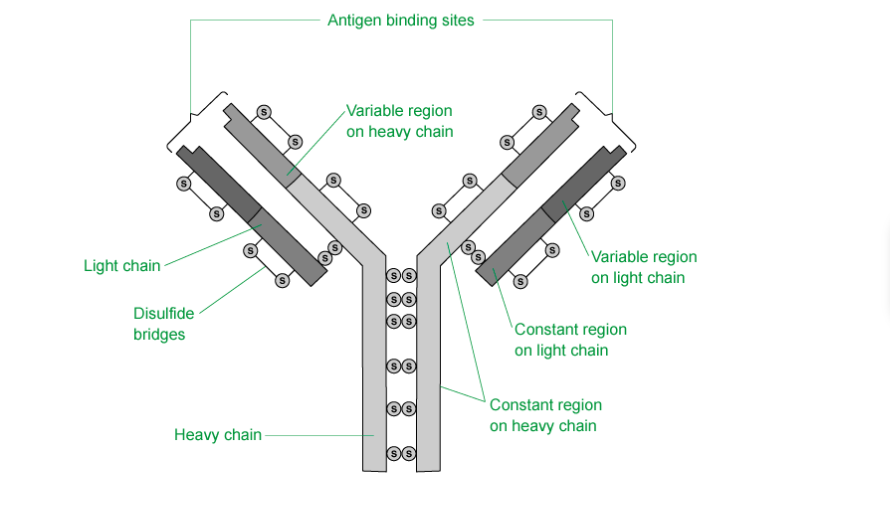
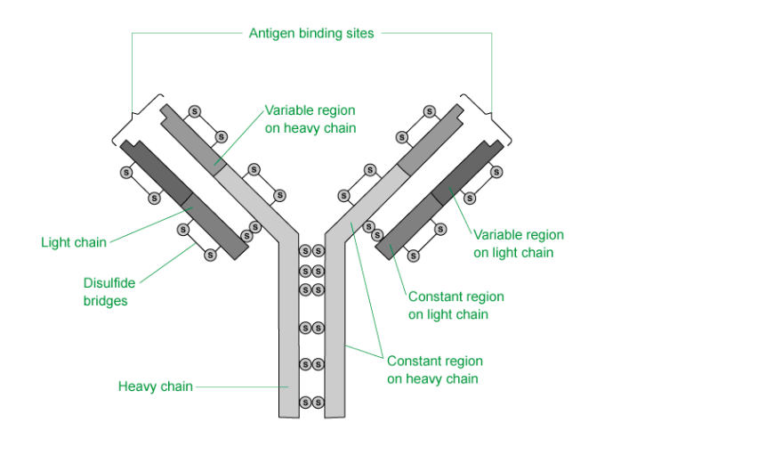

# Mark Schemes — Antibodies & Vaccination
**11. Immunity** · Cambridge (CIE) A-LEVEL biology (9700)

## Multiple Choice Questions (30 questions)

### Q1
**Final answer:** **The correct answer is ****C**** because:**

- **Live attenuated**** vaccines contain live strains of the pathogen that has been ****weakened**
- **An ****inactive vaccine**** is a pathogen that has been ****killed with heat or chemicals**
- **Subunit vaccines**** contain ****fragments ****of the pathogen containing the antigen which allow the immune response to be activated but without the patient receiving the full pathogen**

### Q2
**Final answer:** **The correct answer is ****D**** because:**

- **Monoclonal antibodies**** (Mabs) can be used to treat ****rheumatoid arthritis,**** an ****auto-immune**** disease**
- **Infliximab**** is used to bind to a protein produced by T-cells that cause damage to the cartilage in joints, blocking its action**

> *A **is incorrect as **monoclonal antibodies** are clones and only specific to one antigen; therefore they could not protect against a wide variety of pathogens*

> *B **is incorrect as taking serum from a patient would would give many different types of antibody, not one specific type. *

> *C **is incorrect as Mabs have very narrow specificity to just one antigen.*

### Q3
**Final answer:** **The correct answer is ****B**** because:**

- **TB invades the lungs initially; some people develop an infection quite quickly with infection spreading to the lymph nodes, bones and gut, whilst in others the bacteria remains inactive (dormant) for many years**
- **Malaria is caused by four species of ****Plasmodium**** protoctists which have a complex lifecycle involving stages in both female ****Anopheles ****mosquitoes and humans **
- **Sickle cell anaemia is a ****genetic condition**
- **The bacterium that causes cholera infects the cells of the gut; if the bacterium reaches the gut it secretes choleragen. This is a toxin that disrupts the function of the epithelial cells resulting in loss of salts and water which can make an immune response difficult **

### Q4
**Final answer:** **The correct answer is ****A**** because ****monoclonal antibodies**** cannot bind to chromosomes to identify any abnormalities.**

> *B **is incorrect as **monoclonal antibodies** can be used for **tissue typing** as there are many copies of the same specific antibody to bind to the antigens present.*

> *C **is incorrect as **monoclonal antibodies** are used in pregnancy tests to bind to the **hCG hormone present** in pregnant urine which is produced by the placenta when pregnancy occurs.*

> *D **is incorrect as **monoclonal antibodies** can be used to target B and T cells that would be involved in the **rejection of an organ.*

### Q5
**Final answer:** **The correct answer is ****B**** because:**

- **Pathway 1 refers tp the ****passive responses**** – there is no activation of the immune system**
- **Pathway 2 refers to the ****active responses**** – the immune system is activated to produce antibodies to the antigens present**
- **No. 3 describes ****artificial passive immunity**** when a patient is given antibodies by injection**
- **No. 4 describes ****natural passive immunity**** when a fetus receives antibodies from its mother**
- **No. 5 describes the activation of the immune system through vaccination, an ****artificial activation ****of the immune system**
- **No. 6 describes the ****natural activation**** from infection of the immune system**

### Q6
**Final answer:** **The correct answer is ****D**** because:**

- **Antibodies**** are too big to go through the cell membrane, so they can’t get to the ****viruses**** inside the cells**
- **Antibodies**** that would cause ****agglutination**** would have multiple binding sites to allow the ****clumping of the bacteria**

### Q7
**Final answer:** **The correct answer is ****B**** because:**

- **Records in developing countries are still incomplete of all the vaccinations that have been given**
- **Issue around giving the vaccination such as transport and instability due to civil war prevents individuals from certain areas from receiving vaccination**

### Q8
**Final answer:** **The correct answer is ****A**** because:**

- **Cancer cells are cells growing out of control that will divide continuously**
- **Plasma cells will not keep dividing (their role is to produce antibodies), this is why they need to be combined with the cancer cells into a ****hybridoma**** to make ****monoclonal antibodies**
- **The cancer cells and the plasma cells, when combined into a hybridoma, will retain the ****ability to divide continuously**

### Q9
**Final answer:** **The correct answer is ****C**** because:**

- **Only statement 3 explains why TB vaccination is via injection;  in that the TB ****antigen**** would be destroyed by stomach acid**
- **An injection into the bloodstream is needed so that the immune system can be activated to give ****long-term immunity**

> *A & B are incorrect as these options both contain statement 1. This statement would be an incorrect reason as there are B-lymphocytes and T-lymphocytes in the tissues of the stomach*

> *D is incorrect as macrophages do carry out antigen presentation, but this is not relevant to why TB vaccines must be given by injection.*

### Q10
**Final answer:** **The correct answer is ****B**** because:**

- **Monoclonal antibodies**** are made by first injecting a mouse with the ****antigen**
- **They are then recognised by the mouse immune system which result in the formation of plasma cells **
- **The plasma cells are then fused with a cancer cell to form a ****hybridoma**** that will divide continuously**
- **The hybridoma cells are cultured and the one that is producing the correct ****antibody isolated and cloned**

### Q11
**Final answer:** **The correct answer is ****A**** because:**

- **The heavy chain labelled ****Q**** is ****constant**** and the same in all ****antibodies ****that are formed from four polypeptide chains (the amino acid structure is conserved)**
- **R**** is the ****variable region****; this is the region that is specific to each ****antigen**
- **The binding site is formed by the variable regions**

### Q12
**Final answer:** **The correct answer is ****D****, this statement is incorrect because:**

- **The activation of the immune system to produce ****antibodies**** by plasma cells is ****active immunity**
- **The activation of the immune system would produce memory cells, so the protection would be long-lived**

> *A, B **& **C **are incorrect as all of these answers describe correctly how the body defends itself against infectious disease.*

### Q13
**Final answer:** **The correct answer is ****A**** because:**

- **The ****colostrum**** is the milk expressed in the first few days after the birth of a baby. This milk contains a high number of ****antibodies**** to provide ****passive natural immunity**** to the baby**
- **Active immunity**** is immunity that involves activation of T and B cells resulting in the formation of plasma cells (which make antibodies) and memory cells**
- **Artificial immunity ****results from an injection of antibodies or delivery of a vaccine**

### Q14
**Final answer:** **The correct answer is ****D**** because:**

- **The changing ****antigens**** on the surface of the pathogen means that new antibodies need to be produced to target each type of antigen.**
- **Antibodies**** are specific for the antigen they are made for, so if changes to the ****antigen**** structure occur then any antibodies produced from activated memory cells from a previous infection/vaccination would more than likely not be effective.**
- **This is the biggest problem when developing vaccines for infections caused by viruses responsible for colds and flu – these viruses have high mutation rates which can lead to changing antigens. **

> *A, B **& **C **are incorrect as these statements would not prevent a vaccine from being produced.*

### Q15
**Final answer:** **The correct answer is ****B**** because:**

- **The antibody has four polypeptide chains with two binding sites**
- **The ‘hinge’ region exists between the heavy chains and two light chains – it is a highly flexible part of the molecule that attaches the two light chains to the heavy chains**
- **If the enzyme breaks the fragment into three only ****two**** of them will contain the two binding sites**

### Q16
**Final answer:** **The correct answer is ****A**** because it’s the ****variation**** in the amino acid sequence that changes the structure of the ****variable region**** which gives specificity against a huge (millions+) number of potential ****antigens.**

> *B **is incorrect as the antigen-binding site of antibodies does not bind to phagocytes.*

> *C **is incorrect as the hinge region does provide flexibility to allow the antibody to bind around an antigen, but this is not a correct statement about the property of the binding site.*

> *D **is incorrect as antigen-binding sites are formed from variable regions in both the light and heavy chains.*

### Q17
**Final answer:** **The correct answer is ****C**** because:**

- **Antibodies do have both a ****tertiary and quaternary**** structure; as more than ****one polypeptide chain**** is needed to make an antibody**
- **The antibody structure is held together by ****disulfide bonds**** between the heavy and the light chain at the hinge region and between the two heavy chains – see diagram below **

- **The secondary and tertiary structure of the peptide molecule will depend on the ****hydrogen and peptide bonds**

> *A, B **& **D **are incorrect as the four polypeptide chains give two antigen-binding sites.*

### Q18
**Final answer:** **The correct answer is ****C**** because:**

- **Memory cells**** would be formed from some of the activated B-lymphocytes following vaccination (the other activated B-lymphocytes form plasma cells which secrete antibodies)**
- **The ****memory cells**** provide ****long-term immunity****; these cells remain circulating in the body for a long time and will divide rapidly (forming some plasma cells and some memory cells) if/when the antigen is encountered again**
- **The formation of these memory cells will occur within the first 20 days (when antibody concentration has risen and then fallen)**

> *A **is incorrect as the second exposure occurred before day 25.*

> *B **is incorrect as T-helper cells would have been activated earlier in the immune response. T-helper cells activate the B-cells to produce plasma cells that make the antibodies – this would happen before the antibody concentration started to rise.*

> *D **is incorrect as **active immunity** requires the formation of a population of memory cells (both T and B cells) – this would occur as the antibody concentration starts to rise (as memory cells are formed alongside plasma cells).*

### Q19
**Final answer:** **The correct answer is ****D**** because:**

- **The antiserum will contain ****antibodies ****that can bind to the toxin; the transfer and use of antibodies provides ****passive**** immunity as the immune system has not been activated**
- **The antiserum has not been produced by the patient but made in the horse and injected - this would make it artificial**

> *A is incorrect as the process involves an injection, this would be an artificial process.*

> *B & C are incorrect as this would be a passive process and does not involve the activation of the immune system.*

### Q20
**Final answer:** **The correct answer is ****D**** because:**

- **The cells fused with the ****myeloma**** to produce the ****hybridoma**** are the B-lymphocytes**
- **The B-lymphocytes will develop into a population of plasma cells that produce ****antibodies**
- **When fused with the myeloma cells the ****hybridoma**** will produce many copies of the same antibody – these are ****monoclonal antibodies**

> *A is incorrect as T-helper cells do not divide to form a population of plasma cells that can produce antibodies.*

> *B is incorrect as this combination of cells would not produce antibodies – although memory cells can divide to produce more memory cells and plasma cells it is the B plasma cells that must be fused.*

> *C is incorrect as T cells do not produce antibodies, they are matured in the thymus and either circulate as helper cells or killer cells.*

### Q21
**Final answer:** **The correct answer is ****C**** because:**

- **Vaccinations**** provide ****artificial immunity**
- **The immune system is activated to produce ****antibodies**** and memory cells; so this is ****active immunity**

> *A is incorrect as this is not a passive process the immune system is activated and would only be temporary protection*

> *B & D **are incorrect as this is not a natural process as individuals are given an injection. This would not be **natural immunity*

### Q22
**Final answer:** **The correct answer is ****C**** because:**

- **Histamine**** is produced in the ****inflammation response**
- **Histamine ****is produced when ****mast cells**** come into contact with antigen**

> *A** is incorrect as the binding of an antibody to an antigen will act as a marker for phagocytes and increase phagocytosis.*

> *B** is incorrect as some antibodies bind to toxins, making them harmless (these antibodies are known as antitoxins).*

> *D** is incorrect as antibodies will increase the agglutination (clumping) of bacteria to prevent them from infecting cells and enhancing phagocyte activity.*

### Q23
**Final answer:** **The correct answer is ****D**** because:**

- **The ingestion of ****antibodies**** from the mother’s milk does not produce an ****immune response ****(T and B cells are not activated)**
- **B-lymphocytes in the baby’s immune system would not be activated to differentiate into plasma cells to produce ****antibodies**
- **Memory cells**** are not formed if B-lymphocytes are not activated, it is these memory cells that provide long term immunity**

> *A **is incorrect as immunity cannot be inherited. Inheritance involves the transfer of genetic material from parents to offspring.*

> *B **is incorrect as f the antibodies only acted in the mother this would not help the baby to have immunity, even short term.*

> *C **is incorrect as f the antibodies were low in number then this would not give any immunity, even short term.*

### Q24
**Final answer:** **The correct answer is ****B**** because:**

- **The provision of ****antibodies**** in the mothers’ milk is a ****natural process**
- **The mothers milk has ready-made ****antibodies****, so the babies immune system is not activated, meaning this is a ****passive**** process**

> *A **& **C **are incorrect as this is a natural process, immunity was not obtained artificially.*

> *D **is incorrect as this is not an active process and only provides **temporary immunity.*

### Q25
**Final answer:** **The correct answer is ****C**** because in developing countries ****vaccinations**** without the need for ****boosters**** are essential as there may not be funds available to provide booster injections in the future.**

> *A **is incorrect as a vaccine produced by GM would not be the most relevant in the **fight against measles** in developing countries.*

> *B **is incorrect as a vaccine that only contains the live virus could give recipients the disease.*

> *D **is incorrect as whilst it is useful to vaccinate against as many diseases as possible, it is not essential to do this in the fight against measles.*

### Q26
**Final answer:** **The correct answer is ****A**** because:**

- **The influenza virus ****mutates**** regularly**
- **Some of these mutations cause ****changes to the antigens**** on the surface of the viral protein coat**
- **The many different variations and frequent mutations means that it is impossible to make a ****vaccine**** against them all**
- **The World Health Organisation (****WHO****) tracks and recommends the viral strains that should be in the influenza vaccine each year**

> *B **&** C **are incorrect as this would not prevent a vaccine from being produced.*

> *D **is incorrect as the influenza virus does not have part of its lifecycle in other mammals*

### Q27
**Final answer:** **The correct answer is ****C**** because:**

- **Colostrum ****is the first form of milk produced by the**** mammary glands**** of mammals. This is produced immediately following the delivery of a newborn.**
- **Colostrum**** contains antibodies that provide ****natural passive immunity.**

> *A, B **& **D **are incorrect as these statements are all examples of **active immunity.*

### Q28
**Final answer:** **The correct answer is ****C**** because:**

- **Vaccination with a dead pathogen would be described as ****artificial immunity ****as it is given via an ****injection ****(the pathogen is not acquired naturally)**
- **The injection of ****dead or attenuated**** (weakened) bacteria produces ****active immunity**** as it triggers an ****immune response ****(T and B cells are activated and plasma and memory cells formed)**

> *A **& **D **are incorrect as both of these options describe the response as **passive.*

> *B** is incorrect as vaccination is not **active natural** process, as when vaccinated the pathogen is not acquired naturally.*

### Q29
**Final answer:** **The correct answer is ****B**** because:**

- **The ****secondary response**** to the infection produces large quantities of antibodies**
- **The body will have produced ****memory cells**** after the injection with the vaccine**
- **This would have ****activated the immune system**** and resulted in the formation of memory cells that can activate the production of antibodies during a secondary infection**

> *A **& **D **are incorrect as both of these options describe an increase in the cells that target the antigens and result in the formation of memory cells. They contribute to the secondary response, but it is the increased number of antibodies that is important.*

> *C **is incorrect as **antigens** are on the surface of the invading pathogen; they would not be released in the body. *

### Q30
**Final answer:** **The correct answer is ****A**** because:**

- **Immediate protection would be provided by giving ****antibodies**** to those vulnerable, this would provide ****artificial immunity**
- **This would be a ****passive**** response as the ****immune system ****(T and B cells) would not be involved in the production of the antibodies**
- **This would also not provide long term immunity which requires the production of ****memory cells**

> *B & D are incorrect as this is not a natural process and they would be given an injection of antibodies. Natural passive immunity is given from mothers to babies through breast milk.*

> *C is incorrect as immediate protection would not be provided by an active response as an active response requires activation of T and B cells to produce antibodies.*
