# Exam Questions — Antibodies & Vaccination
**11. Immunity** · Cambridge (CIE) A-LEVEL biology (9700)
> Source: [https://www.savemyexams.com/a-level/biology/cie/25/topic-questions/](https://www.savemyexams.com/a-level/biology/cie/25/topic-questions/) · 41 questions across 2 sets

## Multiple Choice Questions (30 questions)

### Q1 — hard — 1 marks

**Q1** [1 mark]

The statements below describe different types of vaccines

| 1 | contains part of a pathogen that induces an immune response |
|---|---|
| 2 | contains antibodies for the pathogen |
| 3 | contains a pathogen has been treated with heat or chemicals |
| 4 | contains a weakened strain of the pathogen |

Which row of the table describes these types of vaccine?

|   | live attenuated vaccine | inactive vaccine | subunit vaccine |
|---|---|---|---|
| **A** | 1 | 3 | 2 |
| **B** | 1 | 4 | 2 |
| **C** | 4 | 3 | 1 |
| **D** | 4 | 2 | 1 |

### Q2 — hard — 1 marks

**Q2** [1 mark]

Monoclonal antibodies can be used to treat diseases.

Which of the following statements describe a current clinical use for monoclonal antibodies?

### Q3 — hard — 1 marks

**Q3** [1 mark]

A worldwide vaccination programme in the 1970s successfully eradicated smallpox.

Which row in the table correctly identifies the problems of eradicating other diseases through global vaccination?

|   | TB | malaria | sickle cell anaemia | cholera |
|---|---|---|---|---|
| **A** | genetically inherited recessive condition | different vaccines needed for active and dormant to active forms | invade gut cells where immune system less effective | different stages with different antigens; invades body cells |
| **B** | different vaccines needed for active and dormant to active forms | different stages with different antigens; invades body cells | genetically inherited recessive condition | invade gut cells where immune system less effective |
| **C** | different stages with different antigens; invades body cells | poor response with malnourished children; boosters then needed | genetically inherited recessive condition | different vaccines needed for active and dormant to active forms |
| **D** | invade gut cells where immune system less effective | genetically inherited recessive condition | invade gut cells where immune system less effective | poor response with malnourished children; boosters then needed |

### Q4 — hard — 1 marks

**Q4** [1 mark]

Which of the following is not a use for monoclonal antibodies?

### Q5 — hard — 1 marks

**Q5** [1 mark]

The diagram below shows different types of immunity. Each number refers to one type.

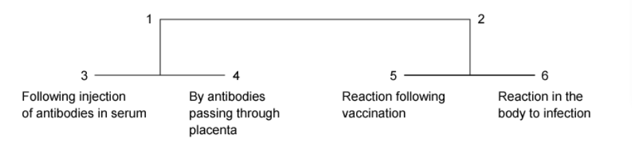

Which of the rows in the table would be correct?

|   | **1** | **2** | **3** | **4** | **5** | **6** |
|---|---|---|---|---|---|---|
| **A** | active | passive | natural | artificial | natural | artificial |
| **B** | passive | active | artificial | natural | artificial | natural |
| **C** | passive | active | natural | artificial | artificial | natural |
| **D** | active | passive | artificial | natural | artificial | natural |

### Q6 — hard — 1 marks

**Q6** [1 mark]

The statements below refer to the functions of antibodies.

Which of these statements are not correct?

| 1 | Antibodies can combine with viruses inside cells to prevent them from damaging cells. |
|---|---|
| 2 | Antibodies can attach to flagella to make the bacteria less mobile. |
| 3 | Antibodies with single binding sites can cause agglutination of bacteria. |
| 4 | Antibodies can, with other molecules, make holes in the cell walls of bacteria. |
| 5 | Antibodies can coat bacteria to mark them for phagocytosis. |
| 6 | Antibodies can neutralise toxins. |

### Q7 — hard — 1 marks

**Q7** [1 mark]

The World Health Organisation (WHO) aimed for polio to be eradicated by vaccination by the year 2000. However, there are still reports of cases of polio twenty years later.

Which of the following statements explains the new cases of polio?

| 1 | Records of vaccinated and unvaccinated people are incomplete. |
|---|---|
| 2 | There is not enough research to develop more effective vaccines. |
| 3 | Some parts of countries are difficult to reach because of poor transport or as a result of civil war. |

### Q8 — hard — 1 marks

**Q8** [1 mark]

The table below shows some cells involved in the production of monoclonal antibodies.

Which row shows the cells that can divide continuously?

|   | cancer cells | mouse B-lymphocyte plasma cells | hybridoma cells |
|---|---|---|---|
| **A** | ✔ | X | ✔ |
| **B** | ✔ | ✔ | ✔ |
| **C** | ✔ | ✔ | X |
| **D** | X | ✔ | ✔ |

### Q9 — hard — 1 marks

**Q9** [1 mark]

Read the following statements:

| 1 | There are no B-lymphocytes and T-lymphocytes in the stomach. |
|---|---|
| 2 | Macrophages present antigens in vaccines to stimulate an immune response. |
| 3 | The TB antigens necessary to produce an immune response are proteins which would be digested in the stomach and small intestine. |

Which statement(s) explains why the TB vaccination must be given via injection rather than by mouth?

### Q10 — hard — 1 marks

**Q10** [1 mark]

The statements below refer to steps in the production of monoclonal antibodies.

| 1 | hybridoma cells cultured |
|---|---|
| 2 | mouse plasma cells fused with cancer cells |
| 3 | mouse B-lymphocytes that recognise the antigen become plasma cells |
| 4 | mouse injected with antigen |
| 5 | hybridoma cells making appropriate antibody cloned |

What would be the correct order for these statements?

|   | **first** | **→** | **→** | **→** | **last** |
|---|---|---|---|---|---|
| **A** | 4 | 3 | 5 | 2 | 1 |
| **B** | 4 | 3 | 2 | 1 | 5 |
| **C** | 3 | 4 | 2 | 5 | 1 |
| **D** | 3 | 4 | 2 | 1 | 5 |

### Q11 — medium — 1 marks

**Q11** [1 mark]

The diagram below represents the structure of an antibody.

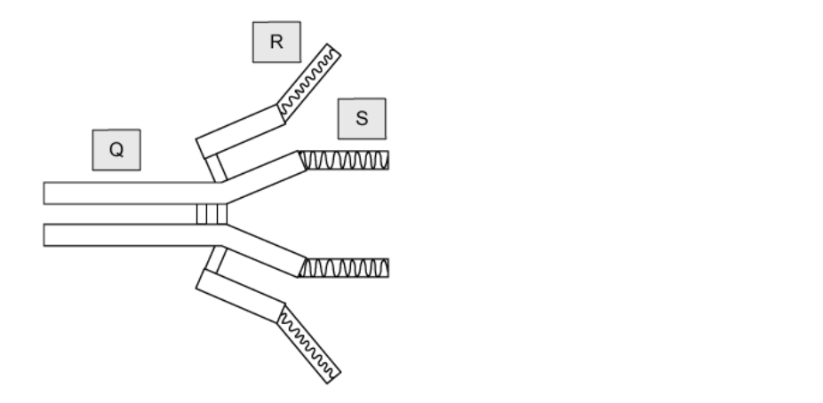

Which row of the table correctly identifies the parts **Q**, **R** and **S** of the antibody?

|   | **Q** | **R** | **S** |
|---|---|---|---|
| **A** | constant region | variable region | antigen binding site |
| **B** | antigen binding site | variable region | constant region |
| **C** | antigen binding site | constant region | variable region |
| **D** | constant region | antigen binding site | variable region |

### Q12 — medium — 1 marks

**Q12** [1 mark]

The following statements are about the defence of the body to infectious disease.

Which statement is incorrect?

### Q13 — medium — 1 marks

**Q13** [1 mark]

Which of the examples in the table below correctly demonstrates the different types of immunity?

|   | **passive natural** | **active artificial** |
|---|---|---|
| **A** | receiving antibodies to measles in colostrum | immunity to smallpox after vaccination |
| **B** | receiving antibodies to tetanus by injection | immunity to measles after infection |
| **C** | receiving antibodies to measles in colostrum | immunity to measles after infection |
| **D** | receiving antibodies to tetanus by injection | immunity to smallpox after vaccination |

### Q14 — medium — 1 marks

**Q14** [1 mark]

The following statements are facts about a pathogen Q:

| 1 | It is transmitted in food and water. |
|---|---|
| 2 | It lives in human intestines. |
| 3 | It has many genes coding for surface proteins. |
| 4 | It changes its surface antigens. |
| 5 | It may or may not trigger an immune response. |

Which statement explains why it is difficult to develop an effective vaccine for Q?

### Q15 — medium — 1 marks

**Q15** [1 mark]

The polypeptide chains of an antibody molecule can be hydrolysed by an enzyme. This happens at the hinge region and breaks the antibody into three fragments.

How many of these fragments are able to bind to antigens?

### Q16 — medium — 1 marks

**Q16** [1 mark]

Antibody molecules have antigen-binding sites.

Which of the following is a correct statement about the properties of these binding sites?

### Q17 — medium — 1 marks

**Q17** [1 mark]

The following statements were written by a student about antibodies.

| 1 | They are protein molecules with both tertiary and quaternary structures. |
|---|---|
| 2 | Four polypeptides provide four antigen-binding sites. |
| 3 | Their structure depends on peptide, hydrogen and disulfide bonds. |

Which statements are true?

### Q18 — medium — 1 marks

**Q18** [1 mark]

The amount of antibody produced in response to an antigen in a vaccine is shown in the graph below.

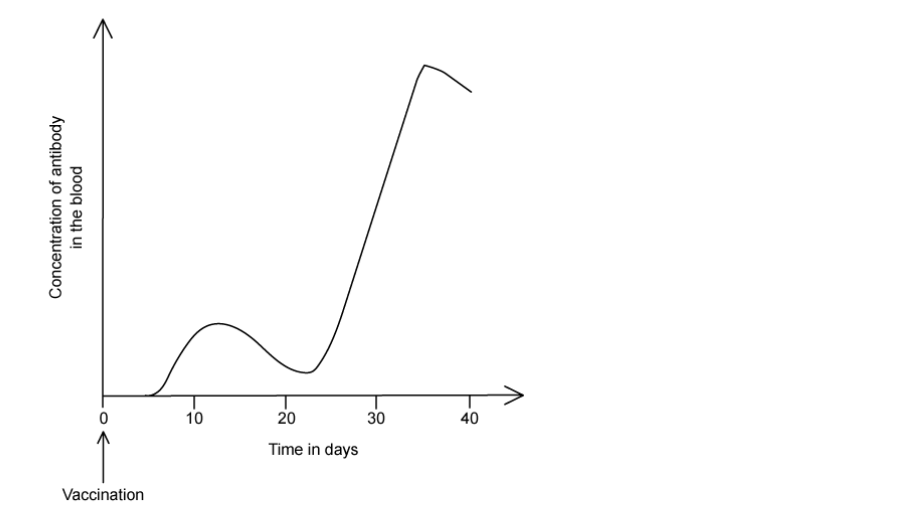

Which statement about the graph is correct?

### Q19 — medium — 1 marks

**Q19** [1 mark]

Antiserums to a toxin can be produced by injecting toxins into a horse. The blood plasma is then taken from the horse a few weeks later. The antiserum can then be injected to a person that has been bitten and infected with the same toxin.

What type of immunity would this be?

### Q20 — medium — 1 marks

**Q20** [1 mark]

The following statements describe possible methods for the production of a hybridoma.

Which statement is correct?

### Q21 — easy — 1 marks

**Q21** [1 mark]

Specific antibodies are produced in response to a vaccination.

Which type of immunity would this be?

|   | artificial | natural |
|---|---|---|
| passive | **A** | **B** |
| active | **C** | **D** |

### Q22 — easy — 1 marks

**Q22** [1 mark]

Antibodies can protect the body from pathogens in several ways.

Which will not happen following antigen-antibody binding?

### Q23 — easy — 1 marks

**Q23** [1 mark]

Natural passive immunity in newborn babies is only temporary.

What is the reason for this?

### Q24 — easy — 1 marks

**Q24** [1 mark]

When a baby ingests the mother’s milk they take in antibodies.

Which type of immunity would this be?

|   | artificial | natural |
|---|---|---|
| passive | **A** | **B** |
| active | **C** | **D** |

### Q25 — easy — 1 marks

**Q25** [1 mark]

The statements below all describe possible developments in vaccine production.

Which one of them would be the most important in the fight against measles in developing countries?

### Q26 — easy — 1 marks

**Q26** [1 mark]

Influenza is a disease that is still highly prevalent in many countries, with annual outbreaks.

Why has a vaccination program not been able to eradicate influenza?

### Q27 — easy — 1 marks

**Q27** [1 mark]

Which of the following is a description of natural passive immunity?

### Q28 — easy — 1 marks

**Q28** [1 mark]

A vaccine may contain dead bacteria.

What type of immune response would this produce?

|   | **artificial** | **passive** |
|---|---|---|
| **A** | yes | yes |
| **B** | no | no |
| **C** | yes | no |
| **D** | no | yes |

### Q29 — easy — 1 marks

**Q29** [1 mark]

A child is given a vaccine to a viral disease. A few months later she is in contact with the same virus.

What is the expected response to the second contact with the virus?

### Q30 — easy — 1 marks

**Q30** [1 mark]

During a pandemic of a very infectious disease, immediate protection would be needed for vulnerable people.

Which type of immunity would be given to these people?

|   | artificial | natural |
|---|---|---|
| passive | **A** | **B** |
| active | **C** | **D** |

## Structured Questions (11 questions)

### Q1 — hard — 15 marks

**Q1** [3 marks]

In the UK babies are routinely vaccinated against pathogens such as measles viruses and meningococcal group B bacteria. Babies are given two or three separate vaccinations against these diseases at regular intervals before their third birthdays.

Explain why more than one vaccination is offered for each disease.

**Q1** [5 marks]

**Extract:**

In the UK babies are routinely vaccinated against pathogens such as measles viruses and meningococcal group B bacteria.

Fig. 1 shows the incidence of invasive meningococcal disease in the UK from 2010 to 2020. The vaccine for meningococcal B infections was introduced to the UK in 2015.

**Fig.1**

(i) Explain how vaccination works to produce the downward trend shown in Fig. 1.

[4]

(ii) Suggest a reason for the data shown in 2018/19.

[1]

**Q1** [2 marks]

Routine vaccination of babies ensures that as many people as possible are vaccinated. Suggest how this protects the UK population against pathogens such as measles viruses and meningococcal bacteria.

**Q1** [5 marks]

An expectant mother is concerned about the health of her unborn baby after she has been infected with a common influenza virus (the flu). Her doctor tells her there is no need to be concerned.

Explain how a foetus is protected against the pathogens that infect its mother during pregnancy.

### Q2 — hard — 11 marks

**Q2** [2 marks]

Fig. 1 is a photomicrograph of a cross-section of a tubular structure in the kidney made from epithelial cells.

A ruler has been included for scale.

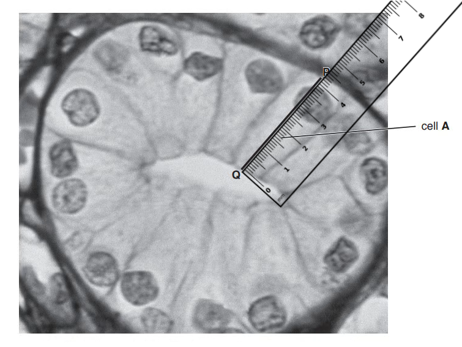

**Fig. 1**

The actual length of epithelial cell **A** along the line** P–Q **is 35 μm.

Calculate the magnification of the image shown in Fig.1. Write down the formula and use it to make your calculation. Show your working.

[2]

*Source: Oct/Nov 2018 9700/21 Q4A*

**Q2** [4 marks]

Some epithelial cells in the kidney release the protein vascular endothelial growth factor (VEGF). This protein is a cell signalling molecule that stimulates cell division in endothelial cells in blood vessels.

(i) State what occurs during interphase to prepare a cell for division.

[2]

(ii) Explain how a cell signalling molecule, such as VEGF, can lead to a response in a cell.

[2]

*Source: Oct/Nov 2018 9700/21 Q4B*

**Q2** [4 marks]

Uncontrolled cell division may result in a tumour. Tumour cells in the kidney respond to VEGF.

Kidney cancer can be treated with monoclonal antibodies. These monoclonal antibodies bind to VEGF.

Outline the hybridoma method for the production of monoclonal antibodies that will target the VEGF protein.

*Source: Oct/Nov 2018 9700/21 Q4C*

**Q2** [1 mark]

**Extract:**

Kidney cancer can be treated with monoclonal antibodies. These monoclonal antibodies bind to VEGF.

Monoclonal antibodies used as a treatment need to be given more than once. Repeated treatment can cause side effects to the person or can become less effective.

Suggest why repeated treatment with monoclonal antibodies may have these effects.

*Source: Oct/Nov 2018 9700/21 Q4D*

### Q3 — hard — 11 marks

**Q3** [3 marks]

Antibody molecules are proteins that show primary structure, secondary structure, tertiary structure and quaternary structure.

Fig.1 shows a ribbon diagram of an antibody molecule.

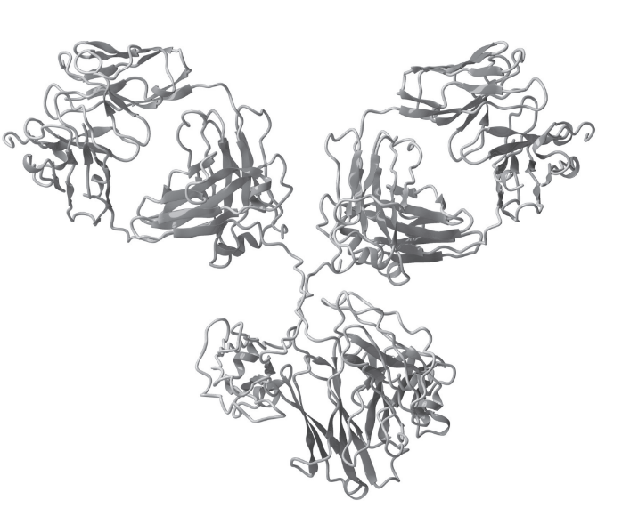

**Fig. 1**

Describe how Fig.1 shows the secondary structure **and **tertiary structure of the antibody molecule.

*Source: May/June 2019 9700/21 Q1A*

**Q3** [8 marks]

Fig. 2 is a transmission electron micrograph of a hybridoma cell.

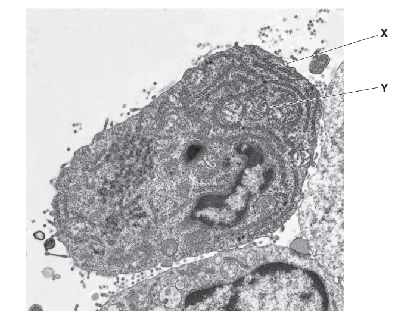

**Fig. 2**

(i) The hybridoma cell in Fig. 2 synthesises and secretes molecules of a monoclonal antibody.

State the roles of the structures labelled **X** and** Y** in the production of antibody molecules in the hybridoma cell.

[2]

(ii) The hybridoma method for the production of monoclonal antibodies involves a number of stages. One of these stages is the formation of hybridoma cells.

Outline the stage in which hybridoma cells are formed.

[3]

(iii) Outline the use of monoclonal antibodies in the treatment of disease.

[3]

*Source: May/June 2019 9700/21 Q1B*

### Q4 — medium — 10 marks

**Q4** [6 marks]

Monoclonal antibodies can be produced using a process known as the hybridoma method.

Outline how hybridomas can be used in the production of monoclonal antibodies.

**Q4** [2 marks]

Lymphocytes known as T regulatory cells, or Treg cells, can act to suppress the activity of the immune system. In cancer patients this can be a problem as it prevents the cells of the immune system from destroying tumour cells.

Suggest how monoclonal antibodies could be used to reduce the activity of Treg cells.

**Q4** [2 marks]

**Extract:**

Lymphocytes known as T regulatory cells, or Treg cells, can act to suppress the activity of the immune system. In cancer patients this can be a problem as it prevents the cells of the immune system from destroying tumour cells.

While part b) descibes a problem resulting from the activity of Treg cells, a lack of Treg cell activity can cause other problems.

Suggest why the activity of the Treg cells described in part b) is important.

### Q5 — medium — 14 marks

**Q5** [5 marks]

Fig. 1 shows the antibody concentration in the blood after the administration of a vaccine and after infection with the same pathogen some time later.

**Fig. 1**

Explain the differences in antibody concentration between that after administration of the vaccine and that after infection with the same pathogen.

**Q5** [4 marks]

Fig. 2 shows the number of measles cases in England and Wales between 1940 and 2010. The measles vaccine was introduced in 1968.

**                                                     Fig. 2**

Describe the trend shown in the data in Fig.2 for the years:

(i) 1940 to 1968.

[2]

(ii) 1968 to 2010.

[2]

**Q5** [3 marks]

Despite the introduction of the measles vaccine, measles has not been eradicated.

Suggest **three** reasons why this is the case.

**Q5** [2 marks]

Contrast the immunity gained by children who are given the measles vaccine with the immunity that babies are born with.

### Q6 — medium — 12 marks

**Q6** [3 marks]

Some breast cancers are caused by overexpression of a protein known as HER2. These types of breast cancers can be treated with a monoclonal antibody known as trastuzumab that targets HER2 proteins.

Fig.1 shows how monoclonal antibodies that target HER2 proteins can be produced.

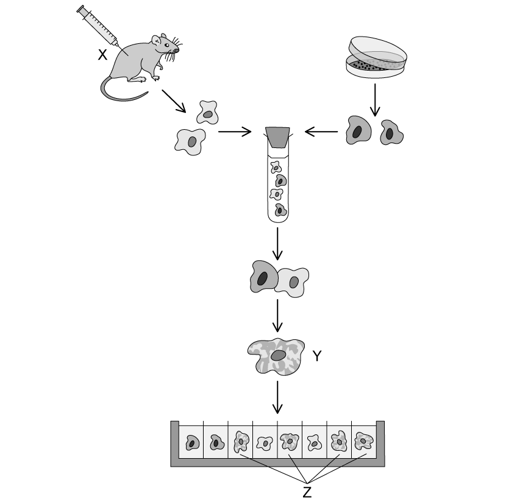

**                                                            Fig. 1**

In Fig.1:

(i) State what is injected into the mouse at **X.**

[1]

(ii) Name the cell formed at **Y**.

[1]

(iii) State the purpose of the screening process that takes place at **Z**.

[1]

**Q6** [4 marks]

**Extract:**

Some breast cancers are caused by overexpression of a protein known as HER2. These types of breast cancers can be treated with a monoclonal antibody known as trastuzumab that targets HER2 proteins.

Fig.1 shows how monoclonal antibodies that target HER2 proteins can be produced.

In Fig.1:
(i) State what is injected into the mouse at X.
(ii) Name the cell formed at Y.
(iii) State the purpose of the screening process that takes place at Z.

The monoclonal antibodies produced in Fig. 3.1 need to undergo a process known as humanisation before they can be used as a treatment for breast cancer in humans.

(i) Suggest why the antibodies need to be humanised.

[2]

(ii) Suggest how the antibodies could be humanised before being used as a breast cancer treatment in humans.

[2]

**Q6** [2 marks]

Fig. 2 shows the results of a study that compared rates of disease free survival in HER2-related breast cancer patients receiving either chemotherapy alone or chemotherapy alongside trastuzumab.

**                                                            Fig. 2**

Calculate the percentage increase in disease-free survival after 4 years in patients receiving chemotherapy alongside trastuzumab in comparison with patients receiving chemotherapy alone.

**Q6** [3 marks]

**Extract:**

Some breast cancers are caused by overexpression of a protein known as HER2. These types of breast cancers can be treated with a monoclonal antibody known as trastuzumab that targets HER2 proteins.

**Other** than survival rates, suggest why it is advantageous to use monoclonal antibodies in cancer treatment rather than traditional chemotherapy.

### Q7 — medium — 8 marks

**Q7** [3 marks]

Tetanus is a potentially life threatening infection caused by *Clostridium tetani* bacteria. Upon infection with *C. tetani*, a toxin is produced by the bacteria that results in painful muscle contractions. One method of treatment involves the injection of tetanus antitoxin, which contains antibodies derived from a person that was vaccinated against tetanus.

Fig.1 shows the concentration of antibodies in the bloodstream of two individuals, **A** and **B**. Person **A** was injected with tetanus antitoxin, while person **B** was vaccinated against tetanus.

**                                                    Fig.1**

Compare the antibody concentration of person **A** and **B**, with reference to Fig.1.

**Q7** [1 mark]

**Extract:**

Tetanus is a potentially life threatening infection caused by *Clostridium tetani* bacteria. Upon infection with *C. tetani*, a toxin is produced by the bacteria that results in painful muscle contractions. One method of treatment involves the injection of tetanus antitoxin, which contains antibodies derived from a person that was vaccinated against tetanus.

Fig.1 shows the concentration of antibodies in the bloodstream of two individuals, **A** and **B**. Person **A** was injected with tetanus antitoxin, while person **B** was vaccinated against tetanus.

Identify the type of immunity that person **A** and **B** gained, as illustrated by Fig.1.

**Q7** [2 marks]

**Extract:**

Identify the type of immunity that person A and B gained, as illustrated by Fig.1.

The type of immunity that person A and B gained would be:

- (Person) A: Passive (artificial) immunity and (person) B: Active (artificial) immunity

Person **A** and **B** each gained a different type of immunity against tetanus.

Explain the advantages of the type of immunity gained by person **B**.

**Q7** [2 marks]

**Extract:**

Tetanus is a potentially life threatening infection caused by *Clostridium tetani* bacteria. Upon infection with *C. tetani*, a toxin is produced by the bacteria that results in painful muscle contractions. One method of treatment involves the injection of tetanus antitoxin, which contains antibodies derived from a person that was vaccinated against tetanus.

Fig.1 shows the concentration of antibodies in the bloodstream of two individuals, **A** and **B**. Person **A** was injected with tetanus antitoxin, while person **B** was vaccinated against tetanus.

**                                                    Fig.1**

With reference to Fig.1, suggest why the tetanus antitoxin is an effective form of treatment against tetanus.

### Q8 — medium — 10 marks

**Q8** [3 marks]

Fig. 1 shows the 3-dimensional structure of an IgG antibody.

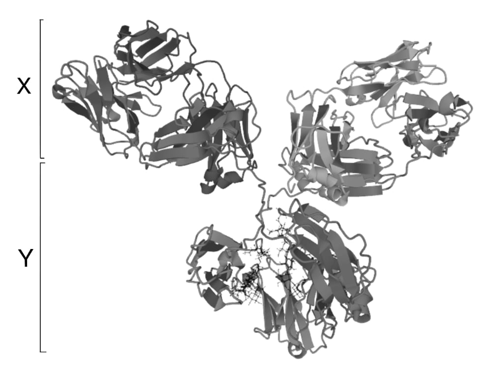

Image courtesy of Tokenzero. Licensed under creative commons Attribution-Share Alike 4.0 International license. Reused and distributed under conditions found at https://creativecommons.org/licenses/by-sa/4.0/deed.en

**Fig. 1**

(i) Identify the areas of the antibody marked **X** and **Y**.

[2]

(ii) Name the bonds that hold the separate polypeptides of the antibody structure together.

[1]

**Q8** [2 marks]

**Extract:**

Fig. 1 shows the 3-dimensional structure of an IgG antibody.

Explain how antibodies such as that shown in Fig. 1 are adapted to their function.

**Q8** [2 marks]

Fig. 2 shows one way in which antibodies interact with pathogens.

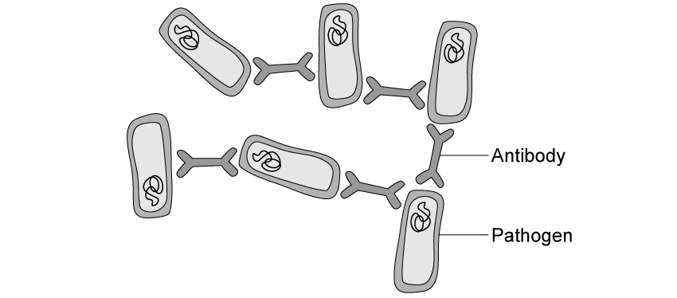

**Fig. 2**

(i) Name the process taking place in Fig. 2.

[1]

(ii) Outline **one other** way in which antibodies interact with pathogens.

[1]

**Q8** [3 marks]

It is possible to engineer antibodies in the laboratory to carry out particular functions.

Suggest how an antibody could be engineered to carry out a specific function.

### Q9 — easy — 8 marks

**Q9** [1 mark]

Fig. 1 shows the hospitalisation rates of people with COVID-19 for those who are unvaccinated and for those who have been vaccinated.

**Fig. 1**

Calculate how many times more likely an unvaccinated person is to be hospitalised than a vaccinated person in May 2021.

**Q9** [3 marks]

**Extract:**

Fig. 1 shows the hospitalisation rates of people with COVID-19 for those who are unvaccinated and for those who have been vaccinated.

Vaccination provides a type of immunity.

(i) Identify the type of immunity shown by the vaccinated individuals in Fig. 1.

[1]

(ii) Describe the type of immunity identified in part (i).

[2]

**Q9** [2 marks]

**Extract:**

Fig. 1 shows the hospitalisation rates of people with COVID-19 for those who are unvaccinated and for those who have been vaccinated.

Explain the difference in hospitalisation rates shown in Fig. 1.

**Q9** [2 marks]

Vaccination programmes, like those used against COVID-19, can lead to herd immunity.

Explain what is meant by *herd immunity.*

### Q10 — easy — 10 marks

**Q10** [3 marks]

Table 1 contains information about different types of immunity.

Use your knowledge of immunity to fill in the gaps in Table 1.

**Table 1**

| **Type of immunity** | **Production of antibodies** | **Presence of memory cells** | **Example** |
|---|---|---|---|
| Natural, passive | No |   | Across the placenta during pregnancy |
| Acquired, passive |   | No | An injection of antibodies |
| Natural, active | Yes |   |   |
| Acquired, active |   | Yes | Being vaccinated |

**Q10** [2 marks]

**Extract:**

Table 1 contains information about different types of immunity.

**Table 1**

| **Type of immunity** | **Production of antibodies** | **Presence of memory cells** | **Example** |
| Natural, passive | No |   | Across the placenta during pregnancy |
| Acquired, passive |   | No | An injection of antibodies |
| Natural, active | Yes |   |   |
| Acquired, active |   | Yes | Being vaccinated |

Use information in Table 1 to suggest why babies need to be vaccinated from the age of 8 weeks.

**Q10** [2 marks]

When an individual is vaccinated they remain susceptible to a disease for a few weeks afterwards.

Suggest why this is the case.

**Q10** [3 marks]

Tetanus is a bacterial infection gained from contact between the blood and the soil-dwelling bacterium *Clostridium tetani*.

An individual who had not been vaccinated against tetanus received a cut from a garden fork and it was suggested that they should go to the hospital for an injection of tetanus antibodies.

Describe how this injection would protect them against tetanus.

### Q11 — easy — 10 marks

**Q11** [2 marks]

Fig. 1 shows part of the specific immune response.

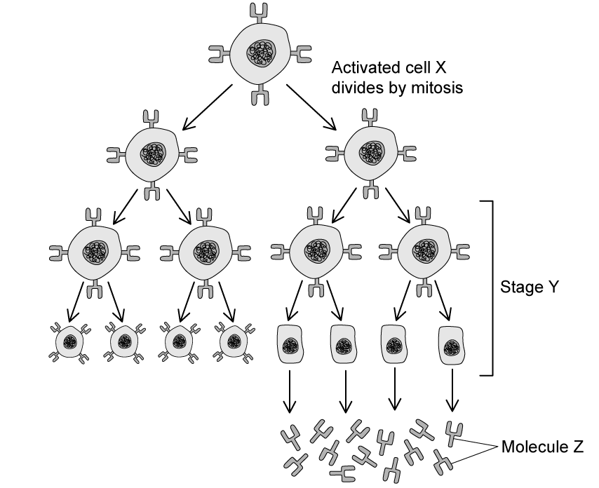

**Fig. 1**

(i) Identify the cell type represented by cell **X**

[1]

(ii) Identify the molecules labelled **Z**

[1]

**Q11** [2 marks]

**Extract:**

Fig. 1 shows part of the specific immune response.

Fig. 1

Describe the events that occur during stage **Y** of the immune response shown in Fig. 1.

**Q11** [3 marks]

**Extract:**

Fig. 1 shows part of the specific immune response.

(ii) Identify the molecules labelled Z

Molecules labelled Z are...
- Antibodies;

Molecule **Z** in Fig. 1 is composed of three distinct regions.

Give the names of these **three **regions.

**Q11** [3 marks]

Proteins known as mAbs are artificially produced molecules which have multiple applications in science and medicine.

The process of producing mAbs can be seen in Fig. 2.

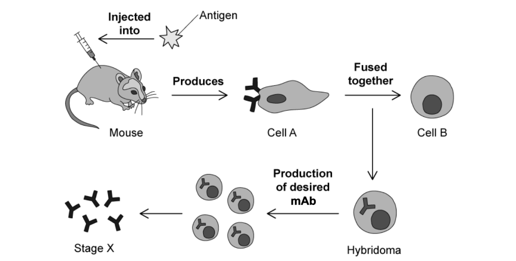

**Fig. 2**

(i) Which cell, from cell** A** and cell **B,** represents the tumour cell used to give the hybridoma cell the ability to divide repeatedly.

[1]

(ii) Give two uses of the mAbs isolated in stage **X**.

[2]
