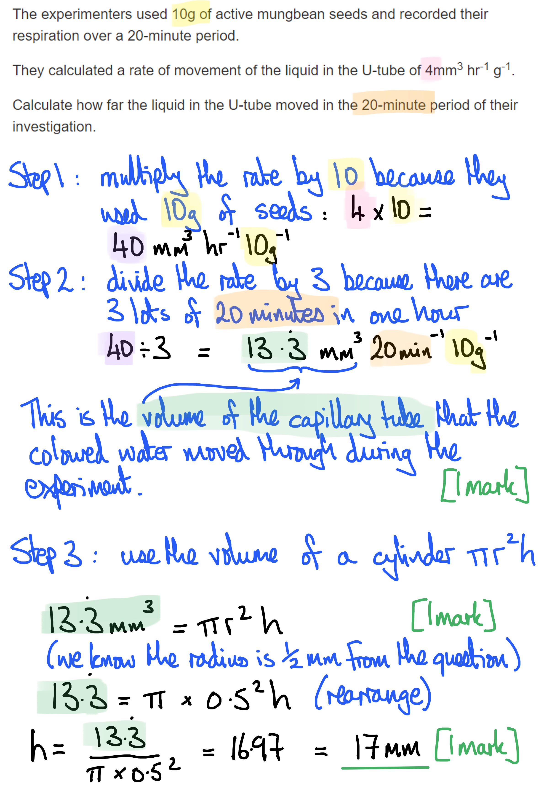
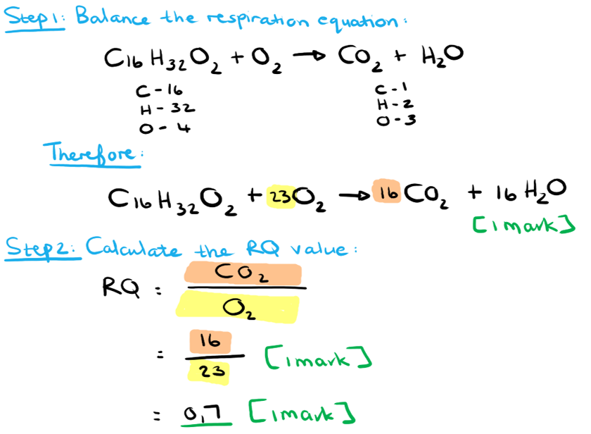
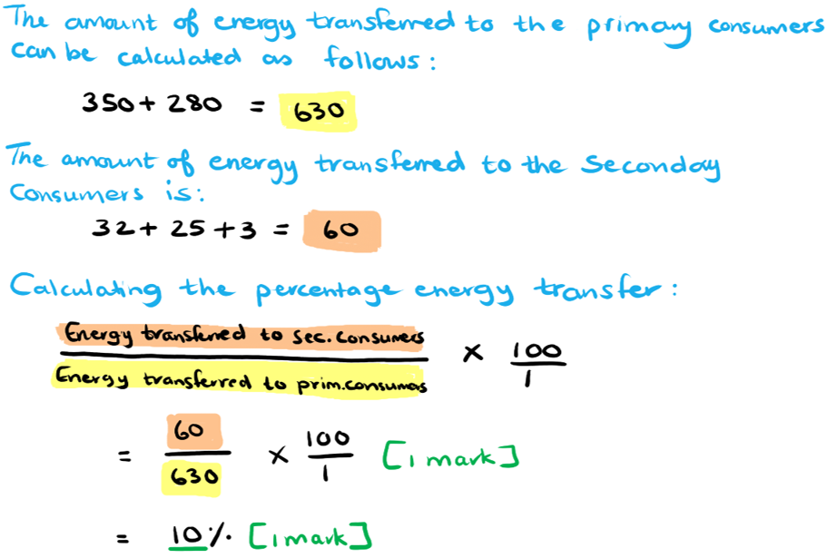
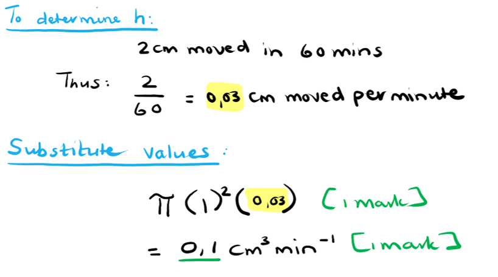
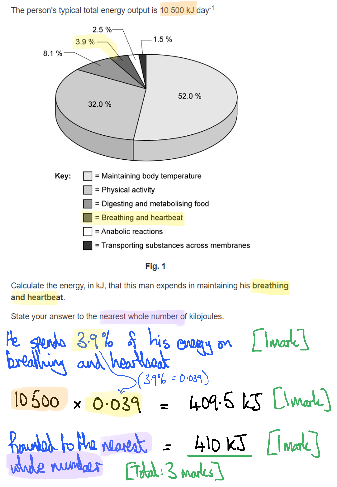
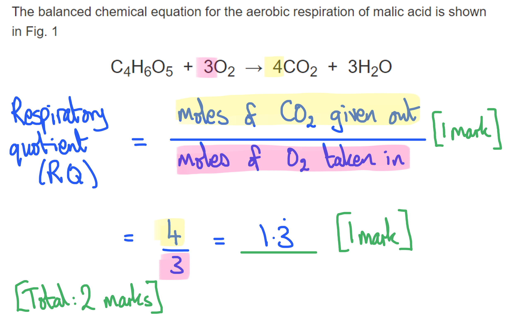

# Mark Schemes — Energy
**12. Energy & Respiration** · Cambridge (CIE) A-LEVEL biology (9700)

## Structured Questions (13 questions)

### Q1
(i) The volumes of potassium hydroxide (KOH) are different in tubes 1 and 2 because:

- The mung bean seeds take up space in tube 2; **[1 mark]**
- KOH in tube 1 is diluted / has water added **SO** keeps the air volume the same in both tubes; **[1 mark]**

(ii) An experimental modification to allow the volumes of potassium hydroxide (KOH) to be kept the same in tubes 1 and 2 is:

- Inert material of the same overall volume as the mung beans (in tube 1); **[1 mark]**

*Accept named inert material such as glass beads, gravel, for marking point 2 *

**[Total: 3 marks]**
The distance, to the nearest mm, that the liquid in the U-tube moved in the 20 minute period of their investigation is calculated as follows:

- Convert the rate to volume of water that moved (13.33 mm3); **[1 mark]**
- Use the equation πr2h to calculate h; **[1 mark]**
- h = 17mm; **[1 mark] **

*16.97 / 16.9 mm;*** [2 marks max.]**

*Allow full marks for the correct answer with no working shown*

**[Total: 3 marks]**

> *You are expected to recall and use the volume of a cylinder equation, where r is the radius and h is the distance or height of the cylinder; applied to this question h is the distance travelled. *

The respiratory quotient (RQ) of the mungbean seeds is calculated as follows:

- Rate of oxygen consumption = 4 (from part b) **AND** rate of CO2 production = 0.72; **[1 mark]**
- $\text{RQ} = \frac{net CO_{2} produced}{ \mathrm{O}_{2} consumed} = \frac{4 + ( - 0.72 )}{4} = \frac{3.28}{4} = 0.82$; **[1 mark]**

**[Total: 2 marks]**

> *The scientists run a respirometer with KOH, CO**2** gets absorbed by the KOH and the coloured liquid moves up tube 2. Then they run the respirometer without KOH, and the level of coloured liquid moves up tube 2 again, though only slightly. This means that less CO**2** is produced than O**2** is consumed. An RQ of <1 is found when less CO**2** is liberated than the volume of O**2 **consumed. This is why the coloured liquid moves up slightly on the side of tube 2 (and down on the side of tube 1). This tells us that we should subtract the rate of 0.72 mm**3** hr**-1** g**-1 **from the rate of 4 mm**3** hr**-1** g**-1 **in order to come up with an RQ value of <1.*
The value of RQ from part (c) suggests that the respiratory substrate is:

- Proteins; **[1 mark]**
- The RQ value for proteins is approximately 0.8 / between 0.8-0.9; **[1 mark]**

**OR**

- Lipids **AND** proteins; **[1 mark]**
- 0.82 is between the RQ values for lipids and proteins; **[1 mark]**

**OR**

- Lipids **AND** carbohydrates; **[1 mark]**
- 0.82 is between the RQ values for lipids and carbohydrates; **[1 mark]**

**[Total: 2 marks]**

> *Don't forget to explain your answer here, as requested by the command words in the question.*

> *It is worth noting that while the RQ value for proteins is sometimes given in textbooks as 0.9, there are some sources that put the value closer to 0.8, so there is a range of acceptable values for protein RQ.*

> *Be aware that a combination of substrates can yield RQ values that fall in between the values for the different substrates:*

| > *Respiration of both lipids (0.7) and proteins (0.8-9) =* | > *RQ value of 0.82* |
|---|---|
| > *Respiration of both lipids (0.7) and carbohydrates (1.0) =* |   |

### Q2
The difference in the energy released by different respiratory substrates can be explained as follows:

**Final answer:** **Any ****five**** of the following:**

- Lipids releases the most energy per gram **OR** carbohydrates release the least energy per gram; **[1 mark]**
- Fatty acids/lipids have a high hydrogen content / contain many C-H bonds; **[1 mark]**
- Hydrogen atoms are transported by NAD / FAD / coenzymes to mitochondrial (inner) membrane; **[1 mark]**
- Many protons and electrons are supplied; **[1 mark]**
- More electrons are moved down electron transport chain **SO** releasing more energy to pump protons into intermembrane space; **[1 mark]**
- A steeper proton/chemiosmotic gradient is created **SO **more ATP is produced by chemiosmosis; **[1 mark]**

**[Total: 5 marks]**

> *The amount of energy released by the respiratory substrates are linked to the hydrogen content of the molecules. The higher the hydrogen content, the greater the proton gradient created across the inner mitochondrial membrane and the more ATP can be synthesised as a result. Lipids have the highest hydrogen content from the respiratory substrates in Table 4.1, due to the long hydrocarbon chains that make up the fatty acids. When they are broken down during respiration, they release the hydrogen atoms which ultimately generates the greatest amount of ATP.*
Calculating the RQ value of palmitic acid:

- 23O2 **AND** 16CO2 **AND** 16H2O; **[1 mark]**
- 16 ÷ 23; **[1 mark]**
- 0.7; **[1 mark]**

**[Total: 3 marks]**

The difference in RQ values for palmitic acid and glucose can be discussed as follows:

**Final answer:** **Any ****two**** of the following:**

- Palmitic acid has a higher hydrogen content than glucose **OR** glucose has a lower hydrogen content than palmitic acid; **[1 mark]**
- The breakdown of palmitic acid produces more ATP (than glucose) **OR** breakdown of glucose produces less ATP; **[1 mark]**
- More oxygen is required to break down palmitic acid **OR** less oxygen is required to break down glucose; **[1 mark]**

**[Total: 2 marks]**

> *From part (c) it was calculated that palmitic acid has a lower RQ value than glucose. The reason for this is that it requires more oxygen to break palmitic acid down due to its high hydrogen content. The higher the amount of oxygen used, the lower the RQ value for that substrate will be.*

### Q3
Carbohydrates, lipids and proteins have different relative energy values as substrates in respiration in aerobic conditions because...

**Final answer:** **Any ****six ****of the following:**

- Different substrates have different numbers of hydrogens / C-H bonds; **[1 mark]**
- Lipids have (relatively) more hydrogens / C-H bonds (than carbohydrates or proteins); **[1 mark]**
- Hydrogens / C-H bonds are located in fatty acid (tails of lipids); **[1 mark]**
- Breakdown/oxidation of substrate provides hydrogen (atoms); **[1 mark]**
- For reduction of NAD/FAD; **[1 mark]**
- Reduced NAD/FAD provide/release hydrogen to electron transport chain; **[1 mark]**
- Hydrogen dissociates into protons and electrons; **[1 mark]**
- Energy used to set up proton gradient / pump hydrogen ions across membrane; **[1 mark]**
- Chemiosmosis / oxidative phosphorylation; **[1 mark]**
- (So) more ATP/energy from lipids per unit mass (than carbohydrates/proteins) **OR** lipids more energy dense / have higher (relative) energy value; **[1 mark]**

**[Total: 6 marks] **
The definition of respiratory quotient is:

- Carbon dioxide given out divided by oxygen taken in / the ratio of carbon dioxide given out to oxygen taken in; **[1 mark]**
- Volume / moles*; ***[1 mark]**
- Per unit time; **[1 mark]**

***Reject**** 'amount' for volume / moles*

An investigation to determine the RQ of germinating barley seeds could be carried out as follows:

**Final answer:** **A ****maximum of**** ****eight ****of the following:**

- Use a respirometer; **[1 mark]**
- Seeds are placed on a mesh/gauze; **[1 mark]**
- KOH / NaOH / soda lime to absorb carbon dioxide; **[1 mark]**
- Manometer / capillary tube / syringe; **[1 mark]**
- Movement of fluid (in manometer/capillary tube/syringe) = uptake of oxygen; **[1 mark]**
- Keep temperature/air pressure constant; **[1 mark]**
- Measure oxygen uptake after certain time; **[1 mark]**
- Repeat without KOH / NaOH / soda lime; **[1 mark]**
- Difference in manometer readings will be due to carbon dioxide given out; **[1 mark]**

**[Total: 9 marks]**

> *Take the time to review the revision note and make sure you've memorised the typical set up for a respirometer. A good way to revise this would be to practice drawing and labelling a diagram of the equipment.  *

### Q4
Processes **A** and **B** represent:

- A = substrate-linked phosphorylation **AND **B = chemiosmosis;** ****[1 mark]**

*Accept 'substrate level phosphorylation' for substrate-linked phosphorylation*

**[Total: 1 mark]**
Differences between substrate-linked phosphorylation and chemiosmosis include:

**Final answer:** **Any ****three**** of the following:**

- Substrate-linked phosphorylation transfers a phosphate from a substrate molecule directly to ADP (to form ATP) **WHILE** chemiosmosis uses an electron transport chain to establish a proton concentration gradient for ATP synthase to phosphorylate ADP; **[1 mark]**
- Energy is provided by another chemical reaction during substrate-linked phosphorylation **WHILE **chemiosmosis uses energy released by the movement of hydrogen ions/protons moving down a concentration gradient; **[1 mark]**
- Substrate-linked phosphorylation occurs in the cytoplasm of cells / matrix of mitochondria **WHILE** chemiosmosis occurs across the inner mitochondrial membrane / thylakoid membrane of chloroplasts; **[1 mark]**
- A small amount of ATP / 4-6 per glucose molecule is produced during substrate-linked phosphorylation **WHILE** a large amount of ATP / 32-34 per glucose molecule is produced during chemiosmosis; **[1 mark]**

*Accept 'process A' for substrate-linked phosphorylation and 'process B' for oxidative phosphorylation throughout*

*Accept 'substrate level phosphorylation' for substrate-linked phosphorylation*

**[Total: 3 marks]**

> *It is important to take note of the different ways in which ATP can be generated. Remember that for questions asking you to contrast processes, you need to discuss the most important differences between them. Think of how and where they occur and also what is produced during each process to guide you during the formulation of an answer.*
The reason chemiosmosis cannot occur in the absence of oxygen is because...

**Final answer:** **Any ****three**** of the following:**

- Chemiosmosis/(process) **B** requires a proton gradient produced by the electron transport chain; **[1 mark]**
- The electron transport chain cannot occur **OR** no electron flow can occur without oxygen; **[1 mark]**
- NAD cannot reform **OR** no oxidation of NADH can occur (without oxygen); **[1 mark]**
- Oxygen is the final electron/proton/hydrogen ion acceptor (in the electron transport chain); **[1 mark]**

**[Total: 3 marks]**

> *Without oxygen the electron transport chain cannot occur, as oxygen acts as the final electron acceptor. Without oxygen, these electrons have nowhere to go. In the absence of oxygen the coenzymes NADH and FADH**2** cannot be oxidised to reform NAD and FAD, therefore leaving them unable to transport hydrogen ions.*
The reasons why such a large mass of ATP is produced would be...

- ATP cannot be stored (in the body) **OR** it is an immediate energy source; **[1 mark]**
- Only a small amount of energy is released by ATP at any time (therefore requiring large amounts of ATP to meet energy demands); **[1 mark]**

**[Total: 2 marks]**

### Q5
(i) The relationship between metabolic rate and body temperature can be explained as follows:

- Metabolic reactions release heat energy; **[1 mark]**
- A decrease in metabolic rate causes a decrease in body temperature; **[1 mark]**

(ii) The time period during which the mammal enters a state known as 'steady torpor' is: **[1 mark]**

- 5.5 hours - 12.5 hours;

***Accept ****answers in the range of 5.4-5.6 and 12.4-12.6*

**[Total: 3 marks]**
The changes in respiratory quotient (RQ) shown in Fig. 1 can be described as follows:

**Final answer:** **Any ****three**** of the following:**

- RQ decreases from 0.9 to 0.75 between hours 0-5; **[1 mark]**
- RQ decreases steeply from 0.75 to 0.62 **AND** increases again to 0.75 between hours 5-6; **[1 mark]**
- RQ is 0.74 between hours 7-12; **[1 mark]**
- RQ increases steeply from 0.74 to 0.96 **AND** decreases again to 0.74 between hours 12-13; **[1 mark]**

***Accept ****descriptions in relation to the start and end of steady torpor instead of in relation to hours.*

**[Total: 3 marks]**

> *When you are presented with a "describe the graph" question, it is always a good idea to tackle it with a "say what you see" approach. The use of data is always recommended so do be sure you are reading the axises correctly, particularly in this example where there are multiple **Y**-axes.*
Possible conclusions about respiratory substrates and torpor include:

**Final answer:** **Any ****three**** of the following:**

- Before entering torpor respiratory substrates are carbohydrates and lipids **OR** before entering torpor respiratory substrates are proteins; **[1 mark]**
- Lipids are respired immediately before entering torpor; **[1 mark]**
- During torpor respiratory substrates are lipids and proteins **OR **during torpor respiratory substrates are** **lipids; **[1 mark]**
- Carbohydrates are respired immediately before the end of torpor **[1 mark]**

**[Total: 3 marks]**

> *Remember that different respiratory substrates have different respiratory quotients, so the RQ values at each point on Fig. 1 give us an idea of which substrates may be being respired at different points in and around the period of torpor:*

- *Before torpor** the RQ is around 0.9; this could be achieved by respiring a combination of carbohydrates (RQ = 1) and lipids (RQ = 0.7) **or **by respiring proteins (RQ = 0.9).*

  - *Note that proteins tend to be a last resort respiratory substrate, as proteins make up the structural tissues of the body, so the respiration of proteins tends to coincide with starvation.*
- *Immediately before torpor** the RQ dips down to nearly 0.6; while this is below the standard value for lipids, there are some lipids that have an RQ value close to 0.6, and this would be your most likely answer even if you were previously unaware of this!*
- *During torpor** the RQ is around 0.74; this is close to the RQ value for lipids, so could mean that lipids are being respired, **or** it could indicate that both lipids and proteins are being respired.*

  - *While protein respiration is still unlikely during such a short period of torpor, this is more likely here than it was earlier on*
- *Immediately after torpor** the RQ briefly increases to almost 1, a strong indication that carbohydrate respiration occurs very briefly at this point.*
Benefits to mammals of brief periods of torpor and arousal, rather than extended periods of unbroken hibernation, could include:

**Final answer:** **Any ****two**** of the following:**

- Waking up and feeding **SO** are less likely to need to respire proteins / digest muscle tissue; **[1 mark]**
- Waking up and restoring body temperature to normal **SO** (named) enzyme-controlled reactions can continue / do not stop entirely; **[1 mark]**
- Waking up and moving / assessing surroundings **SO** less likely to be eaten by predators / able to maintain nest/remain hidden; **[1 mark]**

**[Total: 2 marks]**

> *You are not expected to **know** anything about hibernation or daily torpor, but you should be able to use your knowledge of energy needs, enzyme action, and food chains to answer this question.*

### Q6
Calculating the percentage energy transfer between primary and secondary consumers:

- (60 ÷ 630) x 100; **[1 mark]**
- 10(%); **[1 mark]**

*Full marks awarded for the correct answer only.*

**[Total: 2 marks]**

The energy conversion between the sun and the primary consumers is....

- Light energy to chemical (potential) energy; **[1 mark]**

**[Total: 1 mark]**
The need for energy in living organisms can be outlined as follows....

**Final answer:** **Any ****five**** of the following:**

- Organisms require energy for metabolic processes / metabolism; **[1 mark]**
- ATP is required for glycolysis / the activation/phosphorylation of glucose (during glycolysis); **[1 mark]**
- Light energy is required for photosynthesis to occur; **[1 mark]**
- Energy is required during the light dependent stage / to split water by photolysis / to synthesise ATP and NADPH; **[1 mark]**
- ATP is used to convert carbon dioxide to carbohydrates during the Calvin cycle / light independent stage; **[1 mark]**
- Anabolic reactions require energy (to form more complex molecules from simpler ones) / named anabolic reaction, e.g. protein synthesis, starch or glycogen formation, synthesis of lipids; **[1 mark]**
- Active transport requires energy to move molecules against their concentration gradient / from area of lower concentration to an area of higher concentration; **[1 mark]**
- Muscle contraction requires ATP; **[1 mark]**
- Organisms require energy for regulating (body) temperature; **[1 mark]**

**[Total: 5 marks]**

> *This question has quite a wide range of answers, so there is plenty for you to choose from when trying to come up with examples of why energy is important to living organisms.*
The role of photosynthesis and respiration in the transfer of energy between autotrophs and heterotrophs is as follows:

**Final answer:** **Any ****three**** of the following:**

- Cacti/grasses can synthesise carbon compounds/named carbon compounds, e.g. starch/proteins/lipids / fix carbon during photosynthesis; **[1 mark]**
- Kangaroo rat/grasshopper/Saharan silver ant gain carbon compounds/named carbon compounds when they consume cacti/grasses; **[1 mark]**
- Carbon compounds/named carbon compounds are incorporated into tissues (of autotrophs / heterotrophs); **[1 mark]**
- Carbon compounds/named carbon compounds are broken down (in autotrophs / heterotrophs) during respiration to release energy; **[1 mark]**
- Carbon dioxide is released (during respiration) into the atmosphere **SO** can be used in photosynthesis (again); **[1 mark]**

**[Total: 3 marks]**

> *The chemical potential energy that is stored in the carbon compounds produced during photosynthesis serves as an energy source for heterotrophs. This energy is released during respiration when these compounds are broken down and the energy can be used by the organism for a variety of functions or can serve as an energy source for secondary and tertiary consumers. Carbon dioxide is released as a waste product of respiration and serves as one of the raw materials for photosynthesis.*

### Q7
Part **X** of the ATP molecule in Fig. 1 is:

- Adenosine; **[1 mark]**

**[Total: 1 mark]**
ATP can be described as a 'universal energy currency' for cells because:

**Final answer:** **Any ****two**** of the following:**

- It is used in all living organisms (making it universal); **[1 mark]**
- ATP is a short-term energy store / an energy intermediate; **[1 mark]**
- It is used in many reactions/processes **AND** can be reused/regenerated (just like a currency); **[1 mark]**

**[Total: 2 marks]**
The main benefits of ATP as an energy currency in living organisms include:

**Final answer:** **Any ****three**** of the following:**

- ATP hydrolysis can occur quickly and easily (when energy is needed); **[1 mark]**
- ATP hydrolysis requires just one type of enzyme/ATPase; **[1 mark]**
- A sufficient amount of / enough energy is released (from ATP hydrolysis) to drive metabolic reactions **WHILE** not wasting energy; **[1 mark]**
- (ATP is) relatively stable at the pH level of the cell; **[1 mark]**
- It is soluble for easy transport around the cell; **[1 mark]**
- The breakdown of ATP is reversible **SO** it can be recycled/reused; **[1 mark]**

**[Total: 3 marks]**

> *The characteristics of ATP mentioned above are the main reasons why the molecule is so useful as an energy currency in living organisms. It is easily broken down, yet stable in the conditions found within cells, which reduces energy wastage. It solubility enables it to be transported to parts of the cell that requires energy. ATP can be reformed by adding an inorganic phosphate group to ADP, meaning the same ATP molecule can be reused in different chemical reactions.*
(i) The type of reaction catalysed by ATPases:

- Hydrolysis **OR** dephosphorylation; **[1 mark]**

(ii) The products of the hydrolysis of ATP is:

- ADP/adenosine diphosphate **AND** inorganic phosphate/P*i* /H3PO4; **[1 mark]**

**[Total: 2 marks]**

### Q8
(i) The control in this experiment is:

- The tube containing the glass beads; **[1 mark]**

(ii) The purpose of the potassium hydroxide solution is...

- To absorb carbon dioxide produced by respiring woodlice; **[1 mark]**

**[Total: 2 marks]**
The movement of the liquid in the manometer can be explained as follows:

- The woodlice consumed/used oxygen for (aerobic) respiration; **[1 mark]**
- The carbon dioxide produced by the woodlice / during respiration was absorbed by the potassium hydroxide solution; **[1 mark]**
- (This caused a) decrease in pressure on the woodlice side of the capillary u-tube / manometer; **[1 mark]**

**[Total: 3 marks]**

> *The pressure difference in the manometer will cause the coloured liquid to move upward in the capillary tube on the side of the woodlice, as this side will have a lower pressure than the side of the glass beads.*
The volume of oxygen consumed can be calculated as follows:

- π(1)2(0.03); **[1 mark]**
- 0.1 (cm3min-1); **[1 mark]**

*Full marks awarded for the correct answer only.*

**[Total: 2 marks]**

> *Make sure that you use the radius (1 cm) in your calculations here rather than the diameter (2 cm). In order to get the radius, you simply divide the diameter by 2.*

The deductions that can be made from an RQ value of 0.8 is:

- Both lipids and proteins were used as respiratory substrates by the woodlice **OR** a mixture of substrates were respired/used by the woodlice; [**1 mark]**
- This is because the RQ for lipids is 0.7 and the the RQ for protein is 0.9 (which will give an average value of 0.8); **[1 mark]**

**[Total: 2 marks]**

> *RQ values can give a variety of information to an investigator. It can indicate the respiratory substrate that an organism used, or it may also indicate whether an organism is overfed or underfed.*

### Q9
(i) The molecule represented by X is...

- Adenosine diphosphate; **[1 mark]**

***Reject**** ADP.*

> *Molecule X has **two** phosphates, indicating that it is a **di**phosphate rather than a triphosphate.*

> *The main pitfall here is likely to be either misnaming the molecule (remember that adenine combined with ribose is known as '**adenosine**') or failing to write out the full name of the molecule as stated in the question.*

(ii) The types of reaction taking place at A and B are...

- A = condensation (reaction); **[1 mark]**
- B = hydrolysis (reaction); **[1 mark]**

> *Remember that a reaction during which water is released is a condensation reaction, while a reaction that splits larger molecules and requires water is a hydrolysis reaction.*

(iii) Processes that make use of the 'energy for cells' indicated in Fig. 1 include:

- Active transport / named example of active transport, e.g. cotransport / exocytosis; **[1 mark]**
- Anabolic reactions / named example of an anabolic reaction, e.g. protein synthesis / DNA replication; **[1 mark]**
- Movement of substances within cells / named example of movement within cells, e.g. contraction of muscle fibres / shortening of spindle fibres; **[1 mark]**

***Accept**** other correct examples, e.g. cell signalling / glycolysis / thermoregulation*

**[Total: 6 marks]**
ATP is well suited for its role as energy currency because:

- It is a stable molecule; **[1 mark]**
- It does not react unless ATPase/the correct enzyme is present **SO** energy is not wasted; **[1 mark]**

**OR**

- It releases energy in small amounts; **[1 mark]**
- The break down/hydrolysis of ATP only releases the energy required for a reaction to proceed **OR** there is no waste energy released in the form of heat; **[1 mark]**

**OR**

- It can be hydrolysed/broken down quickly/easily; **[1 mark]**
- Energy can be released immediately when it is needed / cells can respond quickly to changing energy demands; **[1 mark]**

**OR**

- It is soluble (in cell cytoplasm); **[1 mark]**
- It can be transported around cells / to where it is needed within a cell; **[1 mark]**

**OR**

- Breaking down ATP releases phosphate; **[1 mark]**
- Phosphate can be used to activate other molecules / named molecules, e.g. glucose (during glycolysis); **[1 mark]**

**[Total: 2 marks]**

> *There are lots of possible answers here, but the key point to note is that this is an **explain** question, so whichever point you choose to focus on, you need to explain **why **this is beneficial to cells.*
The processes by which ATP is synthesised are:

- Substrate-linked reactions/phosphorylation / direct transfer of a phosphate from a substrate to ADP; **[1 mark]**
- Chemiosmosis; **[1 mark]**

***Accept**** 'substrate-level' for substrate linked.*

**[Total: 2 marks]**
A difference between respiratory substrates that influences energy value is:

- The number of hydrogen atoms / C-H bonds present; **[1 mark]**

**[Total: 1 mark]**

### Q10
The energy that this man expends in maintaining his breathing and heartbeat is calculated as follows...

- Correct data from question: 10 500 (kJ) **AND** 3.9 (%); **[1 mark]**
- (10 500 × 3.9) ÷ 100 **OR **10 500 × 0.039 **OR **409.5 (kJ); **[1 mark]**
- 410 (kJ); **[1 mark]**

**[Total: 3 marks]**

(i) A type of membrane transport that requires energy is...

**Final answer:** **Any ****one**** of the following:**

- Active transport; **[1 mark]**
- Endocytosis / phagocytosis / pinocytosis; **[1 mark]**
- Exocytosis;
- Cotransport; **[1 mark]**

(b) (ii) Specific examples of processes that utilise energy for the transport of substances across membranes include...

**Final answer:** **Any ****two**** of the following:**

- Sodium potassium pump in nerve cell membranes; **[1 mark]**
- Reuptake of neurotransmitters at a synapse; **[1 mark]**
- Exocytosis of digested bacteria from phagocytes/neutrophils/macrophages; **[1 mark]**
- Secretion/exocytosis of a named type of enzyme from a named cell type, e.g. of amylase from the cells of the salivary glands; **[1 mark]**
- Secretion/exocytosis of a named hormone from a named cell types, e.g. insulin from beta cells; **[1 mark]**
- Secretion/exocytosis of antibodies from plasma cells; **[1 mark]**
- Active uptake of calcium ions from muscle cells; **[1 mark]**
- Pumping protons across the inner mitochondrial membrane/cristae; **[1 mark]**
- Cotransport of sugar/glucose from the small intestine into the blood; **[1 mark]**
- Cotransport of sodium / glucose / amino acids from the kidney nephron into the blood; **[1 mark]**

*Ignore non-human / plant-based examples*

*Accept other correct examples*

**[Total: 2 marks]**

> *This is a synoptic question, meaning that it draws together your knowledge from several parts of the syllabus. The ability to draw together different ideas is an important exam skill in biology, so keep working at practice questions to build your confidence in this.*
The energy characteristics of anabolic and catabolic reactions in cells, tissues and organs can be contrasted as follows...

- Anabolic reactions require energy / energy is transferred to molecules during anabolic reactions **WHILE **catabolic reactions release energy; **[1 mark]**

**[Total: 2 marks]**

> *Remember that the laws of physics dictate that energy **can never be created or destroyed**. It is therefore always best to say that energy is either 'released' or 'transferred'.*
The parts of the ATP molecule labelled X, Y and Z in Fig. 2 are...

- X = phosphate; **[1 mark]**
- Y = adenine; **[1 mark]**
- Z = ribose sugar; **[1 mark]**

*Allow Y and Z *<u>*labelled together*</u>* as adenosine; ***[2 marks]**

**[Total: 3 marks]**

### Q11
The respiratory quotient (RQ) of malic acid is calculated as follows...

- $\mathrm{RQ}=\frac{\mathrm{molecule}s\mathrm{of} \mathrm{CO}_{2}\mathrm{produced}}{\mathrm{molecule}s\mathrm{of}O_{2}\mathrm{taken} \mathrm{in}}$; **[1 mark]**
- ($\mathrm{RQ}=\frac{4}{3}$ =) 1.3(33); **[1 mark]**

**[Total: 2 marks]**

(i) The name of the piece of equipment used to measure RQ is...

- Respirometer; **[1 mark]**

(ii) The major food group that substance X belongs to is...

- Lipids / fats; **[1 mark]**

**[Total: 2 marks]**

> *Whilst you do not have to memorise individual values of RQ, learning the rough ranges of RQs for the main 3 food groups (carbohydrates, lipids and proteins) is a good idea.*
The purpose of soda-lime (sodium hydroxide solution) in a respirometer is...

- To absorb carbon dioxide CO2; **[1 mark]**
- To create a pressure drop that can be measured (in a manometer) / to ensure that the carbon dioxide produced during respiration does not contribute to the pressure inside the equipment / to allow oxygen consumption alone to be measured; **[1 mark]**

**[Total: 2 marks]**

> *Pay close attention to the number of marks in a question. To simply answer 'to absorb CO**2**' would only be enough to earn 1 mark. The fact that the question is worth 2 marks means that the examiners are looking for you to add another statement to expand upon your initial answer.*
The teacher's choice of the germinating seeds was the better option because...

**Final answer:** **Any ****two**** of the following:**

- Seeds are more readily available **OR** they may not be able to find woodlice; **[1 mark]**
- Seeds can be stored indefinitely before the experiment; **[1 mark]**
- There are no ethical issues with using seeds **OR** subjecting animals to the experiment can be considered inhumane/cruel/unethical; **[1 mark]**

**[Total: 2 marks]**

### Q12
The order of ADP, AMP and ATP according to the number of phosphate groups is…

- AMP, ADP, ATP **OR** AMP < ADP < ATP **OR** 1= AMP; 2=ADP; 3=ATP; **[1 mark]**

**[Total: 1 mark]**

> *AMP is adenosine **mono**phosphate*

> *ADP is adenosine **di**phosphate*

> *ATP is adenosine **tri**phosphate*
One advantage of releasing energy for cellular processes in small packets from many ATP molecules, rather than all at once from one molecule of glucose is…

**Final answer:** **Any ****one ****of the following:**

- Reduced / limits wasted energy; **[1 mark]**
- Prevents cell temperature from increasing (due to wasted energy that would be released from larger molecules); **[1 mark]**
- Energy can be used for many separate processes (simultaneously); **[1 mark]**
- ATP can be hydrolysed quickly/easily; **[1 mark]**
- ATP can be easily transported around the cell to where it is needed (due to its small size and solubility); **[1 mark]**

**[Total: 1 mark] **
The enzyme which catalyses the synthesis of ATP is...

- ATP synthase; **[1 mark]**

**[Total: 1 mark]**
ATP can be recycled in the cell as follows...

- Re-formation/condensation of ATP from ADP and Pi; **[1 mark]**
- In (cellular) respiration; **[1 mark]**

**[Total: 2 marks]**

> *The usefulness of ATP comes from the fact that it can be regenerated/recycled within the same cell that it is hydrolysed in. Hydrolysis is quick and efficient and releases ADP and P**i** back into the cell for re-phosphorylation during the various stages of respiration. *
