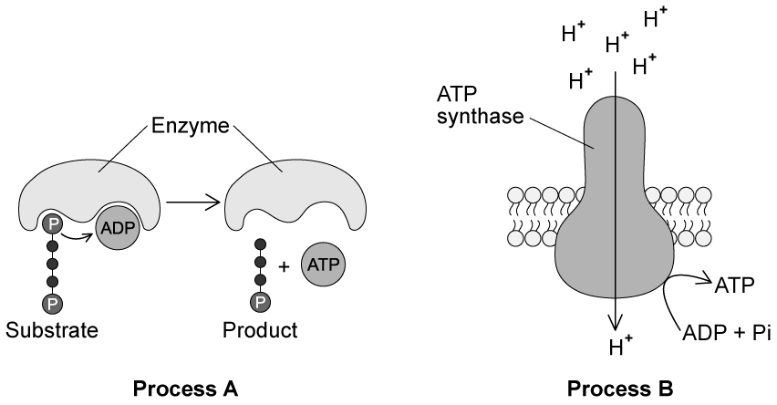
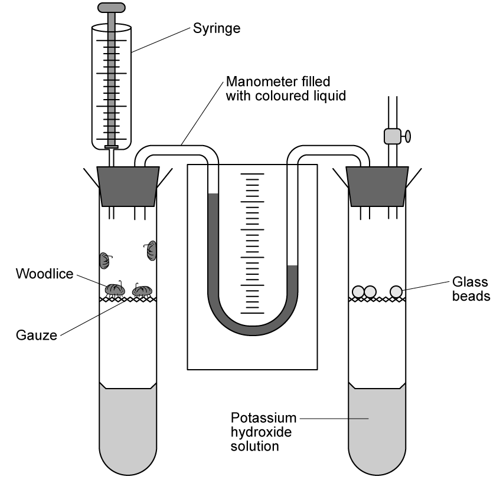
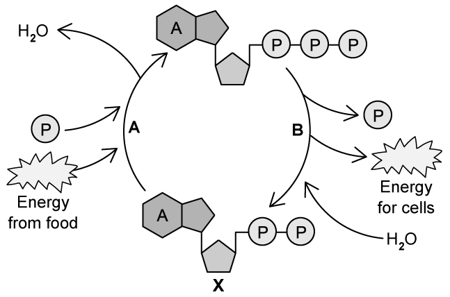
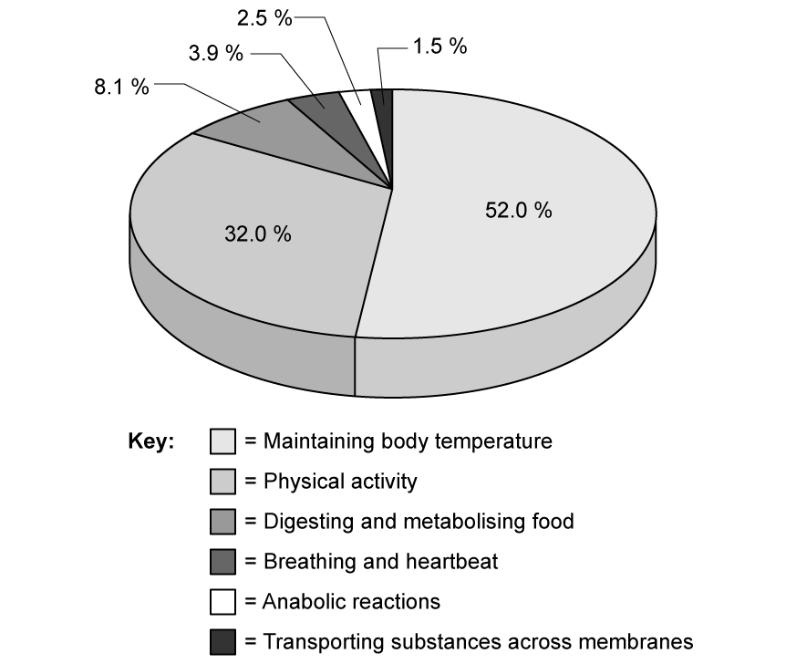

# Exam Questions — Energy
**12. Energy & Respiration** · Cambridge (CIE) A-LEVEL biology (9700)
> Source: [https://www.savemyexams.com/a-level/biology/cie/25/topic-questions/](https://www.savemyexams.com/a-level/biology/cie/25/topic-questions/) · 12 questions across 1 sets

## Structured Questions (13 questions)

### Q1 — hard — 10 marks

**Q1** [3 marks]

Fig. 1 shows a respirometer set up to measure the rate of respiration in germinating mung bean seeds.

It consists of two linked tubes, 1 and 2, held in a temperature-controlled water bath.

**Fig. 1**

The capillary tubes in the U-tube containing coloured liquid have an internal diameter of 1 mm.

(i) Explain why the volumes of potassium hydroxide (KOH) are different in tubes 1 and 2.

[2]

(ii) Suggest an experimental modification to allow the volumes of potassium hydroxide (KOH) to be the same in tubes 1 and 2.

[1]

**Q1** [3 marks]

**Extract:**

Fig. 1 shows a respirometer set up to measure the rate of respiration in germinating mung bean seeds.

It consists of two linked tubes, 1 and 2, held in a temperature-controlled water bath.

The capillary tubes in the U-tube containing coloured liquid have an internal diameter of 1 mm.

Experimenters used the equipment in Fig. 1 to measure the rate of respiration in 10 g of active mung bean seeds over a 20 minute period.

They calculated a rate of movement of the liquid in the U-tube of 4mm3 hr-1 g-1.

Calculate how far, to the nearest mm, the liquid in the U-tube moved in the 20 minute period of their investigation.

**Q1** [2 marks]

**Extract:**

Fig. 1 shows a respirometer set up to measure the rate of respiration in germinating mung bean seeds.

It consists of two linked tubes, 1 and 2, held in a temperature-controlled water bath.

The capillary tubes in the U-tube containing coloured liquid have an internal diameter of 1 mm.

Experimenters used the equipment in Fig. 1 to measure the rate of respiration in 10 g of active mung bean seeds over a 20 minute period.

They calculated a rate of movement of the liquid in the U-tube of 4mm³ hr⁻¹ g⁻¹.

Following the investigation in part (b) the scientists reset the respirometer and ran the experiment again, this time with distilled water in place of KOH in both tubes 1 and 2.

They recorded a slight upward movement of the liquid in the U-tube manometer on the side of tube 2, this time at a rate of 0.72 mm3 hr-1 g-1.

Calculate the respiratory quotient (RQ) of the respiring mung bean seeds in this investigation.

**Q1** [2 marks]

**Extract:**

Experimenters used the equipment in Fig. 1 to measure the rate of respiration in 10 g of active mung bean seeds over a 20 minute period.

They calculated a rate of movement of the liquid in the U-tube of 4mm³ hr⁻¹ g⁻¹.

Following the investigation in part (b) the scientists reset the respirometer and ran the experiment again, this time with distilled water in place of KOH in both tubes 1 and 2.

They recorded a slight upward movement of the liquid in the U-tube manometer on the side of tube 2, this time at a rate of 0.72 mm³ hr⁻¹ g⁻¹.

Calculate the respiratory quotient (RQ) of the respiring mung bean seeds in this investigation.

Suggest, with a reason, what the value of RQ calculated in part (c) indicates about the respiratory substrate of the mung beans at the time of this investigation.

### Q2 — hard — 10 marks

**Q2** [5 marks]

Table 1 shows the amount of energy released per gram of different respiratory substrates.

**Table 1**

| **Respiratory substrate** | **Energy value / kJ g****-1** |
|---|---|
| Carbohydrate | 15.8 |
| Lipid | 39.4 |
| Protein | 17.0 |

With reference to Table 1, explain the difference in the energy released by the different respiratory substrates.

**Q2** [3 marks]

Palmitic acid is a saturated fatty acid found in palm oil, cheese and milk. It can be broken down during aerobic respiration, as represented by the following **partially-completed** equation:

C16H32O2   +   O2 →    CO2   +   H2O

Calculate the respiratory quotient (RQ) of palmitic acid.

Show your working.

**Q2** [2 marks]

**Extract:**

Palmitic acid is a saturated fatty acid found in palm oil, cheese and milk. It can be broken down during aerobic respiration, as represented by the following partially-completed equation:

C₁₆H₃₂O₂   +   O₂ →    CO₂   +   H₂O

Calculate the respiratory quotient (RQ) of palmitic acid.

Show your working.

Mark scheme: 23O₂ AND 16CO₂ AND 16H₂O; 16 ÷ 23; 0.7

Table 1 shows the amount of energy released per gram of different respiratory substrates.

Table 1
Respiratory substrate | Energy value / kJ g⁻¹
Carbohydrate | 15.8
Lipid | 39.4
Protein | 17.0

Mark scheme: Fatty acids/lipids have a high hydrogen content / contain many C-H bonds

The RQ value for glucose is 1.0

Discuss the difference in the RQ values of glucose and palmitic acid.

### Q3 — hard — 15 marks

**Q3** [6 marks]

Explain why carbohydrates, lipids and proteins have different relative energy values as substrates in respiration in aerobic conditions.

*Source: Oct/Nov 2018  9700/42 Q9A*

**Q3** [9 marks]

Define the term respiratory quotient (RQ) **and** describe how you would carry out an investigation to determine the RQ of germinating barley seeds.

*Source: Oct/Nov 2018  9700/42 Q9B*

### Q4 — hard — 9 marks

**Q4** [1 mark]

Fig. 1 shows two processes (**A** and **B**) by which ATP can be synthesised.

**Fig. 1**

Identify processes **A** and **B**.

**Q4** [3 marks]

**Extract:**

Fig. 1 shows two processes (A and B) by which ATP can be synthesised.

A = substrate-linked phosphorylation AND B = chemiosmosis

Contrast process **A** and **B** in Fig. 1 with regards to ATP synthesis.

**Q4** [3 marks]

**Extract:**

Fig. 1 shows two processes (**A** and **B**) by which ATP can be synthesised.

**Fig. 1**

Processes **A** and **B** represent:
- A = substrate-linked phosphorylation AND B = chemiosmosis

Only process **A** in Fig. 1 can occur in anaerobic conditions.

Explain why process **B** in Fig. 1 cannot occur without the presence of oxygen.

**Q4** [2 marks]

The average human synthesises more than 50 kg of ATP each day.

Suggest the reasons for synthesising such a large mass of ATP.

### Q5 — medium — 11 marks

**Q5** [3 marks]

Some hibernating mammals undergo multiple periods of torpor (reduced activity), interspersed with periods of wakefulness, throughout their hibernation.

Research was carried out into the physiological changes occurring in a species of mammal during a period of torpor.

Some of the results are shown in Fig. 1 below.

**Fig. 1**

(i) Explain the relationship between metabolic rate and body temperature shown in Fig. 1

[2]

(ii) Suggest the time period during which the mammal enters a state known as 'steady torpor'.

[1]

**Q5** [3 marks]

**Extract:**

Some hibernating mammals undergo multiple periods of torpor (reduced activity), interspersed with periods of wakefulness, throughout their hibernation.

Research was carried out into the physiological changes occurring in a species of mammal during a period of torpor.

Some of the results are shown in Fig. 1 below.

Fig. 1
Graph showing changes in respiratory quotient, body temperature and metabolic rate during a period of torpor

Describe the changes in respiratory quotient shown in Fig. 1.

**Q5** [3 marks]

**Extract:**

Some hibernating mammals undergo multiple periods of torpor (reduced activity), interspersed with periods of wakefulness, throughout their hibernation.

Research was carried out into the physiological changes occurring in a species of mammal during a period of torpor.

Some of the results are shown in Fig. 1 below.

Fig. 1

The time period during which the mammal enters a state known as 'steady torpor' is 5.5 hours - 12.5 hours.

The changes in respiratory quotient (RQ) shown in Fig. 1:
- RQ decreases from 0.9 to 0.75 between hours 0-5
- RQ decreases steeply from 0.75 to 0.62 AND increases again to 0.75 between hours 5-6
- RQ is 0.74 between hours 7-12
- RQ increases steeply from 0.74 to 0.96 AND decreases again to 0.74 between hours 12-13

Suggest what can be concluded from Fig. 1 about respiratory substrates and torpor.

**Q5** [2 marks]

**Extract:**

Some hibernating mammals undergo multiple periods of torpor (reduced activity), interspersed with periods of wakefulness, throughout their hibernation.

Research was carried out into the physiological changes occurring in a species of mammal during a period of torpor.

Some of the results are shown in Fig. 1 below.

Fig. 1

(i) Explain the relationship between metabolic rate and body temperature shown in Fig. 1

(ii) Suggest the time period during which the mammal enters a state known as 'steady torpor'.

Suggest the benefit to mammals of brief periods of torpor and arousal, rather than extended periods of unbroken hibernation.

### Q6 — medium — 11 marks

**Q6** [2 marks]

Producers such as cacti and grasses form the foundation of most desert food webs. Cacti and grasses are consumed by the primary consumers, which in turn are eaten by the secondary consumers.

Fig. 1 shows the flow of energy through a desert ecosystem. The figures in the circles represent the energy transfer in kJ m-2 yr-1.

**Fig. 1**

Calculate the percentage of energy transferred from the primary consumers to the secondary consumers in Fig. 1

Give your answer as a whole number.

**Q6** [1 mark]

**Extract:**

Producers such as cacti and grasses form the foundation of most desert food webs. Cacti and grasses are consumed by the primary consumers, which in turn are eaten by the secondary consumers.

Fig. 1 shows the flow of energy through a desert ecosystem. The figures in the circles represent the energy transfer in kJ m^-2^ yr^-1^.

Describe the energy conversion occurring between the sun and the primary consumers in Fig. 1

**Q6** [5 marks]

All living organisms require energy in order to perform the functions necessary for life.

Outline the need for energy in living organisms; your answer should include suitable examples.

**Q6** [3 marks]

**Extract:**

Producers such as cacti and grasses form the foundation of most desert food webs. Cacti and grasses are consumed by the primary consumers, which in turn are eaten by the secondary consumers.

Fig. 1 shows the flow of energy through a desert ecosystem. The figures in the circles represent the energy transfer in kJ m^-2^ yr^-1^.

Photosynthesis and respiration are important processes occurring in living organisms.

Explain how the processes of photosynthesis and respiration assist in the transfer of energy between autotrophs and heterotrophs, with reference to Fig. 1.

### Q7 — medium — 8 marks

**Q7** [1 mark]

Fig.1 shows the structure of a molecule of adenosine triphosphate (ATP).

**Fig. 1**

Identify part **X** of the ATP molecule in Fig.1.

**Q7** [2 marks]

ATP is described as a 'universal energy currency' for cells.

Explain why ATP can be considered to be a 'universal energy currency'.

**Q7** [3 marks]

Discuss the main benefits of ATP as an energy currency in living organisms.

**Q7** [2 marks]

ATP is broken down by a group of enzymes known as ATPases.

(i) State the type of reaction that is catalysed by ATPases.

[1]

(ii) Identify the products of the reaction mentioned in part (i).

[1]

### Q8 — medium — 9 marks

**Q8** [2 marks]

A student set up a respirometer, as illustrated in Fig. 1, to measure the rate of oxygen consumption during respiration in woodlice.

**Fig. 1**

From Fig. 1:

(i) Identify the control in this experiment.

[1]

(ii) State the purpose of the potassium hydroxide solution.

[1]

**Q8** [3 marks]

**Extract:**

A student set up a respirometer, as illustrated in Fig. 1, to measure the rate of oxygen consumption during respiration in woodlice.

From Fig. 1:

(i) Identify the control in this experiment.

(ii) State the purpose of the potassium hydroxide solution.

The level of the coloured liquid was equal on both sides of the capillary u-tube of the manometer at the beginning of the experiment.

Explain the movement of the liquid in the capillary tube, as illustrated in Fig. 1.

**Q8** [2 marks]

**Extract:**

A student set up a respirometer, as illustrated in Fig. 1, to measure the rate of oxygen consumption during respiration in woodlice.

**Fig. 1**

The student found that the coloured liquid in the capillary tube in Fig. 1 moved 20 mm over the course of an hour. The diameter of the capillary tube was 2 cm.

The volume of the capillary tube can be calculated by using the formula: πr2h, where h represents the distance moved by the manometer fluid in a minute.

Calculate the volume of oxygen consumed in cm3min-1. Show your working.

**Q8** [2 marks]

**Extract:**

A student set up a respirometer, as illustrated in Fig. 1, to measure the rate of oxygen consumption during respiration in woodlice.

Fig. 1

From Fig. 1:

(i) Identify the control in this experiment.

(ii) State the purpose of the potassium hydroxide solution.

The student repeated the experiment from Fig.1, but removed the potassium hydroxide solution. The volume of gas was calculated again and these values were used to calculate the RQ value of the respiratory substrate of the woodlice.

The RQ value was 0.8.

Suggest what the student can deduce from this RQ value.

### Q9 — easy — 11 marks

**Q9** [6 marks]

Fig. 1 represents the process by which ATP is used and regenerated within cells.

**Fig. 1**

(i) Give the full name of molecule **X **in Fig. 1.

[1]

(ii) Identify the types of reactions taking place at **A** and **B** in Fig. 1.

[2]

(iii) Identify **three** processes that make use of the 'energy for cells' indicated in Fig. 1.

[3]

**Q9** [2 marks]

ATP is a useful energy currency for cells because it can be regenerated, as shown in Fig. 1.

Explain **one** other feature of ATP that makes it especially well suited for its role as energy currency.

**Q9** [2 marks]

There are two types of processes by which ATP can be synthesised within cells.

Identify the **two** processes by which ATP is synthesised.

**Q9** [1 mark]

Different respiratory substrates have different energy values, meaning that they yield different numbers of ATP molecules.

State **one** difference between respiratory substrates that influences energy value.

### Q10 — easy — 10 marks

**Q10** [3 marks]

Fig. 1 shows the percentage daily usage of the energy ingested by a typical adult male.

This man has a moderately active lifestyle and shows typical eating/drinking behaviour.

The person's typical total energy output is 10 500 kJ day-1

**Fig. 1**

Calculate the energy, in kJ, that this man expends in maintaining his **breathing and heartbeat**.

State your answer to the nearest whole number of kilojoules.

**Q10** [3 marks]

Fig. 1 shows that energy is required for **transporting substances across membranes**.

(i) Give **one** example of a **type** of membrane transport that requires energy.

[1]

(ii) One **specific example** of a membrane transport process that requires energy is the absorption of amino acids in the digestive system.

Give **two other specific examples** of membrane transport processes in humans that require energy

[2]

**Q10** [1 mark]

Chemical reactions in living organisms can be anabolic or catabolic. Catabolic reactions involve the break down of large molecules into smaller molecules.

Contrast the **energy characteristics** of anabolic and catabolic reactions in cells, tissues and organs.

**Q10** [3 marks]

Fig. 2 shows a molecule of ATP.

**Fig. 2**

Identify the parts of the ATP molecule labelled **X**, **Y **and **Z** in Fig. 2.

### Q11 — easy — 8 marks

**Q11** [2 marks]

Malic acid (C4H6O5) is a substance found naturally in all living organisms and which contributes to the flavours of certain foods such as fruit.

Its respiration by yeast is an important reaction in the process of winemaking.

The balanced chemical equation for the aerobic respiration of malic acid is shown in Fig. 1.

C4H6O5  +  3O2  →  4CO2  +  3H2O

**Fig. 1**

Calculate the respiratory quotient (RQ) for malic acid.

**Q11** [2 marks]

The respiratory quotient (RQ) of a food substance known as **substance X** was measured experimentally as 0.72.

(i) Give the name of the piece of equipment used to measure RQ.

[1]

(ii) Suggest the major food group to which **substance X** belongs.

[1]

**Q11** [2 marks]

**Extract:**

The respiratory quotient (RQ) of a food substance known as substance X was measured experimentally as 0.72.

(i) Give the name of the piece of equipment used to measure RQ.

The name of the piece of equipment used to measure RQ is...

- Respirometer; [1 mark]

The equipment named in part (b) (i) can contain a substance known as soda-lime (sodium hydroxide solution).

State the purpose of soda-lime in this equipment.

**Q11** [2 marks]

Using the equipment from part (b) (i) to demonstrate the measurement of RQ to a class, a teacher was given a choice between an experiment using germinating seeds or small invertebrates such as woodlice.

Both are known to give measurable results. The teacher chose to use the germinating seeds.

Comment on why the teacher's choice of the germinating seeds was the better option.

### Q12 — easy — 5 marks

**Q12** [1 mark]

List the molecules ADP, AMP and ATP according to the number of phosphate groups that they possess.

Start with the smallest number of phosphate groups and work upwards.

**Q12** [1 mark]

Aerobic respiration of one molecule of glucose generates roughly 38 molecules of ATP.

Give** one** advantage of gaining energy for cellular processes in small packets from many ATP molecules, rather than all at once from one molecule of glucose.

**Q12** [1 mark]

Name the enzyme which catalyses the synthesis of ATP.

**Q12** [2 marks]

Describe the process by which ATP can be recycled in the cell.
