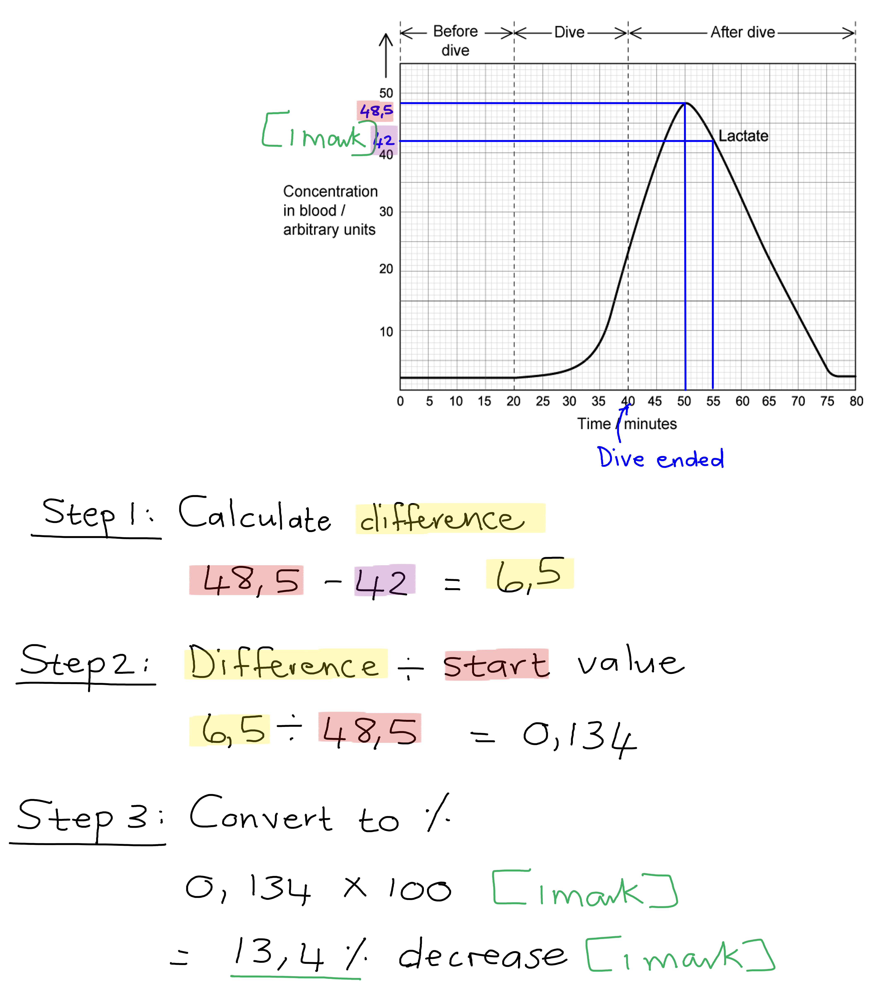
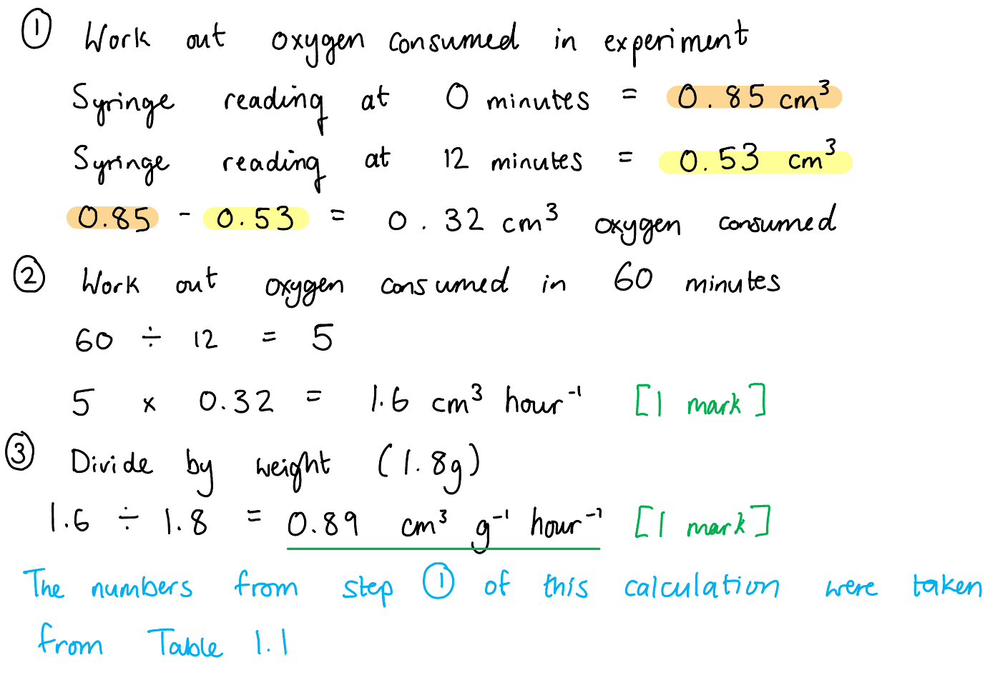
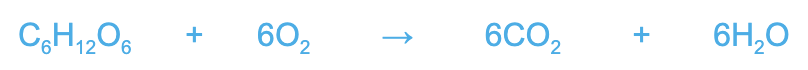

# Mark Schemes — Respiration
**12. Energy & Respiration** · Cambridge (CIE) A-LEVEL biology (9700)

## Structured Questions (15 questions)

### Q1
The container had to be airtight because...

- No oxygen can enter; **[1 mark]**
- No ethanol (vapour) / carbon dioxide can escape; **[1 mark]**
- To prevent the entry of / contamination with microorganisms; **[1 mark]**

**[Total: 3 marks]**

> *The researcher wants ethanol to be produced which means that** anaerobic respiration** must occur. In order for it to take place, no oxygen should be present.*
Description of the relationship...

- The concentration of oxygen decreases at roughly the same rate at which the concentration of carbon dioxide increases; **[1 mark]**

Explanation of the relationship...

- The yeast are respiring aerobically; **[1 mark]**
- So the oxygen used is equal to the carbon dioxide produced; **[1 mark]**

**[Total: 3 marks]**

> *From looking at Fig. 1 you can see that oxygen concentration has decreased from roughly 9.6 to roughly 7.2 while the carbon dioxide concentration has increased from 0 to roughly 2.4. So both have experienced a change of approximately 2.4.*
Anaerobic respiration begins at...

- 2.5 hours; **[1 mark]**
- As this is when ethanol production starts; **[1 mark]**

**[Total: 2 marks]**
The reaction should be stopped after...

- 7 hours; **[1 mark]**

Because at this time...

- The curve is levelling off **OR** rate of increase is decreasing **OR** very little extra ethanol produced after this point; **[1 mark]**
- So it becomes less cost-effective **OR** there will be less profit **OR** resource use outweighs product gained; **[1 mark]**

**[Total: 3 marks]**

> *After 7 hours there are diminishing returns with regards to the production of ethanol; there is very little increase in ethanol after this time so it would not be efficient to continue the reaction.*

### Q2
A comparison of aerobic and anaerobic respiration includes:

*Similarities*

**Final answer:** **A ****maximum of three**** of the following:**

- ATP is released; **[1 mark]**
- The process of glycolysis occurs; **[1 mark]**
- Glucose is a reactant; **[1 mark]**
- They are catabolic reactions **OR** exothermic reactions; **[1 mark]**

*Differences*

**Final answer:** **A ****maximum of three**** of the following:**

- Aerobic respiration requires oxygen **WHILE** anaerobic respiration takes place in the absence of oxygen; **[1 mark]**
- In animals, aerobic respiration produces carbon dioxide and water **WHILE** anaerobic respiration produces lactate/lactic acid; **[1 mark]**
- In plants and yeast, aerobic respiration produces carbon dioxide and water **WHILE** anaerobic respiration produces ethanol and carbon dioxide; **[1 mark]**
- Aerobic respiration produces a lot/more/36 ATP **WHILE** anaerobic respiration produces little/less/2 ATP; **[1 mark]**
- Aerobic respiration takes place in the cytoplasm and mitochondria **WHILE** anaerobic respiration takes place in the cytoplasm only; **[1 mark]**

**[Total: 5 marks]**

> *Compare and contrast questions require a **balance of similarities and differences** in your answer.*

> *Remember that differences need to include a clear description of how two processes **differ** from each other, so each difference must refer to **both processes**.*
Waterlogged conditions may negatively impact crops as...

**Final answer:** **Any ****three**** of the following:**

- Oxygen and carbon dioxide are less readily available in water **OR** oxygen and carbon dioxide diffuse more slowly in liquid compared to air; **[1 mark]**
- Plant roots don’t get the oxygen they need for aerobic respiration **SO** less ATP is produced; **[1 mark]**
- Plants switch to anaerobic respiration **AND** ethanol accumulates in plant cells / ethanol levels become toxic; **[1 mark]**
- Plant leaves don’t get the carbon dioxide they need for photosynthesis **SO** carbon compound production is reduced; **[1 mark]**

**[Total: 3 marks]**

> *Remember that **anaerobic respiration in plant cells involves ethanol fermentation**, so plant cells that switch to anaerobic respiration for extended periods will suffer with ethanol toxicity.*
Another adaptation present in Fig.1 is:

- Aerenchyma tissue; **[1 mark]**

This specialised plant tissue aids aerobic respiration in flooded fields because...

- It contains useful air spaces that allow gases to <u>diffuse to other parts</u> of the plant; **[1 mark]**
- Supplied parts of the plant that are below water / submerged with oxygen/carbon dioxide; **[1 mark]**

**[Total: 3 marks]**
(i) Rice plants are adapted to maximise anaerobic respiration as follows:

- Roots / submerged parts of plant switch to ethanol fermentation; **[1 mark]**
- Rice plants can tolerate higher levels of ethanol compared to other plants **OR** rice plants produce more ethanol dehydrogenase / of the enzyme that <u>breaks down</u> ethanol; **[1 mark]**

(ii) The benefits of growing rice plants in paddies include:

**Final answer:** **Any ****two**** of the following:**

- The other plants or weeds are unable to survive in these conditions **SO** rice has less competition for light / water / minerals; **[1 mark]**
- Rice plants can tolerate flooding / will not be killed by naturally occurring floods; **[1 mark]**
- Growing rice in these conditions increases the <u>yield </u>for farmers; **[1 mark]**

**[Total: 4 marks]**

### Q3
The concentration of lactate in manatee blood increases during feeding because...

- Oxygen is unavailable / runs out **SO** cells respire anaerobically; **[1 mark]**
- Manatees / animals carry out lactate fermentation; **[1 mark]**

*Accept lactic acid in place of lactate*

**[Total: 2 marks]**

> *Remember that the question stem mentions that manatees are mammals, which means they have lungs as a gas exchange surface, not gills. This means that manatees must hold their breath for the entire time that they are underwater to avoid drowning. With very little to no oxygen reaching the cells, they must switch to anaerobic respiration until the manatee goes up for air.*
The mark allocation for calculating the percentage change would be...

- Reading correct values (48.5 and 42) from the graph; **[1 mark]**
- (6.5 ÷ 48.5 x 100; **[1 mark]**
- 13.4 % decrease; **[1 mark]**

*Accept values within a range of 48 - 49 and 42 - 43 for marking point 1*

*Full marks awarded for the correct answer in the absence of calculations*

**[Total: 3 marks]**

> *It is good practice to always show your calculations with mathematical questions. Even if your answer is incorrect, you could still gain a mark for the correct calculation.*

The change in lactate concentration can be explained as follows...

- (As blood oxygen levels increase after the dive) lactate is oxidised/converted into pyruvate; **[1 mark]**
- (Some of the) lactate may be converted into glycogen and stored in the liver; **[1 mark]**

**[Total: 2 marks]**

> *Most of the lactate produced during anaerobic respiration will be oxidised into pyruvate, as the chemical bonds will contain much stored energy that can be released when the molecule enters the Krebs cycle. This will result in a drastic decrease in the lactate concentration in the blood.*
Cold water stress syndrome may be lethal to manatees because...

- (At low temperatures) the rate of aerobic respiration would be (very) low **AS** it is an enzyme-controlled reaction / depends on the activity of ATP synthase; **[1 mark]**
- Molecules would have little kinetic energy; **[1 mark]**
- (This results in) few successful collisions (between enzyme and substrate molecules) / few enzyme-substrate-complexes forming; **[1 mark]**
- (This means that) less/no energy is released **OR** less/no ATP is produced for cellular activities/functions; **[1 mark]**

**[Total: 4 marks]**

> *The command word 'suggest' requires you to apply your knowledge about respiration and enzyme catalysed reactions to an unfamiliar scenario like this one. If respiration occurs at such low rates that the cells are not receiving enough energy or ATP to perform basic functions, this will lead to cells dying. *

### Q4
It is beneficial for ground squirrels to enter torpor during winter months because:

**Final answer:** **Any ****two**** of the following:**

- Ground squirrels have a large SA:V ratio **SO** they lose heat quickly to the surrounding environment; **[1 mark]**
- Maintaining body temperature / carrying out thermoregulation during the winter requires a lot of energy; **[1 mark]**
- Torpor reduces the need for squirrels to increase food / carbohydrate / respiratory substrate intake **OR** during winter there may be shortages of food / carbohydrate / respiratory substrate; **[1 mark]**

**[Total: 2 marks]**

> *Your knowledge of SA:V ratio means that you will be aware that **smaller animals have a larger surface area in relation to their volume**. Ground squirrels measure around 25 cm in length, so they are small mammals, and their large SA:V ratio will mean that they will **lose body heat to their environment very quickly**, especially in cold conditions. The squirrels would need a lot of energy to replace this lost body heat and maintain a normal body temperature, so entering torpor, a state during which metabolic rate and body temperature drops, will **save a lot of energy** and **reduce food requirements**.*
(b) The conclusion that 'increased levels of H2S caused torpor in ground squirrels' can be discussed as follows:

*Points that support the conclusion:*

- H2S levels are significantly higher during torpor than during summer or wakeful periods (there is no overlap of error bars); **[1 mark]**
- There is no significant difference between H2S levels during periods of wakefulness and summer time (there is overlap of error bars); **[1 mark]**

*Points that oppose the conclusion:*

**Final answer:** **A ****maximum of**** ****two**** of the following:**

- The graph shows a correlation / association but does not indicate causation / that H2S has caused the torpor **OR** there could be an unknown third variable that is causing torpor; **[1 mark]**
- The study only looked at liver cells and H2S levels could be different in other cell types; **[1 mark]**
- The results need to be replicated by other researchers / one set of results is not enough to prove a connection; **[1 mark]**

**[Total: 3 marks]**

> *The command word 'discuss' requires you to **write about an issue in a structured way**; when considering a conclusion like this one, a sensible approach is to consider arguments for and against and to give a balance of both.*

> *We looking at data like this, you should remember to consider:*

- *The data itself, and any statistical analysis that is visible, e.g. standard deviations are provided here*
- *The design of the experiment, e.g. this study only considered liver cells*
- *General rules around drawing accurate conclusions, i.e. it is often possible to draw conclusions about associations between variables, but much more difficult to say that one variable has **caused** another, and conclusions drawn from a single set of data will always need to be supported by more research*
(i) Low levels of H2S could affect respiration rate as follows:

- Increases rate of respiration; **[1 mark]**

Because:

- Donates electrons to the electron transport chain when H2S is oxidised; **[1 mark]**
- Provides additional energy for the transport of hydrogen ions into the intermembrane space; **[1 mark]**
- The electrochemical / hydrogen ion gradient is steeper **SO** more hydrogen ions diffuse via ATP synthase; **[1 mark]**

(ii) High concentrations of H2S could cause torpor in squirrels as follows:

- It binds to protein complex IV **AND** prevents passage of electrons to oxygen / the final electron acceptor; **[1 mark]**
- The electron transport chain / passage of electrons stops **AND** chemiosmosis no longer occurs / ATP synthase activity decreases; **[1 mark]**
- Metabolic rate decreases **SO** initiation torpor; **[1 mark]**

**[Total: 7 marks]**

> *You are not expected to recognise the names of the proteins, or know about the effects of H**2**S on respiration, but you should recognise the series of proteins and the events of Fig. 3 as the **electron transport chain**, meaning that a detailed knowledge of the events occurring on the inner mitochondrial membrane will allow you to answer this question.*
(i) An example of a type of molecule that might be produced by the modification of a protein after translation is:

- Glycoprotein; **[1 mark]**

*Accept references to conjugated proteins or haemoglobin, or any other correctly named example of a protein modified after translation*

(ii) The location in which post-translational modification might occur within a cell is:

- Golgi body/apparatus; **[1 mark]**

**[Total: 2 marks]**

### Q5
(i) Metabolic changes occurring in the Warburg effect would include:

**Final answer:** **Any ****three**** of the following:**

- Less pyruvate produced / entering the mitochondria; **[1 mark]**
- Increased rate of glycolysis **AND** (lactate) fermentation; **[1 mark]**
- Aerobic and anaerobic respiration taking place at the same time **OR** glycolysis/lactate production occurs despite presence of oxygen / aerobic glycolysis is taking place; **[1 mark]**
- Reduction in reactions of the Krebs cycle / reduced rate of oxidate phosphorylation (as less pyruvate enters the mitochondria); **[1 mark]**

> *Here you need to consider the changes that would need to take place in a cell in order for increased lactate production to occur regardless of oxygen availability. Fig. 1 shows both aerobic and anaerobic pathways, so for lactate production to increase we would need to have a **reduction in the rate of the aerobic pathway** (so less pyruvate production) and an **increase in the reactions of glycolysis and lactate fermentation**. This would all be happening even in a situation where oxygen is available; this is known as aerobic glycolysis, and is typical of cancer cell metabolism*

(ii) This could be considered a surprising change to occur inside tumour cells because:

- Tumour cells divide rapidly **SO** will have high metabolic requirements; **[1 mark]**
- Glycolysis / anaerobic respiration produces less ATP than oxidative phosphorylation / aerobic respiration; **[1 mark]**

**[Total: 5 marks]**
Immune cells that are close to tumour cells may demonstrate lower than normal activity levels because:

- Tumour cells are using up / metabolising glucose at a high rate (due to increased rate of glycolysis); **[1 mark]**
- There is not enough glucose available for the immune cells and the tumour cells / the immune cells are competing with the tumour cells for glucose; **[1 mark]**

**OR**

- Lactate lowers the pH of the region around the tumour cells; **[1 mark]**
- The enzymes of the immune cells do not function / are denatured at low pH; **[1 mark]**

**[Total: 2 marks]**
(i) The effect of the treatment on cancer cells can be described as follows:

- There is a <u>significant</u> decrease in glucose use **AND** lactate production in comparison to control conditions; **[1 mark]**
- Glucose use decreases from (roughly) 3 nmol per 106 cells min-1 to (roughly) 1.25 nmol per 106 cells min-1 / decreases by 1.75 nmol per 106 cells min-1 **OR** lactate production decreases from (roughly) 4.8 nmol per 106 cells min-1 to (roughly) 2.8 nmol per 106 cells min-1 / decreases by 2 nmol per 106 cells min-1 ; **[1 mark]**

> *Remember that when describing data you should always make use of as much of the detail provided as possible; here you are expected to make use of the statistical analysis data, as well as including numbers in your description.*

(ii) The effect of the treatment on cancer cell metabolism is:

- The treatment reduces the rate of glycolysis / lactate fermentation; **[1 mark]**

> *The graph shows that the treatment reduces glucose use and lactate production. The cellular process that uses glucose and enables lactate production is glycolysis, which produces lactate by lactate fermentation.*

**[Total: 3**** ****marks]**
(i) Drugs that target lactate dehydrogenase activity might function to change the metabolism of tumour cells as follows:

- Less NADH will be oxidised / less NAD will be regenerated **SO** the rate of glycolysis will decrease / glycolysis will be unable to continue; **[1 mark]**

(ii) Drugs that target the function of GLUT4 glucose transporter proteins might change the metabolism of tumour cells as follows:

- Reduction in the the ability of cells to take up glucose (from their surroundings) **SO** the rate of cellular respiration / glycolysis will decrease; **[1 mark]**

**[Total: 2 marks]**

### Q6
Individuals with mitochondrial disease can only endure intense exercise for a short period of time because...

- Mitochondria are the site of aerobic respiration; **[1 mark]**
- Mitochondria produce <u>ATP</u> / release <u>energy</u> that is required for muscles (to contract during exercise); **[1 mark]**

**[Total: 2 marks]**

> *You will not get the second mark for this question if you say that mitochondria **make/produce** **energy, as this is incorrect. Energy cannot be produced or made, it can only be **transferred or released** into different forms, e.g. from glucose to ATP.*
The parts of the mitochondrion labelled **A** and **B** are as follows...

- A = the matrix **AND** B = intermembrane space OR crista(e) OR inner mitochondrial membrane; **[1 mark]**

**[Total: 1 mark]**

> *For your exam, you will be expected to know the structure of a mitochondrion including: outer membrane, intermembrane space, inner membrane, matrix and cristae.*
Mitochondria that lack cristae….

- Would produce less ATP; **[1 mark]**
- (Because) there is a smaller amount of internal mitochondrial membrane / smaller surface area of the membrane/cristae;** [1 mark]**
- Meaning there are fewer <u>electron transport chains</u> (for oxidative phosphorylation); **[1 mark]**

**[Total: 3 marks]**

> *Remember that the electron transport chain spans the inner membrane. You are used to seeing diagrams of single transport chains in textbooks, in reality, there are many of them distributed throughout the cristae.*
The net production of ATP and reduced NAD is...

- 2 molecules of ATP **AND** 2 molecules of reduced NAD / NADH; **[1 mark]**

**[Total: 1 mark]**

> *Four molecules of ATP are produced during glycolysis, but two are used as part of the reaction so the overall gain is two.*

### Q7
Table 2 can be completed to show the correct order of the stages as follows...

| **correct order** | **letter of stage** |
|---|---|
| **1** | **E** |
| **2** | **I** |
| **3** | **F** |
| **4** | **A** |
| **5** | **G** |
| **6** | **J** |
| **7** | **B** |
| **8** | **K** |
| **9** | **C/H** |
| **10** | **H/C** |
| **11** | **D** |

- 8 answers correct; **[4 marks]**
- 6 or 7 answers correct; **[3 marks]**
- 4 or 5 answers correct; **[2 marks]**
- 2 or 3 answers correct; **[1 mark]**
- 0 or 1 answer correct; **[0 marks]**

**[Total: 4 marks]**
The role of NAD in respiration in aerobic conditions is...

**Final answer:** **Any ****four**** of the following:**

- It acts as / is a coenzyme; **[1 mark]**
- It aids dehydrogenase (enzymes); **[1 mark]**
- It carries hydrogen/H; **[1 mark]**
- (H is transported to) the electron transport chain / inner mitochondrial membrane/cristae / oxidative phosphorylation; **[1 mark]**
- (It is involved in) redox / reduction and oxidation reactions; **[1 mark]**
- 2.5/3 ATP (molecules are) produced per NAD; **[1 mark]**

**[Total: 4 marks]**

> *The simplest way of describing the role of NAD is to state that it is a **hydrogen carrier**; it carries hydrogen to where it is needed during the reactions of respiration, specifically to enable **oxidative phosphorylation** on the **inner mitochondrial membrane**.*

> *Note that coenzymes are non-enzyme molecules that **aid the function of enzymes**. NAD is a coenzyme that aids the function of **dehydrogenase** enzymes, e.g. during glycolysis hydrogen is removed from triose phosphate (by the action of dehydrogenase enzymes) and transferred to NAD.*
(i) The total number of molecules of carbon dioxide removed in the link reaction and Krebs cycle for each molecule of glucose respired is...

- 6; **[1 mark]**

> *The wording of part i) here makes this question seem more difficult than it really is; you just need to work out the number of carbon dioxide molecules **produced** (by being removed from other molecules within the reaction) during each part of the respiration reaction. *

> *For each molecule of pyruvate that enters the link reaction, **1 molecule** of carbon dioxide is produced **AND **for each molecule of acetate that enters the Krebs cycle, **2 molecules** of carbon dioxide are produced:*

> *1 + 2 =** 3 molecules** of carbon dioxide*

> *Each molecule of glucose is converted into** two** molecules of pyruvate, so for every molecule of glucose that enters aerobic respiration the link reaction occurs **twice**, and the Krebs cycle turns** twice**.*

> *3 x **2** = **6 molecules** of carbon dioxide *

(ii) Carbon dioxide is transported in the blood mainly as hydrogen carbonate ions and not as carbonic acid because...

**Final answer:** **Any ****one**** of the following:**

- Hydrogen carbonate prevents / carbonic acid would cause a decrease in blood pH; **[1 mark]**
- Carbonic acid dissociates (to give hydrogen carbonate ions and hydrogen ions); **[1 mark]**

***Accept ****references to the role of carbonic anydrase in regulating blood pH for marking point 2, e.g. "carbonic anhydrase catalyses the (reversible) reaction CO**2** + H**2**O ↔ HCO**3**-** + H**+** to regulate pH"*

**[Total: 2 marks]**

### Q8
The role of the coenzymes in the synthesis of ATP is...

- NAD/FAD are <u>reduced</u> by the addition of hydrogen **OR** hydrogen attach to NAD/FAD;** [1 mark]**
- (The coenzymes) <u>transfer hydrogen ions</u> to the inner mitochondrial membrane;** [1 mark]**
- (Hydrogen ions are involved with) the electron transport chain **AND** oxidative phosphorylation; **[1 mark]**

**[Total: 3 marks]**

> *Remember hydrogen atoms are made up of a hydrogen ion (proton) and an electron. The reduction of NAD and FAD involves hydrogen atoms, while it is only the hydrogen ions that are pumped across the inner mitochondrial membrane during oxidative phosphorylation.*
b) The link reaction is described as an oxidative decarboxylation reaction because…

- <u>Pyruvate</u> is decarboxylated / carbon dioxide is removed from pyruvate; **[1 mark]**
- <u>Pyruvate</u> is oxidised by the removal of hydrogen / dehydrogenation of pyruvate occurs; **[1 mark]**

**[Total: 2 marks]  ****  **

> *Decarboxylation is the removal of carbon and oxidation can be the removal of hydrogen, loss of elections, or addition of oxygen.*
The number of carbon atoms at each stage is...

- A = 2C compound
- B = 6C compound
- C = 5C compound
- D = 4C compound

*If only two or three stages are correct then award ****one**** mark only*

**[Total: 2 marks]    **
The number of reduced NAD and FAD molecules produced at each stage are...

| **Stage of respiration** | **Number of NAD molecules** | **Number of FAD molecules** |
|---|---|---|
| Glycolysis | 2 | 0 |
| Link reaction | 2 | 0 |
| Krebs cycle | 6 | 2 |
| Oxidative Phosphorylation | 0 | 0 |
|   | **[1 mark]** | **[1 mark]** |

**[Total: 2 marks]**

> *Note that the question asks for the number of molecules **per glucose**.  Because glucose is split into two during glycolysis, the remaining stages of respiration **occur twice** for each molecule of glucose entering respiration.*

### Q9
The apparatus was left like this for 12 minutes because...

**Final answer:** **Any ****two**** of the following:**

- It allows for an equilibrium to be reached **OR** for the apparatus to equilibrate; **[1 mark]**
- Allows for expansion / pressure change within the apparatus; **[1 mark]**
- Allows the respiration rate of seeds to stabilise; **[1 mark]**

**[Total: 2 marks]**

> *You would not get a mark for saying it allows time for the seeds to **acclimatise**. This is more relevant to experiments where the temperature is being manipulated.*
The teacher did not use a temperature of 35°C because...

- The optimum temperature / temperature for normal growth of seeds is roughly 25°C; **[1 mark]**
- A higher temperature would cause the enzymes involved in respiration to become <u>denatured</u>; **[1 mark]**

**[Total: 2 marks]**

> *If the enzymes for respiration become denatured by high temperatures then the rate of respiration will dramatically decrease.*
The coloured liquid in the U-tube will move towards...

- <u>Tube 2</u>; **[1 mark]**

This is because...

- Oxygen is taken up / used by seeds in tube 2; **[1 mark]**
- CO2 given out by the seeds is absorbed by the <u>KOH solution</u>; **[1 mark]**
- The volume/pressure (in tube 2) decreases; **[1 mark]**

**[Total: 4 marks]**

> *As** **tube 2 contains the seeds, it will be the tube in which** oxygen is used up** and carbon dioxide is produced. The presence of KOH solution means the carbon dioxide produced by the seeds is absorbed by the KOH (and does not replace the oxygen** **the seeds have consumed in terms of volume/pressure), so **the volume of gas present in tube 2 decreases** as oxygen is used up.*
The rate of oxygen consumption by the seeds was...

- (0.32 x 5 =) 1.6 cm3 (in 60 minutes); **[1 mark]**
- 0.89 cm3 g-1 hour-1; **[1 mark]**

*Full marks awarded for the correct answer only.*

**[Total: 2 marks]**

ATP is formed in the mitochondria as follows…

**Final answer:** **Any ****six**** of the following:**

- The Krebs cycle / link reaction produces reduced coenzyme/NAD/FAD; **[1 mark]**
- Hydrogen atoms are donated by reduced NAD and FAD; **[1 mark]**
- Hydrogen atoms split into protons and electrons; **[1 mark]**
- The high-energy electrons release energy as they move through the electron transport chain; **[1 mark]**
- Which is used to transport protons across the inner mitochondrial membrane to form a concentration gradient between the intermembrane space and the matrix; **[1 mark]**
- The protons return to the matrix via facilitated diffusion through the channel protein ATP synthase; **[1 mark]**
- The movement of protons down their concentration gradient provides energy for ATP synthesis; **[1 mark]**
- ATP forms from ADP + Pi (in oxidative phosphorylation); **[1 mark]**
- Oxygen combines with protons and electrons at the end of the electron transport chain to form water **OR** oxygen is the final electron acceptor; **[1 mark]**

**[Total: 6 marks]**

> *There are a lot of possible marks up for grabs here. For a 6 mark question like this, it is vital that you include as much relevant detail as you can remember to cover as many marking points as possible.*

### Q10
(i) The precise location of glycolysis in the cell is the...

- Cytoplasm; **[1 mark]**

(ii) In Fig. 6.1 there is...

- Phosphorylation = steps 1 **AND** 3; **[1 mark]**
- Oxidation = step 5; **[1 mark]**
- ATP is made in step 5 by* =* substrate-linked phosphorylation; **[1 mark]**

***Accept ****substrate-level phosphorylation for marking point 3.*

*The**** list rule**** should be applied here.*

**[Total: 4 marks]**

> *The **list rule **refers to the idea that in any question that requires a list of answers, **extra answers that are incorrect **will **cancel out marks** that might otherwise have been awarded for a correct answer,** **e.g. for marking point 1 if you write "1, 3, and 4" this will score 0 marks as 4 is an additional answer and is incorrect.*

> *In general it is sensible to avoid giving additional answers if you are at all unsure (though in this particular question it is difficult to apply this rule as the question hasn't told you how many answers are required for each mark!).*
The glucose and oxygen requirements of these cancer cells differ from normal cells by...

**Final answer:** **Any ****two ****of the following:**

- Cancer cells need/use more glucose; **[1 mark]**
- Cancer cells need/use less oxygen; **[1 mark]**
- Cancer cells get little energy / a small amount of ATP per glucose (molecule); **[1 mark]**

**[Total: 2 marks]**

> *Remember to read the question stem carefully here. The question clearly states that cancer cells obtain most of their ATP from glycolysis, even if oxygen is available, so references to increased aerobic respiration or a need for more oxygen would not be correct. *

### Q11
Table 1 should be completed as follows...

| **description** | **number** |
|---|---|
| location of ATP synthase | 7; **[1 mark]** |
| transports hydrogen atoms | 4; **[1 mark]** |
| nucleotide with a purine base | 9 **OR** 4; **[1 mark]** |
| location of substrate-linked phosphorylation | 2; **[1 mark]** |
| enters the Krebs cycle | 10; **[1 mark]** |
| produced by oxidation of triose phosphate | 3; **[1 mark]** |

**[Total: 6 marks]**
The respiration of glucose in anaerobic conditions produces less ATP than in aerobic conditions because...

**Final answer:** **Any ****four**** of the following:**

- Anaerobic respiration only involves glycolysis / conversion of glucose into pyruvate; **[1 mark]**
- Glycolysis only produces 2 molecules of ATP (net gain per glucose molecule); **[1 mark]**
- ATP only comes from substrate-linked phosphorylation; **[1 mark]**
- Pyruvate is converted to lactate; **[1 mark]**
- Lactate is energy-rich; **[1 mark]**
- Oxygen is not available as the final electron acceptor; **[1 mark]**
- Electron transport chain / chemiosmosis / oxidative phosphorylation does not occur; **[1 mark]**
- During aerobic respiration most ATP is produced in the electron transport chain / chemiosmosis / oxidative phosphorylation; **[1 mark]**
- No (ATP is produced during) substrate-linked phosphorylation in the Krebs cycle (as the Krebs cycle does not occur); **[1 mark]**

***Accept**** substrate-level phosphorylation for marking points 3 and 9.*

**[Total: 4 marks]**

### Q12
(i) The part of a cell shown in Fig. 1 is:

- Inner **AND** outer mitochondrial membranes / mitochondrial envelope; **[1 mark]**

(ii) The stage of respiration represented by Fig. 1 is:

- Oxidative phosphorylation; **[1 mark]**

(iii) The molecules labelled **P** and **Q** in Fig. 1 are:

- P = ATP synthase; **[1 mark]**
- Q = ATP; **[1 mark]**

**[Total: 4 marks]**

> *Oxidative phosphorylation involves the electron transport chain which drives the activity of ATPase in the production of ATP from ADP + Pi.*
Process W can be described as follows:

Any **two** of the following:

- An <u>electron transport </u>chain;  **[1 mark]**
- NADH/reduced NAD is oxidised to release / drops off/releases <u>hydrogen ions</u> (at the electron transport chain); **[1 mark]**
- Electrons are accepted by <u>oxygen</u> / <u>oxygen</u> acts as the final electron acceptor **AND** <u>water</u>/<u>H</u><u>2</u><u>O</u> is produced; **[1 mark]**

**AND**

Any **one** of the following:

- Electrons pass down the electron transport chain **AND** release energy; **[1 mark]**
- Hydrogen ions are pumped / actively transported across the inner mitochondrial membrane / into the intermembrane space; **[1 mark]**

**[Total: 3 marks]**

> *While the details of the events during oxidative phosphorylation can be quite difficult to get your head around, Fig. 1 provides helpful scaffolding here to allow you to describe process W one step at a time. Just make sure that you follow the instructions in the question and identify X, Y and Z to gain full marks here.*

> *You might be tempted to refer to the process of chemiosmosis at this point, however, chemiosmosis is the movement of ions across a selectively permeable membrane (process W), coupled with the synthesis of ATP (not part of process W).*
Oxidative phosphorylation is affected by temperature because;

**Final answer:** **Any ****two**** of the following:**

- ATP synthase/P is an enzyme **AND **enzyme activity is affected by temperature; **[1 mark]**
- Temperature affects kinetic energy (of substrate molecules) **OR** molecules have more kinetic energy at high temperatures / less kinetic energy at low temperatures; **[1 mark]**
- Enzymes denature at high temperatures; **[1 mark]**

**OR**

**Final answer:** **Any ****two**** of the following:**

- Diffusion occurs faster as temperatures increase; **[1 mark]**
- Molecules move around more / faster when more kinetic energy is available; **[1 mark]**
- Hydrogen ions diffuse more quickly back across the membrane / via ATP synthase **SO** more ATP is synthesised per unit time / in a shorter time; **[1 mark]**

**OR**

**Final answer:** **Any ****two**** of the following:**

- Membrane permeability increases at high temperatures; **[1 mark]**
- At high temperatures the hydrogen ion gradient may become less steep / (more) hydrogen ions will be able to leak across the membrane (without passing through ATP synthase); **[1 mark]**
- At (very) high temperatures the membrane may break apart **SO** no hydrogen ions can be pumped across the membrane / no hydrogen ion gradient will be generated / chemiosmosis will stop; **[1 mark]**

*Allow H**+** for hydrogen ion.*

**[Total: 2 marks]**

> *Note that this is an 'explain' question, so you need to **explain** one aspect of the effect of temperature on oxidative phosphorylation, rather than just listing the reasons why temperature may affect rate.*

> *Any chemical reaction that relies on enzymes will be affected by changes in temperature; at **low temperatures substrate molecules have low kinetic energy**, so fewer collisions occur and **fewer enzyme-substrate complexes** **form**, resulting in a reduced rate of reaction. As kinetic energy levels increase the rate of reaction will therefore also increase. This increase in reaction rate occurs until temperatures become too high, at which point the **enzymes may denature** and the reaction will slow down and eventually stop.*

> *Diffusion is affected by temperature as **molecules with more kinetic energy move around faster**; this means that more hydrogen ions will move through ATP synthase per unit time, producing ATP at a faster rate.*

> *Reactions that occur across membranes are also affected by temperature, as temperature can affect the fluidity, and therefore the 'leakiness' of a membrane (phospholipids with more kinetic energy will move around more and be less tightly packed together). A leaky inner mitochondrial membrane will allow **hydrogen ions to leak back across the membrane**, reducing the steepness of the gradient and **reducing the rate at which ions diffuse via ATP synthase**. At very high temperatures the **membrane may break apart** altogether and there will be no chemiosmosis at all.*
One other example of a coenzyme in aerobic respiration is:

**Final answer:** **Any ****one**** of the following:**

- FAD; **[1 mark]**
- Coenzyme A; **[1 mark]**

**[Total: 1 mark]**

### Q13
The parts of the mitochondrion labelled A and B are as follows:

- A = (mitochondrial) matrix; **[1 mark]**
- B = cristae/crista/inner mitochondrial membrane; **[1 mark]**

**[Total: 2 marks]**

> *Mitochondria and chloroplasts contain their own DNA, it is different to the DNA in the nucleus and is similar to prokaryotic DNA in that it is circular and not associated with proteins.*
The fully-completed Table 1 is as follows:

| **Stage of respiration** | **Location** |
|---|---|
| Glycolysis | (Cell) cytoplasm; **[1 mark]** |
| Link Reaction | (Mitochondrial) matrix; **[1 mark]** |
| Krebs cycle | (Mitochondrial) matrix; **[1 mark]** |
| Oxidative phosphorylation / electron  transport chain | Inner (mitochondrial) membrane / cristae; **[1 mark]** |

**[Total: 4 marks]**

> *Make sure you can identify the locations of the four key stages of respiration; glycolysis is the only stage that occurs outside the mitochondria.*
An appropriate chemical equation to represent the synthesis of ATP is:

- ADP + Pi ⟶  ATP; **[1 mark]**

**[Total: 1 mark]**

> *It is also acceptable to use PO**4**3–** / Ⓟ for inorganic phosphate and, because the question does not specify the type of equation, you can also gain the marks for writing the word equation rather than the symbol equation. This equation is an important one to use whenever talking about the synthesis of ATP.*
ATP is required for the following processes:

**Final answer:** **Any ****two**** of the following:**

- Active transport / exocytosis / cotransport; **[1 mark]**
- DNA synthesis / protein synthesis; **[1 mark]**
- Movement of organelles within cells / shortening of spindle fibres (during cell division) / muscle contraction; **[1 mark]**

***Accept ****references to other processes that require ATP, e.g. activation of enzymes / cell signalling / thermoregulation*

**[Total: 2  marks]**

### Q14
Substances A and B in Fig. 1 are:

- A = pyruvate;** [1 mark]**
- B = ethan<u>a</u>l; **[1 mark]**

**[Total: 2 marks]**
At point **X **the following has occurred:

- A <u>reduction</u> reaction **OR** ethanal has been <u>reduced</u>; **[1 mark]**
- Hydrogen has been gained by substance B/ethanal **OR** ethanal is the hydrogen acceptor; **[1 mark]**

**[Total: 2 marks]**
The equivalent process in animal cells can be described as follows:

- Lactate fermentation / lactate is produced as a waste product / pyruvate is reduced to lactate; **[1 mark]**

**[Total: 1 mark]**
The role of oxygen in the electron transport chain is:

- Oxygen is the terminal/final electron acceptor of the electron transport chain; **[1 mark]**
- Oxygen combines with hydrogen and electrons to form water / H2O (a waste product); **[1 mark]**

**[Total: 2 marks]**

> *The idea of oxygen being the terminal electron acceptor in the electron transport chain is one that comes up frequently. Without oxygen, the electron transport chain would grind to a halt as there would be nowhere for the electrons to go once they reached the end of the chain.*

### Q15
The balanced chemical equation for respiration is:

- Reactants = C6H12O6 + O2 **AND** products = CO2 + H2O; **[1 mark]**
- 1 molecule of C6H12O6 **AND **6 molecules of O2 **AND** 6 molecules of CO2** AND** 6 molecules of H2O; **[1 mark]**

**[Total: 2 marks]**

The net ATP production from glycolysis is:

- Two / 2; **[1 mark]**

**[Total: 1 mark]**

> *In glycolysis there are 4 molecules of ATP produced per glucose molecule, but there are also 2 used in the process. This results in an overall (net) production of 2 ATP molecules.*
Phosphorylation in Fig. 1 can be described as follows:

**Final answer:** **Any ****two ****of the following:**

- Two phosphate/Pi groups are combined with/added to a glucose molecule; **[1 mark]**
- The phosphate comes / is transferred from ATP molecules; **[1 mark]**
- Fructose (1,6-) bisphosphate is produced/formed; **[1 mark]**

**[Total: 2 marks]**
The oxidation of TP can be described as follows:

**Final answer:** **Any**** two**** of the following:**

- Hydrogen is lost from triose phosphate/TP; **[1 mark]**
- Hydrogen is transferred to (coenzyme) NAD; **[1 mark]**
- Reduced NAD/NADH is produced; **[1 mark]**

**[Total: 2 marks]**

> *Remember that the following events can happen during oxidation:*

- Addition of oxygen
- *Loss of hydrogen*
- *Loss of electrons*

> *The opposite is true of reduction. *
