# Exam Questions — Respiration
**12. Energy & Respiration** · Cambridge (CIE) A-LEVEL biology (9700)
> Source: [https://www.savemyexams.com/a-level/biology/cie/25/topic-questions/](https://www.savemyexams.com/a-level/biology/cie/25/topic-questions/) · 15 questions across 1 sets

## Structured Questions (15 questions)

### Q1 — hard — 11 marks

**Q1** [3 marks]

A researcher investigated the use of a new carbohydrate source (substance **L**) for use in the production of ethanol as biofuel. They wanted to find the optimum time period for which for a mixture of yeast and substance **L** should be left in order to maximise the efficiency of ethanol production.

They set up an airtight container containing yeast and substance **L**. The oxygen, carbon dioxide and ethanol concentrations were measured over 10 hours. The results of this experiment are shown in Fig.1 below.

**Fig. 1**

Give **three** reasons why the container had to be airtight.** **

**Q1** [3 marks]

**Extract:**

A researcher investigated the use of a new carbohydrate source (substance L) for use in the production of ethanol as biofuel. They wanted to find the optimum time period for which for a mixture of yeast and substance L should be left in order to maximise the efficiency of ethanol production.

They set up an airtight container containing yeast and substance L. The oxygen, carbon dioxide and ethanol concentrations were measured over 10 hours. The results of this experiment are shown in Fig.1 below.

Fig. 1

Describe **and **explain the relationship seen between the concentration of oxygen and the concentration of carbon dioxide between 0 and 2.5 hours.

**Q1** [2 marks]

**Extract:**

A researcher investigated the use of a new carbohydrate source (substance L) for use in the production of ethanol as biofuel. They wanted to find the optimum time period for which for a mixture of yeast and substance L should be left in order to maximise the efficiency of ethanol production.

They set up an airtight container containing yeast and substance L. The oxygen, carbon dioxide and ethanol concentrations were measured over 10 hours. The results of this experiment are shown in Fig.1 below.

Fig. 1

A student concluded that the yeast started to respire anaerobically when the oxygen concentration fell below a certain level.

Suggest at what time in the experiment this occurred. Justify your answer.

**Q1** [3 marks]

**Extract:**

A researcher investigated the use of a new carbohydrate source (substance **L**) for use in the production of ethanol as biofuel. They wanted to find the optimum time period for which for a mixture of yeast and substance **L** should be left in order to maximise the efficiency of ethanol production.

They set up an airtight container containing yeast and substance **L**. The oxygen, carbon dioxide and ethanol concentrations were measured over 10 hours. The results of this experiment are shown in Fig.1 below.

**Fig. 1**

A biofuel company wanted to know how long they should let the reaction go on for when commercially producing ethanol for biofuels using substance **L** .

Use Fig.1 to suggest a length of time (to the nearest hour). Justify your answer.

### Q2 — hard — 15 marks

**Q2** [5 marks]

Compare and contrast aerobic respiration and anaerobic respiration.

**Q2** [3 marks]

**Extract:**

Aerobic respiration requires oxygen WHILE anaerobic respiration takes place in the absence of oxygen;
In plants and yeast, aerobic respiration produces carbon dioxide and water WHILE anaerobic respiration produces ethanol and carbon dioxide;
Aerobic respiration produces a lot/more/36 ATP WHILE anaerobic respiration produces little/less/2 ATP;

Extreme rainfall and flooding can create major problems when growing crops. As water levels rise, fields can become waterlogged and crops become submerged underwater.

Suggest how waterlogged conditions may negatively impact the growth of crops.

**Q2** [3 marks]

**Extract:**

Extreme rainfall and flooding can create major problems when growing crops. As water levels rise, fields can become waterlogged and crops become submerged underwater.

Waterlogged conditions may negatively impact crops as...

- Oxygen and carbon dioxide are less readily available in water OR oxygen and carbon dioxide diffuse more slowly in liquid compared to air;
- Plant roots don't get the oxygen they need for aerobic respiration SO less ATP is produced;
- Plants switch to anaerobic respiration AND ethanol accumulates in plant cells / ethanol levels become toxic;
- Plant leaves don't get the carbon dioxide they need for photosynthesis SO carbon compound production is reduced;

A species of rice plant, *Oryza* *sativa*, possesses adaptations that maximise aerobic respiration in flooded fields, e.g. it demonstrates an increased rate of upward growth which allows the leaves to remain above the waterline.

Fig.1 below shows a cross-section of an *Oryza sativa* stem, taken near the tip.

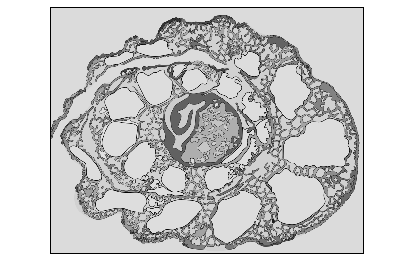

**Fig. 1**

Using Fig.1, explain **one other** adaptation present in the stems of *Oryza sativa* that aids aerobic respiration in flooded fields.

**Q2** [4 marks]

**Extract:**

Extreme rainfall and flooding can create major problems when growing crops. As water levels rise, fields can become waterlogged and crops become submerged underwater.

Waterlogged conditions may negatively impact crops as...

Any three of the following:

- Oxygen and carbon dioxide are less readily available in water OR oxygen and carbon dioxide diffuse more slowly in liquid compared to air;
- Plant roots don't get the oxygen they need for aerobic respiration SO less ATP is produced;
- Plants switch to anaerobic respiration AND ethanol accumulates in plant cells / ethanol levels become toxic;
- Plant leaves don't get the carbon dioxide they need for photosynthesis SO carbon compound production is reduced;

Remember that anaerobic respiration in plant cells involves ethanol fermentation, so plant cells that switch to anaerobic respiration for extended periods will suffer with ethanol toxicity.

(i) Describe how some species of rice plant are adapted to maximise anaerobic respiration.

[2]

(ii) It is common practice for farmers to grow rice in paddies (intentionally flooded fields).

Discuss the benefit of growing rice plants in these conditions.

[2]

### Q3 — hard — 11 marks

**Q3** [2 marks]

The West Indian manatee, *Trichechus manatus*, is a large, aquatic mammal found in the warm coastal waters of the Caribbean. They mainly feed on sea grass and other aquatic plants, meaning that they need spend extended periods of time underwater.

Fig. 1 shows an image of a West Indian manatee.

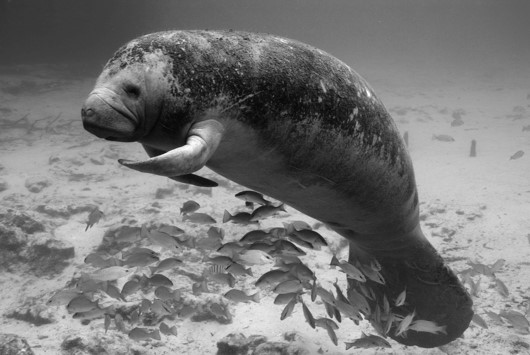

*CC BY 2.0, via **[Flickr](https://www.flickr.com/photos/usfwsendsp/5105566100)*

**Fig. 1**

During feeding there is an increase in the lactate concentration of manatee blood.

Explain this increased lactate concentration.

**Q3** [3 marks]

Fig. 2 shows changes in lactate concentration in the blood of a manatee before, during and after a feeding dive.

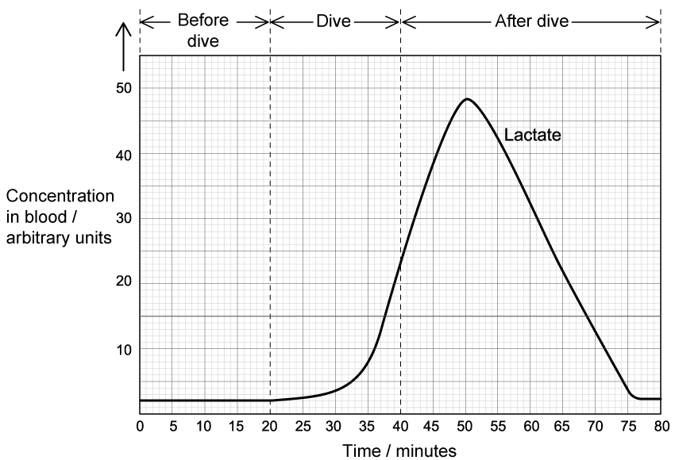

**Fig. 2**

Calculate the percentage change in the lactate concentration between 10 and 15 minutes after the dive was completed.

Show your calculations.

**Q3** [2 marks]

**Extract:**

The West Indian manatee, Trichechus manatus, is a large, aquatic mammal found in the warm coastal waters of the Caribbean. They mainly feed on sea grass and other aquatic plants, meaning that they need spend extended periods of time underwater.

During feeding there is an increase in the lactate concentration of manatee blood.

Fig. 2 shows changes in lactate concentration in the blood of a manatee before, during and after a feeding dive.

Calculate the percentage change in the lactate concentration between 10 and 15 minutes after the dive was completed.

Explain the change in lactate concentration calculated in part (b).

**Q3** [4 marks]

Manatees prefer to live in warm waters around coastlines and in rivers. If they are exposed to extremely cold water for prolonged periods of time they develop a condition called 'cold water stress syndrome', which may be fatal.

With reference to respiration, suggest why cold water stress syndrome may be fatal to manatees.

### Q4 — hard — 14 marks

**Q4** [2 marks]

Fig. 1 below shows a species of ground squirrel, a group of mammals that measure around 25 cm in length. Ground squirrels are known to spend winter months undergoing alternate periods of torpor and wakefulness; during torpor levels of physiological activity decrease significantly, and body temperature and metabolism are much lower than usual.

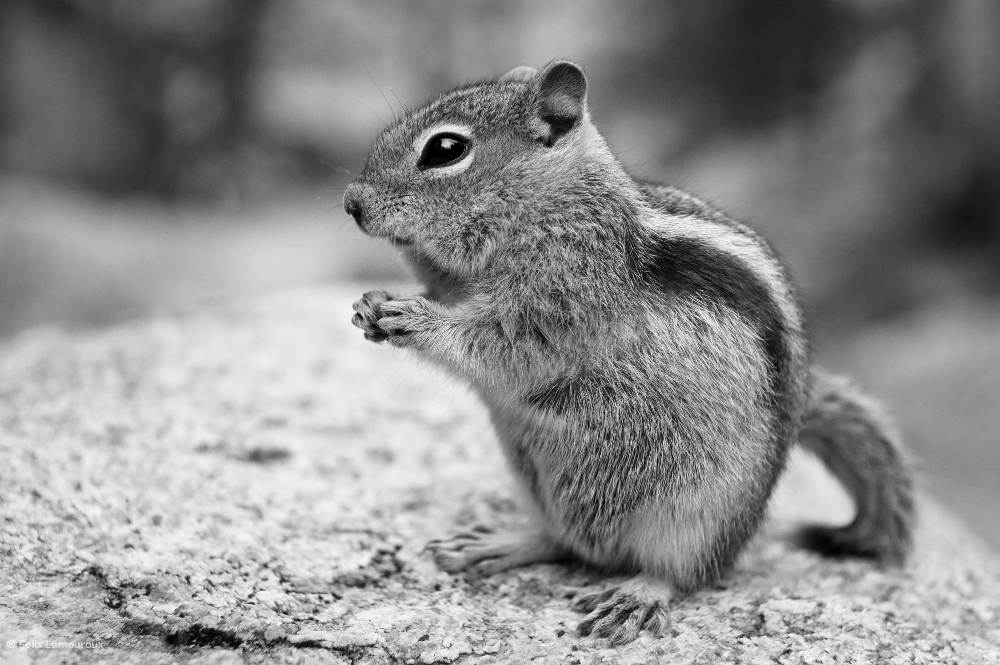

*CC BY-SA 2.0, via **[Flickr](https://www.flickr.com/photos/lamouroux/6265157098)*

**Fig. 1**

Use the information provided to suggest why it is beneficial for ground squirrels to enter torpor during winter months.

**Q4** [3 marks]

Scientists have hypothesised that one factor involved in inducing torpor in ground squirrels is cellular levels of hydrogen sulfide (H2S). One study measured the levels of H2S in the liver cells of ground squirrels during the summer, during torpor, and during the periods of wakefulness that occurred between periods of torpor. Their results are shown in Fig. 2. Error bars show standard deviation.

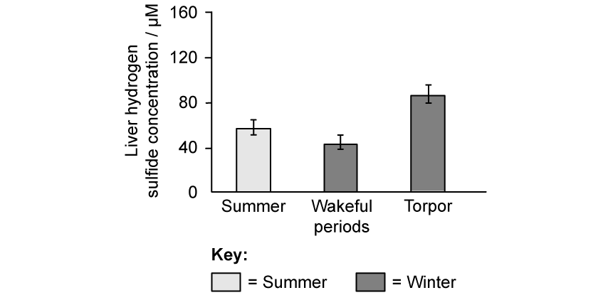

**Fig. 2**

A research assistant viewed Fig. 2 and concluded that increased levels of H2S caused torpor in ground squirrels.

Discuss the research assistant's conclusion.

**Q4** [7 marks]

**Extract:**

Fig. 1 below shows a species of ground squirrel, a group of mammals that measure around 25 cm in length. Ground squirrels are known to spend winter months undergoing alternate periods of torpor and wakefulness; during torpor levels of physiological activity decrease significantly, and body temperature and metabolism are much lower than usual.

Scientists have hypothesised that one factor involved in inducing torpor in ground squirrels is cellular levels of hydrogen sulfide (H~2~S). One study measured the levels of H~2~S in the liver cells of ground squirrels during the summer, during torpor, and during the periods of wakefulness that occurred between periods of torpor.

Fig. 3 below shows the effects of low concentrations of H2S (**A**) and high concentrations of H2S (**B**) on events taking place on the inner mitochondrial membrane. Note that numerals I-IV denote a series of protein complexes.

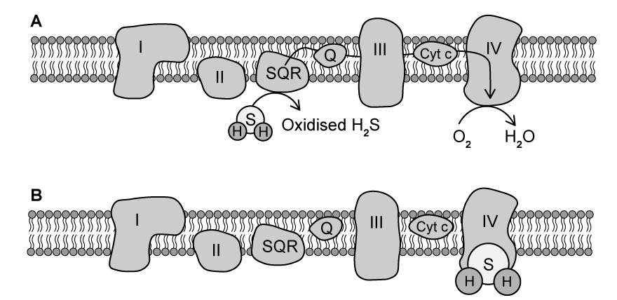

**Fig. 3**

(i) Use information in Fig. 3 to suggest and explain how low levels of H2S could affect respiration rate.

[4]

(ii) Use Fig. 3 to suggest how high levels of H2S might result in torpor in ground squirrels.

[3]

**Q4** [2 marks]

Changes in levels of H2S is one of several cellular events that scientists believe could be responsible for induction of torpor in ground squirrels.

Another mechanism is the post-translational modification of some mitochondrial proteins.

(i) Give **one** example of a type of molecule that might be produced by the modification of a protein after translation.

[1]

(ii) Identify the location in which post-translational modification might occur within a cell.

[1]

### Q5 — hard — 12 marks

**Q5** [5 marks]

Fig. 1 below illustrates two different respiration pathways within an animal cell.

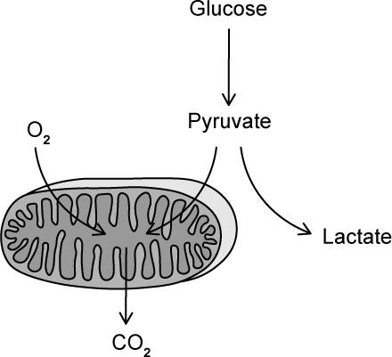

**Fig. 1**

The Warburg effect is a change that occurs in the metabolism of tumour cells that results in a 70-fold increase in lactate production, regardless of oxygen availability.

(i) **Other than** an increase in lactate production, describe the metabolic changes that will be occurring in cells where the Warburg effect is taking place.

[3]

(ii) Suggest why this could be considered a surprising change to occur inside tumour cells.

[2]

**Q5** [2 marks]

**Extract:**

Fig. 1 below illustrates two different respiration pathways within an animal cell.

The Warburg effect is a change that occurs in the metabolism of tumour cells that results in a 70-fold increase in lactate production, regardless of oxygen availability.

Metabolic changes occurring in the Warburg effect would include:
- Increased rate of glycolysis AND (lactate) fermentation

The Warburg effect can also be seen in immune cells that are in the vicinity of tumour cells. These immune cells demonstrate lower than normal activity levels.

Suggest why immune cells that are close to tumour cells may demonstrate lower than normal activity levels.

**Q5** [3 marks]

**Extract:**

Fig. 1 below illustrates two different respiration pathways within an animal cell.

warburg-effect-anaerobic-respiration

Fig. 1

The Warburg effect is a change that occurs in the metabolism of tumour cells that results in a 70-fold increase in lactate production, regardless of oxygen availability.

Fig. 2 shows the effect of a treatment that targets cell metabolism on cancer cells. The error bars indicate standard deviation.

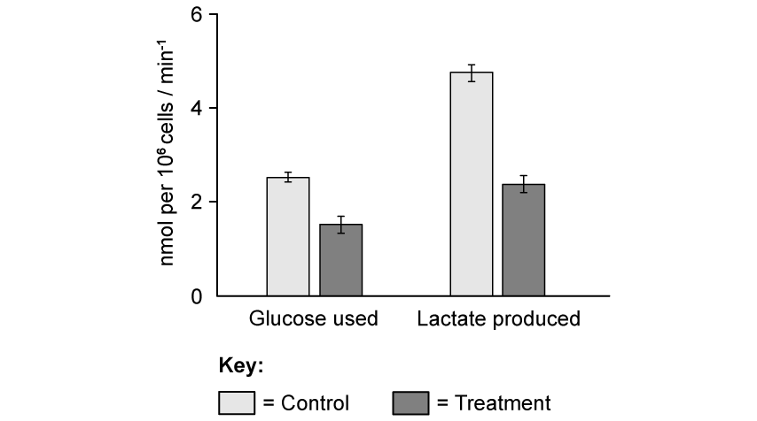

**Fig. 2**

(i) Describe the effect of the treatment on cancer cells.

[2]

(ii) State what can be concluded about the effect of the treatment on cancer cell metabolism.

[1]

**Q5** [2 marks]

**Extract:**

Fig. 1 below illustrates two different respiration pathways within an animal cell.

**Fig. 1**

The Warburg effect is a change that occurs in the metabolism of tumour cells that results in a 70-fold increase in lactate production, regardless of oxygen availability.

Drugs that target cell metabolism can act on different cellular processes.

Suggest how drugs that target the following cellular mechanisms might affect respiration in tumour cells:

(i) Activity of lactate dehydrogenase, the enzyme that is involved in the conversion of pyruvate to lactate.

[1]

(ii) The function of GLUT4 glucose transporter proteins.

[1]

### Q6 — medium — 7 marks

**Q6** [2 marks]

Mitochondrial diseases in humans cause mitochondria to malfunction. Individuals that suffer from mitochondrial disease are only able to endure intense exercise for a short period of time.

Explain the reason for this.

**Q6** [1 mark]

Fig. 1 below shows a mitochondrion.

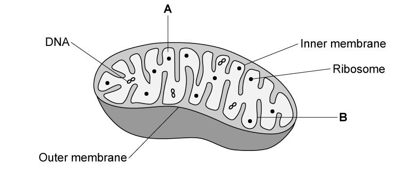

**Fig. 1**

Identify the structures labelled **A** and **B** in the diagram.

**Q6** [3 marks]

Some forms of mitochondrial dysfunction result in mitochondria that lack fully formed cristae as shown in Fig. 2 below.

**Fig. 2**

Suggest, with a reason, the effect of this on the production of ATP.

**Q6** [1 mark]

Fig. 3 below shows glycolysis.

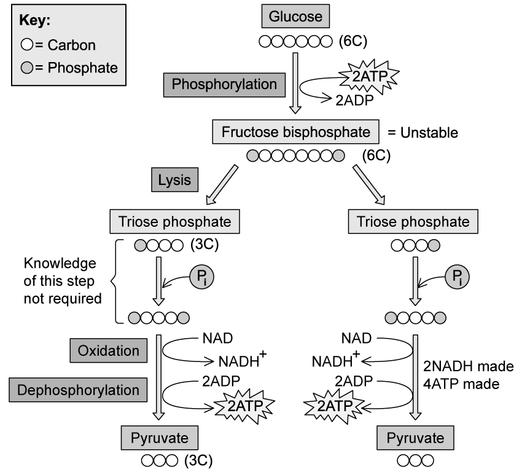

**Fig. 3**

State the net production of ATP and reduced NAD during glycolysis.

### Q7 — medium — 10 marks

**Q7** [4 marks]

The link reaction and Krebs cycle take place in the mitochondrion. The main stages of the link reaction and Krebs cycle are listed in Table 1.

They are **not **listed in the correct order.

**Table 1 **

| **stage** | **description of stage** |
|---|---|
| **A** | acetyl group combines with coenzyme A to form acetyl CoA |
| **B** | citrate is formed |
| **C** | hydrogen atoms are accepted by NAD and FAD |
| **D** | oxaloacetate is regenerated |
| **E** | pyruvate enters the mitochondrial matrix |
| **F** | acetyl group is formed |
| **G** | acetyl CoA enters Krebs cycle |
| **H** | ATP is made by substrate-linked phosphorylation |
| **I** | pyruvate is decarboxylated and dehydrogenated |
| **J** | acetyl CoA combines with oxaloacetate |
| **K** | citrate is decarboxylated and dehydrogenated |

Complete Table 2 to show the correct order of the stages.

Three of the stages have been done for you.

**Table 2**

| **correct order** | **letter of stage** |
|---|---|
| **1** | **E** |
| **2** |   |
| **3** |   |
| **4** |   |
| **5** |   |
| **6** | **J** |
| **7** |   |
| **8** |   |
| **9** |   |
| **10** |   |
| **11** | **D** |

*Source: May/June 2019 9700/41 Q4A*

**Q7** [4 marks]

Outline the role of NAD in respiration in aerobic conditions.

*Source: May/June 2019 9700/41 Q4B*

**Q7** [2 marks]

**Extract:**

The link reaction and Krebs cycle take place in the mitochondrion. The main stages of the link reaction and Krebs cycle are listed in Table 1.

Table 1

| stage | description of stage |
| A | acetyl group combines with coenzyme A to form acetyl CoA |
| B | citrate is formed |
| C | hydrogen atoms are accepted by NAD and FAD |
| D | oxaloacetate is regenerated |
| E | pyruvate enters the mitochondrial matrix |
| F | acetyl group is formed |
| G | acetyl CoA enters Krebs cycle |
| H | ATP is made by substrate-linked phosphorylation |
| I | pyruvate is decarboxylated and dehydrogenated |
| J | acetyl CoA combines with oxaloacetate |
| K | citrate is decarboxylated and dehydrogenated |

Carbon dioxide is removed from compounds in the link reaction and Krebs cycle by decarboxylation.

(i) State the total number of molecules of carbon dioxide removed in the link reaction and Krebs cycle for each molecule of glucose respired.

[1]

(ii) In a mammal, carbon dioxide diffuses from cells into the blood to be transported to the lungs.

Suggest why carbon dioxide is transported in the blood mainly as hydrogen carbonate ions and not as carbonic acid.

[1]

*Source: May/June 2019 9700/41 Q4C*

### Q8 — medium — 9 marks

**Q8** [3 marks]

The Krebs cycle, which takes place in the mitochondrial matrix, releases hydrogen ions. These hydrogen ions, together with coenzymes, provide energy for the synthesis of ATP.

Describe the role of coenzymes in the synthesis of ATP.

**Q8** [2 marks]

Explain why the link reaction is described as an oxidative decarboxylation reaction.

**Q8** [2 marks]

Fig.1 below shows the Krebs cycle.

**Fig. 1**

Identify the number of carbon atoms (e.g. 1C) in the compounds at each stage of the Krebs cycle (**A** to **D**).

**Q8** [2 marks]

Reduced NAD and FAD are produced throughout the stages of respiration.

**Table 1**

| **Stage of respiration** | **Number of reduced NAD molecules** | **Number of reduced FAD molecules** |
|---|---|---|
| Glycolysis |   |   |
| Link reaction |   |   |
| Krebs cycle |   |   |
| Oxidative Phosphorylation |   |   |

Complete Table 1 above to show how many molecules of reduced NAD and FAD are produced at each stage per molecule of glucose.

### Q9 — medium — 16 marks

**Q9** [2 marks]

Fig.1 below shows the respirometer apparatus used by a teacher for measuring the rate of oxygen consumption of seeds during aerobic respiration.

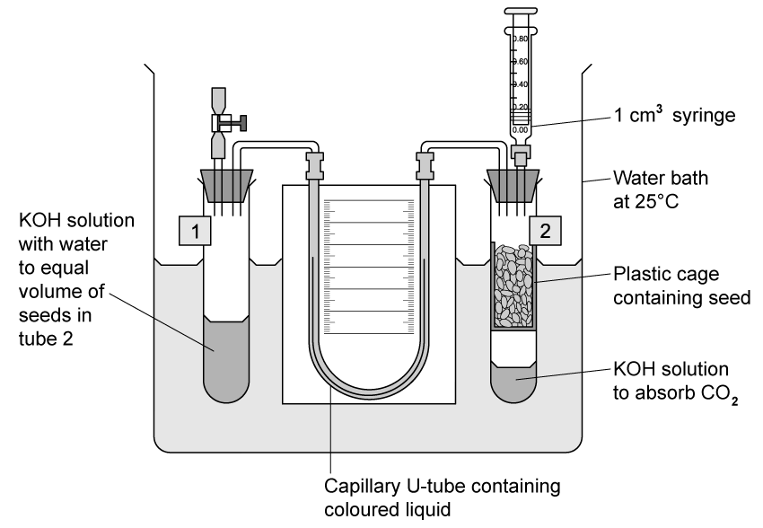

**Fig. 1**

For the first 12 minutes the tap attached to tube 1 was left open and the syringe from tube 2 was removed.

Suggest **two** reasons why this was done.

**Q9** [2 marks]

**Extract:**

Fig.1 below shows the respirometer apparatus used by a teacher for measuring the rate of oxygen consumption of seeds during aerobic respiration.

A temperature of 25°C was used during the experiment. One of the students suggested using a temperature of 35°C.

Explain why the teacher did not do this.

**Q9** [4 marks]

After 12 minutes, the tap connected to tube 1 was closed and the syringe was attached to tube 2. Every 60 seconds, the syringe plunger was moved to make the levels in the U-tube identical. The reading on the volume scale of the syringe was then recorded. The results are shown in Table 1 below.

**Table 1**

| **Time (minutes)** | **Reading on volume scale of syringe (cm****3****)** |
|---|---|
| 0 | 0.85 |
| 1 | 0.82 |
| 2 | 0.79 |
| 3 | 0.76 |
| 4 | 0.74 |
| 5 | 0.72 |
| 6 | 0.69 |
| 7 | 0.67 |
| 8 | 0.64 |
| 9 | 0.61 |
| 10 | 0.58 |
| 11 | 0.56 |
| 12 | 0.53 |

Predict which tube the coloured liquid in the U-tube moves towards during the experiment. Justify your answer.

**Q9** [2 marks]

**Extract:**

After 12 minutes, the tap connected to tube 1 was closed and the syringe was attached to tube 2. Every 60 seconds, the syringe plunger was moved to make the levels in the U-tube identical. The reading on the volume scale of the syringe was then recorded. The results are shown in Table 1 below.

**Table 1**

| **Time (minutes)** | **Reading on volume scale of syringe (cm**^**3**^**)** |
| 0 | 0.85 |
| 1 | 0.82 |
| 2 | 0.79 |
| 3 | 0.76 |
| 4 | 0.74 |
| 5 | 0.72 |
| 6 | 0.69 |
| 7 | 0.67 |
| 8 | 0.64 |
| 9 | 0.61 |
| 10 | 0.58 |
| 11 | 0.56 |
| 12 | 0.53 |

The mass of the seeds was 1.8 g.

Using the information provided in Table 1, calculate the rate of oxygen consumption in cm3 g-1 hour-1 by the seeds. Show your working and give your answer to two decimal places.

**Q9** [6 marks]

Describe the mechanism by which ATP is formed in the mitochondria.

### Q10 — medium — 6 marks

**Q10** [4 marks]

Fig. 1 outlines some of the steps of glycolysis.

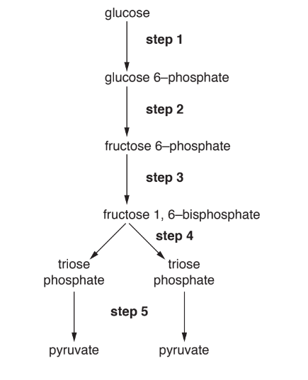

**Fig. 1**

(i) State the precise location of glycolysis in the cell.

[1]

(ii) With reference to Fig.1:

- State the steps where phosphorylation occurs
- State the step where oxidation occurs
- Name the type of reaction by which ATP is made during **step 5**.

[3]

*Source: Oct/Nov 2018 9700/41 Q6A*

**Q10** [2 marks]

Some cancer cells have different metabolic requirements from normal cells. These cancer cells obtain most of their ATP from glycolysis, even if oxygen is available.

State how the glucose and oxygen requirements of these cancer cells differ from normal cells.

*Source: Oct/Nov 2018 9700/41 Q6B*

### Q11 — easy — 10 marks

**Q11** [6 marks]

During a sporting event an athlete carries out aerobic respiration.

Structures and compounds involved in aerobic respiration are listed, **1** to **10**.

| **1** coenzyme A | **6**  carrier protein |
|---|---|
| **2**  cytoplasm | **7**  inner mitochondrial membrane |
| **3 ** pyruvate | **8**  intermembrane space of mitochondrion |
| **4** NAD | **9**  ADP |
| **5**  outer mitochondrial membrane | **10** acetyl group |

Complete Table 1 by matching each description with one number chosen from **1** to **10**, to show the correct structure or compound.

You may use each number once, more than once or not at all.

**Table 1**

| **description** | **number** |
|---|---|
| location of ATP synthase |   |
| transports hydrogen atoms |   |
| nucleotide with a purine base |   |
| location of substrate-linked phosphorylation |   |
| enters the Krebs cycle |   |
| produced by oxidation of triose phosphate |   |

*Source: Specimen 2022 9700/04 Q8A*

**Q11** [4 marks]

Sometimes the muscle cells of an athlete need to carry out respiration in anaerobic conditions.

Explain why the respiration of glucose in anaerobic conditions produces less ATP than in aerobic conditions.

*Source: Specimen 2022 9700/04 Q8B*

### Q12 — easy — 10 marks

**Q12** [4 marks]

The Fig. 1 represents a stage of aerobic respiration.

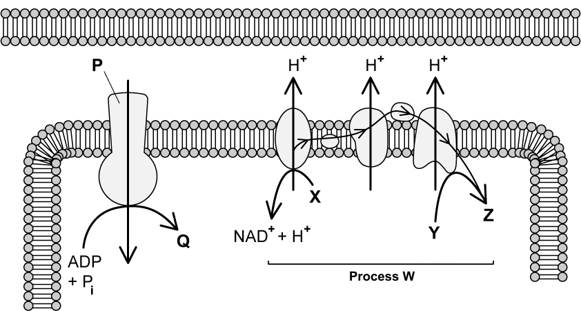

**Fig. 1**

(i) Identify the specific part of a cell shown in Fig. 1.

[1]

(ii) Identify the stage of respiration represented by Fig. 1.

[1]

(iii) Identify the molecules labelled **P** and **Q** in Fig. 1.

[2]

**Q12** [3 marks]

**Extract:**

The Fig. 1 represents a stage of aerobic respiration.

Fig. 1

Describe process W in Fig. 1. You should use the full names of molecules **X**, **Y** and **Z** in your answer.

**Q12** [2 marks]

**Extract:**

The Fig. 1 represents a stage of aerobic respiration.

(ii) The stage of respiration represented by Fig. 1 is:
- Oxidative phosphorylation; [1 mark]

(iii) The molecules labelled P and Q in Fig. 1 are:
- P = ATP synthase; [1 mark]
- Q = ATP; [1 mark]

Process W can be described as follows:
- An electron transport chain;
- NADH/reduced NAD is oxidised to release / drops off/releases hydrogen ions (at the electron transport chain);
- Electrons are accepted by oxygen / oxygen acts as the final electron acceptor AND water/H~2~O is produced;
- Electrons pass down the electron transport chain AND release energy;
- Hydrogen ions are pumped / actively transported across the inner mitochondrial membrane / into the intermembrane space;

The rate at which the process shown in Fig. 1 takes place is affected by temperature.

Explain why this is the case.

**Q12** [1 mark]

NAD is an example of a coenzyme.

Give one other example of a coenzyme involved in aerobic respiration.

### Q13 — easy — 9 marks

**Q13** [2 marks]

Fig. 1 shows a mitochondrion.

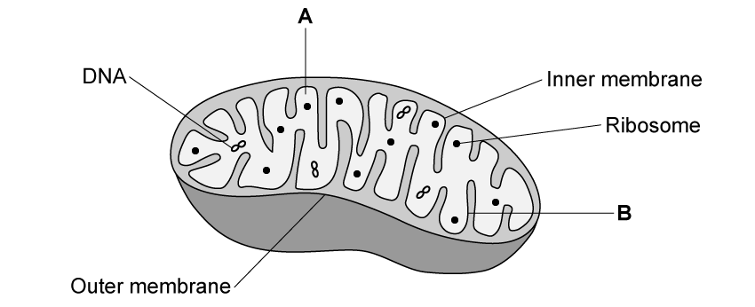

**Fig. 1**

Identify the parts labelled **A **and **B** on Fig. 1.

**Q13** [4 marks]

Table 1 contains the names of the four stages of respiration.

**Table 1**

| **Stage of respiration** | **Location** |
|---|---|
| Glycolysis |   |
| Link Reaction |   |
| Krebs cycle |   |
| Oxidative phosphorylation |   |

Complete Table 1 by identifying the location at which each stage occurs.

**Q13** [1 mark]

ATP synthesis is facilitated by the enzyme ATP-synthase.

Use an appropriate chemical equation to represent the synthesis of ATP.

**Q13** [2 marks]

ATP is required for many processes in the human body.

Identify **two** uses of ATP in the human body.

### Q14 — easy — 7 marks

**Q14** [2 marks]

Fig. 1 shows the process of ethanol fermentation.

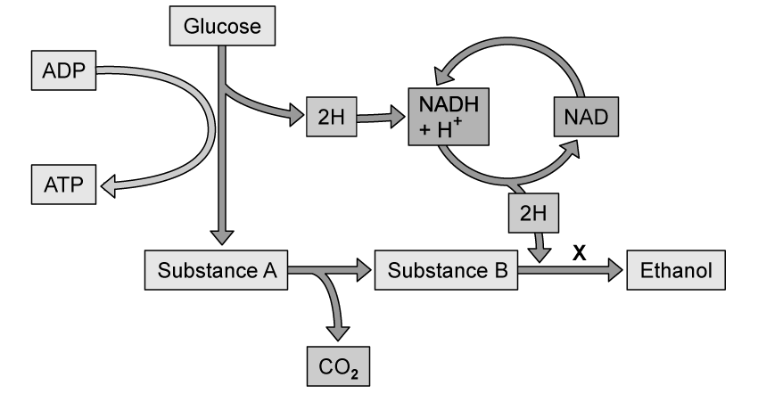

**Fig. 1**

Identify substances **A **and **B**.

**Q14** [2 marks]

**Extract:**

Fig. 1 shows the process of ethanol fermentation.

Identify substances **A **and **B**.

Substances A and B in Fig. 1 are:
- A = pyruvate;
- B = ethanal;

Describe the reaction taking place at point **X** in Fig. 1.

**Q14** [1 mark]

**Extract:**

Fig. 1 shows the process of ethanol fermentation.

Fig. 1

Identify substances A and B.

Substances A and B in Fig. 1 are:
- A = pyruvate
- B = ethanal

Ethanol fermentation occurs in yeast cells.

Describe the equivalent process in animal cells.

**Q14** [2 marks]

In aerobic respiration the presence of oxygen drives the electron transport chain to produce ATP.

Describe the role of oxygen in the electron transport chain.

### Q15 — easy — 7 marks

**Q15** [2 marks]

State the balanced chemical equation for aerobic respiration.

**Q15** [1 mark]

Fig. 1 shows the process of glycolysis.

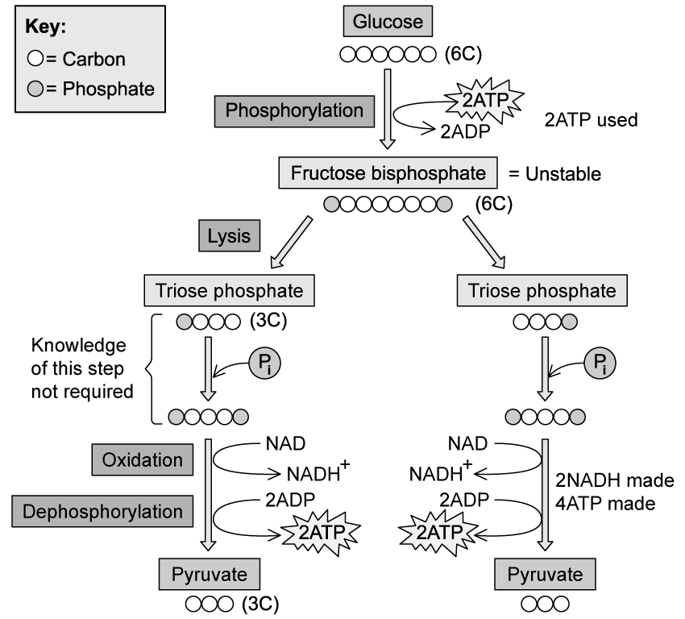

**Fig. 1**

Using Fig. 1, give the net ATP production from glycolysis.

**Q15** [2 marks]

**Extract:**

Fig. 1 shows the process of glycolysis.

Describe the process of phosphorylation as it occurs in Fig. 1.

**Q15** [2 marks]

**Extract:**

Fig. 1 shows the process of glycolysis.

**Fig. 1**

During the final stage of glycolysis, triose phosphate (TP) is oxidised to form pyruvate.

Using Fig. 1, state what occurs during the oxidation of TP.
