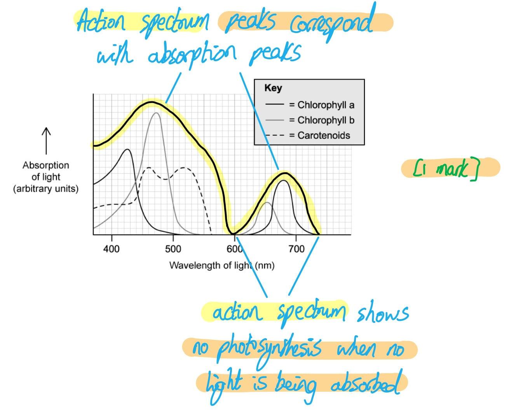
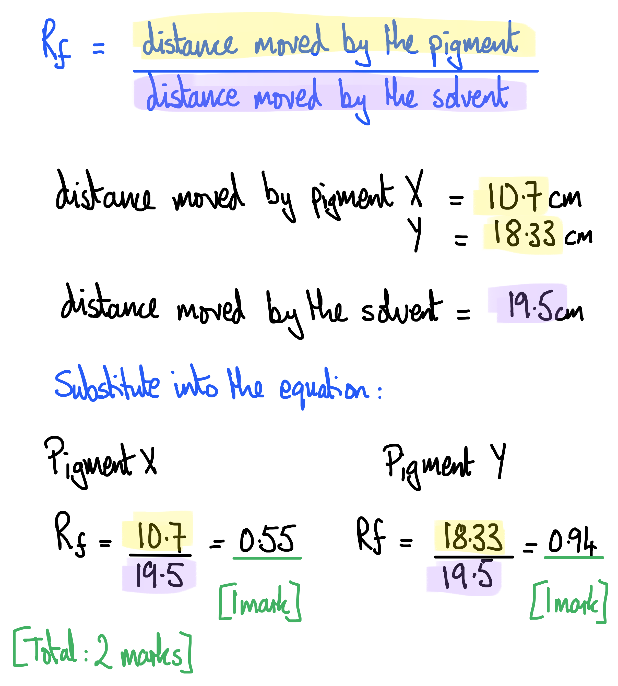

# Mark Schemes — Photosynthesis as an Energy Transfer Process
**13. Photosynthesis** · Cambridge (CIE) A-LEVEL biology (9700)

## Structured Questions (15 questions)

### Q1
Comparative points regarding the absorption spectra for chlorophyll b and carotenoids include...

*Differences*

**Final answer:** **Any ****two**** of the following:**

- Chlorophyll b absorption peaks at 470 nm and 650 nm **WHILE** carotenoid absorption peaks at 460 nm and 520 nm; **[1 mark]**
- Chlorophyll b absorbs mainly blue light and red light **WHILE** carotenoids absorb mainly blue light and green light; **[1 mark]**
- The absorption peak for chlorophyll b at 470 nm is high<u>er</u> than both of the absorption peaks for carotenoids / the absorption peak for chlorophyll b at 650 nm is low<u>er</u> than both of the absorption peaks for carotenoids; **[1 mark]**

*Similarities*

- Neither pigment absorbs light between wavelengths 560 nm and 600 (or 610) nm / yellow light; **[1 mark]**

***Accept**** answers that don't include nm units.*

*Give a margin of error of 5 nm for any numbers quoted.*

**[Total: 3 marks]**

> *Comparison questions require you to identify similarities **and **differences between two sets of observations, so be sure to look for both to get full marks.*
(i) The colour of carotenoid pigments is...

- Yellow/orange/red; **[1 mark]**

***Accept ****yellow-orange or orange-red*

(ii) The reason for this is that...

- Carotenoids do not absorb any light at these wavelengths **SO** these colours of light will be reflected; **[1 mark]**

**[Total: 2 marks]**

> *The wavelengths of light that are not absorbed by an object are reflected back into the eyes of a viewer, and the object will appear to be the colour of the reflected light. We can see from Fig. 2.1 that carotenoids do not absorb light in the yellow through to red parts of the spectrum, so they will reflect these light wavelengths and will appear as a colour from these parts of the spectrum.*
(i) The information represented by an action spectrum is different to that represented by an absorption spectrum in that...

- An action spectrum shows the rate of photosythesis at different light wavelengths **WHILE** an absorption spectrum shows the light absorbed by pigments at different wavelengths; **[1 mark]**

(ii) A sketch of the action spectrum should show...

- A line that corresponds to all of the main peaks of the different pigments **AND** that drops to zero when no pigments are absorbing light; **[1 mark]**

**[Total: 2 marks]**

Only a small number of plant species are found on the ground below the trees because...

**Final answer:** **Any ****four**** of the following:**

- Only a small amount of light energy passes through leaves / tree canopy / reaches the ground; **[1 mark]**
- A smaller <u>range</u> of wavelengths passes through leaves **OR** only green (and yellow) light passes through the tree canopy; **[1 mark]**
- There is little light energy for <u>chlorophyll</u> pigments to absorb;** [1 mark]**
- The rate of photosynthesis will decrease **AND** therefore less glucose will be produced; **[1 mark]**
- Less energy/ATP will be available to the plants (under the trees) **SO** growth will be reduced; **[1 mark]**
- Carotenoids can absorb the light available on the forest floor **SO** some plants (with enough carotenoids) will be able to grow; **[1 mark]**

**[Total: 4 marks]**

> *When Fig.1 and 2 are compared it can be seen that the light wavelengths reaching the forest floor correspond with the light wavelengths not absorbed by chlorophylls a and b. This means that plants on the forest floor have limited light energy to absorb and their rate of photosynthesis will drop, decreasing their growth rate. Any plants that contain large enough amounts of carotenoid pigments will be able to absorb in the green part of the spectrum, so these plants will be able to grow, though not as fast as the trees above them.*

> *While it would be correct to say that the plants in the canopy are out-competing the plants on the ground for light, saying this isn't enough for a mark; you would need to link this idea to a reduction in light energy or range of wavelengths reaching the ground.*

### Q2
Bands 3 and 4 most likely represent the two chlorophyll pigments because...

**Final answer:** **Any ****two**** of the following:**

- Chlorophyll a and chlorophyll b should have similar solubility in the solvent **SO** move a similar distance; **[1 mark]**
- Chlorophyll a and chlorophyll b are both <u>similar</u> in (molecular) structure/polarity/size **SO **they would be expected to be grouped close together on the chromatogram; **[1 mark]**
- Chlorophyll a and chlorophyll b should have similar Rf values; **[1 mark]**

**[Total: 2 marks]**

> *Chromatography can be used to separate and identify chloroplast pigments that have been extracted from a leaf. Each pigment has a unique R**f** value, which demonstrates how far a dissolved pigment travels through the stationary phase. Molecules with a higher affinity to the stationary phase, such as larger molecules, will travel slower (causing their band to appear lower on the chromatogram) and will therefore have a smaller R**f** value.*
The pigments in the chromatogram shown in part (a) can be accurately identified in the following way...

**Final answer:** **Any ****three**** of the following:**

- Measure distance travelled by solvent (front); **[1 mark]**
- Measure distance travelled by each pigment; **[1 mark]**
- Calculate Rf value (for each pigment) **OR** divide pigment distance by solvent (front) distance; **[1 mark]**
- Compare calculated Rf values to <u>known</u> Rf values; **[1 mark]**

*Award 1 mark for references to comparing bands with a colour chart ****OR**** analysis with a spectrometer*

**[Total: 3 marks]**
The red pigment, phycoerythrin, might be absent from the chromatogram because...

**Final answer:** **Any ****one**** of the following:**

- The pigment was not extracted successfully/properly/fully when the pigments from the algae were extracted; **[1 mark]**
- The pigment is insoluble / didn't dissolve in the organic solvent/propanone/acetone used for the chromatography / to separate the pigments; **[1 mark]**
- The pigment travelled too far up the thin layer chromatography plate / TLC plate **OR** a longer TLC plate is required; **[1 mark]**
- The pigment may have degraded / broken down for some reason (e.g. due to the organic solvent used); **[1 mark]**

**[Total: 1 mark]**

> *As the question asks you to suggest why something **might** have occurred, this indicates that any reasonable suggestion would be considered and if appropriate, would be awarded the mark.*
Red algae can live at greater depths than many other algae because...

- Blue light has shorter wavelengths **SO** penetrates water to greater depths (than red light, which has longer wavelengths); **[1 mark]**
- Red algae contain phycoerythrin which absorbs blue light **SO** they can <u>photosynthesise</u> at greater depths (than most other algae); **[1 mark]**

**[Total: 2 marks]**

> *Part (c) tells us that the **Palmaria** contain the pigment phycoerythrin and that this pigment absorbs blue light, while part (d) tells us that light of short wavelengths can penetrate deeper into water. You should know from your knowledge of diagrams showing the visible light spectrum that blue light has a shorter wavelength than other colours of light, so it is blue light that will penetrate deeper into the water than light of other wavelengths. The phycoerythrin pigment can absorb this blue light, so **Palmaria **can photosynthesise at depths that other aquatic algae cannot.*

### Q3
The changes in carbon dioxide occur because...

**Final answer:** **Any ****five**** of the following:**

- There is a high(er) concentration of carbon dioxide at night (at all heights) **AS** photosynthesis stops at night / in the dark;** [1 mark]**
- Photosynthesis stops in the dark **AS **light energy is required for photolysis / splitting water molecules; **[1 mark]**
- There is a high(er) concentration of carbon dioxide at night **AS** organisms (continue to) produce carbon dioxide during respiration / respiration rate is higher than the rate of photosynthesis (when it is dark); **[1 mark]**
- During the day carbon dioxide levels are low(er) **AS** plants use carbon dioxide during photosynthesis; **[1 mark]**
- During the day carbon dioxide levels are low(er) **AS **rate of photosynthesis is greater than rate of respiration; **[1 mark]**
- There is a decrease in carbon dioxide concentration with height **AS** at ground level there are fewer leaves / is less light / rate of photosynthesis is lower; **[1 mark]**
- Carbon dioxide is denser than other gases in air **SO** sinks towards the ground; **[1 mark]**

**[Total: 5 marks]**

> *Note that this is an 'explain' question so each statement must have an element of explanation to achieve a mark.*

> *Photosynthesis uses up carbon dioxide while respiration produces it. During the night photosynthesis stops, so the rate of uptake of carbon dioxide decreases. At the same time, the respiration rate remains constant, producing carbon dioxide and causing overall levels to increase. During the day photosynthesis occurs at a greater rate than respiration, using carbon dioxide and causing levels to fall. The fall will be greatest in the regions of the woodland where the most photosynthesis is occurring; this is likely to be high in the canopy where light levels are high and there are many leaves.*
The results for RuBP and GP at 0.003% carbon dioxide concentration can be explained as follows…

- RuBP levels increase **AS** limited CO2 is available to combine with RuBP / RuBP is not converted into GP;** [1 mark]**
- GP levels decrease **AS** carbon dioxide levels do not affect conversion of GP into TP / GP continues to be converted into TP; **[1 mark]**

**[Total: 2 marks]**

> *It isn’t enough to state that, “CO**2** is the limiting factor”. Examiners will want to see a clear statement that CO**2** combines / reacts with RuBP as part of the Calvin Cycle.  *
The relative levels of GP and RuBP remained the same both before and after the experiment because …

**Final answer:** **Any ****two ****of the following:**

- Temperature becomes a limiting factor **AS** this limits the rate at which Rubisco fixes carbon dioxide; **[1 mark]**
- Light intensity becomes a limiting factor **AS** this limits the rate at which NADP is reduced / ATP is synthesised / GP is converted into TP / TP is converted into RuBP;** [1 mark]**

**Final answer:** **[Total: 2 marks]**

> *When increasing the levels of a potentially limiting factor (in this case CO**2**) leads to no change in reaction rate, we should immediately realise that there must be **another factor** that has become limiting. This is an **explain** question, so just listing the limiting factors of 'temperature' and 'light intensity' will not be enough here; you need to link these factors with the details of the photosynthesis reactions to gain marks.*

### Q4
The rate of photosynthesis in algae that live within the cells of coral polyps is higher than that of free-living algae because...

**Final answer:** **Any ****three**** of the following:**

- Carbon dioxide concentration is higher/increased; **[1 mark]**
- (The carbon dioxide is released by) respiration by the coral/polyp; **[1 mark]**
- (The carbon dioxide) supplies the Calvin cycle / light-independent reactions (in the algae); **[1 mark]**
- (The carbon dioxide) binds to rubisco (enzyme);  **[1 mark]**
- (Carbon dioxide concentration is) not a limiting factor; **[1 mark]**

**OR**

**Final answer:** **Any ****three**** of the following:**

- The temperature is higher/increased; **[1 mark]**
- (Due to) respiration by the coral/polyp; **[1 mark]**
- (This raises the rate of) the Calvin cycle / light-independent reactions (in the algae); **[1 mark]**
- (Because) increased kinetic energy increases the number of collisions / the rate of formation of enzyme-substrate complexes;** [1 mark]**
- (Temperature is) not a limiting factor; **[1 mark]**

**[Total: 3 marks]**

> *This question requires you to **apply your knowledge** of the process of photosynthesis to this unfamiliar scenario. You should consider how living within the cells of the coral would change the environmental conditions (that are relevant to photosynthesis) for the algae.*

> *Remember to pitch your answers using A Level knowledge; for example to state the Calvin cycle (as shown in marking point 3). This avoids the pitfall of answering with only GCSE-level knowledge/keywords which will restrict the marks you can earn in a question like this. *
Lamps radiating mainly violet and blue light are expected to increase the growth of coral polyps more than lamps radiating light of all wavelengths because...

**Final answer:** **Any ****three**** of the following:**

- Pigments absorb violet-blue light / light of wavelength 400-490 nm best in 8 of the peaks (out of 10 from Table 1); **[1 mark]**
- The rate of photosynthesis of the <u>algae</u> will increase when more light is absorbed; **[1 mark]**
- Algae will supply polyps with more oxygen / organic nutrients (e.g. carbon compounds from photosynthesis); **[1 mark]**
- <u>Corals</u> growth will (therefore) increase with more (algal) photosynthesis; **[1 mark]**
- Light is violet-blue/400-490 nm in the natural habitat of coral / places where corals live; **[1 mark]**

**[Total: 3 marks]**

> *Make sure that there is a clear distinction here between the photosynthesis of the **algae** and the growth of the **coral**; the algae photosynthesize, passing the products to the coral which is then able to grow more.*
The process of cyclic photophosphorylation involves...

**Final answer:** **Any ****four**** of the following:**

- Photosystem I only; **[1 mark]**
- Light <u>energy</u> is absorbed (by accessory pigments); **[1 mark]**
- (Energy is) passed on to chlorophyll a / primary pigment / reaction centre; **[1 mark]**
- Electron(s) are excited to a higher energy level / emitted from chlorophyll; **[1 mark]**
- (Electrons are) collected by / pass to an electron acceptor; **[1 mark]**
- (Electrons are) passed along the electron transport chain; **[1 mark]**
- ATP is produced by chemiosmosis; **[1 mark]**
- Electrons return to chlorophyll (in photosystem I); **[1 mark]**

**[Total: 4 marks]**

### Q5
The role of hydrogen sulfide could be as follows…

- A source of H+/hydrogen ions/protons and electrons; **[1 mark]**
- Hydrogen ions can be used in reduction reactions / ATP synthesis/chemiosmosis; **[1 mark]**
- Electrons can be passed along the electron transport chain; **[1 mark]**

**[Total: 3 marks]**

> *Here you need to notice that H**2**S takes the place of H**2**O in the photosynthesis equation. In photosynthesis H**2**O undergoes photolysis, providing protons and electrons for reducing reactions, the electron transport chain, and chemiosmosis. It is logical here to reason that H**2**S will take over that same role in chemosynthesis.*
The blue colour disappeared from the suspension of pigments because...

- Light energy causes <u>photoactivation</u> of electrons within the pigments; **[1 mark]**
- Electrons are accepted by the reagent (rather than by NADP) **AND** it is reduced (changing colour from blue to colourless); **[1 mark]**

**[Total: 2 marks]**
The concentration of glycerate-3-phosphate was found to increase because...

- Reduced NADP/NADPH is not formed / does not enter the Calvin cycle/light-independent reactions **AS** electrons are passed to the blue reagent instead of to NADP; **[1 mark]**
- GP is still produced from RuBP / by the fixation of carbon dioxide **BUT** it is not converted into TP (so it accumulates); **[1 mark]**

**[Total: 2 marks]**

> *Electrons passing to the reagent instead of the NADP during the light dependent stage reduces production of NADPH. NADPH is needed in the Calvin cycle to convert GP into TP, but not in the production of GP from RuBP, so we would expect GP to build up in this experiment.*
The pigments that are likely to be present in greatest abundance are...

- Chlorophyll *b*; **[1 mark]**

***Accept**** chlorophyll c which has a higher absorption peak than chlorophyll b in this part of the spectrum*

This is because...

- It has the highest absorption peak in the blue-green parts of the spectrum / between wavelengths of 400-550 nm **SO** this will maximise absorption of light energy; **[1 mark]**

**[Total: 2 marks]**

### Q6
(i) Compound M is...

- Carbon dioxide; **[1 mark]**

(ii) Compound O is...

- RuBP/ribulose bisphosphate; **[1 mark]**

(iii) The enzyme that catalyses the reaction between compounds M and O is...

- Rubisco/ribulose bisphosphate carboxylase; **[1 mark]**

**[Total: 3 marks]**

> *Don't be thrown by diagrams that are different to the representations that you may be used to. This diagram is a rotated version of the Calvin cycle and the numbers of each molecule have been altered to account for 6 molecules of carbon dioxide being fixed.*
The products of the light-dependent reactions are used in the light-independent reactions in the following ways...

**Final answer:** **Any ****three**** of the following:**

- (The products are) ATP **AND** NADPH/reduced NADP; **[1 mark]**
- ATP is hydrolysed to release energy; **[1 mark]**
- NADPH/reduced NADP is used to reduce/phosphorylate compound N / convert compound N into triose phosphate/TP; **[1 mark]**
- ATP is needed to regenerate RuBP / convert triose phosphate/TP back into RuBP; **[1 mark]**

***Accept ****GP for compound N only once the answer has clearly indicated that compound N has been identified as GP*

**[Total: 3 marks]**

> *Note that you have been asked to **refer to Fig.1** in your answer, so you should be sure to link the names of molecules that you know to the compounds referred to in Fig. 1. Given that compound O has already been identified in part a) and triose phosphate has not been included in the diagram, GP as compound N is the only reference that the mark scheme is looking for.*
(i) Compound P could be converted into...

**Final answer:** **Any ****three**** of the following:**

- Starch; **[1 mark]**
- Sucrose; **[1 mark]**
- Cellulose; **[1 mark]**
- Glycerol/fatty acids/lipids; **[1 mark]**
- Amino acids; **[1 mark]**

(ii) The type of reaction that would convert compound P into a polymer is...

- A condensation (reaction); **[1 mark]**

**[Total: 4 marks]**

> *Compound P is glucose, which can be converted into all of the molecules mentioned above. You are probably familiar with the first four answers but less familiar with the fact that glucose can be converted into amino acids when it combines with nitrates absorbed from the soil.*
Compound **P** is converted into other molecules for storage because...

- It needs to be converted into an insoluble form; **[1 mark]**
- So that it doesn't lower the water potential of the plant cell / cause water to move into the plant cell by osmosis; **[1 mark]**

**OR**

- It needs to be converted into a more compact form / a form that takes up less space; **[1 mark]**
- This allows the plant to store as much (carbohydrate) as possible in a small space / prevents the plant's energy stores from taking up too much space; **[1 mark]**

**OR**

- It needs to be converted into sucrose for transport; **[1 mark]**
- Sucrose is less reactive / less likely to be used up before it reaches its destination / can store more chemical energy (than compound P/glucose); **[1 mark]**

***Accept ****reverse argument.*

**[Total: 2 marks]**

### Q7
The pigments in a chloroplast are arranged as follows...

**Final answer:** **Any ****three**** of the following:**

- Located in the thylakoid <u>membrane</u>; **[1 mark]**
- Located in photosystems (I and II); **[1 mark]**
- Arranged in a funnel shape; **[1 mark]**
- Chlorophyll *a* is found in the reaction centre / at the base of the funnel; **[1 mark]**
- Accessory pigments / chlorophyll *b* **and **carotenoids/carotene/xanthophyll are arranged around the sides of the funnel / channel/funnel light energy to chlorophyll *a*/the reaction centre/the primary pigment; **[1 mark]**

**[Total: 3 marks]**

> *You could also be awarded marks in a question such as this for a well-annotated diagram. Such a diagram would need clear labels as well as descriptions of parts of the diagram to show the examiner your full understanding. *
(i) Photoactivation involves the following...

**Final answer:** **Any ****two**** of the following:**

- Light energy is absorbed by (photosynthetic/accessory) pigments (before being funnelled to the primary pigment); **[1 mark]**
- Electrons in the reaction centre/chlorophyll a are excited / gain energy / raised to a higher energy level; **[1 mark]**
- Electrons are emitted from the photosystem/reaction centre/pigments / pass to an electron acceptor/the electron transport chain; **[1 mark]**

(ii) Photolysis involves the following...

- Water is split into hydrogen ions/protons **AND** electrons **AND** oxygen; **[1 mark]**
- The reaction is catalysed by an enzyme / oxygen-evolving complex / water-splitting complex in photosystem II; **[1 mark]**

**[Total: 4 marks]**

> *Where you are asked to "outline" you only need to set out the main points, so try not to get bogged down in all the details of these two processes as you are not required to go into great detail and would therefore be wasting precious exam time. *
Oxidation and reduction occur in the light-dependent reactions in the following ways...

*Oxidation:*

**Final answer:** **A maximum of ****two**** of the following:**

- Chlorophyll *a*/the primary pigment/the reaction centre is oxidised when electrons are lost (during photoactivation) and passed to the electron transport chain/an electron carrier; **[1 mark]**
- Electron carriers/proteins of the electron transport/transfer chain molecules are oxidised when they pass on/give up electrons to the next electron carrier/photosystem/NADP; **[1 mark]**
- Water is oxidised when it loses electrons during photolysis; **[1 mark]**

*Reduction:*

**Final answer:** **A maximum of**** two**** of the following:**

- Electron carriers/proteins of the electron transport/transfer chain are reduced when they accept/gain electrons from the photosystem / another electron carrier; **[1 mark]**
- Chlorophyll a is reduced when it gains/accepts electrons from an electron carrier during cyclic photophosphorylation / from water during non-cyclic photophosphorylation; **[1 mark]**
- NADP is reduced when it accepts/gains electrons (along with hydrogen ions), becoming reduced NADP or NADPH; **[1 mark]**

***Reject**** references to NAD or NADH throughout*

**[Total: 3 marks]**

> *Oxidation is the loss (OIL) of electrons while reduction is the gain (RIG) of electrons. When chlorophyll **a**, an electron carrier protein, or water loses electrons and passes them elsewhere they are said to be **oxidised **and have taken part in an oxidation reaction. When an electron carrier, chlorophyll a, or NADP gain an electron from elsewhere they are said to be **reduced **and have taken part in a reduction reaction. It is also worth noting that it is not only electrons that are involved in oxidation and reduction reactions, they also apply to the loss or gain of hydrogen and oxygen. *

> *Note that the question asks you to **explain** the oxidation and reduction processes, so a bit more detail is required for each mark than just stating where electrons have been lost or gained. *
(i) The two types of photophosphorylation reactions that occur during the light-dependent stage of photosynthesis are...

- Cyclic **AND** non-cyclic (photophosphorylation); **[1 mark]**

(ii) A comparison between the two types of photophosphorylation would include...

*Similarities*

- <u>Both</u> involves photosystem I; **[1 mark]**
- <u>Both</u> result in the production of ATP / involve chemiosmosis / diffusion of protons via ATP synthase; **[1 mark]**
- Photoactivation occurs in <u>both</u> cyclic and non-cyclic photophosphorylation; **[1 mark]**

*Differences*

**Final answer:** **A maximum of ****three ****of the following:**

- In cyclic photophosphorylation only photosystem/PS I is involved **WHILE** in non-cyclic photophosphorylation both photosystem/PS I and photosystem/PS II are involved; **[1 mark]**
- In cyclic photophosphorylation only ATP is synthesised **WHILE** in non-cyclic photophosphorylation ATP and reduced NADP/NADPH are synthesised; **[1 mark]**
- In cyclic photophosphorylation the excited electrons return to the original photosystem **WHILE** in non-cyclic photophosphorylation they pass to another photosystem; **[1 mark]**
- Non-cyclic photophosphorylation involves the photolysis of water **WHILE** cyclic photophosphorylation does not; **[1 mark]**

> *The command word 'compare' requires a summary of similarities and/or differences, so you should aim to give a balance of both types of point where possible.*

> *Remember that similarities must clearly refer to both sides of the comparison, while differences must clearly present contrasting features; this can be achieved by using language such as 'both' and 'while' as shown above.*

**[Total: 5 marks]**

### Q8
The correctly filled in locations are as follows...

| **compound or structure** | **location** |
|---|---|
| ATP synthase | C |
| rubisco | B |
| starch grain | A |
| phospholipid bilayer | C |

- Four correct; **[3 marks]**
- Three correct; **[2 marks]**
- Two correct **[1 mark]**
- One or zero correct;  **[0 marks]**

**[Total: 3 marks]**
A description and explanation of the results are...

*Description*

- The rate of oxygen production is high(est)/peaks at 450 nm AND 650 nm / blue AND red **OR **the rate of oxygen production is lowest at 535–555 nm / green light; **[1 mark]**

*Explanation*

**Final answer:** **A ****maximum of two ****of the following:**

- *Elodea/*chloroplasts absorb this (specified) wavelength/(named) colour of light; **[1 mark]**
- Light is used for photosynthesis/photophosphorylation; **[1 mark]**
- So more oxygen is produced from <u>photolysis</u>; **[1 mark]**
- (This occurs during) non-cyclic (photophosphorylation) / the light-dependent stage; **[1 mark]**

**[Total: 3 marks]**

> *Note that marking point 5 only refers to non-cyclic photophosphorylation. This is because cyclic photophosphorylation happens independently of photolysis, so would not involve oxygen production.*
The role of the accessory pigments in photosynthesis is to...

**Final answer:** **Any ****two ****of the following:**

- Pass energy/light/photons to chlorophyll *a* / the primary pigment / the reaction centre; **[1 mark]**
- Absorb different wavelengths to chlorophyll *a* / primary pigment / reaction centre; **[1 mark]**
- Form / arranged in a light-harvesting cluster / photosystem; **[1 mark]**

**[Total: 2 marks]**

> *It is incorrect to say that electrons, rather than energy, light or photons, are transferred from the accessory pigments to the primary pigment. This energy then causes electrons in the primary pigment to become excited and leave the photosystem.*

### Q9
(i) The process shown in Fig.1 is...

- <u>Non-cyclic</u> photophosphorylation; **[1 mark]**

(ii) This is because...

- It involves photosystems I and II / photosystem II is present; **[1 mark]**
- Electrons do not return to their starting point / are passed to a different photosystem; **[1 mark]**

> *While there are other differences between the two types of photophosphorylation, these are the only ones that can be clearly seen in Fig. 1.*

**[Total: 3 marks]**
(i) The process marked **A** that could be affected by cadmium is...

- Photoactivation; **[1 mark]**

(ii) The impact that this could have on photosynthesis includes...

**Final answer:** **Any ****three**** of the following:**

- No electrons would enter the electron transport/transfer chain (as they will not be excited in photoactivation); **[1 mark]**
- No ATP would be produced (at B); **[1 mark]**
- No NADP would be reduced / no reduced NADP/NADPH would be produced (at C); **[1 mark]**
- GP will not be converted into TP / no hexose sugars will be produced due to a lack of TP (in the Calvin cycle); **[1 mark]**

**[Total: 4 marks]**

> *Note that part b) ii) is an 'outline' question so the precise details of the impact that cadmium would have on the processes involved are not required, just the overall effects.*

> *Preventing photoactivation would mean that no electrons enter the electron transport chain on the thylakoid membrane. This would prevent the production of ATP and reduced NADP, meaning that these products are not available to enter the Calvin cycle. The Calvin cycle will be unable to progress from GP to TP (ATP and NADPH are needed for this step), so no TP and therefore no hexose sugars will be produced.*
The process taking place at **B** Fig.1 involves...

**Final answer:** **Any ****four ****of the following:**

- Energy is released as electrons pass down the electron transport chain; **[1 mark]**
- The energy released is used to power a proton pump/membrane protein that pumps/actively transports hydrogen ions/protons/H+ (from the stroma) into the thylakoid lumen/space; **[1 mark]**
- A proton/H+ (concentration) gradient is generated between the thylakoid lumen/space and the stroma / there is a higher concentration of protons/H+ in the thylakoid lumen/space than in the stroma; **[1 mark]**
- Protons/H+ move back across the membrane by <u>facilitated</u> diffusion through/via ATP synthase; **[1 mark]**
- (This process is known as) chemiosmosis; **[1 mark]**
- ATP synthase catalyses the production of ATP; **[1 mark]**
- ATP is synthesised/produced from ADP and phosphate/Pi; **[1 mark]**

**[Total: 5 marks]**

### Q10
Stage A of the Calvin cycle can be described as follows...

- Carbon (dioxide) fixation / carboxylation; **[1 mark]**
- Carbon dioxide is combined with a molecule of ribulose bisphosphate / RuBP **AND** yields/produces two molecules of glycerate 3-phosphate/GP; **[1 mark]**
- Catalysed by the enzyme rubisco / ribulose bisphosphate carboxylase oxygenase; **[1 mark]**

**[Total: 3 marks]**
The importance of the light-dependent reactions in allowing stage **B** of the Calvin cycle, as indicated in Fig. 1, to proceed is as follows...

- The production/synthesis of ATP; **[1 mark]**
- To regenerate RuBP from TP/triose phosphate; **[1 mark]**

**[Total: 2 marks]**
Examples of substance **C **and the Calvin cycle intermediates from which these examples are produced include...

**Final answer:** **Any ****three**** of the following:**

- Amino acids **AND** produced from GP; **[1 mark]**
- Carbohydrates / hexose sugars / glucose / sucrose / starch / cellulose **AND **produced from TP; **[1 mark]**
- Lipids / glycerol / fatty acids **AND **produced from TP; **[1 mark]**
- Amino acids **AND **produced from TP; **[1 mark]**

**[Total: 3 marks]**

> *Although Fig. 1 and the question refer to **substance** C, you can see in the image that three arrows have been used, indicating that there are numerous products here; your own knowledge of the Calvin cycle should confirm this.*

> *You are expected to be able to give examples of the substances that can be produced from the Calvin cycle intermediates GP and TP.*

### Q11
(i) Structure B can be identified as...

- Thylakoid/thylakoid membrane; **[1 mark]**

(ii) The role of structure B is...

- Site of the light-dependent stage **OR** contains chlorophyll/pigments/photosystems for absorption of light **OR** site of (cyclic / non-cyclic) photophosphorylation / photoactivation / production of NADPH/ATP **OR** electrons are passed along the electron transport chain / protons are pumped across the membrane / ATP synthase produces ATP; **[1 mark]**

> *Note that part (ii) here is only a 1 mark question, so you do not need to spend time describing the entire light-dependent stage; in short questions like this you should just pick out one or two key ideas, such as those given in the mark scheme above.*

**[Total: 2 marks]**
An electron microscope rather than a light microscope is needed to view the internal structures of chloroplasts because...

**Final answer:** **Any ****two**** of the following:**

- Electron microscopes have a higher resolving power/resolution (than light microscopes) / a resolution of 0.5 nm compared to a light microscope at 200 nm; **[1 mark]**
- (This means that electron microscopes) can distinguish between/resolve two objects that are close together / allow two objects that are close together to be seen as separate (rather than as a single object); **[1 mark]**
- Electrons have a shorter wavelength (than light) / the wavelength of light is too long; **[1 mark]**

**[Total: 2 marks]**
Starch granules are present inside chloroplasts because...

**Final answer:** **Any ****two**** of the following:**

- Glucose produced during photosynthesis is converted into starch/amylose/amylopectin; **[1 mark]**
- Condensation reactions form glycosidic bonds between glucose molecules; **[1 mark]**
- Starch is a storage molecule / stores chemical energy; **[1 mark]**
- Starch does not affect the water potential of the chloroplast / starch does not cause water to move into the chloroplast by osmosis (as it is insoluble); **[1 mark]**
- Starch is compact so can be stored in large quantities; **[1 mark]**

**[Total: 2 marks]**

> *The question here is not very specific about exactly which aspect of the presence of starch is being asked for, but the mark scheme allows for different interpretations of the question. You could think about where the starch has come from, i.e. that it is the result of bonds being formed between glucose molecules that are produced during photosynthesis, or you could think about why it is needed by the plant, i.e. as a store of chemical energy that does not affect the water potential of the organelle.*
(i) The role of photosynthetic pigments in the thylakoid membrane is...

- To absorb light energy for photosynthesis; **[1 mark]**

(ii) The benefit of having various pigments is that...

- Light of different wavelengths can be absorbed; **[1 mark]**
- Maximising the amount of light energy absorbed by the chloroplasts **OR** enables the absorption of a wider <u>range</u> of light wavelengths **OR **accessory pigments/chlorophyll b/carotene/xanthophyll can funnel energy towards the primary pigment/reaction centre/chlorophyll a; **[1 mark]**

**[Total: 3 marks]**

### Q12
Enzyme X in Fig. 1 is...

- Rubisco / ribulose bisphosphate carboxylase; **[1 mark]**

**[Total: 1 mark]**
The molecules required at the positions marked Y and Z are...

- ATP;** [1 mark]**
- NADPH / reduced NADP;** [1 mark]**

*Answers may be given in either order*

**[Total: 2 marks]**

> *Note that it doesn’t matter which molecule is identified as Y and which as Z, provided that the correct molecules are named.*
Two uses for hexose sugars inside plant cells include:

**Final answer:** **Any ****two ****of the following:**

- Conversion into starch for storage; **[1 mark]**
- Conversion into sucrose for transport around the plant; **[1 mark]**
- Conversion into cellulose for cell walls; **[1 mark]**
- Respiration to produce ATP:** [1 mark]**

**[Total: 2 marks]**
One other product that can be made during the Calvin cycle:

- Amino acids; **[1 mark]**
- Used in protein synthesis / to build proteins; **[1 mark]**

**OR**

- Lipids / glycerol / fatty acids; **[1 mark]**
- Used to build cell membranes / the waxy cuticle; **[1 mark]**

**OR**

- ADP / NADP; **[1 mark]**
- Can enter the light dependent reactions; **[1 mark]**

**[Total: 2 marks]**

### Q13
The majority of plants look green to human eyes because...

- Chlorophyll reflects (the most) light in the green <u>wavelengths</u> of the (visible) spectrum; **[1 mark]**

**[Total: 1 mark]**

> *Chlorophyll reflects green light more strongly than **other colours**. This is because chlorophyll **absorbs** light most strongly in the **blue** and **red** portions of the visible spectrum.*
From the data it can be concluded that light colour has the following effect on the growth of *Arabidopsis thaliana*...

**Final answer:** **Any ****two**** of the following:**

- *A. thaliana* growth (as determined by height, shoot length and biomass) is greatest under red light **OR** red light enhances *A. thaliana* growth the most **OR** *A. thaliana* growth is greatest in red light and poorest in blue light; **[1 mark]**
- There is a relationship / (positive) correlation between light wavelength and *A. thaliana* growth; **[1 mark]**
- Any set of data points from the table to support the above points, e.g. *A thaliana* grows 7.4 cm under red light/630 nm, 3.5 cm under orange light/600 nm and 2.3 cm under blue light/450 nm; **[1 mark]**

**[Total: 2 marks]**
The waste oxygen is produced by...

- Photolysis (of water); **[1 mark]**

***Allow**** splitting of water*

**[Total: 1 mark]**

> *All of the oxygen generated in photosynthesis comes from **photolysis**; the **splitting** (hence '**lysis**') of molecules of water in the presence of light (hence '**photo**'). This process also releases** **electrons and protons required for other stages of photosynthesis.*
The two products of the light-dependent stage of photosynthesis are...

- ATP; **[1 mark]**
- NADPH / reduced NADP; **[1 mark]**

**[Total: 2 marks]**

> *Remember, the whole purpose of the light-dependent reactions is to produce ATP and reduced NADP, which are then used to complete the process of photosynthesis through the light-independent reactions.*

### Q14
Photoactivation can be described as follows...

**Final answer:** **Any ****two**** of the following:**

- Light energy is absorbed by a photosystem / passed to the primary pigment/chlorophyll *a*; **[1 mark]**
- An electron is excited (to a higher energy level) / emitted from the photosystem; **[1 mark]**
- An electron is passed to an electron acceptor / the electron transport chain; **[1 mark]**

**[Total: 2 marks]**
One difference between cyclic and non-cyclic photophosphorylation is...

**Final answer:** **Any ****two**** of the following:**

- Cyclic photophosphorylation only involves photosystem/PS I (only) **WHILE** non-cyclic photophosphorylation involves photosystems/PS I and II; **[1 mark]**
- Cyclic photophosphorylation results in the production of ATP (only) **WHILE** non-cyclic photophosphorylation results in the production of ATP and NADPH/reduced NADP; **[1 mark]**
- In cyclic photophosphorylation the excited electron returns to the same photosystem **WHILE** in non-cyclic photophosphorylation it passes to another photosystem; **[1 mark]**
- Non-cyclic photophosphorylation involves / uses electrons from photolysis **WHILE** cyclic photophosphorylation does not; **[1 mark]**

**[Total: 2 marks]**

> *Remember that when you are asked for differences you must make a **direct comparison** for each mark.*
The enzyme rubisco is found in the...

- Stroma (of the chloroplast); **[1 mark]**

**[Total: 1 mark]**
The role of the enzyme rubisco is...

- Catalyses the reaction between carbon dioxide and ribulose bisphosphate/RUBP / fixes carbon by combining carbon dioxide with ribulose bisphosphate/RUBP; **[1 mark]**

**[Total: 1 mark]**

### Q15
The parts of a chloroplast labelled **A** - **C **are...

- A = Stroma; **[1 mark]**
- B = Thylakoid/thylakoid membrane; **[1 mark]**
- C = Thylakoid stack/granum (accept grana, the plural or granum, here); **[1 mark]**

**[Total: 3 marks]**

> *It can be confusing to differentiate between thylakoids and grana, but be sure that you know the difference! A single membrane-bound disc is known as a thylakoid (surrounded by a thylakoid membrane), and these thylakoids stack together to form a granum. More than one stacked together is referred to as the plural, grana. *
Chloroplasts contain more than one different photosynthetic pigment because...

- Different pigments absorb different wavelengths of light / to absorb multiple wavelengths of light **OR** to maximise the absorption of light across different wavelengths; **[1 mark]**

**[Total: 1 mark]**

> *Being able to absorb multiple wavelengths of light allows plants to maximise the amount of light energy that they can absorb, and reduces the amount of light energy that just bounces off a leaf. Different pigments can also be useful in allowing a leaf to be adapted to different environments, e.g. underwater where fewer wavelengths of light are available. *
The Rf values for pigments **X** and **Y** in Fig. 2 are...

- X = 0.55;** [1 mark]**
- Y = 0.94; **[1 mark]**

**OR** (in the absence of both of the above marking points)

Just one correct answer / 10.7 ÷ 19.5 / 18.33 ÷ 19.5; **[1 mark]**

**[Total: 2 marks]**

Pigments **X** and **Y** from Fig. 2 are...

- X = chlorophyll b; **[1 mark]**
- Y = carotene; **[1 mark]**

***Accept**** ‘error carried forward' from part (c)*

**[Total: 2 marks]**

> *Accept ‘error carried forward’ here, meaning that if you calculated the wrong answer to part (c), you can still be given a mark for correctly identifying a pigment that matches your calculated R**f** value.*
