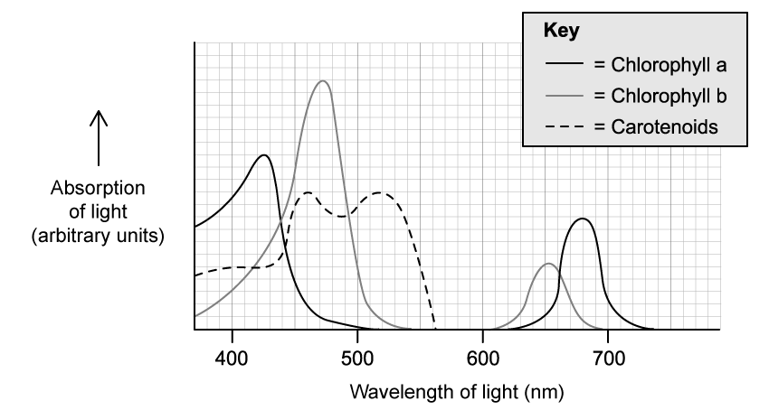
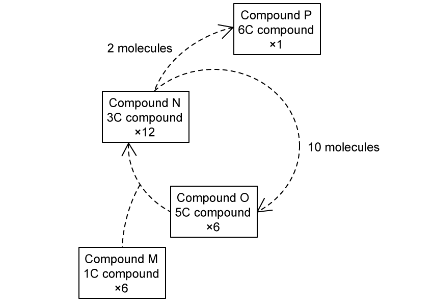
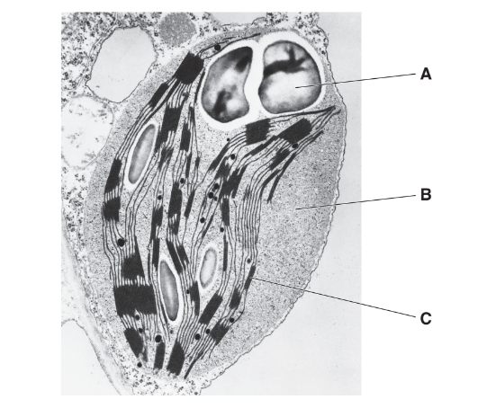
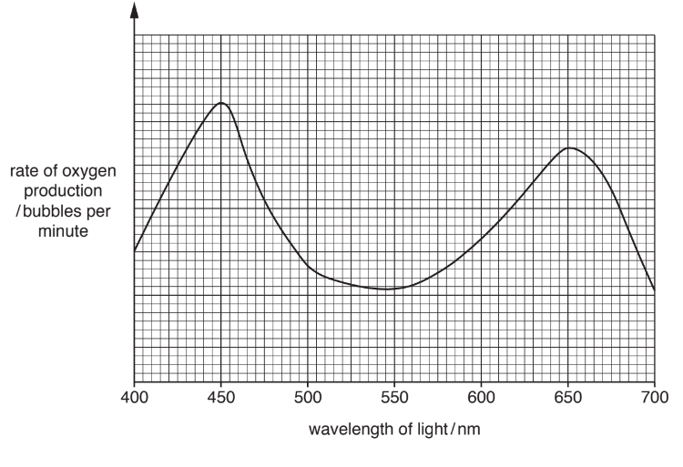
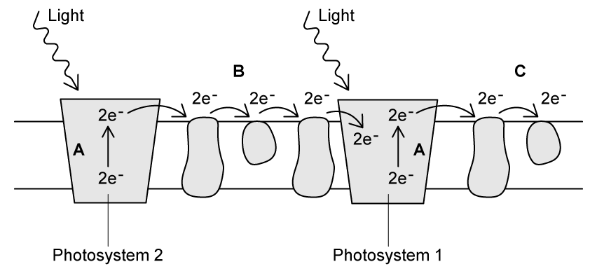
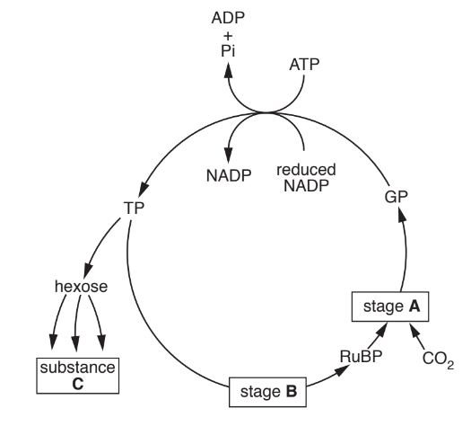
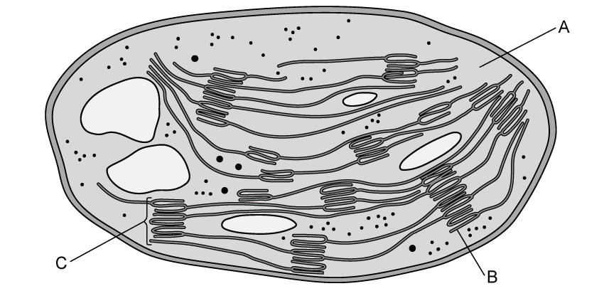
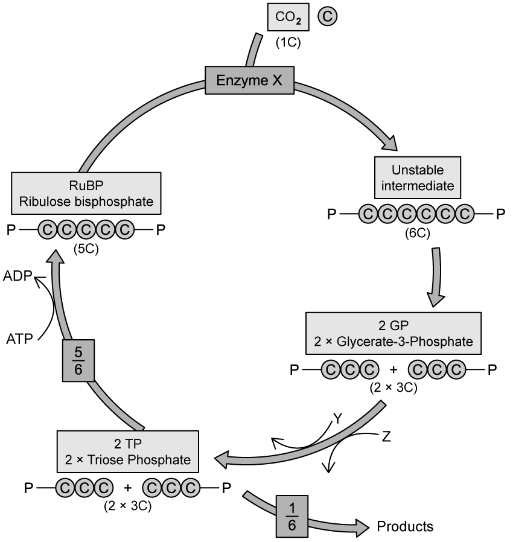
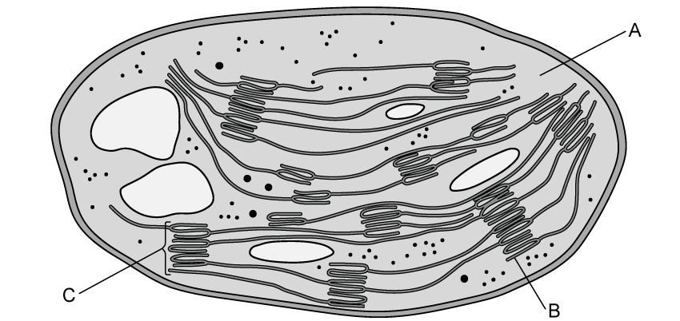

# Exam Questions — Photosynthesis as an Energy Transfer Process
**13. Photosynthesis** · Cambridge (CIE) A-LEVEL biology (9700)
> Source: [https://www.savemyexams.com/a-level/biology/cie/25/topic-questions/](https://www.savemyexams.com/a-level/biology/cie/25/topic-questions/) · 15 questions across 1 sets

## Structured Questions (15 questions)

### Q1 — hard — 11 marks

**Q1** [3 marks]

Fig. 1 shows the absorption spectra for three different photosynthetic pigments.

**Fig. 1**

Compare the absorption spectra of chlorophyll b and carotenoids shown in Fig.1.

**Q1** [2 marks]

**Extract:**

Fig. 1 shows the absorption spectra for three different photosynthetic pigments.

Fig. 1

With reference to Fig. 1:

(i) Suggest the colour of carotenoid pigments.

[1]

(ii) Explain your answer to part (i).

[1]

**Q1** [2 marks]

**Extract:**

Fig. 1 shows the absorption spectra for three different photosynthetic pigments.

**Fig. 1**

It is also possible to represent **action spectra** on a graph like that shown in Fig. 1.

(i) State how the information represented by an action spectrum is different to that represented by an absorption spectrum.

[1]

(ii) Sketch a suggested action spectrum onto the graph shown in Fig.1.

[1]

**Q1** [4 marks]

**Extract:**

Fig. 1 shows the absorption spectra for three different photosynthetic pigments.

A researcher wanted to investigate the wavelengths of light that hit the ground in a woodland area. They measured the wavelengths of direct sunlight and sunlight that had passed through the tree canopy. Fig. 2 shows their results.

**Fig. 2**

Only a small number of plant species are found on the ground below the trees in woodland areas.

Use Fig. 1 and 2 to suggest why.

### Q2 — hard — 8 marks

**Q2** [2 marks]

Paper chromatography can be used to separate photosynthetic pigments obtained from chloroplasts.

Fig. 1 shows the chromatography strip with distinct pigment bands.

**Fig. 1**

The four bands represent four pigments: chlorophyll a, chlorophyll b, xanthophylls and carotenes (but not necessarily in that order). A student suggests bands **3** and **4** most likely represent the two chlorophyll pigments.

Explain why the student is correct.

**Q2** [3 marks]

**Extract:**

Paper chromatography can be used to separate photosynthetic pigments obtained from chloroplasts.

Fig. 1 shows the chromatography strip with distinct pigment bands.

The four bands represent four pigments: chlorophyll a, chlorophyll b, xanthophylls and carotenes (but not necessarily in that order).

Describe how to accurately identify the pigments in the chromatogram shown in part (a).

**Q2** [1 mark]

The photosynthetic pigments from two aquatic algae, green alga genus *Oedogonium *and red alga genus *Palmaria,* were separated by thin layer chromatography.

Fig. 2 shows the chromatograms.

**Fig. 2**

*Palmaria *also contain a red pigment known as phycoerythrin. The pigment appears red because it absorbs blue light and reflects red light. The pigment phycoerythrin is absent from the chromatogram above.

Suggest why this might be.

**Q2** [2 marks]

**Extract:**

The photosynthetic pigments from two aquatic algae, green alga genus *Oedogonium* and red alga genus *Palmaria,* were separated by thin layer chromatography.

*Palmaria* also contain a red pigment known as phycoerythrin. The pigment appears red because it absorbs blue light and reflects red light.

Light of shorter wavelengths penetrates water to greater depths than light of longer wavelengths.

Using information here and from part (c), suggest why red algae such as *Palmaria* can live at greater depths than many other aquatic algae.

### Q3 — hard — 9 marks

**Q3** [5 marks]

The concentration of carbon dioxide gas in the air of a woodland changes over 24 hours. Carbon dioxide concentrations can also vary depending on the height above the ground at which a gas measurement is taken.

Explain the variation in carbon dioxide concentration in woodland over time and at different heights. Assume that there is no air movement caused by wind throughout the 24 hours.

**Q3** [2 marks]

A team of researchers investigated the effect of changing the carbon dioxide concentration on the levels of glycerate-3-phosphate (GP) and ribulose bisphosphate (RuBP) in photosynthesising cells.

Table 1 shows the results obtained when the carbon dioxide concentration was reduced.

**Table 1**

| Photosynthetic intermediate | Level before experiment / arbitrary units | Level after experiment / arbitrary units |   |
|---|---|---|---|
| 1.0% CO2 | 0.003% CO2 |   |   |
| RuBP | 18 | 18 | 37 |
| GP | 36 | 36 | 17 |

Explain the results for RuBP and GP at 0.003% carbon dioxide concentration.

**Q3** [2 marks]

**Extract:**

A team of researchers investigated the effect of changing the carbon dioxide concentration on the levels of glycerate-3-phosphate (GP) and ribulose bisphosphate (RuBP) in photosynthesising cells.

Table 1 shows the results obtained when the carbon dioxide concentration was reduced.

Table 1

| Photosynthetic intermediate | Level before experiment / arbitrary units | Level after experiment / arbitrary units |
| 1.0% CO~2~ | 0.003% CO~2~ |
| RuBP | 18 | 18 | 37 |
| GP | 36 | 36 | 17 |

The researchers carried out a similar experiment but increased the carbon dioxide concentration from 1.0 % to 2.0 %. The relative levels of GP and RuBP remained the same both before and after the experiment.

Explain **two** reasons why this might be the case.

### Q4 — hard — 10 marks

**Q4** [3 marks]

Corals grow in shallow seawater. Corals consist of colonies of small animals called polyps. These polyps have photosynthetic protoctists called algae within their cells, which is advantageous both to the coral polyps and to the algae.

The algae that live within the cells of coral polyps can also live independently as free-living algae.

The rate of photosynthesis of algae that live within the cells of coral polyps is higher than that of free-living algae.

Suggest **and **explain why the rate of photosynthesis in algae that live within the cells of coral polyps is higher than that of free-living algae.

*Source: Specimen 2022 9700/04 Q3A*

**Q4** [3 marks]

**Extract:**

Corals grow in shallow seawater. Corals consist of colonies of small animals called polyps. These polyps have photosynthetic protoctists called algae within their cells, which is advantageous both to the coral polyps and to the algae.

The algae that live within the cells of coral polyps have five different chloroplast pigments.

Table 1 shows the light wavelengths at which each algal chloroplast pigment shows its two largest peaks of light absorption.

**Table 1**

| **chloroplast** **pigment** | **peak 1** **wavelength / nm** | **peak 2** **wavelength / nm** |
|---|---|---|
| chlorophyll *a* | 430 | 662 |
| peridinin | 456 | 485 |
| chlorophyll c2 | 450 | 396 |
| dinoxanthin | 442 | 471 |
| β-carotene | 454 | 480 |

** **Corals can be kept in glass tanks that are usually lit by lamps radiating mainly violet and blue light, with wavelengths in the range of 400 nm to 490 nm.

With reference to Table 1, suggest why lamps radiating mainly violet and blue light are expected to increase the growth of **coral polyps** more than lamps radiating light of all wavelengths.

*Source: Specimen 2022 9700/04 Q3B*

**Q4** [4 marks]

Photosynthesis in the algae living within the cells of coral polyps is the same as photosynthesis in plant cells.

Outline the process of cyclic photophosphorylation.

*Source: Specimen 2022 9700/04 Q3C*

### Q5 — hard — 9 marks

**Q5** [3 marks]

Some species of deep ocean-living bacteria carry out the process of chemosynthesis. Chemosynthesis uses energy stored in chemicals such as methane, hydrogen sulfide (H2S) and carbon dioxide, to produce glucose.

A simplified example of a chemosynthesis reaction is shown below:

6CO2  + 12H2S → C6H12O6 + 6H2O + 12S

Use your knowledge of photosynthesis to suggest the role of hydrogen sulfide in chemosynthesis.

**Q5** [2 marks]

A suspension of photosynthetic pigments was isolated from another species of aquatic bacteria. A reagent that is blue when oxidised and colourless when reduced was added to the suspension.

The suspension of pigments in blue reagent was exposed to sunlight and the blue colour disappeared.

Explain this observation.

**Q5** [2 marks]

**Extract:**

A suspension of photosynthetic pigments was isolated from another species of aquatic bacteria. A reagent that is blue when oxidised and colourless when reduced was added to the suspension.

The suspension of pigments in blue reagent was exposed to sunlight and the blue colour disappeared.

In the same suspension, the concentration of glycerate-3-phosphate (GP) was also measured. It was found to increase during the addition of the blue reagent.

Explain this observation.

**Q5** [2 marks]

The bacteria species described in parts (b) and (c) live underwater at a depth of 5 metres. Most of the light that penetrates to this depth falls at wavelengths of between 400-600 nm.

Suggest which photosynthetic pigment(s) is/are likely to be most abundant in these bacterial cells. Explain your answer.

### Q6 — medium — 12 marks

**Q6** [3 marks]

Fig.1 shows a representation of the light independent stages of photosynthesis.

**Fig. 1**

From Fig.1, identify:

(i) Compound **M**.

[1]

(ii) Compound **O**.

[1]

(iii) The enzyme that catalyses the reaction between compounds **M** and **O**.

[1]

**Q6** [3 marks]

**Extract:**

Fig.1 shows a representation of the light independent stages of photosynthesis.

Fig. 1

From Fig.1, identify:

(i) Compound M.

(ii) Compound O.

(iii) The enzyme that catalyses the reaction between compounds M and O.

With reference to Fig.1 explain how the products of the light dependent reactions are used in the light independent reactions.

**Q6** [4 marks]

**Extract:**

Fig.1 shows a representation of the light independent stages of photosynthesis.

**Fig. 1**

Compound **P** is a product of the light independent reactions.

(i) Give **three** other molecules that could be formed from compound **P** inside plant cells.

[3]

(ii) Name the type of reaction that would convert compound **P** into a polymer.

[1]

**Q6** [2 marks]

**Extract:**

Compound **P** is a product of the light independent reactions.

(i) Give **three** other molecules that could be formed from compound **P** inside plant cells.

Compound P could be converted into...

Any **three** of the following:

- Starch; [1 mark]
- Sucrose; [1 mark]
- Cellulose; [1 mark]
- Glycerol/fatty acids/lipids; [1 mark]
- Amino acids; [1 mark]

Compound P is glucose, which can be converted into all of the molecules mentioned above.

Explain **one** reason why compound **P** is converted into other molecules such as those given in part c) i) rather than being stored as a six-carbon (6C) molecule in the cells.

### Q7 — medium — 14 marks

**Q7** [3 marks]

Chloroplasts contain photosynthetic pigments.

Describe the arrangement of the pigments inside a chloroplast.

**Q7** [4 marks]

**Extract:**

Chloroplasts contain photosynthetic pigments.

Describe the arrangement of the pigments inside a chloroplast.

Outline the following processes connected to the pigment arrangements described in part a):

(i) Photoactivation

[2]

(ii) Photolysis

[2]

**Q7** [3 marks]

**Extract:**

Outline the following processes connected to the pigment arrangements described in part a):

(i) Photoactivation

Photoactivation involves the following...

Any two of the following:

- Light energy is absorbed by (photosynthetic/accessory) pigments (before being funnelled to the primary pigment); [1 mark]
- Electrons in the reaction centre/chlorophyll a are excited / gain energy / raised to a higher energy level; [1 mark]
- Electrons are emitted from the photosystem/reaction centre/pigments / pass to an electron acceptor/the electron transport chain; [1 mark]

(ii) Photolysis

Photolysis involves the following...

- Water is split into hydrogen ions/protons AND electrons AND oxygen; [1 mark]
- The reaction is catalysed by an enzyme / oxygen-evolving complex / water-splitting complex in photosystem II; [1 mark]

In addition to the processes outlined in part b) the light dependent reactions of photosynthesis also involve the processes of oxidation and reduction.

Explain where oxidation and reduction occur during the light dependent reactions.

**Q7** [4 marks]

Pigment molecules are arranged in light-harvesting clusters known as photosystems: photosystem I (PSI) and photosystem II (PSII). These are involved in different photophosphorylation reactions of the light-dependent stage of photosynthesis.

(i) Identify the two types of photophosphorylation reactions that occur during the light-dependent stage of photosynthesis. [1]

(ii) Compare the two types of photophosphorylation.

[4]

### Q8 — medium — 8 marks

**Q8** [3 marks]

Fig. 1 is a transmission electron micrograph of a chloroplast.

**Fig. 1**

Many compounds and structures involved in photosynthesis are located in a chloroplast.

Using the labels **A**,** B **or **C**, complete Table 1 to show the location of four of these compounds or structures.

You may use each of the letters **A**,** B **and** C** once, more than once, or not at all.

**Table 1**

| **compound or structure** | **location** |
|---|---|
| ATP synthase |   |
| rubisco |   |
| starch grain |   |
| phospholipid bilayer |   |

*Source: Oct/Nov 2018 9700/41 Q7A*

**Q8** [3 marks]

*Elodea canadensis* is an aquatic plant that lives submerged in freshwater.

Equal‐sized plants of *E. canadensis* were exposed to different wavelengths of light for the same period of time. As each plant photosynthesised, the number of bubbles of oxygen leaving the plant was counted.

For each wavelength, the rate of oxygen production was calculated.

The results are shown in Fig. 2.

**Fig. 2**

Describe **and** explain the results shown in Fig. 2

*Source: Oct/Nov 2018 9700/41 Q7B*

**Q8** [2 marks]

Chlorophyll b, carotene and xanthophyll are known as accessory pigments.

Describe the role of the accessory pigments in photosynthesis.

*Source: Oct/Nov 2018 9700/41 Q7C*

### Q9 — medium — 12 marks

**Q9** [3 marks]

Fig. 1 shows some of the events of the light independent reactions.

**Fig. 1**

(i) Identify the process shown in Fig.1.

[1]

(ii) Give **two** reasons for your answer to part (i).

[2]

**Q9** [4 marks]

**Extract:**

Fig. 1 shows some of the events of the light independent reactions.

**Fig. 1**

The element cadmium, sometimes present in polluted soils, is toxic to plants even at low concentrations. Research has shown that cadmium can bind to photosystem II, impacting the process marked **A** in Fig 1.

(i) Name the process marked **A **in Fig.1.

[1]

(ii) With reference to your answer to part i), outline the impact that cadmium would have on photosynthesis.

[3]

**Q9** [5 marks]

**Extract:**

Fig. 1 shows some of the events of the light independent reactions.

The process shown in Fig.1 is non-cyclic photophosphorylation. It involves photosystems I and II / photosystem II is present, and electrons do not return to their starting point / are passed to a different photosystem.

The element cadmium, sometimes present in polluted soils, is toxic to plants even at low concentrations. Research has shown that cadmium can bind to photosystem II, impacting the process marked **A** in Fig 1.

Describe the process taking place at the position marked **B** in Fig.1.

### Q10 — medium — 8 marks

**Q10** [3 marks]

Fig.1 is an outline diagram of the Calvin cycle.

**Fig. 1**

With reference to Fig. 1, describe stage **A **of the Calvin cycle.

**Q10** [2 marks]

**Extract:**

Fig.1 is an outline diagram of the Calvin cycle.

Outline the importance of the light-dependent reactions in allowing stage **B** of the Calvin cycle, as indicated in Fig. 1, to proceed.

**Q10** [3 marks]

**Extract:**

Fig.1 is an outline diagram of the Calvin cycle.

**Fig. 1**

Substance **C **in Fig. 1 represents a variety of complex organic molecules.

Give **three** named examples of substance **C **and the Calvin cycle intermediates from which these examples are produced.

### Q11 — easy — 9 marks

**Q11** [2 marks]

Fig. 1 shows an electron microscope image of a chloroplast.

**Fig. 1**

(i) Identify structure **B** in Fig. 1.

[1]

(ii) State the role of structure **B **in photosynthesis.

[1]

**Q11** [2 marks]

Fig. 1 is an electron microscope image.

Explain why an electron microscope rather than a light microscope is needed to view the internal structures of chloroplasts.

**Q11** [2 marks]

The large, pale coloured structures inside the chloroplast in Fig. 1 are starch granules.

Explain why starch granules are present inside chloroplasts.

**Q11** [3 marks]

**Extract:**

Fig. 1 shows an electron microscope image of a chloroplast.

(i) Identify structure **B** in Fig. 1.

Structure B can be identified as thylakoid/thylakoid membrane.

The part of the chloroplast labelled **B** in Figure 1 contains various photosynthetic pigments.

(i) State the role of photosynthetic pigments in photosynthesis.

[1]

(ii) Explain the advantage of the presence of **various** photosynthetic pigments.

[2]

### Q12 — easy — 7 marks

**Q12** [1 mark]

Fig. 1 below shows the reactions of the Calvin cycle.

**Fig. 1**

Identify **Enzyme X **in Fig. 1

**Q12** [2 marks]

**Extract:**

Fig. 1 below shows the reactions of the Calvin cycle.

Identify the molecules required at the positions marked **Y **and **Z **to convert GP into TP.

**Q12** [2 marks]

One of the products produced from TP is hexose sugars.

Give **two** uses for hexose sugars inside plant cells.

**Q12** [2 marks]

**Extract:**

One of the products produced from TP is hexose sugars.

Identify **one** other product that is made during the Calvin cycle and state its role inside plant cells.

### Q13 — easy — 6 marks

**Q13** [1 mark]

Most plants appear green to the human eye.

With reference to chlorophyll, explain why plants are green.

**Q13** [2 marks]

The effect of different colours of light on the growth of *Arabidopsis thaliana* (thale cress) seedlings was studied.

Three different colours of light were tested and measurements of seedling height, shoot length, and biomass were taken. The results of the study are shown in Table 1 below.

**Table 1**

| Colour of light | Wavelength of light / nm | Height of seedlings / cm | Shoot length / cm | Total biomass / g |
|---|---|---|---|---|
| Blue | 450 | 2.3 | 2.0 | 2.4 |
| Orange | 600 | 3.5 | 2.8 | 2.8 |
| Red | 630 | 7.4 | 6.1 | 3.7 |

State what can be concluded about the effect of different colours of light on the growth of *Arabidopsis thaliana *from the data shown.

**Q13** [1 mark]

Oxygen is waste product of photosynthesis.

Identify the process by which this oxygen is produced.

**Q13** [2 marks]

State the **two** products of the light-dependent stage of photosynthesis.

### Q14 — easy — 6 marks

**Q14** [2 marks]

Photosynthesis is spilt into two sets of reactions. The first set of reactions involves a process known as photoactivation.

Describe the events of photoactivation.

**Q14** [2 marks]

Photoactivation can occur during either cyclic or non-cyclic photophosphorylation.

State **two** differences between cyclic and non-cyclic photophosphorylation.

**Q14** [1 mark]

The second set of reactions during photosynthesis rely on the activity of the enzyme rubisco.

State the precise location of the enzyme rubisco.

**Q14** [1 mark]

Describe the role of the enzyme rubisco in photosynthesis.

### Q15 — easy — 8 marks

**Q15** [3 marks]

Fig. 1 below shows a diagram of a chloroplast.

**Fig. 1**

Identify the parts of a chloroplast labelled **A **- **C** in Fig. 1.

**Q15** [1 mark]

**Extract:**

Fig. 1 below shows a diagram of a chloroplast.

The part of the chloroplast labelled **B** in Fig. 1 contains various photosynthetic pigments.

Suggest why chloroplasts contain more than one different photosynthetic pigment.

**Q15** [2 marks]

The pigments in a chloroplast can be separated and identified using a technique called thin-layer chromatography.

After extracting pigments from a spinach leaf, a student carried out thin-layer chromatography.

Some of their results can be seen in Fig. 2 below.

**Fig. 2**

Use the equation provided to calculate the Rf values for pigments **X **and **Y **in Fig. 2.

$\mathrm{Rf}=\frac{\mathrm{Distance} \mathrm{moved} \mathrm{by} \mathrm{pigment}}{\mathrm{Distance} \mathrm{moved} \mathrm{by} \mathrm{the} \mathrm{solvent}}$

**Q15** [2 marks]

**Extract:**

The pigments in a chloroplast can be separated and identified using a technique called thin-layer chromatography.

After extracting pigments from a spinach leaf, a student carried out thin-layer chromatography.

Some of their results can be seen in Fig. 2 below.

Z6gEpBOj_2-2

Fig. 2

Use the equation provided to calculate the R~f~ values for pigments X and Y in Fig. 2.

Rf space equals fraction numerator space Distance space moved space by space pigment over denominator Distance space moved space by space the space solvent end fraction

The R~f~ values for pigments X and Y in Fig. 2 are...
- X = 0.55; [1 mark]
- Y = 0.94; [1 mark]

Table 1 contains value ranges for the Rf values of some common photosynthetic pigments.

**Table 1**

| **pigment** | **R****f**** value range** |
|---|---|
| carotene | 0.89 - 0.95 |
| neoxanthin | 0.05 - 0.11 |
| chlorophyll a | 0.64 - 0.69 |
| chlorophyll b | 0.53 - 0.62 |
| pheophytin a | 0.78 - 0.86 |

Use your answers to part (c) to identify pigments **X** and **Y** from Fig. 2.
