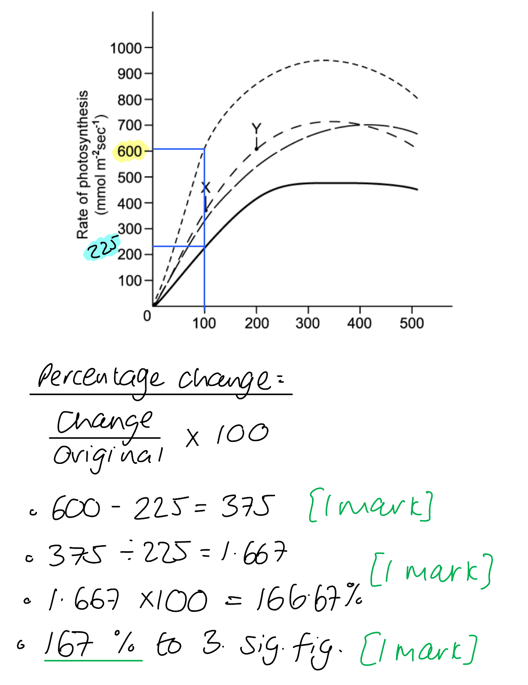
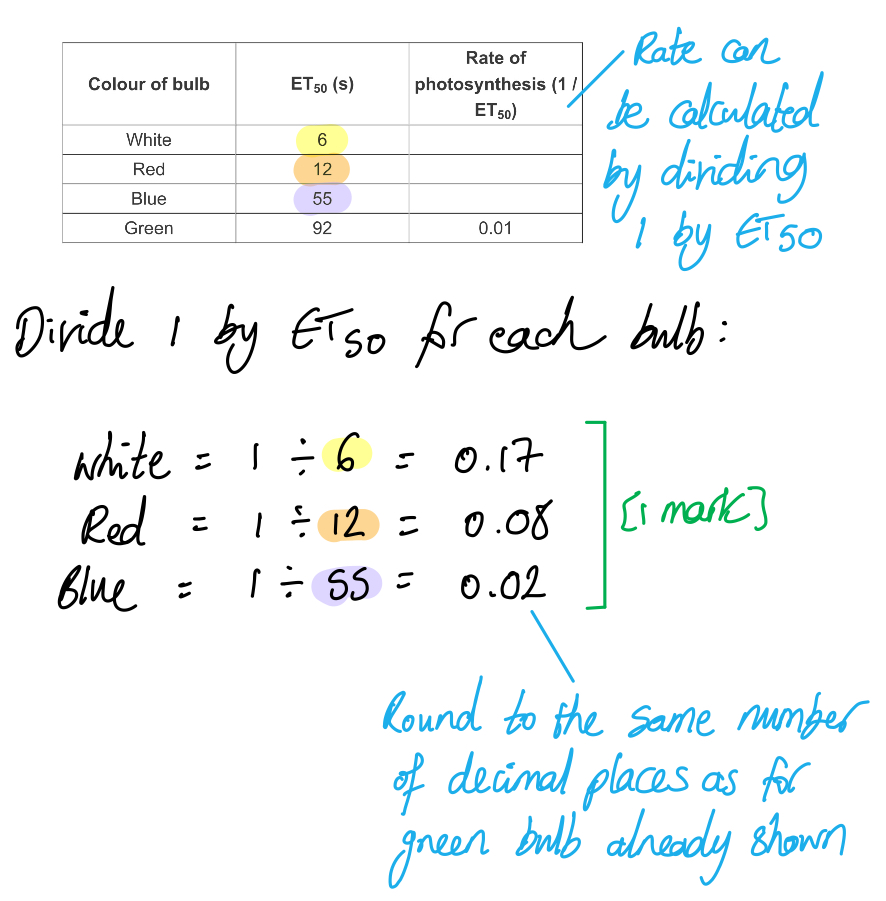
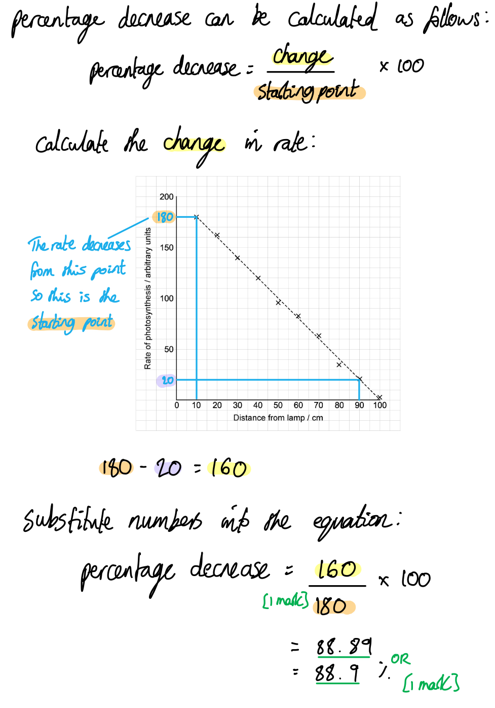
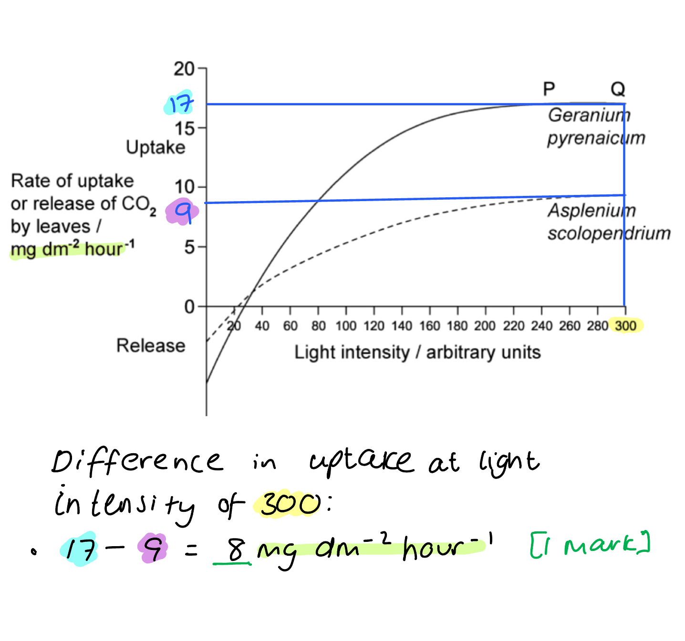
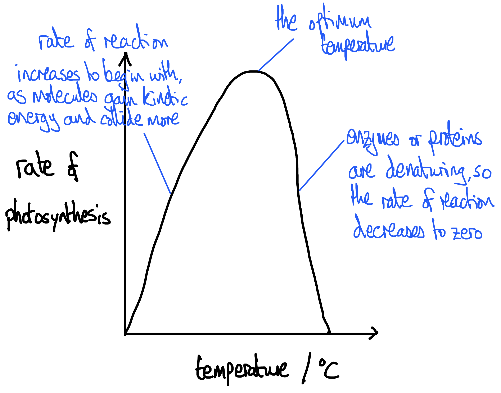

# Mark Schemes — Investigation of Limiting Factors
**13. Photosynthesis** · Cambridge (CIE) A-LEVEL biology (9700)

## Structured Questions (15 questions)

### Q1
It is important that the isolation medium is at the same solute concentration as the spinach cells because...

- This prevents water from moving into / out of the <u>chloroplasts</u> by osmosis; **[1 mark]**
- Prevents damage to the chloroplast membranes / prevents the chloroplasts from bursting; **[1 mark]**

**[Total: 2 marks]**

> *Remember here that it is the activity of the chloroplasts that is being investigated so it doesn't matter if the plant cells themselves are damaged: in fact, it is likely that they may already have been damaged during the preparation of the chloroplast suspension. It is the chloroplast function that needs to be maintained: if they burst then all of the components that need to be close together for photosynthesis to occur will be dispersed and the reaction will not happen as normal.*
(i) The purpose of tube **X** is to...

- Demonstrate that it is the presence of the chloroplasts (and not the isolation medium) that causes the colour change/reduction of DCPIP; **[1 mark]**

(ii) The purpose of tube **Y** is to...

- Demonstrate that it is light that causes the colour change/reduction of DCPIP (and not the mixing together of the different components) **OR** demonstrate that light is required to cause the colour change / reduction of DCPIP; **[1 mark]**

(iii) The purpose of tube **Z** is to...

- Show the colour of the tube in the absence of DCPIP / provide a reference for the point at which DCPIP has become colourless; **[1 mark]**

**[Total: 3 marks]**

> *When DCPIP is reduced its colour changes from deep blue to colourless. The light dependent reactions cause electrons to be released, reducing DCPIP to its colourless form.*

> *Tubes **X** and **Y** are control tubes showing that it is certain variables that are causing the colour change and not others.*

> *Tube **Z** is a reference tube. Chloroplasts in suspension have their own colour, a scientist will not observe a colourless tube but a green one; tube **Z** shows the exact shade of green at which DCPIP has become colourless.*
The results shown in Fig. 1 are due to...

- As light intensity increases / distance between the lamp and tube decreases photoactivation/photolysis occurs faster / more / at a higher rate; **[1 mark]**
- More electrons pass to the electron transport chain; **[1 mark]**
- These electrons pass to DCPIP instead of to NADP (causing it to become colourless); **[1 mark]**

**[Total: 3 marks]**
The farmer was advised not to use ammonium hydroxide weedkiller on their crop fields because...

- The light dependent reactions / production of reduced NADP/NADPH occurs / will be inhibited (by ammonium hydroxide) in <u>all plants</u>; **[1 mark]**
- (Ammonium hydroxide) will kill the crop plants as well as the weeds; **[1 mark]**

**[Total: 2 marks]**

> *Ammonium hydroxide is highly toxic to all living cells, and prevents the formation of NADPH in photosynthesis; it is therefore not a good choice of weedkiller in any situation where some organisms need to be kept alive. It might work well on a pavement or a patio, but would kill off any desired plants/crops along with the weeds in a field or flower bed.*

### Q2
Radioactively labelled carbon dioxide is fixed into radioactive substances in the leaves of the plant in Fig.1 by...

**Final answer:** **Any ****three**** of the following:**

- (Radioactively labelled) carbon dioxide diffuses into plant leaves through the stomata; **[1 mark]**
- Carbon dioxide is (fixed by being) combined with RuBP/ribulose bisphosphate; **[1 mark]**
- (The reaction) is catalysed by rubisco/ribulose bisphosphate carboxylase; **[1 mark]**
- The resulting (unstable, 6C) compound splits into two molecules of (3C) GP/glycerate-3-phosphate; **[1 mark]**

**[Total: 3 marks]**

> *Carbon fixation is the removal of carbon from the atmosphere and its incorporation into the biological molecules of the plant. Your answer should therefore include the stages by which the carbon dioxide leaves the air surrounding the plant and becomes a stable molecule inside the leaf.*
The results shown in Fig. 1 when the plant is moved into the dark are due to...

**Final answer:** **Any ****four**** of the following:**

- The light dependent reactions / photophosphorylation stops; **[1 mark]**
- The supply of ATP **AND** NADPH/reduced NADP (to the Calvin cycle) stops; **[1 mark]**
- RuBP continues to be converted into GP; **[1 mark]**
- GP cannot be converted into TP/triose phosphate (so GP builds up); **[1 mark]**
- TP cannot be converted into RuBP / RuBP cannot be regenerated (so RuBP levels drop); **[1 mark]**

**[Total: 4 marks]**

> *In the absence of light, the light-dependent reactions can no longer occur so ATP and NADPH are not produced for the Calvin cycle. The parts of the Calvin cycle that do not require these products continue, so RuBP is converted into GP when carbon dioxide is fixed, but this GP cannot be converted into TP, as this process requires ATP and NADPH. GP builds up inside the leaf as a result of this. The conversion of TP into RuBP also stops as the supply of TP will drop and there is no ATP to power the process, so RuBP levels decrease.*
Photorespiration reduces the efficiency of photosynthesis because...

**Final answer:** **Any ****two**** of the following:**

- No TP / hexose sugars are produced; **[1 mark]**
- Carbon dioxide is lost rather than fixed; **[1 mark]**
- Less GP enters the Calvin cycle / only 1 GP molecule enters the Calvin cycle rather than 2; **[1 mark]**
- More ATP will be needed (to transfer molecules between different organelles / fuel the many chemical reactions); **[1 mark]**

**[Total: 2 marks]**

> *Even though you are not required to have knowledge of photorespiration, you should still be able to apply your knowledge of the Calvin cycle to a question like this. Consider the important elements of the Calvin cycle (i.e. that it fixes carbon into GP and produces hexose sugars) and look at how these elements are affected by photorespiration; less GP is produced, carbon dioxide is released, and no TP is produced at all. You can also look at the additional information provided here, such as the idea that the process occurs across several organelles and contains many more chemical reactions; these features suggest that more ATP will be required, even if this isn't directly stated in the diagram. *
The enzyme (rubisco) could be improved by...

**Final answer:** **Any ****two**** of the following:**

- Genetic engineering/modification / altering the base sequence to alter the gene for the enzyme (rubisco); **[1 mark]**
- Altering the active site of the enzyme to make it more specific to carbon dioxide / no longer complementary to oxygen; **[1 mark]**
- Adding a non-competitive inhibitor that changes the active site shape (so that it no longer binds to oxygen); **[1 mark]**
- Carry out screening/testing to find plant species/varieties with a more efficient enzyme; **[1 mark]**
- Carry out selective breeding to increase the frequency of the efficient enzyme in a plant variety; **[1 mark]**

**[Total: 2 marks]**

> *While you are not expected to know exactly how the improvement of the enzyme rubisco could be achieved, your knowledge of enzyme structure and function should allow you to make some good suggestions here. Enzymes are proteins so their structure can be changed by altering the base sequence of the genes that code for them. Non-competitive inhibitors can also alter the structure of an active site. The active site would need to be altered in such a way that it is more complementary/specific to carbon dioxide and less complementary to oxygen. An alternative to altering the existing enzyme would be searching for a more efficient version of the enzyme among species and varieties that already exist. Selective breeding could be used to increase the frequency of the efficient enzyme in a particular variety, e.g. an important crop.*

### Q3
The measurements the student should take to determine the rate of photosynthesis are:

- Oxygen production/concentration **AND **time; **[1 mark]**

**[Total: 1 mark]**

> *Other measurements can be investigated to determine the rate of photosynthesis, such as the uptake of carbon dioxide, however, the question asks you to refer to Fig. 1 which shows an oxygen meter as part of the apparatus. *
The pH of the suspension would change over time as follows...

- The pH would increase / become more alkaline; **[1 mark]**
- Carbon dioxide is removed (from the solution) during photosynthesis / by the Calvin cycle; **[1 mark]**
- Carbon dioxide causes solutions to become more acidic / increases the H+ ion concentration in a solution; **[1 mark]**

**[Total: 3 marks]**
(i) The rate of photosynthesis peaks at 460 nm and 660 nm wavelength of light because...

- These wavelengths are absorbed by photosynthetic pigments; **[1 mark]**
- The algal cells contain chlorophyll / chlorophyll *a* / chlorophyll *b *(which absorb light at both of these wavelengths); **[1 mark]**

(ii) Fig. 2 shows an...

- Action spectrum **AS** it shows the rate of photosynthesis rather than the extent to which light is absorbed (at any given wavelength); **[1 mark]**

**[Total: 3 marks]**
(i) The precise stage of photosynthesis in algae chloroplasts that is affected by an increased salt concentration is...

- <u>Non-cyclic</u> photophosphorylation; **[1 mark]**

> *PSII is only involved with non-cyclic photophosphorylation, so a reduction in oxygen production by PSII indicates that this stage of photosynthesis has been disrupted.*

(ii) The effect that increasing salt concentration has on photosynthesis in algae chloroplast can be explained as follows:

- Salt concentration affects the activity of the enzyme / active site / oxygen-evolving complex on photosystem/PS II; **[1 mark]**
- Salt concentration affects the rate of photolysis; **[1 mark]**

> *PSII contains an **enzyme** that catalyses the breakdown of water through photolysis; a reduction in the activity of this enzyme will **slow down photolysis** and result in reduced oxygen production.*

(iii) The effect shown in Fig. 3 will affect other parts of the photosynthesis reactions as follows:

**Final answer:** **Any ****three**** of the following:**

- Fewer electrons will be released **SO** the electrons lost from PSII will not be replaced and non-cyclic photophosphorylation will stop / be slowed further; **[1 mark]**
- Fewer hydrogen ions will be released **SO **less NADP will be reduced / less NADPH will be produced; **[1 mark]**
- Fewer hydrogen ions / reduced passage of electrons along the transport chain to generate a proton gradient **SO** less ATP generated by ATP synthase / chemiosmosis; **[1 mark]**
- Less ATP/NADPH enters the Calvin cycle **SO** less GP converted to TP / less TP recycled to RuBP; **[1 mark]**

> *A reduction in the rate of photolysis doesn't only affect oxygen production, it also means that **fewer electrons** and **fewer protons** are released. The electrons released during photolysis replace those lost from PSII during photoactivation, so a failure to replace these electrons could further slow down non-cyclic phosphorylation. The protons are used to reduce NADP and to drive the production of ATP through chemiosmosis via ATP synthase. A** reduction in ATP and NADPH** production will have a knock-on effect on the reactions of the **Calvin cycle**, which relies on these products.*

**[Total: 6 marks]**

### Q4
The limiting factors between X and Y are...

- Light intensity **AND** temperature; **[1 mark]**

**[Total: 1 mark]**

> *Look carefully at the graph and the information provided to help you identify the limiting factors. *
An explanation of the limiting factors is...

- An increase in temperature (from the Present day at 16 oC to Warming at 19 oC) causes an increase in the rate of photosynthesis; **[1 mark]**
- An increase in light / higher light intensity (from 100 Lux to 200 Lux) causes an increase in the rate of photosynthesis ; **[1 mark]**

**[Total: 2 marks]**

> *Be sure to use the information in Fig. 1 here rather than just talking generally about limiting factors; the question specifically asks you to use information from the graph so you must follow this instruction. *
The results of the investigation show...

**Final answer:** **Any ****four ****of the following:**

- The rate of photosynthesis is greatest under acidification conditions; **[1 mark]**
- The rate of photosynthesis is lowest under present-day conditions; **[1 mark]**
- Higher rates of photosynthesis are seen in the elevated CO2 conditions (acidification and greenhouse); **[1 mark]**
- Elevated temperature conditions (warming and greenhouse) had similar effects on the photosynthetic rates; **[1 mark]**
- Correctly quoted data points to support each marking point; **[1 mark]**

**[Total: 4 marks]**
The percentage difference is...

- (375 ÷ 225) x 100 **OR** 166.667 (%); **[1 mark]**
- To 3 s.f. 167 (%); **[1 mark]**

***Accept ****error carried forward if wrong figures read from the graph*

**[Total: 2 marks]**

### Q5
(i) An advantage to *Costasiella Kuroshimae *in carrying out kleptoplasty is...

- Glucose can (still) be produced in times of food scarcity through photosynthesis; **[1 mark]**
- Therefore respiration reactions can still occur / metabolic reactions can still occur; **[1 mark]**

(ii) Factors that may limit the rate of photosynthesis in kleptoplasts are...

- Carbon dioxide supply/concentration **and** light intensity **and **temperature; **[1 mark]**

**[Total: 3 marks]**

> *The only animals capable kleptoplasty are some marine flatworms and sea slugs belonging to the Sacoglossan clade. The root word klepto- comes from the Greek word for "thief". Organisms capable of kleptoplasty eat algae and “steal” the undigested chloroplasts. This is a bizarre phenomenon and research is still underway into how these animals can determine, within their digestive pathways, which parts are chloroplast and which is tissue for digestion. *

> *The three key factors which may limit the rate of photosynthesis in kleptoplasts are the same limiting factors of photosynthesis in producers.*
The molecule that represents reduced DCPIP is...

- D; **[1 mark]**
- DCPIP (in its oxidised state) accepts electrons in the place of NADP forming reduced DCPIP (instead of reduced NADP); **[1 mark]**

**[Total: 2 marks]**

> *Molecule A is ADP which combines with Pi to form molecule B, which is ATP. Molecule E is water which splits in photolysis to donate electrons to the chlorophyll, hydrogen protons which are part of the reduction process and oxygen which is lost as a waste product.*
The results shown in Fig. 2 can be explained by...

- DCPIP reduced at greatest rate in red light / greatest amount of electrons excited in red light **therefore** highest rate of photosynthesis (is in red light); **[1 mark]**
- DCPIP remained in oxidised form in green light / little/few/no electrons excited in green light **therefore **lowest rate of photosynthesis (is in green light); **[1 mark]**
- DCPIP was reduced in blue light / electrons were excited in blue light **therefore **photosynthesis is occuring at a faster rate than in green light / at a slower rate than in red light; **[1 mark]**

**[Total: 3 marks]**

> *Green light was mostly reflected by the kleptoplasts (chloroplasts) and this was seen by the highest absorbance by the colorimeter. This tells us that DCPIP remained blue and so was not reduced, meaning that little/no electrons from photosystems were excited by green light. In contrast, in red light we can see less absorbance by the colorimter, therefore this means that DCPIP lost its blue colour and was colourless, telling us that in red light photosystems reacted and released electrons which were accepted by DCPIP and it was reduced to its colourless form. When electrons are excited, photosynthesis occurs therefore the greatest rates of photosynthesis would be seen in red light. *
The depth of the ocean *Costasiella kuroshimae* would be best adapted to is...

- 0 - 7.5 m; **[1 mark]**
- This is the penetrable depth of red light **and** red light has the highest rate of photosynthesis (in *Costasiella kuroshimae's *kleptoplasts*)*; **[1 mark]**

***Accept ****any number in the range 0 - 7.5 m for marking point 1*

**[Total: 2 marks]**

### Q6
You would carry out an investigation into the effect of wavelength of light on the rate of photosynthesis of a plant, using a redox indicator such as DCPIP, as follows...

**Final answer:** **Any ****eight**** of the following:**

- (The reaction is known as the) Hill reaction; **[1 mark]**
- Oxidised DCPIP is blue; **[1 mark]**
- DCPIP is colourless when reduced; **[1 mark]**
- Crush leaves in an isolation medium (to make a chloroplast extract); **[1 mark]**
- (Isolation medium should) contain a buffer solution / have the same water potential as the chloroplasts; **[1 mark]**
- Expose the chloroplasts and DCPIP to a (specific) wavelength of light; **[1 mark]**
- Measure the time taken for the blue colour to disappear **OR** leave solution for a fixed amount of time and measure with a colorimeter; **[1 mark]**
- Calculate the rate of reaction as 1/t **OR** calculate the change in colour value (from colorimeter) divided by time; **[1 mark]**
- Test (at least) five wavelengths; **[1 mark]**
- Carry out (at least) three repeats **OR** calculate a mean result (for each wavelength); **[1 mark]**
- Plot wavelength on *x-*axis against rate on *y*-axis; **[1 mark]**

**[Total: 8 marks]**

> *Note that this question wants you to provide an **experimental method**, not an explanation of the biochemistry of the Hill reaction. You need to describe the steps that you would take, including ways of changing your **independent variable **(light wavelength), measuring your **dependent variable **(time taken for colour change), and ensuring that your results would be **valid **(e.g. carrying out repeats and calculating a mean).*

### Q7
(i) The limiting factor between points **A** and **B** is...

- Temperature; **[1 mark]**

(ii) The reason for this is that...

- As temperature increases (on the x axis), so the rate of photosynthesis / uptake of carbon dioxide increases; **[1 mark]**

**[Total: 2 marks]**

> *Light intensity is high between **A** and **B**, so this cannot be a limiting factor. *
Increasing light intensity affects the rate of photosynthesis in the following ways...

**Final answer:** **Any ****three**** of the following:**

- At higher light intensities the rate of photosynthesis is always higher / the plant at the highest light intensity has the highest rate of photosynthesis **and** the plant with the lowest light intensity has the lowest rate of photosynthesis; **[1 mark]**
- The higher the light intensity, the higher the optimum temperature for photosynthesis / the higher the temperature when the maximum rate of photosynthesis is reached **OR** the plant at the highest light intensity has the highest optimum temperature for photosynthesis / reaches its maximum rate at the highest temperature **and** the plant with the lowest light intensity has the lowest optimum temperature / reaches its maximum rate at the lowest temperature; **[1 mark]**
- The higher the light intensity, the higher the temperature when the rate of photosynthesis drops to zero **OR **the rate of photosynthesis for the plant at the highest light intensity reaches zero at the highest temperature **and** the rate of photosynthesis for the plant at the lowest light intensity reaches zero at the lowest temperature; **[1 mark]**
- Data points correctly quoted from Fig. 4.1 to support any of the above points; **[1 mark]**

**[Total: 3 marks]**

> *It is always a good idea to back up any descriptions of data with numbers to support your point.*
The effect of temperature on the rate of photosynthesis is due to...

- At high temperatures (in this case about around 30 degrees) proteins/enzymes denature; **[1 mark]**
- (Photosynthesis relies on the action of) rubisco/electron transport proteins/electron carriers/ATP synthase; **[1 mark]**

**AND**

**Final answer:** **Any ****one**** relevant point from the following:**

- In the absence of functioning rubisco, carbon dioxide cannot be fixed/combined with RuBP to make GP; **[1 mark]**
- In the absence of functioning electron transport proteins/electron carriers energy cannot be released as electrons pass down the electron transport chain / hydrogen ions cannot be pumped across the thylakoid membrane / NADP cannot be reduced; **[1 mark]**
- In the absence of functioning ATP synthase ATP cannot be produced during chemiosmosis; **[1 mark]**

***Accept**** correct answers relating to the breakdown of membrane structure at high temperatures.*

**[Total: 3 marks]**

> *Photosynthesis relies on the action of several essential proteins, such as the proteins of the electron transport chain, ATP synthase, and rubisco. If these proteins denature at high temperatures then the process of photosynthesis will become less efficient and eventually stop*
Carbon dioxide uptake does not give a true measure for the rate of photosynthesis because...

- Carbon dioxide is produced during respiration; **[1 mark]**
- This reduces the amount of carbon dioxide that needs to be taken up from the atmosphere / enables the plant to photosynthesise at a higher rate than its atmospheric uptake would suggest; **[1 mark]**

**[Total: 2 marks]**

> *It is essential to remember that plants respire as well as carry out photosynthesis. These reactions are the reverse of each other, so at certain rates of reaction they cancel each other out, meaning that the plant will neither release nor take up carbon dioxide; this is known as the compensation point. It is worth noting that during the day when light is available the reaction of photosynthesis will always have a greater impact on gas uptake and production than respiration.*

### Q8
The term limiting factor refers to...

**Final answer:** **Any ****seven**** of the following:**

- Photosynthesis is affected by several factors (e.g. light intensity, carbon dioxide concentration); **[1 mark]**
- (The limiting factor is) the factor that is in shortest supply; **[1 mark]**
- (Therefore) preventing the rate (of photosynthesis) from increasing / restricting rate; **[1 mark]**

*Knowledge of limiting factors is used to increase crop yields in glasshouses*

- <u>Light intensity</u> **AND** <u>temperature</u> **AND** <u>carbon dioxide concentration</u>; **[1 mark]**
- Artificial light / lamps to provide light at night; **[1 mark]**
- Use heaters / control ventilation; **[1 mark]**
- CO2 from cylinders / dry ice / combustion; **[1 mark]**
- Automation / computerised control (to keep levels constant); **[1 mark]**
- Optimum conditions; **[1 mark]**
- Sprinklers **OR** humidity control **OR** fertiliser; **[1 mark]**

**[Total: 7 marks]**

> *This question asks for practical applications of knowledge of limiting factors, so you should **give examples** of how this knowledge might affect the methods used to maximise growth in a greenhouse.*

### Q9
The rate of photosynthesis for white, red, and blue bulbs are...

**Final answer:** **[1 mark] to be awarded collectively for:**

- White = 0.17
- Red = 0.08
- Blue = 0.02

**[Total: 1 mark]**

> *The calculation is provided for you in the table, along with one correct answer for the green light bulb. All you need to do is divide 1 by the ET**50** for each bulb.*

Sodium hydrogen carbonate solution was used because...

- This increases the availability of carbon dioxide (in the water/solution surrounding the leaf discs); **[1 mark]**
- This prevents carbon dioxide from becoming a limiting factor; **[1 mark]**

**[Total: 2 marks]**
The results in Table 1 can be explained as follows...

**Final answer:** **Any ****five**** of the following:**

- Light energy is absorbed by (photosynthetic) pigments / photosystems; **[1 mark]**
- Photolysis occurs / water is split, releasing hydrogen ions/H+/protons, electrons, and oxygen; **[1 mark]**
- Oxygen gas accumulates in the leaf air spaces, causing (the discs) to float; **[1 mark]**
- White light (contains all wavelengths of visible light so) can be absorbed by all pigments **SO **provides a lot of / the most energy (for photolysis); **[1 mark]**
- Red/blue light is only absorbed by some pigments / not absorbed by all pigments **SO** provides less energy (for photolysis than white light); **[1 mark]**
- Green light is not absorbed by most pigments / is only absorbed by carotenoid pigments **SO** provides little energy (for photolysis); **[1 mark]**

***Ignore**** attempts to explain the low rate of photosynthesis under blue light.*

**[Total: 5 marks]**

> *The low rate of photosynthesis here for blue light doesn't really make much sense given what you will have learned about absorption spectra so far; this question doesn't require you to explain this other than noting that blue light alone has a lower rate of photosynthesis than white light.*
The role of accessory pigments is to...

**Final answer:** **Any ****two**** of the following:**

- Absorb light energy for photolysis / photoactivation / to excite electrons; **[1 mark]**
- Funnel/channel/pass light energy to the primary pigment / reaction centre / chlorophyll a; **[1 mark]**
- Absorb light wavelengths not absorbed by chlorophyll a / additional light energy **OR** to increase the efficiency of light absorption; **[1 mark]**

**[Total: 2 marks]**

### Q10
(i) Volume of oxygen produced can be used as a measure of the rate of photosynthesis because...

- (Oxygen is produced as) a product of photolysis / from the breakdown of water during the light dependent reaction; **[1 mark]**

(ii) The precise location at which photolysis occurs is...

- The thylakoid membrane / photosystem II; **[1 mark]**

**[Total: 2 marks]**

> *The splitting of water during photolysis at photosystem II on the thylakoid membrane releases hydrogen ions, electrons, and oxygen. Oxygen is given off by the plant as a waste product and can be easily collected from aquatic plants as it bubbles to the surface of the water.*
Three variables that need to be controlled in the investigation shown in Fig. 1 include:

**Final answer:** **Any**** three ****of the following:**

- The temperature of the water bath; **[1 mark]**
- The wavelength of the light / colour of the bulb; **[1 mark]**
- The species of pond weed/aquatic plant used; **[1 mark]**
- The length/size of the piece of pond weed/aquatic plant used; **[1 mark]**
- Concentration of dissolved NaHCO3 /sodium hydrogen carbonate; **[1 mark]**
- Light coming from other sources / investigating a darkened room; **[1 mark]**
- Length of time gas is collected for; **[1 mark]**
- Pondweed given same amount of time to adjust to new light level each time intensity changes; **[1 mark]**

**[Total: 3 marks]**
The percentage decrease in the rate of photosynthesis is...

- 160 ÷ 180; **[1 mark]**
- 88.9 / 88.89 (%); **[1 mark]**

*Full marks can be awarded for the correct answer in the absence of other calculations.*

**[Total: 2 marks] **

**Final answer:** ** **
The rate of photosynthesis decreases when light intensity is reduced because...

**Final answer:** **Any ****three**** of the following:**

- Light energy is needed for photoactivation / to excite electrons / to raise electrons to a higher energy level / electrons to enter the electron transport chain; **[1 mark] **
- As electrons move down the electron transport chain they release energy which enables/powers chemiosmosis / the production of ATP / the action of ATP synthase; **[1 mark] **
- The splitting of water (in photolysis) provides hydrogen ions to reduce NADP; **[1 mark] **
- If the light dependent reactions cannot take place then no ATP/NADPH/reduced NADP can be passed to the Calvin cycle/light independent reactions **OR** there will be no ATP/NADPH/reduced NADP to convert GP into TP; **[1 mark] **

**[Total: 3 marks]**

> *Light energy is required for the light dependent reactions of photosynthesis to take place; both to excite electrons and pass them down the electron transport chain and to supply hydrogen ions from photolysis. If these reactions cannot take place then the products ATP and NADPH will not be produced and cannot pass into the Calvin cycle, meaning that GP cannot be converted into TP and the useful products of photosynthesis cannot be produced.*

### Q11
The variable measured here to give the rate of photosynthesis is the...

- <u>Volume</u> of (oxygen) gas produced/collected (by the pondweed); **[1 mark]**

**[Total: 1 mark]**

> *You wouldn’t get the mark here for saying ‘amount’ of oxygen produced. Get into the habit of being as specific as possible; here it is ‘volume’ because oxygen is a gas and is being measured in cm**3**. *
Temperature needs to be controlled in the investigation shown in Fig. 1 because...

- Temperature affects the rate of enzyme-controlled reactions / the rate of Rubisco activity **SO** would influence the results / oxygen production; **[1 mark]**

**[Total:1 mark]**
The results of the investigation can be described as follows...

- As light intensity decreases / distance from the lamp increases the rate of photosynthesis decreases; **[1 mark]**

The explanation for this is that...

- There is less light energy available for photoactivation / photolysis **OR** fewer electrons are excited during photophosphorylation / enter the electron transport chain;** [1 mark]**

**[Total: 2 marks]**

> *You need to be precise with your terminology here and explain exactly why light is required rather than just stating that there is less photosynthesis.*
Counting bubbles of oxygen is less accurate than the investigation in Fig. 1 because...

- The bubbles may be too small to see / may be released too quickly / may become trapped on the leaves of the plant; **[1 mark]**
- Bubbles may be of different volumes; **[1 mark]**

**[Total: 2 marks]**

> *Remember that accuracy in an experiment is all about ensuring that results reflect the **true value**, in this case the true volume of oxygen produced.*

- *Issues that result in bubbles **not being counted** will mean that the **number of bubbles recorded will be incorrect**.*
- *Bubbles having **different volumes** will mean that the bubble count might **not be a true reflection** of the volume of oxygen gas released.*

### Q12
(i) A redox indicator that can be used to measure the rate of photosynthesis is...

- DCPIP / methylene blue; **[1 mark]**

(ii) The colour change that is observed when the indicator goes from an oxidised to a reduced state is...

- Blue (oxidised) to <u>colourless</u> (reduced); **[1 mark]**

**[Total: 2 marks]**
The exact colour change from part (a) (ii) may not be observed because...

- The chloroplasts contain green pigment / chlorophyll is green / the final colour may be green (rather than colourless); **[1 mark]**

**[Total: 1 mark]**
Another light-related variable that must be controlled / kept constant in this experiment is...

- Light <u>wavelength</u> / the range/combination of <u>wavelengths</u> available; **[1 mark]**

**[Total: 1 mark]**

> *You have to state an aspect **of light** here, so a more typical experimental control variable, like temperature, will not be awarded a mark.*
Three conditions of an isolation medium that are required when preparing a chloroplast suspension are...

- The same water potential / solute concentration (as leaf cells) / the medium must be isotonic; **[1 mark]**
- Ice-cold / held at around 0 °C; **[1 mark]**
- Buffered / held at a constant pH;** [1 mark]**

**[Total: 3 marks]**

### Q13
Two factors which could be limiting the rate of photosynthesis in *Geranium pyrenaicum* between points **P** and **Q** on the graph are...

- Temperature;** [1 mark]**
- Carbon dioxide;** [1 mark]**

**[Total: 2 marks]**
Carbon dioxide is released, rather than taken up, in both species of plant at light intensities below 20-30 arbitrary units because...

- Respiration is occurring at a higher rate than photosynthesis / the rate of photosynthesis decreases below that of respiration; **[1 mark]**

**[Total: 1 marks]**

> *You should be aware that plants, as living organisms, carry out cellular respiration. This process produces carbon dioxide at the same time as photosynthesis uses it up.*

- *At higher light intensities photosynthesis occurs at a high rate, so uses up carbon dioxide more quickly than respiration produces it; this is seen in the net (overall) uptake of carbon dioxide*
- *When light intensity drops below a certain level photosynthesis slows to such an extent that respiration produces carbon dioxide more quickly than photosynthesis uses it, so we see a net release of carbon dioxide*
The difference in uptake of carbon dioxide by leaves in *Geranium pyrenaicum* and *Asplenium scolopendrium* at a light intensity of 300 arbitrary units is...

- (17 - 9 =) 8 (mg dm-2 hour-1); **[1 mark]**

*Accept answers that use 16.5 for 17*

**[Total: 1 mark]**

Measuring the rate of oxygen production rather than the rate of carbon dioxide uptake is also a valid way to investigate the rate of photosynthesis because...

- Oxygen is produced (as a waste product) during the light dependent reactions / photolysis of water; **[1 mark]**
- A higher rate of oxygen production indicates a higher rate of photosynthesis; **[1 mark]**

**[Total: 2 marks]**

### Q14
Control variables that should be considered when using this apparatus are...

**Final answer:** **Any ****two ****of the following:**

- All light wavelengths/colours, other than the wavelength being tested, must be excluded; **[1 mark]**
- Light intensity; **[1 mark]**
- Concentration of NHCO3 solution; **[1 mark]**
- Temperature of the solution surrounding the plant; **[1 mark]**
- Size / species of plant cutting; **[1 mark]**

**[Total: 2 marks]**
(i) The role of the beaker of water is...

- To absorb heat from the light source / to ensure that the solution does not warm up under the light source; **[1 mark]**

(ii) The role of the NaHCO3 is...

- To control the concentration of (dissolved) carbon dioxide/CO2; **[1 mark]**

**[Total: 2 marks]**
A source of error when using the apparatus in Fig. 1 is...

**Final answer:** **Any ****one**** of the following:**

- The scale divisions on the thermometer;** [1 mark]**
- The scale divisions on the gas cylinder/calibrated scale; **[1 mark]**
- Difficulty controlling a <u>named</u> control variable;** [1 mark]**

**[Total: 1 mark]**

> *Remember that the term **error** in this context doesn't refer to just making mistakes, but has a technical meaning. Error in a science experiment is **the difference between a measured value and the true value **for that measurement.*

> *Error can be **random**, meaning that it varies throughout an experiment, e.g. due to small changes in environmental variables that affect the outcome, or it can be **systematic**, meaning that it affects the results in the same way every time, e.g. due to imprecise measuring equipment.*
Plants are able to utilise light energy over a range of wavelengths because...

- The contain multiple / a range of pigments (in their photosystems) / at least two named examples of pigments, e.g. chlorophyll *a* and chlorophyll *b*; **[1 mark]**
- Different pigments absorb light of different wavelengths; **[1 mark]**

**[Total: 2 marks]**

### Q15
Carbon dioxide concentration is a limiting factor in photosynthesis because…

**Final answer:** **Any ****two**** of the following:**

- It is needed in the Calvin cycle/light independent reactions **OR **the higher the carbon dioxide concentration the faster the Calvin cycle/light independent reactions can occur; **[1 mark]**
- It combines with RuBP to form GP / an intermediate compound; **[1 mark]**
- It provides carbon for fixing / converting to other organic molecules (such as sugars, amino acids, glycerol); **[1 mark]**

**[Total: 2 marks]**
The relationship between carbon dioxide concentration and rate of photosynthesis shown in Fig. 1 can be described as follows...

- As carbon dioxide concentration increases the rate of photosynthesis also increases (up to a point); **[1 mark]**
- (After a certain concentration is reached) the rate of photosynthesis levels off/plateaus; **[1 mark]**

**[Total: 2 marks]**

> *When you are describing a graph, be sure to include every part of the relationship shown; here we can see a linear relationship to begin with, before the rate of reaction then levels off.*

> *Sometimes, the graph contains a numbered scale, in which case it is a good idea to include numbers in your description.*
A possible limiting factor at the point labelled X in Fig. 1 could be...

**Final answer:** **Any ****one**** of the following:**

- Temperature; **[1 mark]**
- Light <u>intensity</u>; **[1 mark]**

**[Total: 1 mark]**

> *Although water is needed for photosynthesis, its effects on a plant can be varied and complex, so it is not an acceptable answer here. It is also important to mention the word 'intensity', rather than just 'light'. If you just write, 'light' then you could be referring to other aspects of light such as its direction, wavelength etc, so you have to be specific with your language. *
A sketched graph of the rate of photosynthesis against temperature should looks as follows...

- Line on graph initially shows an increase in reaction rate as temperature increases **AND **then drops back down to zero; **[1 mark]**

(ii) The shape of the graph can be explained as follows...

- As temperature increases molecules have more kinetic energy / there are more collisions between enzymes and substrate (and so reaction rate increases); **[1 mark]**
- Above a certain temperature enzymes/proteins / a named enzyme/protein, e.g. rubisco / the proteins of the electron transport chain denature (causing reactions to slow down and stop); **[1 mark]**

**[Total: 3 marks]**

> *Remember a sketch graph does not require you to add data or values to your axis, nor do you need to plot points. You are only expected to show the general trend and relationship of the observations involved.*
