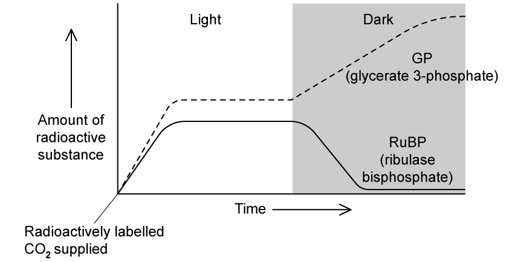
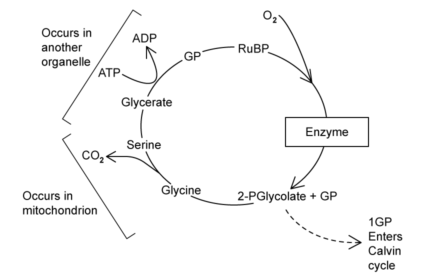
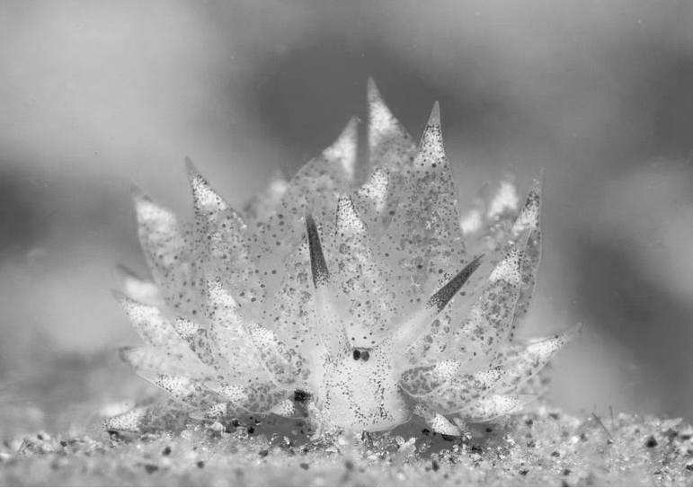
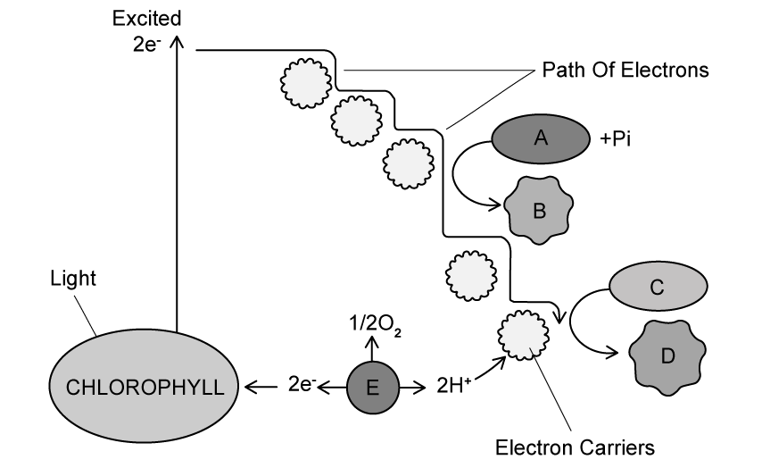
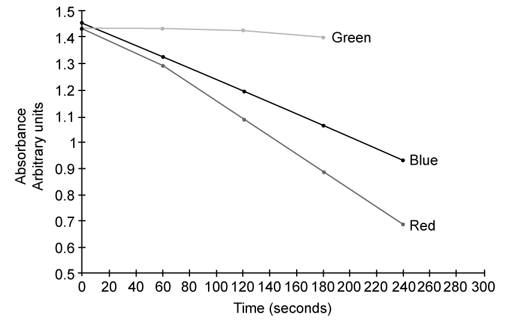
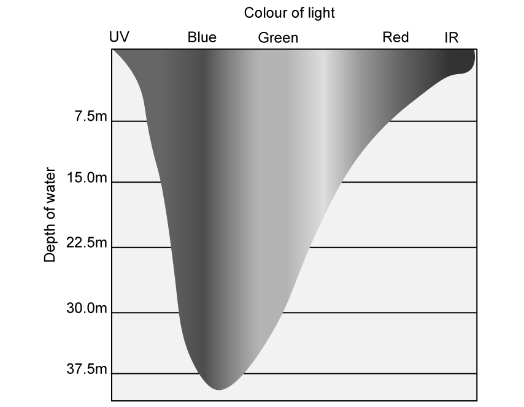
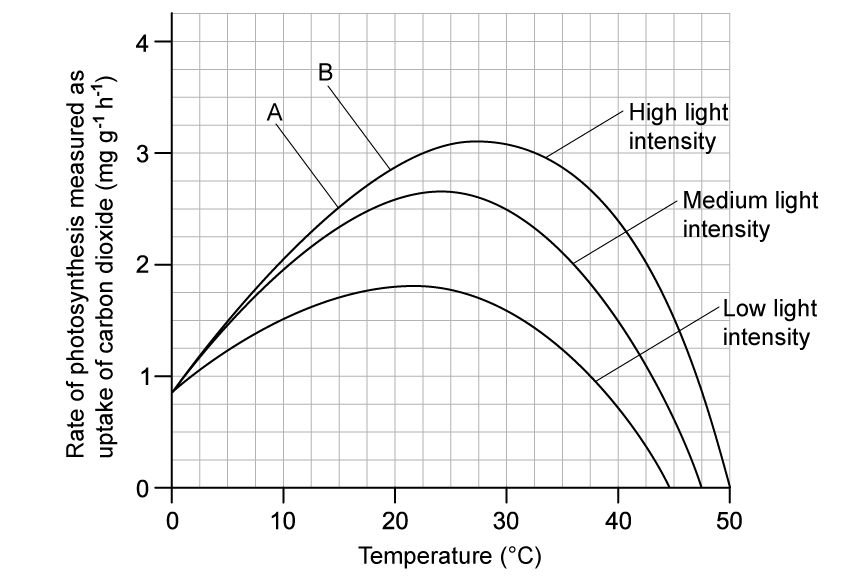
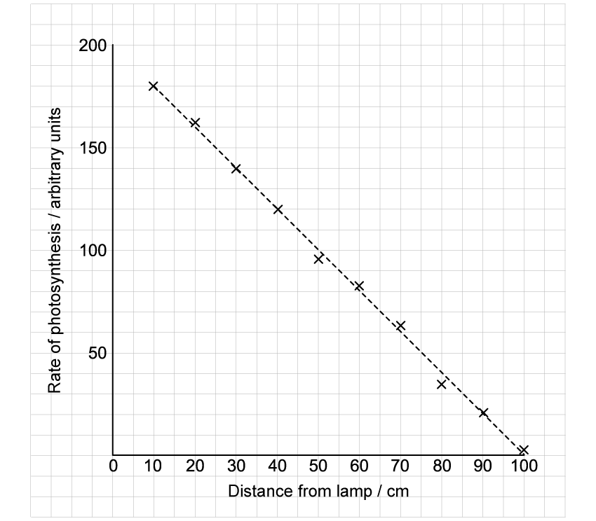
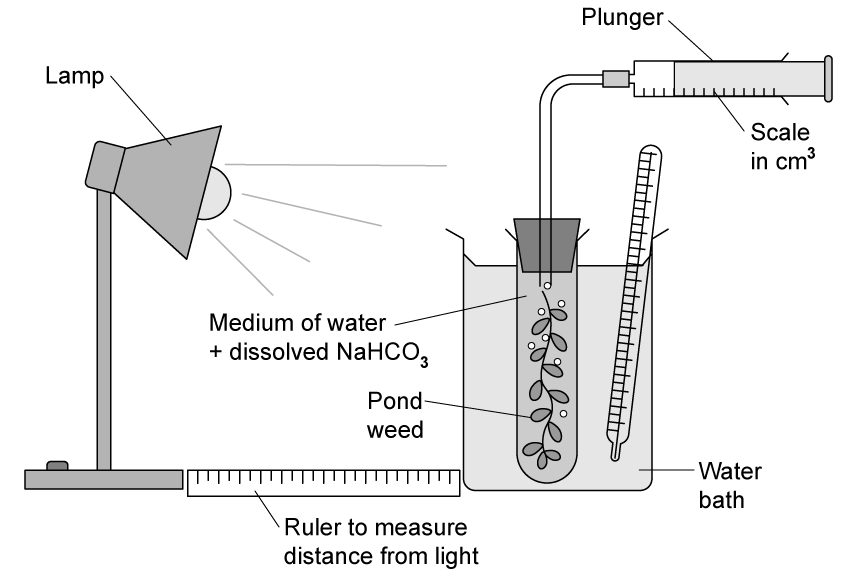

# Exam Questions — Investigation of Limiting Factors
**13. Photosynthesis** · Cambridge (CIE) A-LEVEL biology (9700)
> Source: [https://www.savemyexams.com/a-level/biology/cie/25/topic-questions/](https://www.savemyexams.com/a-level/biology/cie/25/topic-questions/) · 15 questions across 1 sets

## Structured Questions (15 questions)

### Q1 — hard — 10 marks

**Q1** [2 marks]

A group of students wanted to investigate the effect of light intensity on photosynthesis. They followed the procedure below:

1. Prepare a chloroplast suspension using an isolation medium.
2. Set up a series of test tubes in a water bath at 20 °C.
3. Set up the following tubes for the purposes of control or reference:

  - Tube **X** = 5 cm3 DCPIP + 0.5 cm3 water + 0.5 cm3 liquid isolation medium
  - Tube **Y** = 5 cm3 DCPIP + 0.5 cm3 water + 0.5 cm3 chloroplast suspension, wrapped in aluminium foil
  - Tube **Z** = 5.5 cm3 water + 0.5 cm3 chloroplast suspension
4. Set up another series of tubes containing 5 cm3 DCPIP + 0.5 cm3 water.
5. Take one of the second series of tubes and place it 5 cm away from a lamp. Add 0.5 cm3 chloroplast suspension and start a timer.
6. Time how long it takes for the DCPIP to become colourless.
7. Repeat steps 6-7 at different distances from the lamp, e.g. 10 cm, 15 cm, 20 cm, 25 cm, 30 cm

It is important that the isolation medium used in step 1 is at the same solute concentration as the spinach cells.

Explain why this is the case.

**Q1** [3 marks]

**Extract:**

A group of students wanted to investigate the effect of light intensity on photosynthesis. They followed the procedure below:

1. Prepare a chloroplast suspension using an isolation medium.
2. Set up a series of test tubes in a water bath at 20 °C.
3. Set up the following tubes for the purposes of control or reference:

- Tube X = 5 cm³ DCPIP + 0.5 cm³ water + 0.5 cm³ liquid isolation medium
- Tube Y = 5 cm³ DCPIP + 0.5 cm³ water + 0.5 cm³ chloroplast suspension, wrapped in aluminium foil
- Tube Z = 5.5 cm³ water + 0.5 cm³ chloroplast suspension
4. Set up another series of tubes containing 5 cm³ DCPIP + 0.5 cm³ water.
5. Take one of the second series of tubes and place it 5 cm away from a lamp. Add 0.5 cm³ chloroplast suspension and start a timer.
6. Time how long it takes for the DCPIP to become colourless.
7. Repeat steps 6-7 at different distances from the lamp, e.g. 10 cm, 15 cm, 20 cm, 25 cm, 30 cm

From the investigation described in part a), explain the purpose of the following:

(i) Tube **X**.

[1]

(ii) Tube **Y**.

[1]

(iii) Tube **Z**.

[1]

**Q1** [3 marks]

**Extract:**

A group of students wanted to investigate the effect of light intensity on photosynthesis. They followed the procedure below:

1. Prepare a chloroplast suspension using an isolation medium.
2. Set up a series of test tubes in a water bath at 20 °C.
3. Set up the following tubes for the purposes of control or reference:

- Tube X = 5 cm^3^ DCPIP + 0.5 cm^3^ water + 0.5 cm^3^ liquid isolation medium
- Tube Y = 5 cm^3^ DCPIP + 0.5 cm^3^ water + 0.5 cm^3^ chloroplast suspension, wrapped in aluminium foil
- Tube Z = 5.5 cm^3^ water + 0.5 cm^3^ chloroplast suspension
4. Set up another series of tubes containing 5 cm^3^ DCPIP + 0.5 cm^3^ water.
5. Take one of the second series of tubes and place it 5 cm away from a lamp. Add 0.5 cm^3^ chloroplast suspension and start a timer.
6. Time how long it takes for the DCPIP to become colourless.
7. Repeat steps 6-7 at different distances from the lamp, e.g. 10 cm, 15 cm, 20 cm, 25 cm, 30 cm

The results of the investigation described in part a) are shown in Fig. 1.

**Fig. 1**

Explain the results shown in Fig. 1

**Q1** [2 marks]

**Extract:**

When DCPIP is reduced its colour changes from deep blue to colourless. The light dependent reactions cause electrons to be released, reducing DCPIP to its colourless form.

As light intensity increases / distance between the lamp and tube decreases photoactivation/photolysis occurs faster / more / at a higher rate; More electrons pass to the electron transport chain; These electrons pass to DCPIP instead of to NADP (causing it to become colourless)

Some weedkillers contain ammonium hydroxide, a chemical that acts in a similar way to DCPIP during photosynthesis. A farmer wanted to use ammonium hydroxide weedkiller on their crop fields, but a scientist recommended that they choose a different type of weedkiller.

Suggest why the farmer was advised not to use ammonium hydroxide weedkiller on their crop fields.

### Q2 — hard — 11 marks

**Q2** [3 marks]

A group of scientists used radioactive carbon to investigate the Calvin Cycle in both light and dark conditions. Multiple leaves of a plant were enclosed within a sealed bag containing radioactive carbon dioxide for different lengths of time. The leaves were then removed and analysed for radioactive compounds. Their results are shown in Fig. 1.

**Fig. 1**

Describe how radioactively labelled carbon dioxide is fixed inside the leaves of the plant while it is exposed to light in Fig..1.

**Q2** [4 marks]

**Extract:**

A group of scientists used radioactive carbon to investigate the Calvin Cycle in both light and dark conditions. Multiple leaves of a plant were enclosed within a sealed bag containing radioactive carbon dioxide for different lengths of time. The leaves were then removed and analysed for radioactive compounds. Their results are shown in Fig. 1.

Explain the results shown in Fig. 1 when the plant is moved into the dark.

**Q2** [2 marks]

**Extract:**

(Radioactively labelled) carbon dioxide is (fixed by being) combined with RuBP/ribulose bisphosphate; (The reaction) is catalysed by rubisco/ribulose bisphosphate carboxylase; The resulting (unstable, 6C) compound splits into two molecules of (3C) GP/glycerate-3-phosphate;

At high temperatures, the enzyme that is involved with fixing carbon for the plant increasingly combines with oxygen instead of carbon dioxide in a reaction known as photorespiration. A simplified version of the photorespiration reactions can be seen in Fig. 2.

**Fig. 2**

Photorespiration reduces the efficiency of photosynthesis.

Use Fig. 2 to suggest why this is the case.

**Q2** [2 marks]

**Extract:**

Carbon dioxide is (fixed by being) combined with RuBP/ribulose bisphosphate; (The reaction) is catalysed by rubisco/ribulose bisphosphate carboxylase.

At high temperatures, the enzyme that is involved with fixing carbon for the plant increasingly combines with oxygen instead of carbon dioxide in a reaction known as photorespiration. A simplified version of the photorespiration reactions can be seen in Fig. 2.

Fig. 2
[Photorespiration diagram showing: RuBP + oxygen (catalysed by rubisco) produces phosphoglycolate, which through multiple reactions across chloroplast, peroxisome, and mitochondrion produces 1 GP and releases CO2]

Many scientists are interested in finding ways of improving the action of the enzyme that fixes carbon to reduce the rate at which it carries out photorespiration.

Suggest how the action of this enzyme could be improved.

### Q3 — hard — 13 marks

**Q3** [1 mark]

A student investigated the effect of different wavelengths of light on the rate of photosynthesis in a suspension of algal cells.

The apparatus used is shown in Fig. 1

**Fig. 1**

State the measurements the student should take to determine the rate of photosynthesis using the equipment shown in Fig. 1.

**Q3** [3 marks]

**Extract:**

A student investigated the effect of different wavelengths of light on the rate of photosynthesis in a suspension of algal cells.

The student did not use a pH buffer to maintain a constant pH.

Explain how the pH of the suspension would change over time in the absence of a pH buffer.

**Q3** [3 marks]

**Extract:**

A student investigated the effect of different wavelengths of light on the rate of photosynthesis in a suspension of algal cells.

Fig. 2 shows the student's results.

**Fig. 2**

(i) Explain why the rate of photosynthesis peaks at 460 nm and 660 nm.

[2]

(ii) Explain whether the graph in Fig. 2 shows an absorption spectrum or an action spectrum.

[1]

**Q3** [6 marks]

The student extended the investigation by measuring the effect of salt concentration on oxygen production within algae chloroplasts. Fig. 3 shows the results.

**Fig. 3**

(i) Identify the precise stage of photosynthesis in algae chloroplasts that is affected by an increased salt concentration.

[1]

(ii) Using information in Fig. 3, explain the effect that increasing salt concentration has on oxygen production in algae chloroplasts.

[2]

(iii) Explain how the effect shown in Fig. 3 will affect other aspects of the photosynthesis reactions.

[3]

### Q4 — hard — 9 marks

**Q4** [1 mark]

Scientists investigated the effect of elevated carbon dioxide (CO2) levels (measured in microatmospheres, μatm) and temperature on the growth and photosynthetic rates of *Ulva pertusa*, common bloom-forming green algae.

*U. pertusa* was grown under four temperature and CO2 conditions:

- Ambient CO2 levels (400 μatm) and temperature (16°C), modelling **present-day **conditions
- Elevated temperature only (19°C), modelling **warming **conditions
- Elevated CO2  levels only (1,000 μatm), modelling **acidification **conditions
- Elevated temperature and CO2, modelling **the** **greenhouse effect**

The rate of photosynthesis was measured for each condition.

Fig. 1 shows the results of the investigation.

**Fig. 1**

Name the limiting factors between points **X** and **Y**.

**Q4** [2 marks]

**Extract:**

Scientists investigated the effect of elevated carbon dioxide (CO~2~) levels (measured in microatmospheres, μatm) and temperature on the growth and photosynthetic rates of *Ulva pertusa*, common bloom-forming green algae.

*U. pertusa* was grown under four temperature and CO~2~ conditions:

- Ambient CO~2~ levels (400 μatm) and temperature (16°C), modelling **present-day **conditions
- Elevated temperature only (19°C), modelling **warming **conditions
- Elevated CO~2  ~levels only (1,000 μatm), modelling **acidification **conditions
- Elevated temperature and CO~2,~ modelling **the** **greenhouse effect**

The rate of photosynthesis was measured for each condition.

Fig. 1 shows the results of the investigation.

Name the limiting factors between points **X** and **Y**.

Use the information from Fig. 1 to explain your answer to part (a).

**Q4** [4 marks]

**Extract:**

Scientists investigated the effect of elevated carbon dioxide (CO~2~) levels (measured in microatmospheres, μatm) and temperature on the growth and photosynthetic rates of *Ulva pertusa*, common bloom-forming green algae.

*U. pertusa* was grown under four temperature and CO~2~ conditions:

- Ambient CO~2~ levels (400 μatm) and temperature (16°C), modelling **present-day **conditions
- Elevated temperature only (19°C), modelling **warming **conditions
- Elevated CO~2  ~levels only (1,000 μatm), modelling **acidification **conditions
- Elevated temperature and CO~2,~ modelling **the** **greenhouse effect**

The rate of photosynthesis was measured for each condition.

Fig. 1 shows the results of the investigation.

Describe the results of the investigation shown in Fig. 1.

**Q4** [2 marks]

**Extract:**

Scientists investigated the effect of elevated carbon dioxide (CO₂) levels (measured in microatmospheres, μatm) and temperature on the growth and photosynthetic rates of Ulva pertusa, common bloom-forming green algae.

U. pertusa was grown under four temperature and CO₂ conditions:

- Ambient CO₂ levels (400 μatm) and temperature (16°C), modelling present-day conditions
- Elevated temperature only (19°C), modelling warming conditions
- Elevated CO₂ levels only (1,000 μatm), modelling acidification conditions
- Elevated temperature and CO₂, modelling the greenhouse effect

The rate of photosynthesis was measured for each condition.

Fig. 1 shows the results of the investigation.

Calculate the percentage difference in the rate of photosynthesis at 100 Lux between present day and modelled acidification conditions. Give your answer to 2 significant figures.

### Q5 — hard — 9 marks

**Q5** [2 marks]

*Costasiella kuroshimae *is a species of sacoglossan sea slug that graze on green algae.  The algal chloroplasts are not digested but are retained by *Costasiella kuroshimae* and used in a type of photosynthesis called kleptoplasty.

Kleptoplasty is the capacity of a non-photosynthetic host to retain functional chloroplasts from algal sources. These chloroplasts are termed kleptoplasts.

Image courtesy of Alif Abdulrahman via [Wikimedia Commons](https://commons.wikimedia.org/wiki/File:Costasiella_Kuroshimae_(19080120525)_(2).jpg) and under this [license](https://creativecommons.org/licenses/by-sa/2.0/deed.en). No changes to the image have been made

(i) Suggest an advantage to the *Costasiella kuroshimae *in carrying out kleptoplasty.

[1]

(ii) Identify **three** key factors which may limit the rate of photosynthesis in kleptoplasts*.*

[1]

**Q5** [2 marks]

Kleptoplasts from *Costasiella kuroshimae* were extracted and isolated to form a suspension. A scientist investigated the rate of photosynthesis in kleptoplasts at wavelengths of light using the redox indicator DCPIP.

DCPIP interacts with reactions in the light-dependent stage of photosynthesis. DCPIP is a blue solution in its oxidised form, when reduced DCPIP turns colourless.

The light-dependent stage is summarised in Fig. 1.

**Fig. 1**

Explain which molecule, labelled **A** - **E** represents the interaction of reduced DCPIP.

**Q5** [3 marks]

**Extract:**

Kleptoplasts from Costasiella kuroshimae were extracted and isolated to form a suspension. A scientist investigated the rate of photosynthesis in kleptoplasts at wavelengths of light using the redox indicator DCPIP.

DCPIP interacts with reactions in the light-dependent stage of photosynthesis. DCPIP is a blue solution in its oxidised form, when reduced DCPIP turns colourless.

The absorbance of the kleptoplast suspensions at four different wavelengths of light was measured using a colorimeter.

The results of the investigation are shown in Fig. 2.

**Fig. 2**

Explain the results shown in Fig. 2 on the rate of photosynthesis in kleptoplasts.

**Q5** [2 marks]

**Extract:**

The absorbance of the kleptoplast suspensions at four different wavelengths of light was measured using a colorimeter.

The results of the investigation are shown in Fig. 2.

cie-ial-13-2-h-q5c

Fig. 2

Fig. 3 shows the penetrance of different wavelengths of light to different depths in the ocean.

**Fig. 3**

Use the information provided in both Fig. 2 and Fig. 3 to suggest and explain which depth of the ocean *Costasiella kuroshimae* would be best adapted to.

### Q6 — medium — 8 marks

**Q6** [8 marks]

Describe how you would carry out an investigation into the effect of wavelength of light on the rate of photosynthesis of a plant, using a redox indicator such as DCPIP.

*Source: May/June 2019 9700/41 Q10B*

### Q7 — medium — 10 marks

**Q7** [2 marks]

A group of scientists carried out a study into the effects of temperature and light intensity on photosynthesis. The results of the study are shown in Fig. 1

**Fig. 1**

(i) State the limiting factor between the points marked **A** and **B** in Fig.1.

[1]

(ii) Explain your answer to part i).

[1]

**Q7** [3 marks]

**Extract:**

A group of scientists carried out a study into the effects of temperature and light intensity on photosynthesis. The results of the study are shown in Fig. 1

Fig. 1

Describe the effect of increasing light intensity on the rate of photosynthesis in Fig. 1

**Q7** [3 marks]

**Extract:**

A group of scientists carried out a study into the effects of temperature and light intensity on photosynthesis. The results of the study are shown in Fig. 1

Explain the effect of increasing temperature above 30 °C on the rate of photosynthesis in Fig.1

**Q7** [2 marks]

**Extract:**

A group of scientists carried out a study into the effects of temperature and light intensity on photosynthesis. The results of the study are shown in Fig. 1

The study shown in Fig.1 uses carbon dioxide uptake as a measure of the rate of photosynthesis.

Explain why carbon dioxide uptake does not give a true measure for the rate of photosynthesis.

### Q8 — medium — 7 marks

**Q8** [7 marks]

Explain what is meant by the term limiting factor **and **explain how knowledge of limiting factors is used to increase crop yields in glasshouses.

*Source: May/June 2019 9700/41 Q9A*

### Q9 — medium — 10 marks

**Q9** [1 mark]

A student investigated the effect of changing light wavelength on the rate of photosynthesis. They set up four beakers of sodium hydrogen carbonate solution, each containing 20 spinach leaf discs, and each under a lamp with a different coloured bulb. They measured the time taken for 50 % of the leaf discs to rise to the surface of the beaker; this time is notated as ET50. The student's results are shown in table 1 below.

**Table 1**

| **Colour of bulb** | **ET****50**** (s)** | **Rate of photosynthesis (1 / ET****50****)** |
|---|---|---|
| White | 6 |   |
| Red | 12 |   |
| Blue | 55 |   |
| Green | 92 | 0.01 |

Calculate the rate of photosynthesis for leaf discs under white, red, and blue bulbs.

**Q9** [2 marks]

**Extract:**

A student investigated the effect of changing light wavelength on the rate of photosynthesis. They set up four beakers of sodium hydrogen carbonate solution, each containing 20 spinach leaf discs, and each under a lamp with a different coloured bulb. They measured the time taken for 50 % of the leaf discs to rise to the surface of the beaker; this time is notated as ET~50~.

Explain why sodium hydrogen carbonate (NaHCO3) solution was used in the experiment described in part a).

**Q9** [5 marks]

**Extract:**

A student investigated the effect of changing light wavelength on the rate of photosynthesis. They set up four beakers of sodium hydrogen carbonate solution, each containing 20 spinach leaf discs, and each under a lamp with a different coloured bulb. They measured the time taken for 50 % of the leaf discs to rise to the surface of the beaker; this time is notated as ET~50~. The student's results are shown in table 1 below.

**Table 1**

| **Colour of bulb** | **ET**~**50**~** (s)** | **Rate of photosynthesis (1 / ET**~**50**~**)** |
| White | 6 | 0.17 |
| Red | 12 | 0.08 |
| Blue | 55 | 0.02 |
| Green | 92 | 0.01 |

Explain the results shown in Table 1.

**Q9** [2 marks]

**Extract:**

A student investigated the effect of changing light wavelength on the rate of photosynthesis. They set up four beakers of sodium hydrogen carbonate solution, each containing 20 spinach leaf discs, and each under a lamp with a different coloured bulb. They measured the time taken for 50 % of the leaf discs to rise to the surface of the beaker; this time is notated as ET~50~. The student's results are shown in table 1 below.

**Table 1**

| **Colour of bulb** | **ET**~**50**~** (s)** | **Rate of photosynthesis (1 / ET**~**50**~**)** |
| White | 6 |   |
| Red | 12 |   |
| Blue | 55 |   |
| Green | 92 | 0.01 |

The student suggested that the relatively low rate of photosynthesis could be due to light being primarily absorbed by pigments such as chlorophyll b and carotene, known as accessory pigments.

Describe the role of accessory pigments in the light dependent reactions.

### Q10 — medium — 10 marks

**Q10** [2 marks]

A student wanted to investigate the effect of changing light intensity on the rate of photosynthesis in an aquatic plant. They set up their investigation as shown in Fig. 1.

**Fig. 1**

The student assessed the rate of photosynthesis by measuring the volume of oxygen collected in the measuring syringe.

(i) Explain why collecting oxygen is a measure of the rate of photosynthesis.

[1]

(ii) State precisely where in the plant the oxygen is produced.

[1]

**Q10** [3 marks]

**Extract:**

A student wanted to investigate the effect of changing light intensity on the rate of photosynthesis in an aquatic plant. They set up their investigation as shown in Fig. 1.

Fig. 1

The student assessed the rate of photosynthesis by measuring the volume of oxygen collected in the measuring syringe.

Give** three** variables that the student should control in the experiment shown in Fig. 1

**Q10** [2 marks]

**Extract:**

A student wanted to investigate the effect of changing light intensity on the rate of photosynthesis in an aquatic plant. They set up their investigation as shown in Fig. 1.

Fig. 1
1c-19EbT_6

The student assessed the rate of photosynthesis by measuring the volume of oxygen collected in the measuring syringe.

Fig. 2 shows the results collected by the student during the experiment described in part a).

**Fig. 2**

Calculate the percentage decrease in the rate of photosynthesis that takes place in Fig. 2 when the distance from the lamp is 10 cm compared to when it is 90 cm.

**Q10** [3 marks]

**Extract:**

Fig. 2 shows the results collected by the student during the experiment described in part a).

Fig. 2

Explain why lower light intensity leads to a reduced rate of photosynthesis, as shown in Fig. 2.

### Q11 — easy — 6 marks

**Q11** [1 mark]

A student wanted to investigate the effect of light intensity on the rate of photosynthesis.

They set up an investigation as shown in Fig. 1 and altered the light intensity by changing the distance between the lamp and the pondweed.

**Fig. 1**

Identify the variable measured here to give the rate of photosynthesis.

**Q11** [1 mark]

**Extract:**

A student wanted to investigate the effect of light intensity on the rate of photosynthesis.

They set up an investigation as shown in Fig. 1 and altered the light intensity by changing the distance between the lamp and the pondweed.

Temperature needs to be controlled in the experiment shown in Fig. 1.

State why this is the case.

**Q11** [2 marks]

**Extract:**

A student wanted to investigate the effect of light intensity on the rate of photosynthesis.

They set up an investigation as shown in Fig. 1 and altered the light intensity by changing the distance between the lamp and the pondweed.

Fig. 2 shows the student’s results.

**Fig. 2**

Describe and explain the results of the investigation.

**Q11** [2 marks]

**Extract:**

A student wanted to investigate the effect of light intensity on the rate of photosynthesis.

They set up an investigation as shown in Fig. 1 and altered the light intensity by changing the distance between the lamp and the pondweed.

Fig. 1

The variable measured here to give the rate of photosynthesis is the volume of (oxygen) gas produced/collected (by the pondweed).

In a similar investigation a student counted the number of bubbles of oxygen given off by the plant.

Explain why this is less accurate than the experiment shown in Fig. 1

### Q12 — easy — 7 marks

**Q12** [2 marks]

Redox indicators are sometimes used to show that certain reactions are occurring during photosynthesis.

(i) Identify **one** redox indicator that can be used to measure the rate of photosynthesis.

[1]

(ii) Describe the colour change that the indicator named in part (i) displays when the indicator goes from an oxidised to a reduced state.

[1]

**Q12** [1 mark]

**Extract:**

Redox indicators are sometimes used to show that certain reactions are occurring during photosynthesis.

(i) Identify one redox indicator that can be used to measure the rate of photosynthesis.

(ii) Describe the colour change that the indicator named in part (i) displays when the indicator goes from an oxidised to a reduced state.

Mark scheme:
(i) A redox indicator that can be used to measure the rate of photosynthesis is...
- DCPIP / methylene blue;

(ii) The colour change that is observed when the indicator goes from an oxidised to a reduced state is...
- Blue (oxidised) to colourless (reduced);

It can be difficult to observe the full colour change described in part (a) (ii) when measuring the rate of photosynthesis in a suspension of chloroplasts.

Explain why a colour change may not be fully observed even though the indicator has been fully reduced.

**Q12** [1 mark]

A study is carried out to examine the effect of light intensity on the rate of photosynthesis in a chloroplast suspension.

State one other light-related variable that must be controlled / kept constant in this experiment.

**Q12** [3 marks]

A chloroplast suspension can be produced by crushing green leaves with an isolation medium in a pestle and mortar.

State **three** features of an isolation medium that are required when preparing a chloroplast suspension.

### Q13 — easy — 6 marks

**Q13** [2 marks]

Plant biologists investigated photosynthesis in two species of plant found in a woodland. One of the species, *Geranium pyrenaicum*, was adapted to growing in bright sunlight and the other, *Asplenium* *scolopendrium*, was adapted to growing in the shade. The results are shown in Fig. 1.

**Fig. 1**

State **two **factors which could be limiting the rate of photosynthesis in *Geranium pyrenaicum* between points **P** and **Q** on the graph.

**Q13** [1 mark]

**Extract:**

Plant biologists investigated photosynthesis in two species of plant found in a woodland. One of the species, *Geranium pyrenaicum*, was adapted to growing in bright sunlight and the other, *Asplenium* *scolopendrium*, was adapted to growing in the shade. The results are shown in Fig. 1.

State why, when light intensity is below 20-30 arbitrary units, Fig. 1 shows that carbon dioxide is released, rather than taken up, in both species of plant.

**Q13** [1 mark]

**Extract:**

Plant biologists investigated photosynthesis in two species of plant found in a woodland. One of the species, *Geranium pyrenaicum*, was adapted to growing in bright sunlight and the other, *Asplenium* *scolopendrium*, was adapted to growing in the shade. The results are shown in Fig. 1.

**Fig. 1**

Calculate the difference in uptake of carbon dioxide by leaves in *Geranium pyrenaicum* and *Asplenium scolopendrium* at a light intensity of 300 arbitrary units.

**Q13** [2 marks]

A different group of scientists researching photosynthesis in woodland plants measured the rate of oxygen production rather than the rate of carbon dioxide uptake.

Explain why this is also a valid way to investigate the rate of photosynthesis.

### Q14 — easy — 7 marks

**Q14** [2 marks]

A range of light wavelengths were projected onto an aquatic plant and the volume of oxygen per minute at each wavelength was measured. The experimental set up is shown in Fig. 1

**Fig. 1**

Identify **two** control variables that should be considered when using this apparatus.

**Q14** [2 marks]

**Extract:**

A range of light wavelengths were projected onto an aquatic plant and the volume of oxygen per minute at each wavelength was measured. The experimental set up is shown in Fig. 1

Describe the role of the following pieces of apparatus shown in Fig. 1

(i) Beaker of water

[1]

(ii) Dilute sodium hydrogen carbonate (NaHCO3)

[1]

**Q14** [1 mark]

**Extract:**

A range of light wavelengths were projected onto an aquatic plant and the volume of oxygen per minute at each wavelength was measured. The experimental set up is shown in Fig. 1

Identify **one** possible source of **error** when using the apparatus shown in Fig. 1.

**Q14** [2 marks]

Explain why plants are able to utilise light energy over a range of wavelengths.

### Q15 — easy — 8 marks

**Q15** [2 marks]

Carbon dioxide concentration is a limiting factor in photosynthesis.

Explain why this is the case.

**Q15** [2 marks]

Fig. 1 shows the relationship between carbon dioxide concentration and the rate of photosynthesis.

**Fig. 1**

Describe the relationship between carbon dioxide concentration and rate of photosynthesis shown in Fig. 1.

**Q15** [1 mark]

**Extract:**

Fig. 1 shows the relationship between carbon dioxide concentration and the rate of photosynthesis.

Identify a possible limiting factor at the point labelled **X** in Fig. 1.

**Q15** [3 marks]

(i) Sketch a graph of the rate of photosynthesis against temperature

[1]

(ii) Explain the shape of the graph that you have drawn in part (i).

[2]
