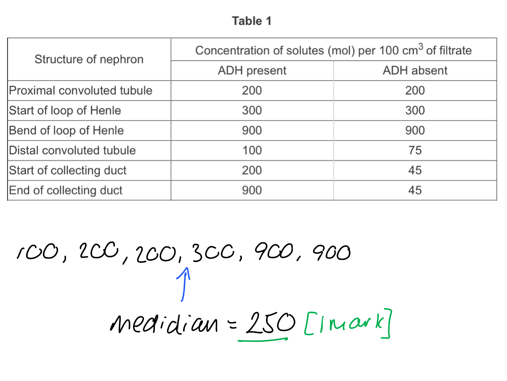
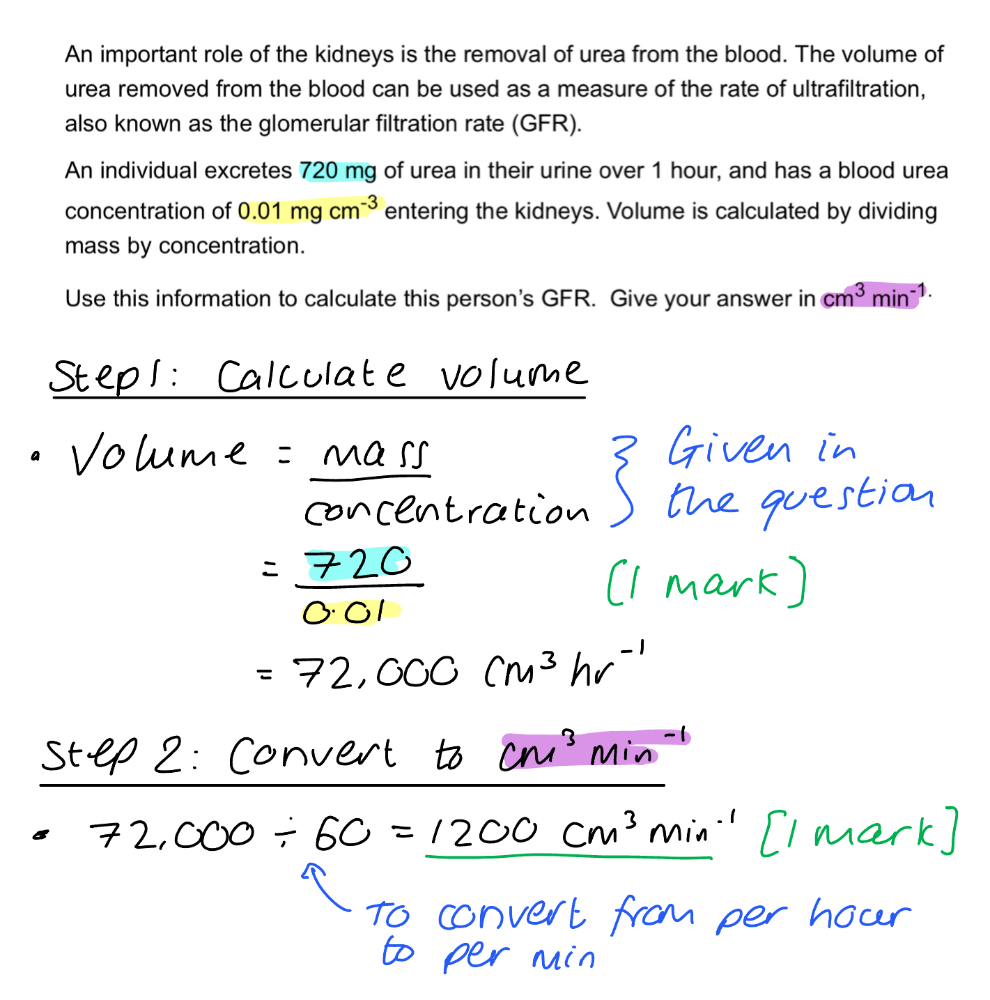
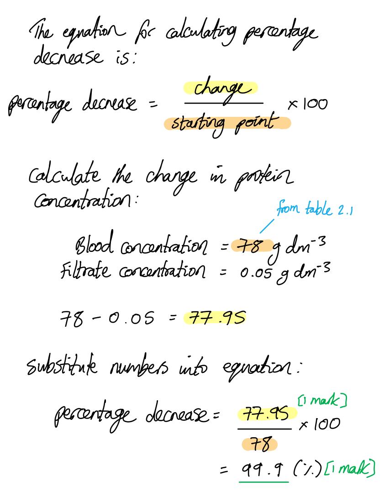
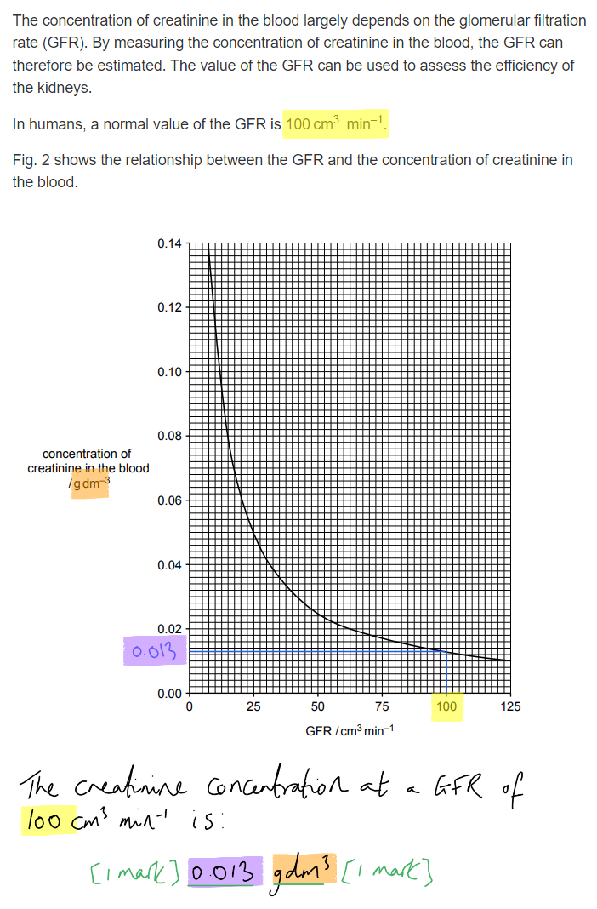
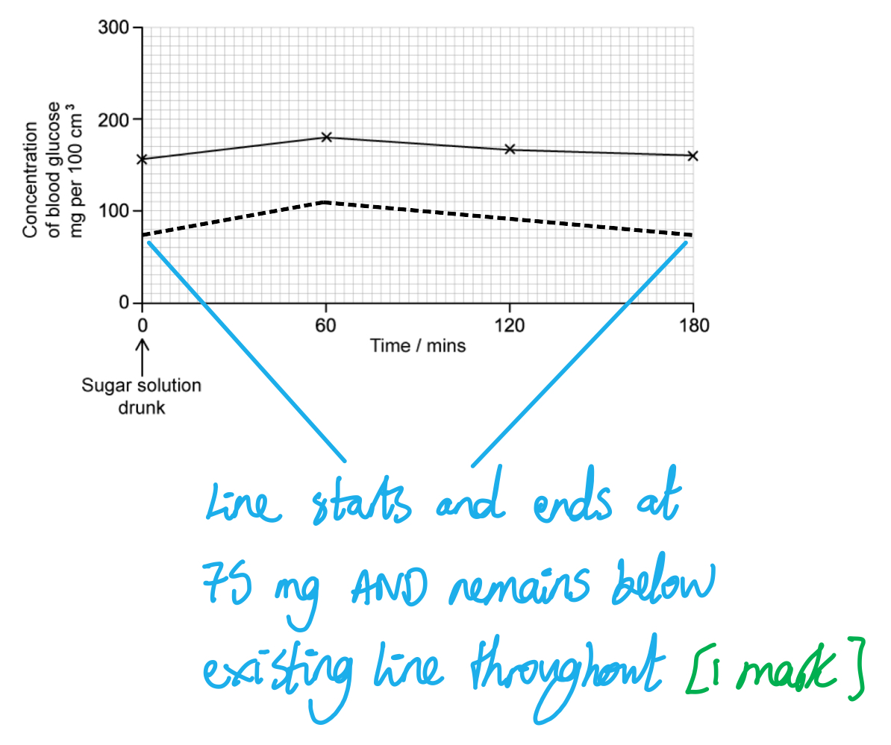

# Mark Schemes — Homeostasis in Mammals
**14. Homeostasis** · Cambridge (CIE) A-LEVEL biology (9700)

## Structured Questions (15 questions)

### Q1
Insulin affects body cells in the following ways...

**Final answer:** **Any ****three**** of the following:**

- (Insulin) binds to a receptor on the cell surface membranes of target/liver/muscle/fat/adipose cells; **[1 mark]**
- Vesicles containing GLUT4/glucose transporter proteins move to/fuse with the cell surface membrane / the number of GLUT4/glucose transporter proteins in the cell surface membrane increases; **[1 mark]**
- Activates enzymes that convert glucose to glycogen / catalyse glycogenesis; **[1 mark]**
- Increases the rate of respiration (so causing glucose to be used up faster);** [1 mark]**
- Activates enzymes that phosphorylate glucose, preventing it from leaving the cells; **[1 mark]**

**[Total: 3 marks]**
Evaluative points relating to this conclusion include...

*In support of the conclusion*

**Final answer:** **A maximum of ****two**** of the following:**

- The higher the dose of metformin the more the blood glucose levels are reduced / the lower the blood glucose level; **[1 mark]**
- There is a (statistically) significant difference between the control group and the metformin groups / metformin has a (statistically) significant effect on blood glucose levels (this can be seen because the standard deviations do not overlap); **[1 mark]**
- The mice fasted for 12 hours beforehand so the results would not have been affected by previous meals; **[1 mark]**
- Mice are mammals so the drug is likely to have a similar effect in humans; **[1 mark]**
- The mice were given an equivalent dose of drug for their body mass; **[1 mark]**

*Against the conclusion*

**Final answer:** **A maximum of ****two**** of the following:**

- Metformin could act differently in humans / the results cannot be directly applied to humans; **[1 mark]**
- The sample size was small so may not be representative of all mice; **[1 mark]**
- The experiment would need to be repeated with the same results / no repeats have been carried out; **[1 mark]**

**[Total: 3 marks]**

> *When evaluating conclusions, be sure to take both sides of the argument into account. You should look at the results from which a conclusion has been made and consider whether they provide support, and you should also think more generally about the experimental method used; consider control variables, the use of experimental controls, and whether the results are representative enough to be valid.*
Metformin reduces the impact of non-functioning insulin by...

**Final answer:** **Any ****three**** of the following:**

- Cyclic AMP/cAMP cannot bind to protein kinase A / less cAMP binds to protein kinase A; **[1 mark]**
- No enzyme cascade is initiated / there is less amplification of the signal (from cAMP); **[1 mark]**
- No/less activation of glycogen phosphorylase / enzymes that break down/hydrolyse glycogen / carry out/catalyse glycogenolysis; **[1 mark]**
- Concentration of glucose inside the cell does not increase / less glucose is released into the blood (reducing blood glucose levels); **[1 mark]**

**[Total: 3 marks]**

> *Metformin works by reducing the function of the enzymes that normally work to increase blood glucose. By reducing levels of cAMP inside the cell, the series of reactions that lead to activation of glycogen breakdown do not take place, and glucose remains locked up in the body's glycogen stores. *
(i) Urine test strips for glucose do not show the presence of other sugars because...

- The glucose oxidase enzyme (on the strip) is <u>specific</u>/<u>complementary</u> to glucose / sugars other than glucose do not fit into the <u>active site</u> of glucose oxidase; **[1 mark]**

(ii) Glucose is present in the urine of diabetic individuals because...

- Not all glucose is <u>selectively reabsorbed</u> / absorbed during <u>selective reabsorption</u> **OR** some glucose remains in the filtrate/urine after <u>selective reabsorption</u> (in the proximal convoluted tubule); **[1 mark]**

**[Total: 2 marks]**

> *Enzymes are specific to their substrates; in this case glucose oxidase is specific to glucose. This means that other sugars will not be complementary to its active site and will not bind to it.*

> *In the kidneys of non-diabetic patients it is usual for all of the glucose to be reabsorbed in the proximal convoluted tubule of the kidney nephron, but the blood glucose levels in diabetic patients are high enough that some glucose remains in the filtrate after selective reabsorption*

### Q2
(i) Region **1** of the nephron is...

- Proximal convoluted tubule; **[1 mark]**

(ii) The reason this can be identified is...

- Most substances are reabsorbed here / all of the glucose is reabsorbed here; **[1 mark]**

***Accept**** references to this being the first section of the nephron after the Bowman's capsule.*

**[Total: 2 marks]**

> *The percentage of the nutrients (in comparison to the nutrients that originally entered the filtrate) are all decreasing through region **1**, showing that they are all leaving the filtrate. This would happen during selective reabsorption, and as we know that most substances (and all glucose) are reabsorbed in the proximal convoluted tubule, this suggests that region **1** is located here. *
The active pumping of sodium ions into the medulla accounts for the reabsorption of water from region **2** because...

- Sodium lowers the water potential of the (cells of the) medulla; **[1 mark]**
- Water moves out of region **2** by osmosis / down a water potential gradient; **[1 mark]**

**[Total: 2 marks]**

> *You are not expected to know the details of water reabsorption from the loop of Henle (region **2**), but you have been given enough  information here to suggest what is happening. The pumping of sodium ions into the medulla surrounding region **2** lowers its water potential, causing water to leave region **2** by osmosis; this can be seen in the downward curve for water in the first half of region **2** in Fig. 1.*
(i) Two features visible in Fig. 2 that aid the process of reabsorption are...

- Many mitochondria; **[1 mark]**
- Microvilli; **[1 mark]**

(ii) These features aid reabsorption by...

- (Mitochondria) release energy for active transport / to power (Na+/K+) pump/transporter proteins; **[1 mark]**
- (Microvilli) increase the surface area (for reabsorption of substances); **[1 mark]**

***Reject*** *references to production of energy*

**[Total: 4 marks]**
The role of Na+/K+ transporter proteins in the reabsorption of nutrients is...

**Final answer:** **Any ****three**** of the following:**

- Pumping sodium out of the (epithelial) cell into the blood/capillary; **[1 mark]**
- Creating a sodium gradient between the (lumen of the) nephron/tubule and the (epithelial) cell; **[1 mark]**
- Sodium diffuses / moves down its concentration gradient out of the nephron/tubule into the cell; **[1 mark]**
- Sodium moves (out of the nephron) by the action of a cotransporter protein (along with glucose/amino acids); **[1 mark]**

**[Total: 3 marks]**

> *The sodium-potassium pumps are responsible for creating the gradient that allows the cotransport of sodium and one other molecule out of the nephron and into the epithelial cells. The pumps actively transport sodium into the blood, creating a gradient that allows sodium to diffuse via cotransporter proteins into the cell from the nephron. This movement of sodium down its concentration gradient enables the cotransporter protein to carry another molecule (either glucose or amino acid) against its concentration gradient.*

### Q3
(i) The percentage change in the mean concentration of solutes with and without ADH present is...

- The median **AS **there is a small sample size with outliers;** [1 mark]**

***Accept**** outliers given as figures e.g. 900*

> *The median is the best measure of central tendency here because it is not affected by extreme outliers; the mean and mode can vary in skewed distributions.*

(ii) 250 (mol); **[1 mark]**

***Accept**** [1 mark] for the correct calculation of mean or mode as an error carried forward from part (i)*

**[Total: 2 marks]**

The following can be concluded about the action of ADH:

- (Presence of ADH) leads to lower volume and** **higher concentration of urine **AS **there is an increase in concentration of solutes (in distal convoluted tubule / collecting duct) / concentration increased (when ADH present); **[1 mark]**
- Blood water concentration increases **AS **ADH increases water re-absorption (in distal convoluted tubule / collecting duct) / increases water permeability / adds/activates aquaporins; **[1 mark]**

**[Total: 2 marks]**
A symptom of a person with diabetes insipidus is...

**Final answer:** **Any ****four ****of the following:**

- Excessive urination / drinking / diluted urine / thirst; **[1 mark]**
- Because ADH is unable to bind to ADH receptors; **[1 mark]**
- (Therefore) aquaporins are not activated/phosphorylated; **[1 mark]**
- (Therefore) vesicles containing aquaporins do not bind to the luminal membrane (of the collecting duct); **[1 mark]**
- Permeability of luminal membrane is not increased / water molecules cannot move from the collecting duct into the tissue fluid/ blood plasma (in the medulla); **[1 mark]**

**[Total: 4 marks]**
Patients are warned not to consume too much water whilst taking desmopressin because...

- ADH/desmopressin causes (luminal) membranes of the collecting duct cells to become **more **permeable to water **OR** ADH/desmopressin increases the number of aquaporins in (luminal) membranes; **[1 mark]**
- Therefore **more **water molecules move from the collecting duct (through aquaporins) into tissue fluid/blood plasma in the medulla; **[1 mark]**
- Water potential of blood increases too much / too low concentration of solutes in blood plasma; **[1 mark]**

**[Total: 3 marks]**

### Q4
Severe dehydration would affect ultrafiltration because:

- Ultrafiltration takes place at high blood pressure **SO** they will be affected by the drop in blood pressure (caused by dehydration); **[1 mark]**
- The rate of ultrafiltration would decrease **OR** the amount of filtrate produced would decrease;** [1 mark]**

**[Total: 2 marks]**
Solute concentration and pressure within the glomerulus establishes a water potential gradient during ultrafiltration because...

**Final answer:** **Any ****six**** of the following:**

- Small solutes diffuse into the Bowman's capsule (from the blood plasma/glomerular capillaries) **and **plasma proteins are too large (to diffuse into the Bowman's capsule) / plasma proteins remain in the blood plasma as they are too large; **[1 mark]**
- Therefore the solute concentration in the blood plasma is higher than in the filtrate (in the Bowman's capsule) **OR** therefore the water potential of the blood plasma is lower than that of the filtrate (in the Bowman’s capsule); **[1 mark]**
- **So** water moves down the water potential gradient from the Bowman’s capsule into the blood plasma (in the glomerular capillaries); **[1 mark]**
- (However) blood pressure is high in the glomerulus as the afferent arteriole is wider than the efferent arteriole; **[1 mark]**
- Therefore** **the water potential of the blood plasma (in the glomerular capillaries) is higher than the water potential of the filtrate in the Bowman’s capsule; **[1 mark]**
- **So** water moves down the water potential gradient from the blood plasma (in the glomerular capillaries) into the Bowman’s capsule; **[1 mark]**
- (Overall) there is a net movement of water from the blood plasma (in the glomerular capillaries) into the Bowman’s capsule; **[1 mark]**

***Accept**** correctly named solutes for marking point 1, such as glucose*

**[Total: 6 marks]**

> *This can be confusing so take some time to learn the sequence of events here for both solute concentration and pressure. Although water moves in opposite directions here, there is a net movement of water into the Bowman's capsule from the blood plasma of the glomerular capillaries. *
The individual’s GFR is:

- 720 / 0.01 = 72000 cm3 hour-1; **[1 mark]**
- 72000 / 60 = 1200 cm3 min-1;** [1 mark]**

**OR**

- 720 / 60 = 12 mg urea excreted per minute;** [1 mark]**
- 12 mg / 0.01 = 1200 cm3 min-1; **[1 mark]**

**[Total: 2 marks]**

> *Full marks can be awarded for the correct answer of 1200 cm**3** min**-1** without additional calculations.*

### Q5
The structure of the nephron and its associated blood vessels are adapted to the process of ultrafiltration by...

**Final answer:** **Any ****eight ****of the following:**

- The capillary <u>endotheli</u>um...; **[1 mark]**
- ...has many gaps/pores/fenestrations; **[1 mark]**
- The afferent <u>arteriole</u> is wider than the efferent <u>arteriole</u>; **[1 mark]**
- (This maintains) high blood/hydrostatic pressure in glomerulus; **[1 mark]**
- Fluid is forced out of the glomerulus / into the Bowman’s capsule (due to the high pressure); **[1 mark]**
- (The walls of the glomerulus consist of cells known as) <u>podocytes</u>; **[1 mark]**
- (Podocytes are cells that) <u>have</u> interlocking / finger-like processes/extensions...; **[1 mark]**
- ...that form filtration slits/pores; **[1 mark]**
- (Between the capillary endothelium and the podocytes is the) <u>basement membrane</u>; **[1 mark]**
- (The basement membrane is a mesh of) collagen / glycoprotein (fibres); **[1 mark]**
- (The basement membrane) acts as the (main) selective barrier/filter; **[1 mark]**
- Large proteins/molecules do not pass through; **[1 mark]**
- Red/white blood cells do not pass through; **[1 mark]**
- Water / solutes/ions pass through; **[1 mark] **

***Ignore**** 'basal' membrane for marking point 9.*

***Reject**** large 'substances' for marking point 12.*

**[Total: 8 marks]**

> *The question asks you to explain how the structure of the nephron and surrounding blood vessels are **adapted for ultrafiltration**, so a general description of kidney structure or of unrelated parts of the nephron such as the loop of Henle will not be credited.*

> *The process of ultrafiltration is **not** an example of diffusion but comes about as a result of the **high hydrostatic pressure** that results from the wider afferent and narrower efferent arterioles.*

> *When describing the podocytes it is important that you describe their structure correctly; marks will not be awarded for statements such as 'podocytes **are** finger-like processes' as this is not a correct statement; you should instead say that 'podocytes are cells that **have **finger-like processes'.*
The effects of insulin on its main target tissues and the ways in which this leads to changes in blood glucose concentration are...

**Final answer:** **Any ****seven ****of the following:**

- (**Two** examples from =) target tissues (of insulin) are liver / muscle / adipose; **[1 mark]**
- (Insulin causes) an increase in glucose uptake (by the cells of the target tissues); **[1 mark]**
- (Insulin) increases the permeability of cells to glucose; **[1 mark]**
- (This is achieved because) more glucose transporter/GLUT (4) proteins (are added to membranes of target tissue cells); **[1 mark]**
- (This occurs when) vesicles (containing GLUT proteins) fuse with cell surface membrane; **[1 mark]**
- (Insulin) stimulates glycogen synthesis/glycogenesis; **[1 mark]**
- (Insulin) activates (the enzyme) glucokinase / glycogen synthase; **[1 mark]**
- Lipid/triglyceride/fatty acid synthesis is stimulated; **[1 mark]**
- There is an increase in respiration (of glucose); **[1 mark]**
- (So) more (facilitated) <u>diffusion</u> of glucose into (liver) cells; **[1 mark]**
- There is a decrease in glycogenolysis / lipolysis / gluconeogenesis; **[1 mark]**
- (All of the above work together to ) decreases <u>blood glucose concentration</u>; **[1 mark]**

**[Total: 7 marks]**

> *Insulin does not convert glucose to glycogen directly, instead, it **activates enzymes** which eventually enable this reaction to occur.*

> *Note that insulin is not solely responsible for making processes like respiration or diffusion of glucose into a target cell occur (these processes will be occurring anyway!); the role of insulin is to **increase the rate** at which these processes take place.*

### Q6
The structure marked **A-C** are...

- **A** = Bowman's capsule; **[1 mark]**
- **B** = loop of Henle (descending limb); **[1 mark]**
- **C **= collecting duct; **[1 mark]**

**[Total: 3 marks]**
(i) A feature visible in Fig. 2 that aids ultrafiltration is...

- Podocytes; **[1 mark]**

(ii) This aids ultrafiltration because...

- It allows dissolved substances / small molecules to pass from the capillary/blood/glomerulus into the nephron/Bowman's capsule/structure A **OR **prevents the passage of large molecules/proteins/blood cells from the capillary/blood/glomerulus into the nephron/Bowman's capsule/structure A; **[1 mark]**

**[Total: 2 marks]**
(i) The percentage decrease in protein between the blood and filtrate is...

- 77.95$\div$78; **[1 mark]**
- 99.9 (%); **[1 mark]**

***Accept ****correct answer for full marks in the absence of other calculations.*

(ii) An explanation for this difference is that..

- The capillary endothelium has pores / holes / gaps between the cells **OR** the basement membrane is mesh-like / made up of a network of fibres (which prevents large proteins from filtering out of glomerulus); **[1 mark]**

**[Total: 3 marks]**

> *No marks are available for references to podocytes as these were covered in part (b).*

High blood pressure might affect the ultrafiltration process in the patient's kidneys in the following way...

**Final answer:** **Any ****two**** of the following:**

- Increased protein concentration in the filtrate; **[1 mark]**
- Blood/blood cells in the filtrate; **[1 mark]**
- Higher glomerular filtration rate; **[1 mark]**

***Reject ****any references to high blood pressure and reabsorption.*

**[Total: 2 marks]**

> *You may not have learned about the effects of high blood pressure, but given what you know about the processes and structures involved with ultrafiltration you should be able to come up with some suggestions here. It is the high pressure generated in the glomerulus that overcomes the effects of water potential and increases glomerular filtration rate (GFR), so it is logical to think that higher blood pressure might increase GFR still further. High-pressure forces small molecules from the capillary into the filtrate, so higher pressure might be able to force larger structures such as proteins and cells through as well. This can damage the glomerulus and Bowman's capsule and lead to further kidney problems.*

### Q7
(i) High blood pressure is achieved as follows...

- afferent arteriole is wider than efferent arteriole; **[1 mark]**

(ii) The main filtration barrier in the nephron that allows creatinine to pass into the Bowman’s capsule but stops red blood cells from passing through is the...

- Basement membrane; **[1 mark]**

**[Total: 2 marks]**
(i) The relationship shown in Fig. 2 can be described as follows...

- The higher the creatinine concentration the lower the GFR; **[1 mark]**
- (Additional detail of relationship, e.g.) the curve shows an exponential decrease / is inversely proportional / two data points correctly quoted; **[1 mark]**

***Accept**** 'creatinine concentration is inversely proportional to the GFR' for 2 marks*

(ii) The concentration of creatinine in the blood that indicates a normal GFR is...

- 0.013; **[1 mark]**
- g dm–3; **[1 mark]**

(iii) Reasons why the GFR of a person might decrease include...

**Final answer:** **Any ****two**** of the following:**

- Kidney disease/damage; **[1 mark] **
- Cancer; **[1 mark]**
- Dehydration; **[1 mark]**
- Low blood pressure; **[1 mark]**
- Blood loss / low blood volume; **[1 mark]**

**[Total: 6 marks]**

### Q8
(i) The results shown in Fig. 1 can be described as follows...

**Final answer:** **Any ****three**** of the following:**

- Blood glucose concentration rises in both individuals when (glucose) drink is taken; **[1 mark]**
- The diabetic individual has high<u>er</u> blood glucose concentration at the start; **[1 mark]**
- The diabetic individual has a high<u>er</u> peak of / steep<u>er</u> rise in blood glucose concentration; **[1 mark]**
- The diabetic individual has a slower fall in blood glucose **OR** the blood glucose of the diabetic individual does not return to normal in 3 hours; **[1 mark]**

(ii) The location of the receptors in a non-diabetic person that detects a change in blood glucose concentration is...

- β cells / pancreas / islets of Langerhans; **[1 mark]**

***Accept**** hypothalamus*

(iii) The homeostatic mechanism by which blood glucose concentration is maintained is...

- <u>Negative feedback</u>; **[1 mark]**

**[Total: 5 marks]**
(i) Enzymes A and B are...

- A = <u>glucose oxidase</u>; **[1 mark]**
- B = (hydrogen) <u>peroxidase</u>; **[1 mark]**

(ii) One** **advantage of using a biosensor and one** **advantage of using a dipstick to measure glucose concentration could be...

- Biosensor = rapid/immediate result **OR** (more) accurate / precise / provides a quantitative reading **OR** shows current blood glucose **OR** reusable; **[1 mark]**
- Dipstick = non-invasive / painless / easy to use / cheap **OR** less risk of infection; **[1 mark]**

**[Total: 4 marks]**

> *Read the question carefully here; it asks for an **advantage** of **both** methods of measuring glucose concentration.*
The role played by insulin in the control of blood glucose concentration is...

**Final answer:** **Any ****five**** of the following:**

- Insulin binds to receptors on liver / muscle / adipose (cells); **[1 mark]**
- GLUT(4 transporters) are added to the surface membrane of cells / cause an increase in (glucose) permeability of cells; **[1 mark]**
- Glucokinase phosphorylates glucose in liver cells **OR** there is an increased rate of <u>diffusion</u> of glucose into liver cells;
- There is an increase in respiration of glucose; **[1 mark]**
- Glycogen synthase is activated / glycogenesis occurs / glycogen is synthesised; **[1 mark]**
- Lipid/triglyceride synthesis occurs **OR** there is a decrease in glycogenolysis / gluconeogenesis; **[1 mark]**
- <u>Blood glucose concentration</u> decreases; **[1 mark]**

**[Total: 5 marks]**

### Q9
The concentration of glucose decreased after 60 minutes despite the blood containing no insulin because:

**Final answer:** **Any ****two**** of the following:**

- Glucose is used in (cellular) respiration / as an energy source / in metabolism; **[1 mark]**
- Glucose enters cells **OR** glucose is converted to glycogen within cells; **[1 mark]**
- Glucose is excreted **OR** glucose exits body in urine; **[1 mark]**

**[Total: 2 marks]**

> *You must specify exactly what is happening to the glucose; it is not enough to simply say that glucose is used, or that it is removed from the blood. Glucose can enter the cells without the need for insulin (though more slowly) where it is stored as glycogen or used in respiration. Glucose can also be filtered by the kidneys and lost in the urine. *
(i) Results for a non-diabetic patient would show...

- A line from 75 mg that increases **AND** remains below the line in Fig. 1 **AND** then drops back down to 75 mg; **[1 mark]**

(ii) The reason for this line would be...

**Final answer:** **Any ****three**** of the following:**

- The beta cells (in the islets of Langerhans) release insulin in response to an increase in blood glucose; **[1 mark]**
- Liver/muscle/fat cells increase uptake of glucose / remove more glucose from the blood **OR** more glucose is transported into liver/muscle/fat cells; **[1 mark]**
- Glucose is converted to glycogen / glycogenesis takes place; **[1 mark]**
- More glucose is used in respiration / the rate of respiration increases; **[1 mark]**

**[Total: 4 marks]**

> *Note that part (ii) is an 'outline' question, meaning that the details of the the action of insulin at a cellular level are not required.*

The role of ADH in osmoregulation is...

**Final answer:** **Any ****five**** of the following:**

- (ADH is) released from the posterior pituitary gland in response to a decrease in blood water potential; **[1 mark]**
- (ADH) binds to receptors on the cell surface membranes of the cells/lining of the collecting duct/distal convoluted tubule; **[1 mark]**
- Cyclic AMP/cAMP is produced (this is a second messenger); **[1 mark]**
- (cAMP) initiates a series/cascade of enzyme-controlled reactions; **[1 mark]**
- Vesicles containing aquaporins move to the cell surface membrane (of the cells lining the collecting duct); **[1 mark]**
- Vesicles fuse with the cell surface membrane; **[1 mark]**
- Cells / wall of collecting duct/distal convoluted tubule becomes more permeable to water; **[1 mark]**
- More water moves out of the collecting duct / is reabsorbed into the blood; **[1 mark]**
- Water moves (out of the collecting duct) down its concentration/water potential gradient; **[1 mark]**

**[Total: 5 marks]**

### Q10
Urea is present in urine because...

**Final answer:** **Any ****three**** of the following:**

- Excess amino acids are converted into urea / urea is produced from excess amino acids; **[1 mark]**
- Urea is transported from the liver to the kidneys in the blood (plasma); **[1 mark]**
- Urea is filtered out of the blood / undergoes ultrafiltration in the kidneys/glomerulus/bowmans capsule; **[1 mark]**
- Urea is not reabsorbed by the kidneys (so ends up in the urine); **[1 mark]**

**[Total: 3 marks]**

> *This is an 'outline' question so no marks are available for details of the processes taking place in the liver or kidneys. *
(i) Molecules **X** is...

- Ammonia; **[1 mark]**

(ii) Molecule **X** cannot remain in the blood because...

**Final answer:** **Any ****one**** of the following:**

- It is (highly) soluble and therefore dissolves in the blood/plasma (to form toxic ammonium hydroxide) / is not diluted enough by the blood; **[1 mark]**
- It raises blood pH / makes the blood more alkaline; **[1 mark]**
- It interferes with cell metabolism / respiration / cell signalling; **[1 mark]**

*Reject 'it is toxic' or 'it is soluble' with no other detail provided.*

**[Total: 2 marks]**
Control of blood water balance is a negative feedback mechanism because...

**Final answer:** **Any ****three**** of the following:**

- Receptors/osmoreceptors in the brain detect a change in the water balance of the blood (this is the stimulus); **[1 mark]**
- Impulses are sent along (sensory) neurones to the posterior pituitary gland; **[1 mark]**
- The posterior pituitary gland releases (more or less) hormones/ADH in response (it is the effector); **[1 mark]**
- The change in water balance / stimulus is corrected/reversed **OR** the kidney reabsorbs more/less water to reverse the change in water balance; **[1 mark]**

**[Total: 3 marks]**

> *Negative feedback mechanisms involve receptors that detect a change in conditions, transfer of information to a co-ordination centre, effectors that respond, and a response that reverses the initial change. Your answer should explain how each of these elements can be seen in the control of water balance.*
It is essential that the water balance of the blood is regulated because...

- This prevents water from moving into/out of body/blood <u>cells</u> by osmosis; **[1 mark]**
- This could damage the cells / cause cells to burst/lyse **OR** reduce cell function / cause cells to shrivel/shrink; **[1 mark]**

**[Total: 2 marks]**

### Q11
(i) The term homeostasis means...

- (The idea that) the regulation of the internal conditions of a cell or organism to maintain optimum conditions for function, in response to internal and external changes; **[1 mark]**

> *This is an important definition so make sure you learn it correctly. It is not enough, at A Level, to simply state the maintenance of an internal environment.*

(ii) The importance of homeostasis in mammals is...

- It ensures the maintenance of <u>optimal</u> conditions for enzyme action and cell function / ensures enzymes do not <u>denature</u>; **[1 mark]**

**[Total: 2 marks]**
The correct order is...

- 3, 2, 5, 1, 4; **[1 mark]**

**[Total: 1 mark]**
Three other physiological factors that homeostasis controls are...

**Final answer:** **Any ****three**** of the following:**

- Metabolic waste *(accept a named example such as carbon dioxide and urea)*;** [1 mark]**
- Blood pH;** [1 mark]**
- Concentration of glucose in the blood / blood glucose;** [1 mark]**
- Water potential of the blood;** [1 mark]**
- Concentration of the respiratory gases (carbon dioxide and oxygen) in the blood;** [1 mark]**

**[Total: 3 marks]**
The role of receptors and effectors in a negative feedback control mechanism is...

- Receptors are cells which detect whether a specific level/stimulus is too low or too high; **[1 mark]**
- Effectors are muscles or glands that react (to messages from the CNS) to counteract the change by bringing the level back to normal/set-point; **[1 mark]**

**[Total: 2 marks]**

> *You need to know about one specific example of negative feedback in mammals and that is its role in the control of blood glucose. *

### Q12
Ultrafiltration is:

- Separation of large/insoluble particles from blood plasma/aqueous solution; **[1 mark]**
- At/under <u>high pressure</u>; **[1 mark]**

**[Total: 2 marks]**
The adaptations of the proximal convoluted tubule help as follows:

| 1. | Microvilli on the inner surface | increase surface area for selective reabsorption | **[1 mark]** |
|---|---|---|---|
| 2. | Many mitochondria in epithelial cells | release energy from respiration for active processes/transport | **[1 mark]** |
| 3. | Tightly-packed cells in the epithelium | prevent diffusion of solutes out of the PCT between cells / force solutes to pass through epithelial cells | **[1 mark]** |

**[Total: 3 marks]**
The afferent and efferent arterioles differ:

- Afferent: blood flows into the glomerulus / efferent: blood flows out of the glomerulus; **[1 mark]**
- Afferent is wider / at higher pressure than efferent; **[1 mark]**

**[Total: 2 marks]**

### Q13
(i) Organ X is the...

- Pancreas; **[1 mark]**

(ii) Hormone Y is...

- Glucagon; **[1 mark]**

**[Total: 2 marks]**

> *The pancreas is responsible for detecting changes in blood glucose; specifically it is the cells of the Islets of Langerhans that do this, but as the question has asked you to name the organ this detail is not required.*
(i) The definition of second messenger is...

- A molecule released within a cell in response to a hormone **AND** which brings about a response in the cell; **[1 mark]**

(ii) The sequence of events leading up to the formation of cAMP are...

**Final answer:** **Any ****four ****of the following:**

- Glucagon binds to cell surface receptors on liver cells; **[1 mark]**
- This causes conformational/shape change of the receptor; **[1 mark]**
- This activates the G-protein; **[1 mark]**
- Leading to stimulation of adenylyl cyclase; **[1 mark]**
- ATP is converted to cyclic AMP/cAMP; **[1 mark]**

**[Total: 4 marks]**
The benefit to the cell of having the signal amplified in this way is...

**Final answer:** **Any ****two**** of the following:**

- A large number of enzymes can be activated in a short period of time; **[1 mark]**
- A large number of glucose molecules are released / a large volume of glycogen is broken down; **[1 mark]**
- Only a small volume of glucagon needs to be synthesised (by the alpha cells of the pancreas) to bring about a large response; **[1 mark]**

**[Total: 2 marks]**

> *It is important you are familiar with and can use key terms such as 'amplification' and 'enzyme cascade'. *
The chemical reactions that occur on the strip in the presence of glucose are...

- <u>Glucose oxidase</u> catalyses a reaction in which glucose is oxidised to form gluconic acid and hydrogen peroxide; **[1 mark]**
- Peroxidase then catalyses a reaction between the hydrogen peroxide and a colourless chemical in the pad to form a brown compound and water; **[1 mark]**

**[Total: 2 marks]**

### Q14
The correct order through which blood passes through each vessel is:

**D → C → F → A → E → B**;** [3 marks]**

| 1st | **D** | renal artery |
|---|---|---|
| 2nd | **C** | afferent arteriole |
| 3rd | **F** | glomerulus |
| 4th | **A** | efferent arteriole |
| 5th | **E** | capillaries alongside nephron |
| 6th | **B** | renal vein |

- 6 correct; **[3 marks]**
- 4 or 5 correct; **[2 marks]**
- 2 or 3 correct; **[1 mark]**
- 0 or 1 correct; **[0 marks]**

**[Total: 3 marks]**
Negative feedback is:

**Final answer:** **Any ****two**** from the following:**

- A change/adjustment to water levels; **[1 mark]**
- In response/opposition to an external stimulus in the opposite direction; **[1 mark]**
- To maintain equilibrium / steady-state / control of water level around a set point / ideal level; **[1 mark]**

**[Total: 2 marks]**
The name of the hormone that controls the level of water that is excreted via the kidney is:

- Anti-diuretic hormone / ADH; **[1 mark]**

**[Total: 1 mark]**
ADH affects the collecting ducts of the kidney as part of osmoregulation by...

**Final answer:** **Any ****three**** of the following:**

- ADH molecules bind to receptor proteins in the cells lining the collecting duct; **[1 mark]**
- This activates a signalling cascade that leads to the phosphorylation of the aquaporin molecules; **[1 mark]**
- This activates the aquaporins, causing the vesicles to fuse with the luminal membranes of the collecting duct cells; **[1 mark]**
- This increases the permeability of the collecting duct membrane to water; **[1 mark]**

**[Total: 3 marks]**

### Q15
Structures labelled 1, 3 and 4 are...

- 1 = Glomerulus; **[1 mark]**
- 3 = Proximal convoluted tubule; **[1 mark]**
- 4 = Collecting duct;** [1 mark]**

**[Total: 3 marks]**
Two components of blood expected to be found within structure 2 are...

**Final answer:** **Any ****two ****of the following:**

- Red blood cells; **[1 mark]**
- White blood cells; **[1 mark]**
- Platelets; **[1 mark]**
- (Plasma) proteins; **[1 mark]**

**[Total: 2 marks]**

> *During the process of ultrafiltration within the Bowman's capsule and glomerulus, large molecules (named above) remain in the blood and should be found within the efferent arteriole (structure 2). Smaller molecules such as glucose, amino acids, urea and some ions are filtered through to the nephron. These smaller molecules undergo selective reabsorption down the length of the nephron.*
The role of sodium ions found within structure 3 is...

- To co-transport glucose/amino acids; **[1 mark]**
- Into (PCT) epithelial cells; **[1 mark]**
- So that glucose/amino acids can diffuse into the blood/capillary/plasma; **[1 mark]**

**[Total: 3 marks]**
Two adaptations of structure **3** are...

**Final answer:** **Any ****two**** of the following:**

- (Many) microvilli; **[1 mark]**
- Co-transporter proteins; **[1 mark]**
- A high number of mitochondria; **[1 mark]**
- Tightly packed cells; **[1 mark]**

**[Total: 2 marks]**

> *The question is not asking you to explain the adaptations so try and avoid including too much detail in your answers if it is not needed because it wastes time. This is why it is always important to pay attention to command words in questions. *
