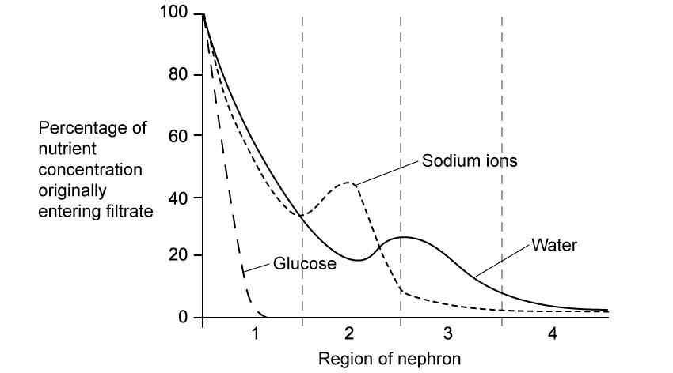
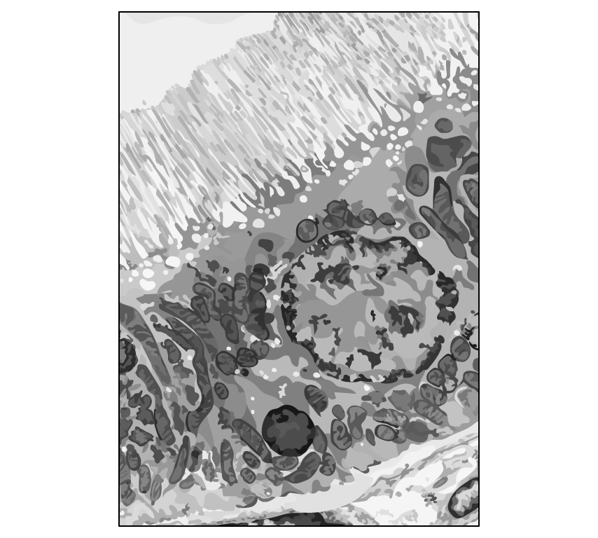
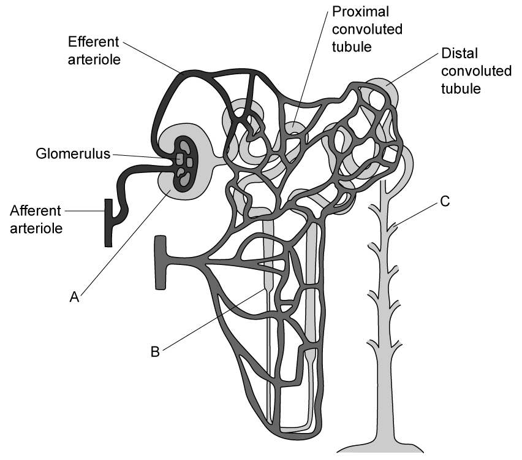
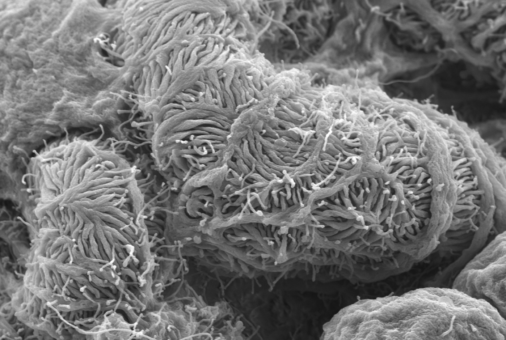
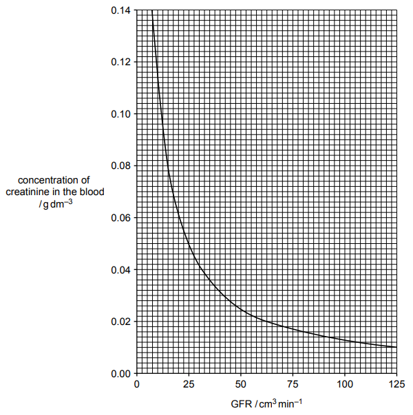
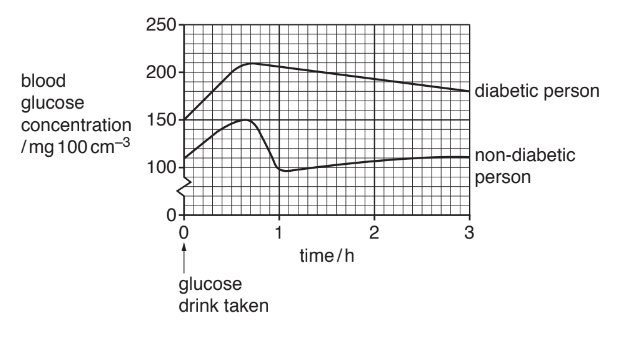
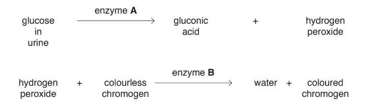
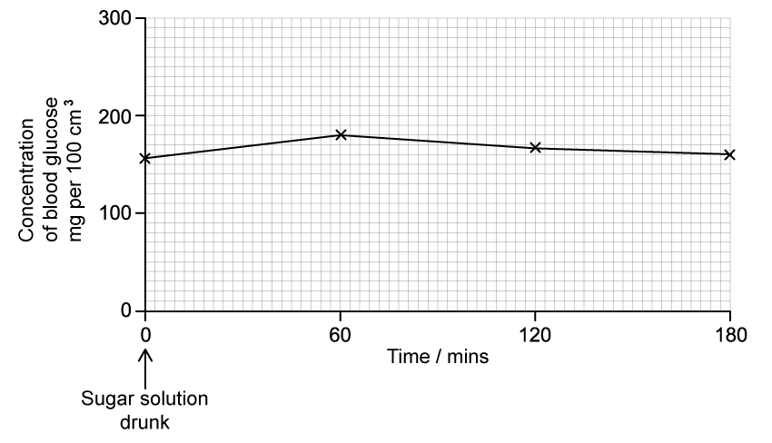
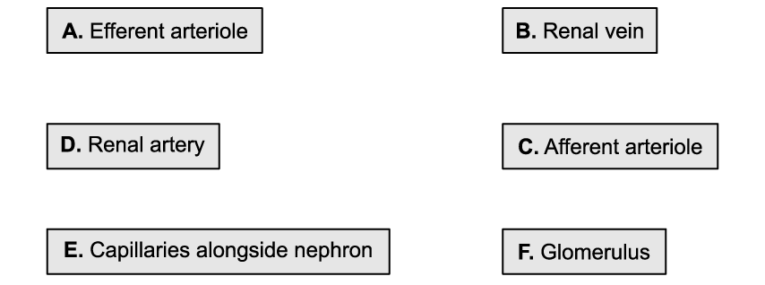

# Exam Questions — Homeostasis in Mammals
**14. Homeostasis** · Cambridge (CIE) A-LEVEL biology (9700)
> Source: [https://www.savemyexams.com/a-level/biology/cie/25/topic-questions/](https://www.savemyexams.com/a-level/biology/cie/25/topic-questions/) · 15 questions across 1 sets

## Structured Questions (15 questions)

### Q1 — hard — 11 marks

**Q1** [3 marks]

Insulin is a hormone that affects blood sugar levels.

Explain how insulin affects body cells.

**Q1** [3 marks]

Diabetes is a condition in which the hormone insulin is unable to carry out its function. Metformin is a drug sometimes used to treat diabetes.

A research group investigated the effect of metformin on blood glucose levels in 10 diabetic mice. The mice were given no food for 12 hours and were then given either no metformin (the control group), a 60 mg per kg dose of metformin, or a 400 mg per kg dose. 30 minutes later the mice were given a glucose meal and 180 minutes after this their blood glucose levels were measured. The results, along with bars to show standard deviation, are shown in Fig. 1.

**Fig. 1**

A research assistant concluded from these results that metformin was an effective drug for the treatment of diabetes in human patients.

Use Fig. 1 and the information provided to evaluate this conclusion.

**Q1** [3 marks]

The drug metformin works by lowering cellular levels of cyclic AMP.

Suggest how metformin works to reduce the impact of non-functioning insulin.

**Q1** [2 marks]

A simple indicator test for diabetes in a patient involves the use of a urine test strip.

(i) State why urine test strips show the presence of glucose but not other sugars in the urine.

[1]

(ii) Explain why glucose is present in the urine of diabetic individuals.

[1]

### Q2 — hard — 11 marks

**Q2** [2 marks]

Fig. 1 shows the changing concentrations of several substances as they pass through the regions of the nephron.

**Fig. 1**

(i) Identify region **1** of the nephron shown in Fig. 1.

[1]

(ii) Give a reason for your answer to part (i).

[1]

**Q2** [2 marks]

**Extract:**

Fig. 1 shows the changing concentrations of several substances as they pass through the regions of the nephron.

**Fig. 1**

Region **2** in Fig. 1 is the location at which much of the water is reabsorbed from the filtrate. During the second half of region** 2**, sodium ions are actively pumped out of the nephron into the surrounding medulla, indicated by a downward curve in Fig. 1.

Suggest how this accounts for the reabsorption of water from region **2**.

**Q2** [4 marks]

**Extract:**

Fig. 1 shows the changing concentrations of several substances as they pass through the regions of the nephron.

(i) Identify region 1 of the nephron shown in Fig. 1.

(ii) Give a reason for your answer to part (i).

Fig. 2 shows a micrograph of the lining of region **1** from Fig. 1.

**Fig. 2**

(i) Identify **two** features visible in Fig. 2 that aid the process of reabsorption.

[2]

(ii) Explain how each of the features identified in part (i) aid reabsorption.

[2]

**Q2** [3 marks]

**Extract:**

Fig. 2 shows a micrograph of the lining of region 1 from Fig. 1.

The cells shown in Fig. 2 have many Na+/K+ transporter proteins in their cell surface membranes.

Explain the role of Na+/K+ transporter proteins in the reabsorption of nutrients.

### Q3 — hard — 11 marks

**Q3** [2 marks]

Diabetes insipidus is a disease partly caused by non-functioning ADH receptor proteins within the membrane of the collecting duct epithelial cells.

Table 1 shows the concentration of solutes within different structures of the nephron in the presence or absence of ADH.

**Table 1**

| Structure of nephron | Concentration of solutes (mol) per 100 cm3 of filtrate |   |
|---|---|---|
| ADH present | ADH absent |   |
| Proximal convoluted tubule | 200 | 200 |
| Start of loop of Henle | 300 | 300 |
| Bend of loop of Henle | 900 | 900 |
| Distal convoluted tubule | 100 | 75 |
| Start of collecting duct | 200 | 45 |
| End of collecting duct | 900 | 45 |

A doctor wanted to summarise the concentration of solutes with and without ADH present in patients suffering from diabetes insipidus and had to choose whether to summarise the data by calculating the mean, the median or the mode.

(i) State the most appropriate measure for this set of data and give a reason for your choice.

[1]

(ii) Find the value using the data from all concentrations of solutes per 100 cm3 of filtrate with ADH present.

[1]

**Q3** [2 marks]

**Extract:**

Diabetes insipidus is a disease partly caused by non-functioning ADH receptor proteins within the membrane of the collecting duct epithelial cells. 

Table 1 shows the concentration of solutes within different structures of the nephron in the presence or absence of ADH. 

**Table 1**

| Structure of nephron | Concentration of solutes (mol) per 100 cm^3 ^of filtrate |
| ADH present | ADH absent |
| Proximal convoluted tubule | 200 | 200 |
| Start of loop of Henle | 300 | 300 |
| Bend of loop of Henle | 900 | 900 |
| Distal convoluted tubule | 100 | 75 |
| Start of collecting duct | 200 | 45 |
| End of collecting duct | 900 | 45 |

Explain what can be concluded about the action of ADH from the data given in Table 1.

**Q3** [4 marks]

**Extract:**

Diabetes insipidus is a disease partly caused by non-functioning ADH receptor proteins within the membrane of the collecting duct epithelial cells.

Table 1 shows the concentration of solutes within different structures of the nephron in the presence or absence of ADH.

Table 1

| Structure of nephron | Concentration of solutes (mol) per 100 cm^3 of filtrate |
| ADH present | ADH absent |
| Proximal convoluted tubule | 200 | 200 |
| Start of loop of Henle | 300 | 300 |
| Bend of loop of Henle | 900 | 900 |
| Distal convoluted tubule | 100 | 75 |
| Start of collecting duct | 200 | 45 |
| End of collecting duct | 900 | 45 |

Suggest and explain a symptom of a person with diabetes insipidus.

**Q3** [3 marks]

**Extract:**

Diabetes insipidus is a disease partly caused by non-functioning ADH receptor proteins within the membrane of the collecting duct epithelial cells.

A symptom of a person with diabetes insipidus is excessive urination / drinking / diluted urine / thirst because ADH is unable to bind to ADH receptors. Therefore aquaporins are not activated/phosphorylated. Therefore vesicles containing aquaporins do not bind to the luminal membrane (of the collecting duct). Permeability of luminal membrane is not increased / water molecules cannot move from the collecting duct into the tissue fluid/blood plasma (in the medulla).

In patients with severe diabetes insipidus individuals may be given a synthetic ADH called desmopressin. Patients are warned not to consume too much fluid whilst taking desmopressin.

Suggest why.

### Q4 — hard — 10 marks

**Q4** [2 marks]

The glomerulus is a structure in the kidneys responsible for the process of ultrafiltration.

Explain how ultrafiltration would be affected by severe dehydration.

**Q4** [6 marks]

Ultrafiltration relies on a water potential gradient being established.

Explain how solute concentration and pressure within the glomerulus establishes a water potential gradient during ultrafiltration.

**Q4** [2 marks]

An important role of the kidneys is the removal of urea from the blood. The volume of urea removed from the blood can be used as a measure of the rate of ultrafiltration, also known as the glomerular filtration rate (GFR).

An individual excretes 720 mg of urea in their urine over 1 hour, and has a blood urea concentration of 0.01 mg cm-3 entering the kidneys. Volume is calculated by dividing mass by concentration.

Use this information to calculate this person’s GFR.  Give your answer in cm3 min-1.

### Q5 — hard — 15 marks

**Q5** [8 marks]

Describe how the structure of the nephron and its associated blood vessels are adapted to the process of ultrafiltration.

*Source: Oct/Nov 2018 9700/41 Q10A*

**Q5** [7 marks]

Describe the effects of insulin on its main target tissues and explain how this leads to changes in blood glucose concentration.

*Source: Oct/Nov 2018 9700/41 Q10B*

### Q6 — medium — 10 marks

**Q6** [3 marks]

Fig. 1 shows a representation of the structure of a kidney nephron.**               **

**Fig. 1**

Identify the structures mark **A**-**C** in Fig. 1.

**Q6** [2 marks]

Fig. 2 shows part of the glomerulus of a mouse.

Image courtesy of SecretDisc. Licensed under Creative Commons Attribution-Share Alike 3.0 Unported license. Reused and disributed under conditions found at https://creativecommons.org/licenses/by-sa/3.0/deed.en

**Fig. 2**

(i) Name **one** feature visible in Fig. 2 that aids the process of ultrafiltration..

[1]

(ii) Explain the advantage provided by the structure named in part (i).

[1]

**Q6** [3 marks]

**Extract:**

Fig. 2 shows part of the glomerulus of a mouse.

(i) Name one feature visible in Fig. 2 that aids the process of ultrafiltration.

(ii) Explain the advantage provided by the structure named in part (i).

Mark scheme:
(i) A feature visible in Fig. 2 that aids ultrafiltration is...
- Podocytes;

(ii) This aids ultrafiltration because...
- It allows dissolved substances / small molecules to pass from the capillary/blood/glomerulus into the nephron/Bowman's capsule/structure A OR prevents the passage of large molecules/proteins/blood cells from the capillary/blood/glomerulus into the nephron/Bowman's capsule/structure A;

Table 1 shows the concentrations of several substances in the blood and in the glomerular filtrate.

**Table 1**

| **Substance** | **Blood concentration / g dm****-3** | **Glomerular filtrate concentration / g dm****-3** |
|---|---|---|
| Amino acids | 0.5 | 0.5 |
| Proteins | 78 | 0.05 |
| Glucose | 1.1 | 1.1 |
| Ions | 7.0 | 7.0 |
| Urea | 0.3 | 0.3 |
| Creatinine | 0.02 | 0.02 |

(i) Calculate the percentage decrease in the concentration of protein between the blood and the glomerular filtrate.

[2]

(ii) **Other than** that shown in Fig. 2, give a reason for the difference calculated in part (i).

[1]

**Q6** [2 marks]

**Extract:**

(i) A feature visible in Fig. 2 that aids ultrafiltration is...

- Podocytes; [1 mark]

(ii) This aids ultrafiltration because...

- It allows dissolved substances / small molecules to pass from the capillary/blood/glomerulus into the nephron/Bowman's capsule/structure A OR prevents the passage of large molecules/proteins/blood cells from the capillary/blood/glomerulus into the nephron/Bowman's capsule/structure A; [1 mark]

Table 1 shows the concentrations of several substances in the blood and in the glomerular filtrate.

Table 1

| Substance | Blood concentration / g dm^-3 | Glomerular filtrate concentration / g dm^-3 |
| Amino acids | 0.5 | 0.5 |
| Proteins | 78 | 0.05 |
| Glucose | 1.1 | 1.1 |
| Ions | 7.0 | 7.0 |
| Urea | 0.3 | 0.3 |
| Creatinine | 0.02 | 0.02 |

A patient at a medical examination was diagnosed with high blood pressure.

Give **two** ways in which high blood pressure might affect the ultrafiltration process in the patient's kidneys.

### Q7 — medium — 8 marks

**Q7** [2 marks]

During contraction muscles use up ATP very quickly. For a short period of time ATP can be resynthesised using creatine phosphate, as shown in Fig. 1.

ADP + creatine phosphate → ATP + creatine

**Fig. 1**

The creatine formed as a result of the resynthesis of ATP is converted to creatinine. Creatinine production in the body stays fairly constant. Creatinine becomes part of the glomerular filtrate during ultrafiltration in the kidney nephrons.

(i) Ultrafiltration requires a high blood pressure in the glomerulus.

Explain how this high blood pressure is achieved.

[1]

(ii) Name the main filtration barrier in the nephron that allows creatinine to pass into the Bowman’s capsule but stops red blood cells from passing through.

[1]

*Source: 2022 9700/04 Q5B*

**Q7** [6 marks]

The concentration of creatinine in the blood largely depends on the glomerular filtration rate (GFR). By measuring the concentration of creatinine in the blood, the GFR can therefore be estimated. The value of the GFR can be used to assess the efficiency of the kidneys.

In humans, a normal value of the GFR is 100 cm3  min–1.

Fig. 2 shows the relationship between the GFR and the concentration of creatinine in the blood.

**Fig. 2**

(i) Describe the relationship shown in Fig. 2.

[2]

(ii) Use Fig. 2 to estimate the concentration of creatinine in the blood that indicates a normal GFR.

[2]

(iii) Suggest **two** reasons why the GFR of a person might decrease.

[2]

*Source: 2022 9700/04 Q5C*

### Q8 — medium — 14 marks

**Q8** [5 marks]

Some people have a condition called diabetes. In type 1 diabetes the pancreas does not produce enough insulin.

Fig. 1 shows the blood glucose concentrations of a type 1 diabetic person and a non-diabetic person, at regular intervals after drinking a glucose drink.

**Fig. 1**

(i) Describe the results shown in Fig. 1.

[3]

(ii) Name the location of the receptors in a non-diabetic person that detect a change in blood glucose concentration.

[1]

(iii) Name the homeostatic mechanism by which blood glucose concentration is maintained.

[1]

*Source: May/June 2019 9700/41 Q7A*

**Q8** [4 marks]

The urine of a non-diabetic person does not contain glucose. A person with type 1 diabetes will excrete glucose in urine.

A reading of the concentration of glucose in the urine can be estimated using a dipstick.

Fig. 2 outlines how a dipstick works.

**Fig. 2**

The higher the concentration of glucose in the urine, the darker the colour on the dipstick.

(i)  Name enzymes **A** and **B**.

[2]

(ii) An electronic biosensor can be used to measure the glucose concentration in a drop of blood.

Suggest **one **advantage of using a biosensor and **one **advantage of using a dipstick to measure glucose concentration.

[2]

*Source: May/June 2019 9700/41 Q7B*

**Q8** [5 marks]

Describe the role played by insulin in the control of blood glucose concentration.

*Source: May/June 2019 9700/41 Q7C*

### Q9 — medium — 11 marks

**Q9** [2 marks]

Some diabetic individuals do not produce insulin. In an experiment, a woman with diabetes drank a sugary solution. The glucose concentration in her blood was measured at regular intervals. The results are shown in Fig. 1.

**Fig. 1**

Suggest **two** reasons why the concentration of glucose decreased after 60 minutes even though this woman’s blood contained no insulin.

**Q9** [4 marks]

**Extract:**

Some diabetic individuals do not produce insulin. In an experiment, a woman with diabetes drank a sugary solution. The glucose concentration in her blood was measured at regular intervals. The results are shown in Fig. 1.

**Fig. 1**

The same experiment was repeated on a non-diabetic patient. The glucose concentration in their blood prior to drinking the sugary solution was 75 mg per 100 cm3.

(i) Sketch a curve on Fig. 1 to show the results you would predict.

[1]

(ii) Outline the reason for the curve that you have sketched in part (i).

[3]

**Q9** [5 marks]

The regulation of glucose is an example of a homeostatic mechanism. Another example of a homeostatic mechanism is osmoregulation.

Describe the role of ADH in osmoregulation.

### Q10 — medium — 10 marks

**Q10** [3 marks]

Urea is excreted from the body in urine.

Outline why urea is present in the urine.

**Q10** [2 marks]

Fig. 1 shows part of the process of urea production.

**Fig. 1**

(i) Identify the molecule marked **X** in Fig. 1.1

[1]

(ii) Give **one** reason why molecule **X** cannot remain in the blood.

[1]

**Q10** [3 marks]

Urea influences the water balance of the blood.

Explain why the control of blood water balance is described as a negative feedback mechanism.

**Q10** [2 marks]

Suggest why it is very important that the water balance of the blood is regulated.

### Q11 — easy — 8 marks

**Q11** [2 marks]

Homeostasis is an important mechanism for mammals.

(i) Define the term homeostasis.

[1]

(ii) Explain the importance of homeostasis in mammals.

[1]

**Q11** [1 mark]

Some of the principles of homeostasis are listed below, detailing the example of an external temperature rise.

Arrange these in order of occurrence of a deviation from the normal.

1. Temperature of skin reduced
2. Signal to the coordination systems
3. Rise in temperature detected by skin receptor cells
4. Signal to coordination system stops/slows
5. Signal sent to the sweat glands

**Q11** [3 marks]

Other than control of body temperature state **three **physiological factors that homeostasis controls.

**Q11** [2 marks]

Most physiological factors controlled by homeostasis are** **regulated by negative feedback control mechanisms.

Describe the role of receptors and effectors in a negative feedback control mechanism.

### Q12 — easy — 7 marks

**Q12** [2 marks]

Blood undergoes ultrafiltration in the kidney.

Define ultrafiltration.

**Q12** [3 marks]

Explain the ways in which the following adaptations of the proximal convoluted tubule (PCT) help the PCT to carry out its function.

| 1. | Microvilli on the inner surface |   |
|---|---|---|
| 2. | Many mitochondria in epithelial cells |   |
| 3. | Tightly-packed cells in the epithelium |   |

**Q12** [2 marks]

Distinguish between the afferent and efferent arterioles in the kidney.

### Q13 — easy — 10 marks

**Q13** [2 marks]

The diagram below shows some of the events that take place during the regulation of blood glucose.

(i) Identify organ **X**.

[1]

(ii) Identify hormone **Y**.

[1]

**Q13** [4 marks]

**Extract:**

The diagram below shows some of the events that take place during the regulation of blood glucose.

Hormone Y is glucagon.

One of the effects of hormone Y is the formation of the second messenger, cyclic AMP.

(i) Define the term 'second messenger'.

[1]

(ii) Describe the sequence of events that leads to the formation of cyclic AMP following the release of hormone Y.

[3]

**Q13** [2 marks]

When cyclic AMP is released it triggers an enzyme cascade which amplifies the signal throughout the cell.

Explain the benefit to the cell of having the signal amplified in this way.

**Q13** [2 marks]

Urine test strips can be used to test for the presence of glucose in the urine of diabetics.

Explain the chemical reactions that occur on the strip in the presence of glucose.

### Q14 — easy — 9 marks

**Q14** [3 marks]

The names of six blood vessel types that carry blood in and around the kidney are shown below as **A - F**.

Place these blood vessels into the correct order through which blood passes during normal circulation.

**Q14** [2 marks]

Maintaining water levels in cells and tissues is an example of a negative feedback system.

Define the term 'negative feedback'.

**Q14** [1 mark]

State the name of the hormone that controls the level of water that is excreted via the kidney.

**Q14** [3 marks]

**Extract:**

State the name of the hormone that controls the level of water that is excreted via the kidney.

The name of the hormone that controls the level of water that is excreted via the kidney is:

- Anti-diuretic hormone / ADH; [1 mark]

Explain how the hormone named in part (c) affects the collecting ducts of the kidney as part of osmoregulation.

### Q15 — easy — 10 marks

**Q15** [3 marks]

Fig. 1 shows an image of a nephron.

Identify the structures labelled **1**, **3** and **4**.

**Q15** [2 marks]

State **two **components of blood expected to be found within structure **2**, as shown in Fig. 1.

**Q15** [3 marks]

**Extract:**

Fig. 1 shows an image of a nephron.

Identify the structures labelled **1**, **3** and **4**.

3 = Proximal convoluted tubule

Explain the role of sodium ions found within structure **3**, as shown in Fig. 1.

**Q15** [2 marks]

**Extract:**

Fig. 1 shows an image of a nephron.

Structures labelled 1, 3 and 4 are...
- 3 = Proximal convoluted tubule

Structure **3**, shown in Fig. 1, has many adaptations so that it can carry out selective reabsorption.

State **two **adaptations of structure **3**.
