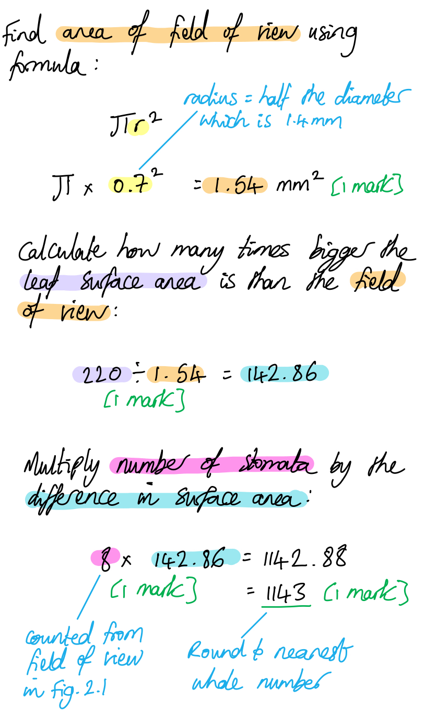
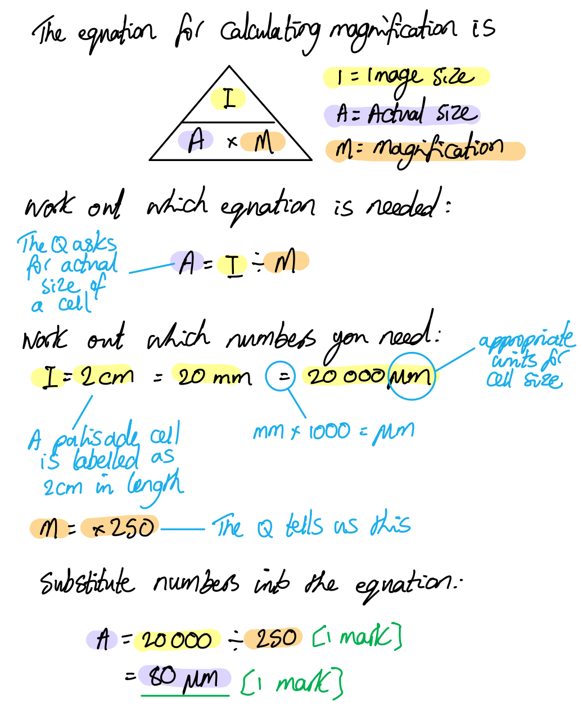
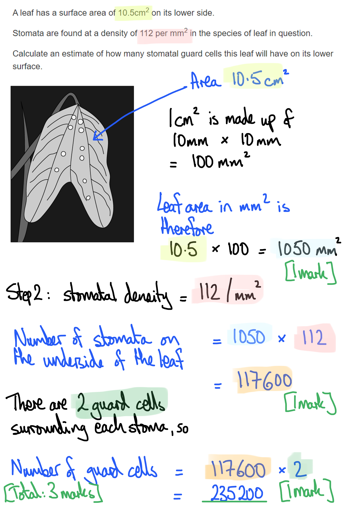
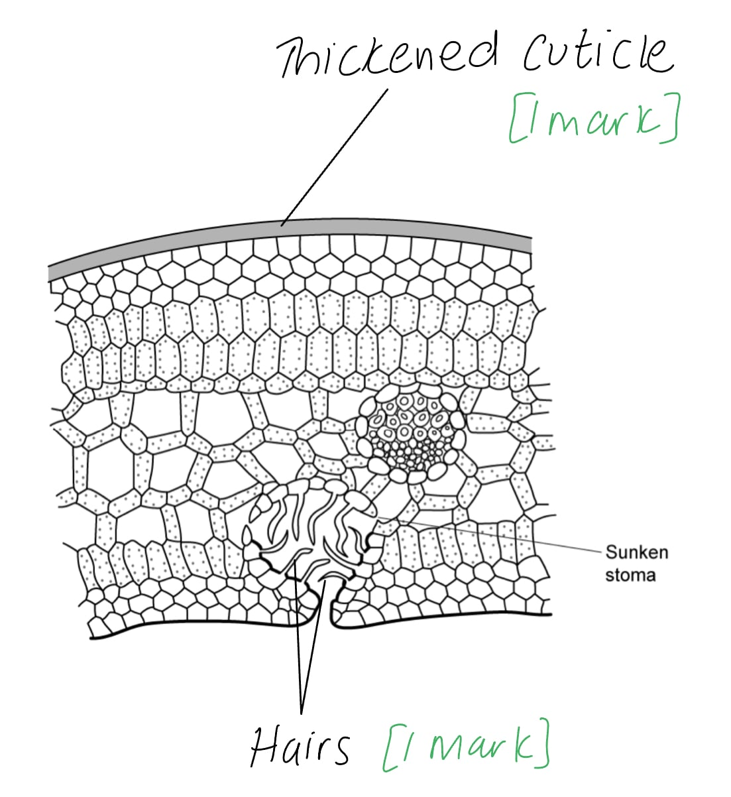
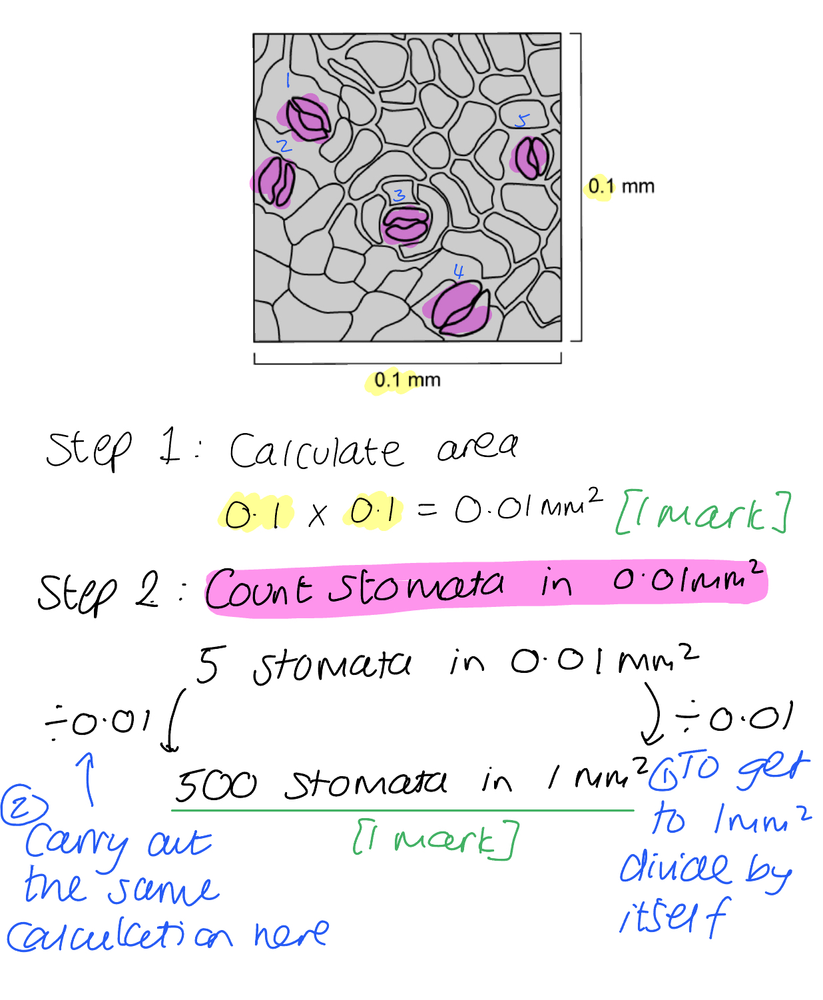
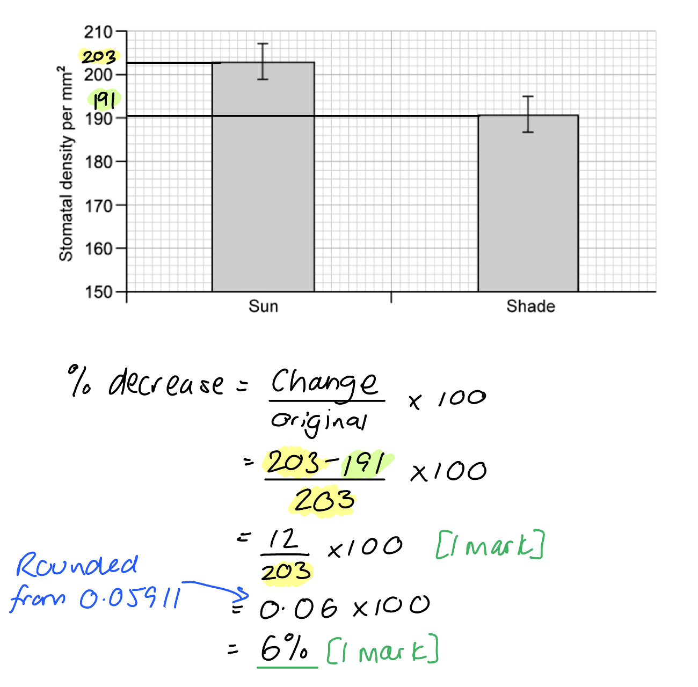

# Mark Schemes — Homeostasis in Plants
**14. Homeostasis** · Cambridge (CIE) A-LEVEL biology (9700)

## Structured Questions (9 questions)

### Q1
(i) The opening and closing of stomata in Fig. 1 shows...

**Final answer:** **Any ****one**** of the following:**

- Stomata close / the percentage of open stomata decreases when it is dark **AND** open / the percentage of open stomata increases when it is light; **[1 mark]**
- Stomata open and close on a daily/24-hour cycle; **[1 mark]**

(ii) Two factors that could be causing the pattern are...

**Final answer:** **Any ****two**** of the following:**

- Temperature; **[1 mark]**
- Humidity; **[1 mark]**
- Carbon dioxide concentration; **[1 mark]**

**[Total: 3 marks]**

> *Several factors influence the opening and closing of stomata, some of which fluctuate throughout a 24-hour cycle. Temperature tends to be higher during the day, and the higher temperatures increase the evaporation of water, raising the humidity levels. Photosynthesis increases during the day, causing plants to use up carbon dioxide and causing carbon dioxide levels to fall, while the rate of respiration overtakes the rate of photosynthesis at night, causing carbon dioxide levels to increase.*

> *While water availability also affects the opening and closing of stomata, this doesn't tend to fluctuate on a daily cycle, so this would not be accepted as an answer here.*
The pattern in Fig. 1 is advantageous to the plant because...

- It enables carbon dioxide to diffuse into the plant/leaves through the stomata; **[1 mark]**
- (During the day) when plenty of products of the light dependent reactions / NADPH and ATP are available for the Calvin cycle / carbon fixation; **[1 mark]**

**[Total: 2 marks]**

> *Having open stomata during daylight hours is useful to the plant because it ensures a supply of carbon dioxide at a time when the Calvin cycle can take place. In daylight, the light dependent reactions will be taking place and the products ATP and NADPH will be produced. These products are required for the Calvin cycle to occur and for carbon dioxide to be fixed.*
(i) ABA levels decrease at increased light intensity due to electrons from chlorophyll causing an ABA precursor molecule to be converted into a chemical called zeaxanthin because...

- Light energy excites electrons in chlorophyll / causes photoactivation **SO** there is no precursor left to produce ABA / all of the precursor is converted into zeaxanthin (and not ABA); **[1 mark]**

(ii) ABA levels decrease at increased light intensity due to glucose deactivating ABA because...

- Light energy increases the rate of photosynthesis **SO** more glucose is produced (which deactivates ABA); **[1 mark]**

(iii) ABA levels decrease at increased light intensity due to the activation of enzymes that break down ABA at high oxygen concentrations because...

- Light energy increases the rate of photolysis **SO** more oxygen is produced/released (activating the enzymes that break down ABA); **[1 mark]**

**[Total: 3 marks]**

> *This question relies on your knowledge of the process of photosynthesis and on you being able to apply this knowledge to an unknown context.*

> *Electrons are released from chlorophyll as a result of photoactivation, so an increase in light levels will increase the number of electrons released from chlorophyll, converting the ABA precursor into another molecule instead of into ABA; this will reduce ABA levels and therefore lead to reduced activity.*

> *Photosynthesis occurs at a higher rate when light intensity is higher; this will produce more glucose, deactivating ABA. and reducing its activity levels.*

> *Photolysis occurs at a higher rate when light intensity is higher; this will produce more oxygen, activating the enzymes that break down ABA. The enzymes will carry out their function, reducing ABA levels and therefore ABA activity.*
ABA affects stomata as follows...

**Final answer:** **Any ****six**** of the following:**

- ABA binds to receptors on the cell surface/plasma membranes of guard cells; **[1 mark]**
- (This) inhibits proton pumps / stops H+ ions from being pumped out of the (guard) cells; **[1 mark]**
- Protons/hydrogen ions/H+ accumulate inside the cell / pH of cell cytoplasm decreases / interior of cells becomes more positive; **[1 mark]**
- (ABA stimulates the) movement of calcium ions/Ca2+ into the guard cell; **[1 mark]**
- Calcium ions cause protein channels to open **AND** negative ions/chloride ions leave the cells; **[1 mark]**
- (Exit) potassium channels open **AND** potassium ions/K+ leave the cells; **[1 mark]**
- Loss of ions causes the water potential of cells to increase; **[1 mark]**
- Water moves out of the cells by <u>osmosis</u>; **[1 mark]**
- Guard cells become flaccid / volume of guard cells decreases (causing the stomata to close); **[1 mark]**

**[Total: 6 marks]**

### Q2
The results of the experiment are...

**Final answer:** **Any ****three ****of the following:**

- Stomatal pore size increased in the morning **and **reached a maximum near noon **and **decreased before the end of the day; **[1 mark]**
- The maximum stomatal aperture size was 7 µm; **[1 mark]**
- Increase in stomatal pore size corresponded to an increase in guard cell potassium content and a decrease in guard cell starch content; **[1 mark]**
- Potassium content declined faster than the stomatal pore size; **[1 mark]**
- Maximum stomatal pore size corresponded to zero starch content and maximum potassium content; **[1 mark]**

**[Total: 3 marks]**
The standard deviation shows...

- **Likely / indicates **that there is a significant difference in the mean diameter of stomatal pores; **[1 mark]**
- As there is no overlap in the SD bars; **[1 mark]**

**[Total: 2 marks]**

> *Standard deviation is not a statistical test, rather it is a measure of the variation around the mean. So we cannot say with certainty that the data is significantly different, to do this we would need to perform a statistical test. *
The change in stomatal pore diameter and potassium concentration is because...

- Calcium ions/Ca2+ stimulate potassium ion/K+ channels to open **so **potassium ion/K+ to <u>leave</u> (the guard cells); **[1 mark]**
- Calcium ions/Ca2+ stimulate the closing of channel proteins **so **potassium ions cannot enter (the guard cells); **[1 mark]**
- Loss of ions increases the water potential inside the guard cells **so **water leaves by <u>osmosis;</u> **[1 mark]**
- The guard cell becomes flaccid and stomata close **so **stomatal pore diameter decreases; **[1 mark]**

***Do not accept**** calcium or potassium alone without reference to ion at marking points 1 and 2*

***Accept ****an annotated diagram*

**[Total: 4 marks]**
The evidence in Fig. 1 that supports the suggestion that starch acts as a sink is...

- As the stomatal pore diameter decreases the starch concentration increases; **[1 mark]**
- When starch concentration is at its highest the stomatal diameter is at its lowest *(accept converse)*; **[1 mark]**

**[Total: 2 marks]**

### Q3
The total number of stomata on the lower surface of the student’s leaf is...

- πr2 = 0.72 = 1.54 / 220 ÷ 1.54 / 8 x 142.86; **[1 mark]**
- 1143 (stomata); **[1 mark]**

*Full marks can be awarded for the correct answer in the absence of other calculations.*

**[Total: 2 marks]**

The student could conclude the following from Fig. 2...

- The high<u>er</u> the atmospheric carbon dioxide concentration the small<u>er</u>/narrow<u>er</u> the stomatal aperture/opening / the small<u>er</u> the stomata width in relation to length **OR** the low<u>er</u> the atmospheric carbon dioxide concentration the larg<u>er</u>/wid<u>er</u> the stomatal aperture/opening / the larg<u>er</u> the stomata width in relation to length; **[1 mark]**
- Carbon dioxide concentration has a (statistically) <u>significant</u> effect on stomatal aperture/opening; **[1 mark]**

***Accept**** the idea of statistical significance given within the context of the first mark point, e.g. as the atmospheric carbon dioxide levels increase, the stomata become *<u>*significantly*</u>* small*<u>*er*</u>*/narrow*<u>*er*</u>*; [2 marks]*

**[Total: 2 marks]**

> *Note that the first mark point requires the use of comparative language; you need to be clear that the stomata become smaller or larger at different carbon dioxide levels; not just that they are small or large. *

> *The bars representing standard deviation show no overlap, so we know that there is a significant difference between each of the data sets.*
An explanation for the results shown in Fig. 2 could be that...

- When atmospheric carbon dioxide levels are high there is a steeper concentration gradient between the atmosphere and the inside/air spaces of the leaf; **[1 mark]**
- (When atmospheric carbon dioxide levels are high) more carbon dioxide diffuses into the leaf / air spaces **SO** the concentration of carbon dioxide inside the leaf increases; **[1 mark]**
- Availability of carbon dioxide for photosynthesis is high **SO** stomata/guard cells close; **[1 mark]**

**[Total: 3 marks]**

> *High levels of carbon dioxide inside the leaf are a stimulus that triggers the closing of the stomata. Having stomata open is always a balance between gaining carbon dioxide and losing water, so when carbon dioxide is readily available the plant closes its stomata to avoid water loss.*
Evaluative points regarding the conclusion that rising global carbon dioxide levels could be good for the world's plants include...

In **support **of the conclusion

**Final answer:** **A maximum of**** two**** of the following:**

- At higher carbon dioxide levels there is a higher (dry) mass of plant material **OR** plants gain more mass / grow more when atmospheric carbon dioxide levels are higher; **[1 mark]**
- High carbon dioxide levels increase the rate of photosynthesis / prevent carbon dioxide from being a limiting factor in photosynthesis; **[1 mark]**
- At higher carbon dioxide levels the stomata are narrower/smaller so plants will lose less water / conserve water; **[1 mark]**
- Dry mass is measured so the amount of water in the plant tissues would not affect the results; **[1 mark]**

**Against **the conclusion

- There is no significant difference between the mass of the plants at high and medium carbon dioxide levels; **[1 mark]**
- Increased carbon dioxide levels cause temperatures to increase so plant enzyme activity might decrease / plant enzymes might denature / water availability will decrease (decreasing the rate of photosynthesis/plant growth); **[1 mark]**

**[Total: 3 marks]**

> *When evaluating aim to always include arguments both for and against.*

> *There is evidence that increasing atmospheric carbon dioxide levels actually aid plant growth; there is more carbon available to be fixed during photosynthesis and plants can conserve water by narrowing their stomata while still getting plenty of carbon dioxide.*

> *The data in Fig. 3 shows that in this study at least, there was no significant increase in plant mass as the result of rising carbon dioxide levels from medium to high. There are of course other impacts of global warming that will impact plant growth negatively, such as rising temperatures and reduced water availability.*

> *The question refers specifically to plant growth so other negative impacts of global warming will not be relevant here. These issues must of course be considered when thinking about the bigger picture; clearly, an increased rate of plant growth does not make up for all the other devastating impacts of climate change.*

### Q4
Two features that help to identify the cells in Fig.1 as guard cells are...

**Final answer:** **Any ****two**** of the following:**

- The cell walls are thicker between the cells / around the pore than around the outer edge; **[1 mark]**
- There are several/multiple vacuoles; **[1 mark]**
- There are several/many/multiple / a high density of chloroplasts; **[1 mark]**

**[Total: 2 marks]**
The environmental conditions could be...

**Final answer:** **Any ****three**** of the following:**

- Dark; **[1 mark]**
- Hot / high temperatures; **[1 mark]**
- Dry / water stress; **[1 mark]**
- Low humidity; **[1 mark]**
- High carbon dioxide concentration; **[1 mark]**

**[Total: 3 marks]**

> *The guard cells in Fig.1 are almost completely closed, so you should consider environmental conditions that will cause stomatal closure.*
The size of the stomatal pore in Fig. 1 could be increased by...

**Final answer:** **Any ****five**** of the following:**

- Active transport of / ATP is used to transport hydrogen ions/protons/H+ out of the guard cell (via a proton pump); **[1 mark]**
- The inside of the guard cell becomes negative in comparison to the outside; **[1 mark]**
- Potassium/K+ channels open **and** potassium ions diffuse into cell; **[1 mark]**
- (Potassium ions cause) water potential of cells to fall/decrease; **[1 mark]**
- Water moves into guard cells by osmosis; **[1 mark]**
- Guard cells swell / volume of guard cells increases / guard cells become turgid; **[1 mark]**
- Thicker inner walls / bands of cellulose/microfibrils cause cells to bend/curve;  **[1 mark]**

**[Total: 5 marks]**

### Q5
The actual length of a palisade mesophyll cell is...

- 20 000 ÷ 250; **[1 mark]**
- 80 μm; **[1 mark]**

*Full marks can be awarded for the correct answer in the absence of other calculations.*

**[Total: 2 marks]**

> *Remember to convert the measurements into appropriate units; this can be done before the calculation or after, but it is good practice to get into the habit of doing it beforehand to avoid forgetting afterwards!*

> *Once you have done a calculation of this nature it is always worth asking yourself whether the answer you have come out with sounds right; given that we know that plant cells can range in size from around 10 - 100 µm, a size of 80 µm sounds about right, but if you had come out with 8 or 800 then you could assume that you had gone wrong somewhere and go back to check your numbers.*

Structures **P**, **Q**, and **R** are...

- **P** = xylem; **[1 mark]**
- **Q** = phloem; **[1 mark]**
- **R** = guard cell; **[1 mark]**

**[Total: 3 marks]**
(i) Features of structure **R** that assist with function include...

**Final answer:** **Any ****two**** of the following:**

- Thick cell walls facing (the air and) the stoma **and** thin cell walls facing surrounding (epidermal) cells; **[1 mark]**
- Bands of cellulose microfibrils surrounding the cell; **[1 mark]**
- Cell walls have no plasmodesmata; **[1 mark]**
- Cell surface membrane is folded; **[1 mark]**
- Cell surface membrane contains many channel/carrier proteins; **[1 mark]**
- Cytoplasm has a high density of/many chloroplasts; **[1 mark]**
- Cytoplasm has a high density of/many mitochondria / mitochondria have many cristae; **[1 mark]**
- Several small vacuoles (rather than one large vacuole); **[1 mark]**

(ii) The benefits of these features could be...

**Final answer:** **Any**** relevant two**** of the following:**

- (Differences in cell wall thickness) allow the guard cell to expand/swell outwards in one direction / without blocking the stomata; **[1 mark]**
- (Cellulose microfibrils) provide the cell wall with strength (to prevent bursting when pressure increases) / allow the guard cells to increase in length but not in width; **[1 mark]**
- (Lack of plasmodesmata) increases the control over substances leaving and entering the cell; **[1 mark]**
- (Folded membrane) increases surface area for transport/channel/carrier proteins; **[1 mark]**
- (Channel/carrier proteins) allow guard cells to adjust their water potential / transport solutes/named solutes into and out of the cell; **[1 mark]**
- (High density of chloroplasts) allows increased production of ATP during chemiosmosis / production of glucose for respiration; **[1 mark]**
- (High density of mitochondria / many cristae) allows increased production of ATP / release of energy for active transport; **[1 mark]**
- (Several small vacuoles) increases the ability/flexibility of the guard cell to increase/decrease in volume / allows the guard cell to take on more water **OR** the small vacuoles fuse to make one large vacuole during guard cell opening and separate into small vacuoles when stomata are closed; **[1 mark]**

***Reject*** *references to production/creation of energy.*

**[Total: 4 marks]**

> *Note that it needs to be possible to make a logical suggestion as to the **benefit** of the given guard cell features. Other features may have been observed (e.g. guard cells have few grana), but if these features don't have an obvious adaptive value then marks will not be awarded.*
The role of stomata in plant homeostasis is...

- (Stomata) control the <u>diffusion</u> of carbon dioxide into the leaf / control the <u>concentration</u> of carbon dioxide present inside the leaf; **[1 mark]**

**[Total: 1 mark]**

### Q6
The conditions in which abscisic acid (ABA) plays a role in plant physiology are...

- Reduced water availability; **[1 mark]**
- High temperatures e.g. a heatwave; **[1 mark]**

**[Total: 2 marks]**

> *If you know the topic well, resist the temptation to launch into a detailed mechanism of how ABA causes stomatal closure; the command word is 'state' which only requires two brief statements. Any elaboration you write will be a waste of time as it won't earn you any extra marks. *
The two inorganic ions that play a role in the action of abscisic acid in leaf function are...

- Calcium/Ca2+ **AND** potassium/K+; **[1 mark]**

**Roles:**

- Calcium ions move into the guard cell cytoplasm and cause other ion channel proteins to open; **[1 mark]**
- Potassium ions diffuse out of the guard cell cytoplasm, increasing its water potential (so water follows and the guard cell becomes flaccid and closes); **[1 mark]**

**[Total: 3 marks]**
An estimate of how many stomatal guard cells this leaf will have on its lower surface is calculated as follows:

- 112 stomata per mm2 = 112 × 100 = 11 200 per cm2; **[1 mark]**
- 11 200 per cm2 × 10.5 = 117 600 stomata; **[1 mark]**
- 117 600 × 2 = 235 200 guard cells per leaf lower surface; **[1 mark]**

**[Total: 3 marks]**

A a role for the chloroplasts found in guard cells on the underside of leaves is...

- As photoreceptors / light receptors / to receive stimuli about lighting conditions; **[1 mark]**
- (In order to) initiate stomatal opening/closing mechanisms; **[1 mark]**

**[Total: 2 marks]**

> *The role of these chloroplasts is not their usual photosynthetic role, given that the lower epidermis cells do not contain any chloroplasts, presumably because of insufficient light intensity underneath the leaves for photosynthesis to take place at an acceptable rate. As a light-sensing organelle, a chloroplast can absorb light which causes changes in the electronic structure of the various photosynthetic pigments. It is thought that these chloroplasts act as the receptors for light, the stimulus that initiates stomatal opening or closing at different times of the day / night. *

### Q7
Two environmental conditions that would cause stomata to close are...

**Final answer:** **Any ****two**** of the following:**

- Darkness / absence of light; **[1 mark]**
- High concertation of carbon dioxide inside the leaf air spaces; **[1 mark]**
- Low humidity; **[1 mark]**
- High temperature; **[1 mark]**
- Water stress / low water availability (to the roots) **OR **high rates of transpiration; **[1 mark]**

**[Total: 2 marks]**

> *It is a fine balance for the plant to regulate the opening and closing of the stomatal aperture to accommodate the need for carbon dioxide uptake with the need to minimise water loss by transpiration.*
The cell that controls the opening and closing of stomata is,,,.

- Guard cell; **[1 mark]**

**[Total: 1 mark]**

> *A common misconception is that the stomata are the cells, but the stomata are actually the holes/opening, or more specifically the aperture, and it is the guard cells surrounding the stomata that control the opening and closing of this hole. *
An advantage **and **a disadvantage of the plant closing the stomata is...

**Advantage**

- Water is retained in the plant / water is not lost from the plant (via transpiration) **so **the plant will not wilt / water stress will be avoided / cells will remain turgid; **[1 mark]**

**Disadvantage**

**Final answer:** **One**** from:**

- Carbon dioxide cannot diffuse into the leaf **so **photosynthesis will be limited; **[1 mark]**
- Water vapour cannot diffuse out so transpiration / water uptake / mineral ion movements will be limited;** [1 mark]**

**[Total: 2 marks]**

> *The command word here is 'explain' so make sure you don't just state the advantage and disadvantage, but you also explain **why **this would be beneficial or detrimental to the plant.*
(i) Two other adaptive features shown in Fig. 1 that help reduce transpiration are...

**Correctly labelled on the diagram:**

- Thickened cuticle; **[1 mark]**
- Hairs; **[1 mark]**

(ii) The features shown in Fig. 1 help to reduce water loss by...

**Final answer:** **Any ****one ****of the following:**

- Thickened cuticle: waxy **so **impermeable to water / waterproof / stops water passing through ; **[1 mark]**
- Hairs: reduced air movement / traps layer of air / trap water <u>vapour</u>* / *maintains humidity **which **reduces diffusion gradient / concentration gradient of water / water potential gradient; **[1 mark]**
- Sunken stoma: stoma can close **which **reduces <u>area</u> for evaporation or transpiration **OR **reduced air movement / traps layer of air / trap water <u>vapour</u>* / *maintains humidity **which **reduces diffusion gradient / concentration gradient of water / water potential gradient; **[1 mark]**

*Do not accept reference to water alone*

**[Total: 3 marks]**

### Q8
Three structural features of guard cells are...

**Final answer:** **Any ****three ****of the following:**

- Thick cell walls facing the air outside the leaf and the stoma and thin cell walls facing adjacent epidermal cells; **[1 mark]**
- Cellulose microfibrils arranged in bands around the cell; **[1 mark]**
- Cell walls have no plasmodesmata; **[1 mark]**
- Cell surface membrane is often folded and contains many channel and carrier proteins; **[1 mark]**
- Cytoplasm has a high density of chloroplasts and mitochondria; **[1 mark]**
- Several small vacuoles rather than one large vacuole; **[1 mark]**

**[Total: 3 marks]**

> *The question stem asked specifically about the structure features of the guard cells, so although the chloroplasts and mitochondria are adapted within the guard cells, you would not achieve marks for including them in your answer. *
The steps in the correct order are..

- C, F, D, B, E, A; **[1 mark]**

**[Total: 1 mark]**

> *This is an important process so make sure you can describe it confidently. It is the increase in turgor pressure that causes the cell to distort its shape. It's a bit like sticking a piece of Sellotape to a water balloon and then filling it; the balloon will curve around the place where the Sellotape is stuck.*
The process by which water enters the cell as described in** **step B in part (b) is...

- Osmosis; **[1 mark]**

**[Total: 1 mark]**
The completed sentences are as follows:

**[1 mark] for each correct sentence:**

- ABA binds with ABA **receptors **on the cell surface membrane of guard cells; **[1 mark]**
- This inhibits the **proton **pumps and **hydrogen **ions are no longer actively transported out of the cell; **[1 mark]**
- **Calcium **ions also move into the guard cells which stimulates the opening of further channel proteins that allow **potassium **ions to leave the guard cells; **[1 mark]**
- Water potential inside the cell **increases **and so water leaves the cell by osmosis. The guard cells become **flaccid **and the stomata close; **[1 mark]**

**[Total: 4 marks]**

### Q9
The student could use an eyepiece graticule to determine the mean diameter of stomata by...

- Measure (each stoma) using the eyepiece graticule; **[1 mark]**
- <u>Calibrate</u> the eyepiece graticule against a stage micrometer / ruler / graph paper; **[1 mark]**
- Take several measurements / repeat for different areas (to calculate a mean); **[1 mark]**

**[Total: 3 marks]**

> *This is a synoptic question assessing and applying knowledge from Topic 1. *
Appropriate units the student should use to measure the distribution of stomata on leaves is...

**Final answer:** **Any ****one ****of the following:**

- Stomata per mm2 or cm2 **OR** number per mm2 or cm2; **[1 mark]**

*Accept: mm**−2** or cm**−2*

*Do not accept 'amount'*

**[Total: 1 mark]**
The number of stomata per mm2 of the leaf surface is calculated as follows...

**Final answer:** **Any ****two**** of the following:**

- Calculation of area: 0.1 x 0.1 = 0.01 (mm2); **[1 mark]**
- 5 stomata ÷ 0.01 mm2 = 500 (per mm2); **[1 mark]**

**[Total: 2 marks]**

(i)The percentage decrease in stomatal density between the two conditions is...

- Difference = 203 - 191 = 12; **[1 mark]**
- % decrease = 12 ÷ 203 = 0.06 x 100 = 6 %; **[1 mark]**

***Accept ****answers in the range of 5.9 - 6.0 %*

(ii) An explanation for the data is...

- (More stomata in the leaves/plants exposed to the sun)
- Because they will carry out more photosynthesis so will need more carbon dioxide to diffuse into the leaf; **[1 mark]**

**[Total: 3 marks]**

