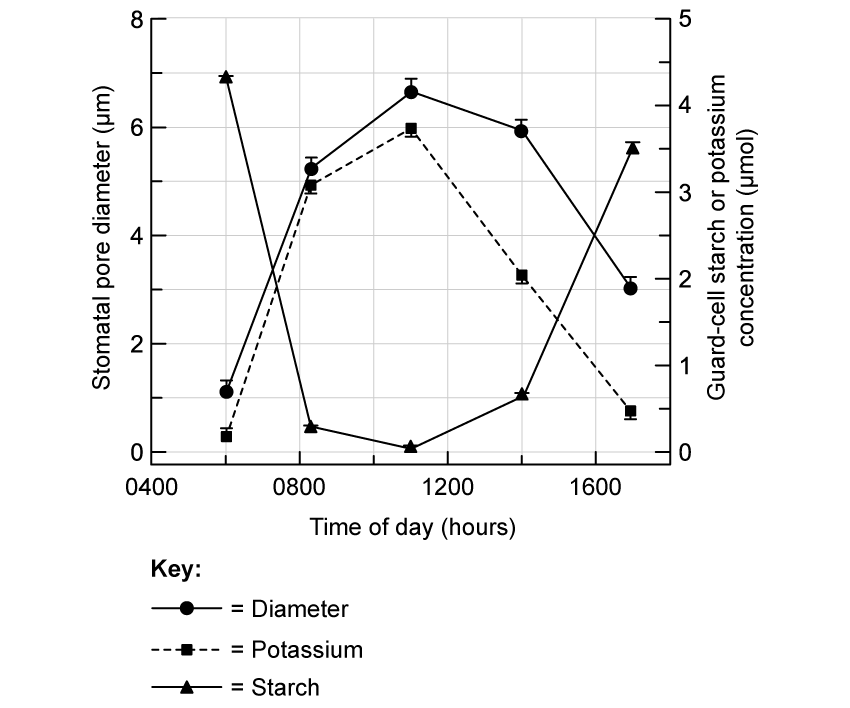
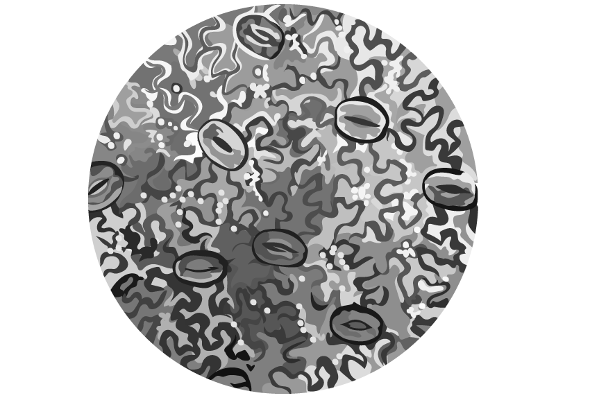
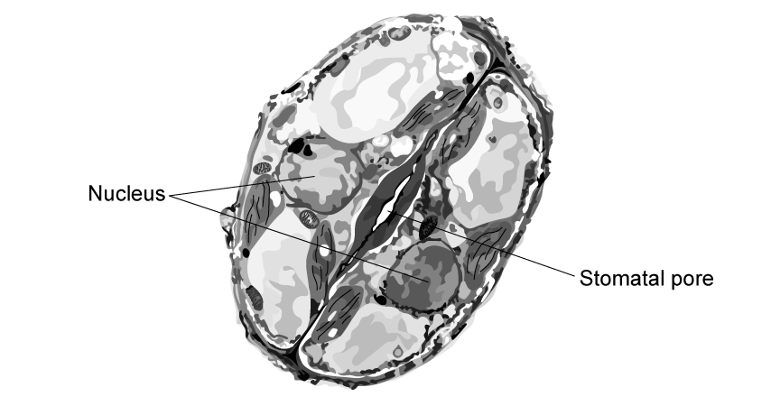
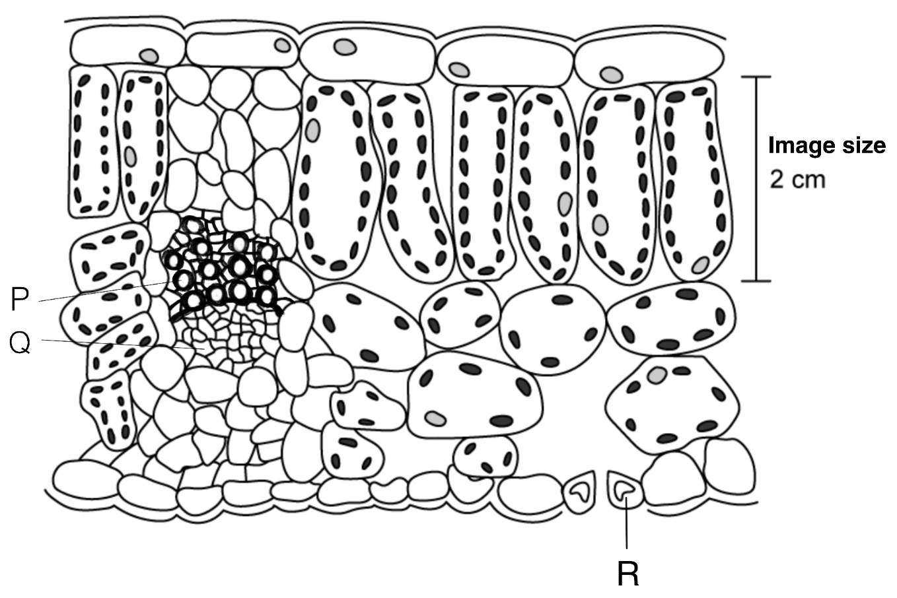
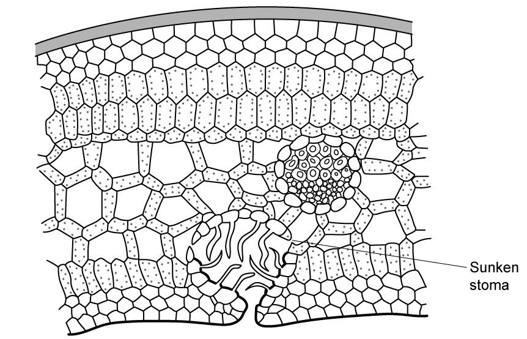
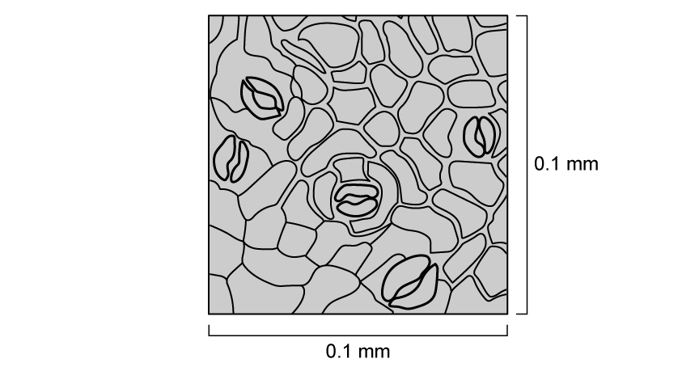
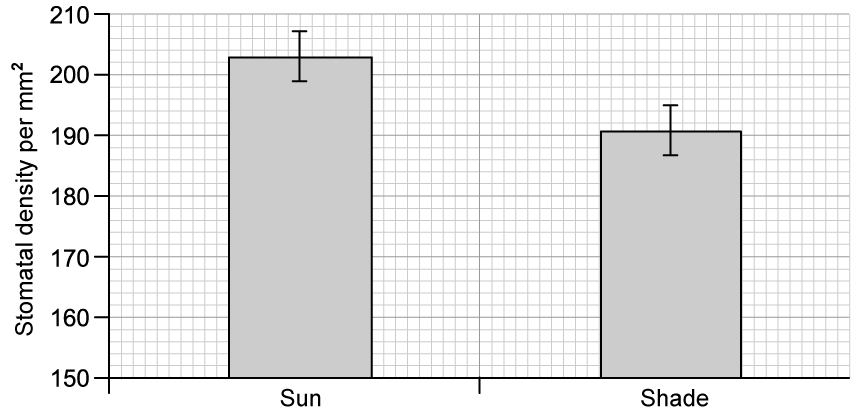

# Exam Questions — Homeostasis in Plants
**14. Homeostasis** · Cambridge (CIE) A-LEVEL biology (9700)
> Source: [https://www.savemyexams.com/a-level/biology/cie/25/topic-questions/](https://www.savemyexams.com/a-level/biology/cie/25/topic-questions/) · 9 questions across 1 sets

## Structured Questions (9 questions)

### Q1 — hard — 14 marks

**Q1** [3 marks]

Fig. 1 shows the percentage of stomata that are open over a 96 hour period.

**Fig. 1**

(i) Describe the opening and closing of stomata in Fig. 1.

[1]

(ii) **Other than** the changing light intensity shown in Fig. 1, give **two** factors that could be contributing to the pattern described in part i).

[2]

**Q1** [2 marks]

**Extract:**

Fig. 1 shows the percentage of stomata that are open over a 96 hour period.

The opening and closing of stomata in Fig. 1 shows that stomata close / the percentage of open stomata decreases when it is dark AND open / the percentage of open stomata increases when it is light; OR stomata open and close on a daily/24-hour cycle.

Outline why the pattern shown in Fig. 1 is advantageous to the plant.

**Q1** [3 marks]

Research has shown that increased light intensity decreases the activity of the chemical abscisic acid (ABA) in plants.

Explain how each of the following circumstances would cause a decrease in ABA activity at increased light intensity:

(i) Electrons from chlorophyll cause an ABA precursor molecule to be converted into a chemical called zeaxanthin.

[1]

(ii) Glucose deactivates ABA.

[1]

(iii) Enzymes that break down ABA are activated at high concentrations of oxygen.

[1]

**Q1** [6 marks]

At low light intensity the level of ABA inside a plant increases.

Explain how this affects stomata.

### Q2 — hard — 11 marks

**Q2** [3 marks]

Scientists investigated the stomatal pore size (µm) and the concentrations of potassium and starch (µmol) within guard cells in basil leaves over 24 hours.

The results of the investigation are shown in Fig. 1 below.

**Fig. 1**

Describe the results of the experiment.

**Q2** [2 marks]

**Extract:**

Scientists investigated the stomatal pore size (µm) and the concentrations of potassium and starch (µmol) within guard cells in basil leaves over 24 hours.

The results of the investigation are shown in Fig. 1 below.

The scientists calculated the mean stomatal pore diameters and the standard deviation.

Describe what the standard deviation shows in relation to the data in Fig. 1.

**Q2** [4 marks]

**Extract:**

Scientists investigated the stomatal pore size (µm) and the concentrations of potassium and starch (µmol) within guard cells in basil leaves over 24 hours.

The results of the investigation are shown in Fig. 1 below.

Fig. 1

Use the data in Fig. 1 to explain the changes in stomatal pore diameter and potassium content after midday.

**Q2** [2 marks]

**Extract:**

Scientists investigated the stomatal pore size (µm) and the concentrations of potassium and starch (µmol) within guard cells in basil leaves over 24 hours.

The results of the investigation are shown in Fig. 1 below.

The scientists suggested that starch molecules act as a sink for osmotic ions leading to stomatal closing.

Describe the evidence in Fig. 1 that supports this.

### Q3 — hard — 10 marks

**Q3** [2 marks]

A student who wanted to investigate stomata looked at a lower leaf surface under a microscope. Their field of view is shown in Fig. 1

**Fig. 1**

The diameter of the microscope’s field of view was 1.4 mm and the lower leaf had a total surface area of 220 mm2. The area of a circle can be calculated using the following formula:

πr2

Calculate the total number of stomata on the lower surface of the student’s leaf. Give your answer to the nearest whole number.

**Q3** [2 marks]

The student read about some research that had been carried out into the effect of atmospheric carbon dioxide on plant growth. Three different carbon dioxide levels were tested; high, medium, and low. The results relating to stomatal aperture are shown in Fig. 2. Note that the bars show standard deviation and that the term aperture refers to the opening between the guard cells.

**Fig. 2**

Describe what the student could conclude from Fig. 2 about the effect of atmospheric carbon dioxide on stomata.

**Q3** [3 marks]

**Extract:**

The student read about some research that had been carried out into the effect of atmospheric carbon dioxide on plant growth. Three different carbon dioxide levels were tested; high, medium, and low. The results relating to stomatal aperture are shown in Fig. 2. Note that the bars show standard deviation and that the term aperture refers to the opening between the guard cells.

Suggest an explanation for the results shown in Fig. 2

**Q3** [3 marks]

The study done by the student in part b) also looked at the effect of carbon dioxide concentration on plant biomass. Fig. 3 shows the results.

**Fig. 3**

The student concluded from Fig. 3 that the currently increasing carbon dioxide levels in the earth's atmosphere could have a positive effect on plant growth around the world.

Use Fig. 3 and your own knowledge to evaluate the student's conclusion.

### Q4 — medium — 10 marks

**Q4** [2 marks]

Fig. 1 shows an electron microscope image of two guard cells.

**Fig. 1**

Give **two** features **other than** the stomatal pore that help to identify the cells in Fig. 1 as guard cells.

**Q4** [3 marks]

**Extract:**

Fig. 1 shows an electron microscope image of two guard cells.

If the guard cells in Fig. 1 were living, suggest the environmental conditions that might be present.

**Q4** [5 marks]

**Extract:**

Fig. 1 shows an electron microscope image of two guard cells.

Explain the process that would cause the size of the stomatal pore in Fig. 1 to increase.

### Q5 — medium — 10 marks

**Q5** [2 marks]

Fig. 1 shows a cross section of a leaf as viewed through a light microscope at x250 magnification.

**Fig. 1**

Fig. 1 indicates that the image size of a palisade mesophyll cell is 2 cm.

Calculate the actual length of a palisade mesophyll cell.

**Q5** [3 marks]

**Extract:**

Fig. 1 shows a cross section of a leaf as viewed through a light microscope at x250 magnification.

Identify structures **P**, **Q**, and **R** in Fig. 1

**Q5** [4 marks]

**Extract:**

Fig. 1 shows a cross section of a leaf as viewed through a light microscope at x250 magnification.

Identify structures P, Q, and R in Fig. 1

Structure R = guard cell

(i) Give **two** features of structure **R** that help it to carry out its function;

[2]

(ii) Suggest how the features given in part i) help structure **R** to carry out its function;

[2]

**Q5** [1 mark]

Structure **R** surrounds a stoma.

State the role of the stomata in plant homeostasis.

### Q6 — medium — 10 marks

**Q6** [2 marks]

State the conditions in which abscisic acid (ABA) plays a role in plant physiology.

**Q6** [3 marks]

Name and outline the roles of the **two** inorganic ions that play a role in the action of abscisic acid in leaf function.

**Q6** [3 marks]

A leaf has a surface area of 10.5 cm2 on its lower side.

Stomata are found at a density of 112 per mm2 in the species of leaf in question.

Calculate an estimate of how many stomatal guard cells this leaf will have on its lower surface.

**Q6** [2 marks]

In many plant species, the guard cells on the underside of the leaf contain chloroplasts, whereas the surrounding cells of the lower epidermis do not.

This is a surprising finding given the low light intensity usually found on the underside of leaves.

Suggest and explain a role for the chloroplasts that are found in the guard cells on the underside of leaves.

### Q7 — easy — 8 marks

**Q7** [2 marks]

Stomata control the movement of gases into and out of a leaf.

State **two **environmental conditions that would cause stomata to close.

**Q7** [1 mark]

Identify the cell that controls the opening and closing of stomata.

**Q7** [2 marks]

**Extract:**

Stomata control the movement of gases into and out of a leaf.

With the stomata closed, this offers some advantages and disadvantages to the plant.

Explain an advantage **and **a disadvantage to the plant when the stomata are closed.

**Q7** [3 marks]

Fig. 1 shows a single stoma and surrounding cells from a xerophytic plant. The sunken stoma has been labelled for you.

**Fig. 1**

(i) Label **two **other adaptive features shown in Fig. 1 that help reduce transpiration.

[2]

(ii) Explain how **one **of these features shown in Fig. 1 helps to reduce water loss.

[1]

### Q8 — easy — 9 marks

**Q8** [3 marks]

Guard cells surround the stomatal aperture.

State **three **structural features of guard cells.

**Q8** [1 mark]

Specific mechanisms and steps take place within the guard cells to open the stomata.

Re-order the statements below to show the steps in the correct order.

| **A** | Thin outer cell wall of the guard cell curves causing stomata to open |
|---|---|
| **B** | Water enters the cell through aquaporins |
| **C** | Light hits the cell |
| **D** | Channel proteins open and potassium ions diffuse into the cells |
| **E** | Turgor pressure is increased |
| **F** | Proton pumps actively transport hydrogen ions out of the cell |

**Q8** [1 mark]

**Extract:**

Specific mechanisms and steps take place within the guard cells to open the stomata.

Re-order the statements below to show the steps in the correct order.

| **A** | Thin outer cell wall of the guard cell curves causing stomata to open |
| **B** | Water enters the cell through aquaporins |
| **C** | Light hits the cell |
| **D** | Channel proteins open and potassium ions diffuse into the cells |
| **E** | Turgor pressure is increased |
| **F** | Proton pumps actively transport hydrogen ions out of the cell |

Identify the process by which water enters the cell as described in **step B** in part (b).

**Q8** [4 marks]

The hormone abscisic acid (ABA) is produced by plants to stimulate the closing of their stomata during times of water stress.

Complete the sentences below to describe the role of abscisic acid in the closure of stomata.

Choose words from the following list. You may use each word once, more than once or not at all.

| **proton    hydrogen   calcium    potassium   out    in  **  **increases    decreases   flaccid    receptors   turgid** |
|---|

- ABA binds with ABA _____________ on the cell surface membrane of guard cells.
- This inhibits the ____________ pumps and ______________ ions are no longer actively transported out of the cell.
- ____________ ions also move into the guard cells which stimulates the opening of further channel proteins that allow ________________ ions to leave the guard cells.
- Water potential inside the cell ___________ and so water leaves the cell by osmosis. The guard cells become __________ and the stomata close.

### Q9 — easy — 9 marks

**Q9** [3 marks]

A student investigated the distribution of stomata on leaves from a species of plant. As part of their investigation they painted a thin layer of nail varnish on the lower epidermis of a leaf. They waited for the nail varnish to dry then peeled it off and placed it on a microscope slide.

The student was able to see the impressions of the stomata on the varnish using an optical microscope. She then determined the mean diameter of the stomata.

Describe how the student could use an eyepiece graticule to determine the mean diameter of stomata.

**Q9** [1 mark]

**Extract:**

A student investigated the distribution of stomata on leaves from a species of plant. As part of their investigation they painted a thin layer of nail varnish on the lower epidermis of a leaf. They waited for the nail varnish to dry then peeled it off and placed it on a microscope slide.

The student was able to see the impressions of the stomata on the varnish using an optical microscope.

Suggest appropriate units the student should use to measure the distribution of stomata on leaves.

**Q9** [2 marks]

Fig. 1 shows part of the lower leaf epidermis of the plant species investigated by the student.

**Fig.1 **

Calculate the number of stomata per mm2 of the leaf surface. Show your working.

**Q9** [3 marks]

Fig. 2 shows the stomatal density of two holly leaves in two different environmental conditions.

**Fig. 2**

(i) Calculate the percentage difference in stomatal density between the two conditions.

[2]

(ii) Suggest an explanation for the data shown in Fig. 2

[1]
