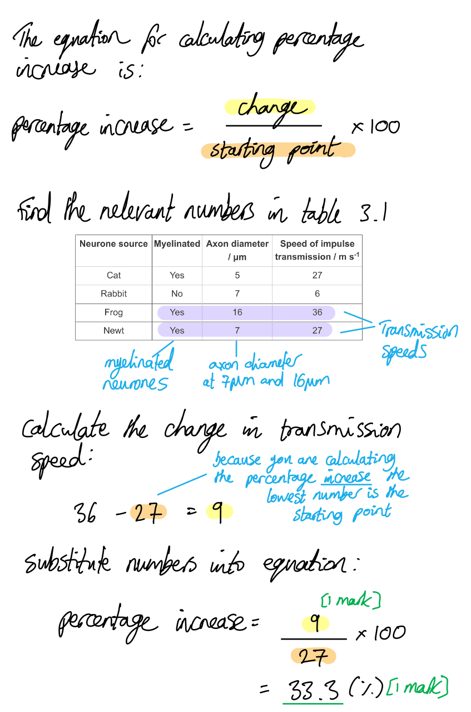
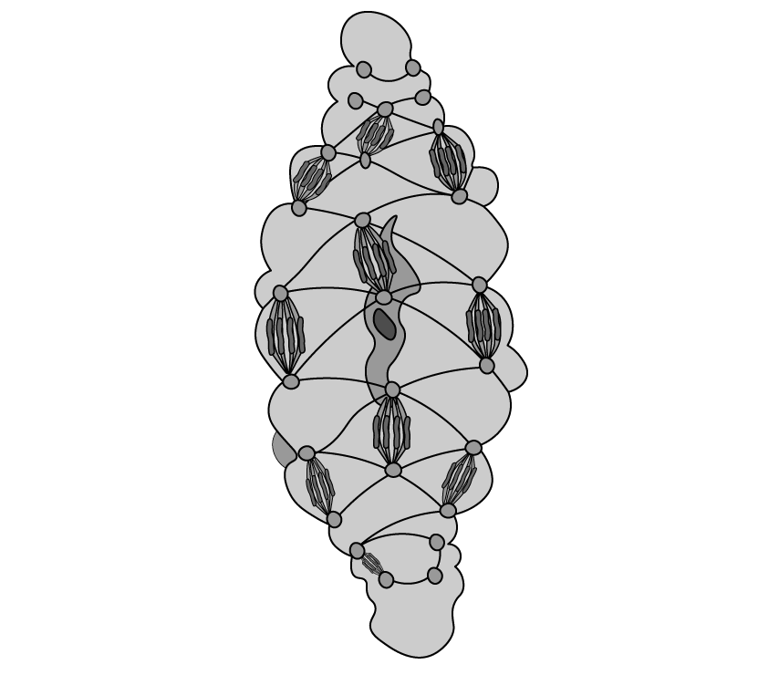
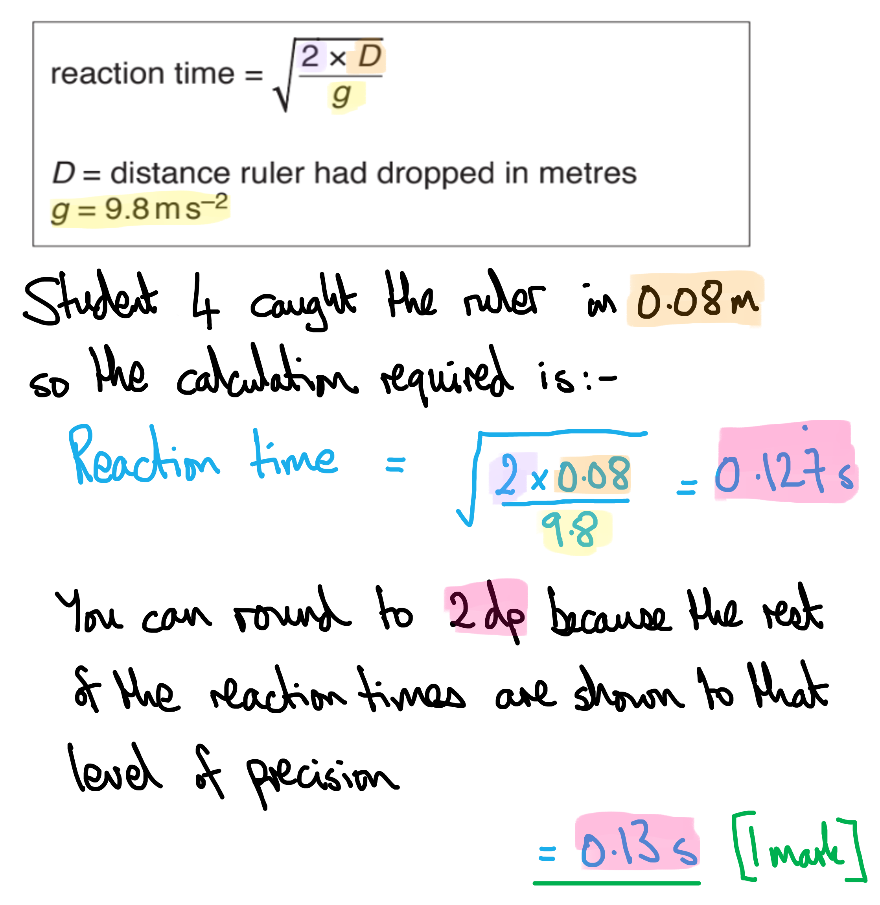
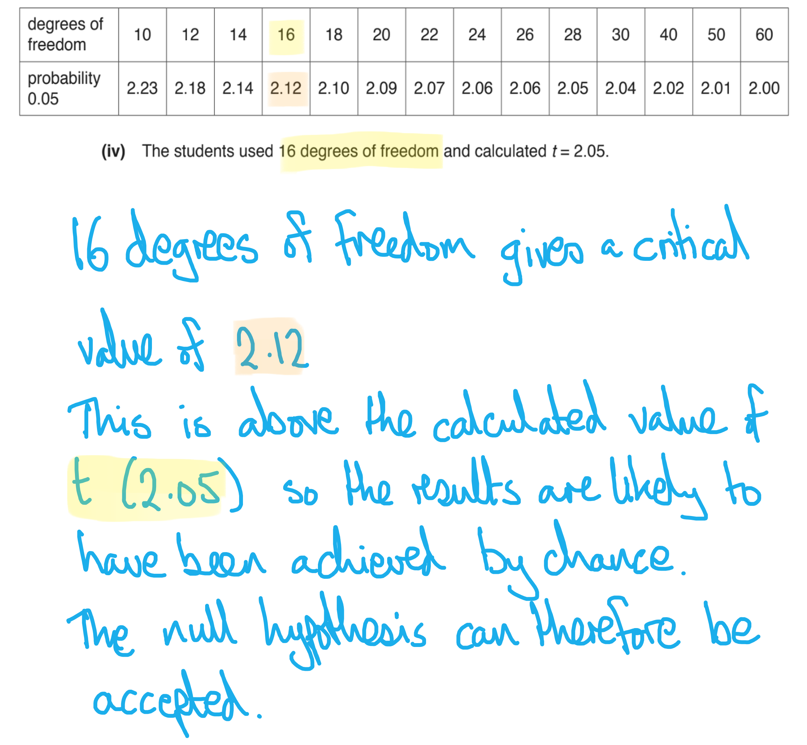
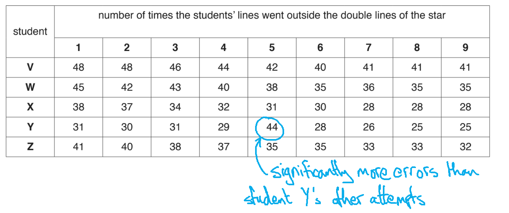
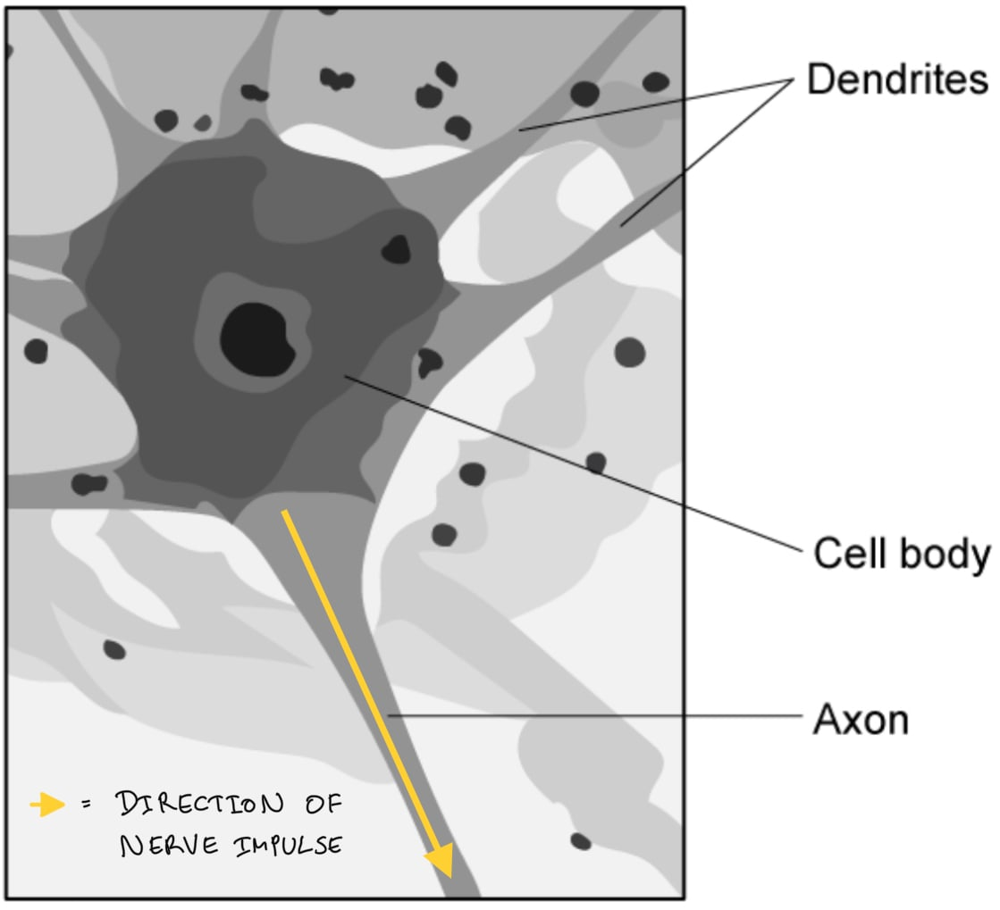
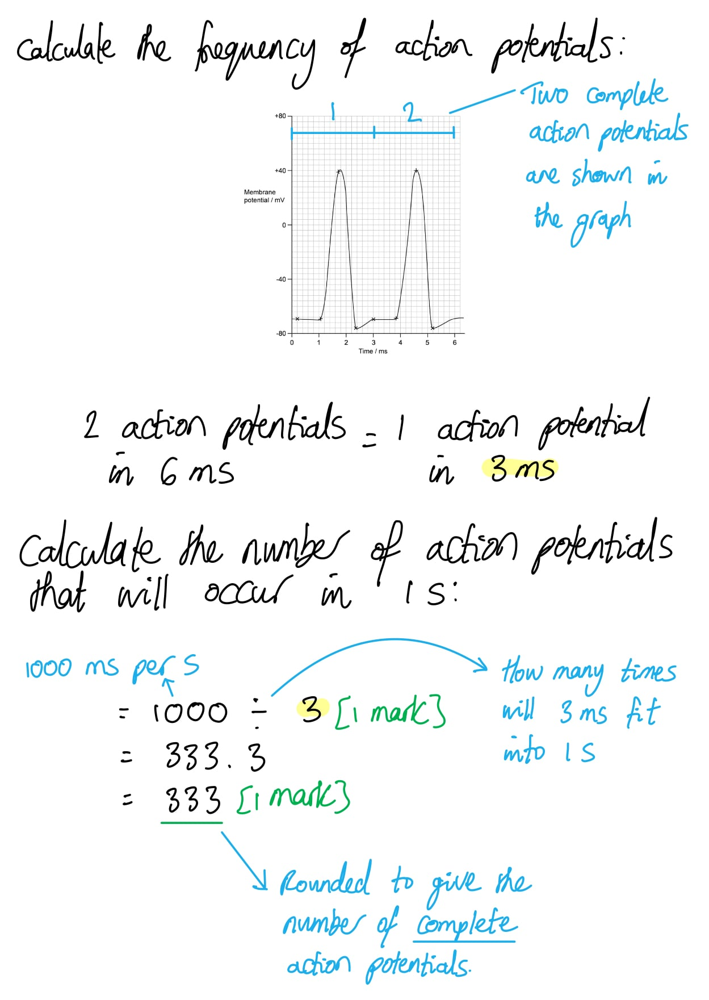
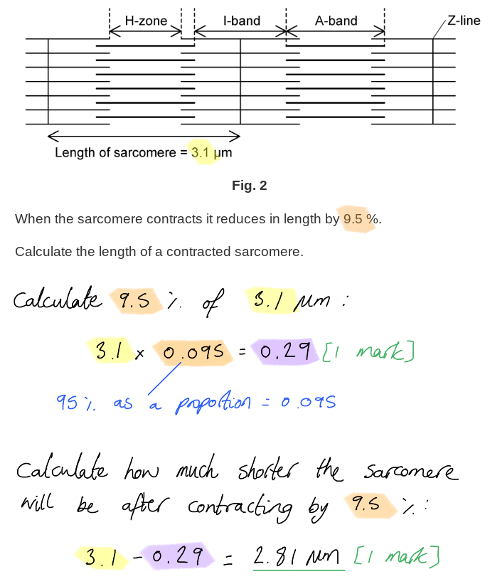

# Mark Schemes — Control & Coordination in Mammals
**15. Control & Coordination** · Cambridge (CIE) A-LEVEL biology (9700)

## Structured Questions (18 questions)

### Q1
An action potential is generated by a taste bud that responds to salty flavour as follows...

**Final answer:** **Any ****three**** of the following:**

- An influx / the inward movement/diffusion of sodium ions causes the cell surface membrane (of the salt receptor) to <u>depolarise</u>; **[1 mark]**
- If the <u>receptor potential</u> is large enough, <u>voltage-gated</u> calcium channels open; **[1 mark]**
- An influx / inward movement of calcium ions causes vesicles containing <u>neurotransmitter</u> to move towards the cell surface/basal membrane; **[1 mark]**
- The neurotransmitter is released and generates an action potential in the (neighbouring) <u>sensory neurone</u>; **[1 mark]**

**[Total: 3 marks]**

> *The diagram in Fig. 1 provides you with some information here so you must be sure to provide more detail than the diagram. Make sure that you use the necessary key words. *
An action potential is generated by a taste bud that responds to sweet flavours as follows...

**Final answer:** **Any ****three**** of the following:**

- The G protein is activated; **[1 mark]**
- The (activated) G-protein activates the enzymes adenyl cyclase; **[1 mark]**
- Cyclic AMP/cAMP activates protein kinase A; **[1 mark]**
- (Protein kinase A) phosphorylates / adds phosphate groups to potassium channel proteins (causing them to close); **[1 mark]**
- Potassium ions (cannot leave the cell so) build up inside the cell; **[1 mark]**
- The build up of positive ions depolarises the cell; **[1 mark]**
- Depolarisation causes (voltage-gated) calcium ion channels to open; **[1 mark]**

**[Total: 3 marks]**

> *This is a slightly tricky question but there are many ways of gaining the three marks available. You need to apply your knowledge of the second messenger model of hormone action to this unfamiliar context, and Fig. 1 gives you plenty of clues. The sugar molecule causes a change in shape of the receptor, activating a G protein. The G protein activates the enzyme adenyl cyclase, which converts ATP into cyclic AMP (this is shown clearly in Fig. 1 so no mark is available for stating this). Cyclic AMP activates protein kinase A, which phosphorylates potassium ion channels. The potassium ion channels close, preventing potassium from leaving the cell and leading to a build up of positively charged potassium ions. This has the same effect as an influx of sodium ions in a salt receptor; the cell is depolarised, voltage-gated calcium ion channels open, and the rest of the events would then be the same as in part a). *
Fig 2 shows the following about the effect of stimulus size on membrane potential...

- When a stimulus is below a certain size no action potential is generated / the threshold for an action potential is not reached / the membrane depolarisation is small / the membrane depolarisation is proportional to the size of the stimulus; **[1 mark]**
- When a stimulus is above a certain size / above the threshold the membrane always depolarises by the same amount / the size of the action potential is always the same **OR **the size of a large stimulus has no effect on the size of the resulting action potential; **[1 mark]**

**[Total: 2 marks]**

> *Fig. 2 illustrates the all-or-nothing principle of action potential generation. The small stimuli all generate small amounts of membrane depolarisation; a slight difference in stimulus size at this level makes a small difference in depolarisation but all are below the threshold for an action potential. The larger stimuli do generate an action potential and the size of the original stimulus has no effect on the size of the action potential; when a stimulus size threshold is reached the size of the resulting action potential is always the same.*
An action potential is transmitted along an axon as follows...

**Final answer:** **Any ****three**** of the following:**

- Current flows / local circuits occur / sodium ions diffuse from the area of action potential to the next section of axon / to a section of axon at resting potential; **[1 mark]**
- Sodium ion channels (in the new section of axon) open / the membrane (in the new section of axon) depolarises; **[1 mark]**
- Hyperolarisation / the refractory period (in the previous section of axon) prevents the impulse from travelling backwards / ensures that the impulse travels in only one direction; **[1 mark]**
- In a myelinated neurone the axon is insulated / depolarisation cannot occur through the myelin / Schwann cells; **[1 mark]**
- (In a myelinated neurone) depolarisation can only occur at the nodes of Ranvier / at unmyelinated sections; **[1 mark]**
- (In a myelinated neurone) saltatory conduction occurs / the imulse jumps from one node to the next; **[1 mark]**

**[Total: 3 marks]**

> *Marks can be gained here for describing transmission of nerve impulses in either a non-myelinated or a myelinated neurone.*

### Q2
The percentage increase in impulse transmission speed in myelinated neurones when the axon diameter is increased from 7 μm to 16 μm is...

- 9 ÷ 27; **[1 mark]**
- 33.3 (%); **[1 mark]**

*Full marks can be awarded for the correct answer in the absence of other calculations.*

**[Total: 2 marks]**

The effect of myelination on neurones is...

- Myelination increases conduction speed / speed of impulse transmission; **[1 mark]**
- The unmyelinated (rabbit) axon transmits impulses at 6 m s-1 and the myelinated (newt) axon transmits impulses at 27 m s-1; **[1 mark]**

**[Total: 2 marks]**

> *Note that the data to support the description comes from two axons of the same diameter; this means that any differences in speed of impulse transmission must be due to myelination.*
(i) Myelination affects the speed of nerve transmission because...

**Final answer:** **Any ****three ****of the following:**

- Transport of ions cannot take place through the myelin sheath / Schwann cells **OR** myelin insulates the axon; **[1 mark]**
- Action potentials can only be generated at gaps between the myelin sheath / Schwann cells / at the nodes of Ranvier; **[1 mark]**
- Between the nodes/gaps sodium ions diffuse along the axon / currents flow / local circuits occur; **[1 mark]**
- (This leads to) saltatory conduction / the impulse appearing to jump between nodes (which is much faster than the transmission in an unmyelinated neurone); **[1 mark]**

> *Saltatory conduction involves the impulse appearing to jump from one node to the next; this occurs due to the diffusion of sodium ions inside the axon within the myelin sheath (know as local circuits). In an unmyelinated neurone the impulse is transmitted by the continuous process of diffusion, depolarisation, channel opeing, and sodium influx; this is much slower than the local circuits that occur within the myelin sheath.*

(ii) Axon diameter affects the speed of nerve transmission because...

**Final answer:** **Any ****one**** of the following:**

- Wider axons have a larger (membrane) surface area across which ion transfer can take place; **[1 mark]**
- Ions diffuse into wider axons at a faster rate, creating a steeper concentration gradient within the axon (leading to faster diffusion); **[1 mark]**

**[Total: 4 marks]**
Evaluative points regarding the conclusion that there is a relationship between myelin content and dementia include...

*In support of the conclusion:*

- Patients with both types of dementia had less myelin than the control group **OR** the control group had higher myelin content than patients with both types of dementia; **[1 mark]**
- Differences between groups are (statistically) significant (as standard deviations do not overlap); **[1 mark]**
- The conclusion states correlation/relationship but does not conclude causation / that lack of myelin causes dementia; **[1 mark]**

*Against the conclusion:*

**Final answer:** **A maximum of ****three**** of the following:**

- There are large/significant differences in myelin content between different types of dementia (suggesting that other factors may be involved);** [1 mark]**
- Small sample sizes are not representative of the population (as a whole) **OR** the sample sizes are too small to apply to the rest of the population; **[1 mark]**
- These results come from a single study **OR** more data is required (to be sure of the conclusion); **[1 mark]**
- Not all / only two forms of dementia were included in the study; **[1 mark]**

**[Total: 4 marks]**

> *The command word for this question is **evaluate** so you need to address both sides of the argument. Be sure to use the data itself, but it is also always a good idea to consider any statistical analysis provided, as well as the design of the investigation.*

### Q3
The ultrastructure of smooth muscle and striated muscle can be compared as follows:

*Similarities:*

- Both have a sarcolemma; **[1 mark]**
- Both have sarcoplasmic reticulum; **[1 mark]**
- Both contain overlapping actin **AND** myosin filaments; **[1 mark]**

*Differences:*

**Final answer:** **A ****maximum of three**** of the following:**

- Smooth muscle cells have a tapered/spindle shape **WHILE** striated muscle fibres are elongated; **[1 mark]**
- Smooth muscle cells have a single nucleus **WHILE** striated muscle fibres are multinucleate / have multiple nuclei; **[1 mark]**
- Smooth muscle cells contain dense bodies / intermediate filaments **WHILE** striated muscle cells do not; **[1 mark]**
- Smooth muscle cells contain regions of overlapping filaments that are distributed randomly throughout the cell / that are not within myofibrils **WHILE** striated muscle contains filaments arranged in adjacent sarcomeres / in myofibrils; **[1 mark]**

**[Total: 5 marks]**

> *The command word '**compare**' requires a summary of the similarities and/or differences between two items; here there are clearly some shared features and some distinct features when smooth muscle is compared with what you already know of striated muscle, so you should ain to **give a balance of both similarities and differences**.*
The actin and myosin filaments cause contraction in smooth muscle as follows:

**Final answer:** **Any ****three**** of the following:**

- Actin and myosin filaments slide over each other / increase their overlap; **[1 mark]**
- The dense bodies are pulled / move closer together; **[1 mark]**
- The intermediate filaments pull dense bodies without attached actin and myosin closer together; **[1 mark]**
- The intermediate filaments pull on the dense bodies attached to the sarcomere to shorten the cell / squeeze the cell inwards; **[1 mark]**

**[Total: 3 marks]**

> *You are not expected to **know** about contraction in smooth muscle, but your knowledge of muscle contraction in striated muscle, together with reasoning skills applied to Fig. 1, will allow you to answer this question.*

> *The dense bodies in a smooth muscle cell act a bit like Z lines in a sarcomere, moving towards each other when the filaments overlap. While not all dense bodies are connected by actin and myosin filaments, they are all connected to intermediate filaments, which allows the contraction of the filaments in one area of the cell to transfer to other regions of the cell in an efficient way. These filaments also connect to the sarcolemma, pulling it inwards to shorten the cell, as illustrated below:*

(i) The slow wave potential changes at **A** and **B** in Fig. 2 could be caused as follows:

- A = inward movement of sodium ions/Na+ / calcium ions/Ca2+ / potassium ions/K+ **OR** outward movement of Cl-; **[1 mark]**
- B = outward movement of K+ / Na+ / Ca2+ **OR** inward movement of Cl-; **[1 mark]**

> *A shows a point during which the inside of the cell is becoming **more positively charged**; this could come about due to an** influx of positively charged ions** or an **efflux of negatively charged ions**.*

> *B shows the inside of the cell becoming **more negative again**; this could be the result of **outward movement of positively charged ions** or the** inward movement of negatively charged ions**.*

> *This is a suggest question, and does not expect you to know the specifics of action potentials in smooth muscle, so there are various examples of positively charged or negatively charged ions that you could list to gain the marks. The depolarisation of smooth muscle cells in the stomach is, in fact, brought about by the inward movement of calcium ions, and the repolarisation is caused by outward movement of potassium ions.*

(ii) The action potentials in Fig. 2 might occur as follows:

- Threshold potential is reached **AND** voltage gated ion channels open; **[1 mark]**
- Positively charged ions / Na+ / Ca2+ rush into the cell **SO** causing an action potential / spike potential; **[1 mark]**
- An action potential / peak is reach **AND** positively charged ions / K+ rush out of the cell (reducing membrane potential); **[1 mark]**
- This process repeats several times until the membrane potential drops back below the threshold; **[1 mark]**

> *While the events in a smooth muscle are not, in fact, exactly the same as those in the neurones that you will have learned about, this question is another suggest question, leaving you free to apply the knowledge that you do have to this unusual set of action potentials. For full marks here you must acknowledge the repeating nature of the action potentials shown in Fig. 2.*

**[Total: 6 marks]**
(i) The initiation of muscle contraction differs between single-unit and multi-unit smooth muscle as follows:

**Final answer:** **Any ****two**** of the following:**

- In single-unit smooth muscle each cell is stimulated to contract by the release of neurotransmitters / the binding of neurotransmitters to receptors **WHILE** in multi-unit smooth muscle some cells are stimulated by neurotransmitters / neurotransmitter binding and other cells are stimulated by neighbouring cells / by the movement of ions through gap junctions; **[1 mark]**
- In single-unit smooth muscle each cell is stimulated individually **WHILE** in multi-unit smooth muscle cells are stimulated as a group; **[1 mark]**
- In single-unit smooth muscle all of the cells can initiate contraction at the same time **WHILE** in multi-unit smooth muscle the cells nearest to the neurones will contract first (and cells that are further away will take longer to contract); **[1 mark]**

> *In single-unit smooth muscle the neurones and varicosities are distributed throughout the tissue, meaning that neurotransmitters released from the vesicles can diffuse directly to receptors on the surface of each individual cell. By contrast, in multi-unit smooth muscle only the outer layer of cells can receive neurotransmitter signals, but the cells themselves are connected by structures labelled 'gap junctions'; this means that the contraction passes from cell-to-cell, rather than an impulse being sent directly from the neurone.*

(ii) The roles of single-unit and multi-unit smooth muscle may differ as follows:

**Final answer:** **Any ****one**** of the following:**

- Single-unit smooth muscle is involved with small motions / movements that require fine control **WHILE** multi-unit smooth muscle is involved with large motions / movements that do not require fine control / movements that only need gross control; **[1 mark]**
- Single-unit smooth muscle is involved with localised movement / movement in a single location **WHILE** multi-unit smooth muscle is involved with waves of movement (e.g. stomach churning / peristalsis); **[1 mark]**

***Accept**** 'single-unit smooth muscle is involved with small*<u>*er*</u>* motions' ****OR ****'multi-unit muscle is involved with larg*<u>*er*</u>* motions' for marking point 1.*

> *The different mechanisms for initiating contraction of smooth muscle indicate that these different types of muscle have different roles; muscle cells that can receive individual instructions to contract allow a high level of control over which sections of muscle contract at any given time, while muscle cells receiving and passing on impulses from other muscle cells results in a wave of contraction, such as when food is pushed along the digestive tract by peristalsis, or when the heart contracts from the base upwards (though note that cardiac muscle is not exactly the same as smooth muscle).*

**[Total: 3 marks]**

### Q4
(i) The roles of exocytosis and endocytosis in the events of Fig. 1 are as follows:

- Exocytosis occurs when neurotransmitter is released into the synaptic cleft (from the presynaptic cell); **[1 mark]**
- Endocytosis occurs when botulinum toxin binds to the cell surface membrane / is taken up into a vesicle; **[1 mark]**

(ii) Botulinum toxin prevents the transmission of a nerve impulse at a synapse as follows:

**Final answer:** **Any ****four**** of the following:**

- The light chain of the botulinum toxin cuts up/breaks down/hydrolyses the SNARE proteins; **[1 mark]**
- The synaptic fusion complex is unable to form / the vesicles are unable to bind to the (inside of the) cell surface membrane; **[1 mark]**
- Neurotransmitter is not released into the synaptic cleft (by exocytosis); **[1 mark]**
- Neurotransmitter is unable to bind to receptors on the postsynaptic cell membrane; **[1 mark]**
- Sodium ions do not enter the postsynaptic cell **SO** no new action potential is initiated; **[1 mark]**

> *Here it is important to pay attention to the scope of the question; you need to refer to the events in Fig. 1, but you need to carry your explanation on for long enough to explain why no nerve impulse is transmitted, so this includes the events at the post-synaptic membrane that are not shown in Fig. 1.*

**[Total: 6 marks]**
An assessment of the conclusion that 'a single round of botulinum toxin injections is a suitable treatment for severe migraine' could include:

*In support of the conclusion:*

- Patients that receive botulinum toxin have significantly fewer migraines than patients receiving the control treatment from day 30 to day 90; **[1 mark]**
- There is only a 1 % probability that the difference between treatment and control at day 60 is due to chance **OR** there is only a 2 % probability that the difference between treatment and control at day 90 is due to chance; **[1 mark]**
- The use of a control group shows that the difference is due to the botulinum treatment and not any other factor; **[1 mark]**

*Against the conclusion:*

**Final answer:** **A maximum of ****three**** of the following:**

- The probability that the difference is due to chance is 5 % / relatively high at day 30 OR p = 0.05 is not considered statistically significant in a medical trial **SO** the treatment takes a long time / more than 30 days to be effective; **[1 mark]**
- The probability that the difference in results is due to chance increases between day 60 and day 90 **OR** the difference between botulinum and control treatments is no longer (medically) significant after 90 days; **[1 mark]**
- The effects of the treatment may wear off after 90 days / there is no evidence to show the efficacy of the treatment after 90 days; **[1 mark]**
- A sample of 30 individuals may not be representative of all migraine sufferers; **[1 mark]**
- Different participants may have a different definition of severe migraine / the definition of severe migraine is subjective; **[1 mark]**
- This is only a single study **SO** would need to be replicated / more data would be needed to support the conclusion; **[1 mark]**

**[Total: 5 marks]**

> *The command word 'assess' requires you to make an informed judgement. When assessing a conclusion that has been drawn from data, a structured approach is to consider factors that show support, or that may argue against, the conclusion.*

> *This question requires a good understanding of statistical analysis. Normally as biologists we look for differences in data that are significant at the **5 % probability level (p = 0.05)**, meaning that there is **only a 5 % probability that any difference is due to chance**; this is acceptable when dealing with data that relate to, e.g. genetic crosses, or studies of ecology.*

> *Data that are significantly different at a lower probability level, e.g. 1 % (p = 0.01) or 2 % (p = 0.02) as shown here, are even less likely to show a difference that is due to chance alone. In medical trials a p value of 0.01 is used, meaning that there **cannot be more than a 1 % probability that any difference is due to chance**. While you are **not** necessarily expected to be aware of this, you should still notice that the difference between treatment and control groups becomes more significant between day 30 and day 60, but then decreases in significance between day 60 and day 90.*

> *Don't forget to consider aspects of experimental design when considering the validity of a conclusion, e.g. here the sample size is small, and the study has not been replicated by other researchers.*
(i) Dendrotoxin will affect nerve impulses as follows:

- Slow down speed of transmission; **[1 mark]**
- The membrane will not depolarise at the nodes of Ranvier **SO **saltatory conduction will not occur; **[1 mark]**

**OR**

- Neurones will be constantly stimulated/depolarised / stuck in action potential; **[1 mark]**
- Potassium ions will be unable to leave the axon **SO** repolarisation will not take place; **[1 mark]**

(ii) α-Bungarotoxin will affect nerve impulses as follows:

- Nerve impulses will not be transmitted across synapses / no action potentials will be generated in postsynaptic cells; **[1 mark]**
- Acetylcholine will be unable to bind to receptors **SO** there will be no influx of sodium in the postsynaptic cell; **[1 mark]**

(iii) Agatoxins will affect nerve impulses as follows:

- There will be no generation of action potentials; **[1 mark]**
- Sodium ion influx (at the point at which threshold potential is reached) is prevented **SO** the membrane will not depolarise beyond threshold potential; **[1 mark]**

**OR**

- No neurotransmitter will be released into the synaptic cleft; **[1 mark]**
- Calcium ions will not move into presynaptic cell **SO** no vesicles (of neurotransmitter) will move towards / bind to the presynaptic membrane; **[1 mark]**

**[Total: 6 marks]**

> *Here you need to apply your knowledge of the various aspects of nerve impulse generation and transmission to the scenarios presented. Note that the command word here is '**explain**', so you will not get full marks for listing the different effects, but only for stating an effect and then **explaining why** this effect occurs.*

### Q5
(i) The missing cell in Table 1 is...

- 0.13 (seconds); **[1 mark]**

(ii) A prediction of what would happen to the reaction time if the ruler was held higher than the original set height is...

**Final answer:** **Any**** one ****of the following:**

- The reaction time would be unchanged; **[1 mark]**
- The reaction time would be longer/slower; **[1 mark]**

**[Total: 2 marks]**

> *The first answer (reaction time unchanged) is acceptable because a person reacts to the visual stimulus of the ruler beginning to move. Therefore the height from which the ruler is dropped won't affect a person receiving a visual stimulus. An unknown is that the question does not specify how much higher the ruler would start from.*

> *The second answer (longer reaction time) is also plausible in that if the ruler is falling from a greater height, it will be travelling faster by the time student A catches it, so he/she will have to 'time' their catch to a point when the ruler has fallen to a point that is within their grasp (assuming student A keeps their hand firmly on the bench, as they should).  *

> *In our opinion this question can also be answered correctly in a third way, i.e. that the reaction times appear to get shorter. If a person catches the ruler at D=10 cm when it starts falling from D=0, then you can reasonably expect that person to catch it at D=8 cm if it starts 2 cm higher up at D=-2 cm. D=8 would give a lower reaction time when worked through the formula.*

> *However, the exam board only chooses to credit two possible answers (for reasons that we at Save My Exams are unsure of), as shown above. *
(i) The dependent variable in this investigation is...

- The distance that the ruler drops/falls; **[1 mark]**

(ii) A method that the students could use to find out if the presence or absence of background noise affects reaction time is...

**Final answer:** **Any ****seven**** of the following:**

- To test in silence/quiet **AND** with background noise; **[1 mark]**
- A method to ensure silence is outlined e.g. using a sound-proofed room; **[1 mark]**
- A method to ensure consistent loudness OR volume of noise is outlined e.g. decibel meter readings; **[1 mark]**
- A suitable number of people are tested OR more than one person tested; **[1 mark]**
- No warning should be given when ruler is to be dropped; **[1 mark]**
- *Outline of the ruler used:* same ruler mass OR material OR starting distance OR ruler held vertically; **[1 mark]**
- Person being tested is the same/similar age OR same sex; **[1 mark]**
- The person being tested should use their same / their dominant hand; **[1 mark]**
- The person being tested should not be taking (named) drugs / medications / stimulants / depressants; **[1 mark]**
- The person being tested should not have with conditions affecting reaction time e.g. poor hearing / poor sight / neurological disorders; **[1 mark]**
- The tests should take place at the same time of day OR at a stated time; **[1 mark]**
- A minimum of three repeats carried out <u>**and**</u> a mean calculated; **[1 mark]**
- The experiment carries low OR medium risk; **[1 mark]**

> *It is not enough to just copy out the basic procedure here. Some thought is required as to how the conditions of noise and no noise can be achieved. Also, an appreciation of the risk should be made, for example the risk to hearing if the noise is played at an excessive volume. *

> *More that one subject is required because different people will have naturally different reaction times. Make sure to mention that no warning should be given before the ruler is dropped; that is one mark that many students miss out on. *

> *Many students go into unnecessary detail about control variables that have nothing to do with the outcome of the investigation. For example, using the 'same bench' or 'constant wind speed' are unlikely to be factors that affect the outcome, in that wind speed indoors is usually zero and that most (lab) benches are built at a standard height. *

> *Finally, when discussing averages, make sure to state which measure of average is calculated; in these tests, it is usually the **mean**.*

**[Total: 8 marks]**
A bar chart is a suitable way to show the data because...

**Final answer:** **Any**** one**** of the following:**

- (The independent variable is) discontinuous; **[1 mark]**
- (The independent variable is) discrete; **[1 mark]**
- (The independent variable is) qualitative; **[1 mark]**
- (The independent variable is) categoric; **[1 mark]**
- There are only two scenarios of noise / on or off / present or absent; **[1 mark]**

**[Total: 1 mark]**

> *Avoid vague terms like 'a bar chart shows the data more clearly' as this will not score the mark. You need to relate the choice of bar chart to the fact that the independent variable (shown on the x-axis) is categoric. *
(i) One conclusion that the students could have made based on these results is...

**Final answer:** **Any**** one ****of the following:**

- That the absence of noise means that reaction time is longer; **[1 mark]**
- That the presence of noise means that reaction time is shorter; **[1 mark]**

(ii) A *t*-test is suitable for these data because...

- A *t*-test is designed for comparing (two) <u>means</u> / of continuous data / that follow a normal distribution;** [1 mark]**

(iii) A null hypothesis for this test is...

- That there is no (significant) difference between the (mean) reaction times for no (background) noise and (background) noise; **[1 mark]**

(iv) What the value of *t* indicates about the difference in mean reaction times shown in Fig. 3 is...

- (That the difference is) not significant / is due to chance (at p > 0.05) **AND** because the calculated value / 2.05 is less/lower than the critical value of *t*/2.12; **[1 mark]**

**[Total: 4 marks]**
(i) The independent variable in this experiment is...

- The number of repeats/attempts at the task; **[1 mark]**

> *Remember, the independent variable (I.V.) is the thing that the experimenters change deliberately to examine the effect of those changes on something else. In this case, the experimenter is looking to see the effect of the number of times a person has attempted a task on how accurately they complete the task. So the I.V. is the number of attempts made by an individual. *

(ii) A suggestion of the hypothesis that was tested in this experiment would be...

- As the number of attempts increases, the accuracy of completing the task increases / number of errors decreases; **[1 mark]**

(iii) The result in Table 3 that was affected by a person walking into the room and talking to one of the students was as follows...

**Final answer:** **Award 1 mark for a ****circle**** around the correct answer as follows:**

> *Be careful to read what the question is asking you to do; you may feel that the question is asking you to name the student that was affected when somebody walked into the room, so circling 'Y' or even the whole row will lose you this mark. The question states clearly that you should circle just **one result**. *

(iv) The student who had previously carried out a similar task was...

- Student <u>Y</u>

This is because...

**Final answer:** **Any**** one ****of the following:**

- Y made fewer errors / was more accurate; **[1 mark]**
- Y started off with fewer errors / was more accurate from the start/attempt 1; **[1 mark]**

> *This has nothing to do with the fact that Student Y was disturbed during the experiment. That is just a coincidence. *

**[Total: 4 marks]**
(f) Two conclusions based on the data in Table 3 are...

**Final answer:** **Any ****two**** of the following:**

- The more replicates/repeats that are carried out, the more accurate / the fewer errors are made; **[1 mark]**
- After 6–7 / several trials, the number of errors starts to plateau / the number of errors does not continue to decrease; **[1 mark]**
- Interruptions/distractions increase number of errors; **[1 mark]**

**[Total: 2 marks]**

> *The first marking point is easier to gain that a second; the data shows that the increase in accuracy tails off after a number of attempts, so it is important to capture that, rather than to state merely that 'accuracy varies'.*

### Q6
Comparative features of a normal cholinergic synapse and a neuromuscular junction include...

*Similarities*

**Final answer:** **A maximum of ****two**** of the following:**

- Both involve vesicles containing (the neurotransmitter) acetylcholine; **[1 mark]**
- Both release vesicles in response to an influx of calcium; **[1 mark]**
- Both rely on diffusion of a neurotransmitter across a gap/synapse/cleft; **[1 mark]**
- Both involve the binding of a neurotransmitter to receptors on the post-synaptic membrane; **[1 mark]**
- Both involve the opening of sodium ion channels; **[1 mark]**
- Both involve the depolarisation of the postsynaptic cell as a result of a sodium ion influx; **[1 mark]**

*Differences*

**Final answer:** **A maximum of ****two**** of the following:**

- Depolarisation of a muscle cell passes to the centre of the cell via T-tubules **WHILE** depolarisation of a neurone does not; **[1 mark]**
- Deporarisation of a muscle cell leads to the release of calcium ions into the cytoplasm (from the sarcoplasmic reticulum) **WHILE **depolarisation of a neurone does not; **[1 mark]**
- Neuromuscular junctions involve one neurone and one muscle cell **WHILE** normal synapses involve two neurones; **[1 mark]**

**[Total: 3 marks]**

> *The command word **compare** can refer to both similarities and differences, so you should be sure to give a reasonable balance of both in your answer. When describing a difference you must be sure that each mark point contains a comparison of the two types of synapse.*
Structures **A**, **B** and **C** are...

- A = sarcomere; **[1 mark]**
- B = A band; **[1 mark]**
- C = Z lines; **[1 mark]**

**[Total: 3 marks]**
The striped appearance of muscle tissue is due to...

- Myosin filaments are thicker **SO** areas containing myosin (and myosin along with actin) are darker in appearance; **[1 mark]**
- Actin filaments are thinner **SO** areas containing <u>only</u> actin are lighter in appearance; **[1 mark]**

**[Total: 2 marks]**
The drugs in Table 1 reduce the contraction of skeletal muscles by...

*PBP*

**Final answer:** **Any ****two**** of the following:**

- Myosin heads cannot be released/detach from actin **OR** cross-bridges cannot be broken; **[1 mark]**
- Myosin cannot re-attach/bind to another binding site further along the actin; **[1 mark]**
- Sarcomere only gets shorter / muscle only contracts by a very small amount **OR** power stroke cannot be repeated / only occurs once; **[1 mark]**

*Dantrolene*

**Final answer:** **Any ****two**** of the following:**

- Calcium cannot bind to troponin; **[1 mark]**
- (Troponin and) tropomyosin do not move / change position to expose myosin binding sites (on actin); **[1 mark]**
- Myosin heads cannot bind to actin / cross-bridges cannot form **SO** power stroke cannot occur / myosin cannot move actin; **[1 mark]**

**[Total: 4 marks]**

> *This question requires you to **apply your knowledge** of the details of muscle contraction to the unfamiliar scenarios of drug action presented.*

> *When ATP is hydrolysed the myosin head detaches from actin, allowing it to form a new cross-bridge further along the actin and repeat the power-stroke. If ATP hydrolysis is prevented then myosin cannot detach from actin and the power stroke will not be repeated.*

> *Calcium ions bind to troponin, causing tropomyosin to move away from actin and exposing the binding sites for myosin. In the absence of calcium ions, these events cannot occur.*

### Q7
The location of the proteins are...

| **protein** | **location** |
|---|---|
| myosin and actin | B; **[1 mark]** |
| actin alone | C; **[1 mark]** |
| ATP synthase | A; **[1 mark]** |
| ATPase | B; **[1 mark]** |

**[Total: 4 marks]**
The role of ATP in the contraction of striated muscle is...

**Final answer:** **Any ****five ****of the following:**

- Myosin head binds to actin / forms cross bridge; **[1 mark]**
- ADP released causes motion of myosin head; **[1 mark]**
- Actin moved; **[1 mark]**
- Power stroke; **[1 mark]**
- ATP binds to myosin head; **[1 mark]**
- Myosin head detaches from actin / cross bridge broken; **[1 mark]**
- (Myosin head / ATPase) causes hydrolysis of ATP / ATP→ ADP + Pi; **[1 mark]**
- Myosin head moves back to original position; **[1 mark]**
- (ATP needed) to pump Ca2+ back into sarcoplasmic reticulum; **[1 mark]**

**[Total: 5 marks]**

> *The order of events here is important. Remember to focus specifically on what is being asked in the question here. For example any reference to ATP being generated in mitochondria, or its role in generating an action potential or synaptic transmission cannot gain marks. *

### Q8
The roles of sensory receptor cells in the mammalian nervous system are...

**Final answer:** **Any ****three ****of the following:**

- Detect/respond to (change in) stimulus/stimuli; **[1 mark]**
- (**Two** examples from, e.g.) light / heat / sound / touch / pressure / pain / chemicals / taste / smell / tension; **[2 marks]**
- Act as transducers / convert stimulus energy to electrical energy; **[1 mark]**
- Produce generator/action potential; **[1 mark]**
- Pass impulses to sensory neurone; **[1 mark]**

**[Total: 3 marks]**

> *It is not enough to say that sensory receptors **sense** or **receive** a **signal** in the environment, they **detect** or **respond to** **stimuli**. *

> *Note that sensory receptors do not pass stimuli, signals or messages to the central nervous system, just to sensory neurones. *
(i) The events are as follows...

- The Na+/K+ pump is operating = C **AND** D **AND** E; **[1 mark]**
- The voltage‐gated Na+ channels are open =** **C; **[1 mark]**
- The voltage‐gated K+ channels are open =** **D; **[1 mark]**

> *Note that while the role of the sodium-potassium pump is to establish and maintain resting potential, it operates continuously and does not stop during the depolarisation and repolarisation stages.*

(ii) Stimulus A did not result in an action potential being produced whereas stimulus B did because...

- The <u>generator potential</u>...; **[1 mark]**
- ... Does not reach/exceed the <u>threshold</u>; **[1 mark]**

(iii) The importance of the refractory period in the transmission of action potentials is...

- Limits/controls (the maximum) frequency of action potentials; **[1 mark]**
- (Action potentials / impulses) travel in one direction; **[1 mark]**

(iv) Action potentials are transmitted along a myelinated axon by...

**Final answer:** **Any ****four ****of the following:**

- Local circuit / movement of ions from positive to negative region; **[1 mark]**
- (Causes) opening of Na+ channels...; **[1 mark]**
- ...At next node (of Ranvier) / gap in myelin sheath; **[1 mark]**
- This causes the next/new action potential/depolarisation; **[1 mark]**
- Saltatory conduction occurs; **[1 mark]**
- One-way transmission only; **[1 mark]**
- Myelin (sheath)/Schwann cells insulate axon / prevent (named) ion movement / speed up transmission / lengthen local circuits; **[1 mark]**

**[Total: 11 marks]**

### Q9
(i) Cell A in Fig. 1 is a...

- Presynaptic neurone/cell; **[1 mark]**

(ii) It is possible to say this because...

- Cell A contains (many) vesicles (which contain neurotransmitter); **[1 mark]**

**[Total: 2 marks]**
(i) One feature that would be found on the cell surface membrane of cell B is...

- Receptors / neurotransmitter receptor molecules / receptor proteins; **[1 mark]**

(ii) These cannot be seen in Fig. 1 because...

- The resolution / resolving power of the (electron) microscope is not high enough; **[1 mark]**
- It is not possible to distinguish between two points that are very close together / between the receptors and their surroundings (so all are viewed as a single point); **[1 mark]**

> *While electron microscopes have a very high resolution, proteins are still too small to be viewed in this way. It is not possible to distinguish between the proteins and the surrounding membrane and only the membrane is visible in the image.*

**[Total: 3 marks]**
The role of structure C within cell A is to...

**Final answer:** **Any ****two**** of the following:**

- Produce ATP / release energy (in the process of respiration); **[1 mark]**
- Producing/recycling neurotransmitter/acetylcholine; **[1 mark]**
- Active transport/uptake of (broken down) neurotransmitter/acetylcholine (back into the cell from the synaptic cleft); **[1 mark]**
- Restoring the calcium ion gradient / pumping/actively transporting calcium ions out of the cell; **[1 mark]**

***Reject**** references to producing/creating energy*

**[Total: 2 marks]**

> *You are not expected to know the exact role of mitochondria inside presynaptic neurones but you should be able to reach an answer by thinking about some of the processes that need to occur in a presynaptic cell.*
The role of calcium ions at a synapse is...

**Final answer:** **Any ****four**** of the following:**

- An action potential / wave of depolarisation arrives at the end of the (presynaptic) neurone / the membrane of the (presynaptic) neurone depolarises; **[1 mark]**
- (Voltage-gated) calcium ion channels open (in response to the depolarisation); **[1 mark]**
- There is a higher concentration of calcium ions outside the neurone than inside; **[1 mark]**
- Calcium ions move/diffuse into the neurone / there is an influx of calcium ions; **[1 mark]**
- (Calcium ions cause) vesicles containing neurotransmitter/acetylcholine to move towards the cell surface membrane; **[1 mark]**
- Vesicles fuse with the cell surface membrane; **[1 mark]**
- Neurotransmitter is released by exocytosis / into the synaptic cleft; **[1 mark]**

***Accept**** mark point 1 in the context of mark point 2, e.g. calcium ion channels open in response to the arrival of an action potential.*

**[Total: 4 marks]**

> *This is really a question about the process that takes place at a synapse, but you should focus on the events that are directly linked to calcium ions.*

### Q10
A cholinergic synapse functions as follows...

**Final answer:** **Any ****seven**** of the following:**

- Nerve impulse/action potential reach the synaptic knob; **[1 mark]**
- (Voltage-gated) Ca2+/calcium ion channels open (in the presynaptic membrane); **[1 mark]**
- Calcium ions enter (the synaptic knob); **[1 mark]**
- Vesicles containing acetylcholine move towards / fuse with the <u>presynaptic membrane</u>; **[1 mark]**
- (Acetylcholine) is released/secreted / exocytosis occurs; **[1 mark]**
- Acetylcholine <u>diffuses</u> across the <u>synaptic cleft</u>; **[1 mark]**
- It binds to receptors on the post-synaptic membrane; **[1 mark]**
- Na+ channels open **AND** Na+ enters the post-synaptic neurone; **[1 mark]**
- The membrane depolarises / an action potential is generated; **[1 mark]**
- <u>Acetylcholinesterase</u> breaks down / recycles acetylcholine; **[1 mark]**

***Accept ****ACh for acetylcholine after the full term has been used correctly once.*

**[Total: 7 marks]**

> *Be careful with some of the key terminology when answering this question:*

- *Calcium **ions** and sodium **ions** are involved; don't just refer to 'calcium' or 'sodium'.*
- *Vesicles **fuse with** the presynaptic membrane and **release ACh** by exocytosis, the vesicles themselves do not leave the cell.*
- *Ions move **through** membranes and **into neurones**, not 'into the membrane' (this implies movement into the space inside the bilayer).*

### Q11
Insulin being a globular protein means the following for its mechanism of action...

**Final answer:** **Any ****three**** of the following:**

- It is water soluble / it dissolves in water / it will interact with water; **[1 mark]**
- (Due to having) hydrophilic regions located around the outside / coming into contact with surroundings; **[1 mark]**
- (It) cannot pass between the (hydrophobic) fatty acid tails of the cell surface membrane / cannot cross the phospholipid bilayer; **[1 mark]**
- It binds to receptors on target cells; **[1 mark]**
- It activates a second messenger within target cells; **[1 mark]**

**[Total: 3 marks]**

> *The amino acids in a globular protein are arranged in such a way that hydrophobic regions are located in the centre of the protein while hydrophilic regions are located around the outside. These hydrophilic regions will interact with water, meaning that globular proteins are water soluble. They cannot, however, interact with the hydrophobic fatty acids in the centre of a phospholipid bilayer, meaning that they cannot pass through cell surface membranes and so they influence cell behaviour by binding to receptors on target cells and initiating action via a second messenger molecule.*
Contrasting features of the endocrine and nervous systems include...

**Final answer:** **Any ****three**** of the following:**

- The parts of the endocrine system are the endocrine glands **WHILE **the parts of the nervous system are the brain, spinal cord, and neurones; **[1 mark]**
- The endocrine system sends hormone/chemical signals **WHILE** the nervous system uses electrical signals/impulses; **[1 mark]**
- The endocrine system sends messages via the blood **WHILE** the nervous system sends messages via the neurones; **[1 mark]**
- The endocrine system can target many cell types **WHILE** the nervous system targets muscle cells or glands; **[1 mark]**
- The endocrine system is (relatively) slow to act **WHILE** the nervous system is fast to act; **[1 mark]**
- The effects of the endocrine system can be long lasting **WHILE** the effects of the nervous system can be short-lived; **[1 mark]**
- The effects of the endocrine system can vary on the basis of hormone concentration **WHILE** nerve impulses are 'all-or-nothing'; **[1 mark]**
- The endocrine system brings about only involuntary responses **WHILE** the nervous system is involved with voluntary and involuntary responses; **[1 mark]**

**[Total: 3 marks]**
(i) The type of cell in Fig. 1 is a...

- Motor neurone; **[1 mark]**

> *The cell in Fig. 1 has its cell body **within the CNS**, marking it as a **motor neurone**; it sends signals from the CNS to effectors. Sensory neurones do not have cell bodies within the CNS and relay neurones are located entirely within the CNS.*

(ii) The direction of nerve impulse travel is...

- Downwards away from the cell body, along the axon; **[1 mark]**

> *Nerve impulses travel away from the cell body along the axon of a neurone.*

**[Total: 2 marks]**
(i) A feature of motor neurones that is not labelled in Fig. 1 is...

**Final answer:** **Any ****one**** of the following:**

- Schwann cells / myelination; **[1 mark]**
- Mitochondria; **[1 mark]**
- Vesicles; **[1 mark]**
- Ribosomes / rough endoplasmic reticulum; **[1 mark]**
- Golgi apparatus/body; **[1 mark]**
- Nucleus; **[1 mark]**

(ii) This feature assists neurone cell function because...

**Final answer:** **Any ****relevant**** answer from the following:**

- (Schwann cells / myelination) speed up conduction of a nerve impulse / allow for saltatory conduction / allow nerve impulses to jump between nodes; **[1 mark]**
- (Mitochondria) produce ATP / release energy for the active transport of ions/named ions; **[1 mark]**
- (Vesicles) store neurotransmitter at synapses / to transmit nerve impulses across synapses; **[1 mark]**
- (Ribosomes / rough endoplasmic reticulum) allow the synthesis of transport proteins/channel proteins/neurotransmitters/acetylcholinesterase; **[1 mark]**
- (Golgi apparatus/body) allow the packaging/transport of transport proteins/channel proteins/neurotransmitters/acetylcholinesterase to the cell surface membrane; **[1 mark]**
- (Nucleus) stores genetic information / DNA / chromosomes from which transport proteins/channel proteins/neurotransmitters/acetylcholinesterase can be transcribed/synthesised;

***Reject**** references to mitochondria producing or creating energy.*

> *Note that you need to be able to explain **how** your identified feature specifically aids **neurone function** so just stating the general role of an organelle, e.g. 'mitochondria release energy' is not enough here.*

**[Total: 2 marks]**

### Q12
A spinal reflex arc functions, and it is an advantage to a mammal, as follows...

**Final answer:** **Any ****nine ****of the following:**

- Sense organ/receptor detects stimulus; **[1 mark]**
- e.g. light, sound, heat; **[1 mark]**
- Very strong stimulus; **[1 mark]**
- Action potential generated in sensory neurone; **[1 mark]**
- Sensory neurone connects to <u>spinal cord</u>; **[1 mark]**
- Synapse with relay/intermediate neurone **OR** action potential passes to relay/intermediate neurone; **[1 mark]**
- (Relay/intermediate/sensory neurone) synapse with motor neurone **OR** action potential passes to motor neurone; **[1 mark]**
- Effector / muscle; **[1 mark]**
- Response; **[1 mark]**
- Fast(er); **[1 mark]**
- Automatic / involuntary; **[1 mark]**
- Response is always the same / stereotypic; **[1 mark]**
- Protects from harm; **[1 mark]**

**[Total: 9 marks]**

> *Remember that the sensory neurone does not detect the stimulus, the receptor does. Also, make sure you're specific with your wording when it comes to the **action potential** in the neurone, try to avoid using basic language like impulse, messages, or information passing along the neurone. *
The importance of the myelin sheath in determining the speed of nerve impulses is...

**Final answer:** **Any ****six ****of the following:**

- (Sheath) insulates axon / stops passage of ions; **[1 mark]**
- Gaps / nodes of Ranvier; **[1 mark]**
- 1–3 mm intervals; **[1 mark]**
- Passage of ions can occur (at nodes); **[1 mark]**
- Depolarisation/action potentials only occur at nodes; **[1 mark]**
- Local circuits (between nodes); **[1 mark]**
- Saltatory conduction; **[1 mark]**
- Faster (speed of nerve impulse); **[1 mark]**

**[Total: 6 marks]**

### Q13
(i) The type of membrane potential in the axon at 0.5 ms is...

- Resting (potential); **[1 mark]**

> *Resting potential is negative, usually around -70mV in humans, meaning that the inside of the axon is more negative than the outside.*

(ii) Resting potential is achieved by...

**Final answer:** **Any ****two**** of the following:**

- Sodium-potassium pumps pump / use ATP to move (sodium and potassium) ions across the membrane; **[1 mark]**
- 3 sodium ions are pumped out of the axon for every 2 potassium ions that are pumped in; **[1 mark]**
- The membrane is permeable to potassium ions **SO** potassium ions diffuse out of the cell/axon; **[1 mark]**
- The membrane is less permeable to sodium **SO** sodium ions do not diffuse back in; **[1 mark]**
- Negatively charged proteins / anions are present inside the axon; **[1 mark]**

> *Resting potential is achieved primarily by the movement of ions. Sodium-potassium pumps use ATP to move more positively charged ions out of the axon than in; this causes the inside of the cell to become more negative than the outside. The movement of ions creates a concentration gradient for both sodium and potassium ions, but because the membrane is more permeable to potassium ions these diffuse back out of the cell while most sodium ions remain on the outside; this further increases the negative charge inside the cell.*

**[Total: 3 marks]**
When the membrane is stimulated at 1 ms...

- Sodium ion channels open; **[1 mark]**

**[Total: 1 mark]**

> *Note that this question is specifically asking about the events occurring **at 1 ms** when the membrane is stimulated, not what happens after this. Events such as an influx of sodium ions and membrane depolarisation occur after this initial stimulus. *
The shape of the curve between 1 - 1.8 ms is due to...

**Final answer:** **Any ****three**** of the following:**

- Sodium ions move in / there is an influx of sodium ions to the axon/neurone; **[1 mark]**
- (Sodium ions move) by diffusion / down their concentration gradient; **[1 mark]**
- If enough sodium ions move into the axon then a threshold (potential) is reached;** [1 mark]**
- (Reaching a threshold) causes more sodium channels / voltage gated sodium channels to open; **[1 mark]**
- The membrane is depolarised / the charge across the membrane is reversed / the inside of the axon becomes positive; **[1 mark]**

**[Total: 3 marks]**

> *The curve between 1 - 1.8 ms shows that the membrane potential is increasing. This occurs due to the **inward movement of positive sodium ions** **down their concentration gradient**. If enough sodium ions enter the axon then a **threshold** is reached and **more sodium ion channels open**, allowing a **further influx** of sodium ions. The inward movement of positive ions causes the inside of the axon to become more positive than the outside and the membrane is said to have **depolarised**.*

> *Be aware that the question is only asking for information about the events occurring **between 1 - 1.8 ms** so there are no marks available for explaining repolarisation or the restoration of resting potential.*
The number of action potentials that will occur in 1 second is...

- 1000 ÷ 3 **OR** `333.3 with times on top`; **[1 mark]**
- 333 (action potentials); **[1 mark]**

*Full marks can be awarded for the correct answer in the absence of calculations.*

**[Total: 2 marks]**

### Q14
Structures A-C are...

- A = synaptic cleft; **[1 mark]**
- B = (pre)synaptic knob / presynaptic cell/neurone/membrane; **[1 mark]**
- C = postsysnaptic cell/neurone/membrane; **[1 mark]**

**[Total: 3 marks]**
Neurotransmitters interact with the structures labelled **D** to bring about an action potential in the new neurone by...

**Final answer:** **Any ****two**** of the following:**

- Binding to (specific) receptors / receptor proteins (D); **[1 mark]**
- (This causes) sodium ion channels to open; **[1 mark]**
- Sodium diffuses into the (postsynaptic) cell; **[1 mark]**
- If enough (sodium enters the cell) then a threshold will be reached (and an action potential generated); **[1 mark]**

**[Total: 2 marks]**
(i) The specialised junctions between motor neurones and muscles are...

- Neuromuscular junctions; **[1 mark]**

(ii) Differences between neuromuscular junctions and synapses include...

**Final answer:** **Any ****one**** of the following:**

- The cell that receives the neurotransmitter/second cell/postsynaptic cell (at neuromuscular junctions) is always a muscle cell **WHILE **(at regular synapses) the cell that receives the neurotransmitter/second cell/postsynaptic cell can be many cell types / a named example of another cell type, e.g. an intermediate nerone; **[1 mark]**
- T-tubules are present / the depolarisation travels/spreads along T-tubules (at neuromuscular junctions) **WHILE** they are not present / the depolarisation remains at the cell surface membrane (in regular synapses); **[1 mark]**
- Calcium diffuses from the sarcoplasmic reticulum (at neuromuscular junctions) **WHILE** this does not occur / there is no calcium/sarcoplasmic reticulum (in the postsynaptic cell of a regular synapse); **[1 mark]**

> *While you may not have learned any specific examples of differences between regular synapses and neuromuscular junctions, your knowledge of both should allow you to answer this question. **T-tubules** and the **sarcoplasmic reticulum** are key parts of the events that occur at a neuromuscular junction, so these are good places to start.*

> *When describing the differences between two things you should always ensure that **each statement is clearly comparative**. You will get no credit if you just describe a neuromuscular junction here.*

> *Note that neuromuscular junctions are still **synapses**, but they are a **specialised type of synapse **and so differ slightly from regular cholinergic synapses.*

**[Total: 2 marks]**
(i) The length of a contracted sarcomere is...

- 3.1 x 0.095 **OR** 0.29/0.295; **[1 mark]**
- (3.1 - 0.29 =) 2.81/2.805 (μm); **[1 mark]**

*Award full marks for the correct answer in the absence of other calculations.*

(ii) Changes that will occur in Fig. 2 as a result of stimulation of the striated muscle include...

**Final answer:** **Any ****two**** of the following:**

- The H zone will get shorter; **[1 mark]**
- The I band will get shorter; **[1 mark]**
- The Z lines will move closer together; **[1 mark]**

> *Remember that the A band does not change in length during muscle contraction. This is because the A band represents the length of the myosin filaments and these do not change in length during contraction, they just overlap further with actin.*

**[Total: 4 marks]**

### Q15
(i) The name of the system represented in Fig. 1 is:

- Endocrine (system); **[1 mark]**

(ii) Organs A and B can be identified as follows:

- A = pancreas; **[1 mark]**
- B = pituitary gland; **[1 mark]**

**[Total: 3 marks]**
The term *hormone* can be defined as follows:

- A chemical messenger/signalling molecule; **[1 mark]**
- Transported in the blood to target cells/organs; **[1 mark]**

**[Total: 2 marks]**
(i) An example of a hormone is:

**Final answer:** **Any ****one**** of the following:**

- Insulin; **[1 mark]**
- Glucagon; **[1 mark]**
- ADH/antidiuretic hormone; **[1 mark]**

*Accept other correctly named examples of hormones, e.g. testosterone / oestrogen / adrenaline.*

(ii) The role of the hormone identified is:

**Final answer:** **Any ****one relevant**** answer from the following:**

- (Insulin =) increase uptake of glucose from the blood/into the cells / stimulate the conversion of glucose into glycogen; **[1 mark]**
- (Glucagon =) stimulate the breakdown of glycogen into glucose / the release of glucose from the liver into the blood; **[1 mark]**
- (ADH =) increase (re)absorption of water in the kidneys / increase the number of aquaporins in the walls of the collecting duct; **[1 mark]**

*Accept a correctly described function for any other hormone identified in part (i).*

*The answer given needs to match the hormone named in part (i) for a mark to be awarded.*

> *Note that the descriptions of function are very specific here, e.g. for insulin you would not gain credit just for saying 'lowers blood glucose' as this answer only covers GCSE-level content, and at A-level more detail is needed.*

**[Total: 2 marks]**
Differences between the endocrine and nervous systems include:

**Final answer:** **Any ****two**** of the following:**

- The endocrine system uses hormones / chemical messengers / signalling molecules **WHILE** the nervous system uses electrical signals/impulses; **[1 mark]**
- The endocrine system uses the blood as its transport mechanism **WHILE** the nervous system uses neurones / axons of neruones; **[1 mark]**
- The endocrine system acts on (a range of) specific target cells / organs **WHILE** the nervous system acts on muscles/glands; **[1 mark]**
- The endocrine system brings about a response relatively slowly **WHILE** nerve impulses can be transmitted more quickly; **[1 mark]**
- The endocrine system is not under conscious control **WHILE** the nervous system can be under either conscious or unconscious control; **[1 mark]**
- The effects of the endocrine system can be long-lasting **WHILE** the effects of the nervous system are short-lived; **[1 mark]**

**[Total: 2 marks]**

> *Note that any question that asks you to give **differences**, or to** contrast** two features, needs you to give **statements of difference**, e.g. the statement that 'the endocrine system uses chemical signals' is not a difference, but 'the endocrine system uses chemical signals** while** the nervous system uses electrical signals' contains a difference.*

### Q16
Structures X, Y and Z can be identified as:

- X = nucleus; **[1 mark]**
- Y = myofibril; **[1 mark]**
- Z = sarcoplasm/cytoplasm; **[1 mark]**

**[Total: 3 marks]**

> *The diagrams that represent the structure of skeletal muscle can be confusing, but the question makes it clear here that we are looking at just a single muscle cell. Muscle cells can contain **multiple nuclei**, and have their own cytoplasm, known as **sarcoplasm**. Within the sarcoplasm are a series of** myofibrils**, which are made up of actin and myosin filaments.*
The role of structure A in Fig. 1 is:

**Final answer:** **Any ****two**** of the following:**

- <u>Aerobic</u> respiration; **[1 mark]**
- The production/synthesis of ATP / transfer of energy from glucose to ATP; **[1 mark]**
- (ATP) allows the myosin heads to detach from actin (during muscle contraction); **[1 mark]**

**[Total: 2 marks]**

> *Remember that you should NEVER say that **energy** is produced, only that it is released or transferred.*
The changes visible in Fig. 2 when the muscle contracts include:

**Final answer:** **Any ****two**** of the following:**

- The sarcomere shortens **OR** the Z lines get closer together / closer to the M line; **[1 mark]**
- The I band / the region containing only actin filaments disappears/shortens; **[1 mark]**
- The H band / the region containing only myosin filaments disappears / shortens **[1 mark]**

**[Total: 2 marks]**

> *Note that this question requires a description of **changes** that are **visible in Fig. 2**, so answers relating to features that stay the same, e.g. the length of the A band, and details of myosin heads and power strokes are not credited.*
The role of calcium ions is as follows:

**Final answer:** **Any ****two**** of the following:**

- Calcium ions move out of the sarcoplasmic reticulum (into the sarcoplasm/cytoplasm); **[1 mark]**
- Calcium ions bind to troponin; **[1 mark]**
- Tropomyosin changes shape **AND** exposes the myosin binding sites (on actin); **[1 mark]**

**[Total: 2 marks]**

> *Make sure that you are happy with the difference between troponin and tropomyosin here!*

### Q17
The structures labelled A, B and C on Fig. 1 are...

- A = node of Ranvier; **[1 mark]**
- B = axon; **[1 mark]**
- C = cell body; **[1 mark]**

**[Total: 3 marks]**

> *The **a**xon is the part of the neurone that carries impulses **a**way from the cell body. We have been told that this cell is a motor neurone so we would expect the cell body to be within the CNS and the impulse would travel **a**way from the CNS towards the effector.*
The function of a motor neurone is to...

- Transmit nerve impulses/action potentials from the CNS / relay/intermediate neurones...; **[1 mark]**
- ...to effectors / muscles / glands; **[1 mark]**

**[Total: 2 marks]**
The fast transmission of impulses along a motor neurone occurs due to...

**Final answer:** **Any ****four**** of the following:**

- Schwann cells are wrapped around the axon/B; **[1 mark]**
- (This forms the) myelin sheath / the axon is myelinated; **[1 mark]**
- (The myelin sheath) insulates the axon / prevents movement of ions; **[1 mark]**
- Depolarisation/action potentials can only occur at nodes (of Ranvier)/A; **[1 mark]**
- Local circuits occur (between one node and the next); **[1 mark]**
- Action potentials (appear to) jump from node to node / saltatory conduction occurs; **[1 mark]**

**[Total: 4 marks]**

> *Make sure that you can explain exactly how myelination speeds up the conduction of nerve impulses.*
