# Exam Questions — Control & Coordination in Mammals
**15. Control & Coordination** · Cambridge (CIE) A-LEVEL biology (9700)
> Source: [https://www.savemyexams.com/a-level/biology/cie/25/topic-questions/](https://www.savemyexams.com/a-level/biology/cie/25/topic-questions/) · 17 questions across 1 sets

## Structured Questions (18 questions)

### Q1 — hard — 11 marks

**Q1** [3 marks]

Fig. 1 shows the events leading to the generation of an action potential in two types of taste buds.

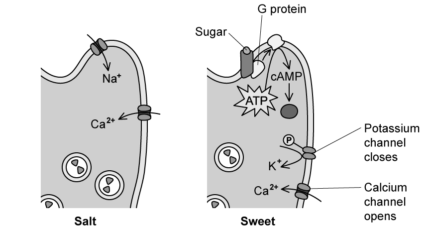

**Fig. 1**

Explain how an action potential is generated by a taste bud that responds to salty flavour.

**Q1** [3 marks]

**Extract:**

Fig. 1 shows the events leading to the generation of an action potential in two types of taste buds.

**Fig. 1**

Fig. 1 shows that taste buds responding to sweet flavours make use of the second messenger model.

Use Fig. 1 to suggest how an action potential is generated by a taste bud that responds to sweet flavours.

**Q1** [2 marks]

Fig. 2 shows the effect of applying different sizes of stimulus on the membrane potential of a receptor cell.

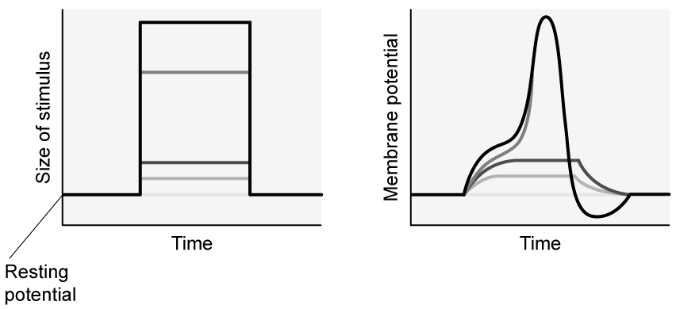

**Fig. 2**

Describe what Fig. 2 shows about the effect of stimulus size on membrane potential.

**Q1** [3 marks]

Outline how an action potential generated in a receptor cell is transmitted along an axon.

### Q2 — hard — 12 marks

**Q2** [2 marks]

Table 1 shows the speed of impulse transmission in neurones of different type and diameter.

**Table 1**

| **Neurone source** | **Myelinated** | **Axon diameter / μm** | **Speed of impulse transmission / m s****-1** |
|---|---|---|---|
| Cat | Yes | 5 | 27 |
| Rabbit | No | 7 | 6 |
| Frog | Yes | 16 | 36 |
| Newt | Yes | 7 | 27 |

Calculate the percentage increase in impulse transmission speed in myelinated neurones when the axon diameter is increased from 7 μm to 16 μm.

**Q2** [2 marks]

**Extract:**

Table 1 shows the speed of impulse transmission in neurones of different type and diameter.

**Table 1**

| **Neurone source** | **Myelinated** | **Axon diameter / μm** | **Speed of impulse transmission / m s**^**-1**^ |
| Cat | Yes | 5 | 27 |
| Rabbit | No | 7 | 6 |
| Frog | Yes | 16 | 36 |
| Newt | Yes | 7 | 27 |

Describe the effect of myelination on neurones shown in Table 1

**Q2** [4 marks]

**Extract:**

Table 1 shows the speed of impulse transmission in neurones of different type and diameter.

**Table 1**

| **Neurone source** | **Myelinated** | **Axon diameter / μm** | **Speed of impulse transmission / m s**^**-1**^ |
| Cat | Yes | 5 | 27 |
| Rabbit | No | 7 | 6 |
| Frog | Yes | 16 | 36 |
| Newt | Yes | 7 | 27 |

Explain the following from Table 1:

(i) The effect of myelination on speed of nerve impulse transmission.

[3]

(ii) The effect of axon diameter on speed of nerve impulse transmission.

[1]

**Q2** [4 marks]

Scientists investigated the relationship between myelin in brain tissue and the different types of dementia.

The scientists measured the mean myelin content in brain tissue samples from 3 different groups:

- A control group of 15 people without dementia
- 22 people with vascular dementia (VD)
- 18 people with Alzheimer's dementia (AD)

Their results are shown in Fig. 1 below. The smaller vertical bars represent standard deviation.

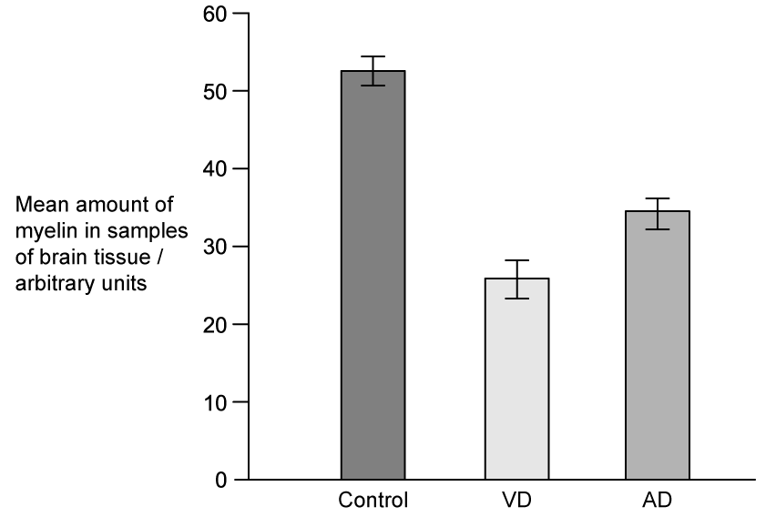

**Fig. 1**

A research assistant reviewing Fig. 1 concluded that there was a relationship between the concentration of myelin present in an individual’s brain and the likelihood of dementia.

Evaluate this conclusion.

### Q3 — hard — 17 marks

**Q3** [5 marks]

Fig. 1 shows the ultrastructure of a smooth muscle cell.

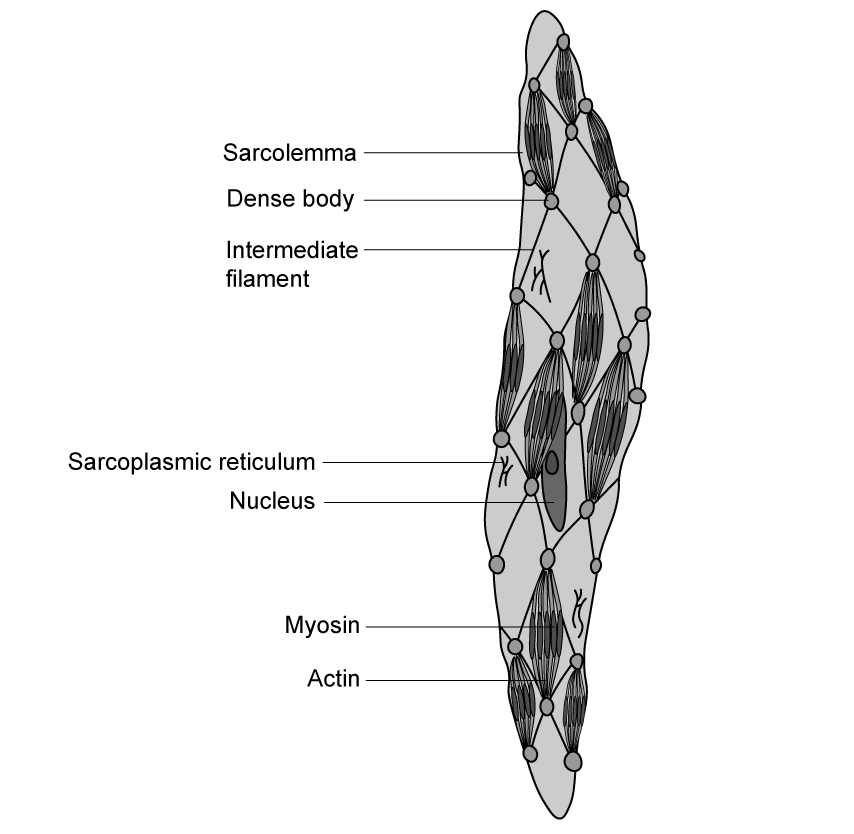

**Fig. 1**

Compare the ultrastructure of smooth muscle with that of striated muscle.

**Q3** [3 marks]

**Extract:**

Fig. 1 shows the ultrastructure of a smooth muscle cell.

Smooth muscle cells contain dense bodies / intermediate filaments. Smooth muscle cells contain regions of overlapping filaments that are distributed randomly throughout the cell / that are not within myofibrils. Both smooth and striated muscle contain overlapping actin AND myosin filaments.

Use information in Fig. 1 to suggest how the actin and myosin filaments cause contraction in smooth muscle.

**Q3** [6 marks]

Smooth muscle is involved in the activities of various body systems, including the digestive system. The contraction of smooth muscle in the lining of the stomach is known to be controlled by various factors, and the nervous activity of the stomach involves a series of waves of charge known as 'gastric slow wave potentials' combined with periods of action potential. An example of this nervous activity is shown in Fig. 2 below.

**Fig. 2**

(i) Suggest how the slow wave potential changes at **A** and **B** in Fig. 2 are caused.

[2]

(ii) Suggest an explanation for the shape of the action potentials in Fig. 2.

[4]

**Q3** [3 marks]

Smooth muscle in the stomach is classified as 'single-unit' smooth muscle, while smooth muscle in other parts of the body, e.g. the iris of the eye, is 'multi-unit' smooth muscle. Fig. 3 below shows a difference in the neurone connections within single-unit and multi-unit smooth muscle.

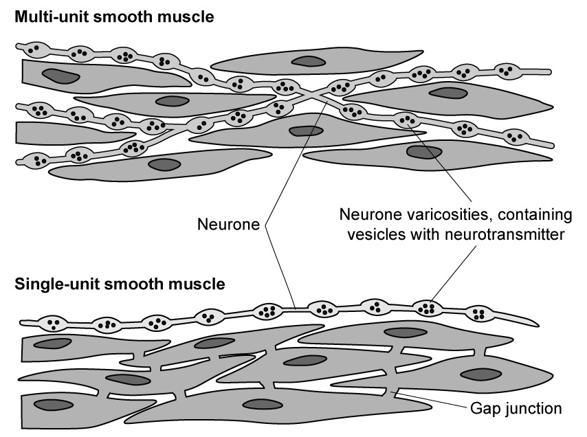

**Fig. 3**

(i) Suggest how the initiation of muscle contraction differs between single-unit and multi-unit smooth muscle.

[2]

(ii) Suggest how the roles of single-unit and multi-unit smooth muscle may differ.

[1]

### Q4 — hard — 17 marks

**Q4** [6 marks]

Fig. 1 shows the effect of botulinum toxin on a presynaptic cell. It represents the events that occur in the absence of botulinum toxin (**A**), and the action of botulinum toxin (**B**).

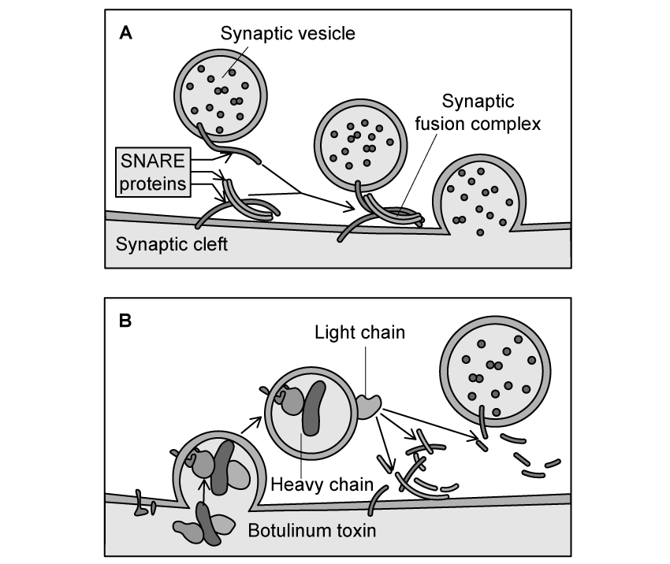

**Fig. 1**

(i) Describe the roles of exocytosis and endocytosis in the events of Fig. 1.

[2]

(ii) Use Fig. 1 to explain how botulinum toxin prevents the transmission of a nerve impulse at a synapse.

[4]

**Q4** [5 marks]

Botulinum toxin is sometimes used in the treatment of migraine headaches. In a study investigating the effect of botulinum toxin treatment on severe migraines, 30 individuals were randomly assigned to either a botulinum toxin treatment or a control treatment. The participants reported their frequency of severe migraines at day 0, before receiving a single round of treatment, administered by intramuscular injection. Participants were then assessed again at 30 days, 60 days and 90 days.

Fig. 2 below shows the results of the study.

**Fig. 2**

A medical student read the study findings and concluded that a single round of botulinum toxin injections was a suitable treatment for severe migraine.

Assess the student's conclusion.

**Q4** [6 marks]

Botulinum toxin is a neurotoxin produced by *Clostridium botulinum* bacteria. Neurotoxins are produced by several other groups of organisms, for example in the venom of snakes and some invertebrates.

Table 1 gives some examples of different types of neurotoxins and describes the action of each toxin within cells.

**Table 1**

| **Toxin** | **Found in** | **Effect on cells** |
|---|---|---|
| Dendrotoxin | Snake venom, e.g. black mamba | - Blocks potassium channels at nodes of Ranvier - Blocks voltage-gated potassium channels |
| α-Bungarotoxin | Snake venom, e.g. many-banded krait snake | - Binds irreversibly to acetylcholine receptors |
| Agatoxin | Spider venom, e.g. funnel web spider | - Blocks voltage gated sodium channels - Blocks calcium channels |

Explain how each of the following toxins would impact nerve impulses:

(i) Dendrotoxin

[2]

(ii) α-Bungarotoxin

[2]

(iii) Agatoxin

[2]

### Q5 — hard — 21 marks

**Q5** [2 marks]

A group of six students carried out an experiment to determine their reaction times using a ruler.

Fig. 1 shows the basic procedure used for the experiment.

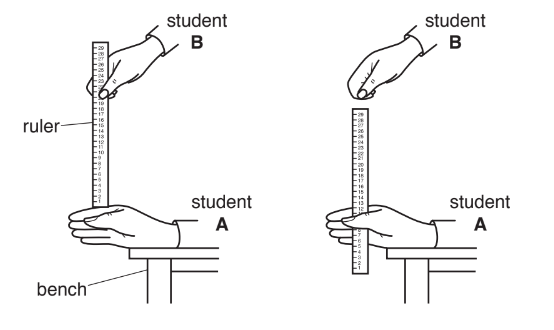

**Fig. 1**

The students worked in pairs.

- Student **A **rested their hand on a bench.
- Student **B **then dropped a ruler from a set height.
- Student **A **had to catch the ruler as quickly as possible.
- The distance the ruler had dropped was measured and recorded.
- The students calculated their reaction times.

The formula for calculating reaction time in seconds is shown in Fig. 2.

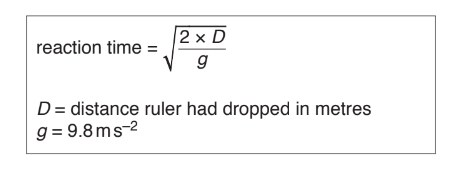

**Fig. 2**

Table 1 shows the results for the six students.

**Table 1**

| **Student** | **Distance ruler had dropped / m** | **Reaction time / s** |
|---|---|---|
| 1 | 0.17 | 0.19 |
| 2 | 0.10 | 0.14 |
| 3 | 0.16 | 0.18 |
| 4 | 0.08 |   |
| 5 | 0.16 | 0.18 |
| 6 | 0.35 | 0.27 |

(i) Use the formula in Fig. 2 to complete Table 1.

[1]

(ii) Predict what would happen to the reaction time if the ruler was held higher than the original set height.

[1]

*Source: May/June 2019 9700/51 Q1A*

**Q5** [8 marks]

**Extract:**

A group of six students carried out an experiment to determine their reaction times using a ruler.

Fig. 1 shows the basic procedure used for the experiment.

The students worked in pairs.

- Student A rested their hand on a bench.
- Student B then dropped a ruler from a set height.
- Student A had to catch the ruler as quickly as possible.
- The distance the ruler had dropped was measured and recorded.
- The students calculated their reaction times.

The formula for calculating reaction time in seconds is shown in Fig. 2.

Table 1 shows the results for the six students.

Table 1

| Student | Distance ruler had dropped / m | Reaction time / s |
| 1 | 0.17 | 0.19 |
| 2 | 0.10 | 0.14 |
| 3 | 0.16 | 0.18 |
| 4 | 0.08 |   |
| 5 | 0.16 | 0.18 |
| 6 | 0.35 | 0.27 |

There was some background noise in the classroom when the students carried out their experiment. The students thought that this noise might have affected their reaction times. They decided to modify their original experiment to find out if the presence or absence of background noise affects reaction time.

(i) Identify the dependent variable in this investigation.

[1]

(ii) Using the procedure shown in Fig. 1, describe a method that the students could use to find out if the presence or absence of background noise affects reaction time.

Your method should be set out in a logical order and be detailed enough for another person to follow.

[7]

*Source: May/June 2019 9700/51 Q1B*

**Q5** [1 mark]

**Extract:**

There was some background noise in the classroom when the students carried out their experiment. The students thought that this noise might have affected their reaction times. They decided to modify their original experiment to find out if the presence or absence of background noise affects reaction time.

Fig. 3 shows some results for a reaction time test that the students found on the internet.

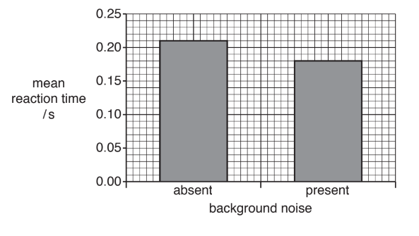

**Fig. 3**

State why a bar chart is a suitable way to show the data.

*Source: May/June 2019 9700/51 Q1C*

**Q5** [4 marks]

**Extract:**

There was some background noise in the classroom when the students carried out their experiment. The students thought that this noise might have affected their reaction times. They decided to modify their original experiment to find out if the presence or absence of background noise affects reaction time.

Fig. 3 shows some results for a reaction time test that the students found on the internet.

(i) Suggest **one** conclusion the students could have made based on these results.

[1]

(ii) The students decided to carry out a* t*-test to find out if the difference in reaction time was significant.

State why a *t*-test is suitable for these data.

[1]

(iii) State a null hypothesis for this test.

[1]

Table 2 shows some probability values of *t*.

**Table 2**

| **degrees of** **freedom** | 10 | 12 | 14 | 16 | 18 | 20 | 22 | 24 | 26 | 28 | 30 | 40 | 50 | 60 |
|---|---|---|---|---|---|---|---|---|---|---|---|---|---|---|
| **probability** **0.05** | 2.23 | 2.18 | 2.14 | 2.12 | 2.10 | 2.09 | 2.07 | 2.06 | 2.06 | 2.05 | 2.04 | 2.02 | 2.01 | 2.00 |

(iv) The students used 16 degrees of freedom and calculated *t* = 2.05.

State **and** explain what the value of *t* indicates about the difference in mean reaction times shown in Fig. 3.

[1]

*Source: Oct/Nov 2018  9700/51 Q1D*

**Q5** [4 marks]

Another student, when carrying out the ruler experiment shown in Fig. 1, noticed that the more repetitions carried out, the faster the reaction time became.

The student decided to carry out a different experiment to investigate the effect of repetition on the accuracy of carrying out a task.

Five students, **V, W, X, Y** and **Z **were tested.

- Each student was given a picture of a star, as shown in Fig. 4.
- Each student sat at a desk so that the star was only visible in a mirror, as shown in Fig. 5.
- Each student was asked to draw between the double lines of the star when looking at it **only **in the mirror. Fig. 6 shows a star diagram completed by a student.
- The students recorded the number of times their lines went outside the double line of the star.

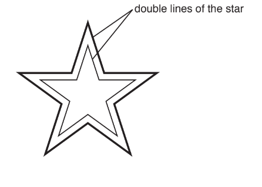

**Fig. 4**

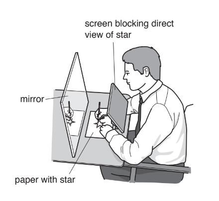

**Fig. 5**

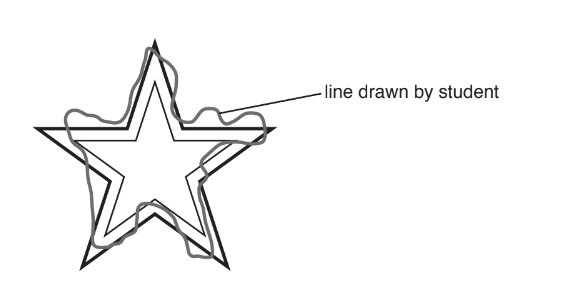

**Fig. 6**

Each student repeated the task nine times on the same day. The results are shown in Table 3.

**Table 3**

| **student** | **number of times the students’ lines went outside the double lines of the star** |   |   |   |   |   |   |   |   |
|---|---|---|---|---|---|---|---|---|---|
| **1** | **2** | **3** | **4** | **5** | **6** | **7** | **8** | **9** |   |
| **V** | 48 | 48 | 46 | 44 | 42 | 40 | 41 | 41 | 41 |
| **W** | 45 | 42 | 43 | 40 | 38 | 35 | 36 | 35 | 35 |
| **X** | 38 | 37 | 34 | 32 | 31 | 30 | 28 | 38 | 28 |
| **Y** | 31 | 30 | 31 | 29 | 44 | 28 | 26 | 25 | 25 |
| **Z** | 41 | 40 | 38 | 37 | 35 | 35 | 33 | 33 | 32 |

(i) Identify the independent variable in this experiment.

[1]

(ii) Suggest the hypothesis that was tested in this experiment.

[1]

(iii) A person walked into the room and started talking to one of the students who was carrying out the test.

Circle the result in Table 3 that was affected by this.

[1]

(iv) One of the students had previously carried out a similar task.

Identify this student **and** give a reason for your answer.

[1]

*Source: May/June 2019 9700/51 Q1E*

**Q5** [2 marks]

**Extract:**

Another student, when carrying out the ruler experiment shown in Fig. 1, noticed that the more repetitions carried out, the faster the reaction time became.

The student decided to carry out a different experiment to investigate the effect of repetition on the accuracy of carrying out a task.

Five students, **V, W, X, Y** and **Z **were tested.

- Each student was given a picture of a star, as shown in Fig. 4.
- Each student sat at a desk so that the star was only visible in a mirror, as shown in Fig. 5.
- Each student was asked to draw between the double lines of the star when looking at it **only **in the mirror. Fig. 6 shows a star diagram completed by a student.
- The students recorded the number of times their lines went outside the double line of the star.

Each student repeated the task nine times on the same day. The results are shown in Table 3.

**Table 3**

| **student** | **number of times the students' lines went outside the double lines of the star** |
| **1** | **2** | **3** | **4** | **5** | **6** | **7** | **8** | **9** |
| **V** | 48 | 48 | 46 | 44 | 42 | 40 | 41 | 41 | 41 |
| **W** | 45 | 42 | 43 | 40 | 38 | 35 | 36 | 35 | 35 |
| **X** | 38 | 37 | 34 | 32 | 31 | 30 | 28 | 38 | 28 |
| **Y** | 31 | 30 | 31 | 29 | 44 | 28 | 26 | 25 | 25 |
| **Z** | 41 | 40 | 38 | 37 | 35 | 35 | 33 | 33 | 32 |

State **two** conclusions based on the data in Table 3.

*Source: May/June 2019 9700/51 Q1F*

### Q6 — medium — 12 marks

**Q6** [3 marks]

Muscle contraction is stimulated by a series of events taking place at a neuromuscular junction.

Compare the structures and processes of a normal cholinergic synapse with those of a neuromuscular junction.

**Q6** [3 marks]

Fig. 1 shows a section of skeletal muscle under an electron microscope.

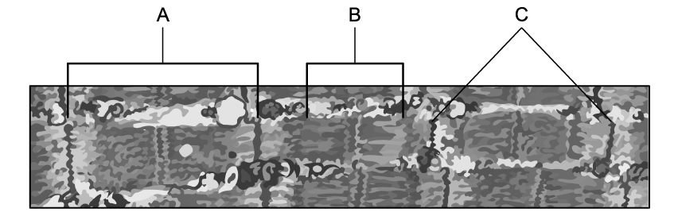

**Fig. 1**

Identify structures **A**, **B** and **C** in Fig. 1.

**Q6** [2 marks]

**Extract:**

Fig. 1 shows a section of skeletal muscle under an electron microscope.

Skeletal muscle, as shown in Fig. 1, is also known as striated muscle due to its striped appearance.

Use your knowledge of the protein filaments in muscle tissue to explain the striped appearance of skeletal muscle shown in Fig. 1

**Q6** [4 marks]

Several different drugs exist that reduce the contraction of skeletal muscles. Two of these drugs are described in Table 1 below.

**Table 1**

| **Drug** | **Mechanism of action** |
|---|---|
| PBP | Inhibits ATP hydrolysis |
| Dantrolene | Inhibits the release of calcium ions from the sarcoplasmic reticulum |

Explain how each of the drugs in Table 1 reduces the contraction of skeletal muscles.

### Q7 — medium — 9 marks

**Q7** [4 marks]

Fig. 1 shows a transmission electron micrograph of a section through striated muscle.

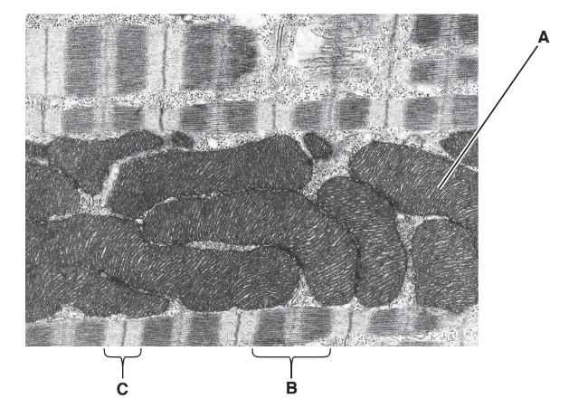

**Fig. 1**

Complete Table 1, using the letters **A**, **B **or **C**, to show the location of proteins associated with striated muscle structure.

You may use each letter once, more than once, or not at all.

**      Table 1**

| **protein** | **location** |
|---|---|
| myosin and actin |   |
| actin alone |   |
| ATP synthase |   |
| ATPase |   |

*Source: Oct/Nov 2018  9700/42 Q4A*

**Q7** [5 marks]

Explain the role of ATP in the contraction of striated muscle.

*Source: Oct/Nov 2018  9700/42 Q4B*

### Q8 — medium — 14 marks

**Q8** [3 marks]

Outline the roles of sensory receptor cells in the mammalian nervous system.

*Source: Oct/Nov 2018 9700/41 Q8A*

**Q8** [11 marks]

Fig. 1 shows the changes in potential difference (p.d.) across the membrane of a receptor cell over a period of time. The membrane was stimulated at time **A** and at time **B** with stimuli of different intensities.

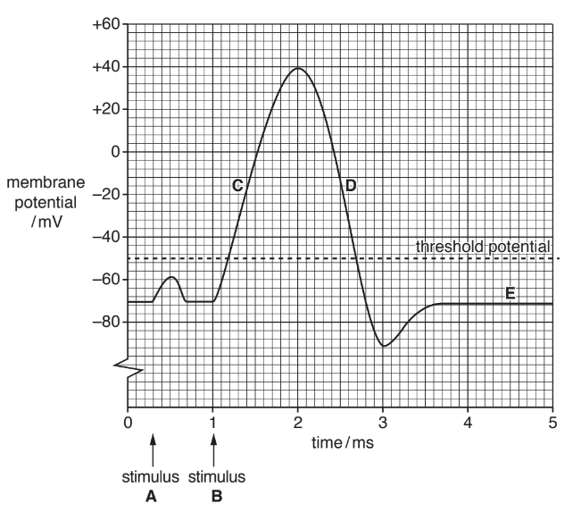

**Fig. 1**

(i) State which of the letters **C**, **D** and **E** on Fig. 1 corresponds to each of these events. You may use each of the letters **C**, **D** or **E** once, more than once or not at all.

- The Na+ /K+ pump is operating
- The voltage‐gated Na+ channels are open
- The voltage‐gated K+ channels are open

[3]

(ii) Explain why stimulus **A** did not result in an action potential being produced whereas stimulus **B** did.

[2]

(iii) Describe the importance of the refractory period in the transmission of action potentials.

[2]

(iv) Describe how action potentials are transmitted along a myelinated axon.

[4]

*Source: Oct/Nov 2018 9700/41 Q8B*

### Q9 — medium — 11 marks

**Q9** [2 marks]

Fig. 1 shows an electron microscope image of a synapse.

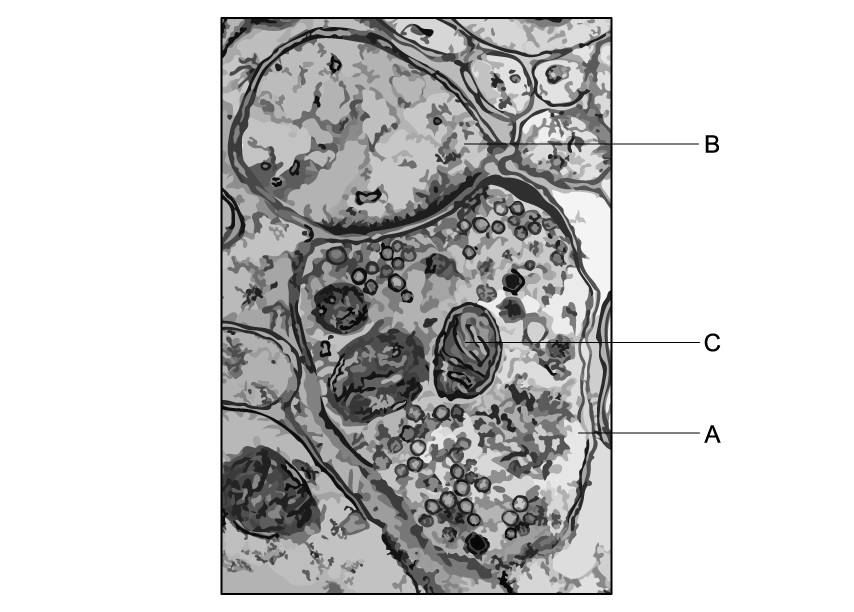

**Fig. 1**

(i) Name cell **A **in Fig. 1.

[1]

(ii) Give a reason for your answer to part (i).

[1]

**Q9** [3 marks]

**Extract:**

Fig. 1 shows an electron microscope image of a synapse.

(i) Give** one** feature that would be found on the cell surface membrane of cell **B** in Fig. 1.

[1]

(ii) Explain why this feature is not visible in Fig. 1.

[2]

**Q9** [2 marks]

**Extract:**

Fig. 1 shows an electron microscope image of a synapse.

Cell A in Fig. 1 is a presynaptic neurone/cell.

Cell A contains (many) vesicles (which contain neurotransmitter).

Structure **C** in Fig. 1 is a mitochondrion.

Suggest the roles of structure **C** within cell **A** in Fig. 1.

**Q9** [4 marks]

Describe the role of calcium ions at a synapse.

### Q10 — medium — 7 marks

**Q10** [7 marks]

Explain how a cholinergic synapse functions.

*Source: May/June 2019 9700/41 Q10A*

### Q11 — medium — 10 marks

**Q11** [3 marks]

Insulin is an example of a globular protein.

Explain what this means for its mechanism of action.

**Q11** [3 marks]

Insulin is released by the endocrine system.

Contrast the action of the endocrine system with that of the nervous system.

**Q11** [2 marks]

Fig. 1 shows a microscope image of a neurone, the cell body of which is located within the central nervous system.

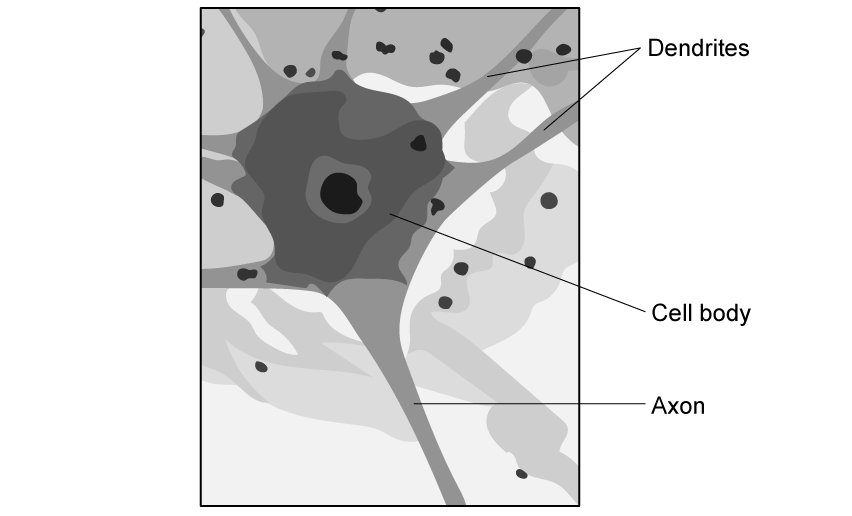

**Fig 1**

(i) Identify the precise cell type shown in Fig. 1.

[1]

(ii) Draw an arrow on Fig. 1 to show the direction a nerve impulse will travel through the cell.

[1]

**Q11** [2 marks]

**Extract:**

Fig. 1 shows a microscope image of a neurone, the cell body of which is located within the central nervous system.

(i) The type of cell in Fig. 1 is a motor neurone.

(i) Identify **one** feature of the neurone type shown in part (c) that is **not** labelled in Fig. 1.

[1]

(ii) State how the feature identified in part (i) assists with the specific function of the neurone.

[1]

### Q12 — medium — 15 marks

**Q12** [9 marks]

Describe how a spinal reflex arc functions **and** explain why it is an advantage to a mammal.

*Source: Oct/Nov 2018  9700/42 Q10A*

**Q12** [6 marks]

Explain the importance of the myelin sheath in determining the speed of nerve impulses.

*Source: Oct/Nov 2018  9700/42 Q10B*

### Q13 — easy — 9 marks

**Q13** [3 marks]

Fig. 1 shows changing membrane potential in an axon within a human leg.

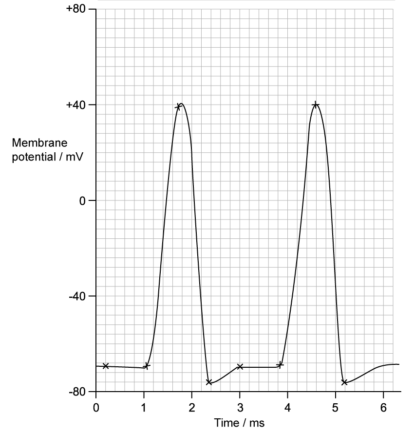

**Fig. 1**

(i) Identify the type of membrane potential present in the axon at** 0.5 ms** in Fig. 1.

[1]

(ii) Explain how the membrane potential identified in part (i) has been achieved in the axon.

[2]

**Q13** [1 mark]

**Extract:**

Fig. 1 shows changing membrane potential in an axon within a human leg.

At 1 ms in Fig. 1 the membrane is stimulated.

State what happens **within the membrane** at **1 ms** as a result of this stimulation.

**Q13** [3 marks]

**Extract:**

Fig. 1 shows changing membrane potential in an axon within a human leg.

At 1 ms in Fig. 1 the membrane is stimulated.

Explain the shape of the curve between 1 - 1.8 ms in Fig. 1.

**Q13** [2 marks]

**Extract:**

Fig. 1 shows changing membrane potential in an axon within a human leg.

**Fig. 1**

Assuming that the intensity of stimulation remains constant, calculate how many complete action potentials will occur in 1 second in the neurone shown in Fig. 1. Note that there are 1000 ms in a second.

### Q14 — easy — 11 marks

**Q14** [3 marks]

Fig. 1 shows a representation of a junction between two neurones.

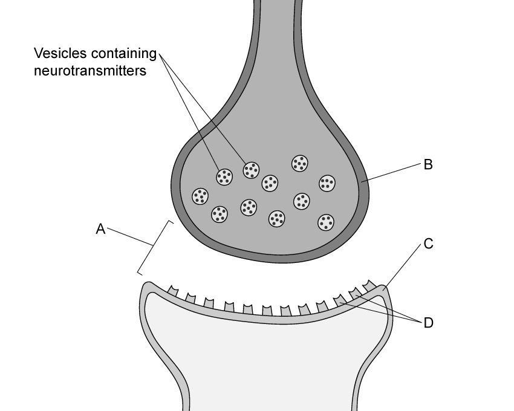

**Fig. 1**

Identify structures **A-C** in Fig. 1.

**Q14** [2 marks]

**Extract:**

Fig. 1 shows a representation of a junction between two neurones.

Fig. 1 shows that the junctions between neurones contain molecules known as neurotransmitters.

Outline how neurotransmitters interact with the structures labelled **D** to bring about an action potential in the new neurone.

**Q14** [2 marks]

**Extract:**

Fig. 1 shows a representation of a junction between two neurones.

Structures A-C are:
- A = synaptic cleft
- B = (pre)synaptic knob / presynaptic cell/neurone/membrane
- C = postsynaptic cell/neurone/membrane

The junctions between motor neurones and muscles are specialised versions of the structure illustrated in Fig. 1.

(i) Name the specialised junctions between motor neurones and muscles.

[1]

(ii) Give **one** difference between the processes that take place in the structure named in part (i) and those that occur in the structure illustrated in Fig. 1.

[1]

**Q14** [4 marks]

Fig. 2 shows a representation of a sarcomere from striated muscle. When an impulse arrives at the structure named in part (c) (i), striated muscle can be stimulated to contract.

**Fig. 2**

(i) When the sarcomere contracts it reduces in length by 9.5 %.

Calculate the length of a contracted sarcomere.

[2]

(ii) Other than an overall reduction in length, state **two specific** changes that will occur in Fig. 2 as a result of stimulation of the striated muscle.

[2]

### Q15 — easy — 9 marks

**Q15** [3 marks]

Fig. 1 shows a system of the human body.

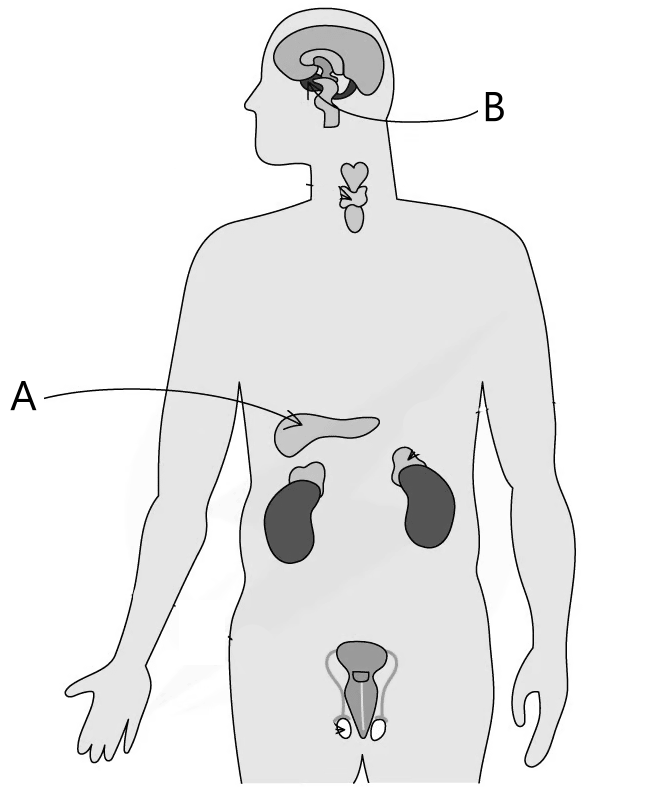

**Fig. 1**

(i) State the name of the system represented in Fig. 1.

[1]

(ii) Identify organs **A** and **B** in Fig. 1.

[2]

**Q15** [2 marks]

The system in Fig. 1 is responsible for the secretion of hormones.

State the meaning of the term *hormone*.

**Q15** [2 marks]

**Extract:**

Fig. 1 shows a system of the human body.

Fig. 1

(i) State the name of the system represented in Fig. 1.

(ii) Identify organs A and B in Fig. 1.

Mark scheme:
(i) The name of the system represented in Fig. 1 is: Endocrine (system);
(ii) Organs A and B can be identified as follows: A = pancreas; B = pituitary gland

(i) Identify **one** example of a hormone secreted by the system in Fig. 1.

[1]

(ii) State the role of the hormone identified in part (i).

[1]

**Q15** [2 marks]

**Extract:**

Fig. 1 shows a system of the human body.

The name of the system represented in Fig. 1 is:
- Endocrine (system)

The system in Fig. 1 is responsible for the secretion of hormones.

The term *hormone* can be defined as follows:
- A chemical messenger/signalling molecule
- Transported in the blood to target cells/organs

State **two** differences between the system in Fig. 1 and the nervous system.

### Q16 — easy — 9 marks

**Q16** [3 marks]

Fig. 1 below shows a diagram of a muscle cell, usually known as a muscle fibre.

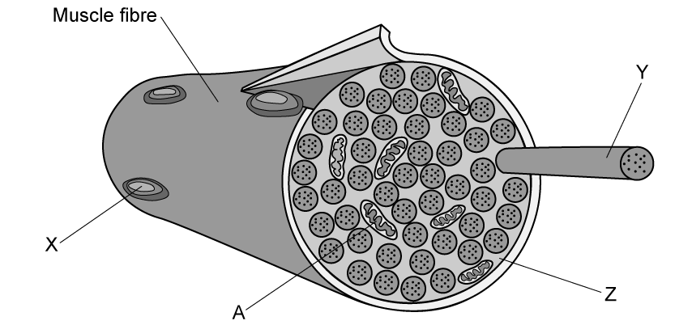

**Fig. 1**

Identify structures **X**, **Y** and **Z** in Fig. 1.

**Q16** [2 marks]

**Extract:**

Fig. 1 below shows a diagram of a muscle cell, usually known as a muscle fibre.

Explain the role of the structure labelled **A** in Fig. 1.

**Q16** [2 marks]

Fig. 2 shows some of the changes that occur within a muscle fibre when skeletal muscle contracts.

**Fig. 2**

Describe the changes that are visible in Fig. 2 when the muscle contracts.

**Q16** [2 marks]

Outline the role of calcium ions in muscle contraction.

### Q17 — easy — 9 marks

**Q17** [3 marks]

Fig. 1 shows a diagram of a motor neurone.

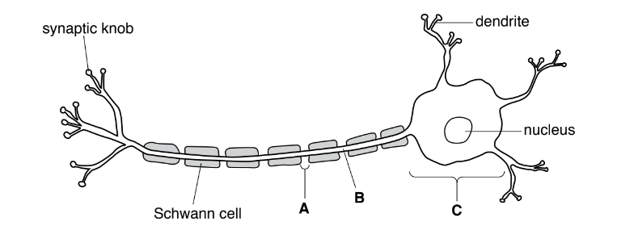

**Fig. 1**

Name the structures labelled **A**, **B** and **C** on Fig. 1.

*Source: Specimen 2022 9700/04 Q2A*

**Q17** [2 marks]

Describe the function of a motor neurone.

*Source: Specimen 2022 9700/04 Q2B*

**Q17** [4 marks]

**Extract:**

Fig. 1 shows a diagram of a motor neurone.

A = node of Ranvier
B = axon
C = cell body

With reference to Fig. 1, explain the fast transmission of impulses along a motor neurone.

*Source: Specimen 2022 9700/04 Q2C*

