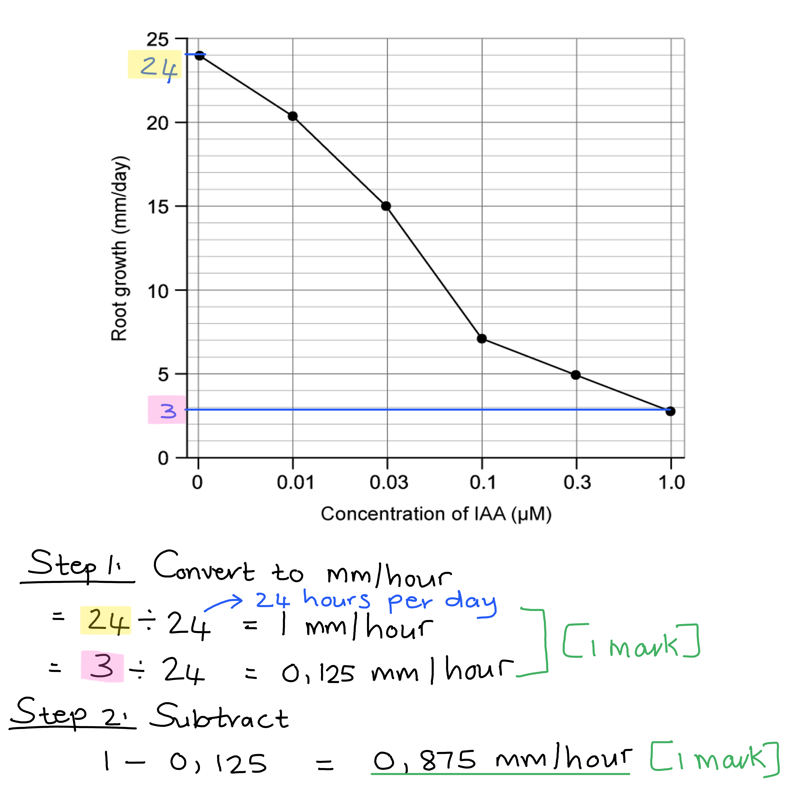
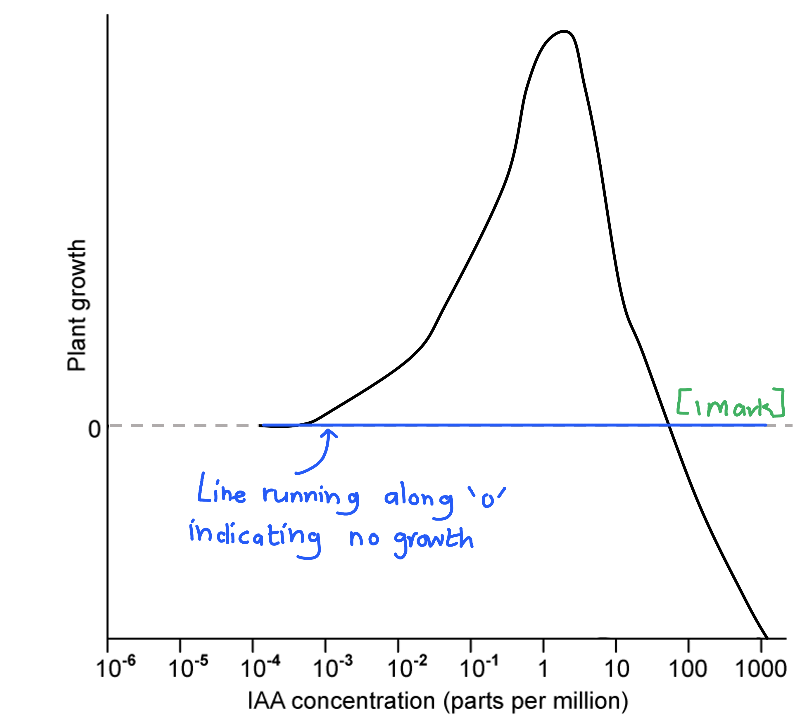
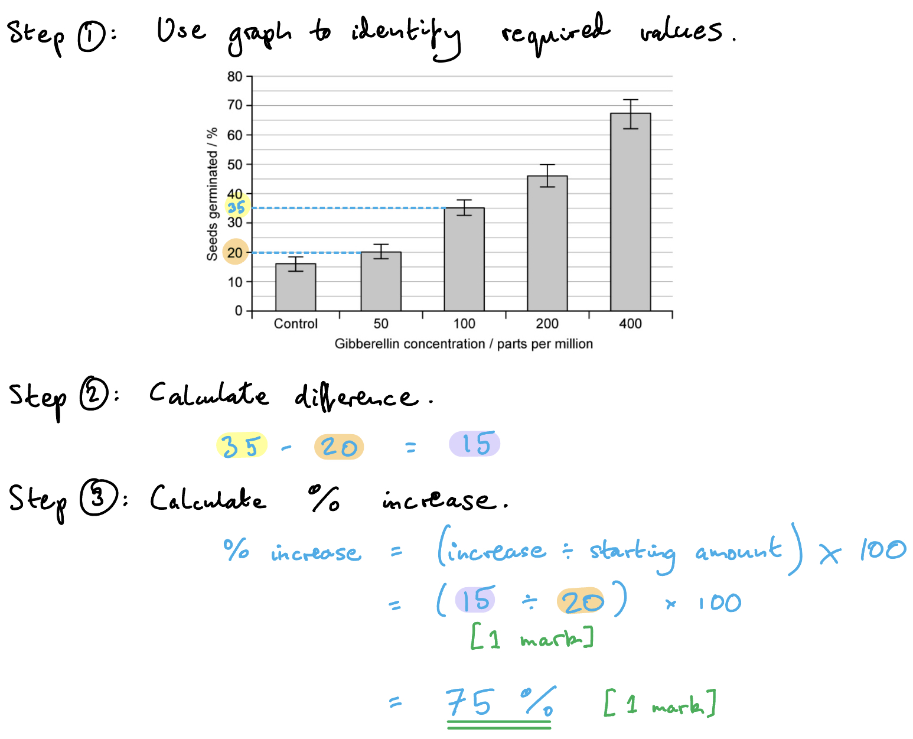
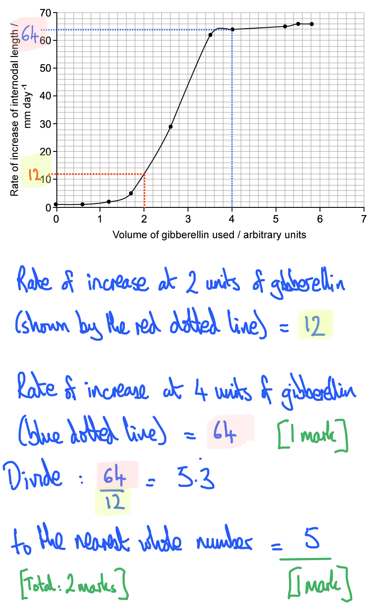

# Mark Schemes — Control & Coordination in Plants
**15. Control & Coordination** · Cambridge (CIE) A-LEVEL biology (9700)

## Structured Questions (9 questions)

### Q1
An action potential is stimulated in an animal neurone as follows...

**Final answer:** **Any ****two**** of the following:**

- A stimulus causes sodium ion channels to open; **[1 mark]**
- Sodium ions diffuse into the neurone/cell/axon / there is an influx of sodium ions down a concentration gradient; **[1 mark]**
- The inside of the cell becomes more positive in comparison to the outside / the charge across the membrane is reversed; **[1 mark]**

**[Total: 2 marks]**

> *This is an 'outline' question, so details about receptor potentials, voltage-gated channels and thresholds are not required for the marks. Note that the focus is on depolarisation rather than on reaching action potential; this is the reversal of charge across the membrane.*
(i) The cells of *M. pudica* become depolarised in the next stage of the process shown in Fig. 1 by...

- Chloride ions diffuse out of the cell / move out of the cell down a concentration gradient; **[1 mark]**
- The loss of negatively charged ions causes the inside of the cell to become more positive; **[1 mark]**

(ii) Repolarisation could occur by...

**Final answer:** **Any ****two**** of the following:**

- The opening of potassium ion channels (in response to depolarisation); **[1 mark]**
- Potassium ions diffusing out of the cell; **[1 mark]**
- The loss of positively charged ions causes the inside of the cell to become more negative / restores the resting state; **[1 mark]**

**[Total: 4 marks]**

> *This is quite a tricky question, but you have been given quite a lot of information in Fig. 1 and you should be able to apply what you know about depolarisation in animal cells and in venus fly traps.*

> *Depolarisation involves the inside of the cell becoming more positive; this can be achieved either by a gain of positively charged ions or a loss of negatively charged ions. In this case, you have been told that a stimulus leads to the opening of chloride ions and Fig. 1 shows chloride ions inside the cell; it is, therefore, logical to think that an outward movement of negatively charged chloride ions causes depolarisation.*

> *You already know that an outward movement of potassium ions leads to repolarisation in animal neurones. Fig. 1 shows potassium ions and a corresponding potassium ion channel. Logic says that the opening of the channel would lead to the outward movement of positive potassium ions, restoring resting potential.*
The process described in part b) could lead to a reduction in leaf volume because...

**Final answer:** **Any ****two**** of the following:**

- Ions leave the cell (both chloride and potassium ions); **[1 mark]**
- This lowers the water potential of the surrounding tissues/cells; **[1 mark]**
- Water leaves the cell by osmosis / down a water potential gradient; **[1 mark]**

**[Total: 2 marks]**

> *This is another tricky question, but you should have a good idea that osmosis is the cause of water movement in living organisms, so you just need to work backward from here. If osmosis is going to take place then it must be due to the generation of a water potential gradient. This could have been achieved in the process from part b) when ions left the cell by diffusion.*
The advantage to *M. pudica* of the response shown in Fig. 2. is...

- It reduces leaf surface area / prevents organisms from sitting on its leaves/stems/branches; **[1 mark]**
- This reduces the risk of being eaten / predation; **[1 mark]**

**[Total: 2 marks]**

> *You are not expected to know about adaptations against predation but Fig. 2 should provide you with the information you need to reason your way to the answer. Fig. 2 shows that when touched the leaf folds up and drops downwards; this should suggest a defense mechanism, allowing the mimosa to defend against predators by reducing the available leaf area to eat and by causing small animals to fall to the ground.*

### Q2
The difference in the root growth per hour can be calculated as follows...

- Conversion: 1 mm/hour **AND** 0.125 mm/hour; **[1 mark]**
- (1 - 0.125) = 0.875 mm/hour; **[1 mark]**

*Full marks awarded for the correct answer in the absence of other calculations*

**[Total: 2 marks]**

*Remember that it good practice to always show your working to ensure that you get at least* **[1 mark]**, *even if your answer is incorrect.*

The growth of the root could have been affected in the following way...

- Auxins/IAA would accumulate on the lower side of the root (due to gravity) **OR** the lower side of the root would have a high(er) auxin/IAA concentration than the upper side of the root; **[1 mark]**
- This would inhibit/decrease cell growth/elongation on the lower side of the root; **[1 mark]**
- Causing the tip of the root to grow downwards / towards gravity; **[1 mark]**

*Ignore reference to the root "bending" downwards for marking point 3*

**[Total: 3 marks]**

> *Even though you are not expected to be familiar with the effects of auxin on the growth of roots, you are expected to apply the information given in Fig. 1 to this unfamiliar scenario to come up with an answer. Fig. 1 shows that an increase in auxin concentration will decrease or inhibit root growth, which would cause the upper part of the pot plant root to elongate more than the lower part, causing the tip of the root to grow downward.*
The mark allocation for the sketch of the graph would be as follows...

- A straight line that runs along the '0' dotted line; **[1 mark]**

**[Total: 1 mark]**

> *Your graph would look like this...*

A possible reason for the line indicating no growth would be...

- No / very little ATP/energy would be released (in the absence of respiration); **[1 mark]**
- Therefore the proton pumps cannot pump hydrogen ions / H+ into the cell wall; **[1 mark]**
- This results in the cell wall remaining rigid / unable to stretch and cell growth through elongation would not occur; **[1 mark]**

**[Total: 3 marks]**

> *Remember that proton pumps require energy to function as they are moving ions against their concentration gradient. Cellular respiration is the main source of energy in the cell, so if this process is inhibited, then these proton pumps cannot function anymore. Without cell walls that are able to stretch, the cell cannot increase in size and no growth would be observed in the shoots.*

### Q3
(i) Two features visible in Fig. 1 that enables the Venus flytrap to gain nitrogen compounds are...

- Sensory hairs / hairs to sense movement (of insects); **[1 mark]**
- Stiff spines/hairs (along edges of the leaf) that can interlock / that trap prey/insects inside leaf; **[1 mark]**

(ii) One other feature that is not visible in Fig. 1 that aid the plant in the same process is...

- Red leaves / glands that produce/secrete nectar; **[1 mark]**
- To attract insects/prey; **[1 mark]**

**OR**

- Glands that produce / the ability to produce (digestive) enzymes; **[1 mark]**
- To digest / break down the bodies of insects/prey **OR** to release nitrates from the bodies of prey; **[1 mark]**

**[Total: 4 marks]**
(i) At threshold A in Fig. 2 the following occurs...

- The leaves close / form a trap; **[1 mark]**

(ii) This occurs because...

**Final answer:** **Any ****three**** of the following:**

- <u>Two</u> (sensory) hairs are stimulated / a hair is stimulated <u>twice</u>; **[1 mark]**
- Calcium ion channels open **AND** calcium ions move/diffuse into the cells (at the base of the hairs); **[1 mark]**
- A large enough <u>receptor potential</u> is generated / a <u>threshold</u> is reached; **[1 mark]**
- An <u>action potential</u> travels / is passed across the leaf (causing it to close); **[1 mark]**

**[Total: 4 marks]**

> *Note that you need to explain the events that lead to the closing of the trap, so while stimulation of a single hair does cause the release of calcium ions, it is the stimulation of two hairs that causes enough calcium ions to move into the cells to trigger an action potential. This can be seen in Fig. 2.*
(i) The genes expressed at threshold B could be...

- (Genes that code for) digestive enzymes / production of vesicles that contain enzymes **OR** molecules that cause the trap to close more tightly / seal the trap; **[1 mark]**

(ii) The benefit to the plant of not changing gene expression until a second threshold is reached is that...

- The plant does not waste energy expressing new genes / changing its gene expression; **[1 mark]**
- If the insect/prey has escaped / not been trapped; **[1 mark]**

***Accept ****reverse answer for part c) ii).*

**[Total: 3 marks]**

> *This is a suggested question, but you should be aware that further stimulation seals the trap and leads to the release of digestive enzymes, so the change in gene expression must be connected to one of these events.*

> *Multiple hair stimulations are required for the second threshold to be reached, meaning that this threshold is only reached if the prey has been caught in a trap and continues moving. If the prey manages to escape then it will be a waste of the plant's energy resources to start secreting digestive enzymes. *

### Q4
The effect of increasing IAA concentration on the growth of plant shoots shown in Fig.1 is...

**Final answer:** **Any ****three**** of the following:**

- At low concentrations, IAA causes no growth (response) in plant shoots / has no effect on plant growth; **[1 mark]**
- At medium concentrations, IAA causes an increase in plant shoot growth; **[1 mark]**
- At high concentrations, IAA inhibits/reduces plant growth; **[1 mark]**
- Correctly stated IAA concentrations to match any of the above points; **[1 mark]**

***Accept*** *approximate values or a value range quoted from the log scale.*

**[Total: 3 marks]**

> *When describing data be sure to describe all of the different trends shown; here there is a section for no growth, a section for increased growth, and a section for decreased growth.*

> *It is always a good idea to use numbers to support your points when describing data.*
The effect of IAA on shoot growth at a concentration of 1 part per million in Fig.1 is due to...

**Final answer:** **Any ****five**** of the following:**

- IAA/auxin binds to receptors/receptor proteins on the cell surface membrane (of plant cells); **[1 mark]**
- (This) causes hydrogen ion/proton/H+ pumps to pump/actively transport hydrogen ions/protons/H+ into the cell wall; **[1 mark]**
- The cell wall becomes acidic / the pH of the cell wall decreases; **[1 mark]**
- (Expansin proteins) loosen the bonds between cellulose microfibrils; **[1 mark]**
- Potassium ion channels open **AND** potassium ions move into the cell wall; **[1 mark]**
- The water potential of the cell wall decreases **AND **water moves into the cell wall by osmosis; **[1 mark]**
- The pressure exerted on the cell walls (due to the increased cell volume) increases, stretching/expanding the cell walls (and causing the cells to elongate); **[1 mark]**

**[Total: 5 marks]**
The effect of IAA on plant roots differs from its effect on plant shoots in Fig.1 as follows...

- Low IAA concentrations increase root growth **WHILE** having no effect on shoot growth **OR** IAA concentrations that have no effect on shoot growth cause increased growth in roots; **[1 mark]**
- Medium IAA concentrations inhibit root growth **WHILE **increasing shoot growth **OR** IAA concentrations that increase growth in shoots cause decreased growth in roots; **[1 mark]**

**[Total: 2 marks]**

> *Plant growth factors such as IAA are more complicated than animal hormones; they do not have a single target tissue and can have different effects on different tissues within the plant. Here it can be seen that at IAA concentrations that do not affect shoot growth, root growth is increasing, while concentrations that cause increased growth in shoots inhibit growth in roots.*

### Q5
(i) The** **type of protein represented by A is...

- (Auxin) receptor (protein); **[1 mark]**

(ii) Proteins** **B, C and D are...

- B = <u>proton</u>/<u>H</u><u>+</u>/hydrogen <u>ion</u> pump; **[1 mark]**
- C = potassium/K+ / ion channel; **[1 mark]**
- D = aquaporin; **[1 mark]**

**[Total: 4 marks]**

> *When writing about proteins that transport hydrogen ions you must indicate clearly that you are referring to **ions** and not to hydrogen atoms. This is achieved either by stating that C transports hydrogen **ions**, or by referring to the ions as **protons** or as **H**+**. Credit will not be given for identifying B as a hydrogen pump.*
The effects on the cell wall of many hydrogen ions moving into the cell wall are...

**Final answer:** **Any ****three**** of the following:**

- (Cell wall) pH decreases / becomes more acidic; **[1 mark]**
- <u>Expansins</u> (are activated as a result of the change in pH);**[1 mark]**
- (Expansins) break/loosen bonds/cross-links;**[1 mark]**
- (These bonds are between) cellulose microfibrils;**[1 mark]**
- The cell wall expands/stretches;**[1 mark]**
- Due to turgor pressure (on cell wall as a result of water moving into the cell by osmosis); **[1 mark]**

**[Total: 3 marks]**

> *Be careful not to confuse **microfibrils** in cellulose with myofibrils in muscles; they are not the same thing!*

> *Note that expansins are not enzymes, so you should not refer to them as such.*
The consequences of an influx of potassium ions into the cell are...

**Final answer:** **Any ****two**** of the following:**

- Water potential decreases / becomes more negative; **[1 mark]**
- Water moves into the cell by <u>osmosis</u> / down a <u>water potential gradient;</u> **[1 mark]**
- The cell expands/elongates; **[1 mark]**

**[Total: 2 marks]**

### Q6
Structures A-C in Fig.1 are...

- A = Embryo; **[1 mark]**
- B = Endosperm; **[1 mark]**
- C = Aleurone layer; **[1 mark]**

**Final answer:** **[Total: 3 marks] **
The percentage increase in the seeds germinated at a gibberellin concentration of 200 parts per million in comparison to the seeds germinated at 50 parts per million is...

- 15 ÷ 20; **[1 mark]**
- 75 (%); **[1 mark]**

*Full marks can be awarded for the correct answer in the absence of other calculations.*

**[Total: 2 marks]**

Evaluative points regarding the conclusion that adding gibberellin increases germination in barley seedlings include...

In support of the conclusion:

**Final answer:** **Any ****one**** of the following:**

- All concentrations of gibberellin show an increased germination percentage in comparison to the control; **[1 mark]**
- Gibberellin concentrations of 100, 200, and 400 parts per million significantly increase seed germination; **[1 mark]**

Against the conclusion:

- The germination percentage at 50 parts per million is not significantly higher than the control; **[1 mark]**

**[Total: 2 marks]**

> *The question asks you to refer only to the data so you cannot add any information about the quality of the study, e.g. the sample size or the number of repeats. The most important point to note is that the standard deviations for the control and for 50 ppm overlap, showing that there is no statistically significant difference between these two sets of results, while the standard deviations for the higher concentrations do not overlap with the control, or with each other. Therefore, the student's conclusion is only partly correct, and you should explain how the student is correct and incorrect in their conclusion.*
The results in Fig. 2 are due to...

**Final answer:** **Any ****five**** of the following:**

- Gibberellin causes the aleurone layer to release amylase; **[1 mark]**
- Transcription/expression of the genes for amylase production increases; **[1 mark]**
- Amylase <u>hydrolyses</u> starch in the endosperm; **[1 mark]**
- Starch is broken down into maltose/glucose; **[1 mark]**
- (Glucose) is used by the embryo in respiration; **[1 mark]**
- ATP is produced / energy is released; **[1 mark]**
- ATP/energy is used by the embryo for growth / fuels growth in the embryo; **[1 mark]**

***Reject**** references to energy being produced or created.*

**[Total: 5 marks]**

> *Fig. 2 already tells us that gibberellin is present so no marks are available for describing the conditions required by the seed or the stimulation of the release of gibberellin by the embryo.*

### Q7
The two processes that are controlled by gibberellins in plants are:

- (Seed) germination; **[1 mark]**
- Stem elongation; **[1 mark]**

*Allow: cell division in the stem*

**[Total: 2 marks]**
Farmers have to keep harvested barley seeds cool and dry because:

- **Dry:** water ingress will stimulate gibberellin production <u>in the embryo</u>; **[1 mark]**
- **Cool:** to reduce the kinetic energy of molecules / reduce the rate of metabolic reactions (of germination); **[1 mark]**

**[Total: 2 marks]**
The correct chronological order of events is:

| 1st |   | 2nd |   | 3rd |   | 4th |   | 5th |   | 6th |
|---|---|---|---|---|---|---|---|---|---|---|
| **B** | **→** | **D** | **→** | **F** | **→** | **C** | **→** | **A** | **→** | **E** |

All 5 correct: **[4 marks]** 4 correct; **[3 marks]** 3 correct; **[2 marks]** 1 or 2 correct; **[1 mark]**

**[Total: 4 marks]**
The large, central part of a barley grain that occupies most of the grain's volume is **named**...

- (The) endosperm; **[1 mark]**

**Its function:**

- It contains starch reserves / food supply (for germinating plant); **[1 mark]**

**[Total: 2 marks]**

### Q8
The name of the gene that governs the height of certain plants and the names of its two alleles are:

*Name of gene:*

- Le; **[1 mark]**

*Names of its alleles:*

- *Le* **AND** *le*; **[1 mark]**

*Ignore references to dominant / recessive*

**[Total: 2 marks]**

> *Be careful to write your answers accurately as this is a case-sensitive question; your lowercase and UPPERCASE letters must be distinguishable by the examiner, or you will risk marks needlessly. *

> *This question also assesses knowledge from Topic 16.2. *
The mutation of the gene referred to in part (a) is:

**Final answer:** **Any ****three**** from the following:**

- A single nucleotide different (to the dominant allele); **[1 mark]**
- Which gives rise to a protein that is one amino acid different to the functional protein; **[1 mark]**
- This changed amino acid is in the enzyme's active site; **[1 mark]**
- Making the enzyme non-functional / cannot form enzyme-substrate complexes; **[1 mark]**
- Active gibberellin cannot be produced/expressed; **[1 mark]**

**[Total: 3 marks]**
Gibberellin is referred to as a plant hormone because...

Gibberellins are:

- Molecules / chemical signals produced by plants; **[1 mark]**
- That act (on other cells in the plant) to regulate growth/development; **[1 mark]**

**[Total: 2 marks]**
To calculate how many times more effective it was to double the volume of gibberellin used from 2 to 4 arbitrary units:

- y-axis value at x = 2 is 12 mm day-1 **AND** y-axis value at x = 4 is 64 mm day-1; **[1 mark]**
- Multiple of times effectiveness = 64 ÷ 12 = 5.3333 / 5.3; **[1 mark]**
- To nearest whole number: 5 times; **[1 mark]**

*Allow error carried forward on rounding to the nearest whole number*

**[Total: 2 marks]**

*Error carried forward means that if you make a mistake in your calculations but still round your answer to the nearest whole number, you can still earn ***[1 mark]*** for following that instruction from the question. *

### Q9
The Venus flytrap (*Dionaea muscipula*) plant is a carnivorous plant because:

- It gets its supply of nitrogen / phosphorus compounds from small animals (mainly insects and arachnids); **[1 mark]**

**[Total: 1 mark]**

> *Strictly speaking, the Venus flytrap should be called omnivorous because it does still make its own food (carbohydrates) by photosynthesis, as well as digesting animals for their mineral content. This enables the plant to grow on mineral-deficient soils. The 'carnivorous' label that is often attached to this species is a little glamourised because of the unusual, varied nature of its diet! *
The events that lead to a Venus flytrap closing to entrap its prey are:

**Final answer:** **Any ****three**** from the following:**

- Prey is attracted by nectar inside the flytrap; **[1 mark]**
- Prey touches the sensory hair inside the lobes; **[1 mark]**
- Calcium channels at the base of the hair are activated; **[1 mark]**
- <u>Two</u> touch stimuli are required (within 30 seconds) to generate action potentials across the flytrap; **[1 mark]**
- Action potentials cause elastic tension in the lobes to be released, causing them to close; **[1 mark]**

**[Total: 3 marks]**
(i) The principle group of proteins that allow cell elongation under the effects of auxins is:

- Expansins; **[1 mark]**

(ii) Their principal mode of action is:

- To loosen the bonds between cellulose microfibrils in the cell wall (allowing expansion/elongation); **[1 mark]**

**[Total: 2 marks]**
The events that cause the cell to elongate are:

- Caused by potassium channels opening and allowing K+ into the cell / cytoplasm; **[1 mark]**
- Water follows by osmosis and (the increased pressure) stretches the cell / makes it longer; **[1 mark]**

**[Total: 2 marks]**
