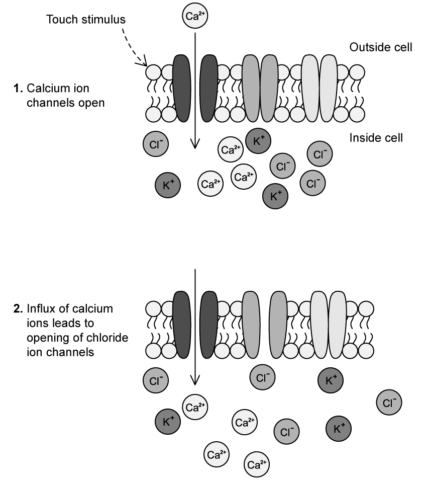
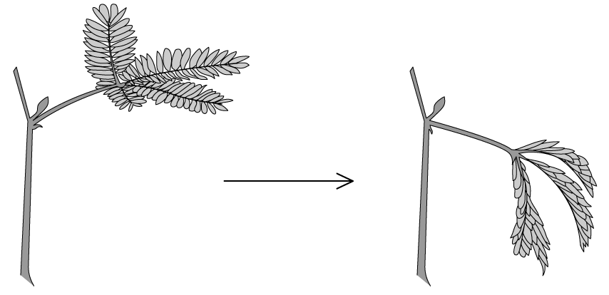
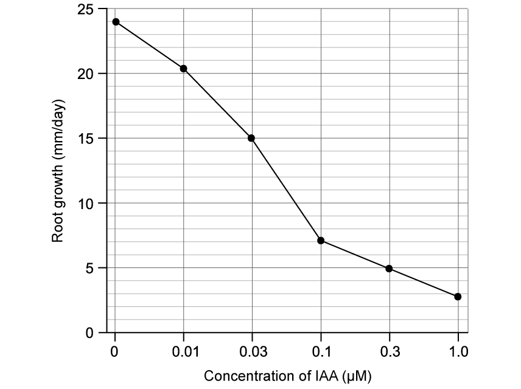
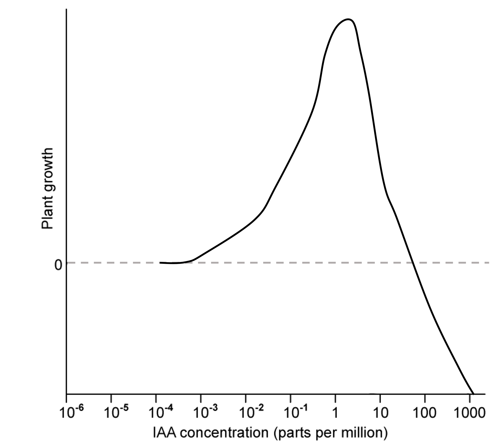
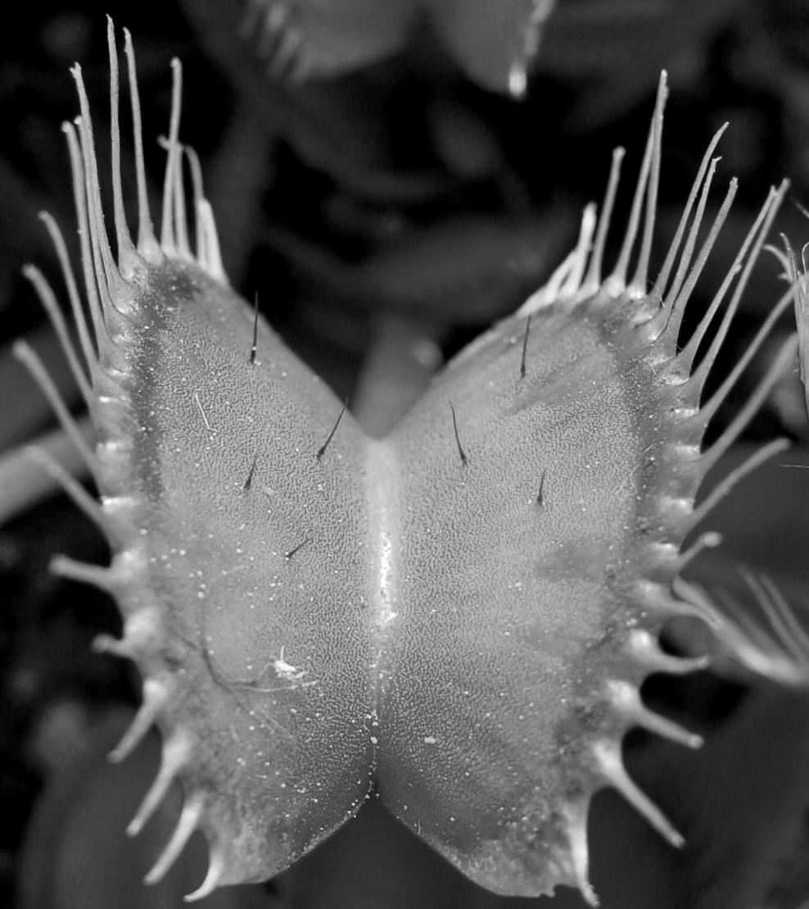
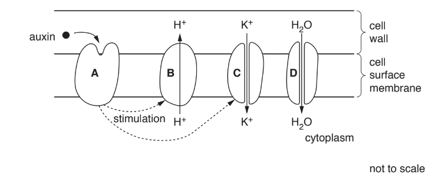
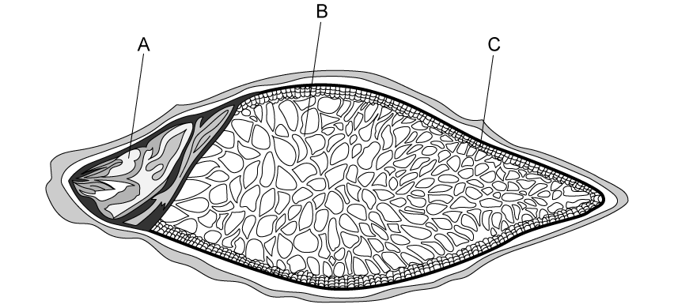
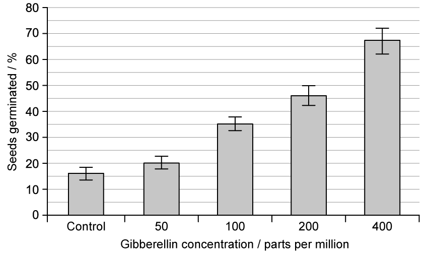
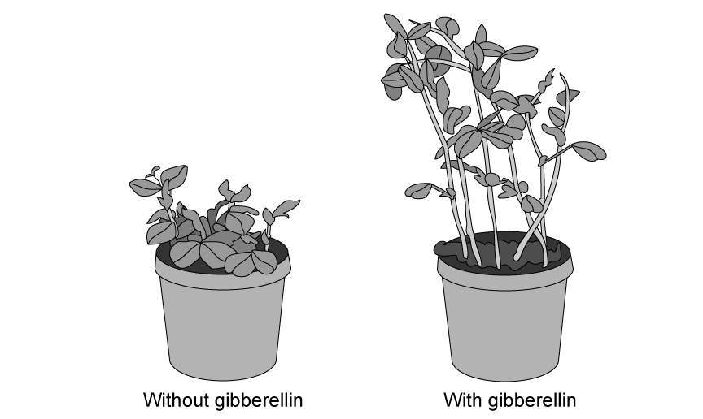
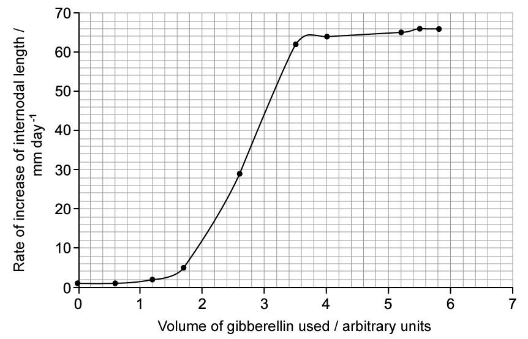

# Exam Questions — Control & Coordination in Plants
**15. Control & Coordination** · Cambridge (CIE) A-LEVEL biology (9700)
> Source: [https://www.savemyexams.com/a-level/biology/cie/25/topic-questions/](https://www.savemyexams.com/a-level/biology/cie/25/topic-questions/) · 9 questions across 1 sets

## Structured Questions (9 questions)

### Q1 — hard — 10 marks

**Q1** [2 marks]

Electrical activity occurs in living organisms as the result of the movement of charged particles, or ions, across cell membranes. The reversal of electrical charge across a cell membrane is known as depolarisation.

Outline how the cell surface membrane of an animal neurone is depolarised.

**Q1** [4 marks]

**Extract:**

Electrical activity occurs in living organisms as the result of the movement of charged particles, or ions, across cell membranes. The reversal of electrical charge across a cell membrane is known as depolarisation.

Plant cells can also be depolarised. The cells of the sensitive Mimosa plant, *Mimosa pudica*, can become depolarised in response to a touch stimulus. Fig. 2.1 shows the first two stages of depolarisation in *M. pudica.*

**Fig. 1**

(i) Suggest how the cells of *M. pudica* become depolarised in the next stage of the process shown in Fig. 1.

[2]

(ii) Suggest how the cells of *M. pudica* might become repolarised to return to a resting state.

[2]

**Q1** [2 marks]

**Extract:**

Plant cells can also be depolarised. The cells of the sensitive Mimosa plant, *Mimosa pudica*, can become depolarised in response to a touch stimulus. Fig. 2.1 shows the first two stages of depolarisation in *M. pudica.*

Fig. 1
15-2-fig-2-1

(i) Suggest how the cells of *M. pudica* become depolarised in the next stage of the process shown in Fig. 1.

(ii) Suggest how the cells of *M. pudica* might become repolarised to return to a resting state.

Mark scheme for part b:
(i) The cells of *M. pudica* become depolarised in the next stage of the process shown in Fig. 1 by...
- Chloride ions diffuse out of the cell / move out of the cell down a concentration gradient;
- The loss of negatively charged ions causes the inside of the cell to become more positive;

(ii) Repolarisation could occur by...
- The opening of potassium ion channels (in response to depolarisation);
- Potassium ions diffusing out of the cell;
- The loss of positively charged ions causes the inside of the cell to become more negative / restores the resting state;

Touch stimulation of the leaves of *M. pudica* leads to the sequence of events shown in Fig. 1 and results in the physiological response shown in Fig. 2.

**Fig. 2**

The response shown in Fig. 2 comes about due to a reduction in cell volume of certain stem and leaf cells.

Suggest how the process described in part b) could lead to a reduction in leaf volume.

**Q1** [2 marks]

**Extract:**

Touch stimulation of the leaves of *M. pudica* leads to the sequence of events shown in Fig. 1 and results in the physiological response shown in Fig. 2.

**Fig. 2**

The response shown in Fig. 2 comes about due to a reduction in cell volume of certain stem and leaf cells.

Suggest the advantage to *M. pudica* of the response shown in Fig. 2.

### Q2 — hard — 9 marks

**Q2** [2 marks]

Plant roots are particularly sensitive to the effects of auxin (IAA). Fig. 1 shows the results of an investigation that was done to determine the effect of increasing auxin concentration on the growth of young roots.

**Fig. 1**

Calculate the difference in the root growth **per hour** between the roots that were not exposed to auxins and those exposed to an auxin concentration of 1.0 µM.

Show your working.

**Q2** [3 marks]

**Extract:**

Plant roots are particularly sensitive to the effects of auxin (IAA). Fig. 1 shows the results of an investigation that was done to determine the effect of increasing auxin concentration on the growth of young roots.

A pot plant was accidentally knocked over.

Based on the information in Fig. 1, suggest and explain how the growth of the root could be affected by this.

**Q2** [1 mark]

An investigation was carried out to determine the effect of increasing auxin (IAA) concentration on the growth of plant shoots. Fig. 2 shows the results of this investigation. The investigation was then repeated with shoots that were treated with a respiratory inhibitor.

**Fig. 2**

Use the axes in Fig. 2 to sketch a graph of the plant growth that would be observed in the shoots treated with the respiratory inhibitor.

**Q2** [3 marks]

**Extract:**

An investigation was carried out to determine the effect of increasing auxin (IAA) concentration on the growth of plant shoots. Fig. 2 shows the results of this investigation. The investigation was then repeated with shoots that were treated with a respiratory inhibitor.

Use the axes in Fig. 2 to sketch a graph of the plant growth that would be observed in the shoots treated with the respiratory inhibitor.

Suggest a reason for your answer at part (c).

### Q3 — hard — 11 marks

**Q3** [4 marks]

Fig. 1 shows an image of a Venus flytrap plant.

Image courtesy of Noel Elhardt. Licensed under Creative Commons Attribution-Share Alike 2.5 Generic license. Reused and distributed under conditions found at https://creativecommons.org/licenses/by-sa/2.5/deed.en

**Fig. 1**

(i) Identify **two** features visible in Fig. 1 that enables the Venus flytrap to gain nitrogen compounds.

[2]

(ii) Explain **one other** feature that is not visible in Fig. 1 that aids the plant in the same process.

[2]

**Q3** [4 marks]

Some researchers measured the release of calcium ions into groups of cells in the leaves of a Venus flytrap when the leaves were stimulated by movement. Some of their results are shown in Fig. 2.

**Fig. 2**

(i) State what happens at threshold **A** in Fig. 2

[1]

(ii) Explain what causes the event stated in part i).

[3]

**Q3** [3 marks]

**Extract:**

Some researchers measured the release of calcium ions into groups of cells in the leaves of a Venus flytrap when the leaves were stimulated by movement. Some of their results are shown in Fig. 2.

Fig. 2

(i) State what happens at threshold A in Fig. 2

At threshold A in Fig. 2 the following occurs...
- The leaves close / form a trap;

(ii) Explain what causes the event stated in part i).

This occurs because...
Any three of the following:
- Two (sensory) hairs are stimulated / a hair is stimulated twice;
- Calcium ion channels open AND calcium ions move/diffuse into the cells (at the base of the hairs);
- A large enough receptor potential is generated / a threshold is reached;
- An action potential travels / is passed across the leaf (causing it to close);

Fig. 2 shows that when threshold **B** is reached there is a change in gene expression in the plant.

(i) Suggest which genes are expressed at threshold **B**.

[1]

(ii) Suggest the benefit to the plant of not changing gene expression until a second threshold is reached.

[2]

### Q4 — medium — 10 marks

**Q4** [3 marks]

Fig.1 shows the effect of increasing IAA concentration on the growth of plant roots and shoots.

**Fig. 1**

Describe the effect of increasing IAA concentration on the growth of plant shoots shown in Fig.1.

**Q4** [5 marks]

**Extract:**

Fig.1 shows the effect of increasing IAA concentration on the growth of plant roots and shoots.

**Fig. 1**

Explain the effect of IAA on shoot growth at a concentration of 1 part per million in Fig.1.

**Q4** [2 marks]

**Extract:**

Fig.1 shows the effect of increasing IAA concentration on the growth of plant roots and shoots.

Describe how the effect of IAA on plant roots differs from its effect on plant shoots as shown in Fig.1

### Q5 — medium — 9 marks

**Q5** [4 marks]

Fig. 1 shows part of a cell in a growing region of a plant.

**Fig. 1**

(i) State the **type **of protein represented by **A**.

[1]

(ii) Proteins **B**, **C** and **D** are transport proteins.

Identify proteins **B**, **C** and **D**.

[3]

*Source: May/June 2019 9700/41 Q1A*

**Q5** [3 marks]

Describe the effects on the cell wall of many hydrogen ions moving into the cell wall.

*Source: May/June 2019 9700/41 Q1B*

**Q5** [2 marks]

**Extract:**

Fig. 1 shows part of a cell in a growing region of a plant.

Proteins B, C and D are transport proteins.

C = potassium/K+ / ion channel

Explain the consequences of an influx of potassium ions into the cell.

*Source: May/June 2019 9700/41 Q1C*

### Q6 — medium — 12 marks

**Q6** [3 marks]

Fig. 1 shows a drawing of a barley seed.

**Fig. 1**

Identify structures **A-C** in Fig.1.

**Q6** [2 marks]

Fig. 2 shows the effect of increasing gibberellin concentration on the percentage of barley seeds that germinate. The smaller bars show standard deviations.

**Fig. 2**

Calculate the percentage increase in the seeds germinated at a gibberellin concentration of 100 parts per million in comparison to the seeds germinated at 50 parts per million.

**Q6** [2 marks]

**Extract:**

Fig. 2 shows the effect of increasing gibberellin concentration on the percentage of barley seeds that germinate. The smaller bars show standard deviations.

A student viewed Fig. 2 and concluded that adding gibberellin increases barley seed germination.

Using only information from Fig. 2, evaluate the student's conclusion.

**Q6** [5 marks]

**Extract:**

Fig. 1 shows a drawing of a barley seed.

Fig. 1

Structures A-C in Fig.1 are:
- A = Embryo
- B = Endosperm
- C = Aleurone layer

Fig. 2 shows the effect of increasing gibberellin concentration on the percentage of barley seeds that germinate. The smaller bars show standard deviations.

Fig. 2

Explain the results shown in Fig. 2.

### Q7 — easy — 10 marks

**Q7** [2 marks]

State the **two** processes that are controlled by gibberellins in plants.

**Q7** [2 marks]

Farmers wishing to preserve stocks of harvested barley seeds have to keep them dry and cool to avoid early germination.

Explain this in the context of gibberellins and their mode of action.

**Q7** [4 marks]

Table 1 gives some events associated with the germination of barley.

**Table 1**

| Event | Description |
|---|---|
| **A** | starch is hydrolysed to maltose and glucose |
| **B** | seeds are dormant (very dry and metabolically inactive) |
| **C** | aleurone layer is stimulated to express amylase genes |
| **D** | seeds begin to absorb water |
| **E** | the embryo can respire and release energy for growth |
| **F** | seeds produce gibberellins |

Place the events into chronological order, 1st to 6th, in the sequence below.

One event has been completed for you.

| 1st |   | 2nd |   | 3rd |   | 4th |   | 5th |   | 6th |
|---|---|---|---|---|---|---|---|---|---|---|
|   | → | **D** | → |   | → |   | → |   | → |   |

**Q7** [2 marks]

Give the name and function of the large, central part of a barley grain that occupies most of the grain's volume.

### Q8 — easy — 10 marks

**Q8** [2 marks]

State the name of the gene that governs the height of certain plants and the names of its two alleles.

**Q8** [3 marks]

**Extract:**

State the name of the gene that governs the height of certain plants and the names of its two alleles.

The recessive allele of the gene mentioned in part (a) contains a mutation that gives rise to a loss of function.

Describe this mutation and its effect.

**Q8** [2 marks]

Gibberellin causes stem elongation in plants.

Fig. 1 shows the effect of gibberellin on pea plants.

**Fig. 1**

The effect of gibberellin is to increase the distance between the groups of leaves on the stem; this distance is called the internodal length.

Explain why gibberellin is referred to as a plant hormone.

**Q8** [3 marks]

**Extract:**

Gibberellin causes stem elongation in plants.

The effect of gibberellin is to increase the distance between the groups of leaves on the stem; this distance is called the internodal length.

Fig. 2 shows the results of a study in which a researcher used a range of volumes of gibberellin and measured the rate of increase of intermodal length in pea plants over a 25-day period.

**Fig. 2**

Calculate how many times more effective it was to double the volume of gibberellin used from 2 to 4 arbitrary units.

State your answer to the nearest whole number.

### Q9 — easy — 8 marks

**Q9** [1 mark]

State why the Venus flytrap (*Dionaea muscipula*) is a carnivorous plant.

**Q9** [3 marks]

State the events that lead to a Venus flytrap closing to entrap its prey.

**Q9** [2 marks]

(i) State the name of the group of proteins that allow cell elongation under the effects of auxins like IAA (indole 3-acetic acid).

[1]

(ii) State their mode of action.

[1]

**Q9** [2 marks]

**Extract:**

(i) State the name of the group of proteins that allow cell elongation under the effects of auxins like IAA (indole 3-acetic acid).

[1]

(ii) State their mode of action.

[1]

Mark scheme:
(i) The principle group of proteins that allow cell elongation under the effects of auxins is:

- Expansins; [1 mark]

(ii) Their principal mode of action is:

- To loosen the bonds between cellulose microfibrils in the cell wall (allowing expansion/elongation); [1 mark]

Following the effect you described in part (c) (ii), explain the events that cause the cell to elongate.
