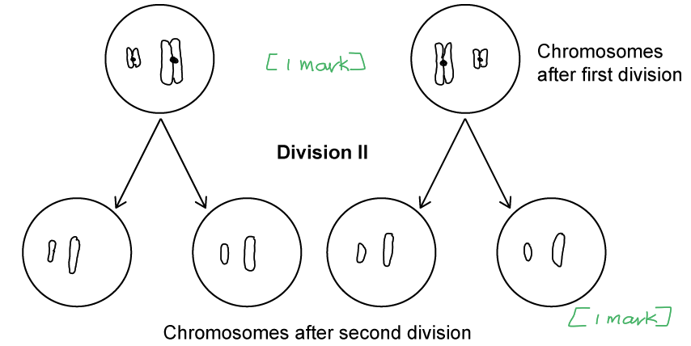
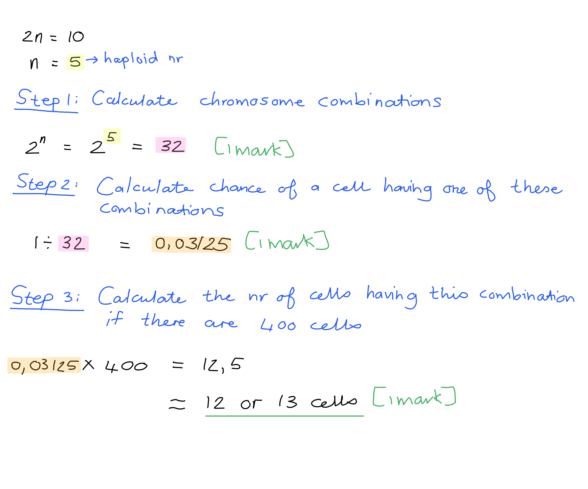
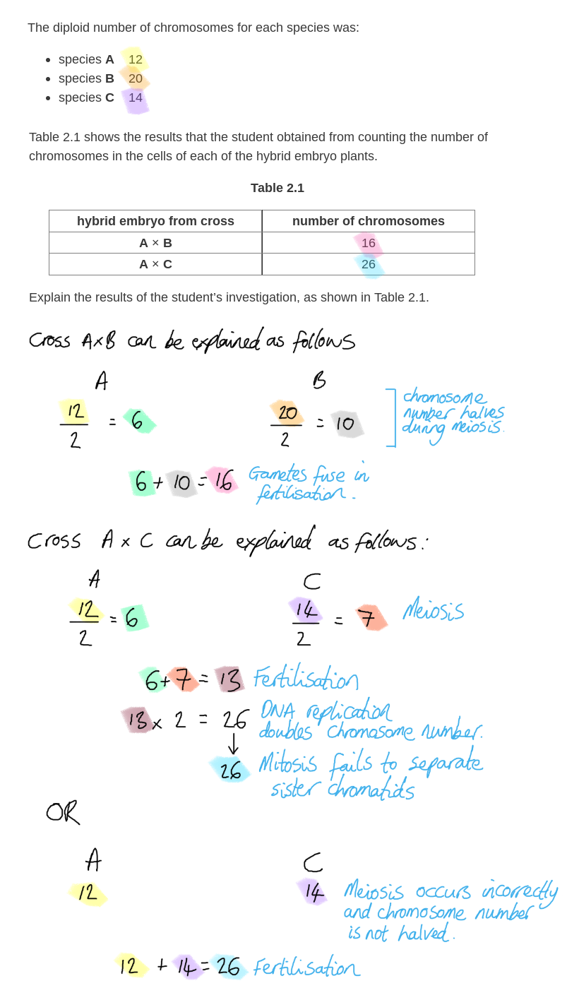
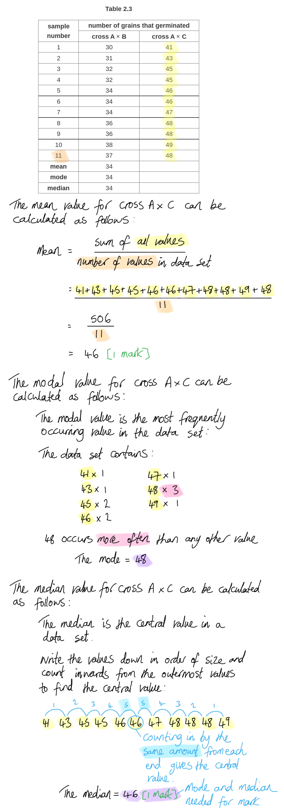
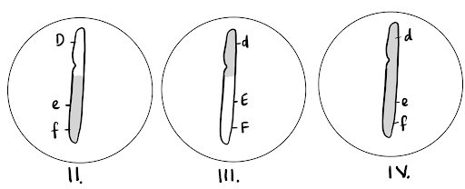
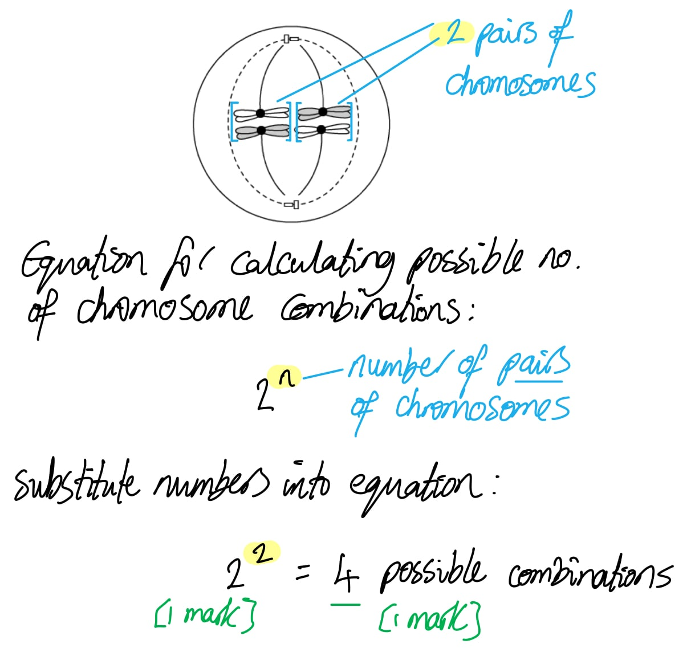
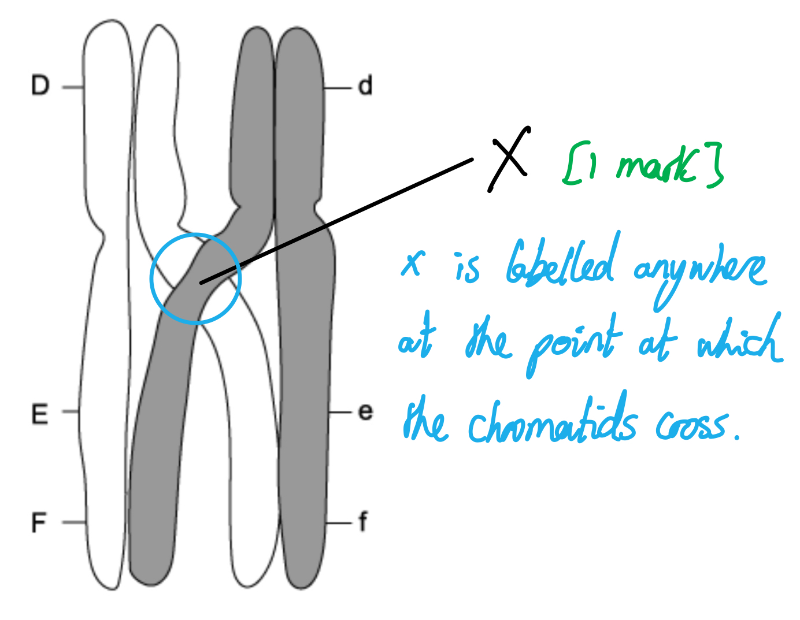
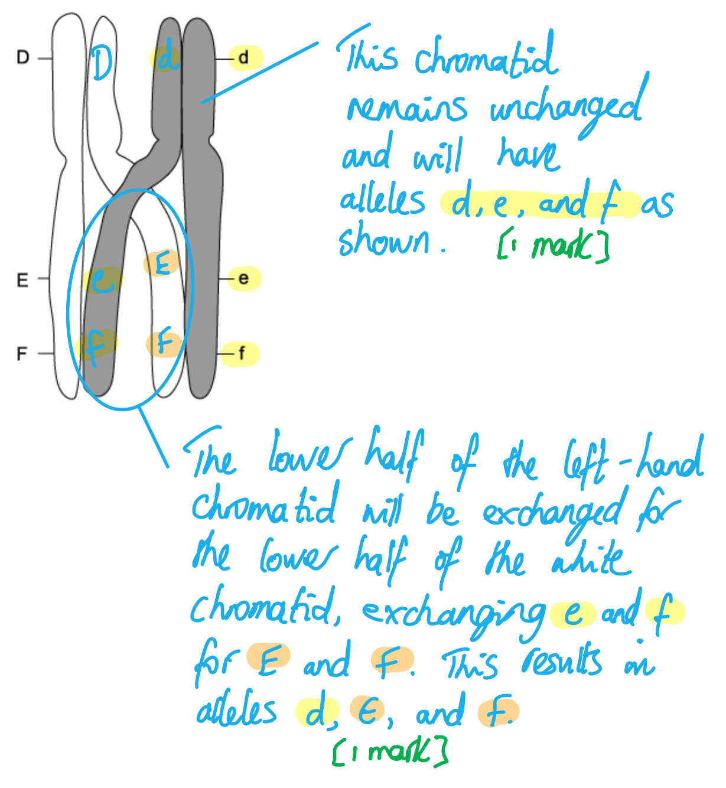
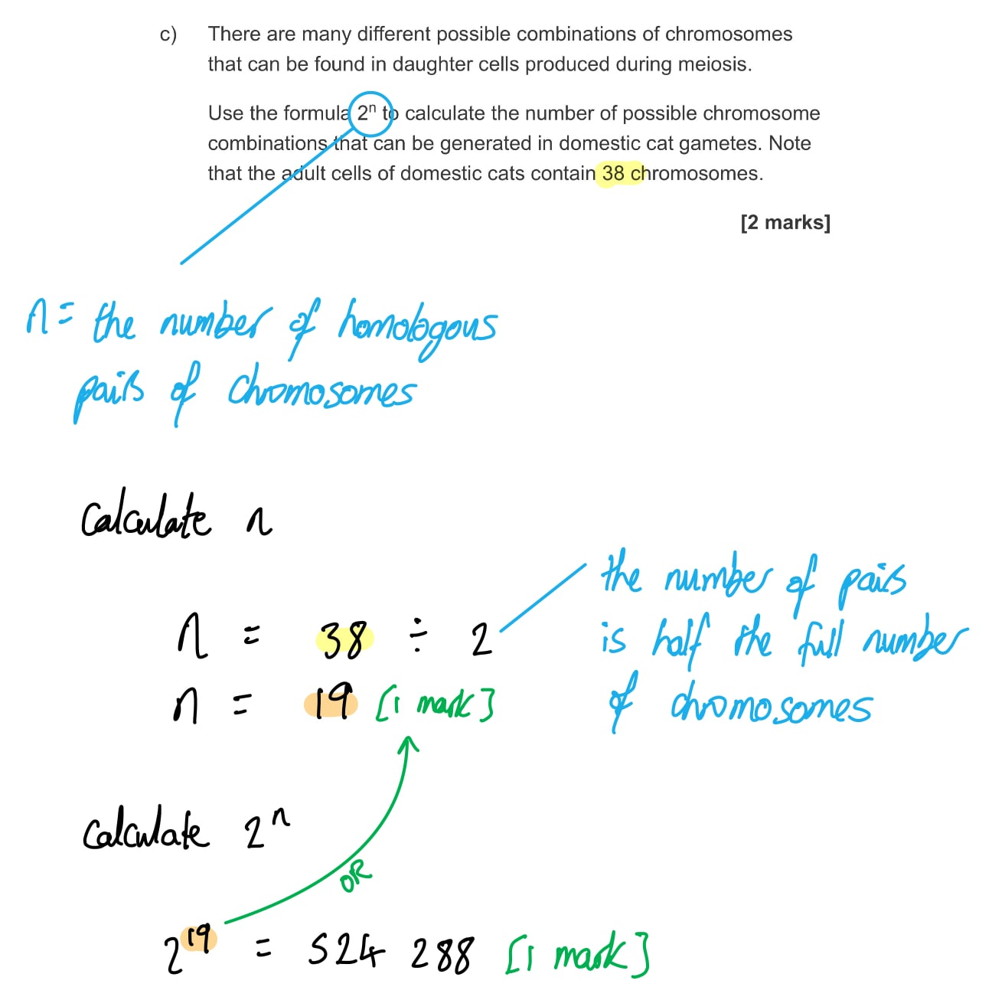
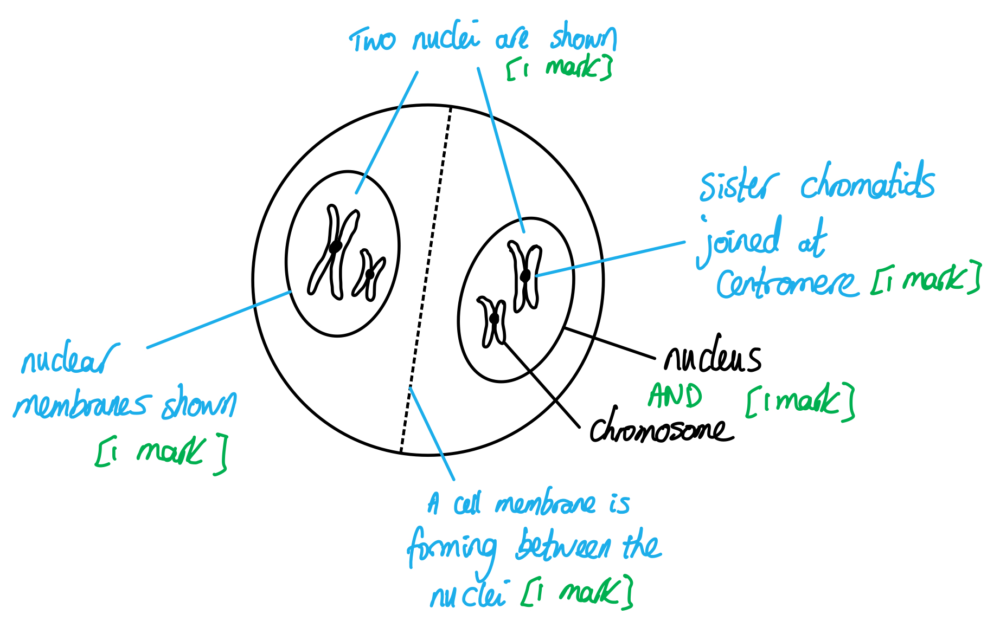

# Mark Schemes — Passage of Information from Parents to Offspring
**16. Inheritance** · Cambridge (CIE) A-LEVEL biology (9700)

## Structured Questions (10 questions)

### Q1
The correct diagram will show...

- (At division I) a pair of homologous chromosomes joined by a centromere; **[1 mark]**
- (At division II) 1 long and 1 short separate chromosome in each cell; **[1 mark]**

**[Total: 2 marks]**

The consequence of the defective form of meiosis is...

- Gametes are not haploid / do not have half the number of chromosomes; **[1 mark]**
- **So **diploid number/diploidy cannot be restored at fertilisation/fusion of gametes/nuclei; **[1 mark]**

**[Total: 2 marks]**
The correct number of chromatids in the parent cell at the start of meiosis is...

- 36; **[1 mark]**

**[Total: 1 mark]**

> *Be careful to read the question carefully here - you are asked for the **chromatid **number, not the chromosome number. The question also asks for the number at the start of meiosis, so DNA replication has already occurred. Remember that a gamete, in this case a pollen cell, has single chromosomes after completing meiosis, not homologous chromosomes. *
The number of cells that would be expected to have an identical arrangement of chromosomes to those shown in Fig. 3...

- 2n = 25 = 32 (different possible chromosome combinations); **[1 mark]**
- 1 ÷ 32 =  0.03 / 0.03125; **[1 mark]**
- 12 cells **OR **13 cells; **[1 mark]**

**[Total: 3 marks]**

> *Remember that the n, in the formular 2**n** corresponds to the number of chromosomes in a **haploid **cell so you first need to halve the number of chromosomes seen in Fig. 3 as you are told these are in the first division of meiosis so these would be diploid. You are given the third marking point for either 12 or 13 whole cells, you cannot get 12.5 cells. *

### Q2
The term homologous pair refers to...

- (Chromosomes with the) same genes in the same positions/loci; **[1 mark]**
- (Chromosomes that) match in size/shape **OR **one member of each pair comes from a different parent/gamete; **[1 mark]**

**[Total: 2 marks]**

> *The most important point to remember about homologous pairs of chromosomes is that they contain the **same genes** in the **same positions** on each chromosome.*
(i) The term mutation refers to...

- A change in the sequence of (DNA) bases/base pairs; **[1 mark]**

(ii) The chromosome mutation that causes Edwards syndrome is...

- Pair 18 has three chromosomes; **[1 mark]**

(iii) This could have happened because...

- A (homologous) pair of chromosomes has not separated (properly/completely); **[1 mark]**
- During (anaphase I of) meiosis; **[1 mark]**

**[Total: 4 marks]**

> *You are not expected to know about chromosome mutations but Fig. 2.1 clearly shows that pair 18 contains 3 chromosomes rather than the expected pair, so it should be a logical conclusion that this is the cause of Edwards syndrome.*

> *Your knowledge of meiosis should tell you that in a normal situation the separation of homologous pairs ensures that every gamete is fully haploid, so a failure to carry out this separation would lead to a gamete with an extra chromosome. When this gamete fuses with another this results in three chromosomes where there should only be two. *
Edwards syndrome affects every cell in the body because...

**Final answer:** **Any ****two**** of the following:**

- The mutation occurred in the gametes/sex cells; **[1 mark]**
- All of the cells of the adult / fully developed individual are produced by <u>mitosis</u> from the fertilised cell; **[1 mark]**
- (Mitosis) produces genetically identical cells / the cell produced (by mitosis) will have the same DNA; **[1 mark]**

**[Total: 2 marks]**

> *Mutations occur in individual cells during DNA replication all the time, but these single cells have little impact on an individual; genetic disorders result when the mutation occurs at the gamete stage. Gametes fuse to form the zygote, which then divides by mitosis to form the rest of the cells in a living organism. Any mutation present in the zygote will therefore be copied every time mitosis occurs, meaning that every cell in the body will contain the original mutation.*
Three sources of variation among living organisms are...

- Crossing over; **[1 mark]**
- Independent assortment/segregation; **[1 mark]**
- Random fusion of gametes / fertilisation; **[1 mark]**

**[Total: 3 marks]**

> *Crossing over and independent assortment occurs during meiosis and creates variation between gametes, while the random fusion of gametes occurs when reproducing sexually and results in variation between zygotes. All of these processes explain why sexual reproduction results in varied offspring.*

### Q3
(i) The** **dependent variable in this investigation is...

- The number of chromosomes in the cells of the embryo; **[1 mark]**

(ii) The variable that was controlled by the use of plastic bags on the flower stalks of species A was...

- The source/species of the pollen (that is transferred) onto the stigma; **[1 mark]**

**[Total: 2 marks]**
The results of the student’s investigation, as shown in Table 1, can be explained as follows...

**Final answer:** **Any ****three**** of the following:**

- Gametes/pollen are produced by <u>meiosis</u>; **[1 mark]**
- In cross A x B = chromosome number (of the gametes) is <u>half</u> of the chromosome number of each parent; **[1 mark]**
- (The chromosome number of the A x B cross results from) <u>fusion</u> of gametes with 6 and with 10 chromosomes; **[1 mark]**
- In cross A x C = chromosome number is <u>double</u>/<u>twice</u> the expected (hybrid) number (which should be 6 + 7 = 13); **[1 mark]**
- (The chromosome number of the A x C cross results from) mitosis (of the zygote/embryo) has not occurred correctly so chromosomes have stayed together in the same cell **OR** meiosis (during gamete formation) has not occurred correctly so chromosomes have stayed together in the same cell; **[1 mark]**

***Accept**** marks shown in the form of an annotated diagram.*

**[Total: 3 marks]**

(i) The number of chromosomes you would expect the student to find in the female gametes of the hybrid grass plants is...

- A x B = a variable number / a number in the range of 0-16 **AND** A x C = 13; **[1 mark]**

(ii) A piece of evidence in Table 2.2 that supports the conclusion that hybrids from cross A × B could not be bred successfully is...

- Gametes/pollen of A x B hybrid do not have a complete/normal-sized set of chromosomes **OR **pollen of A x B hybrid has a variable number of chromosomes **OR** pollen of A x B hybrid would have a <u>different</u> number of chromosomes (to any plant that it might breed with); **[1 mark]**

**[Total: 2 marks]**

> *i) The process of meiosis relies on having a set of chromosomes that can reliably pair up in homologous pairs before being separated during meiosis I. If male gametes of A x B hybrid plants have random numbers of chromosomes then it logically follows that whatever meiosis-related problem is causing this will also affect the formation of female gametes (in plants one individual plant can produce both male and female gametes so the parent cells from which the gametes are being produced will be genetically identical). This means that the female gametes will show the same random variation in chromosome number as the male gametes.*

> *Similarly, meiosis seems to be functioning exactly as would be expected in the A x C cross; the chromosome number of the male gametes is half that of the parents. We would therefore also expect this to be the case in the female gametes.*

> *ii) The variable chromosome number of the gametes produced in the A x B hybrids means that the breeding success from these plants would be highly unpredictable. While some gametes may contain a chromosome number that could fuse with the gamete of another plant, many of them do not, and might lead to unviable zygotes or to infertile offspring. The unpredictability of this makes the A x B hybrid a poor candidate for further breeding.*
(i) The mean, mode and median for the results from cross A × C are...

- Mean = 46; **[1 mark]**
- Mode = 48 **AND** median = 46; **[1 mark]**

(ii) A feature of the data that allows use of the* t*-test is...

**Final answer:** **Any ****one**** of the following:**

- The data are continuous **OR** the data has a normal distribution; **[1 mark]**
- Standard deviations of the data sets are similar; **[1 mark]**
- The sample sizes are below 30; **[1 mark]**

(iii) A null hypothesis for this *t*-test could be that...

- There is no (significant) difference in the percentage germination of grains from A x B and A x C; **[1 mark]**

(iv) The number of degrees of freedom for this *t*-test is 20 because...

- This is the total number of samples -2 **OR** (11+11) -2 = 20 / (11-1) + (11-1) = 20 / 22-2 = 20; **[1 mark]**

**[Total: 5 marks]**

> *i) The mean, median and mode can be calculated as follows...*

> *ii) There are set rules around the appropriate selection of statistical tests. The **t**-test can be used to test whether or not the difference between two data sets is statistically significant when the following conditions are met:*

- *Continuous data have been collected; here the data consist of numerical values rather than distinct categories, so this is continuous data.*
- *The data are normally distributed; this can be seen here in the similarity of the mean, median, and modal values.*
- *There are fewer than 30 values in each sample; here the samples contain 11 values.*
- *Standard deviations are approximately the same; this hasn't been calculated here, but the data are distributed around the mean in a similar way for both data sets so it is likely that the standard deviations are relatively similar.*

> *iii) A hypothesis is a testable statement relating to an outcome of an experiment. A null hypothesis, or H**0**, always states that **no statistically significant association or difference exists **in a data set; in this case that means that the null hypothesis would state that there would be **no difference** between the samples.*

> *iv) Degrees of freedom for a **t**-test can be calculated using the formula*

> *degrees of freedom = (**n**1** + **n**2**) - 2*

> *Where **n** = the sample size*

> *Each sample here contains 11 values, so:*

> * degrees of freedom = (11 + 11) - 2*

> *= 22 - 2*

> *= 20*

### Q4
The stages of meiosis shown in Fig.1 are...

- **A** = metaphase II; **[1 mark]**
- **B** = anaphase II; **[1 mark]**
- **C** = prophase II; **[1 mark]**
- **D** = telophase II; **[1 mark]**

**[Total: 4 marks]**

> *If the cells were in meiosis I there would only be one cell present for prophase, metaphase, and anaphase and there would be two cells present in telophase.*
The process (crossing over) shown in Fig. 2 involves...

**Final answer:** **Any ****two**** of the following:**

- Homologous chromosomes pair up / are very close together; **[1 mark]**
- Sections of the chromosomes/non-sister chromatids overlap/cross over/become entangled; **[1 mark]**
- Stress is placed on the DNA at the crossing points/chiasmata; **[1 mark]**
- The DNA breaks and rejoins / sections of DNA are exchanged / the positions of the alleles are switched; **[1 mark]**

**[Total: 2 marks]**
The chromosomes would have the following allele combinations...

- **II** = short arm of chromosome - D **AND** long arm of chromosome - e and f; **[1 mark]**
- **III** = short arm of chromosome - d **AND** long arm of chromosome - E and F; **[1 mark]**
- **IV** = short arm of chromosome - d **AND** long arm of chromosome - e and f; **[1 mark]**

**[Total: 3 marks]**

> *It is important to ensure that the letters representing the genes are appropriately located on the chromosome (that is, the D/d gene is on the short arm and E/e & F/f are on the long arm). Note that no marks are awarded for the shading of the chromosomes as the question asks only for the allele combinations.*

Genetic variation is important for the survival of *D. melanogaster* as a species because...

**Final answer:** **Any ****two**** of the following:**

- Different individuals will have different phenotypes / different phenotypes will exist within a population; **[1 mark]**
- Some individuals will survive if the environment changes / a new selection pressure arises; **[1 mark]**
- Natural selection can act on their population/species / the population/species will be able to evolve/adapt by natural selection; **[1 mark]**

**[Total: 2 marks]**

> *Genetic variation is the essential starting point for natural selection, as genetic variation gives rise to phenotypic variation. A species with little or no phenotypic variation will be unable to evolve by natural selection (as there will be no individuals with advantageous characteristics) so if their environment changes the species will be at risk of extinction. *

### Q5
The behaviour of chromosomes during meiosis involves...

**Final answer:** **Any ****eight**** of the following:**

*Meiosis I*

- Chromosomes condense; **[1 mark]**
- Homologous chromosomes pair up / bivalents form; **[1 mark]**
- Crossing over occurs / chiasmata form; **[1 mark]**
- Spindle fibres/microtubules attach to centromeres; **[1 mark]**
- Bivalents/pairs line up on equator of cell; **[1 mark]**
- Independent assortment (of homologous pairs); **[1 mark]**
- Chromosomes are pulled to opposite poles; **[1 mark]**
- Chromosome number is halved / cell becomes haploid; **[1 mark]**

*Meiosis II*

- (Individual) chromosomes line up on equator; **[1 mark]**
- Chromosomes line up at right-angles to the equator from meiosis I; **[1 mark]**
- Centromeres break/divide; **[1 mark]**
- (Sister) chromatids separate; **[1 mark]**

***Accept ****general statements such as "meiosis halves the chromosome number / produces haploid cells" without the specific context of meiosis I for marking point 8. *

***Reject**** statements that suggest that the halving of the chromosome number occurs specifically during meiosis II.*

**[Total: 8 marks]**

> *This question refers specifically to the **behaviour of chromosomes**, so descriptions of other cell components such as nuclear membranes and centrioles will not be credited.*

> *Make sure that you are confident at distinguishing between **bivalents**, **single chromosomes**, and **chromatids**:*

- *Bivalent = a homologous **pair** of chromosomes*
- *Chromosome = a **single** chromosome. Until anaphase of meiosis II this will consist of **two sister chromatids** joined at the centromere and will have an 'X-shaped' appearance.*
- *Chromatid = one of the two identical halves of a chromosome formed during DNA replication in preparation for cell division. Joined chromatids are referred to as 'sister chromatids' or 'a chromosome'. As soon as the sister chromatids are separated during meiosis II they become chromosomes in their own right.*

> *Note that cells** become haploid** at the end of **meiosis I** when the **bivalents** are separated. At the end of meiosis II the **amount of DNA **in the cell halves when the chromatids are separated but the ploidy of the cell does not change. It is still correct to say that 'meiosis produces haploid cells', but not to say that 'meiosis II halves the chromosome number'.*

### Q6
(i) The type of cell division shown in Fig.1 is...

- Meiosis; **[1 mark]**

(ii) The events taking place include...

- The homologous pairs / bivalents line up along the middle/equator of the cell; **[1 mark]**
- Spindle fibres/microtubules attach to centromeres; **[1 mark]**

**[Total: 3 marks]**

> *Mitosis does not involve the lining up of homologous pairs of chromosomes, so this identifies the cell division in Fig. 1 as meiosis.*

> *Fig. 1 shows metaphase (I), so shows the lining up of homologous pairs and their attachment to the spindle in preparation for anaphase.*
The process shown in Fig. 1 contributes to genetic variation by...

**Final answer:** **Any ****two**** of the following:**

- Independent assortment/segregation occurs; **[1 mark]**
- Chromosomes randomly align / line up independently of each other; **[1 mark]**
- The way in which the chromosomes align/line up determines which chromosome ends up in which daughter cell; **[1 mark]**

**[Total: 2 marks]**
The number of possible chromosome combinations that could be generated by the cell shown in Fig.1 is...

- 22; **[1 mark]**
- 4; **[1 mark]**

*Full marks can be awarded for the correct answer in the absence of other calculations.*

**[Total: 2 marks]**

(i) The stage of cell division shown in Fig. 2 is...

- Anaphase I; **[1 mark]**

(ii) The reasons for this include...

It is anaphase because...

**Final answer:** **Any ****one**** of the following:**

- Chromosomes are being pulled apart to the poles of the cell; **[1 mark]**
- Spindle/microtubule fibres are shortening; [1 mark]

It is the first division of meiosis because...

- The <u>homologous pairs</u> are separating (as opposed to the sister chromatids, as would be the case in meiosis II or mitosis); **[1 mark]**

**[Total: 3 marks]**

> *For the first mark here you need to identify the stage of meiosis as well as which division is taking place.*

> *The chromosomes are pulled apart as the spindle fibres shorten in anaphase, and in the first division of meiosis it is the pairs of chromosomes that are separated. During the second division of meiosis or during mitosis the sister chromatids are separated when the centromere breaks.*

### Q7
The term *n* indicates that...

**Final answer:** **Any ****two**** of the following:**

- Cells (at this stage of the life cycle) are haploid; **[1 mark]**
- The cells have half the normal number of chromosomes; **[1 mark]**
- The cells have undergone meiosis; **[1 mark]**

**[Total: 2 marks]**

> *The term 'gamete' has been used in Fig. 1 so there are no marks available for identifying the **n** cells as gametes.*
The processes taking place at the stages marked **A** and **B** are...

- **A** = meiosis; **[1 mark]**
- **B** = mitosis; **[1 mark]**

**[Total: 2 marks]**** **

> *Stage** A** shows a transition between a **2n** stage and an **n** stage, showing a halving of the chromosome number; this must therefore be meiosis.*

> *Stage **B** shows a transition between a **2n** stage and another **2n** stage; the chromosome number is the same but more cells are present, so this must be mitosis.*
The events taking place at stage **C** involve...

**Final answer:** **Any ****one**** of the following:**

- Fertilisation; **[1 mark]**
- The fusion of two (gamete) <u>nuclei</u>; **[1 mark]**

**[Total: 1 mark]**
The importance of the process taking place at **A** (meiosis) is...

- It results in haploid cells / cells with half the number of chromosomes (compared to a body/somatic cell) / **OR** it is reduction division; **[1 mark]**
- It ensures that fertilisation results in / zygotes are diploid cells **OR** it ensures that zygotes are viable / have the correct number of chromosomes **OR** it prevents a doubling of the chromosome number with each generation; **[1 mark]**
- It generates genetic variation / genetically different gametes; **[1 mark]**

**[Total: 3 marks]**

### Q8
The process taking place at **X** is...

- DNA replication; **[1 mark]**

**[Total: 1 mark]**

> *Before any kind of cell division takes place, first the DNA (and other cell organelles) need to be replicated. This take place during interphase in both mitosis and meiosis.*
The events that take place in order for this change at **Y** to occur include...

- The centromere breaks/divides; **[1 mark]**
- The (sister) chromatids are separated / move to opposite ends/poles of the cell;** [1 mark]**

**[Total: 2 marks]**
The events during crossing over include...

**Final answer:** **Any ****two**** of the following:**

- Homologous chromosomes pair up / form bivalents / synapsis occurs; **[1 mark]**
- Crossing over occurs / a junction forms between a chromatid of one chromosome and a chromatid of the other chromosome / between non-sister chromatids (within a bivalent); **[1 mark]**
- Part / a section of one (sister) chromatid breaks and rejoins with the other; **[1 mark]**
- Genes are exchanged; **[1 mark]**

**[Total: 2 marks]**
One other process that generates genetic variation during sexual reproduction is...

**Final answer:** **Any ****one**** of the following:**

- Random orientation / independent assortment (of chromosomes); **[1 mark]**
- Random fertilisation / fusion of gametes; **[1 mark]**

**[Total: 1 mark]**

> *The way in which chromosomes randomly orient themselves when they line up during meiosis I means that they are allocated at random when the homologous pairs are separated; this means that there are many different possible combinations of chromosomes that can be inherited in a single gamete. *

> *There is also an element of randomness in the gametes that eventually fuse together during fertilisation, so there are many different combinations of chromosomes that can come together in the zygote.*

> *Both of these sources of variation explain why so much variation can exist between siblings with the same parents.*

### Q9
(i) The stage of meiosis is...

- Anaphase / Anaphase I / Anaphase II; **[1 mark]**

(ii) The behaviour of the chromosomes is...

- They are moving away from the equator **OR **they are being pulled to the poles (by microtubules); **[1 mark]**

**[Total: 2 marks]**

> *It is unclear from the image whether anaphase I or II is occurring so you would be credited for either answer.*
(i) Structures **X** and **Y** are...

- **X** = centromere; **[1 mark]**
- **Y** = (sister) chromatid; **[1 mark]**

(ii) Structures **Y** and **Z** are identical because...

**Final answer:** **Any ****one**** of the following:**

- They were produced by DNA replication; **[1 mark]**
- One (DNA) strand was used as a template to produce a new strand / the (DNA) sequence of the new strand was determined by the sequence of the original/template strand; **[1 mark]**

**[Total: 3 marks]**
Homologous chromosomes can be defined as...

**Final answer:** **Any ****two**** of the following:**

- Chromosomes that carry the same genes at the same loci/position /  have the same sequence of genes; **[1 mark]**
- Chromosomes that have the same genes **BUT** that may have different alleles/version of those genes; **[1 mark]**
- One member of each pair comes from each parent; **[1 mark]**
- Chromosomes that are the same shape;** [1 mark]**

**[Total: 2 marks]**
The stage of meiosis during which the homologous chromosomes are separated is...

- Meiosis I / anaphase I; **[1 mark]**

**[Total: 1 mark]**

> *You must be specific in your answer here, it would not be enough to simply state 'meiosis' or 'anaphase'. Remember that the homologous pairs of chromosomes will separate during anaphase I, while individual chromatids will be pulled to opposite poles during anaphase II.*

### Q10
(i) The process taking place in the image is...

- Crossing over; **[1 mark]**

(ii) The image should be labelled with an **X** to show chiasmata as follows...

- An **X** indicating the point at which the white and grey chromatids cross each other; **[1 mark]**

**[Total: 2 marks]**

The alleles that will be present on each of the grey shaded chromatids at the end of the process shown in part (a) will be...

- d, e, f; **[1 mark]**
- d, E, F;** [1 mark]**

**[Total: 2 marks]**

> *The chromatid that does not cross over will retain the same combination of alleles that is written on the diagram; d, e, and f.*

> *The process of crossing over means that the chromatid that crosses with the white non-sister chromatid will receive a new combination of alleles in the section that is broken and rejoined. The diagram shows that the white chromatid will have the alleles E and F along this section, so the new combination of alleles on the grey chromatid will be d (this top section remains unchanged), E, and F.*

The number of possible chromosome combinations that can be generated in domestic cat gametes is...

- *n* = 19 / 219; **[1 mark]**
- 524 288; **[1 mark]**

**[Total: 2 marks]**

A cell in telophase I should have the following features...

**Final answer:** **Any ****three**** of the following:**

- Nucleus/nuclei / nuclear membrane **AND** chromosomes / sister chromatids are labelled; **[1 mark]**
- Consists of two cells / has two nuclei **AND** each cell/nucleus has the same number of chromosomes in it; **[1 mark]**
- Chromosomes are represented as sister chromatids joined at the centromere;** [1 mark]**
- A nuclear membrane is visible (around each nucleus); **[1 mark]**
- Indication that cytokinesis is taking place / a cell membrane forming between the two cells/nuclei; **[1 mark]**

***Accept ****any number of chromosomes provided that the two cells have the same number.*

*Chromatids and centromere do not need to be labelled for the third mark point (just clearly visible) and chromosomes can be represented as an 'X' shape drawn with single lines.*

**[Total: 3 marks]**

